# КОНСПЕКТ ЛЕКЦІЇ: Сучасні генеративні моделі

---

## ЗАПОВНЕНО ДЛЯ ЦІЄЇ ЛЕКЦІЇ

- **Тема лекції:** Сучасні генеративні моделі
- **Основні алгоритми / концепції:** Diffusion, авторегресивні моделі, Decoder-only Transformer, U-Net, DiT, Mamba, мультимодальність, оркестрація агентів
- **Кінцева задача:** генерація та оркестрація multimodal AI-систем; метрика: якість (візуальна/семантична), latency, вартість, керованість

---

## ЧАСТИНА 0. КОРОТКИЙ ОГЛЯД ТЕМИ

### Що ми будемо робити?

- зафіксуємо історичну траєкторію розвитку генеративних моделей: від GAN до агентних систем
- розберемося, чому ринок змістився від "тренуй модель з нуля" до "інтегруй, оркеструй, адаптуй"
- чітко відокремимо генеративні та дискримінативні підходи на практичних прикладах
- зрозуміємо, що таке мультимодальність і коли краще працює оркестрація вузьких моделей
- відділимо два ключові процеси: **inference** (використання) та **pre-training** (створення моделі)
- розкладемо diffusion pipeline на кроки: prompt encoding, noise schedule, denoising, decoding
- порівняємо U-Net, DiT і гібридні архітектури через компроміс "якість vs обчислення"
- розглянемо авторегресивну генерацію токен за токеном і домінування decoder-only LLM
- порівняємо Transformer і Mamba в термінах O(n²) vs O(n), контексту й точності
- пояснимо, чому LLM стали ядром агентних систем: текст як протокол, композиційність, метакогніція

### Розшифровка нових скорочень

| Символ / Скорочення | Повна назва | Простими словами | Навіщо |
| --- | --- | --- | --- |
| `ASR` | Automatic Speech Recognition | розпізнавання мовлення | технічна реалізація STT |
| `CFG` | Classifier-Free Guidance | сила прив'язки до промпту | контроль балансу "креативність vs точність до тексту" |
| `DiT` | Diffusion Transformer | трансформер у дифузії | кращий глобальний контекст у генерації зображень/відео |
| `FM` | Foundation Model | велика базова модель | універсальний "двигун", який далі адаптують |
| `GAN` | Generative Adversarial Network | генератор + критик | ранній прорив у фотореалістичній генерації |
| `GPT` | Generative Pre-trained Transformer | генеративний попередньо навчений трансформер | базова архітектурна лінійка сучасних LLM |
| `LLM` | Large Language Model | велика мовна модель | основа сучасних чатів, агентів і tool use |
| `MoE` | Mixture of Experts | суміш експертів | масштабування моделі ефективніше за суцільне збільшення |
| `O(n)` | Лінійна складність | витрати ростуть пропорційно | сильна сторона Mamba-подібних моделей |
| `O(n²)` | Квадратична складність | дуже швидко ростуть витрати | ключове обмеження self-attention |
| `RAG` | Retrieval-Augmented Generation | генерація з підсиленням пошуком | додає зовнішні джерела знань у відповідь моделі |
| `STT` | Speech-to-Text | мовлення в текст | вхідний канал для голосових асистентів |
| `TTS` | Text-to-Speech | текст у мовлення | голосова відповідь системи |
| `VAE` | Variational Autoencoder | варіаційний автоенкодер | стискає дані в latent space і відтворює нові схожі приклади |
| `VLM` | Vision-Language Model | модель зору+тексту | обробка зображень разом із текстовими інструкціями |
| `η` | Learning Rate | крок оновлення ваг | керує швидкістю навчання |
| `σ` | Sigma (стандартне відхилення) | рівень шуму | важливий параметр в дифузії |
| `θ` | Параметри моделі | "ваги" мережі | саме їх оптимізуємо під час навчання |

---

## ЧАСТИНА 1. ЕТАПИ РОЗВИТКУ Й СУЧАСНІ ПОТРЕБИ РИНКУ

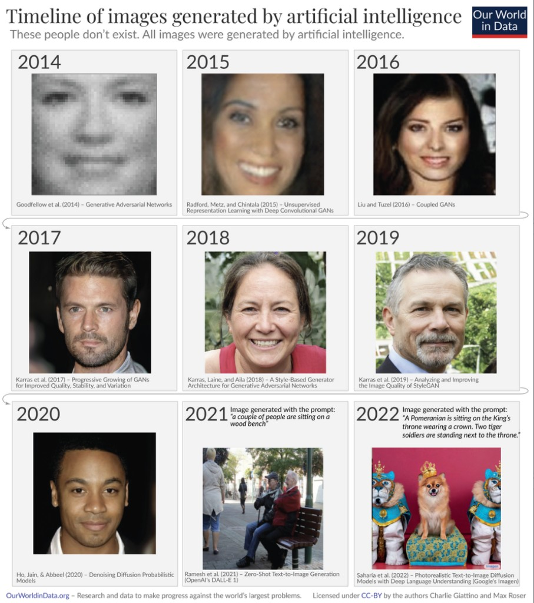

### Ідея:
Генеративний ШІ розвивався хвилями: від архітектурних проривів до інженерних екосистем, де цінність дає не одна "супермодель", а поєднання моделей, інструментів і процесів.

Коротка еволюційна шкала:

1. **VAE / автоенкодери** — "стисни й відтвори", початок керованої генерації через latent space  
2. **GAN (2014+)** — різкі, реалістичні картинки, але нестабільне навчання  
3. **Transformers (2017+)** — універсальний механізм контексту  
4. **GPT-3 (2020)** — масштабована мовна генерація  
5. **Diffusion (2020–2021)** — висока якість зображень через поетапний denoising  
6. **ChatGPT/GPT-4 (2022–2023)** — інструкційність і діалоговість  
7. **Multimodal models (2023–2024)** — один інтерфейс для тексту, зображення, аудіо, відео  
8. **Agent frameworks (2024+)** — перехід від "відповідей" до "виконання задач"

> 💡 **Порада:** у професійній практиці важливіше вміти обирати правильну архітектуру під задачу, ніж знати "наймоднішу" модель.

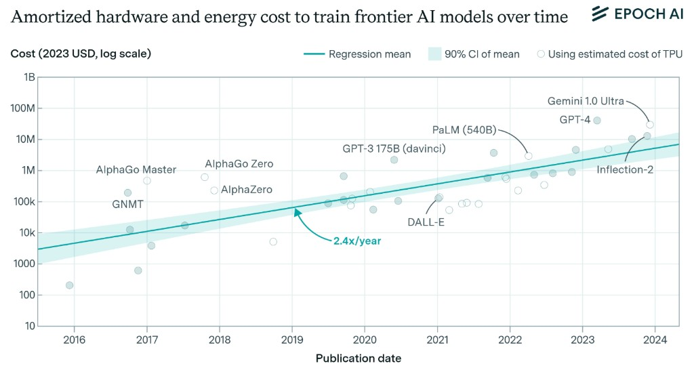

### Чому ринок змінив правила гри

### Ідея:
Тренування великої foundation-моделі — це капіталомісткий процес, тому більшість компаній змагаються не в "pre-train з нуля", а в інтеграції та продуктній інженерії.

- тренування frontier-рівня може коштувати десятки мільйонів доларів
- вартість зростає через compute, дані, інфраструктуру, енергію та безпеку
- бізнесу потрібні фахівці, які швидко збирають прикладні рішення з готових компонентів

**Definition (практично):**  
**Foundation model** — велика універсальна модель, попередньо навчена на масивному корпусі даних і придатна до широкого спектра downstream-задач.

> ⚠️ **Застереження:** "велика модель" не дорівнює "краща модель для вашого продукту". Часто перемагає архітектурно простіший і дешевший pipeline.

### Де реально конкурувати командам без бюджету BigTech

| Напрям | Що робимо | Типовий бюджет | Практичний результат |
| --- | --- | --- | --- |
| Контекст-інжиніринг | Проєктуємо системні/рольові інструкції, memory policy, tool-use шаблони | низький | стабільніша якість без перенавчання |
| Fine-tuning | Донавчаємо модель під домен/мову | низький-середній | краща релевантність у вузькій задачі |
| Оркестрація | Поєднуємо STT, LLM, RAG, TTS, Image Gen | середній | end-to-end продукт замість окремих демо |

---

## ЧАСТИНА 2. ОСНОВНІ ПОНЯТТЯ: ГЕНЕРАТИВНІ МОДЕЛІ, МОДАЛЬНІСТЬ, ОРКЕСТРАЦІЯ

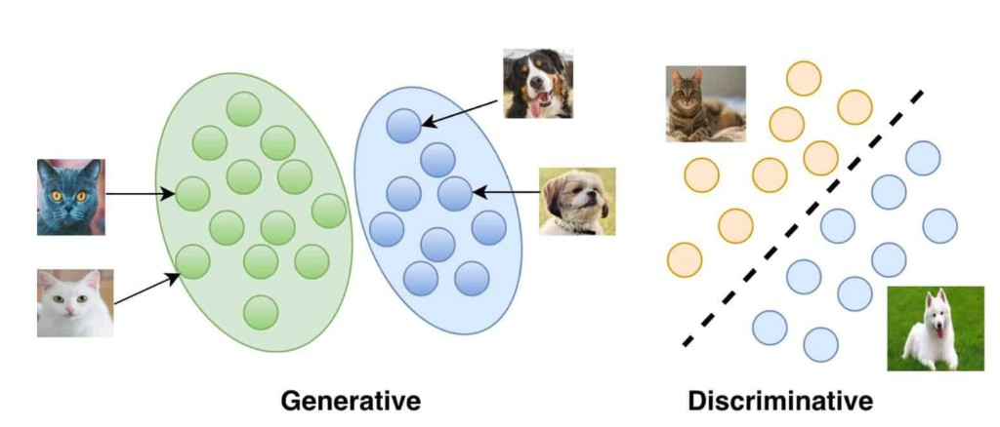

### Генеративні vs дискримінативні

### Ідея:
Генеративні моделі відповідають на питання "як **створити** новий приклад?", а дискримінативні — "до якого **класу** належить наявний приклад?".

| | Генеративний підхід | Дискримінативний підхід |
| --- | --- | --- |
| Головне питання | Як виглядає розподіл даних P(x)? | Яка мітка y для x? |
| Типова задача | створення тексту/зображень | класифікація, детекція |
| Вихід | новий контент | мітка / ймовірність класу |
| Приклади | Diffusion, LLM, VAE | Logistic Regression, SVM, BERT-classifier |

**Чому X, а не Y?**  
Якщо вам потрібно **згенерувати** відповідь, дизайн або код — беремо генеративний підхід. Якщо потрібно **оцінити** ризик/клас/ймовірність — дискримінативний компонент зазвичай надійніший і дешевший.

### "Чорна скринька" як робоча модель мислення

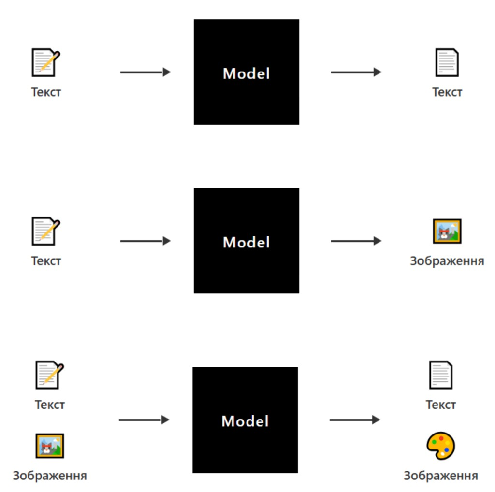

### Ідея:
Для продуктної інженерії достатньо розуміти **поведінку на вході/виході** та обмеження моделі, навіть якщо внутрішні мільярди параметрів непрозорі.

Важливо знати:

- на чому модель навчалась
- який у неї контекст і формат вхідних даних
- де вона схильна до помилок (галюцинації, bias, нестабільність)

> 💡 **Порада:** в агентних системах ефективніше робити надійні guardrails навколо моделі, ніж "вгадувати" її внутрішню логіку.

### Унімодальність і мультимодальність

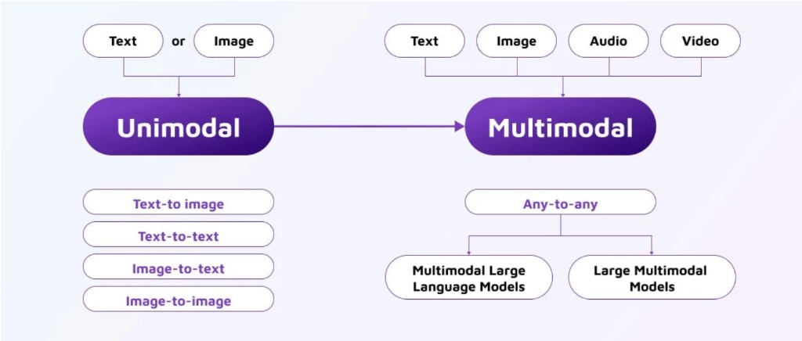

### Ідея:
Мультимодальність зближує UX із природною людською комунікацією, але збільшує вартість і складність підтримки.

| | Унімодальна система | Мультимодальна система |
| --- | --- | --- |
| Вхід/вихід | один тип даних | кілька типів одночасно |
| Вартість | нижча | вища |
| Гнучкість | обмежена | висока |
| Якість у вузькій задачі | часто вища | інколи нижча за спеціалізовану |

> ⚠️ **Застереження:** мультимодальна модель не завжди вигідніша за оркестрацію 2–4 вузьких моделей.

### Оркестрація: коли "система важливіша за модель"

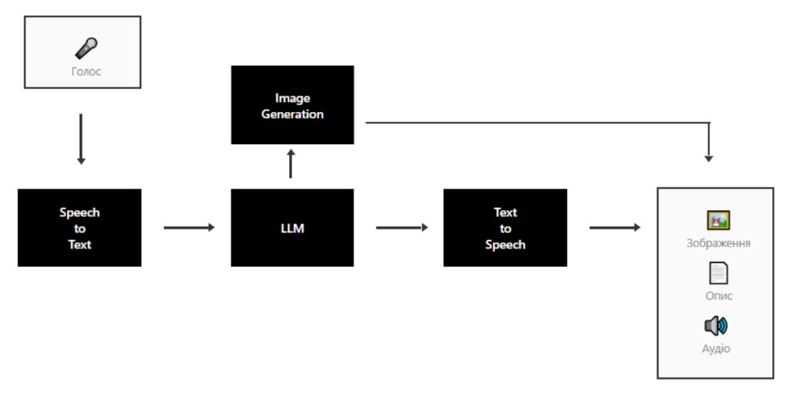

### Ідея:
Оркестрація — це керування взаємодією кількох моделей/сервісів як єдиним процесом із чіткою метою.

Базовий ланцюг:

`STT → LLM (план) → tools/API → TTS/ImageGen → валідація → відповідь`

**Чому X, а не Y?**  
Одна "мега-модель" може бути зручною, але оркестрація дає:

- заміну окремого компонента без повного redesign
- контроль latency на кожній ланці
- кращу керованість відмов і fallback-механізми

### Приклад із голосових режимів OpenAI

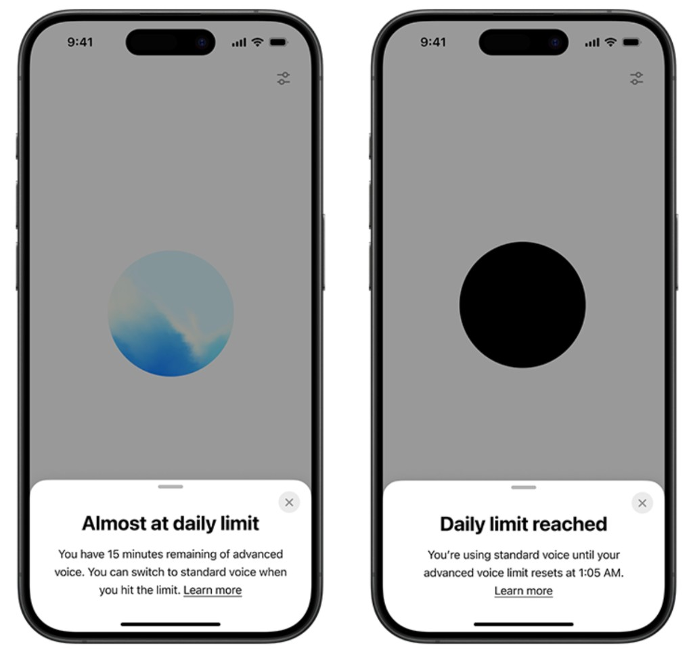

### Ідея:
Реальний продукт завжди має операційні обмеження: ліміти, деградацію режимів, політики безпеки й бюджетні пороги.

---

## ЧАСТИНА 3. ІНФЕРЕНС ТА НАВЧАННЯ ГЕНЕРАТИВНИХ МОДЕЛЕЙ

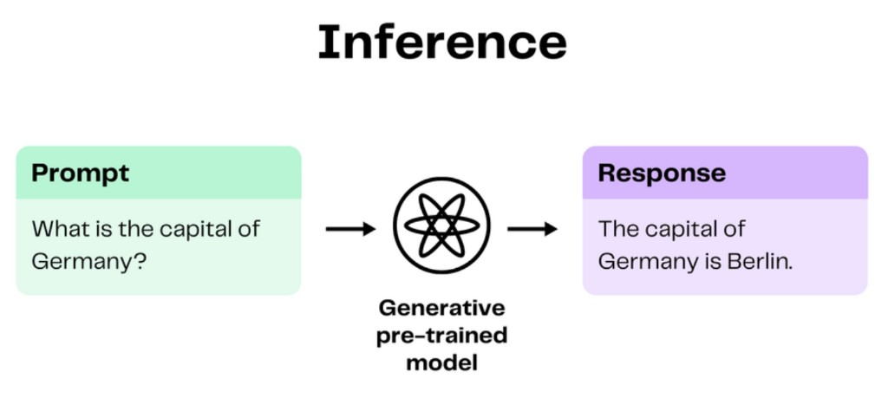

### Ідея:
**Inference** — це використання вже навченої моделі: даємо промпт, отримуємо результат.

Формально для авторегресивного LLM:

$$
P(x_{1:T}) = \prod_{t=1}^{T} P(x_t \mid x_{<t})
$$

| Символ | Що означає | Простими словами |
| --- | --- | --- |
| `x₁:T` | послідовність токенів | весь текст відповіді |
| `x_t` | токен на позиції t | черговий фрагмент відповіді |
| `x_<t` | попередні токени | контекст, який модель уже згенерувала |
| `Π` | добуток | послідовне множення ймовірностей |

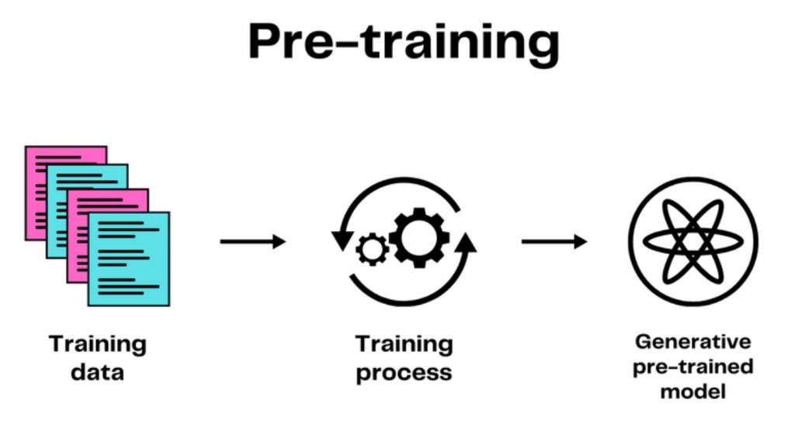

### Ідея:
**Pre-training** — етап, коли модель вчиться статистичній структурі даних у великому масштабі.

Класичний цикл:

1. беремо батч даних
2. робимо forward pass
3. рахуємо loss
4. backpropagation
5. оновлюємо параметри θ

$$
\theta_{new} = \theta_{old} - \eta \cdot \frac{\partial L}{\partial \theta}
$$

| Символ | Що означає | Простими словами |
| --- | --- | --- |
| `θ` | параметри моделі | "пам'ять" мережі |
| `η` | learning rate | розмір кроку оновлення |
| `L` | loss-функція | наскільки помилилась модель |
| `∂L/∂θ` | градієнт | куди і наскільки рухати параметри |

> 💡 **Порада:** pre-training дає "загальний інтелектуальний фундамент", а fine-tuning/інструкції перетворюють його на конкретний інструмент.

---

## ЧАСТИНА 4. СУЧАСНІ ГЕНЕРАТИВНІ МОДЕЛІ: ДИФУЗІЙНИЙ ПІДХІД

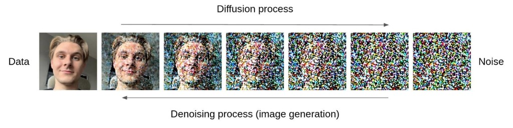

### Що таке дифузійна модель

### Ідея:
Diffusion-модель вчиться крок за кроком видаляти шум, відновлюючи структуру зображення.

Інтуїція: людині простіше **домалювати майже готову картину**, ніж створити її з нуля.  
У дифузії аналогічно: велика задача "створити зображення" розбивається на послідовність малих кроків денойзингу.

Прямий процес (noising):

$$
x_t = \sqrt{\alpha_t}\,x_{t-1} + \sqrt{1-\alpha_t}\,\epsilon,\quad \epsilon \sim \mathcal{N}(0,1)
$$

Зворотний процес (denoising):

$$
p_\theta(x_{t-1}\mid x_t, c)
$$

| Символ | Що означає | Простими словами |
| --- | --- | --- |
| `x_t` | стан на кроці t | частково зашумлене зображення |
| `α_t` | коефіцієнт scheduler-а | скільки сигналу зберігаємо |
| `ε` | випадковий шум | те, що додаємо/передбачаємо |
| `c` | conditioning | текстовий промпт або інші умови |
| `p_θ` | модель денойзингу | "як повернути крок назад" |

### Етап pre-training у latent space

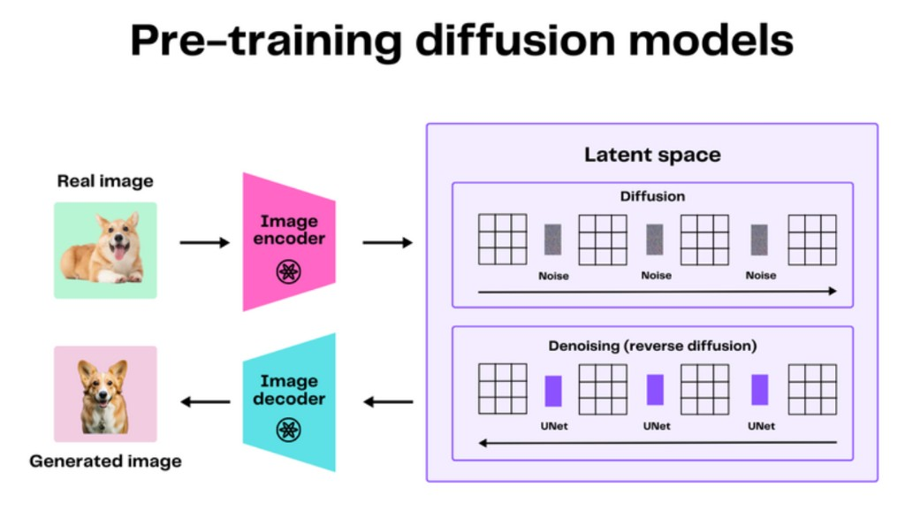

### Ідея:
Щоб зробити навчання дешевшим, сучасні diffusion-моделі працюють не в пікселях, а в стислому latent space.

Компоненти:

1. **Image Encoder** стискає зображення у латентний вектор
2. **Diffusion** додає шум за розкладом
3. **U-Net / DiT** вчиться передбачати шум
4. **Image Decoder** перетворює очищений latent назад у картинку

Модель фактично вчиться на парах:  
**"зашумлене представлення → який шум було додано"**,  
а після навчання здатна стартувати з випадкового шуму і поступово відновлювати структуру.

### Inference-пайплайн text-to-image

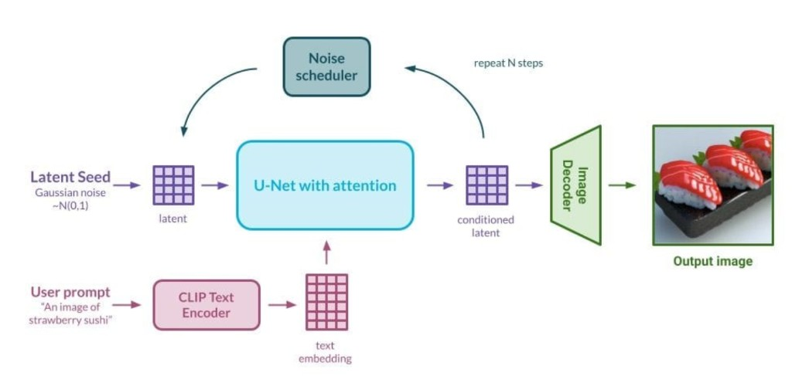

### Ідея:
На inference ми стартуємо з шуму, а промпт керує тим, **яке саме** зображення "проявляється".


Це схема генерації зображення за допомогою **Latent Diffusion Model**, але дещо спрощена.

### Як правильніше уявляти процес?

1. **User Prompt → CLIP Text Encoder**  
   Текст перетворюється на embeddings.
2. **Initial Latent (Gaussian Noise)**  
   Починаємо з випадкового латентного шуму.
3. **Denoising loop — повторити N разів**
4. **U-Net + Text Embeddings**  
   Мережа прогнозує шум на поточному кроці.
5. **Scheduler**  
   Обчислює наступний latent.
6. **Новий latent → назад у U-Net**  
   Цикл повторюється.
7. **Final Latent → Image Decoder**
8. **Generated Image**

> ⚠️ **Уточнення:** у латентній дифузії на inference зазвичай **не використовується image encoder** (він потрібен переважно під час train або image-to-image сценаріїв), натомість з'являється text encoder для conditioning.

> 💡 **Важлива деталь:** `Noise Scheduler` — це алгоритм, який визначає послідовність кроків і спосіб оновлення латентного представлення.
>
> Під час генерації ми **не додаємо шум**, а навпаки — поступово рухаємося від випадкового шуму до структурованого зображення.

### U-Net у дифузійних моделях: що важливо розуміти

### Ідея:
`U-Net` — це архітектура згорткової нейронної мережі (CNN), спочатку запропонована для сегментації зображень, яка згодом стала базовим ядром багатьох diffusion-моделей.


## 1. Як виглядає U-Net?

U-Net складається з трьох основних частин:

1. **Encoder (енкодер)** — поступово зменшує просторові розміри даних і виділяє важливі ознаки: контури, текстури, форми, складні структури.
2. **Bottleneck (вузьке місце)** — обробляє стиснене представлення, поєднуючи інформацію про різні частини зображення.
3. **Decoder (декодер)** — поступово відновлює просторову роздільну здатність, використовуючи отримані ознаки.

Важлива особливість U-Net — **skip connections** (пропускні з'єднання). Вони передають інформацію безпосередньо від шарів енкодера до відповідних шарів декодера, допомагаючи зберігати дрібні деталі.

## 2. Для чого використовується U-Net?

Спочатку U-Net розробили для сегментації медичних зображень — наприклад, визначення меж клітин на мікроскопічних знімках.

У дифузійних моделях його завдання інше.  
Уявімо, що ти хочеш згенерувати зображення кота:

- на вхід U-Net надходить зашумлений latent
- U-Net отримує інформацію про поточний крок дифузії та (в text-to-image моделях) текстовий промпт
- мережа прогнозує шум (або іншу величину, залежно від параметризації моделі)
- scheduler використовує цей прогноз, щоб отримати наступний latent із меншим рівнем шуму
- процес повторюється багато разів

## 3. Чим U-Net відрізняється від Image Decoder?

| U-Net | Image Decoder |
| --- | --- |
| Працює із зашумленими латентними представленнями | Працює з фінальним latent |
| Прогнозує шум або іншу величину для denoising | Перетворює latent на зображення |
| Викликається багато разів під час генерації | Зазвичай викликається один раз наприкінці |

Отже, **U-Net не створює фінальне зображення безпосередньо**. У схемі Stable Diffusion його роль — допомогти поступово перетворити випадковий шум на осмислене латентне представлення.

І ще одна деталь: не всі сучасні дифузійні моделі використовують U-Net. Частина нових підходів використовує **Diffusion Transformer (DiT)**.

> ⚠️ **Чому X, а не Y?** U-Net довго домінував через ефективність і стабільність у CNN-пайплайнах, але DiT краще масштабується в задачах, де критичний глобальний контекст між багатьма об'єктами сцени.

**Джерела:**  
- [U-Net: Convolutional Networks for Biomedical Image Segmentation (2015)](https://arxiv.org/abs/1505.04597)  
- [U-Net Architecture Explained (Medium)](https://medium.com/%40AIchemizt/u-net-architecture-explained-a-simple-guide-with-pytorch-code-fc33619f2b75)

### Дифузійні моделі: формули, сигнал, шум і процес генерації (поглиблено)

### Ідея:
Дифузійна генерація — це керований стохастичний процес: спочатку ми руйнуємо структуру даних шумом (у навчанні), а потім вчимо модель виконувати зворотний рух від шуму до структури (у генерації).

#### 1) Що таке дифузія?

**Дифузія (diffusion)** у фізиці — це поширення частинок унаслідок хаотичного руху.  
У generative AI це математичний процес поступового додавання випадкового шуму до даних із подальшим навчанням зворотного процесу.

Є два базові процеси:

1. **Forward Diffusion (Noising)** — поступово додаємо шум до зображення/latent.
2. **Reverse Diffusion (Denoising)** — навчена модель поступово відновлює структуру.

#### 2) Як комп'ютер представляє зображення?

Уявімо RGB-зображення 512 × 512.

- кількість пікселів: `512 × 512 = 262 144`
- на кожен піксель припадає 3 канали (`R`, `G`, `B`)
- загалом чисел: `262 144 × 3 = 786 432`

Тобто зображення можна уявляти як тензор:

$$
512 \times 512 \times 3
$$

У 8-бітному RGB канали лежать у `[0, 255]`.  
Після нормалізації — наприклад, у `[0, 1]`:

$$
\frac{204}{255} = 0.8
$$

> 💡 **Порада:** значення `0.8` не означає "вухо" чи "око". Це лише інтенсивність одного каналу одного пікселя (або елемента латентного тензора).

#### 3) Що таке сигнал (signal)?

**Сигнал** — корисна числова інформація, що описує структуру зображення:

- контури й форми
- текстури
- кольорові закономірності
- просторові взаємозв'язки

Коли кажемо "зберігаємо сигнал", маємо на увазі саме збереження цієї структури чисел.

#### 4) Що таке шум (noise)?

**Шум** — випадкова числова складова, що порушує початкову структуру.

Наприклад:

- попереднє значення: `0.8`
- шум: `ε = 0.5`

Після багаторазового застосування до великої кількості елементів тензора структура стає дедалі менш читабельною.

У diffusion-моделях зазвичай використовують **Gaussian noise**.

#### 5) Що означає `ε ~ N(0,1)`?

Запис означає: `ε` розподілена за стандартним нормальним законом.

| Символ | Значення |
| --- | --- |
| `ε` | випадкова величина шуму |
| `~` | "розподілена як" |
| `N` | normal distribution |
| `0` | середнє значення |
| `1` | дисперсія (σ²), стандартне відхилення σ = 1 |

Важливо: це **не** означає, що значення шуму завжди між `−1` і `1`. Значення поза діапазоном теж можливі.

#### 6) Формула forward diffusion

$$
x_t = \sqrt{\alpha_t}\,x_{t-1} + \sqrt{1-\alpha_t}\,\epsilon
$$

| Символ | Значення |
| --- | --- |
| `x_t` | зашумлене представлення на поточному кроці |
| `x_{t-1}` | представлення з попереднього кроку |
| `t` | номер кроку дифузії |
| `α_t` | коефіцієнт балансу сигнал/шум |
| `√α_t` | множник попереднього сигналу |
| `√(1−α_t)` | множник нового шуму |
| `ε` | випадковий гаусівський шум |

Для DDPM зазвичай:

$$
\alpha_t = 1 - \beta_t
$$

де `β_t` — інтенсивність шуму на кроці `t`.

#### 7) Числовий приклад одного кроку

Нехай:

- `x_{t-1} = 0.8`
- `α_t = 0.81`
- `ε = 0.5`

Тоді:

$$
x_t = \sqrt{0.81}\cdot0.8 + \sqrt{1-0.81}\cdot0.5
$$

$$
\sqrt{0.81}=0.9,\quad \sqrt{0.19}\approx0.4359
$$

$$
x_t = 0.9\cdot0.8 + 0.4359\cdot0.5 = 0.72 + 0.218 \approx 0.938
$$

Це приклад для **одного** числового елемента. У реальності такий перехід виконується для всього тензора.

#### 8) Чому у формулі є квадратні корені?

### Ідея:
Корені потрібні для коректного балансу дисперсій внесків сигналу й шуму.

Якщо внески незалежні та нормовані, то:

- сигнал дає внесок дисперсії `α_t`
- шум дає внесок дисперсії `1−α_t`

Сума:

$$
\alpha_t + (1-\alpha_t) = 1
$$

> ⚠️ **Застереження:** це не означає, що "81% пікселів лишилися незмінними". Змінюються числові значення всього тензора.

#### 9) Багатокроковий noising

Послідовність:

$$
x_0 \rightarrow x_1 \rightarrow x_2 \rightarrow \dots \rightarrow x_T
$$

На кожному кроці:

1. беремо попередній стан
2. семплуємо новий шум
3. масштабуємо сигнал і шум
4. сумуємо
5. отримуємо новий стан

Для DDPM є зручна "closed-form" формула семплювання стану на довільному кроці:

$$
x_t = \sqrt{\bar{\alpha}_t}\,x_0 + \sqrt{1-\bar{\alpha}_t}\,\epsilon
$$

де

$$
\bar{\alpha}_t = \alpha_1 \times \alpha_2 \times \dots \times \alpha_t
$$

Це прискорює підготовку тренувальних прикладів із різним рівнем шуму.

#### 10) Reverse diffusion і conditioning

Зворотний процес описуємо умовним розподілом:

$$
p_\theta(x_{t-1}\mid x_t, c)
$$

| Символ | Значення |
| --- | --- |
| `p` | імовірнісний розподіл |
| `θ` | навчені параметри мережі |
| `x_t` | поточний зашумлений стан |
| `x_{t-1}` | попередній (менш зашумлений) стан |
| `c` | conditioning (наприклад, текстові embeddings) |

**Conditioning** направляє генерацію. Для text-to-image `c` походить із text encoder (CLIP/T5 тощо).

#### 11) Як модель вчиться denoising

Типовий DDPM-процес навчання (noise prediction):

1. беремо `x_0`
2. випадково обираємо `t`
3. генеруємо `ε ~ N(0,1)`
4. будуємо `x_t`
5. подаємо `x_t` і `t` у мережу
6. мережа прогнозує `\hat{\epsilon}`
7. порівнюємо `\hat{\epsilon}` з `ε`
8. мінімізуємо loss і оновлюємо `θ`

Поширений loss:

$$
L_{MSE} = \lVert \epsilon - \hat{\epsilon} \rVert^2
$$

#### 12) Як відбувається генерація нового зображення

1. промпт → text embeddings
2. ініціалізуємо випадковий latent noise
3. U-Net/DiT прогнозує шум на кроці `t`
4. scheduler обчислює наступний latent
5. цикл повторюється `N` кроків
6. фінальний latent декодується image decoder-ом

**Чому X, а не Y?**  
Модель не "витягує готове фото" з пам'яті. Вона ітеративно будує структуроване представлення, використовуючи вивчену статистику даних.

#### 13) Короткий підсумок блоку

- **Signal** — корисна структура чисел
- **Noise** — випадкова стохастична складова
- **Forward diffusion** руйнує структуру
- **Reverse diffusion** відновлює структуру через навчений перехід
- **Noise scheduler** задає правила траєкторії в просторі latent-представлень
- **U-Net / DiT** — ядро прогнозу для denoising

**Головна ідея:** дифузійна модель навчається статистично узгоджено перетворювати випадковий шум у структуровані дані, а не "чистити видимі плями" на готовому фото.

### Ключові параметри diffusion-генерації

#### 1) Noise Scheduler

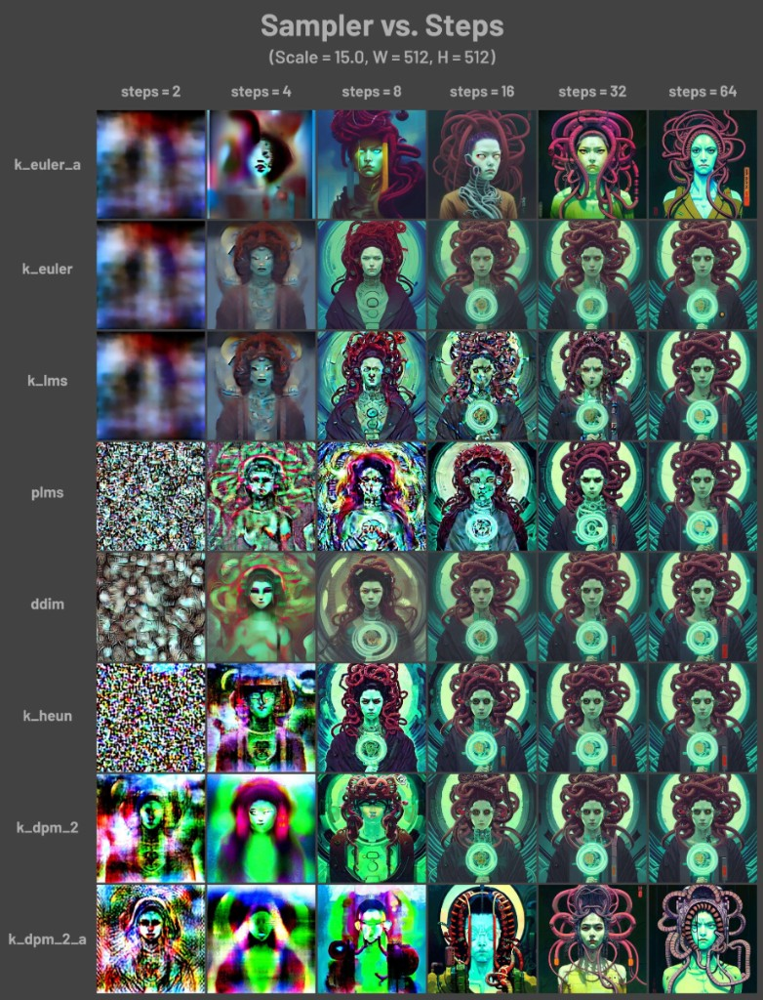

### Ідея:
Scheduler визначає траєкторію руху від шуму до зображення: швидко, стабільно або максимально детально.

**Noise Scheduler (планувальник шуму)** — це алгоритм, який керує кроками дифузії: визначає, як переходити від поточного зашумленого представлення до наступного.

**User Prompt** у сучасних diffusion-пайплайнах зазвичай проходить через text encoder (наприклад CLIP, T5 або їх комбінації) і перетворюється на embeddings, які керують denoising-кроками.

#### Основні алгоритми scheduler-ів (розшифровка)

| Назва | Розшифрування | Що означає |
| --- | --- | --- |
| `DDPM` | Denoising Diffusion Probabilistic Models | Імовірнісний базовий підхід до поетапного denoising |
| `DDIM` | Denoising Diffusion Implicit Models | Прискорений/неявний варіант дифузійного переходу |
| `DPM++` | Diffusion Probabilistic Model Solver++ (DPM-Solver++) | Удосконалений чисельний solver для швидших і стабільних кроків |
| `Euler` | Euler Method | Класичний чисельний метод інтегрування дифузійної динаміки |

#### Чим вони відрізняються?

- **DDPM** — класичний стохастичний підхід; історично часто використовував багато кроків (наприклад, до ~1000 у базових постановках).
- **DDIM** — більш швидкий варіант; може працювати детерміновано та дає прийнятну якість за менше кроків.
- **DPM-Solver++** — сучасний чисельний solver; часто дозволяє отримати сильний результат за ~10–30 кроків.
- **Euler / Euler Ancestral** — практичні методи з хорошим балансом; у багатьох сценаріях дають якісну генерацію вже близько ~20–30 кроків.

> 💡 **Уточнення:** `solver` у DPM-Solver++ — це чисельний спосіб оновлення стану, а не окрема нейронна мережа.

#### Що означає кількість кроків (`inference steps`)?

Якщо встановити, наприклад, `30 steps`, модель виконає приблизно 30 послідовних оновлень latent-представлення.  
На кожному кроці мережа прогнозує шум (або іншу параметризацію), а scheduler обчислює наступний стан.

**Чому X, а не Y?**  
Більше кроків не завжди означає кращу деталізацію: після певного порогу приріст якості може бути мінімальним, а час генерації зростає суттєво.

| Параметр | Низьке значення | Високе значення |
| --- | --- | --- |
| Steps | швидше, але грубіше | повільніше, але детальніше |
| Агресивний sampler | більше креативу | ризик артефактів |
| Консервативний sampler | стабільніше | інколи "плоскіше" |

#### 2) Negative Prompt

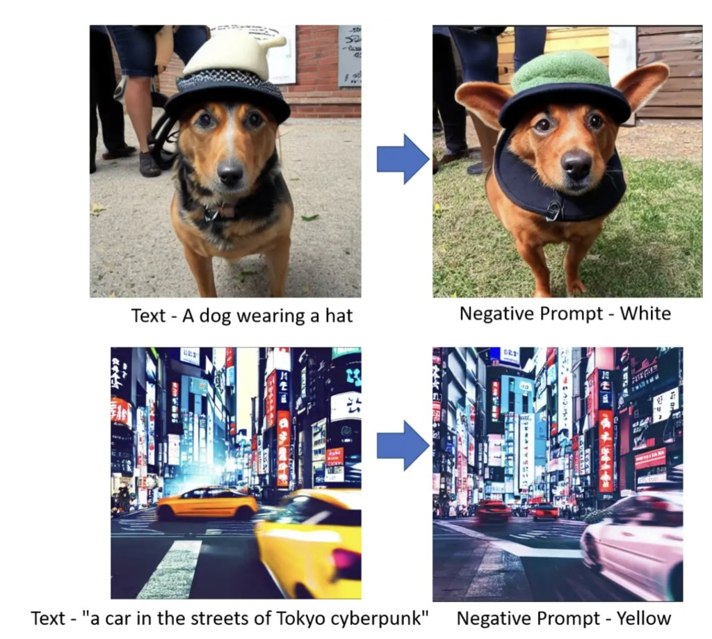

### Ідея:
Negative prompt задає анти-вимоги: що **не повинно** з'явитися у результаті.

Приклади типових негативних токенів:

- `blurry`, `low quality`, `watermark`
- `deformed hands`, `extra fingers`
- небажані кольори/стилі/об'єкти

#### 3) CFG Scale

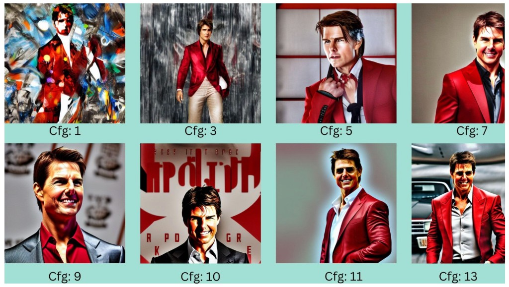
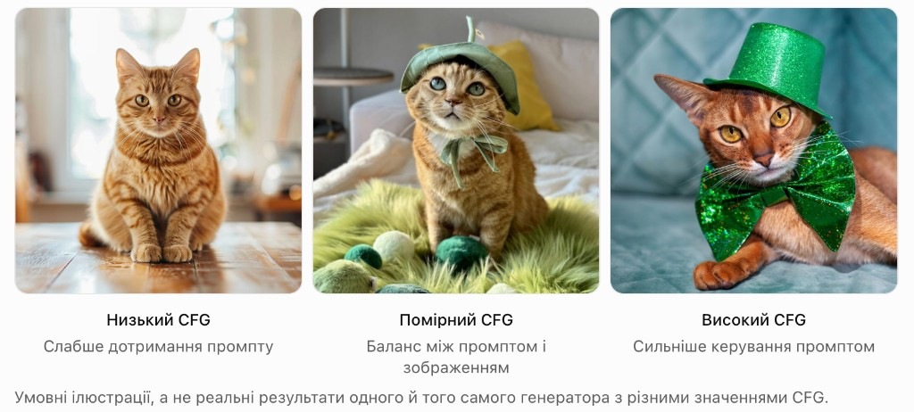

### Ідея:
**CFG Scale (Classifier-Free Guidance Scale — коефіцієнт керування генерацією без класифікатора)** — це параметр дифузійних моделей, який визначає, наскільки сильно текстовий промпт впливає на процес генерації.

Простими словами: CFG Scale регулює, наскільки наполегливо модель має дотримуватися текстового опису.

#### 1) Як це працює?

Уявімо промпт: **«Рудий кіт у зеленому капелюсі сидить на дерев'яному столі»**.

- **Низький CFG** → слабше дотримання промпту, більше "вільної" генерації.
- **Помірний CFG** → баланс між креативністю моделі та точністю до промпту.
- **Високий CFG** → сильніше керування промптом, але вищий ризик артефактів.

> 💡 **Уточнення:** ілюстрація з котом є навчальною схемою, а не строго контрольованим бенчмарком одного генератора за ідентичних seed/налаштувань.

#### 2) Що відбувається математично?

У класичному classifier-free guidance модель рахує два прогнози шуму:

1. **Conditional prediction** — прогноз із промптом.
2. **Unconditional prediction** — прогноз без конкретного промпту (порожня умова).

Далі комбінує їх:

$$
\hat{\epsilon} = \epsilon_{uncond} + s \cdot (\epsilon_{cond} - \epsilon_{uncond})
$$

| Символ | Що означає | Простими словами |
| --- | --- | --- |
| `ε_cond` | шум із conditioning | прогноз з урахуванням промпту |
| `ε_uncond` | шум без conditioning | "вільний" прогноз моделі |
| `s` | CFG scale | сила тиску промпту |
| `ε̂` | підсумковий шум | те, що реально застосовується на кроці |

Вираз `ε_cond - ε_uncond` показує, як саме текстова умова змінює прогноз моделі, а `s` масштабує цю різницю.

#### 3) Що означають конкретні значення CFG?

Для одного умовного числового елемента:

$$
\epsilon_{uncond}=0.3,\quad \epsilon_{cond}=0.5,\quad s=7.0
$$

$$
\hat{\epsilon}=0.3+7.0\cdot(0.5-0.3)=0.3+1.4=1.7
$$

Інтерпретація: різниця між умовним і безумовним прогнозами суттєво підсилюється.

> ⚠️ **Важливо:** `CFG = 7` не означає “70% точності промпту”. Це коефіцієнт у формулі комбінування прогнозів, а не відсоток якості.

#### 4) Яке значення вибирати?

- Для частини класичних checkpoint-ів Stable Diffusion часто використовували діапазон близько `5–9`.
- Для новіших моделей оптимум може бути іншим через іншу архітектуру, тренування, scheduler і параметризацію денойзингу.
- Деякі сучасні пайплайни застосовують модифіковані або альтернативні механізми керування умовою.

> ⚠️ **Застереження:** надто високий CFG часто дає перенасичені, неприродні результати або візуальні артефакти.

---

## ЧАСТИНА 5. АРХІТЕКТУРИ ДИФУЗІЙНИХ МОДЕЛЕЙ

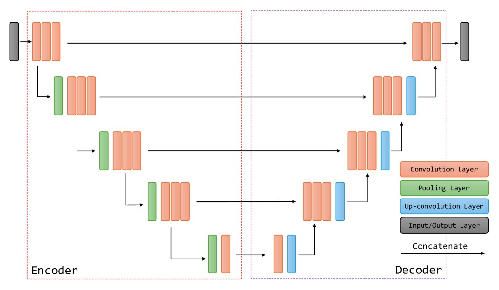

### 5.1 U-Net

### Ідея:
U-Net поєднує локальну деталізацію і глобальну структуру через симетричний encoder-decoder та skip connections.

Типові приклади (або найбільш поширені інженерні реконструкції для закритих систем):

- Stable Diffusion 1.5/2.1 — U-Net backbone у latent diffusion
- DALL-E 2 — модифікований U-Net-денойзер у загальному ланцюгу генерації
- Midjourney v1-v4 — за зовнішніми ознаками часто описують як U-Net-подібні (точна архітектура не розкрита)

Сильні сторони:

- добре працює з 2D-структурою зображень
- стабільний у навчанні
- відносно передбачуваний за compute

Обмеження:

- слабше глобальне "узгодження сцени", ніж у великих attention-моделей
- масштабування до дуже високої якості може вимагати складних надбудов
- базово прив'язаний до тренувальної роздільної здатності; якісне масштабування зазвичай вимагає додаткових методів (upscaling, tiled inference, SR)

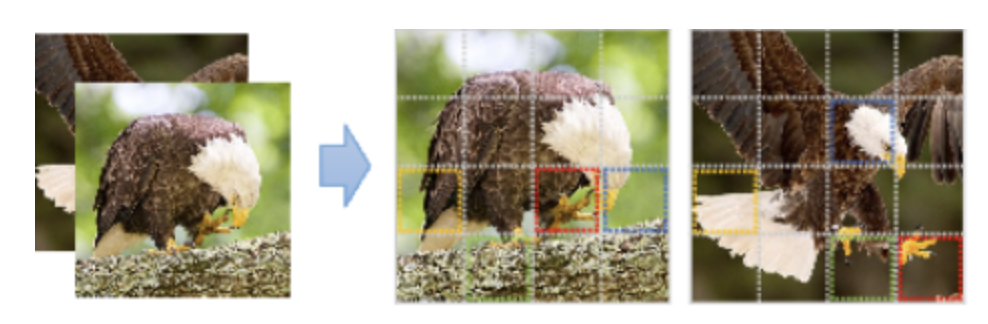

### 5.2 DiT (Diffusion Transformer)

### Ідея:
DiT замінює CNN-ядро на transformer-блоки й обробляє latent як послідовність патчів.

Типові приклади:

- Sora (OpenAI) — transformer-орієнтований підхід у відеогенерації
- Stable Diffusion 3 — сімейство MMDiT (Multimodal Diffusion Transformer)
- FLUX.1 — transformer-centric підхід із сучасними flow/diffusion ідеями

$$
\text{Self-Attention complexity} \propto n^2
$$

де `n` — кількість патчів (токенів зображення).

| Символ | Що означає | Простими словами |
| --- | --- | --- |
| `n` | число патч-токенів | скільки фрагментів має зображення |
| `n²` | квадратична залежність | вартість росте дуже швидко |

**Чому X, а не Y?**  
DiT краще за U-Net у складних композиціях і довгих взаємозв'язках об'єктів, але дорожчий по обчисленнях.

Що важливо:

- краще масштабується в бік композиційно складних сцен
- природніше узгоджується з текстовими transformer-репрезентаціями
- обчислювально дорожчий через квадратичну увагу за кількістю токенів

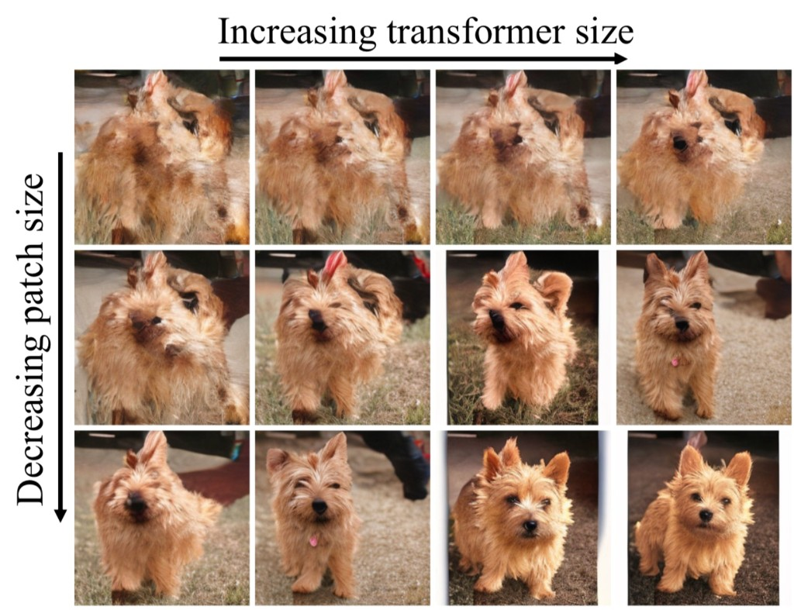

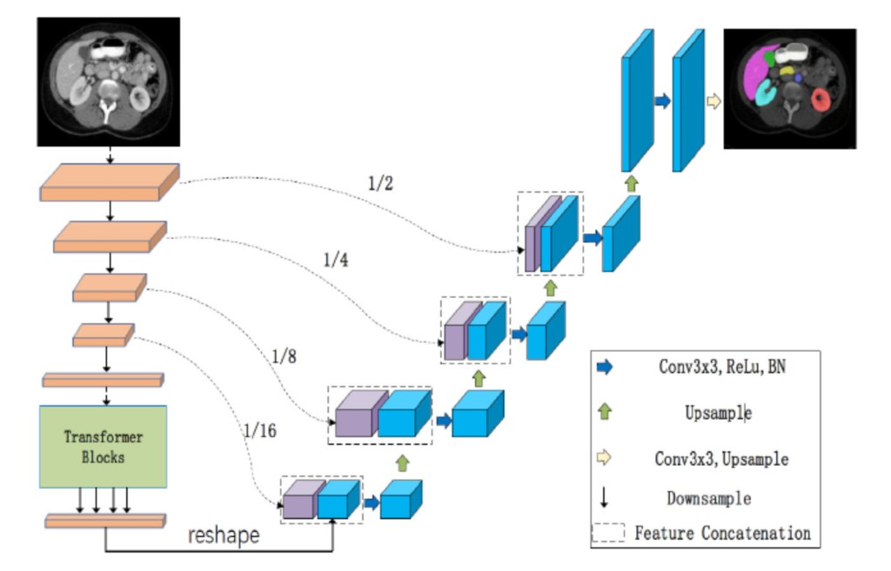

### 5.3 Гібридні підходи (U-Net + Transformer)

### Ідея:
Гібриди намагаються отримати "краще з обох світів": локальні деталі від CNN і глобальний контекст від attention.

Приклади:

- DALL-E 3 — публічні описи вказують на сильну transformer-компоненту для мовного розуміння і потужний image-generation стек
- Midjourney v5/v6 — часто інтерпретують як гібридний підхід (точні деталі не публічні)

Що важливо:

- transformer-блоки часто інтегруються в attention/conditioning-шари U-Net-подібних денойзерів
- це компроміс між compute-ефективністю класичного U-Net і композиційністю DiT

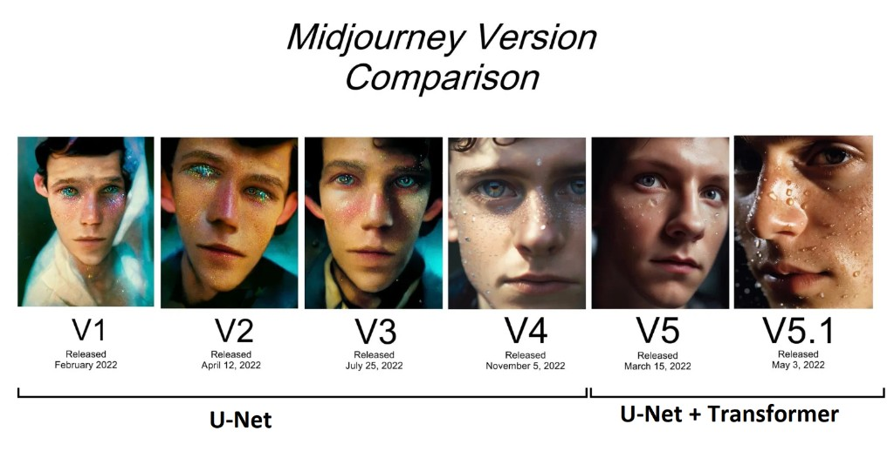


> 💡 **Уточнення до схеми:** вона загалом коректно передає різницю між U-Net і DiT на концептуальному рівні.  
> ⚠️ **Технічні нюанси:**  
> - Твердження "U-Net має менше параметрів" не універсальне — залежить від конкретної конфігурації.  
> - U-Net у сучасних diffusion-системах часто включає attention/cross-attention, а не є суто згортковим.  
> - DiT зазвичай краще масштабується на складних сценах, але за це платить вищими вимогами до пам'яті та обчислень.  
> - Для proprietary-моделей (наприклад Midjourney) архітектурні деталі частково оціночні, бо повна специфікація не публічна.

### Порівняльна таблиця архітектур

| | U-Net | DiT | Гібрид |
| --- | --- | --- | --- |
| Локальні деталі | сильні | сильні | сильні |
| Глобальний контекст | середній | високий | високий |
| Compute-вартість | нижча | вища | середня-висока |
| Гнучкість масштабу | середня | висока | висока |
| Типовий компроміс | якість/швидкість | якість/вартість | складність/інтеграція |

---

## ЧАСТИНА 6. АВТОРЕГРЕСИВНІ МОДЕЛІ

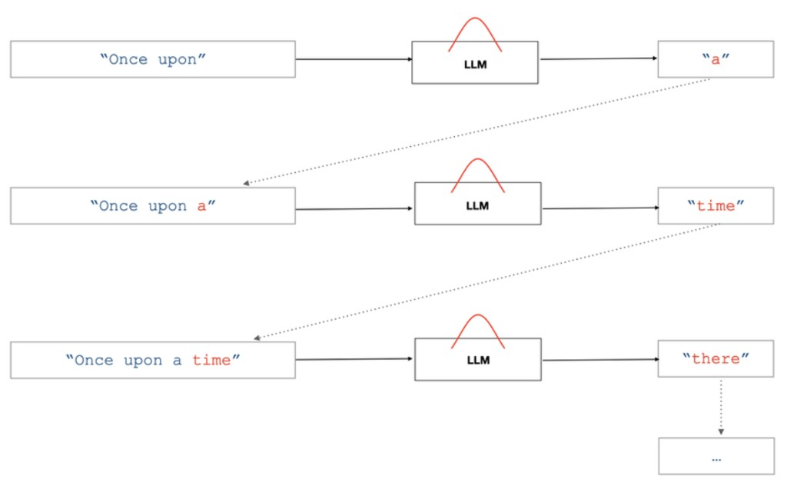

### Що таке авторегресія

### Ідея:
Авторегресивна модель генерує послідовність поелементно: кожен новий токен залежить від усіх попередніх.

$$
P(y_{1:T}\mid x) = \prod_{t=1}^{T} P(y_t \mid y_{<t}, x)
$$

| Символ | Що означає | Простими словами |
| --- | --- | --- |
| `y_t` | токен відповіді на кроці t | чергове слово/сабворд |
| `y_<t` | уже згенерований контекст | пам'ять поточної відповіді |
| `x` | вхідний промпт | задача для моделі |

Відбувається «генерація за токенами»: саме тому відповідь чату ми бачимо поступово, частинами слів або речень, а не одним миттєвим блоком.

Авторегресивні моделі широко застосовуються для:

- генерації тексту
- генерації коду
- генерації аудіо
- частини image-generation підходів, де важлива послідовна структура

Важлива особливість: **накопичення помилок**. Якщо модель на ранньому кроці згенерувала невдалий токен, це може змістити всю подальшу траєкторію відповіді.

> 💡 **Порада:** параметри авторегресивної генерації (temperature, top-p, repetition penalty, max tokens) треба розглядати разом, бо вони колективно керують стабільністю та різноманітністю тексту.

### Різниця між дифузійними й авторегресивними моделями на рівні процесу генерації

Головна різниця: **авторегресивна модель** генерує результат послідовно, токен за токеном, а **дифузійна модель** поступово перетворює шум на структуровані дані.

#### 1) Авторегресивна модель (Autoregressive Model)

Приклад: **GPT (Generative Pre-trained Transformer — генеративний попередньо навчений трансформер)**.

Модель добудовує відповідь по одному токену:

`Кіт → сидить → на → дерев'яному → столі → .`

Кожен новий токен генерується з урахуванням уже наявного контексту.

Процес:

1. Отримує промпт.
2. Обчислює ймовірності можливих наступних токенів.
3. Обирає наступний токен.
4. Додає його до поточної послідовності.
5. Повторює цикл до завершення відповіді.

Особливість: результат нарощується послідовно; у звичайному режимі модель не "переписує назад" уже згенеровані токени.

#### 2) Дифузійна модель (Diffusion Model)

Приклад: класична **Stable Diffusion**-сімейство.

Процес:

1. Ініціалізується випадковий тензор шуму.
2. Нейромережа прогнозує шум (або іншу параметризацію для кроку переходу).
3. **Noise Scheduler** обчислює новий стан latent.
4. Кроки повторюються багаторазово.
5. Після завершення denoising фінальний latent декодується в зображення.

Особливість: модель оновлює все представлення зображення на кожному кроці, а не додає "готові пікселі" по одному.

#### 3) Порівняння

| Характеристика | Авторегресивна | Дифузійна |
| --- | --- | --- |
| Початок генерації | Промпт або початкові токени | Зазвичай випадковий шум |
| Основна операція | Передбачити наступний токен | Оновити зашумлене представлення |
| Порядок | Послідовне додавання токенів | Ітеративне уточнення даних |
| Контекст | Попередні токени | Поточний стан, timestep, умова |
| Типове застосування | Генерація тексту/коду | Генерація зображень, аудіо, відео |

> ⚠️ **Важливо:** ці підходи не прив'язані жорстко до одного типу даних. Є авторегресивні моделі для зображень і дифузійні підходи для тексту.

#### 4) А де тут Transformer?

Це різні рівні опису:

- **Autoregressive** — спосіб генерації (next-token залежить від попередніх).
- **Diffusion** — спосіб генерації (багатокроковий denoising із шуму).
- **Transformer** — архітектура нейромережі, яку можна використати в обох підходах.

Тому `Transformer ≠ обов'язково авторегресивна модель`.  
Наприклад, **DiT (Diffusion Transformer — дифузійний трансформер)** використовує transformer-архітектуру всередині дифузійного процесу.

**Фраза для запам'ятовування:** авторегресивна модель добудовує послідовність, а дифузійна багаторазово уточнює представлення майбутнього результату.

### Основні архітектури авторегресивних моделей

#### Transformer (decoder-only)

### Ідея:
**Decoder-only Transformer** дивиться на вже згенерований префікс і передбачає наступний токен.

Саме через простоту масштабування та універсальність ця архітектура стала де-факто стандартом для сучасних LLM.

Приклади:

- GPT-4, GPT-3.5 (OpenAI) — decoder-only родина
- Claude 3/3.5/4 (Anthropic) — transformer-підхід із власними alignment-процедурами
- LLaMA-сімейство — decoder-only

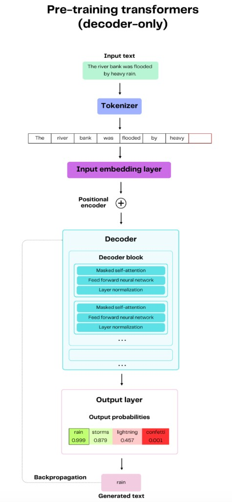

### Pre-training decoder-only трансформера (детально)

#### 1) Підготовка даних

- **Tokenization** розбиває текст на токени (слова/частини слів).
- Кожен токен проходить через **input embedding layer** і стає вектором.
- Додаються **positional encodings** (позиційні сигнали), щоб модель розуміла порядок токенів.

Приклад: слово «навчання» може бути представлене як кілька сабтокенів, наприклад `нав` + `чання`.

#### 2) Основа моделі: декодерні блоки

Кожен блок зазвичай містить:

- **Masked self-attention** — бачить лише попередні токени, а майбутні маскуються.
- **Feed-forward layer** — нелінійна трансформація ознак.
- **Layer Normalization** — стабілізує масштаб активацій і покращує тренування.

> ⚠️ **Технічне уточнення:** LayerNorm часто покращує стабільність і проходження градієнтів, але не є математичною гарантією повного усунення проблем зникання/вибуху градієнтів у всіх конфігураціях.

Інтуїція masked attention:

у реченні «Кіт сидів на килимі, тому що він був теплий» модель вчиться з контексту виводити, що «він» найімовірніше відноситься до «килима», а не до довільного слова.

#### 3) Передбачення наступного токена

Вихід останнього декодерного блоку:

1. проходить через **linear layer** (проєкція у розмір словника),
2. далі через **softmax** (ймовірності для всіх токенів словника).

Отже, модель на кожному кроці фактично розв'язує задачу багатокласової класифікації "який токен наступний?".

#### 4) Процес навчання

1. Передбачений токен порівнюється з правильним токеном (ground truth).
2. Різниця вимірюється через **loss** (часто cross-entropy).
3. Через **backpropagation** оновлюються параметри.
4. Цикл повторюється мільйони разів на багатьох епохах/кроках оптимізації.

### Inference

Після pre-training (і часто додаткового fine-tuning/alignment) модель готова до генерації:

- отримує промпт,
- покроково семплує токени,
- зупиняється за stop-condition (EOS token / max tokens / stop sequence).

### Порівняння з іншими типами трансформерів

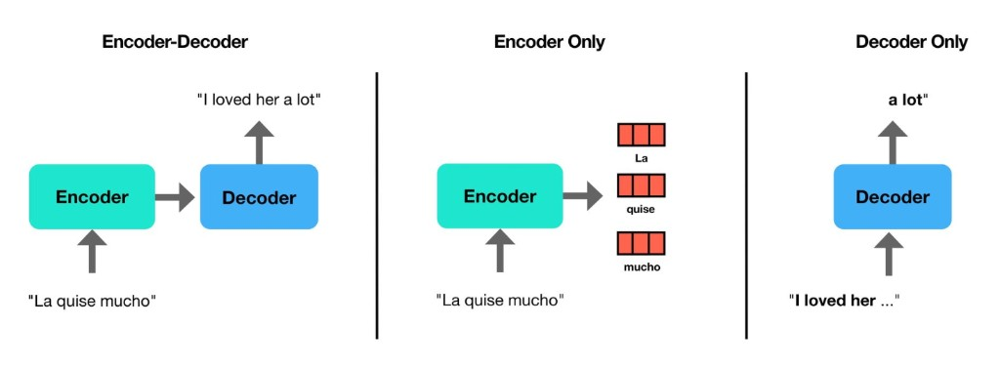

| | Encoder-Only | Encoder-Decoder | Decoder-Only |
| --- | --- | --- | --- |
| Основна роль | розуміння тексту | трансформація послідовностей | генерація |
| Класичні задачі | класифікація, NER | переклад, summarization | чат, код, агенти |
| Приклади | BERT, RoBERTa | T5, BART | GPT, Claude, LLaMA |

### Чому decoder-only домінує в LLM-практиці

- один універсальний інтерфейс "prompt → continuation" для багатьох задач
- добре масштабується на великих корпусах і параметрах
- потужний **in-context learning** без обов'язкового task-specific fine-tuning
- екосистема tooling і продакшн-патернів уже зріла

> ⚠️ **Важливо:** "домінує" не означає "завжди найкращий для будь-якої задачі". Для окремих вузьких задач encoder-only або encoder-decoder можуть бути кращими.

### Mamba — альтернативна авторегресивна архітектура

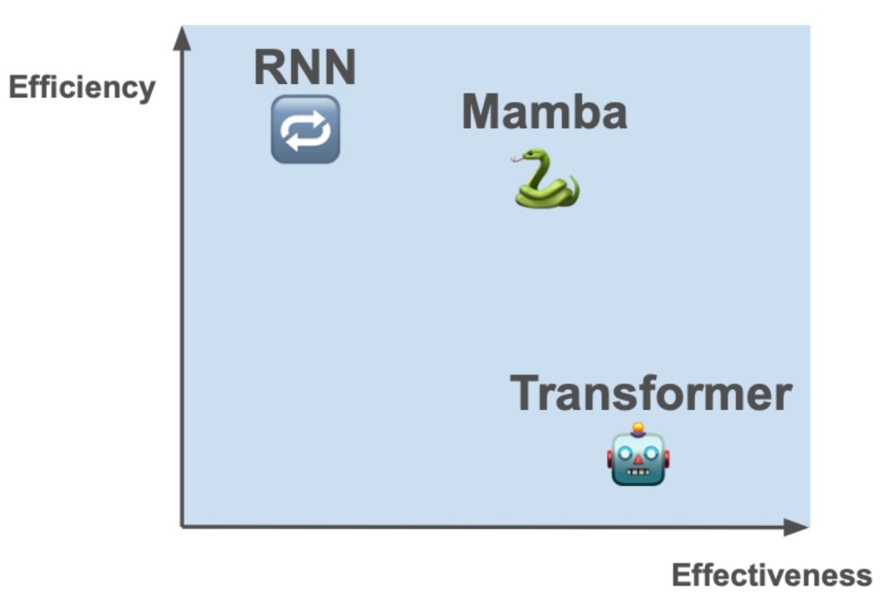

### Ідея:
Замість явної уваги до всіх попередніх токенів, Mamba стискає історію в компактний динамічний стан, який оновлюється крок за кроком.

Практичне порівняння:

- **Transformer:** "бачу весь попередній контекст напряму"
- **Mamba:** "маю стислий state попереднього контексту"

Звідси випливає типова перевага Mamba-подібних підходів:

$$
O(n)\ \text{проти}\ O(n^2)\ \text{у повній self-attention}
$$

Приклади:

- Mamba-1, Mamba-2
- Jamba (гібрид Mamba + Transformer + MoE)

Інженерні обмеження:

- потенційна втрата деталей при сильному стисканні контексту
- нерівномірна якість на задачах, де критичне точне in-context наслідування прикладів
- результати залежать від конкретної реалізації, бенчмарку й режиму інференсу

### Що означають осі на порівняльній діаграмі RNN/Transformer/Mamba

- **Efficiency** — швидкість/ресурсоефективність обчислень
- **Effectiveness** — якість вирішення задач

Інтерпретація:

1. **RNN** — компактні, але зазвичай слабші на складному довгому контексті.
2. **Transformer** — найсильніші результати на широкому спектрі задач, але дорожчі.
3. **Mamba** — компроміс між швидкістю та якістю; перспективний напрям, але не повна заміна Transformer у всіх кейсах.

### MoE (Mixture of Experts) — суміш експертів

### Ідея:
**MoE (Mixture of Experts — суміш експертів)** — це архітектурний підхід, у якому модель містить кілька підмереж-експертів, але для кожного токена активується лише частина з них.

Головна думка: не обов'язково проганяти кожен токен через всю модель; можна обчислювати лише вибрані гілки.


**Що показано на схемі і чому це коректно:**

- **Крок 1. Вхідні токени → Embedding:** кожен токен переходить у векторне представлення.
- **Крок 2. Router / Gating Network:** маршрутизатор оцінює, які експерти найкраще підходять саме для цього токена.
- **Крок 3. Top-k routing:** активуються не всі експерти, а лише частина (на схемі top-2 з 4).
- **Крок 4. Combine / Weighted Sum:** виходи активних експертів зважено поєднуються в один вектор.
- **Крок 5. Вихідне представлення токена:** далі передається в наступні шари моделі.

> ⚠️ **Технічне уточнення:** схема правильно передає принцип sparse routing, але це спрощення. У реальних системах також важливі обмеження місткості експертів (capacity), load balancing loss і комунікаційні витрати між пристроями.

#### 1) Як працює MoE?

Уявімо речення: «Кіт сидить на столі».

1. токен перетворюється на векторне представлення
2. **Router (маршрутизатор)** оцінює, які експерти найдоречніші
3. обираються, наприклад, `top-2` із 4 експертів
4. активні експерти обчислюють вихід
5. результати об'єднуються в нове представлення токена

Приклад top-2 routing:

- Expert 1 — активний
- Expert 2 — активний
- Expert 3 — неактивний
- Expert 4 — неактивний

> 💡 **Важливо:** експерти зазвичай не мають наперед заданих "професій" (типу математик/лінгвіст). Їх спеціалізація виникає під час навчання.

#### 2) Чому це корисно?

У щільному шарі (dense layer) кожен токен використовує всі параметри шару.  
У **Sparse MoE** активується лише частина експертів.

Це дає змогу збільшувати загальну кількість параметрів без пропорційного росту FLOPs на токен.

Але важливе уточнення:

- це не гарантує лінійного прискорення "в стільки ж разів"
- routing, комунікація між пристроями та балансування навантаження теж коштують ресурсів

#### 3) Як MoE пов'язаний із Mamba та Transformer?

Це різні концепти, які можна комбінувати:

| Технологія | За що відповідає |
| --- | --- |
| Transformer | моделює зв'язки між токенами (attention-механізм) |
| Mamba | моделює послідовність через оновлення внутрішнього стану |
| MoE | вирішує, які підмережі-експерти активувати для конкретного токена |

Тобто **MoE — не пряма альтернатива** Transformer або Mamba, а механізм маршрутизації обчислень, який можна вбудовувати в різні backbone-архітектури.

Приклад комбінування: **Jamba (AI21 Labs)** поєднує блоки Transformer, Mamba та MoE.

---

## ЧАСТИНА 7. УНІКАЛЬНІ ВЛАСТИВОСТІ LLM ТА АГЕНТНІ СИСТЕМИ

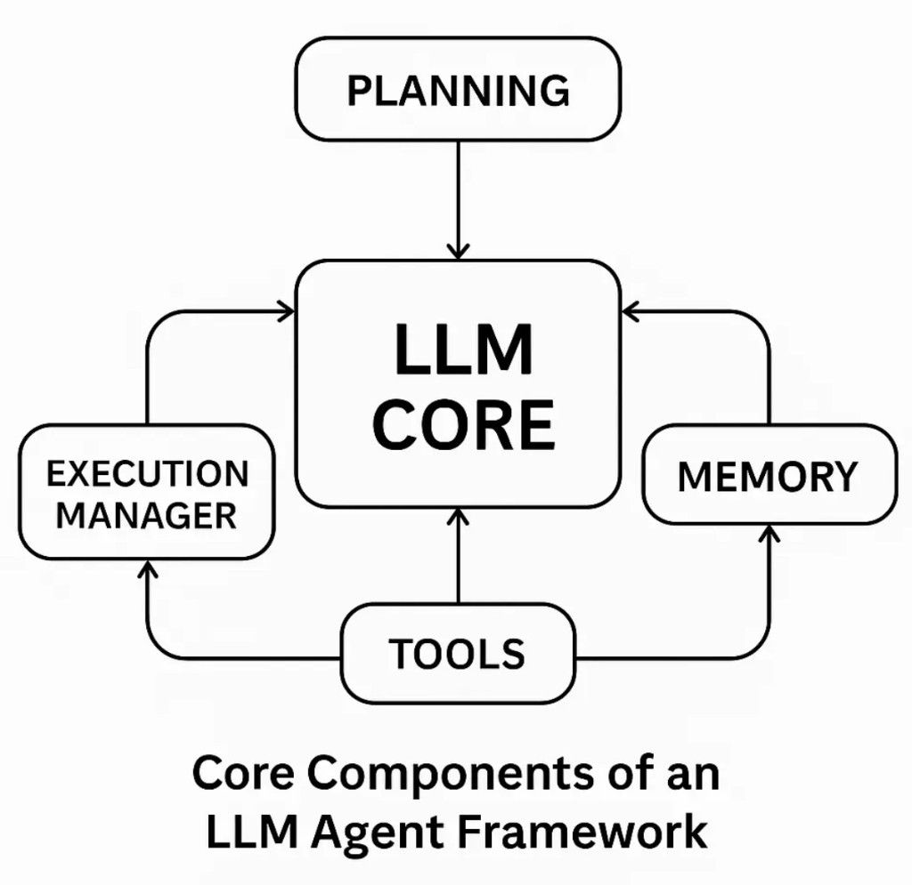

### Ідея:
LLM стали ядром агентних систем не просто через "великий обсяг знань", а через здатність бути універсальним інтерфейсом для планування, інструментів і самокорекції.

### 7.1 Текст як універсальний протокол дій

- у тексті можна одночасно описувати **дані**, **операції** і **формат результату**
- це спрощує інтеграцію: однаковий протокол для людини, моделі, API, логів
- модель може переводити текстові інструкції в послідовність дій

> 💡 **Порада:** найефективніші агенти мають чіткі текстові контракти: вхід, очікуваний формат виходу, критерії валідації.

### 7.2 Композиційна гнучкість

### Ідея:
LLM може "склеювати" різні типи мислення в одному контексті: аналіз, планування, трансформацію даних, генерацію звіту.

Типовий ланцюг:

1. розібрати запит
2. побудувати план
3. викликати інструмент
4. перевірити відповідь
5. переформатувати у фінальний output

### 7.3 Метакогнітивна поведінка

### Ідея:
У складних задачах LLM здатні переоцінювати стратегію: "цей шлях неефективний, спробую інший".

Це дає агентності:

- ітеративне покращення проміжних кроків
- переключення між інструментами
- адаптацію до нових обмежень у процесі виконання

### 7.4 Чому саме LLM, а не класичний жорсткий pipeline

| | Жорсткий pipeline | LLM-агент |
| --- | --- | --- |
| Планування | вручну в коді | динамічно в контексті |
| Реакція на нестандартний запит | слабка | вища |
| Інтеграція інструментів | статичні правила | policy + tool calls |
| Прозорість рішень | висока, але вузька | нижча, але гнучкіша |

---

## ПІДСУМКИ

Після теми ви орієнтуєтесь у повній картині сучасного generative/agentic AI:

- розумієте еволюцію генеративних систем від GAN до агентних фреймворків
- бачите різницю між inference та pre-training, а також роль fine-tuning
- вмієте пояснити, чому diffusion і autoregressive підходи відрізняються за процесом генерації
- знаєте ключові diffusion-параметри: prompt-encoder, scheduler, negative prompt, CFG
- розрізняєте архітектурні компроміси U-Net, DiT і гібридних рішень
- розумієте домінування decoder-only LLM у чатових та агентних системах
- можете аргументувати позицію "оркестрація > монолітна модель" у прикладних продуктах
- пояснюєте, як властивості LLM перетворюють їх на ядро агентності

---

## EXAM / REVISION CHEAT SHEET

### 1) Foundation Models — швидко
- великі універсальні моделі, навчені на масивних даних
- дорогі у pre-training, але гнучкі у downstream використанні
- бізнес-цінність часто дає не тренування, а інтеграція
- формула оновлення параметрів:

$$
\theta_{new} = \theta_{old} - \eta \cdot \frac{\partial L}{\partial \theta}
$$

### 2) Diffusion Models — швидко
- старт із шуму, поступове відновлення структури
- якість сильно залежить від scheduler/steps/CFG
- працюють у latent space для економії compute
- базова генеративна ідея:

$$
p_\theta(x_{t-1}\mid x_t, c)
$$

### 3) Авторегресивні моделі — швидко
- генерують токен за токеном
- кожен наступний токен залежить від попередніх
- ідеально для тексту, коду, діалогу
- факторизація послідовності:

$$
P(x_{1:T}) = \prod_{t=1}^{T} P(x_t \mid x_{<t})
$$

### 4) U-Net — швидко
- сильний у локальних деталях
- skip-connections рятують дрібні ознаки
- compute дешевший за чисті великі transformers

### 5) DiT — швидко
- attention по патчах дає кращий глобальний контекст
- масштабування зазвичай покращує якість
- ціна — висока складність O(n²)

### 6) Decoder-only Transformer — швидко
- де-факто стандарт LLM
- masked self-attention для next-token prediction
- сильний in-context learning без task-specific fine-tuning

### 7) Mamba — швидко
- лінійна складність O(n), добре для довгих послідовностей
- стискає історію у state, а не переглядає весь контекст напряму
- компроміс: потенційна втрата точних деталей

### 8) Оркестрація — швидко
- керує ланцюгом моделей і інструментів
- дозволяє гнучкі fallback і контроль latency/cost
- підходить для production-агентів краще, ніж monolith

### 9) Мультимодальність — швидко
- природніша взаємодія (text/image/audio/video)
- зростають вимоги до інфраструктури й якості даних
- часто потрібен гібрид з оркестрацією вузьких моделей

### Порівняльна таблиця методів (екзаменаційний мінімум)

| Метод | AUC/метрика (типово) | Переваги | Недоліки |
| --- | --- | --- | --- |
| Diffusion (image) | FID, CLIP score, human eval | висока візуальна якість, контроль стилю | повільніший inference, дорогий compute |
| Decoder-only LLM | perplexity, MMLU, task score | універсальність, сильний zero/few-shot | галюцинації, висока вартість при довгому контексті |
| Mamba/SSM | latency, throughput, long-context score | O(n), стабільно на довгих послідовностях | слабший точний retrieval з контексту |
| Оркестрація агентів | task success rate, latency, cost/task | модульність, керованість, виробнича надійність | складніша інженерна підтримка |

---

## ДОДАТОК: ПОКРОКОВИЙ РОЗБІР ПРОЦЕСУ НАВЧАННЯ

### 30+ кроків простими словами

1. Формулюємо бізнес-ціль: що саме має вміти система.
2. Обираємо модальність: текст, зображення, аудіо або їх комбінацію.
3. Визначаємо тип моделі: diffusion чи авторегресивна.
4. Описуємо constraints: latency, бюджет, приватність, безпека.
5. Готуємо дані: збір, очищення, дедуплікація.
6. Перевіряємо legal/етичні обмеження датасетів.
7. Розбиваємо дані на train/validation/test.
8. Налаштовуємо токенізатор або image transforms.
9. Ініціалізуємо параметри θ.
10. Формуємо батч вхідних прикладів.
11. Проганяємо forward pass.
12. Отримуємо проміжне представлення (latent або hidden states).
13. Рахуємо prediction (токени, шум, класи).
14. Рахуємо loss.
15. Застосовуємо регуляризацію (якщо потрібна).
16. Обчислюємо градієнти ∂L/∂θ.
17. Оновлюємо параметри через optimizer.
18. Повторюємо кроки 10–17 багато разів.
19. Відстежуємо метрики на validation.
20. Якщо модель переобучається — змінюємо режим навчання.
21. Підбираємо scheduler learning rate.
22. Робимо checkpointing.
23. Проводимо sanity-check inference.
24. Аналізуємо типові помилки моделі.
25. Робимо prompt/context tuning.
26. Додаємо інструментальні виклики (tool use), якщо це агент.
27. Валідуємо policy/guardrails.
28. Тестуємо в режимі навантаження.
29. Вимірюємо latency та вартість на 1 задачу.
30. Розгортаємо контрольований production rollout.
31. Моніторимо деградацію й drift.
32. Повторюємо цикл покращення.

### Дифузійний pipeline (ASCII)

```text
RealImage -> Encoder -> Latent
Latent -> (+ noise over T steps) -> x_T
x_T + PromptEmbedding -> Denoiser(U-Net/DiT) -> x_(T-1) -> ... -> x_0
x_0 -> Decoder -> GeneratedImage
```

### Авторегресивний pipeline (ASCII)

```text
PromptTokens -> Embedding -> DecoderBlock_1 -> ... -> DecoderBlock_N -> NextTokenProbs
Pick token_t -> append to context -> repeat until stop condition
```

### "Суцільна картина" всього процесу

```text
Data -> Preprocess -> Pretrain/Fine-tune -> Evaluate -> Orchestrate with Tools -> Deploy -> Monitor -> Improve
```

### Backpropagation — зворотне поширення помилки

### Ідея:
Backpropagation відповідає на питання: який саме параметр моделі і наскільки "винен" у поточній помилці.

1. Маємо forward prediction.
2. Порівнюємо prediction із ground truth.
3. Рахуємо loss.
4. Через chain rule обчислюємо градієнти кожного шару.
5. Optimizer змінює ваги в напрямку зменшення loss.

Ключовий крок оновлення:

$$
w_{new} = w_{old} - \eta \cdot \frac{\partial L}{\partial w}
$$

### Найголовніша картина

| Етап | Що відбувається | Роль у навчанні |
| --- | --- | --- |
| Forward | модель генерує прогноз | створює основу для оцінки помилки |
| Loss | порівняння з еталоном | дає числову "ціну" помилки |
| Backprop | градієнти по всіх параметрах | показує, як змінити модель |
| Optimizer | крок оновлення ваг | фактично навчає модель |

---

## КОРИСНІ ПОСИЛАННЯ

- [Timeline of AI-generated faces (Wikimedia Commons)](https://commons.wikimedia.org/wiki/File:Timeline-of-AI-generated-faces.png)
- [Amortized hardware and energy cost to train frontier AI models (Wikimedia Commons)](https://commons.wikimedia.org/wiki/File:Amortized_hardware_and_energy_cost_to_train_frontier_AI_models_over_time.png)
- [Diffusion models in practice. Part 1: A primers (deepsense.ai)](https://deepsense.ai/blog/diffusion-models-in-practice-part-1-a-primers/)
- [Negative Prompts (ARTSMART AI docs)](https://artsmart.ai/docs/negative-prompts/)
- [Scalable Diffusion Models with Transformers (DiT)](https://www.wpeebles.com/DiT)
- [Multimodal Generative AI: What Is It to Enterprises?](https://lingarogroup.com/insights/multimodal-generative-ai-what-is-it-to-enterprises)
- [Midjourney Versions Comparison (X post)](https://x.com/heyBarsee/status/1654825921746989057)
- [LLM Agent Frameworks 2026: Guide & Comparison](https://www.chatbase.co/blog/llm-agent-framework-guide)

---

## СТРУКТУРА ФАЙЛІВ

```text
тема_1/
├── 1_modern_generative_models_notes.md
└── images/
    ├── timeline_ai_generated_faces.jpg                 ← Еволюція якості AI-облич 2014–2022
    ├── training_cost_frontier_models.png               ← Зростання вартості тренування frontier-моделей
    ├── generative_vs_discriminative.png                ← Порівняння генеративного і дискримінативного підходів
    ├── model_blackbox_text_to_text.png                 ← "Чорна скринька" для різних I/O модальностей
    ├── unimodal_vs_multimodal.png                      ← Унімодальні проти мультимодальних систем
    ├── voice_assistant_orchestration.png               ← STT→LLM→TTS/ImageGen оркестрація
    ├── chatgpt_voice_daily_limit.png                   ← Приклад лімітів голосового режиму
    ├── inference_prompt_response.png                   ← Що таке inference
    ├── pretraining_data_process_model.png              ← Що таке pre-training
    ├── diffusion_forward_reverse.png                   ← Прямий і зворотний дифузійний процес
    ├── pretraining_diffusion_models.png                ← Архітектура pre-training дифузії
    ├── stable_diffusion_inference_pipeline.png         ← Inference pipeline Stable Diffusion
    ├── ldm_inference_flow_simplified.png               ← Спрощений покроковий inference-ланцюг Latent Diffusion
    ├── sampler_vs_steps_comparison.jpg                 ← Вплив sampler/steps на результат
    ├── negative_prompt_examples.jpg                    ← Приклади застосування negative prompt
    ├── cfg_scale_comparison.jpg                        ← Вплив CFG scale
    ├── cfg_scale_levels_cat_example.jpg                ← Умовний приклад низького/помірного/високого CFG на промпті про кота
    ├── unet_architecture.png                           ← U-Net encoder/decoder з skip-connections
    ├── unet_classic_architecture.png                   ← Класична U-Net (encoder/bottleneck/decoder + skip connections)
    ├── dit_scalability_patch_transformer.png           ← Масштабування DiT: патчі та розмір трансформера
    ├── levit_unet_transformer_blocks.png               ← Гібридна LeViT-UNet схема
    ├── dit_increasing_transformer_decreasing_patch.jpg ← Вплив розміру трансформера/патчів
    ├── unet_vs_dit_diffusion_architectures.png         ← Детальне порівняння пайплайнів U-Net і DiT у diffusion-моделях
    ├── midjourney_version_comparison.png               ← Еволюція якості Midjourney
    ├── llm_autoregressive_generation.png               ← Авторегресивна токен-by-токен генерація
    ├── decoder_only_transformer_pretraining.png        ← Pre-training decoder-only трансформера
    ├── encoder_decoder_vs_encoder_vs_decoder.png       ← Порівняння 3 типів трансформерів
    ├── rnn_mamba_transformer_comparison.png            ← Efficiency vs Effectiveness (RNN/Mamba/Transformer)
    ├── moe_sparse_expert_routing_explained.png         ← Схема Sparse MoE: Router, top-k експерти, weighted combine
    └── llm_agent_framework_components.png              ← Компоненти агентного LLM-фреймворку
```
