# КОНСПЕКТ-ДОВІДНИК ЛЕКЦІЇ №10: МУЛЬТИАГЕНТНІ СИСТЕМИ

> **Тема:** Мультиагентні системи: проблеми одноагентної архітектури, дев'ять архітектурних патернів, реалізація патерну супервізора у LangChain, контроль потоку інформації та Human-in-the-Loop.
>
> **Формат:** розгорнутий навчальний довідник із виправленнями неточностей оригінального матеріалу, поясненнями простими словами, практичними кейсами, зображеннями і кодом із коментарями.
>
> **Код:** [`тема_10/AI_topic_10_lesson_reviewed.ipynb`](AI_topic_10_lesson_reviewed.ipynb)
>
> **Ілюстративні числа та твердження без першоджерела:** [`тема_10/unverified_claims.md`](unverified_claims.md)

---

<a id="dictionary"></a>

## Словник скорочень і термінів

### Скорочення

- **API (Application Programming Interface).** Інтерфейс, через який програма взаємодіє із зовнішнім сервісом або бібліотекою: надсилає запит і отримує відповідь.

- **CRM (Customer Relationship Management).** Система управління взаємовідносинами з клієнтами, де зберігаються дані про покупців, їхня історія покупок і звернень.

- **HITL (Human-In-The-Loop).** Підхід, коли людина бере участь у циклі роботи агента: переглядає, редагує або схвалює певні кроки перед їх виконанням.

- **ISO 8601.** Міжнародний стандарт запису дати й часу. Формат для дати: `YYYY-MM-DD`; для дати і часу з часовим поясом: `2026-11-10T14:00:00+01:00`. Часовий пояс у форматі `+HH:MM` або суфікс `Z` (UTC) є обов'язковим для планування подій між різними регіонами.

- **LLM (Large Language Model).** Велика мовна модель, навчена на текстових даних і здатна генерувати, перекладати та аналізувати текст.

- **MAS (Multi-Agent System).** Мультиагентна система: архітектура, де кілька спеціалізованих AI-агентів координовано вирішують складні завдання.

- **RAG (Retrieval-Augmented Generation).** Підхід, де перед генерацією відповіді модель спочатку знаходить релевантні фрагменти в зовнішній базі знань і спирається на них.

- **SMTP (Simple Mail Transfer Protocol).** Протокол надсилання електронних листів. У навчальних прикладах надсилання листа *імітується* — реального SMTP-виклику немає.

### Терміни LangChain / LangGraph

- **Multi-Agent System (Мультиагентна система).** Архітектурний підхід, де складний застосунок розбивається на кілька спеціалізованих агентів із чіткими ролями, кожен з яких взаємодіє з рештою через визначені механізми координації.

- **Supervisor (Супервізор).** Центральний агент у патерні супервізора, що координує роботу підлеглих агентів-спеціалістів (workers): аналізує поточний стан, делегує завдання та синтезує результати в єдину відповідь.

- **Subagent (Підагент, агент-спеціаліст).** Агент, що відповідає за конкретний домен або функцію (наприклад, планування подій чи складання листів). Отримує завдання від супервізора або іншого агента і повертає результат.

- **Tool Calling (Виклик інструментів).** Мультиагентний підхід, де головний агент викликає інших агентів як інструменти (`@tool`). Підагенти не спілкуються з користувачем безпосередньо; вони виконують завдання і повертають результат головному агенту.

- **Handoff (Передача керування).** Мультиагентний підхід, де поточний агент явно передає контроль над розмовою іншому агенту разом із необхідним контекстом. Новий агент взаємодіє з користувачем безпосередньо, а не через першого агента.

- **Router (Маршрутизатор).** Агент або функція, що аналізує вхідне завдання і визначає, який спеціалізований агент найкраще підходить для його розв'язання.

- **Aggregator (Агрегатор).** Агент або вузол, що об'єднує результати кількох паралельних агентів у єдиний підсумковий звіт.

- **Orchestration (Оркестрація).** Координація роботи кількох агентів: визначення, хто що виконує, в якому порядку та які дані передаються між ними.

- **Context Engineering (Інженерія контексту).** Процес визначення того, яку саме інформацію бачить кожен агент або LLM. Мета: надати кожному агенту лише ті дані, які потрібні для виконання його конкретної задачі, уникаючи «забруднення контексту» нерелевантними даними.

- **Tool Overload (Перевантаження інструментами).** Стан, коли агенту надано забагато інструментів одночасно, що призводить до неправильного вибору інструмента, уповільнення роботи та зростання помилок.

- **Attention Saturation (Насичення уваги).** Стан, коли механізм уваги (attention) моделі отримує надто великі або нерівномірні вхідні значення, і функція softmax «насичується»: всі елементи отримують майже однакову або майже нульову вагу. Модель втрачає здатність розрізняти важливість різних частин контексту.

- **State (Стан агента).** Структура даних, що зберігає всю поточну інформацію під час виконання агента або графа. Описується як `TypedDict` або клас, що успадковує `AgentState`. Під час роботи стан — це звичайний словник Python (`dict`).

- **State Key (Ключ стану).** Назва конкретного поля в структурі стану агента. Наприклад, `messages`, `test_status`, `accuracy_score`. Не є зарезервованим словом LangChain — це довільна назва, яку обирає розробник.

- **ToolRuntime.** Об'єкт LangChain, який LangChain автоматично передає в інструмент під час виконання. Надає доступ до поточного стану агента (`runtime.state`), контексту виконання, конфігурації та ID поточного виклику. LLM не потрібно явно формувати цей аргумент.

- **Command.** Спеціальний об'єкт LangGraph, що дозволяє одночасно оновити стан (`update`) і вказати наступний вузол (`goto`) або передати рішення після переривання (`resume`). Використовується для відновлення HITL-сесій.

- **Runnable.** Спільний інтерфейс у LangChain для моделей, агентів, ланцюгів, інструментів і графів. Визначає стандартні методи: `invoke()`, `ainvoke()`, `batch()`, `stream()`.

- **`invoke()`.** Метод інтерфейсу `Runnable`, що синхронно запускає компонент (модель, агента, ланцюг чи граф) з переданими вхідними даними. Для агента один `invoke()` може запускати цілий цикл: виклик LLM → виконання інструментів → повторний виклик LLM → формування відповіді.

- **`stream()`.** Метод інтерфейсу `Runnable`, що повертає результати поетапно — повідомлення за повідомленням або крок за кроком. Корисний для спостереження за роботою агента в реальному часі.

- **Checkpointer (Чекпоінтер).** Механізм збереження стану агента після кожного кроку. Дозволяє призупинити виконання (наприклад, для Human-in-the-Loop) і відновити його пізніше з того ж місця. `InMemorySaver` зберігає стан у RAM (зникає після перезапуску процесу). Для production із тривалими сесіями потрібен persistent storage (SQLite, Postgres).

- **`InMemorySaver` / `MemorySaver`.** Вбудований чекпоінтер LangGraph, що зберігає всі знімки стану в оперативній пам'яті. Підходить для навчання та тестування.

- **`thread_id`.** Ідентифікатор сесії (потоку виконання). Всі checkpoint-и одного `thread_id` утворюють єдину послідовну «пам'ять». Використання того самого `thread_id` продовжує попередню сесію. При HITL **критично важливо** передавати той самий `thread_id` під час відновлення через `Command(resume=...)`.

- **`interrupt`.** Механізм LangGraph, що призупиняє виконання графа і повертає payload людині для перегляду. Відновлення здійснюється через `Command(resume=...)` з тим самим `thread_id` та `config`.

- **`HumanInTheLoopMiddleware`.** Вбудоване middleware LangChain, яке автоматично призупиняє виконання перед викликом певних інструментів для отримання схвалення від людини. Параметри `interrupt_on` вказують, які інструменти потребують перевірки; `interrupt_mode="per_call"` забезпечує окреме переривання для кожного виклику.

- **`@tool`.** Декоратор LangChain, що перетворює Python-функцію на інструмент, схему аргументів якого бачить LLM-агент. Назва, type hints і **docstring** допомагають моделі зрозуміти, коли й як його використовувати.

- **Mock (Заглушка, імітація).** Функція, що повторює інтерфейс реального зовнішнього API, але не виконує справжніх дій. Використовується у навчальних прикладах і тестах.

- **`recursion_limit`.** Параметр LangGraph, що обмежує максимальну кількість кроків (вузлів) у графі за один запуск. Дозволяє виявляти незавершені цикли і запобігати нескінченному виконанню.

---

<a id="section1"></a>

## 1. Одноагентна vs мультиагентна архітектура

### 1.1. Проблема «агента-універсала»

Уявіть, що ви намагаєтеся знайти одну людину, яка водночас є лікарем, юристом, програмістом і дизайнером: теоретично можливо, але на практиці неефективно.

Так само і з AI-агентами: коли ми надаємо одному агенту занадто багато можливостей, він починає давати збої.

Розглянемо три ключові проблеми.

---

#### Tool Overload (Перевантаження інструментами)

Ця проблема виникає, коли агенту надається доступ до занадто великої кількості інструментів одночасно.

При 10–20 інструментах агент ще працює ефективно, але при 50+ інструментах точність вибору правильного інструмента критично знижується (ілюстративні цифри — детальніше у [unverified_claims.md](unverified_claims.md)).

Наслідки:
- Агент витрачає більше часу на аналіз варіантів, ніж на виконання завдання.
- Кожен додатковий інструмент збільшує простір можливих рішень.
- Зростає кількість помилкових викликів інструментів та операційних витрат.

---

#### Attention Saturation (Насичення уваги)

Механізм уваги — це основний компонент сучасних LLM, що визначає, на які частини вхідних даних модель звертає особливу увагу.

Насичення відбувається, коли функція `softmax` у механізмі уваги отримує занадто великі або нерівномірні значення. У результаті вона входить у зону насичення: всі елементи отримують або майже нульову, або майже однакову вагу.

Це призводить до втрати здатності розрізняти важливість різних елементів вхідних даних. Агент або пропускає критичну інформацію, або обробляє всі дані з однаковим пріоритетом.

---

#### Контекстне перевантаження

Контекстне вікно — це обмежений обсяг інформації, який агент може обробляти одночасно. Кожен підключений інструмент потребує опису своїх функцій та параметрів, що займає частину цього вікна.

При підключенні сотень інструментів їхні описи можуть зайняти всю доступну пам'ять, не залишаючи місця для фактичної роботи з даними користувача.

---

### 1.2. Одноагентна архітектура

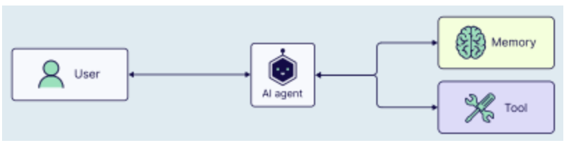

У базовій схемі один агент отримує запит від користувача, може звертатися до пам'яті та інструментів, і повертає відповідь.

---

### 1.3. Мультиагентна архітектура

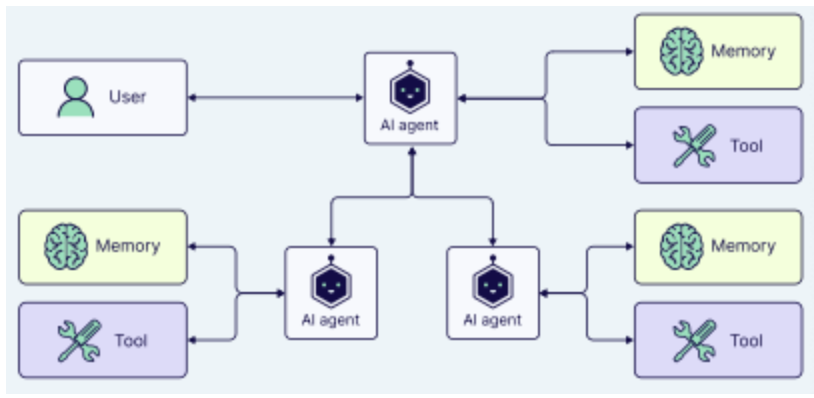

**Мультиагентні системи** — це архітектурний підхід, де складний застосунок розбивається на кілька спеціалізованих агентів, кожен з яких має свою чітку роль та сферу експертності.

Замість одного «універсального» агента — команда фахівців: менеджер проєкту, дизайнер, розробник, тестувальник. Кожен виконує свою частину роботи краще.

---

### 1.4. Коли варто переходити на мультиагентні системи

Перехід стає доцільним за цих ознак:

1. **Надмірна кількість інструментів.** Один агент керує 50+ функціями та регулярно обирає неправильні. 50+ — це орієнтир, а не абсолютний поріг (залежить від домену та складності інструментів).

2. **Розростання контексту.** Контекстне вікно або історія розмов стають занадто великими. Кожен підагент працює лише з релевантною частиною контексту.

3. **Потреба в спеціалізації.** Різні завдання вимагають різної експертності:
   - Планувальник — декомпозує складні завдання на етапи
   - Дослідник — здійснює пошук інформації
   - Аналітик — інтерпретує та синтезує результати

---

### 1.5. Роль інженерії контексту

**Context Engineering (інженерія контексту)** — процес визначення того, яку саме інформацію бачить кожен агент або LLM.

Мета: надавати кожному агенту лише ті дані, які потрібні для виконання його специфічного завдання. Обмеження контексту запобігає «забрудненню контексту», де нерелевантна інформація відволікає агента.

> **Важливо:** якщо відфільтрувати надто багато даних, підагент може дати гіршу відповідь. Баланс між мінімізацією та достатністю контексту — ключове інженерне рішення.

Докладніше про інженерію контексту — у [Темі 4](../тема_4/4_context_engineering_notes.md).

---

<a id="section2"></a>

## 2. Дев'ять мультиагентних архітектур

Мультиагентні архітектури описують *різні аспекти* побудови систем і не є взаємовиключними:

| Категорія | Архітектури |
|-----------|------------|
| Організація виконання задач | Parallel, Sequential, Loop |
| Організація координації та керування | Router, Supervisor, Hierarchical, Network |
| Спосіб об'єднання результатів | Aggregator |
| Механізм передачі керування | Handoffs |

У реальній системі патерни комбінуються. Наприклад, Supervisor може запускати три агенти паралельно, передавати результати Aggregator, а за помилок — запускати Loop.

---

### 2.1. Паралельна архітектура (Parallel)

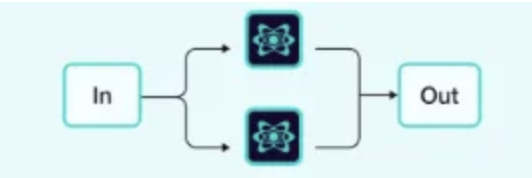

У паралельній архітектурі кілька агентів **одночасно** обробляють незалежні частини завдання. Результати збираються після завершення всіх паралельних процесів.

**Коли доцільна:** коли задачі незалежні і не потребують результатів одна одної.

**Ключова умова паралельності:** задачі повинні бути по-справжньому незалежними. Якщо Agent B потребує результату Agent A, паралельність не дасть правильного результату — потрібна послідовна архітектура.

**Переваги:** скорочення загального часу виконання — рівно до часу найдовшої з паралельних задач.

**Обмеження:** витрати на координацію. Якщо задачі дуже короткі, overhead на запуск і збір результатів може перевищити виграш у часі.

---

#### Приклад: оцінювання відповіді LLM (паралельно)


Припустімо, RAG-система вже згенерувала відповідь і нам потрібно перевірити її якість. Три агенти отримують **одну й ту ж зафіксовану відповідь** разом із необхідними їм даними:

- **Agent 1 — Factual Grounding:** перевіряє, чи підтверджені твердження наданими джерелами.
- **Agent 2 — Safety Compliance:** перевіряє відповідність правилам безпеки.
- **Agent 3 — Format Validation:** перевіряє структуру JSON, обов'язкові поля та типи даних.

Усі три перевірки **справді незалежні**: жодному агенту не потрібен результат іншого. Агрегатор об'єднує результати в єдиний звіт.

---

> **Виправлення оригінального прикладу**
>
> В оригінальному конспекті наведено приклад з паралельним перекладом тексту та аналізом тональності. Він є некоректним через залежність задач:
>
> - Якщо потрібно аналізувати тональність *оригінального* тексту — переклад не є передумовою, і паралельність виправдана.
> - Якщо потрібно аналізувати тональність *перекладеного* тексту — ці задачі залежать одна від одної і мають виконуватися послідовно.
>
> Крім того, переклад може змінити емоційне забарвлення та культурні конотації.

---

#### Приклад зі схемою branch/join (з оригінального матеріалу)

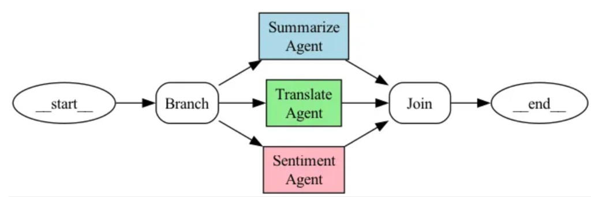

Схема Branch → Join ілюструє структуру паралельного запуску і збору результатів. Ключова деталь: **Translate** і **Sentiment** тут можуть бути паралельними лише якщо обидва обробляють один і той самий незмінний вхідний текст.

---

### 2.2. Послідовна архітектура (Sequential)

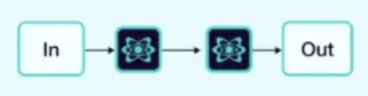

У послідовній архітектурі завдання обробляються **крок за кроком**: вихід одного агента стає входом для наступного. Кожен агент чекає завершення попереднього.

**Коли доцільна:** для процесів, що вимагають поетапної обробки, де результат кожного кроку залежить від попереднього.

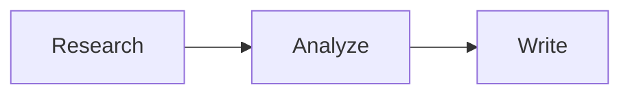

---

#### Приклад: схвалення бюджетних заявок

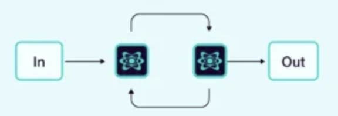

Заявка проходить від керівника команди → менеджера відділу → фінансового директора. Якщо на будь-якому етапі заявку відхиляють — подальші кроки пропускаються.

---

#### Порівняння Sequential та Handoffs

Важлива деталь: **Sequential і Handoffs не є взаємовиключними**. Головна відмінність:

| Критерій | Sequential | Handoffs |
|----------|-----------|---------|
| Порядок агентів | Зазвичай фіксований заздалегідь | Може визначатися динамічно |
| Хто обирає наступний крок | Workflow / оркестратор | Поточний агент або логіка передачі |
| Передача контексту | Дані попереднього кроку | Контекст і стан, потрібні наступному агенту |
| Можливість змінити маршрут | Якщо це передбачено workflow | Основна ідея механізму |
| Завершення | За логікою workflow | Агент може завершити роботу без подальшого handoff |

**Sequential** — це *визначений порядок виконання*. Agent Research не вирішує самостійно, кому передати роботу: цей маршрут уже закладений у workflow.

**Handoff** — це *передача відповідальності*. Поточний агент вирішує, кому передати роботу та який контекст передати.

---

### 2.3. Циклічна архітектура (Loop)

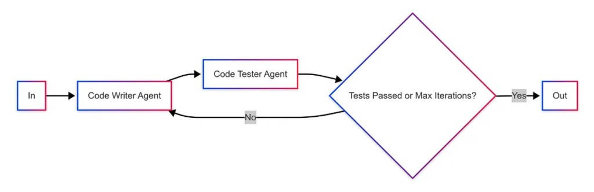

У циклічній архітектурі агенти **ітеративно** покращують результат на основі зворотного зв'язку. Цикл завершується, коли досягнуто бажаної якості або вичерпано максимальну кількість ітерацій.

**Коли доцільна:** для задач, що потребують поступового вдосконалення.

**Критичний момент:** цикл *повинен* мати умову виходу — інакше він може стати нескінченним. Типові умови:
- Досягнуто цільового показника якості
- Вичерпано максимальну кількість ітерацій (`max_iterations`)
- Агент вирішив передати управління або завершити роботу

---

#### Приклад: автоматичне написання та тестування коду

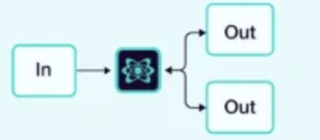

Агент-програміст пише код → агент-тестувальник знаходить помилки → програміст виправляє → цикл повторюється. Після того як тести пройшли або вичерпалося максимальна кількість ітерацій, цикл завершується.

---

### 2.4. Архітектура маршрутизатора (Router)

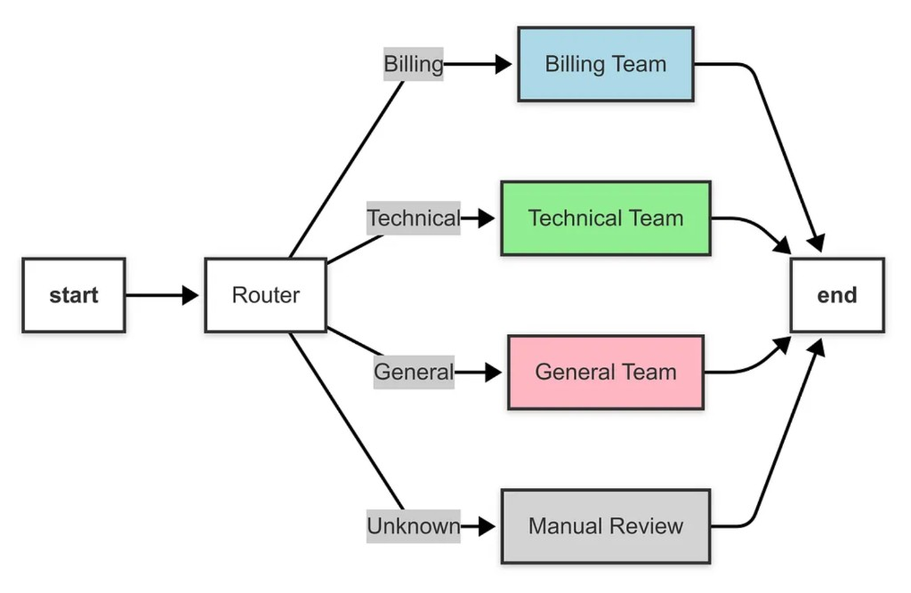

Центральний маршрутизатор аналізує вхідне завдання і **визначає**, який спеціалізований агент найкраще підходить для його розв'язання. Маршрутизатор діє як диспетчер: після вибору лише один агент обробляє запит.

**Коли доцільна:** для класифікації та розподілу запитів за типом або категорією.

---

#### Приклад: система підтримки клієнтів

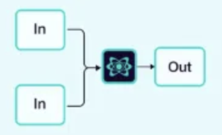

Маршрутизатор аналізує текст звернення і направляє його:
- До **Billing Team** — якщо мова про рахунок
- До **Technical Team** — якщо технічна проблема
- До **General Team** — загальні питання
- До **Manual Review** — незрозумілі або складні звернення

---

### 2.5. Архітектура агрегатора (Aggregator)

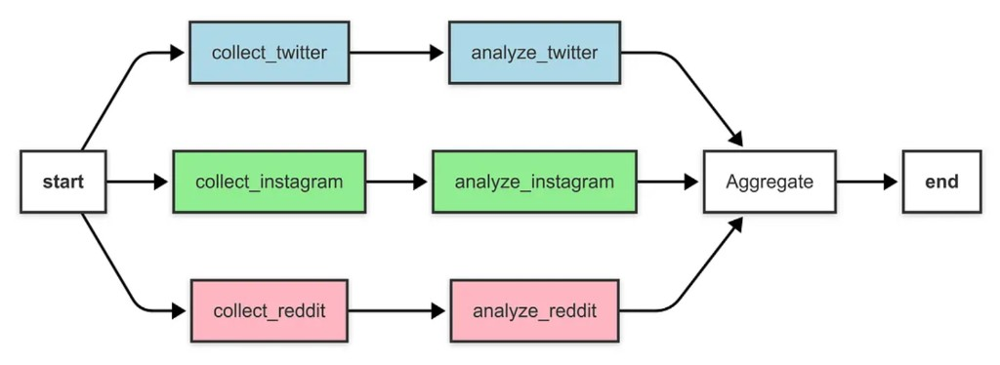

Кілька агентів збирають та обробляють інформацію з різних джерел, після чого центральний **агрегатор** об'єднує всі результати в єдиний фінальний звіт.

**Коли доцільна:** для аналітичних задач, що потребують даних з багатьох джерел.

---

#### Приклад: моніторинг репутації бренду

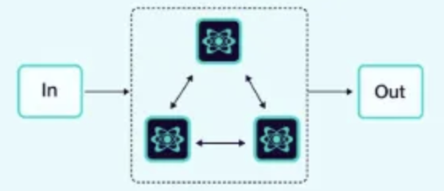

Три агенти паралельно збирають дані:
- **Twitter-агент:** виявляє негативну тональність (−0.27)
- **Instagram-агент:** знаходить позитивні відгуки (+0.55)
- **Reddit-агент:** фіксує змішані думки (+0.18)

Агрегатор об'єднує дані, обчислює середньозважену тональність і формує звіт. (Числа ілюстративні — детальніше у [unverified_claims.md](unverified_claims.md).)

---

### 2.6. Мережева архітектура (Network / Horizontal)

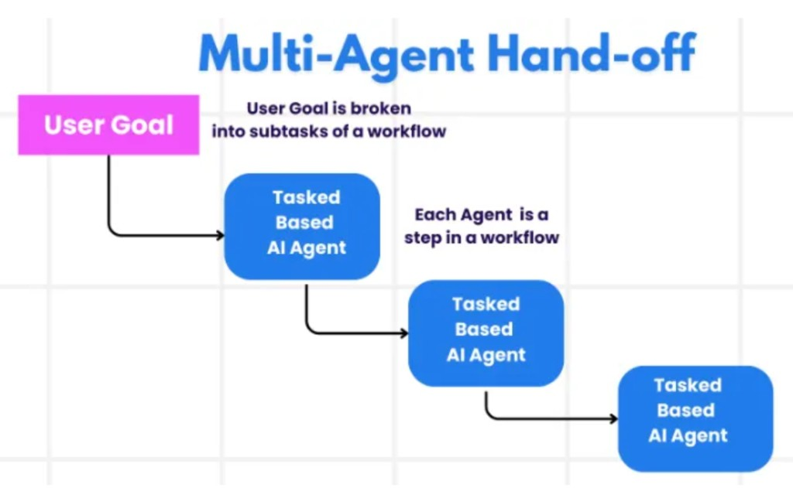

Агенти спілкуються **безпосередньо** один з одним без єдиного центрального вузла. Кожен агент може передавати керування будь-якому іншому на основі власної логіки.

**Коли доцільна:** для складних задач без чіткої ієрархії, де потрібна гнучка peer-to-peer співпраця.

**Важлива деталь:** мережева архітектура не є автоматично стійкою до відмов. Потрібно окремо передбачати обробку помилок, повторні спроби та альтернативні маршрути.

---

#### Приклад: команда експертів (Analyst, Designer, Developer)

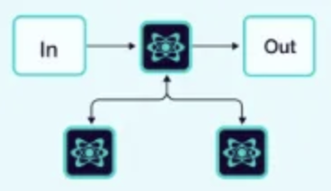

Аналітик, дизайнер і розробник можуть передавати роботу один одному в будь-якому порядку залежно від поточних потреб.

---

#### Механізми завершення у мережевій архітектурі

Без механізму завершення агенти потенційно можуть нескінченно передавати керування. Децентралізоване керування не означає відсутності правил завершення.

| Механізм | Пояснення |
|----------|----------|
| Completion condition | Досягнуто вимірюваної цілі (наприклад, всі перевірки завершено) |
| Final response / END | Агент завершує workflow замість передачі керування |
| Max iterations / hops | Обмеження кількості переходів між агентами |
| Timeout / budget | Завершення за перевищенням часу або бюджету |
| Human escalation | Передача людині, якщо агенти не можуть досягти результату |
| `recursion_limit` | Параметр LangGraph, що обмежує кількість кроків графа |

---

### 2.7. Передача керування (Handoffs)

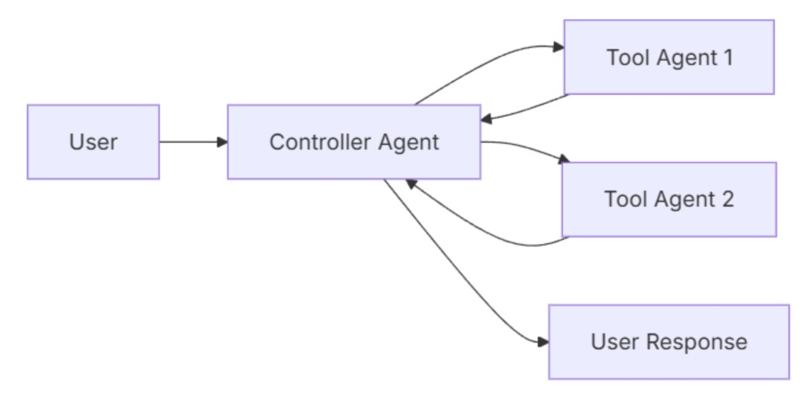

Механізм, що дозволяє агентам явно передавати керування іншому агенту разом із необхідним контекстом. На відміну від Tool Calling, тут **активний агент** динамічно змінюється, і користувач взаємодіє безпосередньо з тим, хто наразі має контроль.

**Аналогія:** дзвінок у службу підтримки, де загальний оператор переводить вас до технічного спеціаліста. Спеціаліст розмовляє з вами безпосередньо, а не через першого оператора.

**Потік виконання:**
1. Поточний агент вирішує, що завдання виходить за межі його компетенції.
2. Він передає керування (і стан розмови) наступному агенту.
3. Новий агент взаємодіє з користувачем безпосередньо.
4. Новий агент може передати керування далі або завершити розмову.

---

#### Приклад: система підтримки з передачею керування

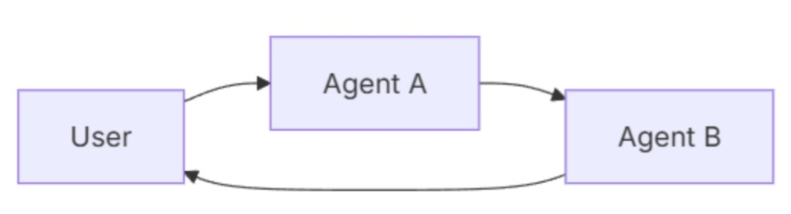

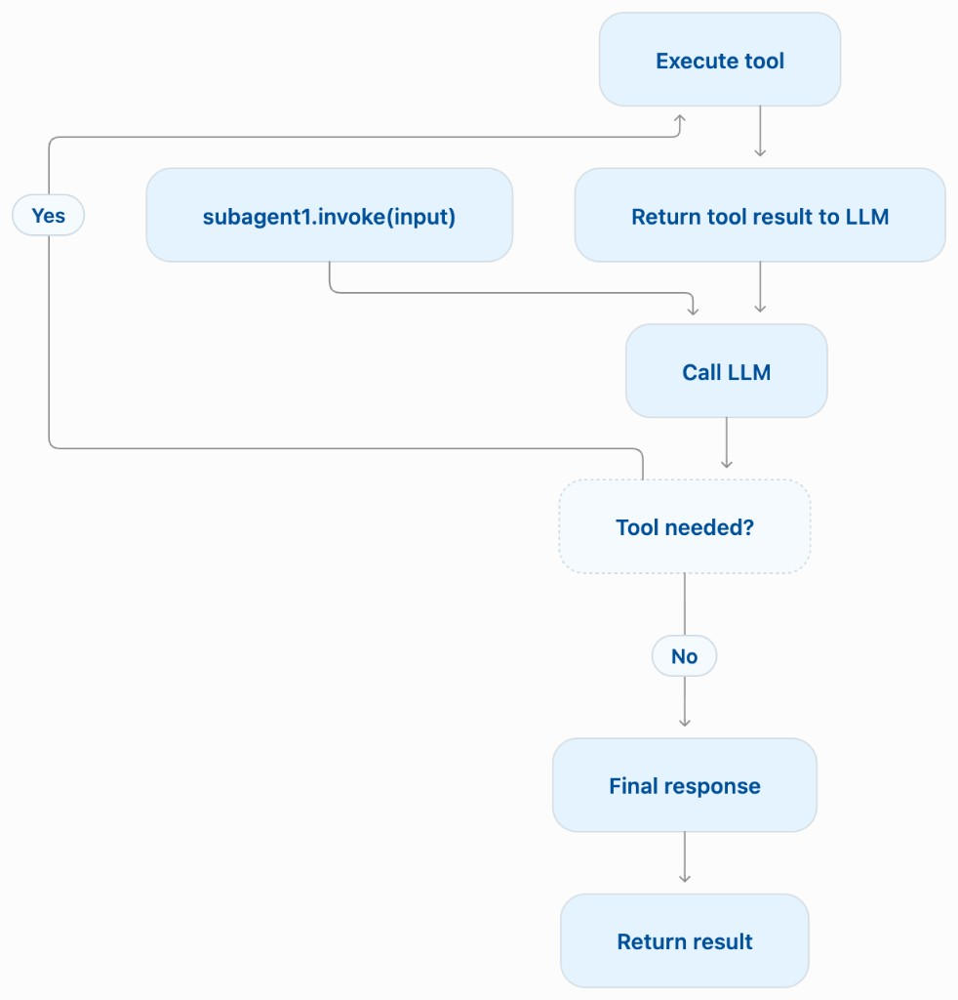

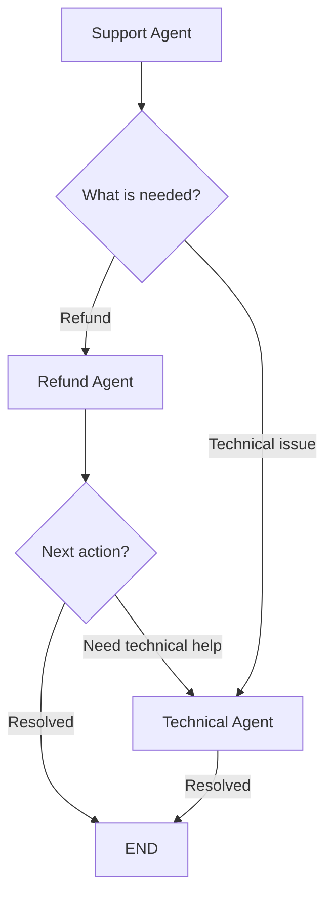

---

### 2.8. Архітектура супервізора (Supervisor)

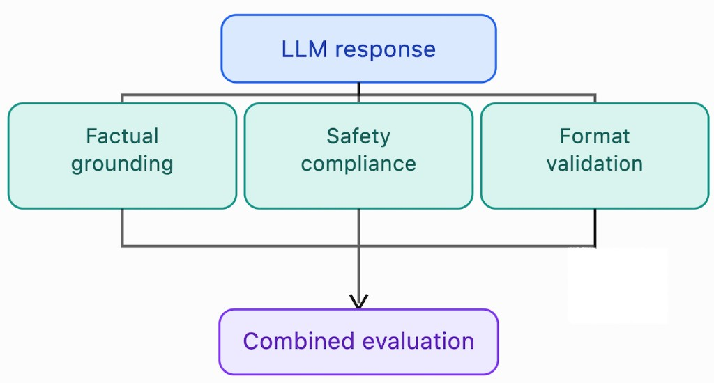

Центральний агент-супервізор **координує** роботу спеціалізованих підагентів: аналізує поточний стан, делегує задачі, отримує результати і приймає рішення про наступний крок.

Підагенти завжди повертають керування супервізору після виконання. Це забезпечує централізований контроль із можливістю динамічної маршрутизації.

**Докладна практична реалізація** — у розділі 4.

---

### 2.9. Ієрархічна архітектура (Hierarchical)

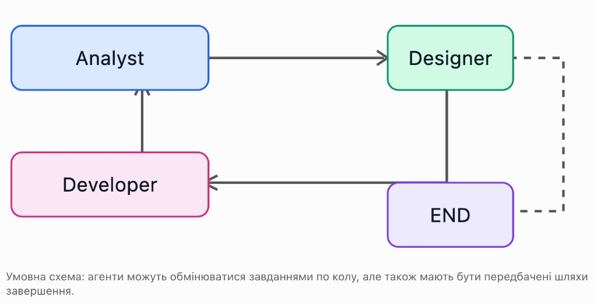

Агенти організовані в **деревоподібну структуру** з кількома рівнями керування. Агенти вищого рівня керують командами спеціалізованих агентів нижчого рівня. Топ-супервізор координує роботу між командами.

**Коли доцільна:** для великих систем, де потрібно керувати складністю через поділ на підсистеми.

**Приклад:** велика консалтингова компанія — головний супервізор керує фінансовою, технічною та маркетинговою командами, кожна з яких має свого супервізора та спеціалістів.

---

<a id="section3"></a>

## 3. Мультиагентність у LangChain / LangGraph

### 3.1. Два підходи: Tool Calling vs Handoffs

| Підхід | Як це працює | Потік керування | Приклад використання |
|--------|-------------|-----------------|---------------------|
| **Tool Calling** | Супервізор викликає інших агентів як інструменти. Підагенти виконують завдання і повертають результат супервізору. | Централізований: уся маршрутизація проходить через головного агента. | Оркестрація складних задач, структуровані workflows, чіткий контроль над послідовністю. |
| **Handoffs** | Поточний агент передає керування іншому. Активний агент змінюється. | Децентралізований: агенти самі вирішують, хто стає активним. | Багатодоменні розмови, передача до вузького спеціаліста, діалоги з переключенням контексту. |

---

#### Коли що обирати

| Питання | Tool Calling | Handoffs |
|---------|-------------|---------|
| Потрібен централізований контроль? | ✅ Так | ❌ Ні |
| Агенти взаємодіють з користувачем напряму? | ❌ Тільки головний | ✅ Кожен активний |
| Складна, природна розмова між спеціалістами? | Обмежено | ✅ Сильна підтримка |
| Чітко визначена послідовність кроків? | ✅ Ідеально | Не обов'язково |

---

### 3.2. Tool Calling: агент як інструмент

Підхід, де головний агент («контролер» або «супервізор») розглядає інших агентів як **інструменти** (`@tool`).

**Аналогія:** менеджер проєкту, який доручає завдання різним фахівцям. Кожен фахівець виконує свою частину і повідомляє менеджеру про результат.

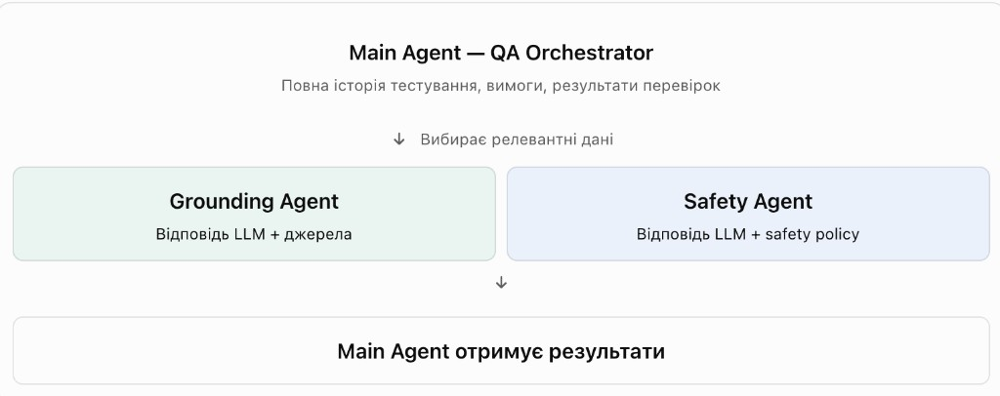

**Потік виконання:**
1. Контролер отримує запит від користувача та вирішує, який підагент викликати.
2. Підагент виконує завдання на основі інструкцій.
3. Підагент повертає результат контролеру.
4. Контролер аналізує результат і приймає рішення про наступний крок.

**Важливо:** підагенти зазвичай **не взаємодіють з користувачем** безпосередньо. Якщо вам потрібно, щоб підагент міг ставити уточнювальні запитання — використовуйте Handoffs.

---

#### Що відбувається всередині `invoke()`

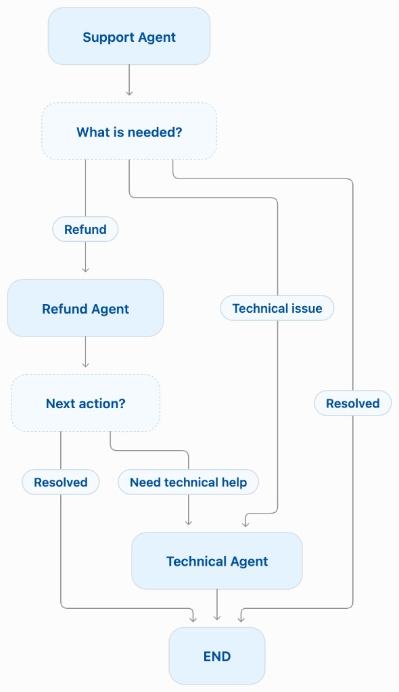

Один виклик `agent.invoke()` запускає потенційно цілий цикл:
- Виклик LLM → LLM вирішує, чи потрібен інструмент
- Якщо так → виконання інструменту → результат повертається LLM
- LLM знову вирішує → і так до фінальної відповіді

```python
# invoke() у різних об'єктах LangChain
result = llm.invoke(input)         # Викликає модель, повертає відповідь
result = agent.invoke(input)       # Запускає агента разом із можливими викликами інструментів
result = tool.invoke(input)        # Виконує конкретний інструмент
result = chain.invoke(input)       # Запускає послідовність операцій
result = graph.invoke(input)       # Запускає виконання LangGraph-графа
```

Це частина спільного інтерфейсу `Runnable` в LangChain. Інші методи: `ainvoke()` (асинхронний), `batch()` (кілька запитів), `stream()` (потокова відповідь).

---

#### Мінімальний приклад: підагент як інструмент

```python
from langchain_core.tools import tool
from langchain.agents import create_agent

# Крок 1: Створюємо підагента із власною моделлю та набором інструментів.
# Підагент ізольований — він бачить тільки свої інструменти.
subagent1 = create_agent(
    model=model,                       # LLM-модель (gpt-4o, claude-3-5-sonnet тощо)
    tools=[specialized_tool_a, specialized_tool_b],  # Інструменти тільки цього підагента
    system_prompt="Ти спеціаліст у ...",
)

# Крок 2: Обгортаємо підагента в інструмент для головного агента.
# Декоратор @tool перетворює функцію в інструмент.
# Назва і docstring — це те, що бачить головний агент, вирішуючи, коли викликати підагента.
@tool(
    "subagent1_name",                  # Ім'я інструмента — так головний агент посилається на нього
    description="subagent1_description"  # Опис: допомагає вирішити, коли викликати
)
def call_subagent1(query: str) -> str:
    """
    Функція-обгортка для виклику підагента як інструмента.

    Args:
        query: Запит або завдання для підагента.

    Returns:
        Текстова відповідь від підагента (лише фінальне повідомлення).
    """
    # Викликаємо підагента, передаючи запит як повідомлення користувача
    result = subagent1.invoke({
        "messages": [{"role": "user", "content": query}]
    })
    # Повертаємо тільки текст фінального повідомлення підагента.
    # Головному агенту не потрібно бачити проміжні виклики інструментів.
    return result["messages"][-1].content

# Крок 3: Головний агент бачить лише call_subagent1 як інструмент.
# Він не знає про внутрішню роботу підагента.
agent = create_agent(
    model=model,
    tools=[call_subagent1],
    system_prompt="Ти головний агент, координуєш роботу підагентів.",
)
```

---

### 3.3. Де налаштовувати інженерію контексту

Існує кілька ключових точок управління контекстом між головним агентом та підагентами:

**1. Ім'я підагента** — так головний агент посилається на нього у своєму «мисленні». Використовуйте описові імена: `"financial_analyst"` замість `"agent1"`.

**2. Опис підагента (docstring)** — це те, що головний агент знає про можливості підагента. Безпосередньо впливає на вирішення, коли його викликати. Приклад: *«Аналізує фінансові дані, розраховує ROI та виявляє фінансові ризики».*

**3. Вхідні дані** — яка інформація передається підагенту. У базовому прикладі це лише `query`. Можна розширити: передати історію повідомлень, метадані, попередні результати.

**4. Вихідні дані** — що підагент повертає головному агенту. У базовому прикладі — лише текст фінального повідомлення.

---

### 3.4. Контроль вхідних даних: впровадження контексту

За допомогою `ToolRuntime` інструмент може отримувати доступ до **поточного стану** головного агента і передавати підагенту лише потрібну частину.

```python
from typing import Annotated
from langchain.agents import AgentState
from langchain_core.tools import tool, InjectedToolCallId
from langchain.tools import ToolRuntime

# Розширюємо базовий стан агента власними полями.
# AgentState вже містить поле "messages"; ми додаємо ще одне.
class CustomState(AgentState):
    example_state_key: str  # Довільна назва поля — не зарезервоване слово LangChain

@tool("subagent1_name", description="subagent1_description")
def call_subagent1(
    query: str,
    runtime: ToolRuntime[None, CustomState],  # LangChain передає автоматично; LLM не бачить
) -> str:
    """
    Виклик підагента з доступом до стану головного агента.

    Args:
        query: Запит для підагента.
        runtime: Надається LangChain автоматично; містить стан головного агента.

    Returns:
        Текстова відповідь підагента.
    """
    # Застосовуємо логіку для відбору лише потрібної інформації зі стану.
    # some_logic() — це довільна функція, яку розробник визначає сам.
    # Вона може, наприклад, відфільтрувати тільки останні N повідомлень.
    subagent_input = some_logic(query, runtime.state["messages"])

    result = subagent1.invoke({
        "messages": subagent_input,
        # За потреби можна передати додаткові ключі стану.
        # ВАЖЛИВО: підагент повинен мати ці ключі у своїй схемі стану.
        "example_state_key": runtime.state["example_state_key"],
    })
    return result["messages"][-1].content
```

> **Нюанс щодо `next()`:** в оригінальному матеріалі використовується `next(message for message in runtime.state["messages"] if message.type == "human")`. Цей код повертає **перше** повідомлення користувача, а не останнє. Якщо потрібне *останнє* повідомлення, слід ітерувати по `reversed(runtime.state["messages"])`. Якщо потрібна *вся* релевантна частина історії — треба передавати список, а не одне повідомлення.

> **Нюанс щодо стану підагента:** передача стану через `invoke()` **не означає**, що підагент і головний агент автоматично поділяють один стан. Значення копіюються явно в момент виклику. Результати підагента повертаються головному агенту через інструмент.

---

### 3.5. Контроль вихідних даних: Command з оновленням стану

Якщо потрібно повернути не лише текст відповіді, а й структуровані дані, використовується об'єкт `Command`:

```python
from typing import Annotated
from langchain_core.tools import tool, InjectedToolCallId
from langchain_core.messages import ToolMessage
from langgraph.types import Command

@tool("subagent1_name", description="subagent1_description")
def call_subagent1(
    query: str,
    # InjectedToolCallId автоматично вставляється LangChain.
    # LLM не потрібно його формувати явно.
    tool_call_id: Annotated[str, InjectedToolCallId],
) -> Command:
    """
    Виклик підагента з поверненням структурованих даних назад головному агенту.

    Args:
        query: Запит для підагента.
        tool_call_id: Автоматично вставлений ID виклику інструмента.

    Returns:
        Command з оновленнями стану та повідомленням про результат.
    """
    result = subagent1.invoke({
        "messages": [{"role": "user", "content": query}]
    })

    # Command(update=...) оновлює вибрані поля стану головного агента.
    # Усі поля, які оновлюємо, мають бути оголошені у схемі стану головного агента.
    return Command(update={
        # Передаємо структурований результат у конкретне поле стану
        "example_state_key": result["example_state_key"],
        "messages": [
            # ToolMessage — спеціальний тип повідомлення для результатів виклику інструментів.
            # tool_call_id зв'язує цей результат із правильним викликом інструмента.
            ToolMessage(
                content=result["messages"][-1].content,
                tool_call_id=tool_call_id,  # Обов'язково для правильного зв'язування
            )
        ]
    })
```

**Два підходи до вихідних даних:**

| Підхід | Коли використовувати | Деталі |
|--------|---------------------|--------|
| Prompt modification | Вихідні дані неповні або неправильного формату | Додати в промпт підагента: «Включи всі результати викликів інструментів у фінальну відповідь» |
| Custom output formatting | Потрібні структуровані дані, а не лише текст | Використовувати `Command(update=...)` з `ToolMessage` |

**Поширений режим відмови:** підагент виконує виклики інструментів, але не включає їх результати у фінальне повідомлення. Вирішення: явно вказати в промпті, що фінальна відповідь повинна містити всю релевантну інформацію.

---

<a id="section4"></a>

## 4. Практична реалізація: патерн супервізора

### 4.1. Загальна концепція

Патерн супервізора (supervisor pattern) — мультиагентна архітектура, де центральний агент-супервізор координує роботу спеціалізованих агентів-працівників.

**Навіщо?** Коли задача вимагає різних типів експертності. Замість одного «універсального» агента — сфокусовані спеціалісти, кожен з яких є експертом у своєму домені.

**Трирівнева архітектура системи:**

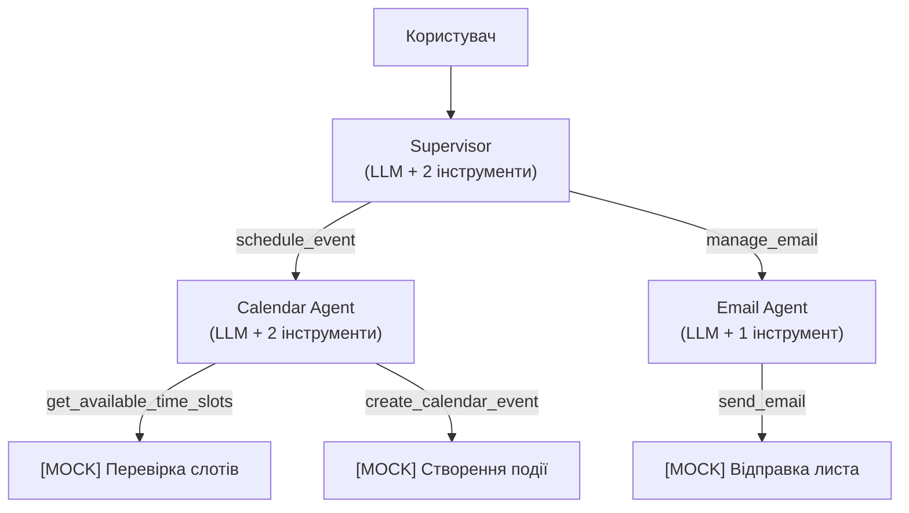

| Рівень | Компоненти | Відповідальність |
|--------|-----------|-----------------|
| **API-інструменти** | `create_calendar_event`, `send_email`, `get_available_time_slots` | Структуровані дані, точні формати (ISO-дати, email) |
| **Підагенти** | `calendar_agent`, `email_agent` | Переклад природної мови в API-виклики |
| **Супервізор** | `supervisor_agent` | Аналіз запиту, делегування, синтез відповіді |

---

### 4.2. Вибір моделі

```python
import os
from getpass import getpass
from langchain_openai import ChatOpenAI

# Безпечне налаштування ключа: не записуємо у код і не публікуємо з ноутбуком.
# getpass() запитує ключ без відображення у комірці.
if not os.getenv("OPENAI_API_KEY"):
    api_key = getpass("Вставте OpenAI API key (ввід приховано): ").strip()
    if not api_key:
        raise ValueError("Потрібен непорожній OPENAI_API_KEY")
    os.environ["OPENAI_API_KEY"] = api_key
    del api_key  # Видаляємо з пам'яті після збереження в середовищі

# MODEL_NAME можна змінити до виконання цієї комірки через змінну середовища OPENAI_MODEL.
# temperature=0 зменшує випадковість, але не гарантує повністю детерміновану поведінку.
MODEL_NAME = os.getenv("OPENAI_MODEL", "gpt-4o-mini")
model = ChatOpenAI(model=MODEL_NAME, temperature=0)
```

---

### 4.3. Mock-інструменти з валідацією

Для навчального прикладу використовуємо заглушки (mock tools), що не підключаються до реальних API, але перевіряють коректність вхідних даних і записують «дії» у mock-журнали.

```python
from datetime import date as date_type, datetime, time, timedelta
from zoneinfo import ZoneInfo
from langchain_core.tools import tool

# Mock-журнали для перевірки фактичних ефектів (не лише тексту відповіді LLM)
SIMULATED_EVENTS: list[dict] = []
SIMULATED_EMAILS: list[dict] = []

@tool
def create_calendar_event(
    title: str,
    start_time: str,       # ISO 8601 з часовим поясом: "2026-11-10T14:00:00+01:00"
    end_time: str,         # ISO 8601 з часовим поясом
    attendees: list[str],  # Список email-адрес учасників (обов'язково!)
    location: str = "",    # Місце проведення (необов'язково)
) -> str:
    """Імітувати створення календарної події без зовнішнього API.

    Args:
        title: Назва події.
        start_time: Початок у ISO 8601 із часовим поясом.
        end_time: Завершення у ISO 8601 із часовим поясом.
        attendees: Список email-адрес учасників.
        location: Необов'язкове місце проведення.

    Returns:
        Повідомлення з чіткою позначкою, що подія лише симульована.

    Raises:
        ValueError: Якщо час некоректний або учасники не вказані.
    """
    # Парсимо час: замінюємо "Z" на "+00:00" для сумісності з fromisoformat()
    start = datetime.fromisoformat(start_time.replace("Z", "+00:00"))
    end = datetime.fromisoformat(end_time.replace("Z", "+00:00"))

    # Перевірки коректності — не покладаємося на LLM
    if start.tzinfo is None or end.tzinfo is None:
        raise ValueError("start_time і end_time мають містити часовий пояс")
    if end <= start:
        raise ValueError("end_time має бути пізніше start_time")
    if not attendees:
        # ВИПРАВЛЕННЯ: підагент не повинен вигадувати учасників.
        # Якщо учасники не вказані — інструмент відхиляє запит.
        raise ValueError("Потрібно вказати принаймні одного учасника")

    record = {
        "title": title,
        "start_time": start.isoformat(),
        "end_time": end.isoformat(),
        "attendees": list(attendees),
        "location": location,
    }
    # Записуємо у mock-журнал замість реального API-виклику
    SIMULATED_EVENTS.append(record)
    return f"[MOCK] Подію '{title}' записано лише до SIMULATED_EVENTS."


@tool
def send_email(
    to: list[str],             # Список адрес одержувачів
    subject: str,              # Тема листа
    body: str,                 # Текст листа
    cc: list[str] | None = None,  # ВИПРАВЛЕННЯ: None замість [] (mutable default argument)
) -> str:
    """Імітувати надсилання email та зберегти запис у пам'яті.

    Args:
        to: Список email-адрес основних одержувачів.
        subject: Тема електронного листа.
        body: Текст листа.
        cc: Необов'язковий список одержувачів копії. Використовуємо None
            замість [] щоб уникнути помилки з mutable default argument.

    Returns:
        Повідомлення, що прямо зазначає відсутність реальної доставки.

    Raises:
        ValueError: Якщо немає адресатів, тема порожня або адреси некоректні.

    Note:
        Антипатерн: `cc: list[str] = []` — змінюваний об'єкт як значення
        за замовчуванням. Один список може використовуватися між всіма
        викликами функції і непередбачено накопичувати дані.
    """
    # Безпечне отримання списку копій (None перетворюємо на порожній список)
    recipients_cc = list(cc or [])
    if not to:
        raise ValueError("Потрібен хоча б один одержувач")
    if not subject.strip():
        raise ValueError("Тема листа не може бути порожньою")
    if not all("@" in address for address in [*to, *recipients_cc]):
        raise ValueError("Деякі адреси не схожі на email")

    record = {
        "to": list(to),
        "cc": recipients_cc,
        "subject": subject,
        "body": body,
    }
    SIMULATED_EMAILS.append(record)
    return f"[MOCK] Email до {', '.join(to)} НЕ надіслано; записано до SIMULATED_EMAILS."


@tool
def get_available_time_slots(
    attendees: list[str],    # Учасники для перевірки доступності
    date: str,               # Дата у форматі YYYY-MM-DD
    duration_minutes: int,   # Тривалість у хвилинах
) -> list[str]:
    """Повернути демонстраційні часові слоти без запиту до реального API.

    Args:
        attendees: Список учасників для умовної перевірки доступності.
        date: Дата у форматі ISO 8601, 'YYYY-MM-DD'.
        duration_minutes: Бажана тривалість події у хвилинах.

    Returns:
        Статичний список демонстраційних годин: 09:00, 14:00, 16:00.
        В реальному застосунку тут був би запит до API календаря кожного учасника.

    Raises:
        ValueError: Якщо немає учасників або параметри некоректні.

    Note:
        Ця функція ЗАВЖДИ повертає ["09:00", "14:00", "16:00"].
        Це навчальна заглушка, а не реальна перевірка доступності.
    """
    date_type.fromisoformat(date)  # Перевіряємо формат дати
    if not attendees:
        raise ValueError("Не вказані учасники")
    if duration_minutes <= 0:
        raise ValueError("Тривалість має бути додатною")
    # У реальному застосунку — запит до Google Calendar API, Outlook тощо
    return ["09:00", "14:00", "16:00"]
```

---

### 4.4. Створення спеціалізованих підагентів

```python
from langchain.agents import create_agent

# --- Агент календаря ---
# Системний промпт визначає роль і поведінку агента.
# Додано явну вимогу НЕ вигадувати дані — ключове виправлення відносно оригіналу.
CALENDAR_AGENT_PROMPT = (
    "Ти календарний агент. Працюєш з датами ISO 8601 і часовими поясами. "
    # Критичне обмеження: агент не може вигадувати учасників або дати
    "НЕ вигадуй email-адреси, дату, час чи доступність. "
    "Якщо бракує даних — постав уточнювальне запитання. "
    # Порядок: спочатку перевірка доступності, потім створення події
    "За наявності даних спочатку викликай get_available_time_slots; "
    "якщо потрібного часу немає в списку, не викликай create_calendar_event. "
    "Усі інструменти демонстраційні: називай створення події імітацією."
)

calendar_agent = create_agent(
    model=model,
    # Агент бачить ТІЛЬКИ інструменти свого домену
    tools=[get_available_time_slots, create_calendar_event],
    system_prompt=CALENDAR_AGENT_PROMPT,
)

# --- Агент електронної пошти ---
EMAIL_AGENT_PROMPT = (
    "Ти агент електронної пошти. Готуй короткі ввічливі повідомлення. "
    # Критичне обмеження: агент не може вигадувати адреси
    "НЕ вигадуй одержувачів, їхні адреси чи факти. Якщо бракує адрес — запитай. "
    "За наявності всіх даних викликай send_email. "
    "Підкреслюй, що інструмент лише імітує відправку листів."
)

email_agent = create_agent(
    model=model,
    # Агент бачить ТІЛЬКИ інструменти свого домену
    tools=[send_email],
    system_prompt=EMAIL_AGENT_PROMPT,
)
```

---

### 4.5. Обгортання підагентів як інструментів супервізора

```python
@tool
def schedule_event(request: str) -> str:
    """Делегувати календарну задачу спеціалізованому календарному агенту.

    Використовуй, коли потрібно створити, змінити або перевірити події календаря.
    Обробляє парсинг природної мови, перевірку доступності та створення подій.

    Args:
        request: Природномовне завдання з відомими датою, часом,
            учасниками і часовим поясом або запит на уточнення цих даних.

    Returns:
        Фінальна відповідь календарного підагента. Операції є mock.

    Note:
        Супервізор бачить ТІЛЬКИ цей інструмент, а не низькорівневі
        create_calendar_event чи get_available_time_slots.
        Це ключовий архітектурний крок — ізоляція рівнів абстракції.
    """
    result = calendar_agent.invoke(
        {"messages": [{"role": "user", "content": request}]}
    )
    # Повертаємо тільки фінальну відповідь — проміжні виклики інструментів
    # супервізору бачити не обов'язково
    content = result["messages"][-1].content
    return content if isinstance(content, str) else str(content)


@tool
def manage_email(request: str) -> str:
    """Делегувати підготовку mock-листа спеціалізованому email-агенту.

    Використовуй, коли потрібно надіслати сповіщення, нагадування або
    будь-яку іншу електронну комунікацію. Обробляє витягання одержувачів,
    генерацію теми та складання листа.

    Args:
        request: Текст задачі з адресами, метою листа і контекстом.

    Returns:
        Фінальна відповідь поштового підагента; реальної доставки немає.
    """
    result = email_agent.invoke(
        {"messages": [{"role": "user", "content": request}]}
    )
    content = result["messages"][-1].content
    return content if isinstance(content, str) else str(content)
```

---

### 4.6. Створення та тестування супервізора

```python
SUPERVISOR_PROMPT = (
    "Ти супервізор календарного і поштового агентів. "
    "За потреби делегуй календарні задачі інструменту schedule_event, "
    "а електронну пошту — інструменту manage_email. "
    # Порядок: спочатку calendar, потім email — email може містити деталі зустрічі
    "Для запиту 'створи подію та надішли нагадування' спочатку спробуй "
    "отримати результат calendar-агента, потім делегуй підготовку листа. "
    "Не вигадуй дані, яких немає. "
    "Пам'ятай, обидва зовнішні сервіси тут лише імітуються."
)

# Супервізор бачить ТІЛЬКИ schedule_event і manage_email
supervisor_agent = create_agent(
    model=model,
    tools=[schedule_event, manage_email],
    system_prompt=SUPERVISOR_PROMPT,
)
```

**Допоміжна функція для відображення роботи агента:**

```python
def print_agent_stream(agent, user_request: str) -> None:
    """Виконати агентний запит і надрукувати оновлення вузлів графа.

    Args:
        agent: Агент, створений через LangChain create_agent.
        user_request: Задача користувача природною мовою.

    Returns:
        None. Повідомлення друкуються у вигляді потоку.

    Warning:
        Це справжній виклик OpenAI API (не mock). Він не є безкоштовним.
    """
    for update in agent.stream(
        {"messages": [{"role": "user", "content": user_request}]},
        stream_mode="updates",  # Повертає оновлення після кожного вузла
    ):
        for node_name, state_update in update.items():
            print(f"\n--- Вузол: {node_name} ---")
            if isinstance(state_update, dict):
                for message in state_update.get("messages", []):
                    if hasattr(message, "pretty_print"):
                        message.pretty_print()
                    else:
                        print(message)
```

**Тест: однодоменний запит (тільки календар)**

```python
# Правильний запит: всі деталі вказані явно, нічого не треба домислювати
TIMEZONE = ZoneInfo("Europe/Warsaw")
TODAY = datetime.now(TIMEZONE).date()
days_until_next_tuesday = (1 - TODAY.weekday()) % 7 or 7
MEETING_DATE = TODAY + timedelta(days=days_until_next_tuesday)
MEETING_START = datetime.combine(MEETING_DATE, time(14, 0), tzinfo=TIMEZONE)
MEETING_END = MEETING_START + timedelta(hours=1)
TEST_RECIPIENTS = ["designer1@example.com", "designer2@example.com"]

query = (
    f"Створи демонстраційну зустріч команди дизайну {MEETING_START.isoformat()} "
    f"до {MEETING_END.isoformat()} з учасниками {', '.join(TEST_RECIPIENTS)}."
)
print_agent_stream(supervisor_agent, query)
```

**Тест: мультидоменний запит (календар + email)**

```python
# Супервізор повинен викликати обидва підагенти
multi_query = (
    f"Створи демонстраційну зустріч команди дизайну {MEETING_START.isoformat()} "
    f"до {MEETING_END.isoformat()} з учасниками {', '.join(TEST_RECIPIENTS)}, "
    "і підготуй їм mock-email з нагадуванням про перегляд нових макетів."
)
print_agent_stream(supervisor_agent, multi_query)
```

> **Технічна деталь: паралельні vs послідовні виклики інструментів**
>
> Якщо в системному промпті не вказано явний порядок, LLM може видати кілька `tool_call` в одному повідомленні — тоді runtime **виконає їх паралельно**, а не послідовно. Якщо email-агент повинен знати результати calendar-агента (наприклад, конкретну дату події), слід або вказати в промпті *«спочатку calendar, потім email»*, або реалізувати жорстку послідовність через граф LangGraph.

---

### 4.7. Перевірка фактичних ефектів (не лише тексту)

```python
# ПРАВИЛЬНИЙ підхід до тестування агентів:
# Перевіряємо фактичні записи в mock-журналах, а НЕ лише текст відповіді LLM.
# Агент може написати "успішно", навіть якщо tool не спрацював.
print("Кількість mock-подій:", len(SIMULATED_EVENTS))
print("Кількість mock-листів:", len(SIMULATED_EMAILS))
if SIMULATED_EVENTS:
    print("Остання подія:", SIMULATED_EVENTS[-1])
if SIMULATED_EMAILS:
    print("Останній лист:", SIMULATED_EMAILS[-1])

# Негативний тест: некоректний часовий діапазон
events_before = len(SIMULATED_EVENTS)
try:
    create_calendar_event.invoke({
        "title": "Некоректний тест",
        "start_time": MEETING_END.isoformat(),   # Кінець раніше початку
        "end_time": MEETING_START.isoformat(),
        "attendees": TEST_RECIPIENTS,
    })
except ValueError as error:
    print("Очікувана помилка:", error)
else:
    raise AssertionError("Некоректна подія не була відхилена!")

assert len(SIMULATED_EVENTS) == events_before  # Журнал не змінився
print("PASS: некоректна подія не записана.")
```

---

<a id="section5"></a>

## 5. Human-in-the-Loop (HITL)

### 5.1. Концепція та навіщо це потрібно

**Human-in-the-Loop** — підхід, де людина бере участь у циклі агента: переглядає, редагує або схвалює певні дії перед їх виконанням.

Деякі операції агента є **безпечними** (читання даних), інші — **критичними** (фінансові транзакції, відправка листів, видалення записів). `HumanInTheLoopMiddleware` дозволяє визначити, які інструменти потребують схвалення.

**Як це працює:**
1. Агент вирішує викликати підконтрольний інструмент.
2. Middleware автоматично призупиняє виконання і повертає опис дії людині.
3. Людина приймає рішення: схвалити, відредагувати або відхилити.
4. Виконання відновлюється через `Command(resume=...)` з тим самим `thread_id`.

**Що потрібно для роботи HITL:**
- `checkpointer` — зберігає стан між перериванням і відновленням (наприклад, `InMemorySaver`)
- `thread_id` — ідентифікатор сесії; *критично* передавати той самий при відновленні
- `interrupt_mode="per_call"` — окреме переривання для кожного виклику інструмента

---

### 5.2. Можливі рішення людини

| Рішення | Що відбувається |
|---------|----------------|
| `approve` | Інструмент виконується з оригінальними аргументами |
| `edit` | Аргументи змінюються, потім інструмент виконується |
| `reject` | Інструмент **не виконується**; виконання продовжується без цієї дії |
| `respond` | Людина надає відповідь замість виконання інструмента |

> **Виправлення:** в оригінальному матеріалі перелічено лише `approve`, `edit`, `reject`. Тип рішення `respond` також підтримується LangChain і дозволяє людині самостійно надати відповідь замість виклику інструмента.

---

### 5.3. Реалізація HITL

```python
from uuid import uuid4
from langchain.agents import create_agent
from langchain.agents.middleware import HumanInTheLoopMiddleware
from langgraph.checkpoint.memory import InMemorySaver
from langgraph.types import Command

# Два рівні HITL-контролю:
# 1. Перехоплення на рівні супервізора (schedule_event, manage_email)
#    — затвердження перед БУДЬ-ЯКИМ делегуванням
# 2. Перехоплення на рівні підагента (send_email)
#    — затвердження перед конкретним API-викликом з аргументами (to, subject, body)
#
# Це РІЗНІ рівні контролю, і їх важливо не плутати!
# На рівні супервізора видно лише "request" (рядок),
# на рівні підагента — структуровані аргументи (to, subject, body).

supervisor_agent_hitl = create_agent(
    model=model,
    tools=[schedule_event, manage_email],
    system_prompt=SUPERVISOR_PROMPT,
    middleware=[
        HumanInTheLoopMiddleware(
            interrupt_on={
                # interrupt_on: словник {назва_інструмента: налаштування}
                "schedule_event": {"allowed_decisions": ["approve", "edit", "reject"]},
                "manage_email": {"allowed_decisions": ["approve", "edit", "reject"]},
            },
            # per_call: окреме переривання для кожного виклику інструмента
            # (потребує langchain >= 1.4.6)
            interrupt_mode="per_call",
            description_prefix="Потрібне рішення людини перед делегуванням",
        )
    ],
    # checkpointer НЕОБХІДНИЙ для HITL: зберігає стан між паузою та відновленням.
    # InMemorySaver зберігає в RAM (зникає після перезапуску процесу).
    # Для production потрібен persistent storage (SQLite, Postgres).
    checkpointer=InMemorySaver(),
)
```

---

### 5.4. Запуск та обробка переривань

```python
# Щоразу генеруємо новий унікальний thread_id для нової сесії.
# Якщо використати той самий thread_id після перезапуску — відновиться попередня сесія.
hitl_config = {"configurable": {"thread_id": f"supervisor-{uuid4()}"}}

hitl_result = supervisor_agent_hitl.invoke(
    {"messages": [{"role": "user", "content": multi_query}]},
    config=hitl_config,  # Передаємо thread_id для збереження стану
    version="v2",        # version="v2" повертає об'єкт з полями value і interrupts
)

# Перевіряємо, чи є переривання
print("Кількість переривань:", len(hitl_result.interrupts))
for interrupt_ in hitl_result.interrupts:
    print("\nID переривання:", interrupt_.id)
    print("Назва tool:", interrupt_.value.get("name"))
    print("Аргументи:", interrupt_.value.get("args"))
```

---

### 5.5. Функція ручного рев'ю (правильна реалізація)

```python
def collect_human_decisions(interrupts) -> dict[str, dict]:
    """Зібрати явне рішення користувача для кожного HITL-переривання.

    Args:
        interrupts: Список переривань LangGraph у режимі per_call.
            Кожне має id і value з назвою tool та первинними аргументами.

    Returns:
        Словник {interrupt_id: decision} для Command(resume=...).

    Raises:
        ValueError: Якщо рішення, поле редагування або нове значення некоректні.

    Note:
        Жодна дія НЕ схвалюється автоматично. Людина обирає рішення
        для кожного переривання.

        ВИПРАВЛЕННЯ ОРИГІНАЛУ: не використовуємо жорстко прописаний interrupt ID
        (наприклад, "2b56f299be313ad8bc689eff02973f16"). ID змінюється між
        запусками. Правильно: визначати потрібну дію за назвою інструмента
        (interrupt_.value["name"]), а потім використовувати фактичний interrupt_.id.
    """
    decisions: dict[str, dict] = {}
    for interrupt_ in interrupts:
        action = interrupt_.value
        action_name = action["name"]           # Назва інструмента
        original_args = dict(action["args"])   # Оригінальні аргументи

        print("\n=== Запит дозволу ===")
        print("Tool:", action_name)
        print("Аргументи:", original_args)
        # Людина явно обирає рішення для кожного переривання
        choice = input("Рішення [approve/edit/reject]: ").strip().lower()

        if choice == "approve":
            decision = {"type": "approve"}

        elif choice == "reject":
            reason = input("Причина відхилення: ").strip() or "Не затверджено"
            decision = {"type": "reject", "message": reason}

        elif choice == "edit":
            field = input(f"Поле для редагування {list(original_args)}: ").strip()
            if field not in original_args:
                raise ValueError(f"Tool не приймає поля {field!r}")
            original_value = original_args[field]
            raw = input(f"Нове значення поля {field}: ").strip()
            if not raw:
                raise ValueError("Нове значення не може бути порожнім")

            # Зберігаємо тип даних: список залишається списком, рядок — рядком
            if isinstance(original_value, list):
                new_value = [item.strip() for item in raw.split(",") if item.strip()]
            elif isinstance(original_value, int) and not isinstance(original_value, bool):
                new_value = int(raw)
            elif isinstance(original_value, str):
                new_value = raw
            else:
                raise ValueError("Цей тип аргументу не підтримує просте редагування")

            edited_args = {**original_args, field: new_value}
            decision = {
                "type": "edit",
                "edited_action": {"name": action_name, "args": edited_args},
            }
        else:
            raise ValueError("Оберіть лише approve, edit або reject")

        # Використовуємо фактичний ID переривання — він унікальний для кожного запуску
        decisions[interrupt_.id] = decision

    return decisions
```

---

### 5.6. Відновлення після рішення людини

```python
# Цикл відновлення: повторюємо, доки є переривання або вичерпано ліміт раундів
for review_round in range(1, 7):  # Захист від нескінченного навчального циклу
    if not hitl_result.interrupts:
        print("Роботу завершено без нових переривань.")
        break

    print(f"\n--- HITL: раунд {review_round} ---")
    decisions = collect_human_decisions(hitl_result.interrupts)

    hitl_result = supervisor_agent_hitl.invoke(
        Command(resume=decisions),  # Передаємо рішення людини
        config=hitl_config,         # ТОЙ САМИЙ thread_id — критично важливо!
        version="v2",
    )
else:
    print("Досягнуто ліміт раундів рев'ю.")

if not hitl_result.interrupts:
    print("\nФінальна відповідь:")
    print(hitl_result.value["messages"][-1].content)
```

---

### 5.7. Два рівні HITL-контролю

> **Важлива деталь:** редагування на рівні супервізора і на рівні підагента — це **різні операції**.

| Рівень | Що контролюємо | Видимі аргументи |
|--------|---------------|-----------------|
| Супервізор | Чи взагалі делегувати задачу | `request` (рядок природною мовою) |
| Підагент (send_email) | Конкретні поля листа | `to`, `subject`, `body`, `cc` |

Щоб редагувати `subject` листа, потрібно перехоплювати **`send_email`** на рівні email-агента — тоді будуть доступні структуровані аргументи.

```python
# Окремий поштовий агент із HITL для редагування конкретних полів листа
email_approval_agent = create_agent(
    model=model,
    tools=[send_email],
    system_prompt=EMAIL_AGENT_PROMPT,
    middleware=[
        HumanInTheLoopMiddleware(
            interrupt_on={
                "send_email": {"allowed_decisions": ["approve", "edit", "reject"]}
            },
            interrupt_mode="per_call",
        )
    ],
    # Власний checkpointer — незалежний від supervisor_agent_hitl
    checkpointer=InMemorySaver(),
)
```

---

<a id="section6"></a>

## 6. Знайдені неточності оригінального конспекту

Детальний аналіз порівняно з офіційною документацією LangChain та перевіркою логіки.

| № | Де | Проблема | Виправлення |
|---|----|----------|-------------|
| 1 | Приклад 1, Supervisor | Агент самостійно додає «Алісу та Боба», яких немає у запиті | Агент не повинен вигадувати учасників; промпт виправлено: «НЕ вигадуй email-адреси» |
| 2 | Приклад 2, Supervisor | Написано «агенти запускаються послідовно», хоча в trace два `tool_call` в одному повідомленні | Це може бути паралельне виконання; для гарантованої послідовності потрібен явний граф |
| 3 | `get_available_time_slots` | Представлено як «перевірка доступності», хоча завжди повертає фіксований список | Явно позначено як mock (заглушка), а не реальна перевірка |
| 4 | `create_calendar_event` | Написано «подію створено», але нічого не записується | Використовується `SIMULATED_EVENTS` — прозора позначка `[MOCK]` у відповіді |
| 5 | `send_email` | Написано «лист надіслано», але доставки немає | Використовується `SIMULATED_EMAILS` — позначка `[MOCK] ... НЕ надіслано` |
| 6 | `schedule_event` | Опис каже «може змінювати події», але інструмента немає | Звужено опис до реальних можливостей або треба додати `update_calendar_event` |
| 7 | Дати в прикладах | `2024-01-16` і `2024-06-18` для «наступного вівторка» без пояснення | Дата обчислюється від `TODAY` у часовому поясі `Europe/Warsaw`; ISO з часовим поясом |
| 8 | Передача контексту | «Передаємо повний контекст розмови підагенту» | Код передає лише перше повідомлення користувача або підзапит |
| 9 | `send_email(cc=[])` | Змінюваний об'єкт як значення аргументу за замовчуванням | Виправлено на `cc: list[str] \| None = None` |
| 10 | ISO-дати без часових поясів | Не враховується різниця між часовими поясами | Додана перевірка `tzinfo is None` у `create_calendar_event` |
| 11 | Hardcoded interrupt ID | `if interrupt_.id == "2b56f299..."` — ID змінюється між запусками | Визначати потрібну дію за `interrupt_.value["name"]`, потім використовувати `interrupt_.id` |
| 12 | Відсутній тип `respond` | Перелічено лише approve/edit/reject | LangChain підтримує також `respond` |

---

<a id="section7"></a>

## 7. QA-перспектива: тестування мультиагентних систем

Мультиагентні системи потрібно тестувати не лише на якість відповідей LLM, а й на **правильність маршрутизації, передачу стану та завершення workflow**.

### 7.1. Ключові тестові сценарії

| Сценарій | Що перевіряти | Чому це важливо |
|----------|--------------|-----------------|
| Missing information | Агент уточнює, а не вигадує email чи учасників | Безпека, коректність даних |
| Invalid input | Tool відхиляє некоректні дати, часові пояси | Бізнес-правила, цілісність |
| Tool failure | Якщо API повернуло помилку, агент не повідомляє про успіх | Довіра до системи |
| Dependency handling | Лист не надсилається як підтвердження зустрічі, що не створена | Залежності між діями |
| HITL approve | Дія виконується з оригінальними аргументами | Коректність схвалення |
| HITL edit | Tool викликається зі зміненими аргументами | Коректність редагування |
| HITL reject | Контрольований tool **не запускається** | Дійсний людський контроль |
| Routing correctness | Запит про лист не потрапляє до calendar-агента | Правильна маршрутизація |
| State management | Підагент отримує потрібний контекст, але не зайві дані | Якість context engineering |
| Retry / resume | Повторний запуск не створює дублікатів у журналі | Idempotency |
| Infinite loop | Граф завершується, а не крутиться нескінченно | `recursion_limit`, умови виходу |
| InMemorySaver scope | Стан втрачається після перезапуску ядра | Планування persistence |

### 7.2. Принцип: перевіряти ефекти, а не лише текст

```python
# НЕПРАВИЛЬНО: Довіряємо тільки тексту відповіді LLM
response = agent.invoke({"messages": [{"role": "user", "content": query}]})
assert "успішно" in response["messages"][-1].content  # LLM міг написати неправду

# ПРАВИЛЬНО: Перевіряємо фактичний запис у mock-журналі
events_before = len(SIMULATED_EVENTS)
agent.invoke({"messages": [{"role": "user", "content": query}]})
assert len(SIMULATED_EVENTS) == events_before + 1   # Подія справді записана
assert SIMULATED_EVENTS[-1]["title"] == "Командна зустріч"  # Правильна назва
assert len(SIMULATED_EVENTS[-1]["attendees"]) > 0          # Є учасники
```

### 7.3. Тестова матриця для HITL

| Test ID | Scenario | Input | Expected | Key assertion |
|---------|----------|-------|----------|---------------|
| HITL-01 | Approve schedule | Запит на зустріч + approve | Подія в SIMULATED_EVENTS | `len(SIMULATED_EVENTS) == before + 1` |
| HITL-02 | Reject email | Запит на лист + reject | Лист НЕ записаний | `len(SIMULATED_EMAILS) == before` |
| HITL-03 | Edit subject | Запит на лист + edit subject | Лист із новою темою | `SIMULATED_EMAILS[-1]["subject"] == new_subject` |
| HITL-04 | No attendees | Запит без учасників | ValueError від tool | `pytest.raises(ValueError)` |
| HITL-05 | Invalid time | end < start | ValueError від tool | `pytest.raises(ValueError)` |

---

<a id="section8"></a>

## 8. Підсумкові таблиці

### 8.1. Мультиагентні системи: зведена таблиця

| Тема | Що потрібно знати | Ключові моменти |
|------|------------------|-----------------|
| Проблеми одноагентної архітектури | Tool overload, attention saturation, context overload | Велика кількість інструментів ускладнює вибір; надмірний контекст може знижувати якість. 50+ — орієнтир, а не абсолютний поріг. |
| Коли потрібна мультиагентна система | Спеціалізація, складність, масштабування | Коли один агент погано справляється з кількома доменами або інструментами. |
| Дев'ять архітектур | Parallel, Sequential, Loop, Router, Aggregator, Network, Handoffs, Supervisor, Hierarchical | Не взаємовиключні: в одній системі можуть комбінуватися кілька патернів. |
| Tool Calling vs Handoffs | Централізоване та децентралізоване керування | Tool calling: головний агент викликає підагента як інструмент і отримує результат. Handoff: керування передається іншому агенту, який продовжує виконання. |
| Агент як інструмент | `@tool`, `create_agent()`, `invoke()` | Підагент у `create_agent()`. Функція-обгортка `@tool` викликає його через `.invoke()`. |
| Context Engineering | Контроль інструкцій, інструментів, входів і виходів | Передавати кожному агенту лише релевантні дані. |
| Supervisor Pattern | API tools → Subagents → Supervisor | Супервізор розподіляє задачі; підагенти виконують спеціалізовану роботу. |
| State Management | `AgentState`, state keys, `ToolRuntime`, `Command` | `AgentState` — структура стану; `ToolRuntime` — доступ до неї; `Command(update=...)` — оновлення стану. |
| Контроль результатів | Prompt modification, custom output formatting | Можна вимагати формат у промпті або програмно обробляти результат. |
| Human-in-the-Loop | `HumanInTheLoopMiddleware`, checkpointer, interrupt/resume | Людина схвалює, редагує або відхиляє дію; `checkpointer` зберігає стан для відновлення. |
| Коли Supervisor vs Handoffs | Вибір способу координації | Supervisor: централізована координація. Handoffs: пряма взаємодія агентів з користувачем. |
| Checkpointer | Persistence, interrupt, resume | Зберігає стан виконання; необхідний для HITL. `InMemorySaver` — для навчання. |
| Найкращі практики | Чіткі ролі, ізоляція, тестування | Мінімізувати зайвий контекст, тестувати незалежно й разом, перевіряти ефекти. |

---

### 8.2. Дев'ять архітектур: таблиця для повторення

| Архітектура | Як працює | Коли використовувати |
|-------------|----------|---------------------|
| Parallel | Агенти виконують **незалежні** задачі одночасно | Незалежні перевірки, аналіз різних джерел |
| Sequential | Результат попереднього передається наступному | Поетапна обробка з визначеним порядком |
| Loop | Агенти повторюють цикл із урахуванням feedback | Генерація → перевірка → виправлення |
| Router | Маршрутизатор вибирає відповідного агента | Класифікація та розподіл запитів |
| Aggregator | Об'єднує результати кількох агентів | Аналітичні звіти, синтез інформації |
| Network / Horizontal | Агенти взаємодіють без центрального супервізора | Динамічна peer-to-peer співпраця |
| Handoffs | Поточний агент передає керування іншому | Динамічна зміна відповідального агента |
| Supervisor | Центральний агент координує спеціалістів | Кілька доменів із централізованим керуванням |
| Hierarchical | Кілька рівнів супервізорів та їхніх команд | Великі системи з багаторівневою координацією |

---

### 8.3. Коли використовувати Supervisor

**✅ Використовуйте Supervisor, коли:**
- У вас є кілька різних доменів (календар, email, CRM, база даних)
- Кожен домен має кілька інструментів або складну логіку
- Потрібен централізований контроль workflow
- Підагентам не потрібно спілкуватися з користувачем — достатньо повертати результати

**❌ Не використовуйте Supervisor:**
- Для простіших задач з кількома інструментами — один агент справиться краще
- Коли агентам потрібно вести діалог із користувачем — використовуйте Handoffs
- Коли потрібна peer-to-peer співпраця без ієрархії — розгляньте Network або Handoffs

---

<a id="section9"></a>

## 9. Самостійні вправи

1. **Початковий рівень.** Змініть запит на одну дію (лише календар або лише email). Які tools викликає супервізор?

2. **Середній рівень.** Приберіть адреси учасників із запиту. Чи уточнює агент дані? Перевірте `SIMULATED_EMAILS`.

3. **Середній рівень.** Під час HITL-рев'ю спробуйте `approve`, `edit` та `reject`. Чи відповідає кожне рішення фактичним записам у журналі?

4. **Просунутий рівень.** Додайте в mock-подію унікальний `event_id` і захист від дублювання за ним. Напишіть негативний тест.

5. **Просунутий рівень.** Замініть промптове *«спочатку calendar, потім email»* на **явний граф LangGraph із послідовними вузлами**, щоб порядок виконання був гарантованим, а не залежав від LLM.

**Питання для самоперевірки:**

- Чим відрізняється затвердження `manage_email(request=...)` на рівні супервізора від затвердження `send_email(to=..., subject=..., body=...)` всередині email-агента?
- Якщо `reject` на рівні супервізора — чи виконається `send_email`?
- Чому `InMemorySaver` не підходить для production?
- Яка різниця між `Parallel` і `Aggregator`? Чи можна їх поєднати?

---

<a id="sources"></a>

## 10. Джерела та посилання

### Офіційна документація LangChain / LangGraph

- [LangChain — Subagents (Multi-Agent)](https://docs.langchain.com/oss/python/langchain/multi-agent/subagents)
- [LangChain — Personal Assistant with Subagents](https://docs.langchain.com/oss/python/langchain/multi-agent/subagents-personal-assistant)
- [LangChain — Human-in-the-loop](https://docs.langchain.com/oss/python/langchain/human-in-the-loop)
- [LangGraph — Interrupts](https://docs.langchain.com/oss/python/langgraph/interrupts)
- [LangGraph — Persistence / Checkpointers](https://langchain-ai.github.io/langgraph/concepts/persistence/)
- [LangGraph — Low-Level Concepts](https://langchain-ai.github.io/langgraph/concepts/low_level/)
- [LangChain — Runnable Interface](https://reference.langchain.com/python/langchain-core/runnables/base/Runnable)

### Мультиагентні патерни

- [OpenAI Agents SDK — Handoffs](https://openai.github.io/openai-agents-python/handoffs/)
- [Medium — AI Agents: Multi-Agent Architectures (Part 7)](https://medium.com/@vipra_singh/ai-agents-multi-agent-architectures-part-7-0f0e185bb083#239d)

### Навчальний матеріал

- [Код лекції: AI_topic_10_lesson_reviewed.ipynb](AI_topic_10_lesson_reviewed.ipynb)
- [Ілюстративні числа та твердження без першоджерела](unverified_claims.md)
