# КОНСПЕКТ-ДОВІДНИК ЛЕКЦІЇ №11: MCP та A2A — стандарти взаємодії AI-агентів

> **Тема:** Model Context Protocol (MCP) та Agent-to-Agent Protocol (A2A): архітектура, примітиви, транспорт, безпека, практичне застосування та порівняння протоколів.
>
> **Формат:** розгорнутий навчальний довідник з виправленнями неточностей оригінального матеріалу, поясненнями простими словами, схемами, таблицями, практичними кейсами і кодом.
>
> **Код:** [`тема_11/MU_AI_topic_11_lesson_MCP_A2A.ipynb`](MU_AI_topic_11_lesson_MCP_A2A.ipynb)
>
> **Ілюстративні числа та твердження без першоджерела:** [`тема_11/unverified_claims.md`](unverified_claims.md)

---

## Зміст

1. [Словник термінів і скорочень](#dictionary)
2. [Вступ: навіщо потрібна стандартизація](#intro)
3. [Базові поняття](#basics)
   - 3.1 [Що таке «сервер» насправді](#server-role)
   - 3.2 [Пошукові API та Tavily — у чому різниця](#tavily)
   - 3.3 [JSON-RPC — мова запитів між процесами](#jsonrpc)
   - 3.4 [stdin / stdout / stderr](#stdio)
   - 3.5 [LSP — джерело натхнення для MCP](#lsp)
4. [MCP — Model Context Protocol](#mcp)
   - 4.1 [Проблема N×M](#nxm)
   - 4.2 [Що таке MCP та аналогія з USB-C](#what-is-mcp)
   - 4.3 [Архітектура: Host → Clients → Servers](#architecture)
   - 4.4 [Транспортний рівень: stdio та Streamable HTTP](#transport)
   - 4.5 [Примітиви сервера: Tools, Resources, Prompts](#primitives)
   - 4.6 [Примітиви клієнта: Elicitation](#client-primitives)
   - 4.7 [Повідомлення MCP: JSON-RPC у дії](#messages)
   - 4.8 [Керування контекстом: progressive discovery та code execution](#context)
   - 4.9 [MCP проти звичайного API](#mcp-vs-api)
5. [A2A — Agent-to-Agent Protocol](#a2a)
   - 5.1 [Навіщо потрібен A2A](#why-a2a)
   - 5.2 [Архітектура A2A](#a2a-architecture)
   - 5.3 [Agent Card — цифрова візитівка агента](#agent-card)
   - 5.4 [П'ять сутностей A2A](#a2a-entities)
   - 5.5 [Життєвий цикл Task](#task-lifecycle)
   - 5.6 [Версії протоколу A2A](#a2a-versions)
   - 5.7 [Як використовувати A2A](#a2a-usage)
6. [Порівняння та використання протоколів](#comparison)
   - 6.1 [MCP проти A2A — коли що обирати](#mcp-vs-a2a)
   - 6.2 [Комбінування протоколів](#combining)
   - 6.3 [Безпека](#security)
   - 6.4 [MCP Registry](#registry)
7. [Практичні кейси](#cases)
   - 7.1 [Кейси MCP](#mcp-cases)
   - 7.2 [Кейси A2A](#a2a-cases)
8. [Практика: підключення MCP до Claude Desktop](#claude-desktop)
9. [Практика: підключення MCP до Codex](#codex)
10. [Ролі в AI-екосистемі](#roles)
11. [Висновки](#conclusions)
12. [Перевірте себе](#checklist)
13. [Список посилань](#links)

---

<a id="dictionary"></a>

## 1. Словник термінів і скорочень

### Скорочення

- **A2A (Agent-to-Agent Protocol).** Відкритий протокол для стандартизованої взаємодії між незалежними AI-агентами. Дозволяє агентам делегувати завдання, обмінюватись результатами та координувати дії без розкриття внутрішньої логіки одне одному.

- **API (Application Programming Interface).** Інтерфейс, через який програма взаємодіє із зовнішнім сервісом або бібліотекою: надсилає запит і отримує відповідь.

- **gRPC (gRPC Remote Procedure Call).** Сучасний фреймворк для виклику процедур між сервісами, розроблений Google. Використовує бінарний формат Protocol Buffers замість тексту JSON, що дозволяє передавати дані швидше й компактніше.

- **HTTP (Hypertext Transfer Protocol).** Основний протокол передачі даних у вебі. Запит → відповідь.

- **I/O (Input/Output).** Введення/виведення — базовий механізм обміну даними між програмою та зовнішнім середовищем.

- **JSON (JavaScript Object Notation).** Текстовий формат обміну даними. Простий у читанні та парсингу, підтримується у всіх мовах програмування.

- **JSON-RPC.** Протокол виклику процедур, що використовує JSON для структурування запитів і відповідей. Деталі — у [розділі 3.3](#jsonrpc).

- **LLM (Large Language Model).** Велика мовна модель, навчена на текстових даних і здатна генерувати, перекладати та аналізувати текст.

- **LSP (Language Server Protocol).** Стандарт для взаємодії редакторів коду з аналізаторами мов програмування. Деталі — у [розділі 3.5](#lsp).

- **MCP (Model Context Protocol).** Відкритий стандарт від Anthropic для підключення AI-застосунків до зовнішніх інструментів і джерел даних. Деталі — у [розділі 4](#mcp).

- **MRTR (Multi Round-Trip Requests).** Патерн у MCP для операцій, які потребують кількох обмінів між клієнтом і сервером — наприклад, коли сервер запитує у користувача додаткові дані (Elicitation).

- **OAuth 2.0 / 2.1.** Відкритий стандарт авторизації. OAuth 2.1 — уточнена версія, яку MCP прийняв як основу для авторизації. Використовується для безпечного отримання токенів доступу до захищених ресурсів.

- **RAG (Retrieval-Augmented Generation).** Підхід, де перед генерацією відповіді модель спочатку знаходить релевантні фрагменти в зовнішній базі знань і спирається на них.

- **REST (Representational State Transfer).** Архітектурний стиль для API, де операції визначаються HTTP-методами (GET, POST, PUT, DELETE) та URL-ресурсами.

- **SDK (Software Development Kit).** Набір бібліотек, інструментів і прикладів для розробки програмного забезпечення на конкретній платформі.

- **SSE (Server-Sent Events).** Механізм HTTP, що дозволяє серверу надсилати клієнту потік повідомлень у реальному часі по одному HTTP-з'єднанню (однобічний стрімінг від сервера до клієнта).

- **stdio.** Standard input/output — стандартні потоки введення/виведення. Деталі — у [розділі 3.4](#stdio).

### Терміни MCP

- **MCP Host.** AI-застосунок, який містить інтеграцію з LLM і керує одним або кількома MCP Clients. Приклади: Claude Desktop, Cursor, власний AI-агент. Відповідає за запуск клієнтів та надання результатів інструментів моделі.

- **MCP Client.** Компонент всередині MCP Host, який підтримує з'єднання з одним конкретним MCP Server і отримує від нього контекст. Один Host може мати кілька клієнтів — по одному на кожен підключений сервер.

- **MCP Server.** Програма (процес), яка надає AI-застосункам інструменти, ресурси або промпти через стандартизований протокол MCP. MCP Server — це **роль** програми, а не обов'язково окрема фізична машина. Він може запускатися локально на тому самому комп'ютері, що й Host.

- **Tools (Інструменти).** Один із трьох примітивів MCP Server — функції, які AI-застосунок може викликати для виконання дій: пошуку, обчислення, відправки запитів тощо. Tool може як читати дані, так і змінювати стан системи.

- **Resources (Ресурси).** Один із трьох примітивів MCP Server — джерела даних, які AI-застосунок може прочитати через запит `resources/read`: файли, схеми БД, логи тощо.

- **Prompts (Промпти).** Один із трьох примітивів MCP Server — готові шаблони завдань або інструкцій для типових сценаріїв. Допомагають стандартизувати складні запити.

- **Elicitation.** Поточний примітив MCP Client (станом на специфікацію 2026-07-28): дозволяє серверу запитувати у користувача додаткову інформацію або підтвердження через клієнта.

- **Sampling (застаріло).** Колишній примітив MCP Client: дозволяв серверу запитувати генерацію у LLM через клієнта. **Deprecated** у специфікації 2026-07-28. Нові реалізації мають використовувати прямі API LLM-провайдерів.

- **Logging (застаріло).** Колишній механізм MCP для надсилання серверами лог-повідомлень клієнту. **Deprecated** у специфікації 2026-07-28. Нові реалізації мають використовувати `stderr` (для stdio) або OpenTelemetry.

- **Streamable HTTP transport.** Поточний HTTP-транспорт MCP. Використовує HTTP POST для запитів від клієнта до сервера та опціонально SSE для потокових відповідей.

- **stdio transport.** Транспорт для локальної взаємодії процесів через стандартні потоки stdin/stdout на одній машині.

- **Progressive discovery.** Архітектурний підхід, де клієнт завантажує не всі інструменти одразу, а поступово — лише ті, що потрібні для поточного завдання. Не є автоматичною функцією протоколу; залежить від реалізації застосунку.

- **Tasks (розширення MCP).** Опціональне розширення MCP, яке дозволяє серверу повернути дескриптор тривалої операції (замість миттєвої відповіді), щоб клієнт міг потім опитувати статус і отримати результат.

- **`_meta` поле.** Поле, яке МАЄ бути присутнім у кожному запиті MCP (специфікація 2026-07-28). Містить версію протоколу, можливості клієнта та ідентифікацію клієнта. Забезпечує stateless-природу протоколу.

- **`server/discover`.** Метод MCP, який клієнт може надіслати першим, щоб дізнатися підтримувані версії протоколу, можливості та ідентифікацію сервера. Відповідь кешується.

- **`npx`.** Утиліта для запуску пакетів Node.js без їх попередньої глобальної установки. `npx -y` автоматично погоджується на завантаження пакету.

- **`uv`.** Сучасний менеджер пакетів Python. Використовується деякими SDK, але не є єдиним варіантом — звичайний `pip` також підходить.

### Терміни A2A

- **Agent Card.** JSON-документ, який виступає «цифровою візиткою» A2A Server. Містить назву, опис, список навичок, URL endpoint, підтримувані формати та схеми автентифікації. Доступний за `/.well-known/agent-card.json`.

- **Task.** Одиниця роботи в A2A з унікальним ID. Має стани та повний життєвий цикл — від створення до завершення або помилки. Може існувати тривалий час.

- **Message.** Одиниця комунікації між агентами. Має роль: `user` або `agent`. Містить одну або кілька частин (Part).

- **Part.** Найменша одиниця вмісту всередині Message або Artifact. Може бути текстом, посиланням на файл або структурованими даними.

- **Artifact.** Результат виконання завдання — документ, файл, JSON тощо. Складається з Parts.

- **Extension.** Механізм розширення A2A для надання додаткових можливостей або даних поза основною специфікацією.

- **A2A Client.** Агент або застосунок, який ініціює запити до A2A Server.

- **A2A Server (Remote Agent).** Агент або система, що надає A2A-сумісний endpoint і обробляє Tasks.

- **Context (A2A).** Необов'язковий ідентифікатор для логічного групування пов'язаних Tasks і Messages.

### Терміни безпеки

- **Prompt injection.** Атака, де шкідливі інструкції вбудовуються в дані, які обробляє модель (наприклад, у документ або вебсторінку), щоб змінити поведінку AI без відома користувача.

- **Tool poisoning.** Атака, де зловмисник вбудовує приховані інструкції в описи MCP-інструментів (невидимі для людини, але зчитувані AI).

- **Rug pull.** Атака, де MCP-сервер спочатку працює безпечно, але згодом оновлюється (тихо) на шкідливий код. Назва з крипторинку — «висмикнути килим».

---

<a id="intro"></a>

## 2. Вступ: навіщо потрібна стандартизація

Стандартизація взаємодії AI-агентів з даними та між собою — це ключ до створення потужних мультиагентних систем нового покоління.

Уявіть собі світ, де кожен виробник смартфонів використовував би власний тип зарядки, власний стандарт зв'язку, власну операційну систему без можливості взаємодії. Це був би хаос. Саме тому людство винайшло стандарти: USB для підключення пристроїв, HTTP для вебкомунікації, Bluetooth для бездротового зв'язку. Стандарти часто є ознакою того, що технологія дозріває — і саме це зараз відбувається зі світом AI-агентів.

До недавнього часу кожна компанія реалізовувала function calling та інструменти по-своєму: OpenAI мав свій підхід до «функцій», Anthropic — свій, Google — ще інший. Результат — хаос інтеграцій та величезні витрати на підтримку.

Ця тема охоплює два протоколи, які змінюють правила гри:

- **Model Context Protocol (MCP)** від Anthropic — стандарт для підключення AI-застосунків до зовнішніх даних та інструментів.
- **Agent-to-Agent Protocol (A2A)** — відкритий стандарт (ініційований Google, переданий у незалежне управління) для координації між незалежними агентами.

---

<a id="basics"></a>

## 3. Базові поняття

Перш ніж занурюватися в MCP та A2A, варто розібрати кілька фундаментальних технічних понять, які будуть потрібні надалі.

---

<a id="server-role"></a>

### 3.1 Що таке «сервер» насправді

Коли люди вперше чують «MCP Server», вони часто уявляють фізичну машину в стійці. Насправді це не так.

У програмуванні «сервер» — це **роль програми** в архітектурі клієнт-сервер, а не тип обладнання.

| Термін          | Що означає                                                               |
|-----------------|--------------------------------------------------------------------------|
| Physical server | Фізична машина з процесором, пам'яттю, дисками та мережевим обладнанням |
| Software server | Програма або процес, який обслуговує запити клієнтів                     |

**Client** — програма, яка надсилає запити.  
**Server** — програма, яка приймає запити, обробляє їх і повертає відповідь або виконує дію.

Наприклад, ви запускаєте на своєму ноутбуці дві програми:

1. AI-застосунок із MCP Client.
2. MCP Server, написаний на Python.

Клієнт запитує: «Які інструменти ти маєш?»  
Сервер відповідає: «У мене є `search_web` і `read_file`».  
Клієнт викликає `read_file`, сервер виконує операцію і повертає вміст.

Усе це відбувається на одному ноутбуці, без окремого фізичного сервера і навіть без мережевого з'єднання між двома процесами — наприклад, через stdin/stdout.

**Головне правило:** client і server — це **ролі у взаємодії**, а не типи обладнання.

---

<a id="tavily"></a>

### 3.2 Пошукові API та Tavily — у чому різниця

Щоб добре зрозуміти MCP, корисно знати, чим відрізняються різні пошукові API — зокрема Tavily, який часто використовується в AI-системах.

**Tavily API** — це пошуковий API, спеціально оптимізований для LLM та AI-агентів. Він не є мовною моделлю — це інструмент, який дає LLM доступ до актуальної інформації з інтернету.

| Характеристика    | Звичайний Search API              | Tavily API                                       |
|-------------------|-----------------------------------|--------------------------------------------------|
| Призначення       | Пошук інформації                  | Пошук для AI-систем                              |
| Результат         | URL, заголовки, короткі фрагменти | Релевантний, структурований текст із джерелами   |
| Обробка сторінок  | Часто потрібна додаткова          | Є вбудоване витягування вмісту                   |
| Оптимізація для LLM | Зазвичай ні                    | Так                                              |
| Використання в RAG | Потрібна додаткова обробка       | Зручний для безпосередньої інтеграції            |

**Приклади інших пошукових API:**
- [SerpAPI](https://serpapi.com/) — отримання результатів пошукових систем
- [Brave Search API](https://api.search.brave.com/app/documentation/web-search/get-started) — програмний пошук у вебі
- [Google Custom Search JSON API](https://developers.google.com/custom-search/v1/overview) — традиційний пошуковий API

**Як Tavily взаємодіє з LLM:**

Звичайний пошуковий API — більше кроків:
```
Запит користувача → Search API → URL та snippets
↓
Завантаження сторінок → очищення → відбір тексту
↓
LLM → Відповідь
```

Tavily — спрощений шлях:
```
Запит користувача → Tavily → оброблений релевантний контент
↓
LLM → Відповідь
```

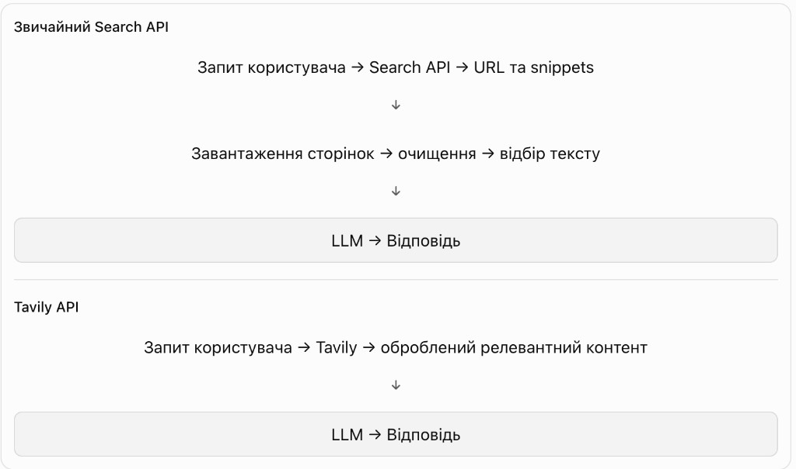

**Як Tavily стає інструментом MCP:**

Щоб AI-агент міг використовувати Tavily, його підключають через MCP Server:

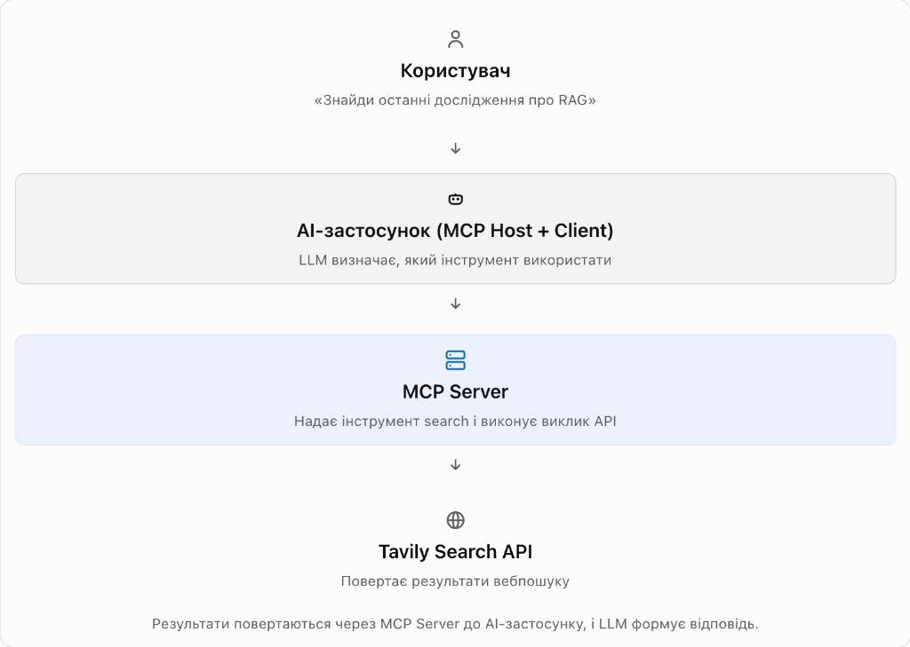

1. Користувач запитує: «Знайди останні дослідження про RAG»
2. AI-застосунок (MCP Host + Client) визначає, який інструмент використати
3. MCP Server надає інструмент `search` і виконує виклик Tavily API
4. Tavily повертає результати вебпошуку
5. MCP Server передає результати клієнту, і LLM формує відповідь

**Важливий нюанс:** MCP не замінює REST API. MCP Server часто сам використовує звичайні API (як Tavily) для виконання запитів. Також Tavily використовує звичайні HTTP-запити та JSON — «API для LLM» не є окремим технічним стандартом.

---

<a id="jsonrpc"></a>

### 3.3 JSON-RPC — мова запитів між процесами

**JSON-RPC** (JavaScript Object Notation – Remote Procedure Call) — це протокол, який дозволяє одній програмі **викликати функції іншої програми**, використовуючи JSON для передачі запитів і відповідей.

Простіше кажучи: «Виконай ось цю функцію з такими параметрами та поверни мені результат».

#### Як це виглядає на практиці

Припустимо, у нас є дві програми. Client хоче, щоб Server додав два числа.

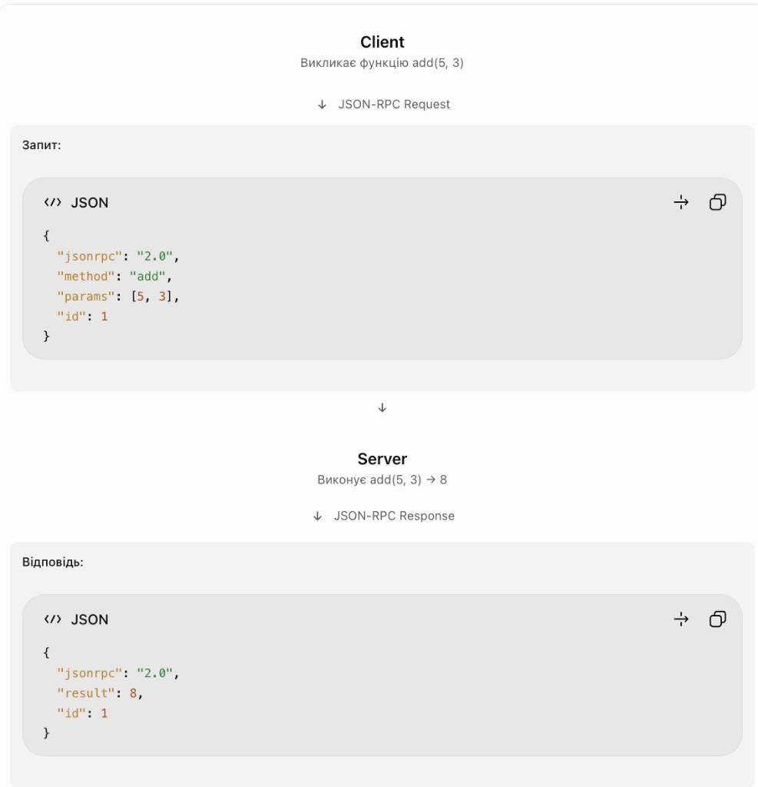

**Запит (Client → Server):**
```json
{
  "jsonrpc": "2.0",
  "method": "add",
  "params": [5, 3],
  "id": 1
}
```

**Відповідь (Server → Client):**
```json
{
  "jsonrpc": "2.0",
  "result": 8,
  "id": 1
}
```

#### Що означають поля

| Поле       | Значення                                                           |
|------------|--------------------------------------------------------------------|
| `jsonrpc`  | Версія протоколу (завжди `"2.0"`)                                  |
| `method`   | Назва функції або операції для виконання                           |
| `params`   | Аргументи функції (масив або об'єкт)                               |
| `id`       | Ідентифікатор запиту для зіставлення з відповіддю                  |
| `result`   | Результат виконання (є у відповідях без помилок)                   |
| `error`    | Інформація про помилку, якщо вона виникла                          |

**Notification** (повідомлення без id) — повідомлення, яке не потребує відповіді. Використовується в MCP для сповіщень про зміни (наприклад, список інструментів оновився).

#### JSON-RPC проти REST API

| REST API                                       | JSON-RPC                                                  |
|------------------------------------------------|-----------------------------------------------------------|
| Орієнтований на **ресурси**                    | Орієнтований на **виклик методів**                        |
| Використовує HTTP GET, POST, PUT, DELETE тощо  | Використовує поле `method` у JSON                         |
| `/users/123` → отримати користувача            | `getUser` з параметром `id: 123`                          |
| Зазвичай працює через HTTP                     | Може працювати через HTTP, WebSocket, stdin/stdout тощо   |

Важливий нюанс: REST — це архітектурний стиль, а JSON-RPC — протокол виклику методів. Це різні речі на різних рівнях.

#### Зв'язок з MCP та LSP

- **JSON-RPC** визначає, як оформити виклик методу та відповідь.
- **LSP** використовує JSON-RPC для взаємодії редактора коду з Language Server.
- **MCP** використовує JSON-RPC для взаємодії AI-застосунку з MCP Server.

Офіційна специфікація: [jsonrpc.org/specification](https://www.jsonrpc.org/specification)

---

<a id="stdio"></a>

### 3.4 stdin / stdout / stderr

**stdin** (standard input) і **stdout** (standard output) — стандартні потоки введення та виведення, які операційна система надає кожній програмі.

- **stdin** — звідки програма отримує дані (зазвичай клавіатура, але може бути будь-яке джерело)
- **stdout** — куди програма надсилає результати (зазвичай термінал)
- **stderr** — окремий потік для повідомлень про помилки та діагностики

#### Приклад у Python

```python
name = input("What is your name? ")  # читає зі stdin
print(f"Hello, {name}!")              # записує у stdout
```

#### I/O Redirection (перенаправлення потоків)

В терміналі можна перенаправити потоки:

```bash
python script.py > output.txt 2> errors.txt
```

- `>` перенаправляє stdout у файл `output.txt`
- `2>` перенаправляє stderr у файл `errors.txt`

#### Як це працює в MCP

Коли AI-застосунок запускає локальний MCP Server як окремий процес, вони можуть обмінюватись повідомленнями через stdin/stdout без HTTP або мережевих портів:

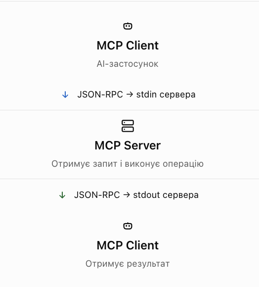

1. MCP Client пише JSON-RPC повідомлення у **stdin** сервера
2. MCP Server читає запит, виконує операцію
3. MCP Server пише JSON-RPC відповідь у **stdout**
4. MCP Client читає відповідь зі **stdout** сервера

Дві програми можуть обмінюватися повідомленнями без HTTP, WebSocket або відкриття мережевого порту.

**Важлива деталь для MCP:** якщо сервер використовує stdout для JSON-RPC, звичайні діагностичні `print()` порушать комунікацію. Тому логування завжди спрямовують у **stderr**.

**Головна ідея:** stdin/stdout — це механізм передавання даних між процесами, а JSON-RPC — формат і правила повідомлень, якими вони обмінюються.

---

<a id="lsp"></a>

### 3.5 LSP — джерело натхнення для MCP

**LSP (Language Server Protocol)** — стандартизований протокол, який дозволяє редакторам коду (VS Code, Neovim та іншим) взаємодіяти з програмами, що аналізують код.

Простіше кажучи: завдяки LSP редактор може розуміти код і допомагати програмісту, незалежно від мови програмування.

#### Що дає LSP

Коли ти пишеш Python або TypeScript у VS Code:
- **Autocomplete** — пропонує завершення коду
- **Go to Definition** — переходить до визначення функції
- **Find References** — знаходить усі місця використання змінної
- **Diagnostics** — показує помилки та попередження
- **Hover** — показує інформацію про функцію при наведенні
- **Rename Symbol** — перейменовує змінну в усіх відповідних місцях

Усе це реалізує не сам редактор, а окремий Language Server — наприклад, `pylsp` для Python або `typescript-language-server` для TypeScript. Редактор «не знає» мови — він лише надсилає запити через LSP і отримує відповіді.

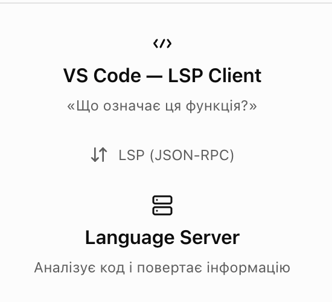

#### Чому ж LSP та MCP схожі?

| Характеристика | LSP                               | MCP                                                |
|----------------|-----------------------------------|----------------------------------------------------|
| Призначення    | Аналіз програмного коду           | Інтеграція AI із зовнішніми інструментами й даними |
| Клієнт         | Редактор коду                     | AI-застосунок (Host + Client)                      |
| Сервер         | Аналізатор мови програмування     | Програма, що надає інструменти або дані            |
| Протокол       | JSON-RPC                          | JSON-RPC                                           |
| Розгортання    | Локальний процес (зазвичай)        | Локальний або віддалений процес                    |

**Ідея обох протоколів однакова:** створити стандартизований спосіб взаємодії між програмами, щоб не писати окрему інтеграцію для кожної комбінації продуктів. LSP — один стандарт для редактора і нескінченної кількості мов програмування. MCP — один стандарт для AI-застосунку і нескінченної кількості інструментів та джерел даних.

До речі, LSP з'явився раніше за MCP і є одним з архітектурних джерел натхнення для нього.

Офіційна специфікація LSP: [microsoft.github.io/language-server-protocol](https://microsoft.github.io/language-server-protocol/)

---

<a id="mcp"></a>

## 4. MCP — Model Context Protocol

<a id="nxm"></a>

### 4.1 Проблема N×M

До MCP кожна компанія реалізовувала function calling та інструменти по-своєму. OpenAI мав свій підхід, Anthropic — свій, Google — ще інший. Розробникам доводилося створювати власні конектори для кожного джерела даних. Anthropic описав це як проблему інтеграцій «N×M».

**Що таке N?**  
N — це кількість AI-застосунків та їхніх клієнтських реалізацій. Кожен AI-застосунок (Claude Desktop, Cursor, власний агент) потребує реалізації клієнтської частини для роботи з інструментами.

**Що таке M?**  
M — це кількість зовнішніх інструментів, джерел даних і сервісів:
- Хмарні сховища (Google Drive, Dropbox)
- Комунікаційні платформи (Slack, Discord)
- Системи контролю версій (GitHub, GitLab)
- Бази даних (PostgreSQL, MongoDB)
- CRM-системи (Salesforce, HubSpot)
- Локальні файли та системи

**Комбінаторний вибух:**  
Якщо у вас 10 різних AI-застосунків і 20 різних інструментів — потенційно потрібно 200 різних інтеграцій. Додайте ще один застосунок — вже 220. Додайте ще один інструмент — 231. Це й є N×M.

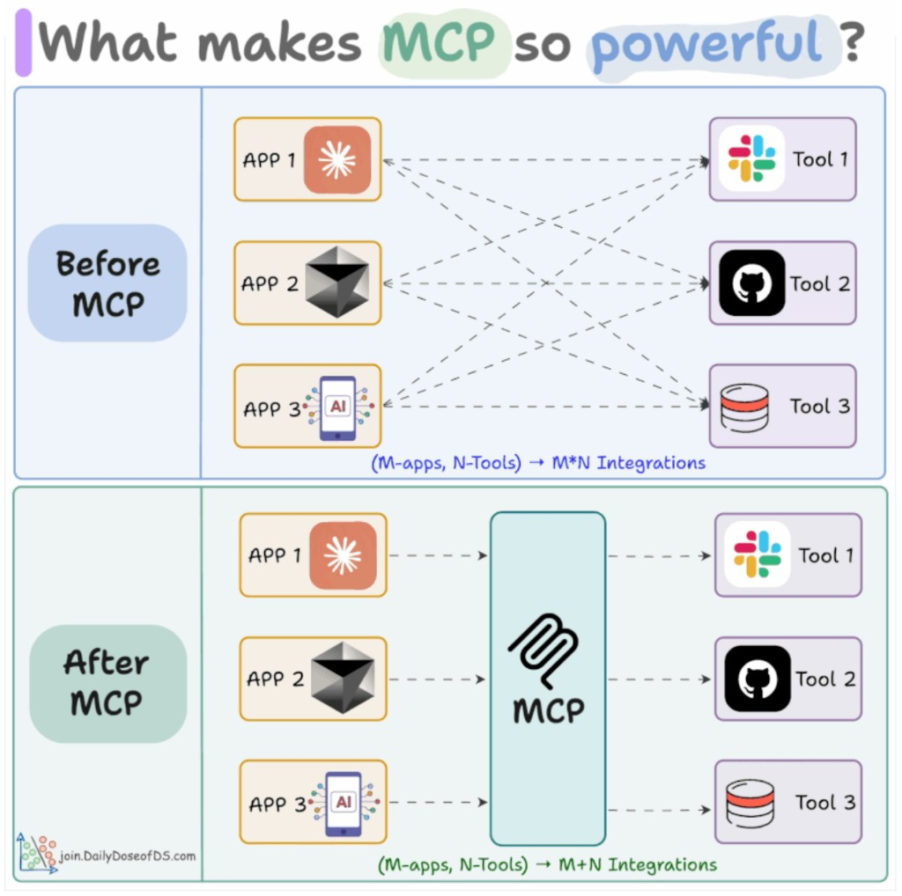

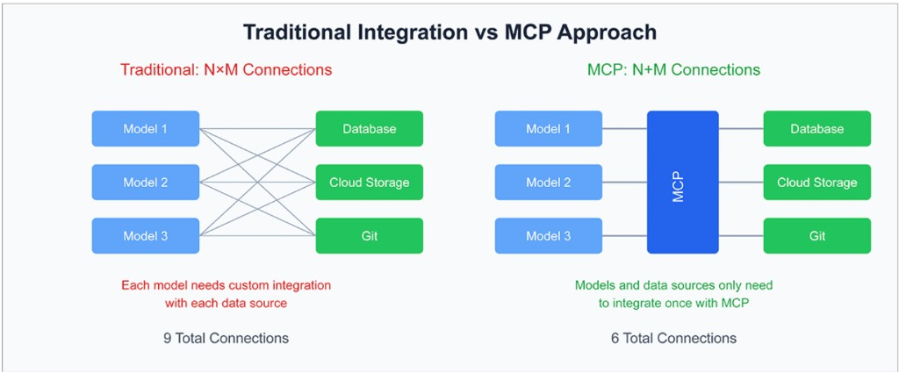

> **⚠️ Важливе уточнення щодо «N+M»:**
> 
> N+M (або N×M) — це **модель складності реалізацій коду**, а не гарантована кількість активних мережевих з'єднань у вашій системі в конкретний момент. MCP дозволяє **повторно використовувати** стандартизовані реалізації: кожен AI-застосунок реалізує MCP Client один раз, і кожен зовнішній інструмент реалізує MCP Server один раз. Але різні інтеграції все одно потребують автентифікації, конфігурації та підтримки, а MCP не усуває необхідність підтримувати зовнішні API.

Виправлений слайд:

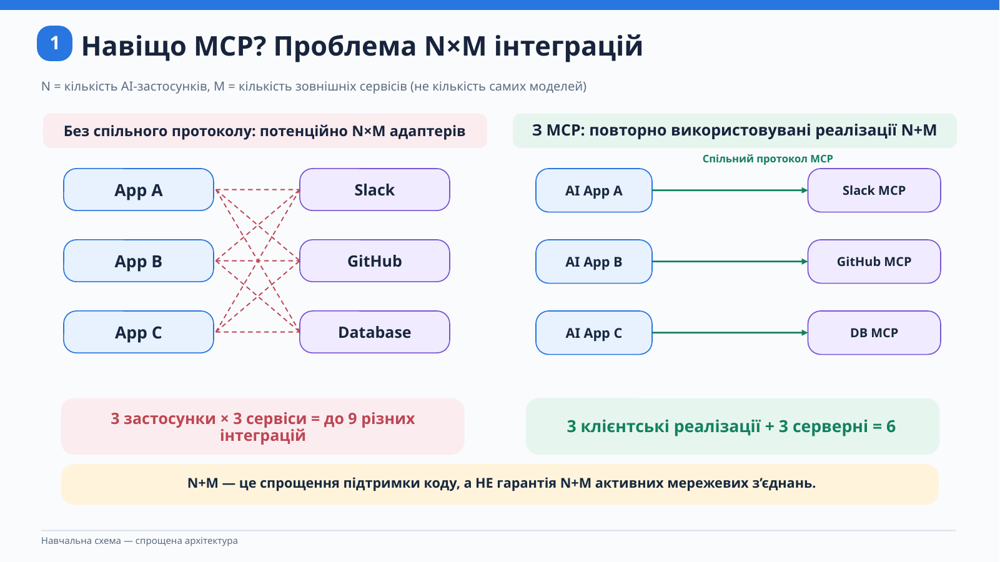

---

<a id="what-is-mcp"></a>

### 4.2 Що таке MCP та аналогія з USB-C

У листопаді 2024 року Anthropic відкрив **Model Context Protocol (MCP)** — стандарт для підключення AI-застосунків до зовнішніх систем, репозиторіїв контенту, бізнес-інструментів та середовищ розробки.

У грудні 2025 року Anthropic передав MCP до незалежного управління: протокол став частиною **Agentic AI Foundation** у складі Linux Foundation, що гарантує його розвиток без прив'язки до одного вендора.

**Аналогія з USB-C:**

Так само як USB-C надає стандартизований спосіб підключення пристроїв до периферійних аксесуарів, MCP надає стандартизований спосіб підключення AI-застосунків до різних джерел даних та інструментів. Розробник пише підтримку MCP один раз — і цей інструмент автоматично стає доступним для всіх AI-застосунків, що підтримують протокол.

**Що MCP НЕ є:**

Деякі схеми зображують MCP як «єдиний центральний API» або «шлюз» між моделями та інструментами — це **неправильно**.

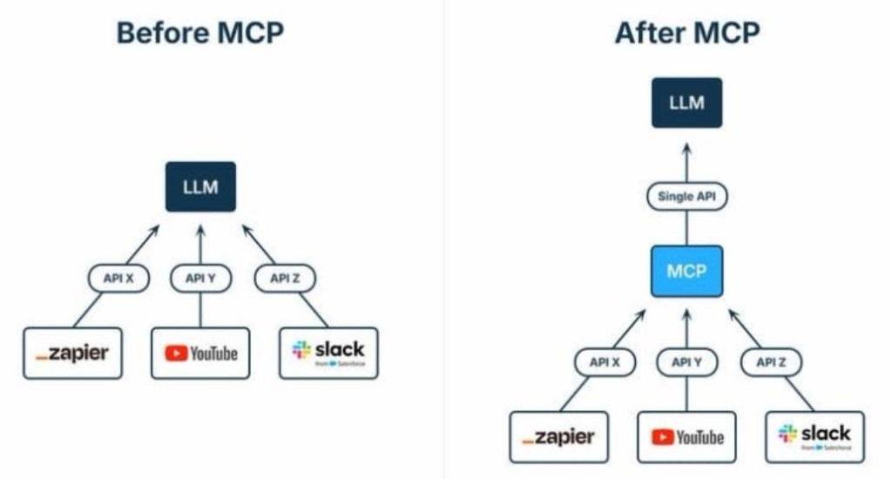

MCP — це **спільний протокол взаємодії**, а не один центральний сервер чи обов'язковий проксі, через який проходять усі запити. Кожен AI-застосунок безпосередньо з'єднується з окремими MCP Servers.

Виправлена схема:

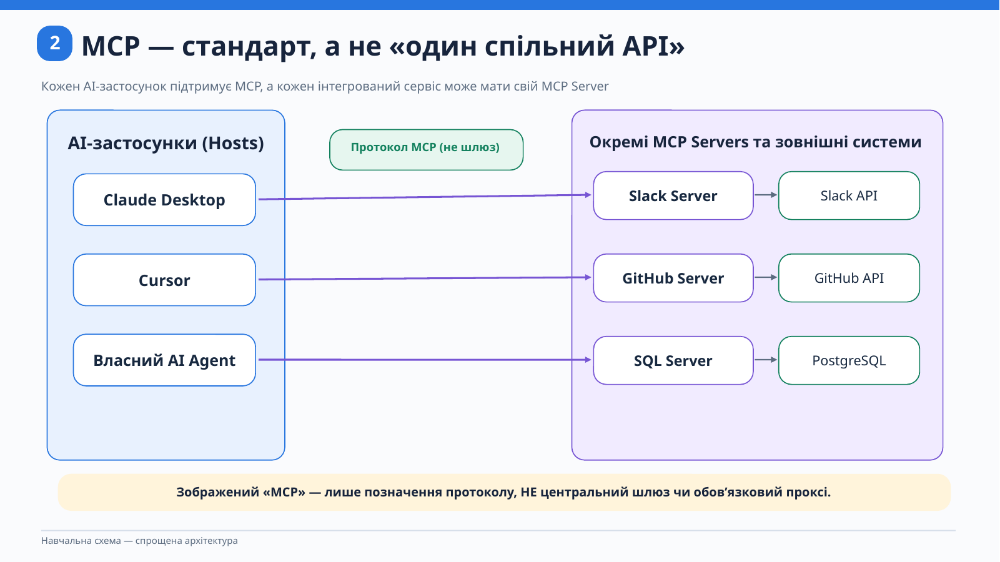

#### Реальна проблема, яку розв'язує MCP

Розглянемо ілюстративний приклад. Компанія **Block** (раніше Square) стала одним з перших адоптерів MCP. До MCP для кожної нової інтеграції AI-агентів з внутрішніми системами потрібно було вивчити API конкретної системи, написати спеціальний адаптер для кожної AI-моделі та підтримувати цей код при оновленнях. MCP дозволив уніфікувати цей підхід.

> **Примітка:** Anthropic підтверджує, що Block була раннім користувачем MCP. Конкретні цифри (наприклад, заміна 300 інтеграцій на 30 серверів) є ілюстративним прикладом, а не підтвердженими даними. Дивіться [`unverified_claims.md`](unverified_claims.md).

---

<a id="architecture"></a>

### 4.3 Архітектура: Host → Clients → Servers

MCP побудований за принципом клієнт-сервер, натхненним дизайном Language Server Protocol.

Три ключові ролі:

```
MCP Host (AI-застосунок)
  ├── MCP Client 1  ───────────────────► MCP Server A (наприклад, Slack)
  ├── MCP Client 2  ───────────────────► MCP Server B (наприклад, GitHub)
  └── MCP Client 3  ───────────────────► MCP Server C (наприклад, Database)
```

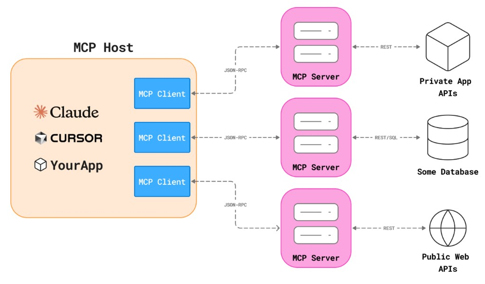

**MCP Host** — AI-застосунок (наприклад, Claude Desktop, Cursor або ваш власний агент). Містить інтеграцію з LLM і керує всіма MCP Clients. Відповідає за запуск клієнтів та надання інструментів моделі.

**MCP Client** — компонент всередині Host, який підтримує **з'єднання з одним конкретним MCP Server**. Один Host може містити багато клієнтів — по одному на кожен підключений сервер.

**MCP Server** — програма, яка надає AI-застосункам інструменти, ресурси або промпти через MCP. Може бути локальним (на тій самій машині) або віддаленим (в хмарі чи на іншому сервері).

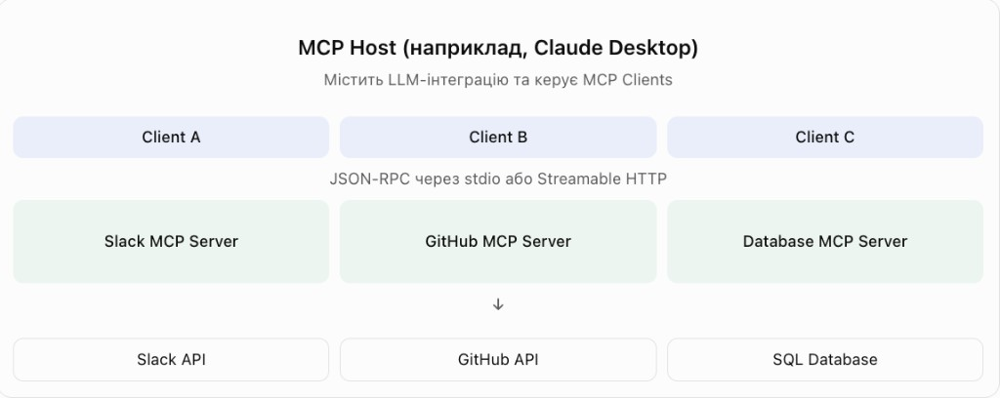

> **⚠️ Важливе уточнення:**  
> На схемі з Claude, Cursor та YourApp — це три приклади **різних MCP Hosts** (різних застосунків), а не компоненти одного Host. Всередині кожного окремого Host є свої клієнти.

Виправлена схема архітектури:

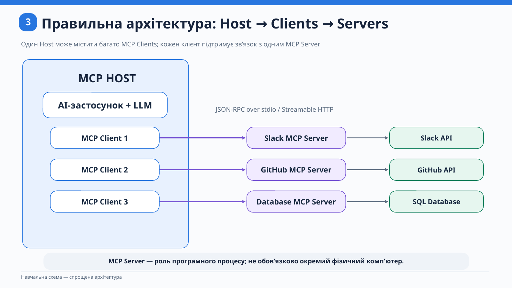

**Ключове правило:** Кожен MCP Client підтримує з'єднання **з одним** MCP Server. Якщо локальний stdio-сервер зазвичай обслуговує один Client, то віддалений Streamable HTTP сервер може обслуговувати багато клієнтів одночасно.

**MCP Server — це роль, а не тип обладнання:**  
Claude Desktop запускає filesystem server як локальний subprocess (stdio). Офіційний Sentry MCP server запущено на платформі Sentry і доступний через Streamable HTTP. Обидва є «MCP Servers» — але один локальний, інший віддалений.

---

<a id="transport"></a>

### 4.4 Транспортний рівень: stdio та Streamable HTTP

Транспортний рівень визначає **канал**, яким передаються JSON-RPC повідомлення між клієнтом і сервером.

MCP підтримує два актуальних транспорти (специфікація 2026-07-28):

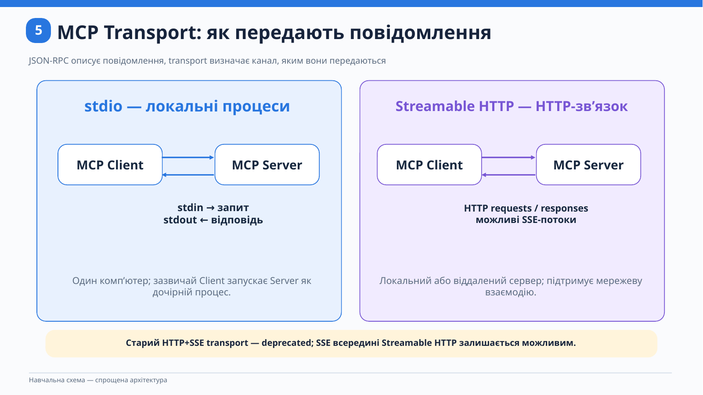

#### stdio (локальні процеси)

- Використовує стандартні потоки `stdin` та `stdout` для прямого зв'язку між процесами на **одній машині**
- Клієнт запускає сервер як дочірній процес і записує JSON-RPC у його stdin
- Сервер обробляє та відповідає через stdout
- Оптимальна швидкість: немає мережевого накладного розходу
- Зазвичай один Client = один Server (1:1)

#### Streamable HTTP (локальний або віддалений)

- Використовує HTTP POST для запитів від клієнта до сервера
- Опціонально Server-Sent Events (SSE) для потокових відповідей
- Підтримує стандартні HTTP-методи автентифікації: bearer tokens, API keys, кастомні заголовки
- MCP рекомендує OAuth для отримання токенів
- Може обслуговувати багато клієнтів одночасно

> **⚠️ Старий HTTP+SSE transport — deprecated:**  
> У попередніх версіях MCP існував окремий транспорт «HTTP+SSE». Він застарів (deprecated). SSE може використовуватися **всередині** Streamable HTTP, але старий окремий транспорт HTTP+SSE не рекомендується для нових реалізацій.

> **⚠️ Локальний сервер ≠ безпечний сервер:**  
> Stdio дає перевагу — відсутність мережевої передачі між процесами. Але локальність не гарантує безпеку: шкідливий MCP Server на вашій машині може все одно завдати шкоди.

---

<a id="primitives"></a>

### 4.5 Примітиви сервера: Tools, Resources, Prompts

MCP Server може надавати три типи речей AI-застосунку. Кожен примітив вирішує свою конкретну задачу.

> **Примітка про старі схеми:** Деякі матеріали показують схему з п'ятьма компонентами — Tools, Resources, Prompts, **Sampling** та **Notification**. Sampling — це колишній клієнтський примітив, deprecated у специфікації 2026-07-28. Notifications — це тип JSON-RPC повідомлення (не окремий примітив). Нова схема відображає актуальний стан.

> Оригінальна схема для порівняння: [`images/mcp_05_transport_tools_resources_prompts.png`](images/mcp_05_transport_tools_resources_prompts.png)

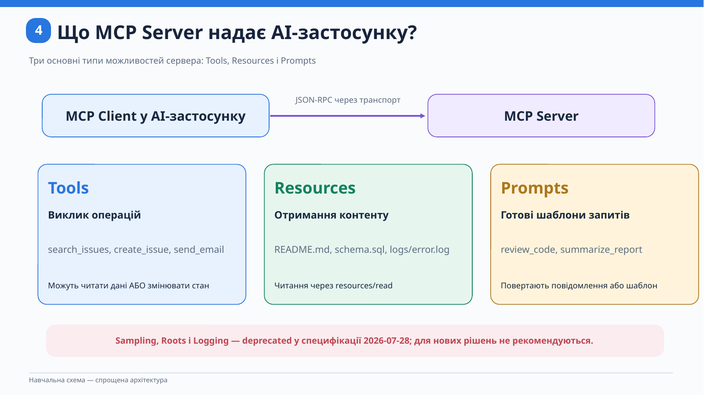

#### Tools — виконання операцій

**Tools** — це функції, які AI-застосунок може викликати для виконання операцій. Tool може як читати дані, так і **змінювати стан системи**.

Виклик: метод `tools/call`.  
Список доступних: `tools/list`.

> **⚠️ Виправлення:** у деяких джерелах пишуть, що Tool завжди «змінює щось». Це не так: Tool може виконувати лише читання (наприклад, `get_weather`, `search_database`). Категорія визначається за призначенням, а не за впливом.

**Приклад: MCP Server для роботи з email**

| Tool           | Опис                   |
|----------------|------------------------|
| `send_email`   | Відправити листа       |
| `search_inbox` | Знайти листи за запитом|
| `create_draft` | Створити чернетку      |

Коли агент підключається до сервера, він отримує список інструментів з описами (`tools/list`). Потім може сказати: «викликай `send_email` з параметрами `to='boss@company.com'`, `subject='Звіт готовий'`». Сервер виконує дію та повертає результат.

#### Resources — отримання контенту

**Resources** — це джерела даних, вміст яких AI-застосунок може прочитати. Це не дії, а «файли» або «документи».

Виклик: метод `resources/read`.  
Список доступних: `resources/list`.

> **⚠️ Виправлення:** Ресурс **не** читається «без виклику функції». Він читається через явний MCP-запит `resources/read`. Різниця від Tool — не в механізмі, а в семантиці: Resource надає дані для читання, Tool виконує операцію.

**Приклад: MCP Server для документації проєкту**

| Resource             | Вміст                      |
|----------------------|----------------------------|
| `README.md`          | Опис проєкту               |
| `logs/error.log`     | Логи помилок               |
| `database/schema.sql`| Структура бази даних       |

**Ключова різниця між Tool і Resource:**

| Tool                                              | Resource                                   |
|---------------------------------------------------|--------------------------------------------|
| Виконує операцію (може читати або змінювати)      | Надає контент для читання                  |
| `tools/call` → результат операції                 | `resources/read` → вміст ресурсу           |
| Приклад: `execute_query`, `send_email`            | Приклад: `schema.sql`, `error.log`         |

#### Prompts — готові шаблони

**Prompts** — це готові інструкції або шаблони, які MCP Server пропонує для типових завдань.

Виклик: `prompts/get`.  
Список доступних: `prompts/list`.

**Приклад: MCP Server для аналізу коду**

| Prompt           | Опис                                                               |
|------------------|--------------------------------------------------------------------|
| `code_review`    | «Проаналізуй цей код на предмет багів, безпеки та продуктивності» |
| `add_tests`      | «Напиши unit-тести з покриттям edge cases»                         |
| `refactor_clean` | «Зроби рефакторинг для кращої читабельності»                       |

Уявіть junior-розробника, який не знає, як правильно попросити AI зробити code review. Він просто вибирає готовий prompt `code_review`, і MCP Server повертає правильно сформульоване завдання з усіма необхідними деталями та корпоративними стандартами.

#### Як усі три примітиви працюють разом: приклад

Розглянемо **MCP Server для бази даних інтернет-магазину**:

**Tools:**
- `execute_query` — виконати SQL-запит
- `backup_database` — зробити бекап
- `optimize_tables` — оптимізувати таблиці

**Resources:**
- `schema.sql` — структура всіх таблиць
- `slow_queries.log` — логи повільних запитів
- `database_stats.json` — статистика використання

**Prompts:**
- `analyze_performance` — «Проаналізуй slow_queries.log, знайди проблемні запити, запропонуй індекси»
- `daily_report` — «Створи звіт про продажі за день, топ-товари, середній чек»
- `find_anomalies` — «Знайди підозрілі транзакції або незвичайну активність»

**Сценарій використання:**

1. Менеджер каже агенту: «Підготуй щоденний звіт»
2. Агент підключається до MCP Server
3. Використовує Prompt `daily_report`, щоб зрозуміти, що потрібно
4. Читає Resource `schema.sql`, щоб знати структуру даних
5. Викликає Tool `execute_query` з SQL для отримання даних
6. Генерує звіт на основі отриманих даних

#### Чому розділено на три частини?

Кожен примітив оптимізований під свою задачу:

- **Tools** мають чітку схему параметрів і можуть змінювати стан системи
- **Resources** можуть бути великими (мегабайти логів) і завантажуються тільки коли потрібно
- **Prompts** можуть містити складну бізнес-логіку й best practices компанії

Це дає гнучкість: MCP Server може мати лише Tools (калькулятор), лише Resources (бібліотека документації), лише Prompts (набір корпоративних шаблонів) — або будь-яку комбінацію.

---

<a id="client-primitives"></a>

### 4.6 Примітиви клієнта: Elicitation

Крім серверних примітивів, MCP також визначає, що можуть надавати **клієнти** (тобто чим сервер може скористатися від клієнта).

**Поточний стан (специфікація 2026-07-28):**

| Примітив клієнта | Статус      | Опис                                                                               |
|------------------|-------------|------------------------------------------------------------------------------------|
| **Elicitation**  | Активний    | Дозволяє серверу запитувати у користувача додаткову інформацію через клієнта (метод `elicitation/create`). Доставляється через патерн MRTR. |
| Sampling         | **Deprecated** | Дозволяв серверу запитувати генерацію в LLM. Нові реалізації мають використовувати прямі API LLM-провайдерів. |
| Logging          | **Deprecated** | Дозволяв серверу надсилати лог-повідомлення клієнту. Нові реалізації мають використовувати `stderr` або OpenTelemetry. |

**Notifications** (сповіщення) — це тип JSON-RPC повідомлення без відповіді, яке один учасник надсилає іншому. Не є окремим «примітивом», а вбудованим механізмом протоколу для реального часу.

> **⚠️ Старі схеми можуть показувати Sampling та Logging як актуальні компоненти MCP.** Вони все ще підтримуються для зворотної сумісності, але для нових реалізацій **не рекомендуються**.

---

<a id="messages"></a>

### 4.7 Повідомлення MCP: JSON-RPC у дії

MCP використовує JSON-RPC 2.0 для структурування повідомлень між клієнтами та серверами. Починаючи зі специфікації 2026-07-28, протокол є **stateless**: кожен запит містить усю інформацію, необхідну для обробки, у полі `_meta`.

#### Поле `_meta`

Поле `_meta` **обов'язкове** в кожному запиті (специфікація 2026-07-28). Воно містить:
- Версію протоколу: `io.modelcontextprotocol/protocolVersion`
- Можливості клієнта: `io.modelcontextprotocol/clientCapabilities`
- Ідентифікацію клієнта: `io.modelcontextprotocol/clientInfo`

#### Крок 1: Виявлення можливостей сервера

Перший запит, який клієнт може (але не зобов'язаний) надіслати — `server/discover`:

```json
{
  "jsonrpc": "2.0",
  "id": 1,
  "method": "server/discover",
  "params": {
    "_meta": {
      "io.modelcontextprotocol/protocolVersion": "2026-07-28",
      "io.modelcontextprotocol/clientInfo": {
        "name": "my-app",
        "version": "1.0.0"
      },
      "io.modelcontextprotocol/clientCapabilities": {
        "elicitation": {}
      }
    }
  }
}
```

Відповідь сервера:

```json
{
  "jsonrpc": "2.0",
  "id": 1,
  "result": {
    "resultType": "complete",
    "supportedVersions": ["2026-07-28"],
    "capabilities": {
      "tools": { "listChanged": true },
      "resources": {}
    },
    "_meta": {
      "io.modelcontextprotocol/serverInfo": {
        "name": "my-mcp-server",
        "version": "1.0.0"
      }
    },
    "ttlMs": 3600000
  }
}
```

#### Крок 2: Список інструментів

```json
{
  "jsonrpc": "2.0",
  "id": 2,
  "method": "tools/list",
  "params": {
    "_meta": {
      "io.modelcontextprotocol/protocolVersion": "2026-07-28",
      "io.modelcontextprotocol/clientCapabilities": { "elicitation": {} }
    }
  }
}
```

#### Крок 3: Виклик інструменту

```json
{
  "jsonrpc": "2.0",
  "method": "tools/call",
  "params": {
    "_meta": {
      "io.modelcontextprotocol/protocolVersion": "2026-07-28",
      "io.modelcontextprotocol/clientCapabilities": { "elicitation": {} }
    },
    "name": "get_weather",
    "arguments": {
      "city": "Київ",
      "units": "celsius"
    }
  },
  "id": 3
}
```

**Правильна структура відповіді Tools/call** (content-масив, а не прямі поля):

```json
{
  "jsonrpc": "2.0",
  "result": {
    "resultType": "complete",
    "content": [
      {
        "type": "text",
        "text": "{\"temperature\": 15, \"condition\": \"partly_cloudy\", \"humidity\": 65}"
      }
    ],
    "isError": false
  },
  "id": 3
}
```

> **⚠️ Виправлення:** Відповідь `tools/call` має структуру `result.content[]`, де кожен елемент є об'єктом з полями `type` та `text` (або `data` для бінарного вмісту). Поля `temperature`, `condition` та `humidity` **не** лежать безпосередньо в `result` — вони знаходяться в текстовому або структурованому вмісті всередині `content`.

#### Чому «просто HTTP та JSON» недостатньо

Знання форматів HTTP та JSON не є достатнім для реалізації MCP. Необхідно також:
- Дотримуватись специфічних методів (наприклад, `server/discover`, `tools/list`, `tools/call`)
- Правильно структурувати `_meta` поле в кожному запиті
- Розуміти правила обробки помилок, сповіщень та потокових відповідей
- Дотримуватись специфікацій версій (клієнт оголошує версію, сервер її перевіряє)

#### Розширення Tasks

Якщо операція тривала (наприклад, виконання великого обчислення або генерація документа), сервер може використати **Tasks extension** — повернути дескриптор тривалої операції, щоб клієнт міг потім опитувати статус через `tasks/get` та отримати результат пізніше.

---

<a id="context"></a>

### 4.8 Керування контекстом: progressive discovery та code execution

Основна проблема сучасних AI-моделей — обмежений розмір контексту. Навіть у найновіших моделей є ліміт на кількість токенів за раз.

#### Progressive discovery

Якщо у вас 1000 інструментів, завантаження всіх їхніх описів одразу може з'їсти весь контекст. **Progressive discovery** — це архітектурний підхід, де застосунок завантажує інструменти поступово:

1. Спочатку отримати лише список категорій інструментів
2. Вибрати релевантну категорію
3. Завантажити лише інструменти з цієї категорії
4. Отримати детальну інформацію лише про вибраний інструмент

> **⚠️ Уточнення:** Progressive discovery — це **підхід на рівні AI-застосунку**, а не автоматична вбудована функція протоколу. MCP надає механізми (`tools/list`, пагінацію) — але як і коли їх використовувати, вирішує розробник застосунку.

#### Code execution

Замість того щоб передавати величезні обсяги даних через контекст, агент може виконати код, який обробить дані локально й поверне лише результат.

Приклад: замість передачі 1000 рядків з бази даних у промпт, агент виконує SQL-запит, агрегує дані й повертає 5 рядків із підсумками.

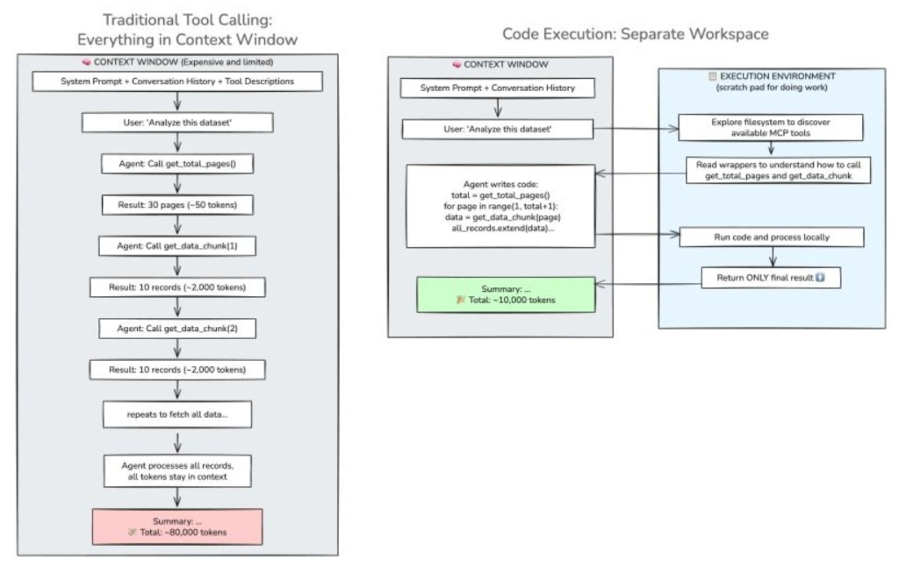

Виправлена схема:

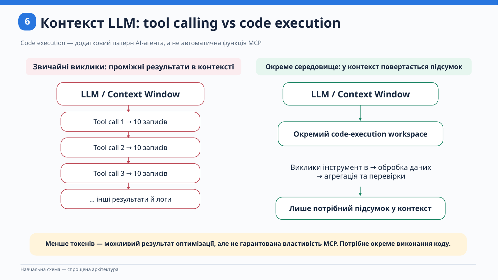

> **⚠️ Уточнення:** Code execution — це **архітектурний патерн AI-агента**, а не автоматична функція MCP. MCP надає інструменти — але рішення «виконати код і повернути підсумок замість сирих даних» приймає логіка агента.
>
> Anthropic демонстрував приклад, де такий підхід зменшив використання токенів зі ~150 000 до ~2 000 (скорочення на 98,7%). Але це результат **конкретного сценарію**, а не гарантована економія від використання MCP. Реальний ефект залежить від типу задачі, обсягів даних і архітектурних рішень.

---

<a id="mcp-vs-api"></a>

### 4.9 MCP проти звичайного API

Це часте питання: «Якщо у мене вже є REST API — навіщо MCP?»

| Звичайний API                                   | MCP                                                           |
|-------------------------------------------------|---------------------------------------------------------------|
| Визначає, як взаємодіяти з **конкретним** сервісом | Стандартизує, як AI-застосунок **знаходить** і **викликає** інструменти |
| Розробник сам пише інтеграцію та описує функції для LLM | AI-застосунок автоматично отримує опис доступних інструментів |
| Знання формату API прив'язане до конкретного провайдера | Один стандарт для всіх MCP-сумісних серверів |

**MCP не замінює REST API.** MCP Server часто сам **використовує** звичайні API для виконання запитів — наприклад, MCP Server для Slack всередині викликає Slack REST API.

---

<a id="a2a"></a>

## 5. A2A — Agent-to-Agent Protocol

<a id="why-a2a"></a>

### 5.1 Навіщо потрібен A2A

MCP чудово вирішує задачу «AI-застосунок + інструменти». Але уявіть іншу ситуацію: у вас є агент планування подорожей, агент бронювання готелів, агент пошуку авіаквитків і агент складання маршрутів. Кожен створений різними компаніями на різних платформах. Як змусити їх працювати разом?

Старі підходи мали фундаментальні проблеми:

- **Відсутність спеціалізованого стандарту:** не було спільного протоколу саме для взаємодії агентів (HTTP та REST існували, але не визначали семантику делегування, статусів, арtefactів)
- **Проблеми безпеки:** агентам доводилося ділитися внутрішньою логікою, даними чи API-ключами
- **Масштабування:** додавання нового агента вимагало оновлення всіх наявних інтеграцій

**A2A** розроблено, щоб дозволити агентам співпрацювати без розкриття внутрішньої логіки: «Агент А, зроби ось це. Мені не треба знати, як ти це зробиш — просто поверни результат».

---

<a id="a2a-architecture"></a>

### 5.2 Архітектура A2A

A2A використовує клієнт-серверну архітектуру, адаптовану для агентів.

**A2A Client** — агент або застосунок, який ініціює запити. Він формулює завдання та передає їх на виконання.

**A2A Server (Remote Agent)** — агент або система, що надає A2A-сумісний endpoint і обробляє Tasks. Він відповідає за виконання і повертає результати.

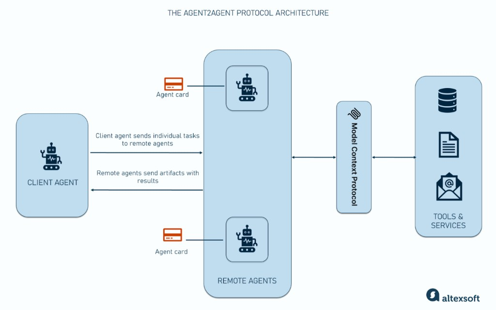

Приклад конкретного workflow — планування подорожі через A2A:

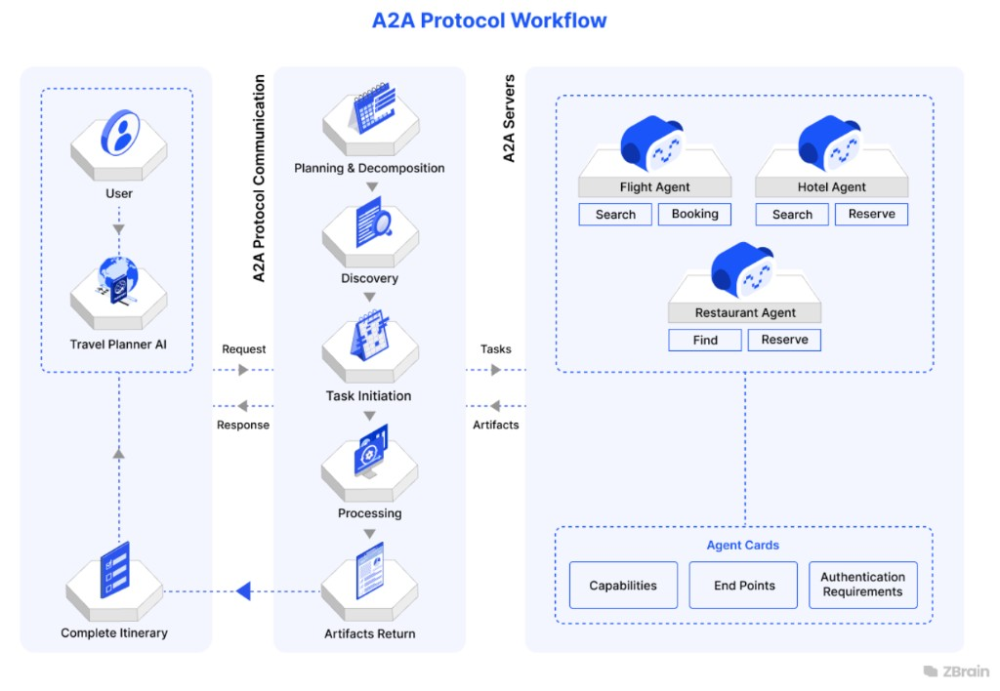

> **⚠️ Уточнення до другої схеми (ZBrain):** «Planning & Decomposition» — це **внутрішня логіка AI-агента**, а не частина специфікації A2A. A2A стандартизує комунікацію між агентами (передачу Tasks і результатів), але не те, як агент планує роботу всередині. Також на схемі не показано Task Lifecycle — стани виконання завдання.

> **⚠️ Уточнення до першої схеми (AltexSoft):**
> - Agent Cards — це JSON-документи з метаданими про агента (не окремі сервери і не обов'язкові учасники кожного запиту)
> - MCP між Remote Agents і Tools показано як **необов'язковий** варіант — агент може взаємодіяти з API безпосередньо
> - Результат — не обов'язково «Artifact»: агент може повернути Message, Task або Artifact залежно від сценарію

**Три шари A2A (специфікація 1.0):**

1. **Layer 1 — Canonical Data Model:** визначає основні структури даних (Task, Message, AgentCard, Part, Artifact, Extension). Нормативно визначені через Protocol Buffers (`spec/a2a.proto`).

2. **Layer 2 — Abstract Operations:** описує фундаментальні операції (Send Message, Get Task тощо) незалежно від конкретного протоколу.

3. **Layer 3 — Protocol Bindings:** конкретне відображення операцій на протоколи — JSON-RPC, gRPC, HTTP/REST (і Custom Bindings для особливих випадків).

---

<a id="agent-card"></a>

### 5.3 Agent Card — цифрова візитівка агента

**Agent Card** — це JSON-документ, який відіграє роль «цифрової візитки» A2A Server. Він дозволяє іншим агентам зрозуміти, з ким вони мають справу та що можна делегувати.

**Де знаходиться:**  
За стандартним URI: `https://{agent-server-domain}/.well-known/agent-card.json` (RFC 8615)

**Що містить:**

```json
{
  "name": "Flight Search Agent",
  "description": "Searches for available flights based on route and date",
  "url": "https://flight-agent.example.com/a2a",
  "provider": {
    "name": "Example Airlines"
  },
  "capabilities": {
    "streaming": true,
    "pushNotifications": false
  },
  "authentication": {
    "schemes": ["Bearer", "OAuth2"]
  },
  "skills": [
    {
      "id": "search_flights",
      "name": "Search Flights",
      "description": "Find flights between two airports on a given date",
      "inputModes": ["text", "data"],
      "outputModes": ["data"],
      "examples": [
        "Find flights from KBP to LHR on 2027-01-15"
      ]
    }
  ]
}
```

**Три стратегії виявлення (discovery) Agent Cards:**

1. **Well-Known URI** — рекомендується для публічних агентів: HTTP GET до `/.well-known/agent-card.json`
2. **Curated Registries** — для корпоративних середовищ і маркетплейсів: централізований реєстр з пошуком за навичками
3. **Direct Configuration** — для приватних і тісно пов'язаних систем: hardcoded URL або конфіг

> **⚠️ Уточнення:** Agent Cards **стандартизують опис** агента, але для пошуку потрібен окремий механізм виявлення. Самі по собі картки автоматично не «знаходять» одна одну. Поточна специфікація A2A **не визначає** стандартний API для реєстрів — це область для майбутнього розвитку.

> **Щодо цифрових підписів Agent Cards:**  
> Криптографічне підписання карток можливе і підвищує безпеку, але **не гарантує** легітимність агента автоматично: підпис потрібно верифікувати за довіреним ключем, а сам механізм довіри потребує окремої інфраструктури.

---

<a id="a2a-entities"></a>

### 5.4 П'ять сутностей A2A

| Сутність     | Призначення                                                                 |
|--------------|-----------------------------------------------------------------------------|
| **Agent Card** | Описує можливості агента та спосіб підключення (метадані, не учасник запиту) |
| **Task**      | Одиниця роботи з унікальним ID, статусами та повним lifecycle               |
| **Message**   | Повідомлення між агентами, має роль `user` або `agent`, містить Parts        |
| **Part**      | Найменша одиниця вмісту: текст, файл або структуровані дані                 |
| **Artifact**  | Результат виконання Task: документ, файл, JSON тощо                         |

Також є **Extension** — механізм для розширення протоколу поза базовою специфікацією.

---

<a id="task-lifecycle"></a>

### 5.5 Життєвий цикл Task

Task у A2A — це не просто «запит → відповідь». Завдання може виконуватися тривалий час, запитувати додаткові дані або повертати проміжні оновлення.

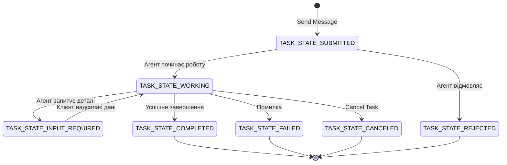

**Шість термінальних і нетермінальних станів:**

| Стан                      | Тип          | Опис                                                      |
|---------------------------|--------------|-----------------------------------------------------------|
| `TASK_STATE_SUBMITTED`    | Нетермінальний | Task отримано, ще не розпочато                           |
| `TASK_STATE_WORKING`      | Нетермінальний | Task виконується                                         |
| `TASK_STATE_INPUT_REQUIRED` | Нетермінальний | Агент чекає на додаткові дані від клієнта               |
| `TASK_STATE_COMPLETED`    | **Термінальний** | Успішно завершено                                      |
| `TASK_STATE_FAILED`       | **Термінальний** | Виникла помилка                                        |
| `TASK_STATE_CANCELED`     | **Термінальний** | Скасовано на запит клієнта                             |
| `TASK_STATE_REJECTED`     | **Термінальний** | Агент відхилив завдання (наприклад, невалідний запит)  |

**Три способи отримувати оновлення Task:**

1. **Polling** — клієнт регулярно запитує статус через `GetTask`
2. **Streaming** — клієнт відкриває streaming-з'єднання і отримує `TaskStatusUpdateEvent` та `TaskArtifactUpdateEvent` у реальному часі
3. **Push Notifications** — сервер надсилає HTTP POST на webhook URL клієнта (для довготривалих або offline-сценаріїв)

---

<a id="a2a-versions"></a>

### 5.6 Версії протоколу A2A

**Хронологія:**

| Дата          | Версія  | Ключові зміни                                                                                 |
|---------------|---------|-----------------------------------------------------------------------------------------------|
| Квітень 2025  | 0.1.0   | Перший публічний релізний кандидат                                                           |
| Червень 2025  | 0.2.6   | Уточнення специфікації, виправлення помилок                                                 |
| 30 липня 2025 | 0.3.0   | Підтримка gRPC, можливість підписувати Agent Cards, покращення безпеки, Python SDK           |
| 12 березня 2026 | **1.0.0** | **Перша стабільна версія.** Триринний дизайн (Data Model / Operations / Bindings), proto-центрований підхід, підтримка кількох protocol bindings |

**Три актуальних protocol bindings (A2A 1.0):**

- **JSON-RPC 2.0 over HTTP** — для широкої сумісності
- **gRPC** — для продуктивності при великих обсягах даних
- **HTTP+JSON/REST** — REST-style endpoints

Також підтримуються **Custom Bindings** для особливих вимог.

**Щодо gRPC:**  
gRPC використовує бінарний формат Protocol Buffers, що робить його ефективнішим за текстовий JSON для великих обсягів. Однак реальна перевага в продуктивності залежить від навантаження та реалізації — не всі сценарії потребують gRPC.

---

<a id="a2a-usage"></a>

### 5.7 Як використовувати A2A

**Офіційний Python SDK:**

```bash
pip install a2a-sdk
```

Або з uv:

```bash
uv add a2a-sdk
```

Вимоги: Python 3.10+. Менеджер `uv` є зручним варіантом, але не обов'язковим — підходить звичайний `pip`.

> **⚠️ Уточнення:** Оригінальний матеріал вказує Python 3.12+, але офіційний Python SDK підтримує Python 3.10+. Перевіряйте актуальну документацію SDK при встановленні.

**Альтернативи:**

- `python-a2a` — спрощена спільнотна бібліотека з мінімальними залежностями
- Офіційні SDK для Java, TypeScript та інших мов

**Підтримувані фреймворки для агентів:**

Google надає приклади агентів на популярних фреймворках:
- **LangChain** / **LangGraph** — потокові графи агентів
- **CrewAI** — фреймворк для рольових агентів
- **Google ADK (Agent Development Kit)** — власний фреймворк Google
- **AutoGen** — мікрософтівський фреймворк для мультиагентних систем

A2A дозволяє вийти за межі однієї екосистеми: LangGraph-агент може взаємодіяти з CrewAI-агентом через A2A, навіть якщо вони написані на різних стеках.

**Офіційна документація:** [a2a-protocol.org](https://a2a-protocol.org) та [github.com/a2aproject/a2a-python](https://github.com/a2aproject/a2a-python)

---

<a id="comparison"></a>

## 6. Порівняння та використання протоколів

<a id="mcp-vs-a2a"></a>

### 6.1 MCP проти A2A — коли що обирати

Розуміння різниці між MCP та A2A критично важливе для правильного проєктування систем.

**MCP** — це про те, як **AI-застосунок отримує доступ до інструментів і даних**.  
**A2A** — це про те, як **незалежні агенти координують виконання складних завдань**.

| Характеристика     | MCP                                      | A2A                                              |
|--------------------|------------------------------------------|--------------------------------------------------|
| Призначення        | Agent → Tool / Data                      | Agent → Agent                                    |
| Рівень абстракції  | Нижчий: виклик конкретного інструменту   | Вищий: делегування завдання іншому агенту        |
| Взаємодія          | Структурований запит → відповідь         | Діалог із можливими уточненнями та тривалими Task |
| Операції           | Можуть тривати довго (Tasks extension)   | Нативно async, підтримка HITL і тривалих Task    |
| Прозорість         | Агент знає, який інструмент викликає     | Агент знає навички, але не внутрішню логіку      |
| Приклад            | `getAccountBalance(id)`, `readFile(path)` | «Знайди оптимальний переліт та забронюй готель»   |

> **⚠️ Виправлення:** Оригінальний матеріал описує MCP-операції як «атомарні та детерміновані» і «з миттєвою відповіддю». Це спрощення: MCP підтримує MRTR (Multi Round-Trip Requests) через Elicitation і довготривалі операції через розширення Tasks. Однак MCP справді орієнтований на структуровані виклики інструментів, тоді як A2A — на координацію між автономними агентами.

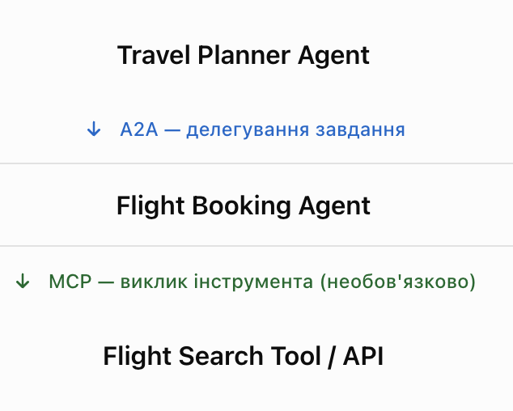

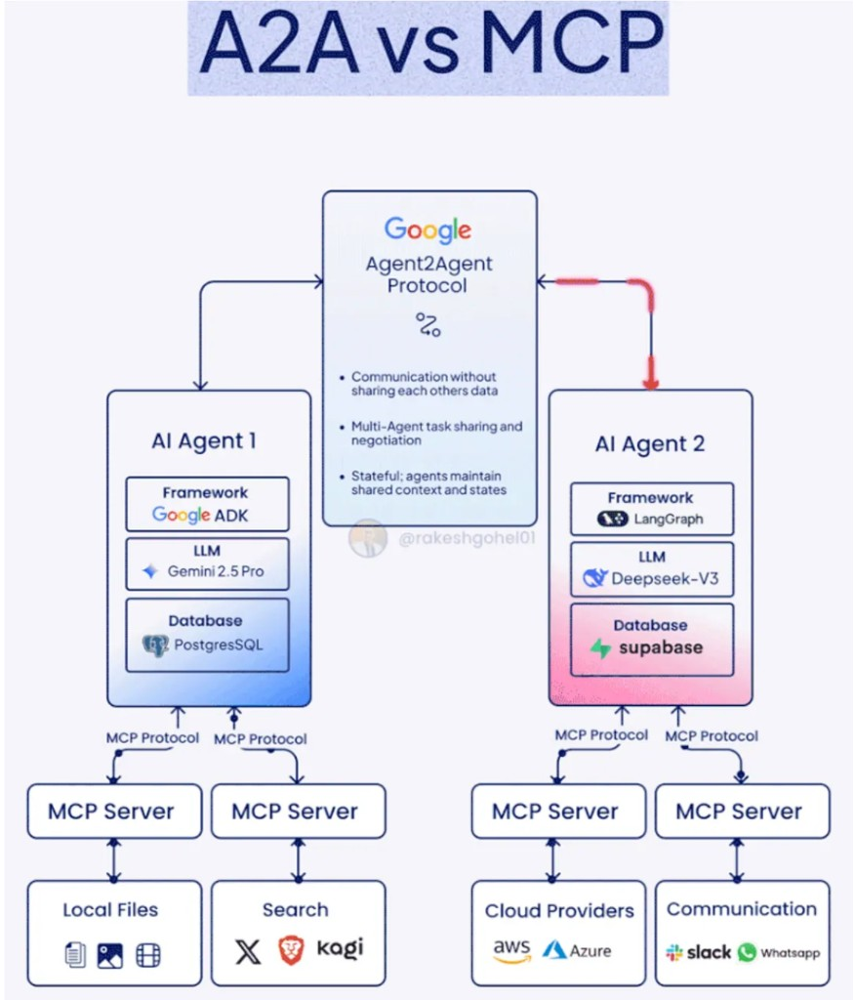

**Коли обирати MCP:**

Якщо ваш агент потребує доступу до конкретних джерел даних або інструментів — MCP ваш вибір. Наприклад:
- AI-асистент з кодування читає схему бази даних і контекст проєкту
- Фінансовий агент отримує доступ до банківського API
- Агент пошуку читає документи з Google Drive

Тут важлива чітко визначена операція: агент викликає функцію і одразу отримує результат (або чекає через Tasks). Немає потреби в «переговорах» про умови завдання.

**Коли обирати A2A:**

Для сценаріїв, де потрібна координація між **незалежними** агентами різних систем або компаній. Наприклад:
- Дві компанії обмінюються оперативними даними через своїх агентів
- Агент бронювання делегує пошук квитків агенту авіакомпанії, а пошук готелів — агенту системи броней
- Агент не знає заздалегідь, яким агентам делегувати — він динамічно знаходить їх через Agent Cards

Тут MCP не підійшов би: агенти різних компаній мають **домовлятися**, уточнювати деталі, підтримувати стан — це діалог між рівноправними учасниками, а не виклик функції.

**Важливо:** MCP та A2A можуть **працювати разом**, але жоден із них сам по собі не гарантує безпеку, надійність або автономність агентів.

---

<a id="combining"></a>

### 6.2 Комбінування протоколів

Найцікавіші можливості відкриваються при комбінуванні обох протоколів.

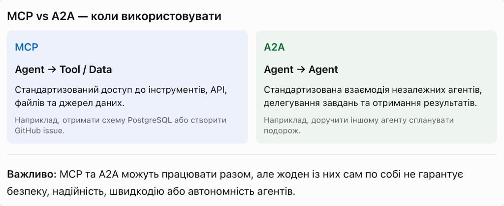

```
Travel Planner Agent
        │
        │  A2A — делегування завдання
        ▼
Flight Booking Agent
        │
        │  MCP — виклик інструменту (необов'язково)
        ▼
Flight Search Tool / API
```

- **A2A:** «Агенте бронювання, знайди оптимальний переліт з KBP до LHR. Можеш уточнити умови й повернути мені результат».
- **MCP:** «Виклич інструмент `search_flights` із параметрами: origin=KBP, dest=LHR, date=2027-01-15».

#### Приклад 1: Онбординг нового співробітника

**MCP для доступу до даних:**
- HR-агент → MCP → система управління персоналом (отримує дані про посаду та відділ)
- IT-агент → MCP → Active Directory (створює облікові записи)
- Facilities-агент → MCP → система управління офісом (призначає робоче місце)

**A2A для координації:**
- HR-агент створює master-task і розподіляє підзавдання
- Агенти працюють паралельно та звітують про прогрес
- При конфліктах агенти консультуються один з одним

#### Приклад 2: Обробка замовлень в e-commerce

- Sales-агент → MCP → вебсайт (приймає замовлення)
- Inventory-агент → MCP → складська система (перевіряє наявність)
- Payment-агент → MCP → платіжні шлюзи (обробляє оплату)

**Через A2A** агенти координують складні сценарії: якщо товару немає — пропонують альтернативи; узгоджують пріоритети доставки.

> **⚠️ Застереження:** Модульність, масштабованість і надійність не є **автоматичними властивостями** MCP або A2A. Це **властивості хорошої архітектури**, яка використовує ці протоколи. Навіть з MCP та A2A вам потрібні retries, timeouts, fault isolation та інші механізми надійності.

---

<a id="security"></a>

### 6.3 Безпека

#### Дозволи та автентифікація

> **⚠️ Виправлення:** Оригінальний матеріал стверджує, що «кожен виклик інструменту вимагає явного підтвердження користувача». Це **неправда** як universal гарантія.
>
> Реальна ситуація:
> - Політика дозволів залежить від MCP Host і конфігурації
> - Деякі інструменти потребують OAuth-токена, інші — ні
> - Claude Desktop показує діалог підтвердження для певних дій, але це рішення конкретного Host

**MCP та OAuth:**
- Підтримку авторизації на основі OAuth внесено до специфікації MCP у березні 2025 року
- OAuth 2.1 прийнятий як основа в серпні 2025 року
- Enterprise-Managed Authorization (Zero-touch OAuth) стала стабільною у червні 2026 року

**A2A та автентифікація:**
Схеми автентифікації (Bearer, OAuth2, API keys) визначаються в Agent Card кожного агента. Це **декларація** про підтримувані схеми, а не автоматична реалізація.

#### Аудит

> **⚠️ Уточнення:** Механізм `Logging` у MCP **deprecated** (специфікація 2026-07-28). Відстеження викликів інструментів, параметрів та результатів **можна** реалізувати засобами застосунку або інфраструктури (OpenTelemetry, централізоване логування) — але MCP не надає це «з коробки».

#### Відомі вразливості

**Tool Poisoning:** Атаки, де зловмисники вбудовують приховані шкідливі інструкції в описи MCP-інструментів. Текст видається нешкідливим для людини, але може бути інтерпретований AI-моделлю як інструкція.

**Rug Pull:** MCP-сервер спочатку працює безпечно й виглядає легітимним. Потім розробник тихо оновлює код на шкідливий. Ви встановили «калькулятор», перевірили — все гаразд. Через тиждень вийшло оновлення, яке краде ваші API-ключі.

**Prompt injection:** Шкідливі інструкції вбудовані в дані, які обробляє модель (наприклад, у документ, що читається через Resource).

**Як захищатися:**
- Встановлюйте MCP Server лише з перевірених джерел
- Перевіряйте дозволи, які запитує сервер
- Звертайте увагу на оновлення серверів після початкової перевірки
- Використовуйте валідацію вхідних даних та ізоляцію виконання
- MCP Registry (детальніше в наступному розділі) стандартизує метадані, але не гарантує безпеку коду

---

<a id="registry"></a>

### 6.4 MCP Registry

До вересня 2025 року пошук MCP-серверів був хаотичним: вони були розкидані по GitHub-репозиторіях, Discord-каналах та особистих блогах.

**8 вересня 2025 року** відбувся публічний preview-запуск офіційного **MCP Registry** — централізованого каталогу MCP-серверів.

Кожен сервер у реєстрі має стандартизований опис: назва, можливості, версія, інструкція для підключення та посилання на пакет (npm, PyPI, Docker).

**Важливі застереження:**

1. MCP Registry стандартизує **метадані** про сервери та перевіряє права на публікацію в певному просторі імен. Але це **не** означає автоматичного аудиту всього коду або перевірки дій сервера.

2. Registry **не є обов'язковим** для використання MCP: можна підключати локальні, приватні й корпоративні сервери без публікації в офіційному каталозі.

Офіційний реєстр: [registry.modelcontextprotocol.io](https://registry.modelcontextprotocol.io/)

---

<a id="cases"></a>

## 7. Практичні кейси

> **Як читати цей розділ:** Кожен кейс має статус підтвердженості. «Підтверджено» означає, що конкретний факт перевірено за публічними джерелами. «Частково» — підтверджено саме партнерство/використання, але не всі деталі. «Пілот» — проєкт існує, але як production не підтверджено.

<a id="mcp-cases"></a>

### 7.1 Кейси MCP

---

#### Sourcegraph Cody — AI-асистент для коду

**Статус:** ✅ Підтверджено

**Що це:** Sourcegraph — платформа для пошуку коду у великих компаніях (кодова база може містити мільйони рядків). Cody — їхній AI-асистент для розробників.

**Проблема без MCP:**  
Розробник просить AI: «Напиши функцію для створення нового користувача». AI генерує код, але не знає реальної схеми бази даних, обов'язкових полів та корпоративних патернів. Результат — код, який потребує значних змін.

**Як працює з MCP:**  
Cody через MCP-сервер отримує доступ до:
- Схеми PostgreSQL бази даних (назви таблиць, типи полів, зв'язки)
- Тикетів з Linear (контекст задачі, acceptance criteria)
- Наявного коду проєкту (патерни, що вже використовуються)

Тепер AI бачить реальну структуру проєкту й генерує код, що одразу відповідає вашим стандартам.

**Чому MCP, а не A2A:**  
Тут потрібен швидкий доступ до даних: читання схеми БД, файлу. Це типові MCP-операції: виклик → відповідь, без тривалих переговорів між агентами.

---

#### Block (Square) — автоматизація платежів

**Статус:** ⚠️ Частково підтверджено (Anthropic підтверджує Block як раннього адоптера MCP; конкретний приклад бухгалтерської автоматизації — ілюстративний)

**Що це:** Block (раніше Square) — фінтех-компанія, яка обробляє платежі для мільйонів бізнесів.

**Проблема без MCP:**  
Бухгалтер витрачає години на рутинне звіряння транзакцій із банківською випискою та категоризацію витрат.

**Як може працювати з MCP:**  
AI-агент через MCP підключається до API транзакцій Square та банківського API, автоматично порівнює дані й категоризує нові транзакції на основі попередніх патернів. Показує бухгалтеру лише ті випадки, де є розбіжності.

---

<a id="a2a-cases"></a>

### 7.2 Кейси A2A

---

#### Box — обробка корпоративних документів

**Статус:** ⚠️ Частково підтверджено (Box має A2A API; конкретний workflow Box→Salesforce→Jira як production-реалізація не підтверджено)

**Що це:** Box — хмарне сховище для корпорацій, де зберігаються 35+ мільярдів файлів.

**Проблема без A2A:**  
Менеджер отримує підписаний контракт у PDF і вручну переносить дані в CRM, створює задачі для юристів, оновлює прогноз продажів — 15–20 хвилин роботи на один контракт.

**Як може працювати з A2A:**  
1. Агент-аналізатор (Box) витягує структуровані дані з PDF
2. Через A2A передає агенту CRM (Salesforce) для оновлення картки клієнта
3. Агент задач (Jira) створює завдання для юридичного відділу
4. Агент аналітики оновлює дашборд

**Чому A2A, а не MCP:**  
Тут взаємодіють незалежні агенти різних систем. Вони мають домовитися про формат даних, підтвердити виконання, обробити помилки — це діалог між рівними учасниками.

---

#### Tyson Foods + Gordon Food Service — координація постачання

**Статус:** ⚠️ Пілот (обидві компанії взяли участь у спільному A2A пілоті; виробнича система не підтверджена)

**Що це:** Tyson Foods — великий виробник м'яса. Gordon Food Service — великий дистриб'ютор продуктів харчування.

**Проблема без A2A:**  
Менеджер телефонує: «Скільки курячих грудок на складі?» Відповідь приходить через email із затримкою в дні. Тим часом ресторан вже замовив товар, якого немає.

**Як може працювати з A2A:**  
1. Агент Tyson публікує Agent Card: «Можу повідомити наявність, терміни виробництва, ціни»
2. Агент Gordon надсилає запит на потрібний обсяг
3. Агент Tyson відповідає з деталями
4. Агенти координують графік постачання

**Чому A2A, а не MCP:**  
Дві різні компанії з різними системами. Жодна не дає іншій прямий доступ до своєї бази даних. Натомість агенти спілкуються через стандартний протокол, зберігаючи автономність і безпеку.

---

Схеми, що ілюструють A2A у дії:

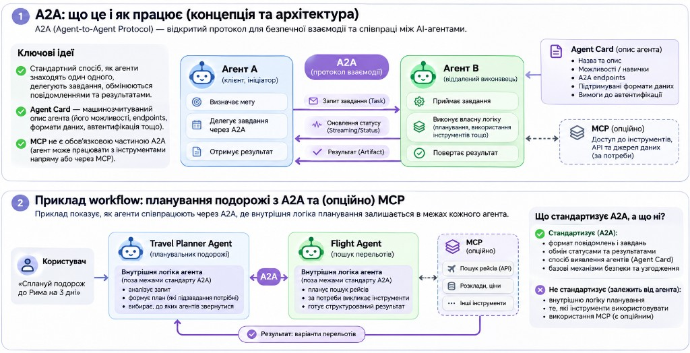

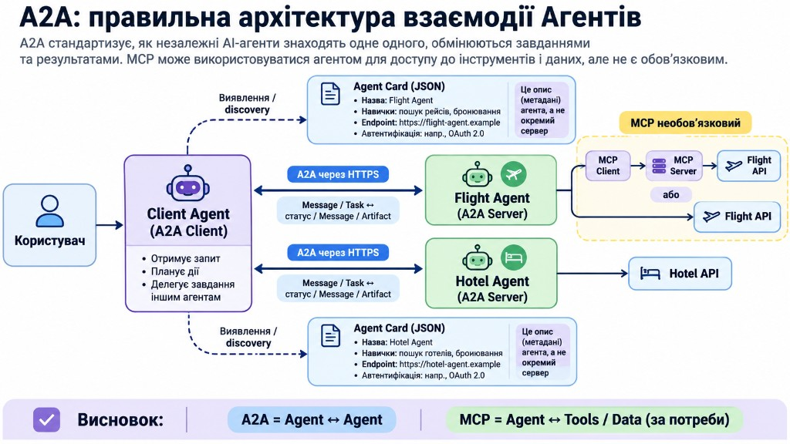

---

<a id="claude-desktop"></a>

## 8. Практика: підключення MCP до Claude Desktop

Найкращий спосіб зрозуміти MCP — спробувати його в дії. Підключимо MCP Server файлової системи до Claude Desktop. Весь процес займає близько 5 хвилин.

### Крок 1: Відкрийте налаштування розробника

Відкрийте Claude Desktop і перейдіть: **меню зверху → Settings → Developer → «Edit Config»**

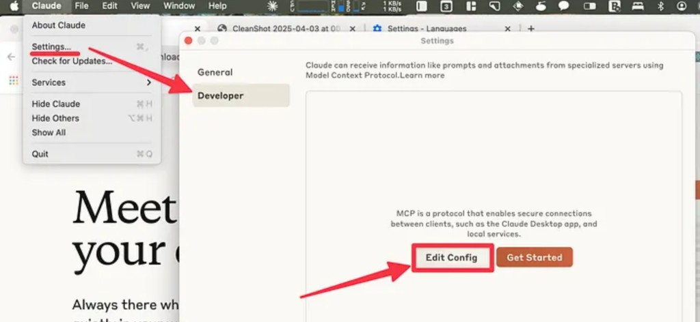

### Крок 2: Відредагуйте конфігураційний файл

Це відкриє файл `claude_desktop_config.json`.

**Де знаходиться файл:**
- **macOS:** `~/Library/Application Support/Claude/claude_desktop_config.json`
- **Windows:** `C:\Users\ВашеІм'я\AppData\Roaming\Claude\claude_desktop_config.json`

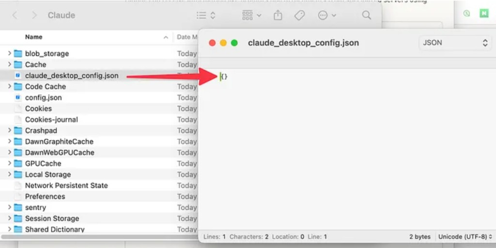

Відкрийте файл у будь-якому текстовому редакторі та додайте:

**Для macOS (шлях до вашої тестової папки):**

```json
{
  "mcpServers": {
    "filesystem": {
      "command": "npx",
      "args": ["-y", "@modelcontextprotocol/server-filesystem", "/Users/ВашеІм'я/Documents/MCP-demo"]
    }
  }
}
```

**Для Windows:**

```json
{
  "mcpServers": {
    "filesystem": {
      "command": "npx",
      "args": ["-y", "@modelcontextprotocol/server-filesystem", "D:\\Projects\\MCP"]
    }
  }
}
```

> **⚠️ Важливо для Windows:** у JSON використовуйте подвійні слеші `\\` (не одинарні `\`), бо одинарний `\` є escape-символом у JSON.

> **Що таке `npx -y`:** `npx` запускає пакет Node.js без глобальної установки; `-y` автоматично погоджується на завантаження пакету. Щоб це працювало, на вашому комп'ютері має бути встановлений Node.js.

Замініть шлях на ту папку, до якої хочете дати доступ Claude. Рекомендується використовувати окрему тестову папку без особистих даних.

### Крок 3: Перезапустіть Claude Desktop

**Важливо:** закрийте Claude Desktop **повністю**. На macOS: `Claude → Quit Claude`. На Windows: клік правою кнопкою на іконці в треї → Exit. Просте натискання на хрестик залишає програму у фоні.

Відкрийте Claude Desktop знову. Якщо все налаштовано правильно, внизу вікна з'явиться **іконка молотка з цифрою** — кількість доступних MCP-інструментів.


Якщо іконка не з'явилася, перевірте логи: **Settings → Developer → «Open logs folder»**.

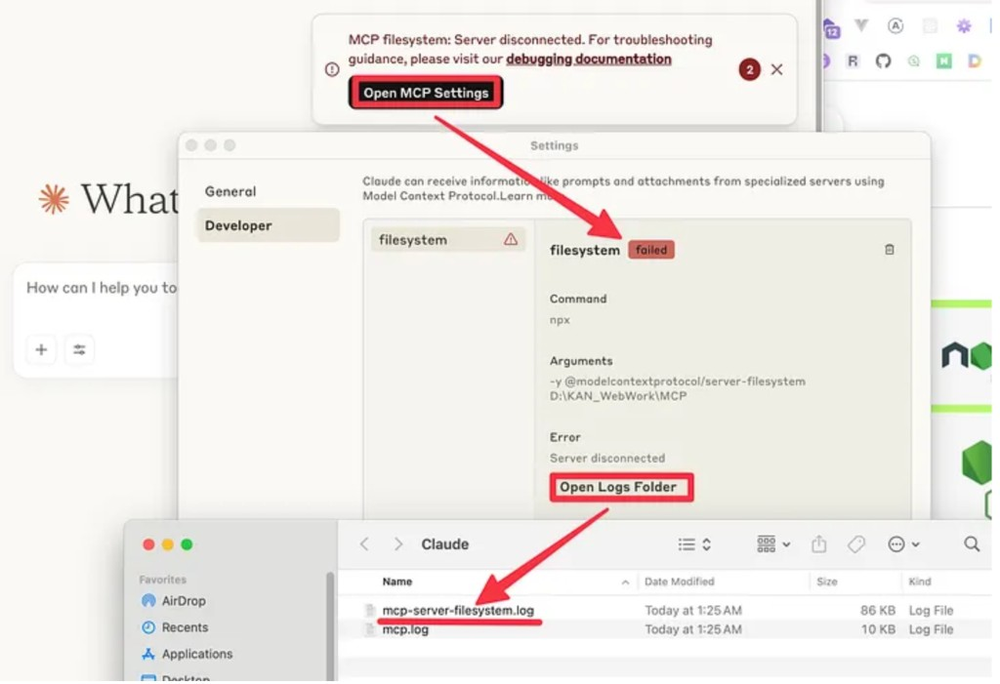

### Крок 4: Протестуйте

Напишіть у чаті:
- «Створи папку `test` у моїй MCP-директорії»
- «Покажи список файлів у папці»
- «Створи файл `notes.txt` з текстом "Привіт, MCP!"»

Claude запитає дозвіл перед кожною дією — це частина системи безпеки Host.

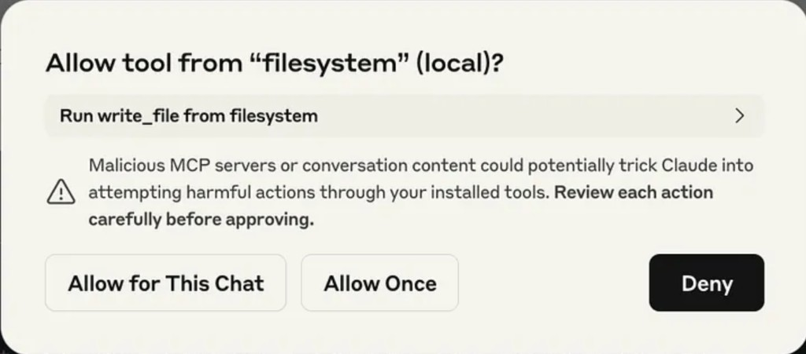

Підтвердьте, і операція виконається.

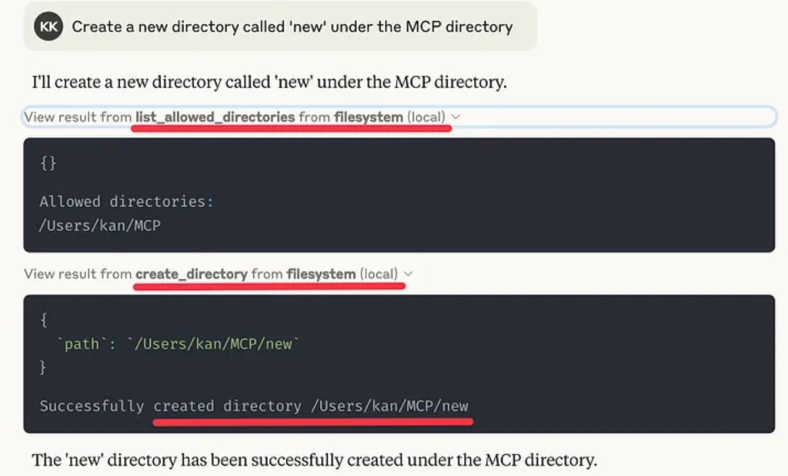

### Що відбувається під капотом

```
Claude Desktop (MCP Host)
    └── MCP Client
         │  запускає через npx
         ▼
filesystem MCP Server
    │  отримує запит по stdio
    │  виконує операцію з файлами
    └── повертає результат → Client → Host → модель → вам
```

1. Claude читає конфігурацію та через `npx` запускає MCP Server
2. Сервер отримує доступ **лише** до вказаної папки (не до всього комп'ютера)
3. Коли ви просите Claude працювати з файлами, він формує JSON-RPC запит до сервера
4. Сервер виконує операцію й повертає результат
5. Claude отримує відповідь і показує вам результат

Той самий принцип працює для баз даних, API, хмарних сервісів — змінюється лише MCP Server у конфігурації.

---

<a id="codex"></a>

## 9. Практика: підключення MCP до Codex

Codex (OpenAI) також підтримує MCP Servers. Можна повторити той самий експеримент із файловою системою.

**Одна відмінність:** Codex вже вміє працювати з локальними файлами в межах своїх дозволів — тому для звичайного читання й редагування MCP не потрібен. Але для вивчення **протоколу** це хороший практичний приклад.

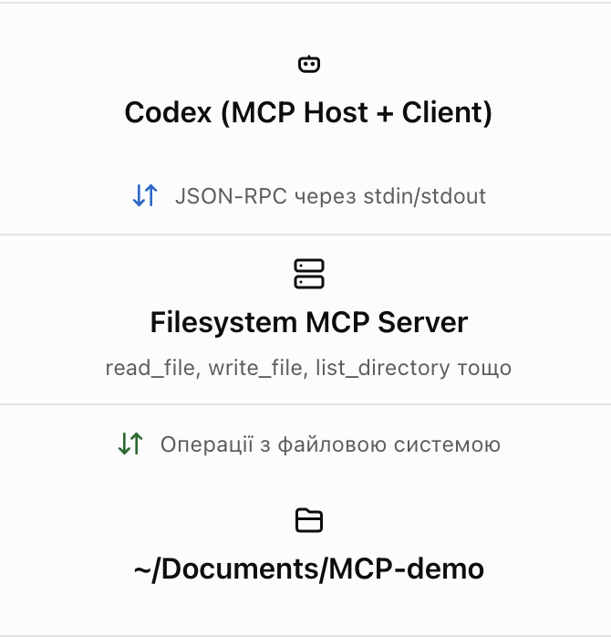

### Через Codex CLI

**Крок 1:** Створіть тестову папку:
```bash
mkdir -p ~/Documents/MCP-demo
```

**Крок 2:** Додайте MCP Server:
```bash
codex mcp add filesystem -- npx -y @modelcontextprotocol/server-filesystem "$HOME/Documents/MCP-demo"
```

**Крок 3:** Перевірте підключення:
```bash
codex mcp list
```

Або всередині Codex CLI:
```
/mcp
```

**Крок 4:** Запустіть Codex та явно попросіть використати MCP:

> «Використай інструменти Filesystem MCP Server, щоб створити файл `hello.txt` у папці MCP-demo та записати в нього "Hello from MCP!"»

Важливо **явно** попросити використати MCP — інакше Codex може скористатися власними файловими інструментами.

### Через Codex Desktop App

Settings → MCP servers → Add server:

| Поле      | Значення                                                                          |
|-----------|-----------------------------------------------------------------------------------|
| Name      | `filesystem`                                                                      |
| Transport | `STDIO`                                                                           |
| Command   | `npx`                                                                             |
| Arguments | `-y @modelcontextprotocol/server-filesystem /Users/USERNAME/Documents/MCP-demo`   |

Замініть `USERNAME` на своє ім'я користувача. Збережіть і перезапустіть.

> **Цікавий факт:** Claude Desktop і Codex можуть використовувати той самий Filesystem MCP Server, але кожен запускає **власний екземпляр** процесу зі своєю конфігурацією та ізольованим з'єднанням.

Офіційна документація: [learn.chatgpt.com/docs/extend/mcp](https://learn.chatgpt.com/docs/extend/mcp)

---

<a id="roles"></a>

## 10. Ролі в AI-екосистемі

Розуміння MCP і A2A важливе для різних AI-ролей, але фокус відрізняється.

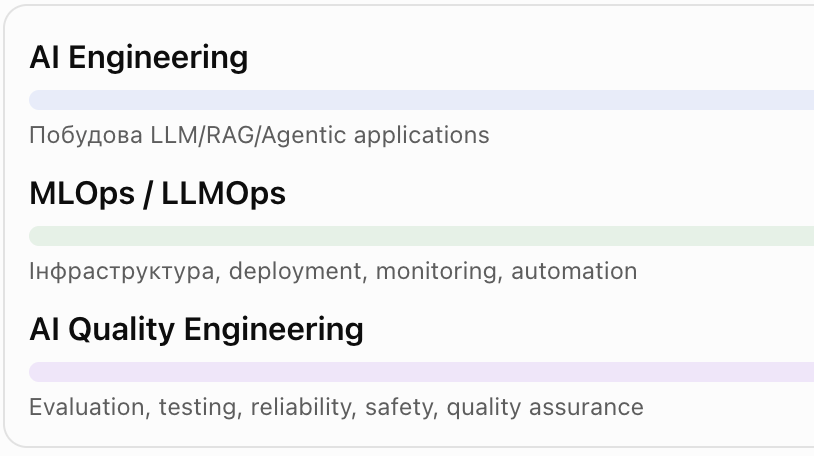

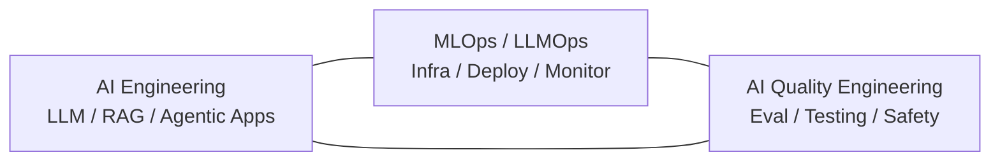

> Це не три ізольовані професії. У невеликих AI-командах одна людина нерідко виконує роботу з усіх трьох напрямів.

### Порівняння фокусу за напрямами

| Напрям         | AI Engineer                                                | MLOps / LLMOps Engineer                           |
|----------------|------------------------------------------------------------|----------------------------------------------------|
| **MCP**        | Розробка MCP Clients і Servers, інтеграція інструментів    | Розгортання, масштабування, конфігурація серверів  |
| **A2A**        | Архітектура мультиагентних систем, делегування завдань     | Надійність міжсервісної взаємодії                  |
| **API**        | REST, JSON-RPC, gRPC, асинхронні операції                  | API Gateway, балансування, мережеві політики       |
| **Безпека**    | OAuth, permissions, prompt injection                       | Secrets management, IAM, TLS, ізоляція             |
| **Продуктивність** | Context management, latency, token usage             | Autoscaling, resource utilization, throughput      |
| **Надійність** | Error handling, retries, timeouts                          | Monitoring, alerting, disaster recovery            |
| **Observability** | Tracing agent workflows, tool calls                   | Centralized logging, metrics, distributed tracing  |
| **Тестування** | Integration tests, evals, поведінка агентів                | Load, resilience, deployment validation            |

### Що варто вивчити в першу чергу

**Для AI Engineer:**
1. Client-server architecture, HTTP, REST, JSON-RPC, gRPC
2. MCP Host/Client/Server: реалізація власного MCP Server на Python
3. A2A: Agent Cards, Tasks, Messages, Artifacts, Task Lifecycle
4. Agent orchestration: LangGraph, ADK, CrewAI
5. Function calling, tool discovery, context engineering
6. Security: prompt injection, tool poisoning, authorization

**Для MLOps / LLMOps Engineer:**
1. Docker, Kubernetes, networking, service discovery
2. CI/CD для AI-систем
3. Deployment MCP Servers і A2A-сервісів
4. Observability: OpenTelemetry, Prometheus, Grafana
5. Secrets management, IAM, OAuth, TLS
6. Scaling, latency, availability, fault tolerance
7. Model serving, model registry, versioning, monitoring, drift detection

MLOps значно ширший за MCP та A2A — він охоплює повний lifecycle ML-моделей: підготовку даних, навчання, production-моніторинг.

**Якщо ваша мета — вирости з AI QA в ширшу роль:** орієнтуйтесь на AI Engineer із сильною компетенцією в AI Evaluation та LLMOps. Це дозволить використати наявний досвід тестування, але не обмежуватися ним.

---

<a id="conclusions"></a>

## 11. Висновки

MCP та A2A представляють фундаментальний зсув у тому, як ми думаємо про AI-системи. Замість монолітних ізольованих агентів, ми рухаємося до модульних взаємопов'язаних систем.

**MCP** вирішує проблему N×M: замість індивідуальних адаптерів для кожної пари «AI-застосунок + інструмент», кожна сторона реалізує стандарт один раз.

**A2A** вирішує задачу координації: незалежні агенти з різних компаній або екосистем можуть делегувати завдання і обмінюватися результатами без розкриття внутрішньої логіки.

**Три ключові висновки:**

1. **Фокус на архітектурі, а не на імплементації:** Розуміння того, як системи взаємодіють (протоколи, транспорти, primitive типи), стає важливішим за знання конкретних API.

2. **Стандарти — не магія:** MCP і A2A надають загальний словник і правила. Але безпека, надійність, швидкодія та автономність — це властивості конкретної реалізації, а не протоколу.

3. **Екосистема відкрита й активно розвивається:** MCP передано до Linux Foundation (грудень 2025). A2A 1.0 стабілізувався (березень 2026). Стежте за специфікаціями та оновленнями SDK.

---

<a id="checklist"></a>

## 12. Перевірте себе

Після вивчення цієї теми ви маєте розуміти:

✔️ **MCP — проблема N×M:** що означає «N+M складність» і чому це модель реалізацій, а не кількість з'єднань

✔️ **MCP — архітектура:** ролі Host, Client, Server; правило «один Client = один Server»; MCP Server як роль програми, а не тип обладнання

✔️ **MCP — транспорт:** два актуальних транспорти (stdio, Streamable HTTP); чому HTTP+SSE застарів; особливості кожного транспорту

✔️ **MCP — примітиви сервера:** Tools (виконання операцій), Resources (читання контенту через `resources/read`), Prompts (шаблони)

✔️ **MCP — примітиви клієнта:** Elicitation (активний); Sampling і Logging (deprecated у 2026-07-28)

✔️ **MCP — повідомлення:** роль `_meta` в кожному запиті; структура `tools/call` відповіді (content масив); `server/discover`

✔️ **MCP — stateless:** кожен запит містить усю інформацію в `_meta`; Tasks extension для тривалих операцій

✔️ **A2A — проблема:** відсутність стандарту для координації між **незалежними** агентами різних екосистем

✔️ **A2A — архітектура:** три шари (Data Model, Operations, Protocol Bindings); три bindings (JSON-RPC, gRPC, HTTP/REST)

✔️ **A2A — Agent Card:** JSON-документ за `/.well-known/agent-card.json`; три стратегії discovery; Agent Card декларує, але не автентифікує

✔️ **A2A — сутності:** Task, Message, Part, Artifact (+ Agent Card і Extension)

✔️ **A2A — Task lifecycle:** стани (Submitted → Working → Completed/Failed/Canceled/Rejected); три способи отримати оновлення (polling, streaming, push)

✔️ **A2A — версії:** 1.0 — стабільна версія (березень 2026); попередня — 0.3

✔️ **MCP vs A2A:** MCP = Agent → Tool/Data; A2A = Agent → Agent; можна комбінувати

✔️ **Безпека:** tool poisoning, rug pull, prompt injection; дозволи залежать від Host; аудит — на рівні застосунку

✔️ **MCP Registry:** preview з вересня 2025; стандартизує метадані, але не гарантує безпеку коду; необов'язковий

---

<a id="links"></a>

## 13. Список посилань

### Офіційна документація

- **MCP:** [modelcontextprotocol.io](https://modelcontextprotocol.io)
- **MCP Architecture Overview:** [modelcontextprotocol.io/docs/learn/architecture](https://modelcontextprotocol.io/docs/learn/architecture)
- **MCP Registry:** [registry.modelcontextprotocol.io](https://registry.modelcontextprotocol.io/)
- **MCP Blog:** [blog.modelcontextprotocol.io](https://blog.modelcontextprotocol.io/)
- **A2A Protocol:** [a2a-protocol.org](https://a2a-protocol.org)
- **A2A Specification 1.0:** [a2a-protocol.org/latest/specification/](https://a2a-protocol.org/latest/specification/)
- **A2A Agent Discovery:** [a2a-protocol.org/latest/topics/agent-discovery/](https://a2a-protocol.org/latest/topics/agent-discovery/)
- **A2A Python SDK:** [github.com/a2aproject/a2a-python](https://github.com/a2aproject/a2a-python)
- **Codex MCP:** [learn.chatgpt.com/docs/extend/mcp](https://learn.chatgpt.com/docs/extend/mcp)

### Технічні специфікації (базові поняття)

- **JSON-RPC 2.0:** [jsonrpc.org/specification](https://www.jsonrpc.org/specification)
- **LSP:** [microsoft.github.io/language-server-protocol](https://microsoft.github.io/language-server-protocol/)
- **RFC 8615 (Well-Known URIs):** [tools.ietf.org/html/rfc8615](https://tools.ietf.org/html/rfc8615)

### Статті та матеріали

- [The M×N Integration Problem — DailyDoseOfDS](https://blog.dailydoseofds.com/p/the-mn-integration-problem-solved)
- [What is MCP — Humanloop](https://humanloop.com/blog/mcp)
- [MCP: Model Context Protocol — AISpaces](https://aispaces.substack.com/p/what-is-mcp-model-context-protocol)
- [MCP Server Client Host — AgentCat](https://agentcat.com/blog/mcp-server-client-host/)
- [MCP Crash Course Part 4 — DailyDoseOfDS](https://www.dailydoseofds.com/model-context-protocol-crash-course-part-4/)
- [Understanding the A2A Protocol — ZBrain](https://zbrain.ai/understanding-the-a2a-protocol/)
- [Tavily API Documentation](https://help.tavily.com)
- [SerpAPI](https://serpapi.com/)
- [Brave Search API](https://api.search.brave.com/app/documentation/web-search/get-started)
