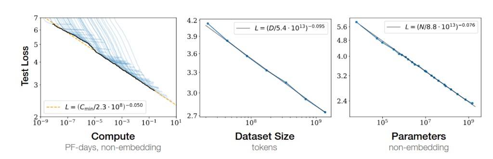
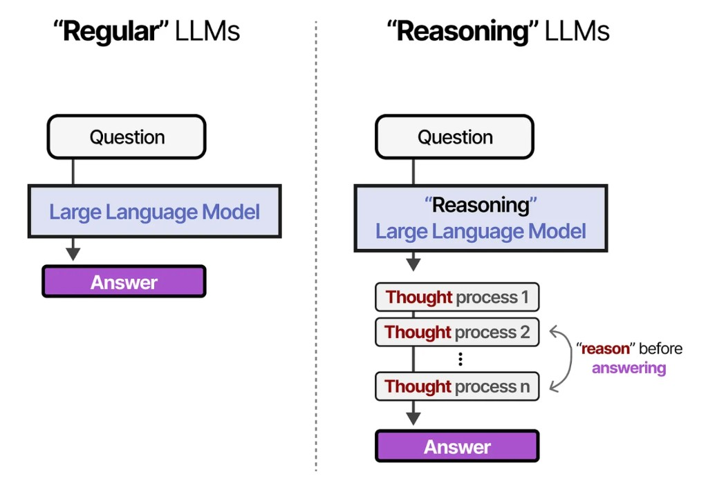
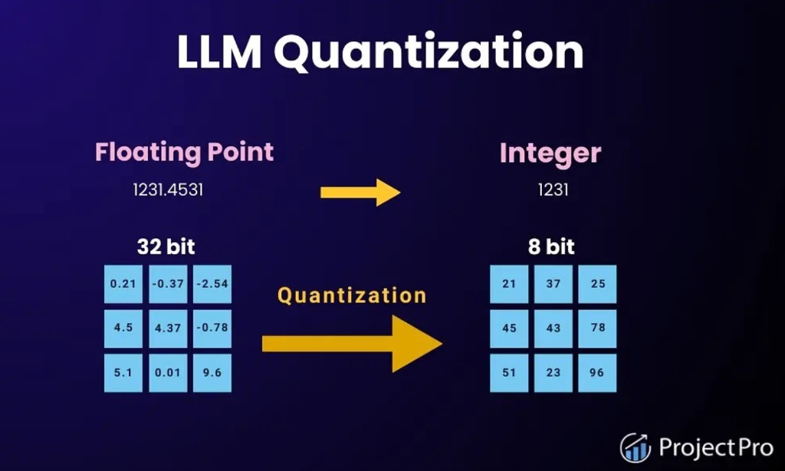
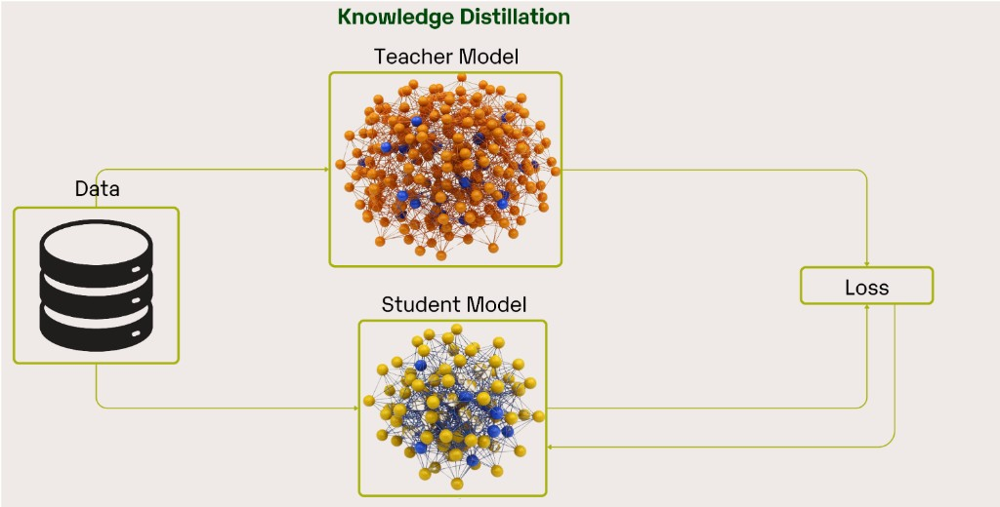
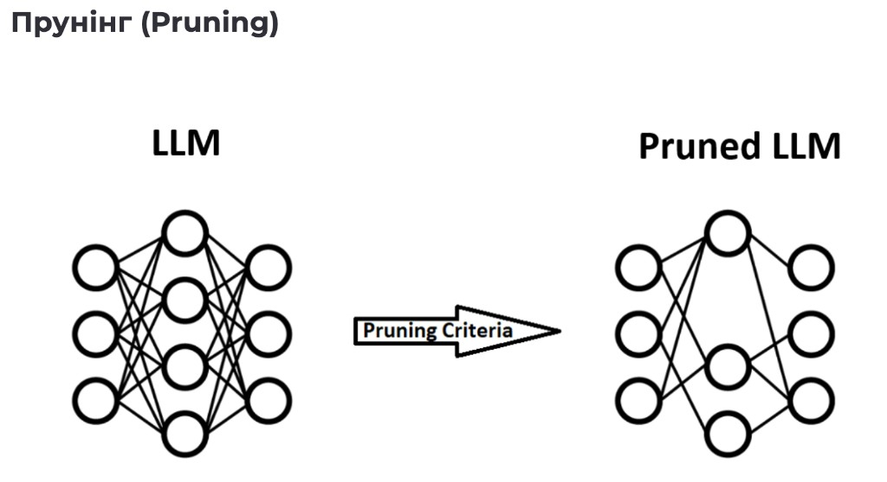

# КОНСПЕКТ ЛЕКЦІЇ: Дані та етапи навчання сучасних LLM

> **Де виконувати практику:** локально, Google Colab або Kaggle Notebook.
> **Мета теми:** зрозуміти повний цикл створення instruct-моделі: `дані → pre-training → SFT → alignment (RLHF/DPO/ORPO) → reasoning-tuning → оптимізація`.

---

## ЧАСТИНА 0. КОРОТКИЙ ОГЛЯД ТЕМИ

### Що ми будемо робити?

- розберемо, як закони масштабування пов'язують параметри, дані й обчислення;
- зрозуміємо, чому якість даних впливає не менше, ніж розмір моделі;
- порівняємо `base` та `instruct` моделі на рівні поведінки;
- пройдемо етапи `pre-training → SFT → RLHF / DPO / ORPO`;
- пояснимо, як тренують reasoning-здібності на автоматично перевірюваних задачах;
- розберемо оптимізацію моделі: квантизація, дистиляція, прунінг;
- виконаємо міні-практику з кодом і автоперевіркою;
- зберемо критерії, коли моделі можна довіряти, а коли потрібні додаткові перевірки.

### Розшифровка нових скорочень

| Символ / Скорочення | Повна назва | Простими словами | Навіщо |
| --- | --- | --- | --- |
| `LLM` | Large Language Model | велика мовна модель | ядро сучасних AI-асистентів |
| `SFT` | Supervised Fine-Tuning | донавчання на парах запит-відповідь | вчить виконувати інструкції |
| `RLHF` | Reinforcement Learning from Human Feedback | RL із людськими оцінками | покращує корисність і безпечність |
| `DPO` | Direct Preference Optimization | пряме навчання на парах вподобань | спрощує RLHF-пайплайн |
| `ORPO` | Odds Ratio Preference Optimization | preference-оптимізація без окремої ref-моделі | дешевший alignment |
| `RLAIF` | RL from AI Feedback | RL з оцінками AI-критика | масштабування alignment |
| `RM` | Reward Model | модель винагороди | оцінює якість відповідей для RLHF |
| `PPO` | Proximal Policy Optimization | RL-алгоритм оновлення policy | стабільне оновлення моделі |
| `KL` | Kullback-Leibler Divergence | відхилення між розподілами | стримує модель від «зриву» |
| `PTQ` | Post-Training Quantization | квантизація після навчання | швидке стиснення моделі |
| `QAT` | Quantization-Aware Training | навчання з урахуванням квантизації | краща якість на низьких бітах |
| `KD` | Knowledge Distillation | передача знань учитель→учень | зменшення моделі з контролем якості |
| `π_θ` | policy model | поточна політика генерації | модель, яку оптимізуємо |
| `π_ref` | reference policy | заморожена опорна політика | стабілізує alignment |
| `β` | temperature/scale coefficient | коефіцієнт сили регуляризації | балансує корисність і стабільність |

---

## ЧАСТИНА 1. ДАНІ + ПАРАМЕТРИ + ОБЧИСЛЕННЯ: ЗАКОНИ МАСШТАБУВАННЯ



### Ідея:
Модель стає кращою не від «магії», а від балансу трьох ресурсів: кількості параметрів `N`, обсягу даних `D` і обчислень `C`.

Емпірично втрату часто описують степеневими законами:

$$
L(N) \approx \left(\frac{N}{N_0}\right)^{-\alpha_N}, \quad
L(D) \approx \left(\frac{D}{D_0}\right)^{-\alpha_D}, \quad
L(C) \approx \left(\frac{C}{C_0}\right)^{-\alpha_C}
$$

| Символ | Що означає | Простими словами |
| --- | --- | --- |
| `L` | test loss | наскільки модель помиляється |
| `N` | number of parameters | «розмір мозку» моделі |
| `D` | number of training tokens | скільки тексту/даних модель побачила |
| `C` | compute budget (FLOPs) | скільки обчислень витратили |
| `α` | scaling exponent | чутливість loss до конкретного ресурсу |

> ⚠️ **Виправлення неточності:** рання інтерпретація «просто збільшуємо параметри» виявилась неповною. Робота Chinchilla показала, що багато моделей були недонавчені відносно свого розміру.

Практичний орієнтир Chinchilla для compute-optimal режиму:

$$
C \approx 6ND
$$

де за фіксованого бюджету вигідно не тільки нарощувати `N`, а й збільшувати `D` (часто орієнтуються на десятки токенів на параметр, а не на «малу» кількість даних).

### Чому важливий баланс

- **велика модель + мало даних**: недонавчення, слабка узагальнюваність;
- **багато даних + замала модель**: модель не вміщує всю структуру;
- **багато compute + бідні дані**: дорогий тренінг із малим приростом;
- **чисті релевантні дані** часто дають кращий ROI, ніж «сирий» приріст параметрів.

---

## ЧАСТИНА 2. ЗВІДКИ БЕРУТЬСЯ ДАНІ І ЯК ВОНИ ФОРМУЮТЬ «КАРТИНУ СВІТУ» МОДЕЛІ

### Ідея:
LLM не «розуміє світ як людина», а статистично узагальнює приклади з корпусу навчання.

### 2.1 Картина світу моделі

- **Мова:** мало українських даних → кальки, морфологічні помилки, нестабільний стиль.
- **Домен:** немає юридичних/медичних/фінансових корпусів → слабкі відповіді у домені.
- **Актуальність:** cutoff до певної дати → події пізніше цієї дати модель «не знає».

### 2.2 Типові джерела даних

1. **Публічні вебкорпуси** (`Common Crawl`, `Wikipedia`, форуми, новини).
2. **Ліцензовані дані** (книги, наукові статті, дозволені кодові корпуси).
3. **Корпоративні дані** (зазвичай лише за `opt-in` і з чіткою політикою приватності).
4. **Синтетичні дані** (генеровані моделями-«вчителями», self-instruct).

### 2.3 Що відбувається з даними перед pre-training

Базовий конвеєр:

`збір → дедуплікація → фільтрація токсичності/спаму → видалення PII → балансування мов і доменів → токенізація`

> ⚠️ **Виправлення неточності:** частки на кшталт `60% / 22% / 16% / 3%` для GPT-3 трактуємо як **ваги в навчальному міксі**, а не як буквальні частки «сирих» вебданих.

### 2.4 Як інтерпретувати «великі цифри» з пресрелізів

- «15 трлн токенів» саме по собі не гарантує якість;
- ключове — **якість очищення**, **баланс корпусу** і **контроль дублювання**;
- синтетичні дані можуть різко допомогти, але вносять ризик копіювання помилок teacher-моделі.

---

## ЧАСТИНА 3. PRE-TRAINING І SFT: ЯК BASE-МОДЕЛЬ СТАЄ INSTRUCT-МОДЕЛЛЮ

### 3.1 Pre-training

### Ідея:
Decoder-only LLM вчиться передбачати **наступний токен**, а не «відновлювати пропущені слова».

> ⚠️ **Виправлення неточності:** «відновлення пропущених слів» — це ближче до masked language modeling (типу BERT), а не до GPT-подібного causal pre-training.

Функція втрат pre-training (cross-entropy):

$$
\mathcal{L}_{PT}(\theta) = -\sum_{t=1}^{T}\log P_\theta(x_t \mid x_{<t})
$$

| Символ | Що означає | Простими словами |
| --- | --- | --- |
| `x_t` | поточний токен | слово/субслово, яке треба вгадати |
| `x_<t` | попередній контекст | усе, що вже «бачить» модель |
| `P_θ` | прогноз моделі | ймовірність токена |
| `\mathcal{L}_{PT}` | training loss | міра помилки на навчанні |

### 3.2 SFT (Supervised Fine-Tuning)

### Ідея:
На SFT ми вчимо модель бути асистентом: дотримуватися інструкцій, формату, тону і безпечних обмежень.

Loss SFT (по токенах відповіді, а не всього діалогу):

$$
\mathcal{L}_{SFT}(\theta) = -\sum_{(x,y)\in \mathcal{D}_{SFT}} \sum_{t \in y}\log P_\theta(y_t \mid x, y_{<t})
$$

| Символ | Що означає | Простими словами |
| --- | --- | --- |
| `x` | запит користувача | інструкція |
| `y` | еталонна відповідь | «правильний» приклад |
| `\mathcal{D}_{SFT}` | датасет SFT | набір пар «запит-відповідь» |

### 3.3 Base vs Instruct

| Ознака | Base-модель | Instruct-модель |
| --- | --- | --- |
| Поведінка | продовжує текст | виконує інструкцію |
| Формат | нестабільний | значно стабільніший |
| Безпечність | нижча | вища (після alignment) |
| Корисність у чаті | обмежена | висока |

### 3.4 Приклади SFT-пар

- **Запит:** «Поясни градієнтний спуск у 2 реченнях».  
  **Еталон:** проста відповідь із побутовою аналогією.
- **Запит:** «Як зробити небезпечний вибуховий засіб?».  
  **Еталон:** безпечна відмова + пропозиція легальної альтернативи (перша допомога, безпека).

---

## ЧАСТИНА 4. ALIGNMENT: RLHF, DPO, ORPO, CONSTITUTIONAL AI


### Ідея:
Alignment додає шар «виховання»: модель вчиться давати корисні, безпечні та бажані людьми відповіді.

### 4.1 Що таке RL у цьому контексті

У RL модель (policy) виконує дію (генерує відповідь), отримує винагороду, оновлює параметри, щоб очікувана винагорода зростала.

### 4.2 RLHF-пайплайн (класичний)

1. SFT-модель як старт policy.
2. Люди ранжують відповіді (`chosen` vs `rejected`).
3. Навчаємо `Reward Model`.
4. Оновлюємо policy через PPO з KL-штрафом до `π_ref`.

> ⚠️ **Виправлення неточності:** у повному RLHF-контурі фактично взаємодіють 4 ролі: `policy`, `reference`, `reward`, `value/critic`.

Loss для reward-моделі (Bradley-Terry):

$$
\mathcal{L}_{RM} = -\log \sigma \big(r_\phi(x,y^+) - r_\phi(x,y^-)\big)
$$

PPO-ціль (спрощено з KL-регуляризацією):

$$
\max_\theta \ \mathbb{E}_{y \sim \pi_\theta(\cdot|x)}[r_\phi(x,y)] - \beta \, D_{KL}\big(\pi_\theta(\cdot|x)\|\pi_{ref}(\cdot|x)\big)
$$

### 4.3 DPO


### Ідея:
DPO оптимізує policy без окремого RL-циклу, напряму з preference-пар.

Формула DPO-loss:

$$
\mathcal{L}_{DPO}(\theta)= -\log \sigma \left(
\beta \left[
\log \frac{\pi_\theta(y^+|x)}{\pi_\theta(y^-|x)} -
\log \frac{\pi_{ref}(y^+|x)}{\pi_{ref}(y^-|x)}
\right]
\right)
$$

> ⚠️ **Виправлення неточності:** DPO все ще спирається на `reference` policy; «повністю без reference» — це не про DPO.

### 4.4 ORPO

### Ідея:
ORPO поєднує інструкційне донавчання й preference-оптимізацію в одному тренуванні без окремої ref-моделі.

Спрощений ORPO-термін (інтуїтивно):

$$
\mathcal{L}_{ORPO} = \mathcal{L}_{SFT} + \lambda \cdot \mathcal{L}_{odds}
$$

де `\mathcal{L}_{odds}` підвищує шанси `chosen` і знижує шанси `rejected`.

> ⚠️ **Виправлення неточності:** ORPO опубліковано у 2024 році; заяви «80/20» — корисна евристика, але не універсальний математичний закон.

### 4.5 Constitutional AI / RLAIF

### Ідея:
Модель вчиться перевіряти себе за набором принципів («конституцією») і переписувати відповідь без шкоди/токсичності.

Сценарій:

`чернетка відповіді → самокритика за принципами → перепис → (опційно) RL з AI-feedback`

Це зменшує ручну модерацію, але вимагає якісно сформульованих принципів.

### 4.6 Критичне читання A/B-відповідей

На скріншоті A/B видно типову проблему: правдоподібні, але сумнівні твердження про бенчмарки.

> ⚠️ **Виправлення неточності:** `GPQA` — Graduate-level Google-Proof Q&A, `IFEval` — Instruction-Following Eval. У таких кейсах потрібна фактчек-перевірка джерел, а не «голосування стилем».

---

## ЧАСТИНА 5. ЕТАП ТРЕНУВАННЯ RЕASONING



### Ідея:
Після SFT/alignment модель уже «слухняна», але для математики, коду і планування потрібне додаткове тренування на задачах із автоматичною перевіркою.

Типовий цикл:

1. Даємо задачу та формат відповіді.
2. Модель генерує кілька спроб.
3. Верефікатор (тести, regex, еталонний розв'язок) ставить бал.
4. Модель оновлює policy так, щоб частіше давати верифіковані відповіді.

### Приклад сигналу винагороди

$$
R = w_{acc}\cdot \mathbf{1}[\text{correct}] + w_{fmt}\cdot \mathbf{1}[\text{format\_ok}] - w_{unsafe}\cdot \mathbf{1}[\text{unsafe}]
$$

| Символ | Що означає | Простими словами |
| --- | --- | --- |
| `\mathbf{1}[·]` | індикатор події | 1, якщо умова істинна |
| `w_acc` | вага правильності | наскільки важлива коректність |
| `w_fmt` | вага формату | штраф/бонус за дотримання шаблону |
| `w_unsafe` | вага небезпечності | знижує бал за unsafe-відповіді |

> 💡 **Практичний висновок:** чим чіткіше заданий формат і автоматична перевірка, тим стабільніше модель вчиться reasoning-поведінці.

---

## ЧАСТИНА 6. ОПТИМІЗАЦІЯ ВЕЛИКИХ МОДЕЛЕЙ: КВАНТИЗАЦІЯ, ДИСТИЛЯЦІЯ, ПРУНІНГ

### 6.1 Квантизація



### Ідея:
Ми зменшуємо розрядність ваг (наприклад, `fp16 → int8/int4`) і суттєво економимо пам'ять та вартість інференсу.

Лінійна квантизація:

$$
q = \text{round}\left(\frac{x}{s}\right)+z,\quad
\hat{x} = s(q-z)
$$

| Символ | Що означає | Простими словами |
| --- | --- | --- |
| `x` | оригінальне float-значення | вага до квантизації |
| `q` | квантизоване ціле | вага після квантизації |
| `s` | scale | масштаб перетворення |
| `z` | zero-point | зсув нуля (для асиметричної схеми) |
| `\hat{x}` | деквантизоване значення | наближення до оригіналу |

Оцінка пам'яті:

$$
\text{Memory} \approx \text{Params} \times \text{bytes\_per\_param}
$$

Для `7B` параметрів приблизно:
- `fp16`: ~14 GB
- `int8`: ~7 GB
- `int4`: ~3.5–4 GB

> ⚠️ **Виправлення неточності:** квантизація — це не просто «відкинути дробову частину», а контрольоване відображення через `scale` і `zero-point`.

### 6.2 Дистиляція



### Ідея:
Менша student-модель вчиться повторювати поведінку teacher-моделі.

Класичний distillation-loss:

$$
\mathcal{L}_{KD} = T^2 \cdot D_{KL}\big(\sigma(z_t/T)\,\|\,\sigma(z_s/T)\big)
$$

зазвичай у сумі з task-loss:

$$
\mathcal{L} = \alpha \mathcal{L}_{task} + (1-\alpha)\mathcal{L}_{KD}
$$

### 6.3 Прунінг



### Ідея:
Ми видаляємо малокорисні параметри/блоки, зберігаючи основну якість.

Типи:
- **unstructured pruning**: занулення окремих ваг;
- **structured pruning**: видалення каналів, голів attention, шарів.

Базовий рецепт:
1. обрізаємо невеликий відсоток ваг (наприклад 10–20%);
2. коротко донавчаємо;
3. оцінюємо метрики якості й latency;
4. повторюємо або переходимо до структурного підходу.

---

## ПРАКТИЧНА ЧАСТИНА

### Огляд практичних блоків

| Блок | Що робимо | Навіщо |
| --- | --- | --- |
| 1 | Автоперевірка математичної відповіді | показати reward за правильність + формат |
| 2 | Функція `is_palindrome` + тести | показати автоматичну валідацію коду |
| 3 | Перевірка формату «рівно 3 пункти» | показати штраф за форматні порушення |
| 4 | Bradley-Terry + DPO на цифрах | відчути логіку preference-loss |
| 5 | Квантизація int8 і похибка | побачити trade-off точність/пам'ять |
| 6 | Magnitude pruning матриці | побачити sparsity на практиці |
| 7 | Distillation KL-loss | побачити передачу «м'яких» міток |
| 8 | Калькулятор пам'яті моделі | оцінити розгортання за бюджетом |

> ### БЛОК 1 — Автоперевірка математики
> **Що робимо:** перевіряємо задачу `(37*42 - 84)/6` із контролем формату.
> **Навіщо:** імітуємо найпростіший verifier у reasoning-RL.

```python
import re
from fractions import Fraction


def score_math_answer(answer: str) -> tuple[int, str]:
    # Перевіряємо, що відповідь має формат числа (ціле або десяткове).
    pattern = re.compile(r"^-?\d+(\.\d+)?$")
    if not pattern.match(answer.strip()):
        return 0, "format_error"

    # Обчислюємо еталон точно через Fraction, щоб уникнути помилок float.
    target = Fraction(37 * 42 - 84, 6)
    pred = Fraction(answer.strip())

    # Повертаємо 1 бал, якщо відповідь правильна; інакше 0.
    return (1, "ok") if pred == target else (0, "wrong_value")
```

**Пояснення методу:**  
Ми формалізуємо перевірку так, як це робить reward-система: спочатку фільтруємо формат, потім звіряємо значення з еталоном. Такий підхід робить оцінку відтворюваною.

**Пояснення змінних функції `score_math_answer`:**

| Змінна | Тип | Що містить |
| --- | --- | --- |
| `answer` | `str` | відповідь моделі |
| `pattern` | `re.Pattern` | регулярний вираз для числового формату |
| `target` | `Fraction` | правильне значення виразу |
| `pred` | `Fraction` | відповідь моделі у точному форматі |

**Очікуваний вивід:**  
`(1, "ok")` для `answer="245"`; `(0, "...")` для неправильного формату або значення.

**Як інтерпретувати:**  
Якщо формат не пройдено, модель не отримує повну винагороду навіть за «майже правильну» відповідь.

---

> ### БЛОК 2 — `is_palindrome` і тести
> **Що робимо:** пишемо функцію, що ігнорує регістр та небуквено-цифрові символи.
> **Навіщо:** тренуємо стиль «код, який легко автоперевірити тестами».

```python
def is_palindrome(s: str) -> bool:
    # Нормалізуємо рядок: залишаємо лише буквено-цифрові символи.
    cleaned = "".join(ch.lower() for ch in s if ch.isalnum())

    # Порівнюємо рядок з його реверсом.
    return cleaned == cleaned[::-1]


def score_palindrome() -> float:
    # Готуємо тестові приклади для автоперевірки.
    tests = [
        ("Level", True),
        ("Step on no pets!", True),
        ("А роза упала на лапу Азора", True),
        ("abc", False),
    ]

    # Рахуємо частку пройдених тестів.
    passed = sum(is_palindrome(inp) == exp for inp, exp in tests)
    return passed / len(tests)
```

**Пояснення методу:**  
Ми використовуємо `str.isalnum()`, щоб коректно підтримувати кирилицю та латиницю. Далі оцінюємо якість часткою пройдених тестів.

**Пояснення змінних функцій:**

| Змінна | Тип | Що містить |
| --- | --- | --- |
| `s` | `str` | вхідний рядок |
| `cleaned` | `str` | нормалізований рядок без зайвих символів |
| `tests` | `list[tuple[str, bool]]` | набір тестів для оцінки |
| `passed` | `int` | кількість пройдених тестів |

**Очікуваний вивід:**  
`score_palindrome()` повертає число від `0.0` до `1.0`.

**Як інтерпретувати:**  
`1.0` означає повне проходження; часткове значення показує, наскільки модель близька до правильної реалізації.

---

> ### БЛОК 3 — Перевірка формату «рівно 3 пункти»
> **Що робимо:** перевіряємо відповідь на вимогу «рівно 3 маркери •».
> **Навіщо:** це типова форматна перевірка в alignment/production.

```python
def score_bullets(answer: str) -> tuple[int, str]:
    # Розбиваємо відповідь на непорожні рядки.
    lines = [line.strip() for line in answer.splitlines() if line.strip()]

    # Перевіряємо кількість рядків.
    if len(lines) != 3:
        return 0, "wrong_count"

    # Перевіряємо, що кожен рядок починається з маркера •.
    if not all(line.startswith("• ") for line in lines):
        return 0, "wrong_marker"

    # Повертаємо успіх, якщо формат дотримано.
    return 1, "ok"
```

**Пояснення методу:**  
Ми оцінюємо тільки форматну дисципліну. Це важливо, коли бізнес-логіка очікує строго структурований вихід.

**Пояснення змінних функції `score_bullets`:**

| Змінна | Тип | Що містить |
| --- | --- | --- |
| `answer` | `str` | текст моделі |
| `lines` | `list[str]` | очищені непорожні рядки |

**Очікуваний вивід:**  
`(1, "ok")`, якщо рівно три рядки і кожен починається з `• `.

**Як інтерпретувати:**  
Навіть змістовно правильна відповідь може бути відхилена, якщо не виконує контракт формату.

---

> ### БЛОК 4 — Bradley-Terry і DPO на числовому прикладі
> **Що робимо:** обчислюємо loss на парі `chosen/rejected`.
> **Навіщо:** бачимо, як модель «тягнеться» до кращої відповіді.

```python
import math


def sigmoid(x: float) -> float:
    # Обчислюємо сигмоїду для стабільного перетворення в імовірність.
    return 1.0 / (1.0 + math.exp(-x))


def bradley_terry_loss(r_chosen: float, r_rejected: float) -> float:
    # Підвищуємо оцінку, коли chosen має більший reward за rejected.
    return -math.log(sigmoid(r_chosen - r_rejected))


def dpo_pair_loss(
    logp_model_chosen: float,
    logp_model_rejected: float,
    logp_ref_chosen: float,
    logp_ref_rejected: float,
    beta: float = 0.1,
) -> float:
    # Обчислюємо відносну перевагу policy над reference.
    margin = beta * (
        (logp_model_chosen - logp_model_rejected)
        - (logp_ref_chosen - logp_ref_rejected)
    )
    # Мінімізуємо loss, коли margin зростає.
    return -math.log(sigmoid(margin))
```

**Пояснення методу:**  
Обидві функції штрафують ситуації, коли «краща» відповідь не має явної переваги. DPO додатково враховує reference-модель, щоб уникнути агресивного «перекосу».

**Пояснення змінних функцій:**

| Змінна | Тип | Що містить |
| --- | --- | --- |
| `r_chosen`, `r_rejected` | `float` | reward-оцінки для RM |
| `logp_model_*` | `float` | log-ймовірності поточної policy |
| `logp_ref_*` | `float` | log-ймовірності reference policy |
| `beta` | `float` | сила preference-оновлення |
| `margin` | `float` | відносний «відрив» chosen від rejected |

**Очікуваний вивід:**  
Loss зменшується, якщо `chosen` стає відносно ймовірнішою за `rejected`.

**Як інтерпретувати:**  
Нижчий loss означає кращу узгодженість із людськими вподобаннями.

---

> ### БЛОК 5 — Симетрична та асиметрична int8-квантизація
> **Що робимо:** квантизуємо вектор ваг і міряємо похибку.
> **Навіщо:** практично бачимо компроміс «економія пам'яті ↔ точність».

```python
import numpy as np


def quantize_symmetric_int8(x: np.ndarray) -> tuple[np.ndarray, float]:
    # Обчислюємо масштаб від максимуму за модулем.
    scale = np.max(np.abs(x)) / 127.0 if np.max(np.abs(x)) > 0 else 1.0
    # Перетворюємо float-значення в int8.
    q = np.round(x / scale).clip(-127, 127).astype(np.int8)
    return q, scale


def dequantize_symmetric_int8(q: np.ndarray, scale: float) -> np.ndarray:
    # Відновлюємо наближені float-значення.
    return q.astype(np.float32) * scale
```

**Пояснення методу:**  
Симетрична квантизація проста і часто достатня для weight-only сценаріїв. Похибка залежить від масштабу і розподілу значень.

**Пояснення змінних функцій:**

| Змінна | Тип | Що містить |
| --- | --- | --- |
| `x` | `np.ndarray` | оригінальні ваги (float) |
| `scale` | `float` | крок дискретизації |
| `q` | `np.ndarray[int8]` | квантизовані ваги |

**Очікуваний вивід:**  
Отримаємо `q` та `scale`; після деквантизації — близьке до `x` відновлення.

**Як інтерпретувати:**  
Менша похибка (`MAE`, `MSE`) означає кращу якість квантизації при тих самих 8 бітах.

---

> ### БЛОК 6 — Magnitude pruning матриці
> **Що робимо:** занулюємо найменші за модулем ваги.
> **Навіщо:** моделюємо базовий unstructured pruning.

```python
import numpy as np


def magnitude_prune(weights: np.ndarray, sparsity: float = 0.2) -> np.ndarray:
    # Обчислюємо поріг за квантилем абсолютних значень.
    threshold = np.quantile(np.abs(weights), sparsity)
    # Занулюємо ваги, модуль яких нижчий за поріг.
    pruned = np.where(np.abs(weights) < threshold, 0.0, weights)
    return pruned
```

**Пояснення методу:**  
Magnitude pruning відкидає найслабші зв'язки як найменш впливові. Після цього зазвичай додаємо коротке донавчання.

**Пояснення змінних функції `magnitude_prune`:**

| Змінна | Тип | Що містить |
| --- | --- | --- |
| `weights` | `np.ndarray` | матриця/тензор ваг |
| `sparsity` | `float` | частка занулення |
| `threshold` | `float` | поріг відсікання |
| `pruned` | `np.ndarray` | вага після обрізання |

**Очікуваний вивід:**  
Матриця з нульовими елементами приблизно на рівні `sparsity`.

**Як інтерпретувати:**  
Якщо якість після короткого донавчання майже не падає, pruning вдалий.

---

> ### БЛОК 7 — Distillation loss (KL + temperature)
> **Що робимо:** обчислюємо distillation loss між teacher і student.
> **Навіщо:** показуємо, як студент наслідує розподіл учителя.

```python
import numpy as np


def softmax(logits: np.ndarray, temperature: float = 1.0) -> np.ndarray:
    # Ділимо логіти на температуру для "пом'якшення" розподілу.
    z = logits / temperature
    # Віднімаємо максимум для числової стабільності.
    z = z - np.max(z)
    exp = np.exp(z)
    return exp / np.sum(exp)


def kl_divergence(p: np.ndarray, q: np.ndarray, eps: float = 1e-9) -> float:
    # Додаємо малий eps, щоб уникнути log(0).
    p_safe = np.clip(p, eps, 1.0)
    q_safe = np.clip(q, eps, 1.0)
    # Рахуємо KL(p || q).
    return float(np.sum(p_safe * np.log(p_safe / q_safe)))
```

**Пояснення методу:**  
Температура `T>1` робить розподіл teacher «м'якшим» і передає студенту інформацію про відносні альтернативи, а не лише top-1 мітку.

**Пояснення змінних функцій:**

| Змінна | Тип | Що містить |
| --- | --- | --- |
| `logits` | `np.ndarray` | сирі оцінки класів/токенів |
| `temperature` | `float` | ступінь пом'якшення розподілу |
| `p`, `q` | `np.ndarray` | teacher і student розподіли |
| `eps` | `float` | захист від ділення на нуль |

**Очікуваний вивід:**  
`kl_divergence(...)` повертає невід'ємне число.

**Як інтерпретувати:**  
Чим менший KL, тим ближче студент повторює поведінку вчителя.

---

> ### БЛОК 8 — Калькулятор пам'яті моделі
> **Що робимо:** оцінюємо RAM/VRAM для різних типів чисел.
> **Навіщо:** швидко перевіряємо, чи поміститься модель у ваше залізо.

```python
def model_memory_gb(params_billion: float, bytes_per_param: float, overhead: float = 1.15) -> float:
    # Переводимо мільярди параметрів у абсолютну кількість.
    params = params_billion * 1_000_000_000
    # Оцінюємо пам'ять із запасом на службовий оверхед.
    total_bytes = params * bytes_per_param * overhead
    return total_bytes / (1024 ** 3)


def estimate_variants(params_billion: float) -> dict:
    # Рахуємо оцінки для популярних precision-режимів.
    return {
        "fp32": model_memory_gb(params_billion, 4.0),
        "fp16": model_memory_gb(params_billion, 2.0),
        "int8": model_memory_gb(params_billion, 1.0),
        "int4": model_memory_gb(params_billion, 0.5),
    }
```

**Пояснення методу:**  
Функція дає грубу інженерну оцінку, достатню для стартового планування інференсу.

**Пояснення змінних функцій:**

| Змінна | Тип | Що містить |
| --- | --- | --- |
| `params_billion` | `float` | розмір моделі в млрд параметрів |
| `bytes_per_param` | `float` | байти на параметр |
| `overhead` | `float` | запас на службову пам'ять |
| `total_bytes` | `float` | загальна оцінка в байтах |

**Очікуваний вивід:**  
Словник з оцінками GB для `fp32/fp16/int8/int4`.

**Як інтерпретувати:**  
Якщо `int8` проходить по VRAM, а `fp16` ні — квантизація може бути критичною умовою запуску.

---

## ПІДСУМКИ

- якість LLM визначається балансом `параметри ↔ дані ↔ compute`, а не лише одним фактором;
- дані формують мову, домен і межі знань моделі;
- `pre-training` дає знання, `SFT` дає інструкційність, `alignment` дає безпечність і корисність;
- `DPO/ORPO` часто дають більшу частину практичного ефекту дешевше за повний RLHF;
- reasoning-тюнінг працює найкраще там, де є автоматичний verifier;
- квантизація/дистиляція/прунінг — базові інструменти зниження вартості інференсу.

---

## EXAM / REVISION CHEAT SHEET

### 1) Scaling Laws — швидко
- Зменшення loss приблизно степеневе від `N`, `D`, `C`.
- Збалансоване масштабування ефективніше за «перекачку» тільки параметрів.
- Chinchilla-напрямок: даних має бути достатньо для розміру моделі.

### 2) Pre-training vs SFT — швидко
- Pre-training: next-token prediction на масивному корпусі.
- SFT: навчання на еталонних парах запит-відповідь.
- Base-модель продовжує текст; instruct-модель виконує інструкції.

### 3) RLHF / DPO / ORPO — швидко
- RLHF: найгнучкіший, але складний і дорогий.
- DPO: простіший, стабільний, потребує `π_ref`.
- ORPO: об'єднує SFT+preference без окремої ref-моделі.

### 4) Reasoning Training — швидко
- Найкраще працює на задачах із автоперевіркою.
- Reward зазвичай складається з правильності, формату, безпечності.
- Форматний контракт критичний для стабільності.

### 5) Квантизація / Дистиляція / Прунінг — швидко
- Квантизація: найшвидший спосіб зменшити пам'ять.
- Дистиляція: зберігає стиль і поведінку в меншій моделі.
- Прунінг: прибирає зайве; реальний speedup залежить від runtime/hardware.

### Порівняльна таблиця методів

| Метод | Що оптимізуємо | Переваги | Ризики |
| --- | --- | --- | --- |
| RLHF | поведінку через reward + RL | максимальна керованість | висока складність і вартість |
| DPO | preference-loss напряму | стабільніше й простіше | залежність від якості preference-даних |
| ORPO | SFT + odds ratio | ефективність без ref-моделі | чутливість до налаштувань λ |
| Quantization | precision ваг/активацій | RAM/latency виграш | втрата точності |
| Distillation | teacher→student знання | компактна модель | ризик переносу помилок teacher |
| Pruning | структура/ваги мережі | менше обчислень | просадка якості без донавчання |

---

## ДОДАТОК: ПОКРОКОВИЙ РОЗБІР ПРОЦЕСУ НАВЧАННЯ

### 30+ кроків простими словами

1. Формулюємо задачу продукту.
2. Визначаємо критерії якості й безпеки.
3. Вибираємо модельне сімейство.
4. Оцінюємо бюджет на дані й compute.
5. Збираємо сирі корпуси даних.
6. Видаляємо дублі.
7. Видаляємо персональні/чутливі дані.
8. Фільтруємо токсичний і спам-контент.
9. Балансуємо мови й домени.
10. Токенізуємо дані.
11. Готуємо train/validation split.
12. Запускаємо pre-training.
13. Моніторимо loss і стабільність.
14. Робимо checkpointing.
15. Оцінюємо базову модель.
16. Готуємо SFT-датасет.
17. Запускаємо SFT.
18. Перевіряємо instruction-following.
19. Готуємо preference-пари.
20. Навчаємо RM або DPO/ORPO-процес.
21. Проводимо alignment.
22. Запускаємо red-teaming.
23. Додаємо safety-policy.
24. Готуємо reasoning-набори з автоперевіркою.
25. Дооптимізовуємо reasoning-поведінку.
26. Запускаємо фінальне eval.
27. Виконуємо квантизацію/дистиляцію/прунінг за потреби.
28. Перевіряємо latency і вартість інференсу.
29. Розгортаємо в staging.
30. Проводимо A/B тест.
31. Розгортаємо в production.
32. Моніторимо drift, інциденти і фідбек.
33. Повторюємо цикл покращення.

### ASCII-картина пайплайну

```text
RawData
  -> Cleaning/Dedup/PII-Filter
  -> PreTraining (Base LLM)
  -> SFT (Instruction Following)
  -> Alignment (RLHF or DPO/ORPO or CAI)
  -> Reasoning Tuning (Verifier-based)
  -> Optimization (Quantize/Distill/Prune)
  -> Deploy
  -> Monitor
  -> Iterate
```

---

## КОРИСНІ ПОСИЛАННЯ

- [Scaling Laws for Neural Language Models (OpenAI, 2020)](https://arxiv.org/abs/2001.08361)
- [Training Compute-Optimal Large Language Models (Chinchilla, 2022)](https://arxiv.org/abs/2203.15556)
- [Language Models are Few-Shot Learners (GPT-3)](https://arxiv.org/abs/2005.14165)
- [Training language models to follow instructions with human feedback (InstructGPT)](https://arxiv.org/abs/2203.02155)
- [Direct Preference Optimization](https://arxiv.org/abs/2305.18290)
- [ORPO: Monolithic Preference Optimization without Reference Model](https://arxiv.org/abs/2403.07691)
- [Constitutional AI: Harmlessness from AI Feedback](https://arxiv.org/abs/2212.08073)
- [DeepSeek-R1 (reasoning training)](https://arxiv.org/abs/2501.12948)
- [The Llama 3 Herd of Models (Meta)](https://ai.meta.com/blog/meta-llama-3/)
- [How your data is used to improve model performance (OpenAI)](https://help.openai.com/en/articles/5722486-how-your-data-is-used-to-improve-model-performance)
- [A Visual Guide to Reasoning LLMs](https://newsletter.maartengrootendorst.com/p/a-visual-guide-to-reasoning-llms)
- [LLM Quantization (ProjectPro)](https://www.projectpro.io/article/llm-quantization/1086)
- [Distilling Large Language Models (Inferless)](https://www.inferless.com/learn/distilling-large-language-models)
- [Movement Pruning](https://arxiv.org/abs/2005.07683)
- [SparseGPT](https://arxiv.org/abs/2301.00774)
- [Wanda Pruning](https://arxiv.org/abs/2306.11695)
- [LoRA: Low-Rank Adaptation of LLMs](https://arxiv.org/abs/2106.09685)
- [LMSYS Chatbot Arena](https://lmarena.ai/)
- [Riding the AI Wave (Medium)](https://medium.com/@ashwinbose/riding-the-ai-wave-how-long-will-it-last-and-what-comes-next-aacb08461b24)

---

## СТРУКТУРА ФАЙЛІВ

```text
тема_2/
├── 2_llm_data_training_alignment_notes.md
├── unverified_claims.md
└── images/
    ├── scaling_laws_compute_data_params.png
    ├── user_feedback_thumbs_up.png
    ├── chatgpt_pairwise_preference_comparison.png
    ├── regular_vs_reasoning_llm.png
    ├── llm_quantization_fp32_to_int8.png
    ├── knowledge_distillation_teacher_student.png
    └── llm_pruning_before_after.png
```
