# КОНСПЕКТ ЛЕКЦІЇ №3: Вибір і налаштування LLM

> **Тема:** як свідомо обирати модель під задачу, рахувати вартість, керувати якістю/швидкістю генерації та розуміти сучасні архітектури (MoE, reasoning).
>
> **Формат:** самодостатній конспект із виправленнями неточностей, поясненнями та прикладами.

---

## ЧАСТИНА 0. ЩО САМЕ МИ ВЧИМОСЯ РОБИТИ

Після цієї теми ви зможете:

- порівнювати LLM не лише за "якістю", а й за економікою (ціна, latency, throughput);
- оцінювати, коли потрібен великий контекст, а коли це зайві витрати;
- керувати стилем і стабільністю відповіді через параметри генерації;
- розуміти, що дають MoE і reasoning-моделі, а де їхні обмеження;
- читати бенчмарки без типових помилок інтерпретації.

### Короткі скорочення

| Термін | Що означає |
| --- | --- |
| `TTFT` | Time To First Token (затримка до першого токена) |
| `TPS` | Tokens Per Second (швидкість генерації після старту відповіді) |
| `RPS` | Requests Per Second (пропускна здатність за запитами) |
| `FLOPs` | Floating Point Operations (операції з плаваючою крапкою) |
| `MoE` | Mixture of Experts (суміш експертів, розріджена активація) |
| `FFN` | Feed-Forward Network (позиційний MLP-блок у Transformer) |
| `CoT` | Chain of Thought (ланцюжок міркувань) |
| `KV cache` | кеш ключів/значень уваги для повторного використання обчислень |
| `SFT` | Supervised Fine-Tuning |
| `RL` | Reinforcement Learning (навчання з підкріпленням) |
| `RLHF` | Reinforcement Learning from Human Feedback |
| `GRPO` | Group Relative Policy Optimization |
| `HLE` | Humanity's Last Exam |
| `GPQA` | Graduate-Level Google-Proof Q&A |
| `SWE` | Software Engineering |

---

## ЧАСТИНА 1. ПРОДУКТИВНІСТЬ І ВАРТІСТЬ: ЩО ДИВИТИСЯ ПЕРШИМ

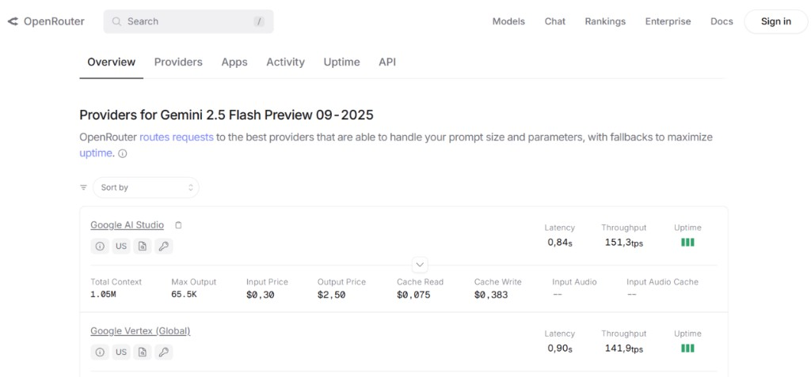

### 1.1 Ключові метрики моделі

Для прикладної роботи достатньо стартувати з 5 метрик:

1. `Context window` (скільки токенів уміщається в один прохід).
2. `Max output` (верхня межа відповіді).
3. `Input/Output price` (вартість токенів).
4. `Latency / TTFT` (час до першого токена).
5. `Throughput / TPS` (токенів за секунду після старту).

Джерела інтерфейсів і тарифів:

- [OpenRouter](https://openrouter.ai/)
- [OpenAI API](https://openai.com/api/)

### 1.2 Як порахувати вартість запиту

Базова формула:

\[
\text{cost} =
\frac{\text{input\_tokens}}{1{,}000{,}000}\cdot P_{in} +
\frac{\text{output\_tokens}}{1{,}000{,}000}\cdot P_{out}
\]

Приклад (10k вхід, 2k вихід, $0.30/$2.50):

- вхід: \(10000/1e6 \times 0.30 = 0.003\) USD
- вихід: \(2000/1e6 \times 2.50 = 0.005\) USD
- разом: **$0.008**

#### 1.2.1 Чому "$15 + $60" не дорівнює "$75 за мільйон"

Для історичного тарифу OpenAI o1:

- $15 за 1M вхідних токенів;
- $60 за 1M вихідних токенів.

Це дві окремі ставки. Наприклад, 100k вхід + 20k вихід:

\[
100000 \cdot \frac{15}{1e6} + 20000 \cdot \frac{60}{1e6}
= 1.5 + 1.2 = 2.7
\]

Отже, вартість запиту = **$2.70**, а не "$75 за мільйон".

#### 1.2.2 Приклад DeepSeek-R1 і чому "$8" потребує уточнення

Для DeepSeek-R1 (оголошення на релізі, січень 2025):

| DeepSeek-R1 | За 1M токенів |
| --- | --- |
| Вхід, без кешу | $0.55 |
| Вхід, із кешу | $0.14 |
| Вихід | $2.19 |

> ⚠️ **Виправлення неточності:** порівняння "$8 проти $15 + $60" некоректне без контексту. Часто "$8" у таких фразах означає **собівартість на власній інфраструктурі**, а $15/$60 — **роздрібний API-тариф**.

Формула собівартості:

\[
\text{cost\_per\_token} = \frac{\text{infra\_cost}}{\text{processed\_tokens}}
\]

Без опису обладнання, навантаження та методики це число не можна узагальнювати.

### 1.3 Latency vs Throughput (це різні речі)

- **TTFT/latency**: коли користувач побачив перший токен.
- **TPS/throughput**: наскільки швидко "друкується" решта.

Орієнтовний час повної відповіді:

\[
t_{total} \approx TTFT + \frac{N_{output}}{TPS}
\]

### 1.4 Prompt caching: що це і що це не є

- Кеш не "навчає" модель і не змінює її ваги.
- Кеш не збільшує контекстне вікно.
- Кеш дозволяє не перераховувати повторюваний префікс запиту (системний промпт, правила, довідник).

Практично: повторні запити з однаковим префіксом можуть бути дешевші/швидші.

Корисно читати:

- [Google Gemini caching](https://ai.google.dev/gemini-api/docs/caching)
- [OpenRouter prompt caching](https://openrouter.ai/blog/tutorials/prompt-caching-sticky-routing/)
- [OpenAI prompt caching](https://developers.openai.com/api/docs/guides/prompt-caching)

### 1.5 Тренд вартості: "LLMflation"

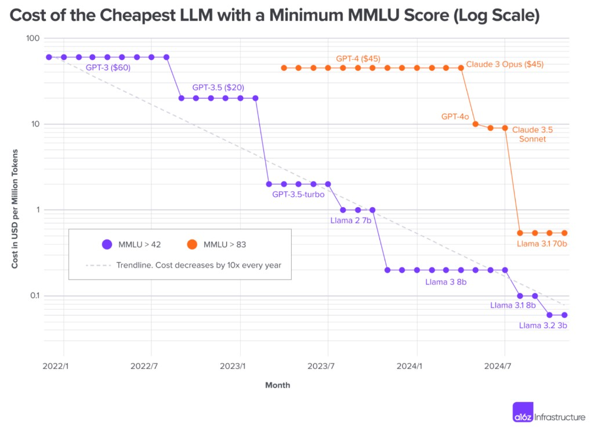

Головна ідея графіка: **ціна досягнення певного рівня якості з часом падає на порядки**.

- Вісь Y логарифмічна: рівні відрізняються в 10 разів.
- "Сходинка вниз" = з'явився дешевший спосіб досягти того ж порогу якості.

Джерело:

- [a16z: LLMflation](https://a16z.com/llmflation-llm-inference-cost/)

> ⚠️ **Виправлення неточності:** у лекції було наведено застарілу/помилкову пару цін GPT-4 як ~$3/$6 за 1M токенів. Для класичного GPT-4 (2023, 8k) публічні тарифи були **$30/$60** за 1M (вхід/вихід). На графіку a16z значення ~$45 відповідає усередненню.

### 1.6 Квантизація як інструмент продуктивності

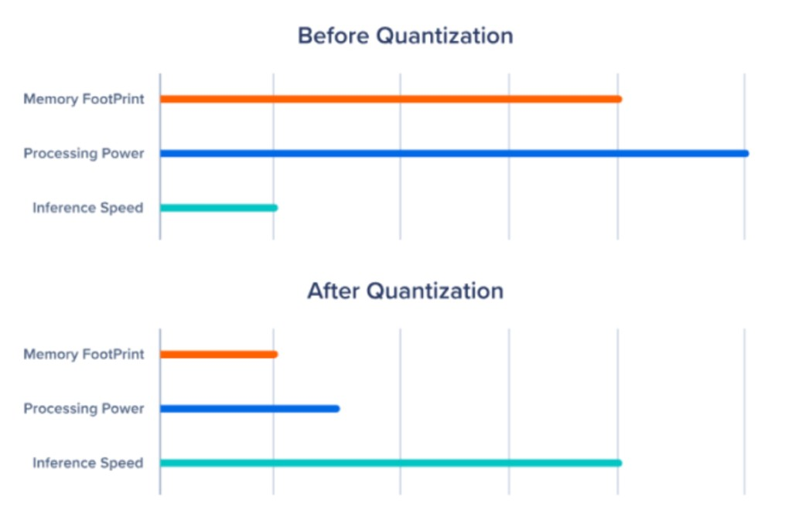

Квантизація зазвичай:

- зменшує пам'ять під ваги;
- може зменшити latency;
- може збільшити TPS;
- може трохи погіршити якість (залежить від методу/бітності/задачі).

Джерело:

- [Deepchecks: Quantization methods](https://deepchecks.com/top-llm-quantization-methods-impact-on-model-quality/)

---

## ЧАСТИНА 2. КОНТЕКСТНЕ ВІКНО І МАСШТАБ МОДЕЛІ

### 2.1 Контекстне вікно: правильна інтерпретація

Контекстне вікно = максимум токенів, які модель бачить в одному запиті:

- системні інструкції;
- історія діалогу (тільки та частина, що влізла);
- поточний запит;
- місце під нову відповідь.

> ⚠️ **Виправлення неточності:** зростання історії чату **не** збільшує контекстне вікно моделі. Вікно фіксоване для конкретної моделі; система лише керує, що саме потрапить у це вікно (обрізка, summary, retrieval).

### 2.2 Бюджет `max_tokens` треба ставити динамічно

\[
M = \min(R,\ C-I-S)
\]

де:

- `M` — фактичний ліміт відповіді,
- `R` — бажаний ліміт,
- `C` — контекстне вікно моделі,
- `I` — вже зайняті вхідні токени,
- `S` — технічний резерв.

Якщо `C-I-S <= 0`, треба скоротити контекст або змінити модель.

### 2.3 Великі контексти: плюс і ціна

Плюси:

- можна аналізувати великі документи без дроблення;
- менше зовнішнього orchestration-коду.

Мінуси:

- більше токенів = дорожче;
- довші запити можуть збільшувати latency;
- якість вилучення фактів з далеких позицій контексту не завжди лінійно росте.

Джерело:

- [Meibel: context window trade-offs](https://www.meibel.ai/post/understanding-the-impact-of-increasing-llm-context-windows)

### 2.4 Параметри моделі (`B`, `T`) і що вони означають

- `B` = billion = \(10^9\) параметрів.
- `T` = trillion = \(10^{12}\) параметрів.

> 70B параметрів не означає "70B токенів пам'яті". Це кількість навчуваних чисел, а не розмір поточного контексту.

#### 2.4.1 Параметри = ваги і зміщення

Параметри моделі — це навчувані числа (переважно ваги та, якщо архітектура використовує, зміщення):

- матриці в проєкціях attention;
- матриці FFN;
- embedding-матриці;
- параметри нормалізацій та інших навчуваних блоків.

| Представлення | Вигляд | Приклад |
| --- | --- | --- |
| Скаляр | Одне число | Окремий коефіцієнт |
| Вектор | Одновимірний масив | Зміщення шару |
| Матриця | Двовимірний масив | Ваги лінійного шару |
| Тензор | Багатовимірний масив | Групи матриць/згортки |

Для маленького лінійного шару 3->2:

- вхідний вектор: 3 числа;
- матриця ваг: \(2 \times 3 = 6\) чисел;
- вихідний вектор: 2 числа.

#### 2.4.2 Що означає "314B параметрів, із яких 78.5B активні"

На прикладі Grok-1 (публічні заяви xAI):

| Показник | Орієнтовне значення |
| --- | --- |
| Загальні параметри | 314B |
| Активні на токен | ~78.5B (приблизно 25%) |
| Неактивні для цього токена | ~235.5B |

У MoE це не означає, що одна й та сама "чверть" активна для всіх токенів.

> ⚠️ **Важливо:** "78.5B активних параметрів" не означає, що токен `cat` має вектор із 78.5 млрд чисел. Розмір вектора токена може бути, наприклад, 6144, але його перетворення залучає величезну кількість ваг у шарах.

### 2.5 Scaling laws: точніше формулювання

> ⚠️ **Виправлення неточності:** закони масштабування напряму описують передусім **зменшення loss**, а не гарантовано плавне зростання всіх прикладних метрик.

Ключові джерела:

- [Kaplan et al., 2020](https://arxiv.org/abs/2001.08361)
- [Hoffmann et al. (Chinchilla), 2022](https://arxiv.org/abs/2203.15556)

#### 2.5.1 Що можна масштабувати

| Що масштабуємо | Як саме |
| --- | --- |
| Параметри `N` | Ширина/глибина мережі, додавання експертів |
| Дані `D` | Більше навчальних токенів |
| Обчислення `C` під час тренування | Більший тренувальний бюджет |
| Test-time compute | Більше обчислень під час генерації (reasoning) |

#### 2.5.2 Баланс параметрів і даних

| Модель | Параметри | Навчальні токени | Токенів на параметр |
| --- | --- | --- | --- |
| A | 100B | 300B | 3 |
| B | 100B | 2T | 20 |
| C | 500B | 300B | 0.6 |

Інтуїція: дуже велика модель з малим датасетом може недовикористати свою місткість.

#### 2.5.3 Chinchilla-орієнтир

\[
D \approx 20N
\]

Для 100B параметрів це дає орієнтовно 2T токенів.

> ⚠️ **Виправлення неточності:** це не універсальний закон для всіх моделей і не "магічне число", а емпіричний орієнтир у певному режимі бюджетів.

#### 2.5.4 Dense і MoE як варіанти масштабування

| Архітектура | Загальні параметри | Активні параметри на токен |
| --- | --- | --- |
| Dense (умовно) | 100B | ~100B |
| MoE (умовно) | 500B | ~50B |

У MoE можна збільшувати загальну місткість без пропорційного росту активних параметрів на токен.

### 2.6 Уточнення по моделях із лекції

> ⚠️ **Виправлення неточності:** "більшість open моделей мають 2k-4k контекст" — історично застаріло.

- Mistral 7B (базова) мала 8k, а не 4k.
- У 2024-2026 відкриті моделі з 32k/128k+ вже поширені.

> ⚠️ **Виправлення неточності:** GPT-4o — окрема модель OpenAI (не "версія GPT-4 в Azure"). 128k контекст масово з'явився в GPT-4 Turbo.

---

## ЧАСТИНА 3. ПАРАМЕТРИ ГЕНЕРАЦІЇ (ПРАКТИЧНО)

### 3.1 Де це крутити в OpenRouter (UI)

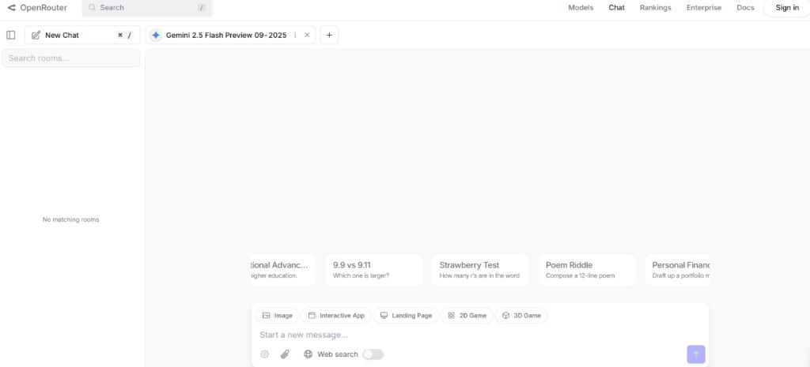
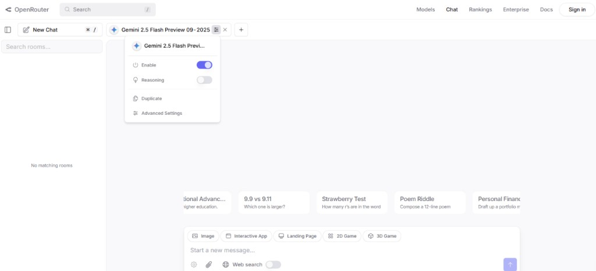
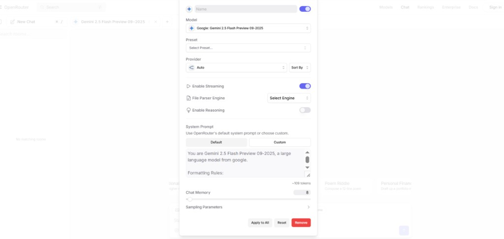
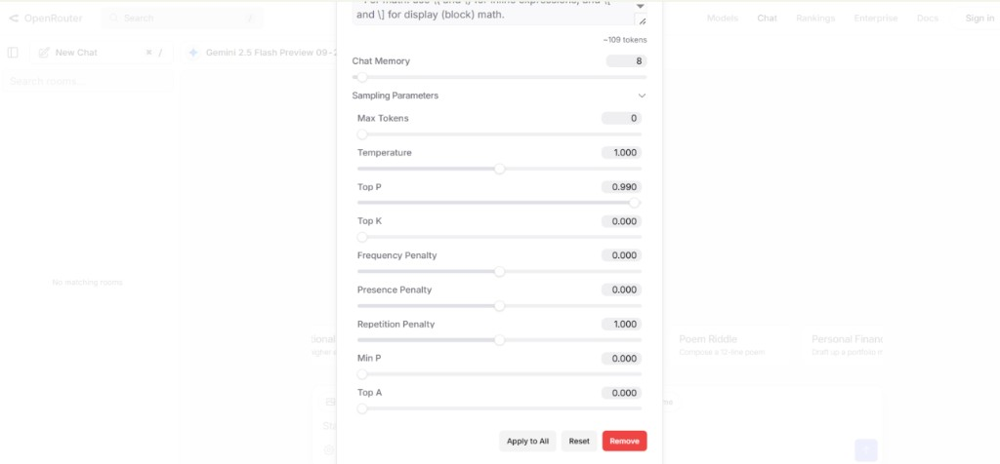

### 3.2 Порядок вибору токена (спрощено)

1. модель дає логіти;
2. застосовуються штрафи (frequency/presence/repetition);
3. temperature масштабує логіти;
4. softmax -> ймовірності;
5. top-k/top-p/min_p/top_a обрізають кандидатів;
6. семплінг або greedy вибирає токен.

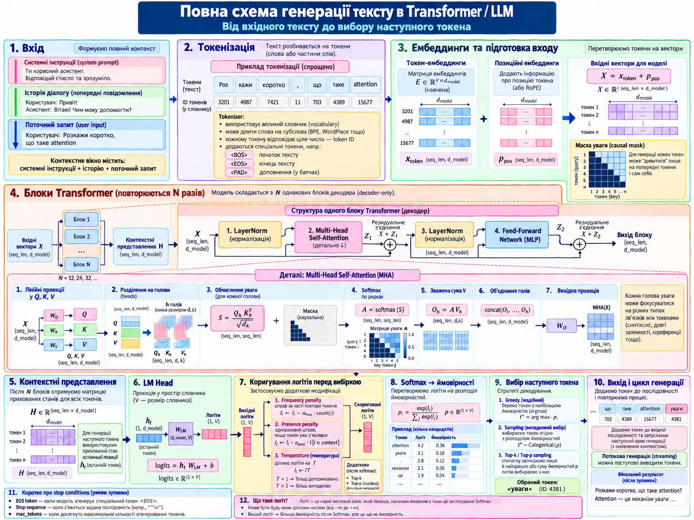

### 3.3 Temperature

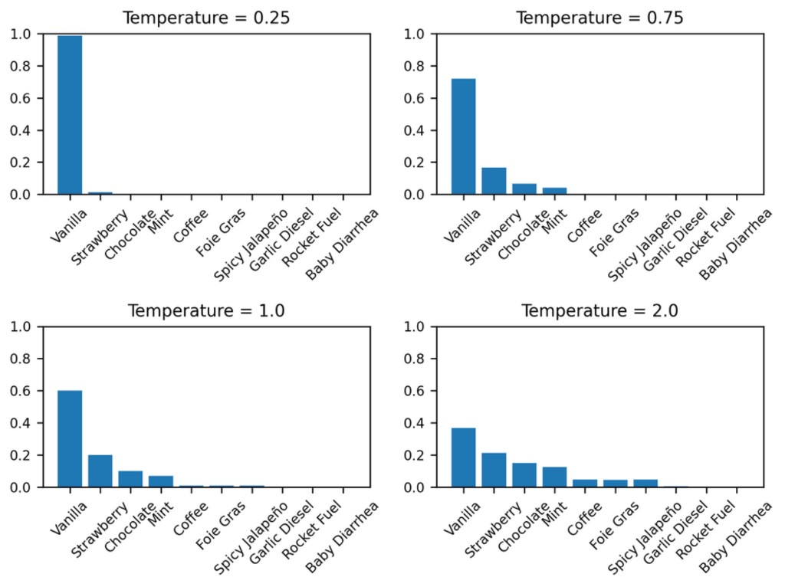

Температура змінює розподіл імовірностей:

\[
P_i=\frac{e^{z_i/T}}{\sum_j e^{z_j/T}}
\]

де \(z_i\) — логіт токена, \(T\) — температура.

| Temperature | Ефект | Типові задачі |
| --- | --- | --- |
| 0-0.2 | Висока передбачуваність | Витяг полів, класифікація |
| 0.4-0.7 | Баланс | Пояснення, аналітика |
| 0.8-1.0 | Більше різноманіття | Креатив, брейншторм |
| >1.0 | Ще більше випадковості | Експерименти |

Приклад для логітів `[3, 2, 1, 0.5]`:

| `T` | Розподіл (наближено) |
| --- | --- |
| 0.25 | `[0.9806, 0.0179, 0.0003, 0.0000]` |
| 0.75 | `[0.6948, 0.1834, 0.0484, 0.0234]` |
| 1.0 | `[0.6308, 0.2321, 0.0854, 0.0518]` |
| 2.0 | `[0.4551, 0.2760, 0.1674, 0.1015]` |

> ⚠️ **Виправлення неточності:** `T=0` не завжди гарантує 100% детермінізм у всіх провайдерів/режимів, але зазвичай максимально наближує поведінку до greedy.

### 3.4 Top-k і Top-p (nucleus)

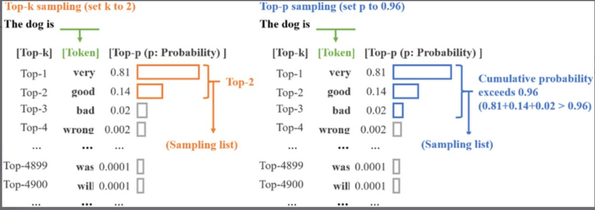

- `top_k`: фіксована кількість найкращих токенів.
- `top_p`: динамічне "ядро" токенів із кумулятивною імовірністю >= `p`.

Приклад: `p = 0.85`, початковий розподіл `40% / 30% / 15% / 10% / 5%`.

- після обрізки залишаються перші 3 токени (40 + 30 + 15 = 85);
- виконується перенормування:
  - `40/85 = 47.1%`
  - `30/85 = 35.3%`
  - `15/85 = 17.6%`

| Мета | Temperature | Top-p | Top-k |
| --- | --- | --- | --- |
| Максимальна повторюваність | 0-0.2 | 1.0 | без обмеження |
| Збалансована генерація | 0.5-0.7 | 0.9-1.0 | без обмеження |
| Креатив | 0.8-1.0 | 0.9-0.95 | без обмеження |
| Контрольоване різноманіття | ~0.7 | ~0.9 | 20-50 |

Практично: змінюйте **один параметр за раз**, щоб зрозуміти його реальний вплив.

> ⚠️ **Виправлення неточності:** низький `top_p` не робить відповідь автоматично фактично правильною; він лише звужує множину кандидатів.

### 3.5 `max_tokens` / `max_output_tokens`

- це **верхня межа**, а не цільова довжина;
- модель може завершити раніше;
- відповідь може обірватись, якщо межа замала.

### 3.6 Stop sequences, EOS і Structured Outputs

- `stop` зупиняє генерацію на текстовому маркері;
- `eos_token` — внутрішній токен завершення послідовності;
- `max_tokens` — механічний ліміт довжини.

> ⚠️ **Виправлення неточності:** `stop=["}"]` для JSON часто ламає валідність JSON (закривальна дужка не потрапляє у відповідь).

Для JSON-надійності краще використовувати Structured Outputs:

- `text.format` + `json_schema` + `strict: true` у Responses API;
- обробляти випадки `refusal` і `incomplete` (`max_output_tokens`).

Джерело:

- [OpenAI Structured Outputs](https://platform.openai.com/docs/guides/structured-outputs)

### 3.7 Frequency / Presence / Repetition penalty

- **frequency penalty**: штраф зростає з кількістю повторів токена;
- **presence penalty**: одноразовий штраф за факт появи токена;
- **repetition penalty** (у багатьох open runtime): альтернативний механізм гальмування повторів.

Приклад для токена `cat` з базовим логітом 5 і штрафом 0.5:

| Появ токена | Presence penalty | Frequency penalty |
| --- | --- | --- |
| 0 | 5.0 | 5.0 |
| 1 | 4.5 | 4.5 |
| 2 | 4.5 | 4.0 |
| 3 | 4.5 | 3.5 |
| 4 | 4.5 | 3.0 |

> ⚠️ **Виправлення неточності:** високі штрафи не є універсально кращими для точності. Для коду, формул і термінології вони часто шкодять, бо модель уникає потрібних повторів.

Додатково: слово може складатися з кількох токенів, тому штрафи працюють на токенному рівні, а не на "словах" у лінгвістичному сенсі.

### 3.8 Практичні стартові пресети

- **Аналітика/факти**: `temperature 0.1-0.4`, `top_p 0.8-0.95`, penalties мінімальні.
- **Код**: `temperature 0-0.2`, `top_p 0.8-1.0`, penalties близько 0.
- **Креатив**: `temperature 0.8-1.2`, `top_p 0.9-1.0`.
- **Чат-асистент**: `temperature 0.5-0.8`, `top_p ~0.9`.

---

## ЧАСТИНА 4. MOE І SPECULATIVE DECODING

### 4.1 MoE: інтуїція

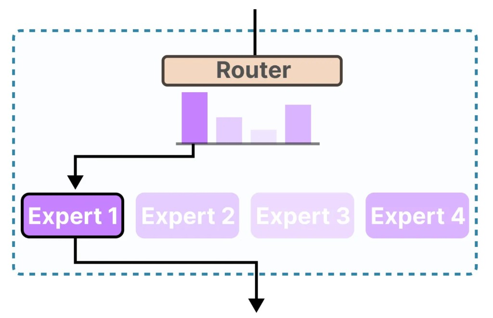
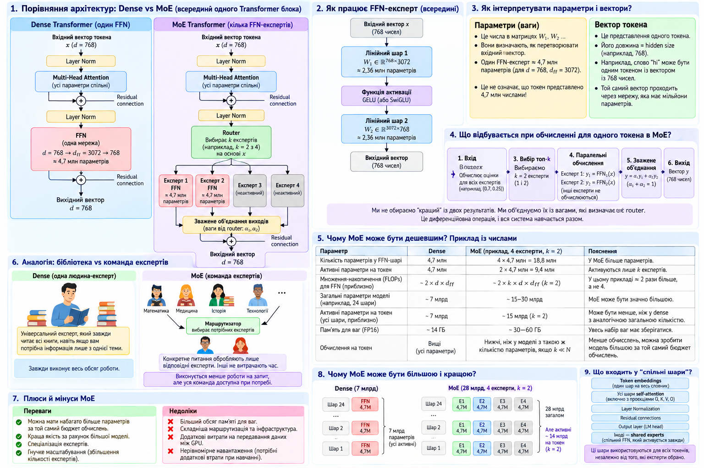

У MoE:

- є кілька експертів (часто FFN-блоків),
- роутер обирає підмножину експертів на токен,
- активні лише частина параметрів.

> ⚠️ **Виправлення неточності:** у dense-моделях compute зростає переважно лінійно з кількістю параметрів; "квадратичність" у Transformer головно пов'язана з attention за довжиною послідовності.

### 4.2 Експерт — це не "окрема LLM-особистість"

Експерт зазвичай є підмережею типу FFN у шарі:

\[
Expert(x)=W_2 \cdot \sigma(W_1 x + b_1)+b_2
\]

Важливо:

- токен може бути 768/4096-розмірним вектором;
- експерт може мати мільйони параметрів;
- це різні масштаби і різні сутності.

### 4.3 Чому MoE може бути дешевшим (і коли ні)

#### 4.3.1 Порівняння трьох конфігурацій FFN

Для вхідного вектора 768 (без bias, спрощено):

| Конфігурація | Формула FFN | Активні ваги на токен |
| --- | --- | --- |
| Dense (1 великий FFN) | `768 -> 12288 -> 768` | ~18.9M |
| MoE (4 експерти, top-2, менші FFN) | кожен `768 -> 3072 -> 768` | ~9.4M |
| MoE (4 великі експерти, top-2) | кожен `768 -> 12288 -> 768` | ~37.7M |

Висновок:

- якщо експерти менші, top-2 може бути дешевшим за великий dense FFN;
- якщо експерти такого ж розміру, top-2 дорожчий.

> **MoE сама по собі не гарантує прискорення.**

#### 4.3.2 Що робиться з виходами двох експертів

Роутер вибрав експертів `E1` і `E3` з вагами 0.7 і 0.3:

\[
E_1(x)=[2,4,6], \quad E_3(x)=[8,2,4]
\]
\[
y=0.7E_1(x)+0.3E_3(x)=[3.8,3.4,5.4]
\]

Тобто результат MoE-шару — **один об'єднаний вектор**, а не "вибір переможця".

#### 4.3.3 Аналогія з командою експертів

- Dense: один універсальний відділ працює над кожним запитом повним складом.
- MoE: велика команда, але на конкретний запит залучається лише кілька учасників.

Межа аналогії: експерти не обов'язково явно "медицина/історія/математика"; їхня спеціалізація формується під час навчання.

#### 4.3.4 Що реально виграємо в MoE

Умовний приклад:

| Параметр | Dense | MoE |
| --- | --- | --- |
| Загальні параметри | 40B | 200B |
| Активні параметри на токен | ~40B | ~30B |
| Пам'ять під FP16 ваги | ~80 GB | ~400 GB |
| Потенціал якості | залежить від тренування | може бути вищим через більшу місткість |

Це умовний приклад для інтуїції, а не прямі вимірювання конкретних моделей.

Публічний орієнтир: DeepSeek-V3 повідомляв **671B загальних** і **37B активних** параметрів.

> ⚠️ **Виправлення неточності:** "гібридні моделі майбутнього" вже існують зараз. Більшість великих MoE-моделей і так поєднують спільні dense-компоненти з розрідженими експертами.

### 4.4 Speculative decoding (окремо від MoE)

Дві моделі:

1. `draft` (мала, швидка) пропонує кілька токенів наперед;
2. `target` (велика, точніша) підтверджує/відхиляє.

Це оптимізація **процесу декодування**, а не архітектурна заміна шарів як у MoE.

---

## ЧАСТИНА 5. REASONING-МОДЕЛІ І СПЕЦИФІЧНІ ПАРАМЕТРИ

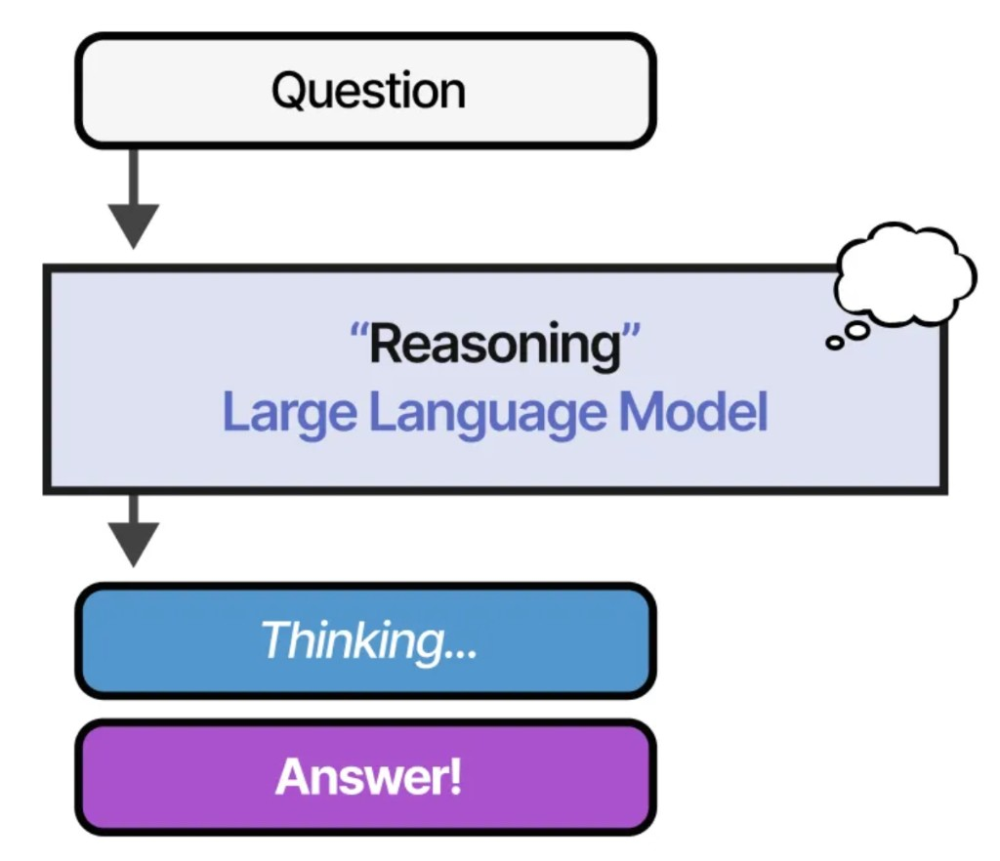

### 5.0 Що таке reasoning в LLM

Суть reasoning-моделей: дати мережі більше послідовних обчислень на розв'язання задачі до фінальної відповіді.

Це не обов'язково:

- окрема модель-критик;
- другий Transformer;
- оновлення ваг під час відповіді.

### 5.1 Чому з'явився клас reasoning-моделей

Класичні LLM добре продовжують текст, але складні multi-step задачі часто вимагають:

- більше "внутрішнього" обчислення на відповідь;
- кращого навчання на задачах міркування;
- явних механізмів керування глибиною міркування.

#### 5.1.1 Простий приклад із яблуками

Задача: "Було 15 яблук, віддали третину, купили ще 7."

- коротке обчислення: \(15 - 5 + 7 = 17\);
- з кроками модель має більше шансів уникнути помилки.

#### 5.1.2 Чому "той самий Transformer" може дати кращий результат

Не змінюючи архітектуру:

- без кроків: `Питання -> відповідь`;
- з reasoning: `Питання -> проміжні токени -> фінальна відповідь`.

Модель може використовувати вже згенеровані проміжні токени як контекст.

#### 5.1.3 Приклад 37 x 48

\[
37 \times 48 = 37 \times (40 + 8) = 1480 + 296 = 1776
\]

"Чернеткові" токени допомагають виконати послідовні кроки обчислення.

#### 5.1.4 Test-time compute scaling

Один прохід через фіксовану мережу має обмежену глибину обчислень. Додаткові кроки генерації = додаткові проходи через ту саму модель.

### 5.2 OpenAI: `reasoning.effort`

У Responses API:

- головний контроль: `reasoning.effort` (`low/medium/high`, залежно від моделі можуть бути додаткові значення);
- reasoning-токени враховуються у вихідний бюджет;
- якщо `max_output_tokens` замалий, можливий `incomplete`.

#### 5.2.1 `reasoning.effort` vs `max_output_tokens`

- `reasoning.effort` керує інтенсивністю міркування;
- `max_output_tokens` обмежує загальний бюджет вихідних токенів.

Джерело:

- [OpenAI reasoning guide](https://platform.openai.com/docs/guides/reasoning)

### 5.3 Anthropic: перехід від manual budget до adaptive

Історично:

- `thinking: { type: "enabled", budget_tokens: N }`.

У новіших лінійках:

- ручний бюджет не завжди підтримується;
- рекомендований adaptive-підхід через effort-параметри (`output_config.effort`).

> ⚠️ **Уточнення:** `budget_tokens` зазвичай трактують як цільовий бюджет, а не абсолютно жорсткий ліміт у всіх сценаріях.

Джерело:

- [Anthropic extended/adaptive thinking](https://docs.anthropic.com/en/docs/build-with-claude/extended-thinking)

### 5.4 Gemini: актуальний контроль thinking

У Gemini версійність параметрів важлива:

- для частини 2.5 API динамічний режим `thinkingBudget` задавався як `-1` (не `1`);
- у новіших API/моделях також використовується `thinkingLevel`.

> ⚠️ **Виправлення неточності:** не сприймайте `thinkingBudget = -1` як універсальне правило для всіх endpoint/SDK.

Джерело:

- [Gemini thinking docs](https://ai.google.dev/gemini-api/docs/thinking)

### 5.5 DeepSeek R1 і MoE

> ⚠️ **Виправлення неточності:** R1 не слід описувати як "просто MoE-модель". Її рівень reasoning сильно пов'язаний із рецептом навчання (SFT + RL), тоді як MoE дає переважно обчислювальну ефективність.

### 5.6 Training vs Inference: що відбувається де

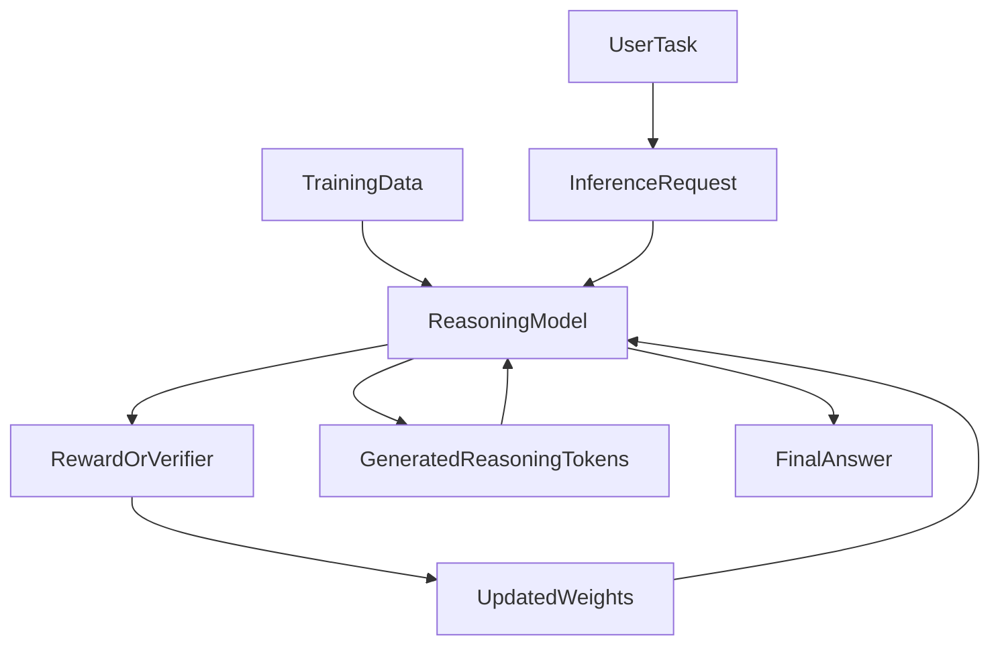

- **Під час навчання**: змінюються ваги (SFT/RL/GRPO).
- **Під час інференсу**: ваги не змінюються; модель лише генерує токени.

### 5.7 Приклад коду (Responses API)

```python
from openai import OpenAI

client = OpenAI()

response = client.responses.create(
    model="o3",
    input="Розв'яжи задачу: 15 яблук, віддали третину, купили ще 7.",
    reasoning={"effort": "high"},
    max_output_tokens=2000,
)

print(response.output_text)

if response.usage:
    print("Усього вихідних токенів:", response.usage.output_tokens)
    details = response.usage.output_tokens_details
    if details:
        print("Токени міркування:", details.reasoning_tokens)
```

### 5.8 Три рівні контролю в практичних системах

| Рівень | Що контролюємо | Точність контролю |
| --- | --- | --- |
| `reasoning.effort` | Загальний рівень зусиль | Опосередковано |
| Бюджет токенів | Максимальні витрати | Через ліміти |
| Зовнішній алгоритм/інструменти | Кроки верифікації | Програмно і явно |

Псевдокод зовнішнього контролю:

```python
claim = "Pain relief in 15 minutes"
analysis = reasoning_model.analyze(claim)
verification = claims_database.verify(claim=claim, market="Mexico")

if verification.is_approved:
    result = "PASS"
else:
    result = reasoning_model.revise(claim=claim, evidence=verification.evidence)
```

### 5.9 CNN vs Transformer для математики і науки

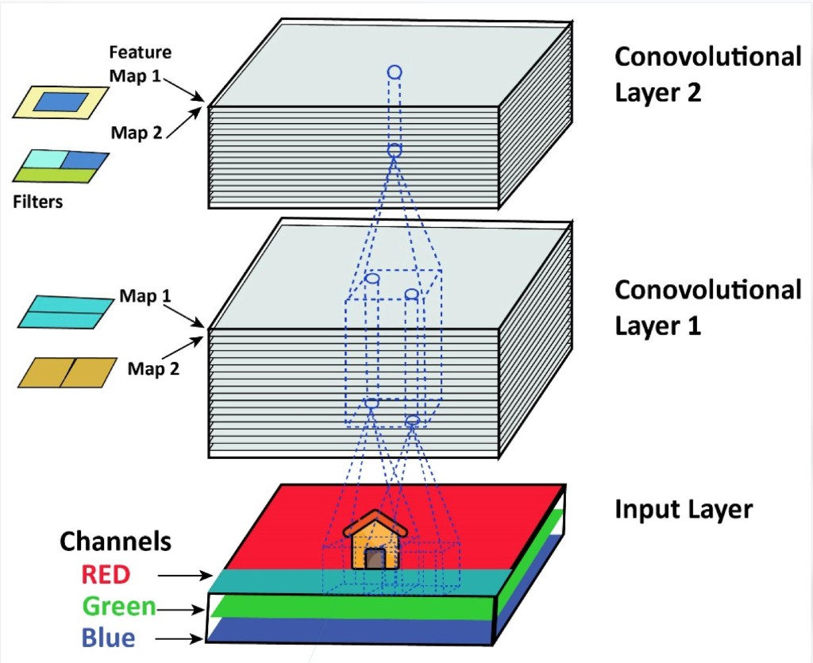
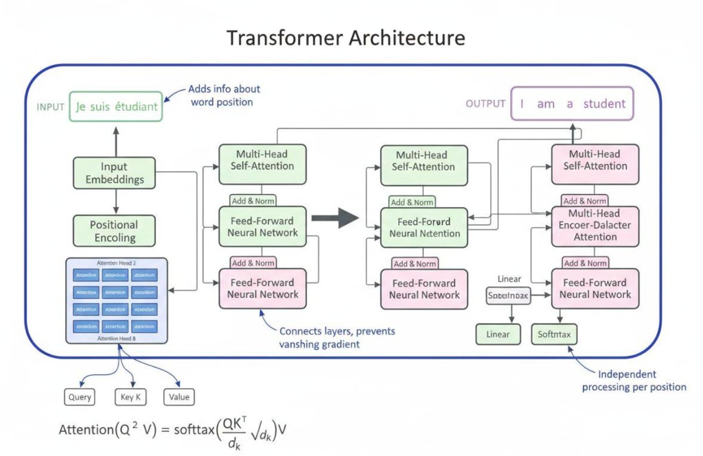

Дві різні задачі:

- **внутрішні обчислення мережі** (мільйони матричних операцій);
- **правильне розв'язання користувацької математичної задачі**.

Приклад виразу:

\[
(15+7)\times(48-12)
\]

CNN і Transformer можуть по-різному кодувати залежності, але жоден підхід не гарантує математичну безпомилковість без додаткових механізмів.

| Тип задачі | Що частіше доцільно |
| --- | --- |
| Розпізнавання формул на зображенні | CNN / ViT / гібрид |
| Аналіз медичних зображень | CNN або ViT |
| Математичне доведення | Transformer + reasoning |
| Точне множення великих чисел | Детермінований алгоритм/калькулятор |
| Текстове пояснення задачі | Transformer |

Практичний шаблон:

`Transformer -> виклик калькулятора/Python -> перевірений результат -> пояснення`.

Наприклад:

\[
378 \times 924 = 349272
\]

---

## ЧАСТИНА 6. БЕНЧМАРКИ ТА "OPEN VS CLOSED"

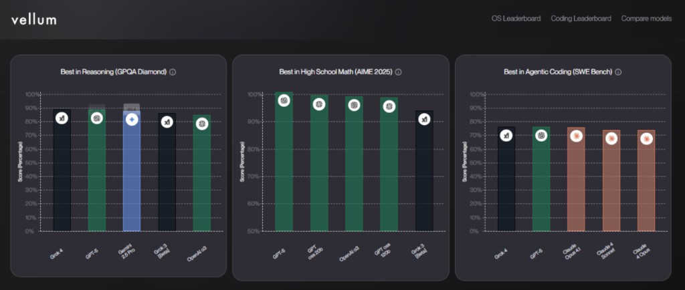

### 6.0 Що таке benchmark у LLM

Бенчмарк — стандартизований набір задач і методика оцінювання.

Він не вимірює "інтелект загалом", а конкретні здібності за конкретного протоколу.

| Група | Приклади | Що перевіряє |
| --- | --- | --- |
| Знання | MMLU, MMLU-Pro, ARC, GPQA, HLE | Предметні знання і застосування |
| Абстракція | ARC-AGI | Виведення закономірностей |
| Математика | GSM8K, MATH-500, AIME | Багатокрокові розрахунки |
| Код | SWE-bench, LiveCodeBench, HumanEval, MBPP | Генерація/виправлення коду |
| Мультимодальність | MMMU, MMMU-Pro | Робота з текстом + зображеннями |
| Правдивість/людська оцінка | TruthfulQA, LMArena | Фактичність і preference |

### 6.1 Короткий розбір ключових бенчмарків

#### 6.1.1 MMLU і MMLU-Pro

- MMLU: масив завдань з 57 дисциплін.
- MMLU-Pro: складніший формат і більша складність вибору.
- Типова метрика: `accuracy`.

#### 6.1.2 ARC (AI2 Reasoning Challenge)

- Запитання зі шкільних природничих наук.
- Набори: `ARC-Easy` і `ARC-Challenge`.

#### 6.1.3 ARC-AGI (Abstraction and Reasoning Corpus)

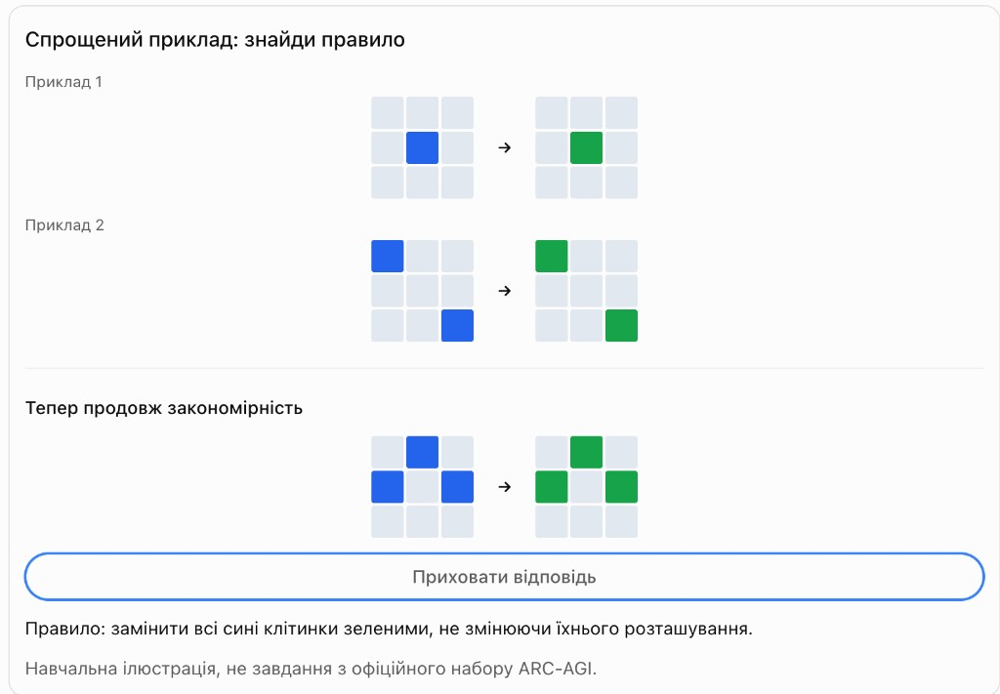

- Це **інший** ARC, не AI2 ARC.
- Перевіряє абстрактне виведення правила за прикладами.

#### 6.1.4 HLE (Humanity's Last Exam)

- Складні міждисциплінарні задачі експертного рівня.
- Окрім точності, часто аналізують калібрування впевненості.

#### 6.1.5 GPQA Diamond

- Питання graduate-рівня з фізики/хімії/біології.
- "Google-proof" означає, що простого пошуку зазвичай недостатньо.

#### 6.1.6 GSM8K, MATH-500, AIME

- GSM8K: шкільні текстові задачі.
- MATH-500: складніші багатокрокові задачі.
- AIME: олімпіадна математика (комбінаторика, алгебра, геометрія).

#### 6.1.7 SWE-bench

- Реальні issue з open-source репозиторіїв.
- Перевіряє здатність створювати patch, який проходить тести.

Поширені позначення:

- `SWE-bench` (основний набір),
- `Verified` (перевірений піднабір),
- `Live` (оновлюваніші задачі),
- `Bash-Only` (режим оцінювання, а не обов'язково окремий набір).

#### 6.1.8 LiveCodeBench

- Алгоритмічне програмування на свіжих задачах.
- Зменшує ризик contamination зі старих навчальних даних.

#### 6.1.9 HumanEval і MBPP

- HumanEval: короткі Python-функції (164 задачі).
- MBPP: базові Python-задачі (~1k).
- Метрики: `pass@1`, `pass@k`.

#### 6.1.10 MMMU і MMMU-Pro

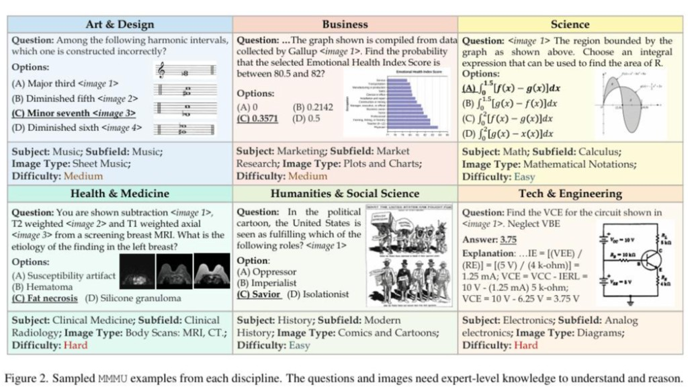


- Бенчмарки мультимодального розуміння (графіки, схеми, зображення, текст).
- MMMU-Pro посилює складність і зменшує "вгадуваність".

#### 6.1.11 TruthfulQA

- Перевіряє схильність відтворювати популярні хибні твердження.
- Не є повним тестом усіх видів галюцинацій.

#### 6.1.12 LongBench

- Завдання з довгим контекстом (QA по документах, резюмування, код).
- Велике context window не гарантує коректного вилучення фактів.

#### 6.1.13 Chatbot Arena / LMArena

- Парні "сліпі" порівняння відповідей людьми.
- Історично часто посилаються на Elo, але також застосовуються інші статистичні моделі парних порівнянь.

### 6.2 Як правильно читати benchmark-числа

| Метрика | Що показує |
| --- | --- |
| Accuracy | Частка правильних відповідей |
| pass@1 | Успіх з однієї спроби |
| pass@k | Шанс мати хоча б один правильний варіант серед `k` |
| Resolved rate | Частка успішно розв'язаних інженерних задач |
| Elo/Arena score | Перевага в парних людських порівняннях |
| Calibration | Наскільки впевненість узгоджена з реальною точністю |

Правило: порівнюйте результати лише за сумісних умов (версія датасету, протокол, tools/no-tools, кількість спроб).

### 6.3 Open vs closed: як читати оцінки "лагу"

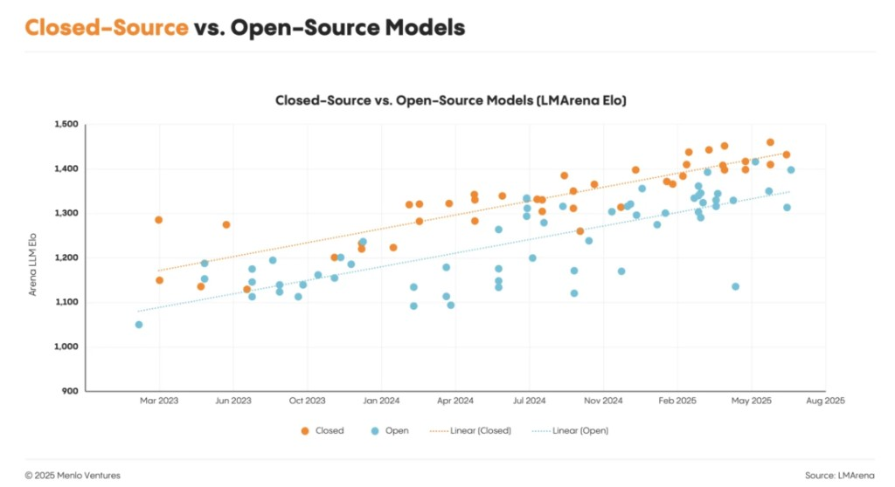

За Epoch AI (для певного періоду):

- оцінки лагу відкритих моделей були в широкому діапазоні;
- усереднені оцінки залежали від методики та довірчих інтервалів.

Джерела:

- [Epoch AI report](https://epoch.ai/publications/open-models-report)
- локальна копія: `uploads/open-models-report-3.md`

> ⚠️ **Виправлення неточності:** формулювання "лаг дорівнює X місяців" треба читати як оцінку для конкретної методики й часу, а не універсальну константу.

> ⚠️ **Додаткове уточнення:** згадки про нові оцінки (наприклад, ~4 місяці за ECI у 2026) теж слід перевіряти за оригінальною публікацією й датою.

### 6.4 Словник термінів

| Термін | Коротке пояснення |
| --- | --- |
| Benchmark | Стандартизований тест |
| Leaderboard | Таблиця результатів |
| Data contamination | Потрапляння тестових задач у навчальні дані |
| Data leakage | Витік інформації між train/test або між етапами пайплайна |
| Open-weight model | Відкриті ваги моделі |
| Closed model | Закрита модель |
| SOTA | Найкращий опублікований результат на момент оцінки |
| Baseline | Базовий орієнтир для порівняння |
| BBH | BIG-Bench Hard |
| LSAT | Law School Admission Test |
| API | Application Programming Interface |
| AGI | Artificial General Intelligence |

### 6.5 Які бенчмарки практичні для QA AI Engineer

| Бенчмарк | Для чого корисний |
| --- | --- |
| SWE-bench | Перевірка агентів, що працюють із кодом/issue |
| LiveCodeBench | Актуальне алгоритмічне програмування |
| GPQA/HLE | Складне міркування й фактологія |
| TruthfulQA | Ризики хибних популярних тверджень |
| LongBench | Якість роботи з довгим контекстом |
| MMMU/MMMU-Pro | Мультимодальні сценарії |

Для RAG-систем варто додатково використовувати спеціалізовані оцінки (наприклад, RAGAS) і розділяти оцінювання retrieval та generation.

---

## ПРАКТИЧНА ЧАСТИНА (МІНІ-ЛАБИ БЕЗ API)

### 1) Калькулятор вартості

```python
def request_cost(input_tokens, output_tokens, price_in, price_out):
    return (input_tokens / 1_000_000) * price_in + (output_tokens / 1_000_000) * price_out

print(request_cost(10_000, 2_000, 0.30, 2.50))  # 0.008
```

### 2) Динамічний `max_tokens` бюджет

```python
def compute_max_tokens(context_window, input_tokens, requested_max_tokens, safety_margin=100):
    return max(0, min(requested_max_tokens, context_window - input_tokens - safety_margin))

print(compute_max_tokens(4096, 3500, 1000, 100))  # 496
```

### 3) Temperature + softmax (демо)

```python
import math

def softmax(xs):
    m = max(xs)
    exps = [math.exp(x - m) for x in xs]
    s = sum(exps)
    return [e / s for e in exps]

logits = [3.0, 2.0, 1.0]
for T in [0.25, 0.75, 1.0, 2.0]:
    probs = softmax([x / T for x in logits])
    print(T, probs)
```

### 4) `top_p` ядро (nucleus)

```python
def top_p_filter(tokens_probs, p=0.9):
    # tokens_probs: list[tuple[token, prob]], already sorted desc
    kept, cum = [], 0.0
    for tok, pr in tokens_probs:
        kept.append((tok, pr))
        cum += pr
        if cum >= p:
            break
    z = sum(pr for _, pr in kept)
    return [(tok, pr / z) for tok, pr in kept]  # renormalized

data = [("A", 0.6), ("B", 0.2), ("C", 0.1), ("D", 0.06), ("E", 0.04)]
print(top_p_filter(data, 0.9))
```

### 5) Чому `stop=["}"]` небезпечно для JSON

```python
text = '{ "product": "No-Spa", "status": "approved" }'
stop = "}"
cut = text.split(stop)[0]
print(cut)  # невалідний JSON без закривальної дужки
```

---

## ПІДСУМКИ

1. Вибір LLM = компроміс між якістю, ціною, latency і throughput.
2. Контекстне вікно — обмежений ресурс; кеш допомагає з обчисленнями, але не розширює вікно.
3. Параметри генерації треба тюнити під задачу, а не "ставити універсальні магічні значення".
4. MoE дає перевагу не через "магічну швидкість двох FFN", а через масштабування місткості за контрольованих активних обчислень.
5. Reasoning — це додаткові послідовні обчислення під час інференсу, а не обов'язково інша модель або оновлення ваг.
6. Бенчмарки корисні, але фінальне рішення про модель ухвалюють доменні eval-тести на ваших сценаріях.

---

## КОРИСНІ ПОСИЛАННЯ

- [OpenRouter](https://openrouter.ai/)
- [OpenAI API](https://openai.com/api/)
- [OpenAI reasoning guide](https://platform.openai.com/docs/guides/reasoning)
- [OpenAI structured outputs guide](https://platform.openai.com/docs/guides/structured-outputs)
- [Anthropic extended thinking](https://docs.anthropic.com/en/docs/build-with-claude/extended-thinking)
- [Gemini thinking docs](https://ai.google.dev/gemini-api/docs/thinking)
- [A visual guide to MoE](https://newsletter.maartengrootendorst.com/p/a-visual-guide-to-mixture-of-experts)
- [DeepSeek-R1 paper](https://arxiv.org/abs/2501.12948)
- [DeepSeek-V3 technical report](https://arxiv.org/abs/2412.19437)
- [Kaplan et al. scaling laws](https://arxiv.org/abs/2001.08361)
- [Hoffmann et al. (Chinchilla)](https://arxiv.org/abs/2203.15556)
- [Epoch AI: Open vs Closed models report](https://epoch.ai/publications/open-models-report)
- [ARC Prize](https://arcprize.org/)
- [Humanity's Last Exam](https://agi.safe.ai/)
- [GPQA benchmark](https://arxiv.org/abs/2311.12022)
- [SWE-bench](https://www.swebench.com/)
- [LiveCodeBench](https://livecodebench.github.io/)
- [MMMU benchmark](https://mmmu-benchmark.github.io/)
- [TruthfulQA](https://arxiv.org/abs/2109.07958)
- [LongBench](https://github.com/THUDM/LongBench)
- [LMArena](https://lmarena.ai/)

---

## СТРУКТУРА ФАЙЛІВ

```text
тема_3/
├── 3_llm_selection_generation_params_notes.md
├── unverified_claims.md
└── images/
    ├── openrouter_provider_metrics.png
    ├── llm_cost_decline_mmlu_a16z.png
    ├── quantization_before_after.png
    ├── openrouter_chat_step_1_select_model.png
    ├── openrouter_chat_step_2_open_settings.png
    ├── openrouter_chat_step_3_advanced_settings.png
    ├── openrouter_chat_step_4_sampling_params.png
    ├── temperature_distribution_effect.png
    ├── top_k_vs_top_p_sampling.png
    ├── moe_router_experts.png
    ├── reasoning_llm_thinking_answer.png
    ├── vellum_benchmarks_leaderboard.png
    ├── open_vs_closed_lmarena_elo.png
    ├── transformer_text_generation_pipeline_uk.png
    ├── dense_vs_moe_explained_uk.png
    ├── cnn_convolutional_layers.jpg
    ├── transformer_architecture_overview.jpg
    ├── arc_agi_simple_example.png
    ├── mmmu_examples.jpg
    └── mmmu_pro_examples.jpg
```
