# Вибір і налаштування великих мовних моделей
<a id="s001"></a>

## Лекція №3 · повний конспект-довідник

**Редакція:** 28 жовтня 2026 року. **Мова:** українська; англійські назви та скорочення пояснено в тексті й словнику.

> **Як укладено цей довідник.** Основою є наданий файл `3_llm_selection_generation_params_notes.md`; структуру частин 0–6 і всі його основні теми збережено. До відповідних розділів інтегровано змістовні пояснення, запитання, аналогії та обчислення з цього діалогу. Повтори об’єднано; несправні інтерактивні блоки замінено статичними прикладами. Позначки **«Уточнення»** показують виправлення; **«Умовний приклад»** — вигадані навчальні числа, а не вимірювання реальної моделі. Перевірені зовнішні джерела позначені посиланнями `[S…]`. Обидва надані файли збережено без змін у папці `originals/`.
>
> Історичні ціни, графіки та назви моделей не є рекомендацією щодо поточного вибору. Змінні налаштування перевіряють за документацією конкретної моделі й версії інтерфейсу. Перелік відкритих питань міститься в `verification_notes.md`.

<details>
<summary><strong>Зміст · перейти до теми</strong></summary>

- [ЧАСТИНА 0. ЩО САМЕ МИ ВЧИМОСЯ РОБИТИ](#s002)
  - [0.1 Карта понять](#s003)
  - [0.2 Базові скорочення](#s004)
- [ЧАСТИНА 1. ПРОДУКТИВНІСТЬ І ВАРТІСТЬ](#s005)
  - [1.1 Як читати картку постачальника моделі](#s006)
  - [1.2 Як рахувати вартість](#s007)
  - [1.3 Latency, TTFT, TPS і RPS](#s008)
  - [1.4 Кеш: що, де і навіщо зберігається](#s009)
  - [1.5 Графік здешевлення: як його читати](#s010)
  - [1.6 Локальна модель, API та квантування](#s011)
  - [1.7 «Вартість за корисність»](#s012)
- [ЧАСТИНА 2. КОНТЕКСТНЕ ВІКНО, ПАРАМЕТРИ Й МАСШТАБУВАННЯ](#s013)
  - [2.1 Контекст, історія та пам’ять — не синоніми](#s014)
  - [2.2 Хто визначає розподіл токенів](#s015)
  - [2.3 Чи допомагає кеш «умістити більше»](#s016)
  - [2.4 Що таке параметри, вектори й тензори](#s017)
  - [2.5 Чому 4,7 млн параметрів — не 4,7 млн чисел у токені](#s018)
  - [2.6 Пам’ять для ваг: навіщо її рахувати](#s019)
  - [2.7 Що означає «активні параметри на токен»](#s020)
  - [2.8 Закони масштабування: що саме покращується](#s021)
  - [2.9 Баланс «параметри ↔ дані» та правило 20](#s022)
  - [2.10 «Нові здібності після 50B»: обережно з порогами](#s023)
- [ЧАСТИНА 3. ВІД ТЕКСТУ ДО НАСТУПНОГО ТОКЕНА](#s024)
  - [3.1 Де налаштовувати генерацію](#s025)
  - [3.2 Повна послідовність генерації](#s026)
  - [3.3 Логіти: «сирі передбачення»](#s027)
  - [3.4 Порядок перетворень перед вибором токена](#s028)
  - [3.5 Temperature — температура](#s029)
  - [3.6 Top-k і top-p: два способи звузити кандидатів](#s030)
  - [3.7 Frequency penalty та presence penalty](#s031)
  - [3.8 Як обирати стартові налаштування](#s032)
  - [3.9 Max tokens і стоп-послідовності](#s033)
  - [3.10 Чому `stop="}"` не забезпечує JSON](#s034)
  - [3.11 Structured Outputs — структуровані відповіді](#s035)
  - [3.12 Раніше створена загальна інфографіка](#s036)
- [ЧАСТИНА 4. DENSE, MOE ТА ВИПЕРЕДЖУВАЛЬНЕ ДЕКОДУВАННЯ](#s037)
  - [4.1 Dense Transformer — що означає «щільний»](#s038)
  - [4.2 Що всередині експерта](#s039)
  - [4.3 Що таке спільні шари](#s040)
  - [4.4 «Але два FFN дорожчі за один!» — правильне заперечення](#s041)
  - [4.5 Що робимо після двох експертів — вибираємо кращого?](#s042)
  - [4.6 Аналогія, яка не приховує компроміс](#s043)
  - [4.7 Чому не треба постійно «оновлювати актуальність» експертів](#s044)
  - [4.8 Реальні історичні приклади — не «8 окремих 7B-чатботів»](#s045)
  - [4.9 Speculative decoding — інший спосіб прискорення](#s046)
  - [4.10 Як підібрати помічника: де перевірити токенізатор](#s047)
  - [4.11 MoE і speculative decoding можна поєднувати](#s048)
  - [4.12 Ілюстрація з попереднього чату та її обмеження](#s049)
- [ЧАСТИНА 5. REASONING: НАВІЩО МОДЕЛІ ДОДАТКОВІ КРОКИ](#s050)
  - [5.1 Головна ідея без «другого мозку»](#s051)
  - [5.2 Умовний приклад: 37 × 48](#s052)
  - [5.3 Як цього навчають](#s053)
  - [5.4 CoT-промпт і reasoning-модель — не одне й те саме](#s054)
  - [5.5 Effort, thinking budget і контроль](#s055)
  - [5.6 Як це виглядає у коді](#s056)
  - [5.7 Коли ми справді контролюємо проміжні етапи](#s057)
  - [5.8 Reasoning не завжди потрібне](#s058)
  - [5.9 Чи була б згорткова мережа краща для точних наук](#s059)
- [ЧАСТИНА 6. БЕНЧМАРКИ ТА ВІДКРИТІ/ЗАКРИТІ МОДЕЛІ](#s060)
  - [6.1 Що вимірює benchmark](#s061)
  - [6.2 MMLU та MMLU-Pro](#s062)
  - [6.3 ARC — шкільні природничі науки](#s063)
  - [6.4 ARC-AGI — інший ARC](#s064)
  - [6.5 HLE — Humanity’s Last Exam](#s065)
  - [6.6 GPQA Diamond](#s066)
  - [6.7 GSM8K, MATH-500 та AIME](#s067)
  - [6.8 SWE-bench: реальні виправлення коду](#s068)
  - [6.9 LiveCodeBench](#s069)
  - [6.10 HumanEval і MBPP](#s070)
  - [6.11 MMMU та MMMU-Pro](#s071)
  - [6.12 TruthfulQA](#s072)
  - [6.13 LongBench](#s073)
  - [6.14 Chatbot Arena та Elo](#s074)
  - [6.15 RewardBench](#s075)
  - [6.16 Як читати метрики](#s076)
  - [6.17 Open-weight проти closed: що можна стверджувати](#s077)
  - [6.18 Що з цього застосовувати в QA](#s078)
- [ПРАКТИЧНА ЧАСТИНА. МІНІЛАБОРАТОРНІ БЕЗ API](#s079)
  - [П.1 Калькулятор вартості](#s080)
  - [П.2 Контекстний бюджет і помилки на межі](#s081)
  - [П.3 Температура, жадібний вибір і top-p](#s082)
  - [П.4 Наскрізний навчальний крок вибору токена](#s083)
  - [П.5 Числа всередині FFN і MoE](#s084)
  - [П.6 Стоп-маркер не є перевіркою структури](#s085)
- [ДОДАТОК А. СЛОВНИК АНГЛІЙСЬКИХ ТЕРМІНІВ](#s086)
- [ДОДАТОК Б. ОРИГІНАЛЬНІ РЕФЕРЕНСНІ ЗОБРАЖЕННЯ](#s087)
  - [Б.1 BERT і виділення відповіді у тексті](#s088)
  - [Б.2 Кодувальник–декодер із рекурентними блоками](#s089)
  - [Б.3 Запитання про вибір моделі](#s090)
- [ПІДСУМОК: ДЕСЯТЬ ВІДМІННОСТЕЙ, ЯКІ ВАРТО ПАМ’ЯТАТИ](#s091)
- [ДЖЕРЕЛА ТА ПОДАЛЬШЕ ЧИТАННЯ](#s092)

</details>

<a id="s002"></a>

## ЧАСТИНА 0. ЩО САМЕ МИ ВЧИМОСЯ РОБИТИ

Мета — не знайти одну «найрозумнішу» модель, а вибрати систему, яка виконує потрібну роботу з прийнятними якістю, витратами та часом відповіді. Після цієї теми має бути зрозуміло, як читати картку моделі, рахувати вартість, керувати генерацією, розрізняти пам’ять і контекст, пояснювати Dense/MoE та перевіряти результати на власних задачах.

<a id="s003"></a>

### 0.1 Карта понять


<details>
<summary>Показати редагований код Mermaid</summary>

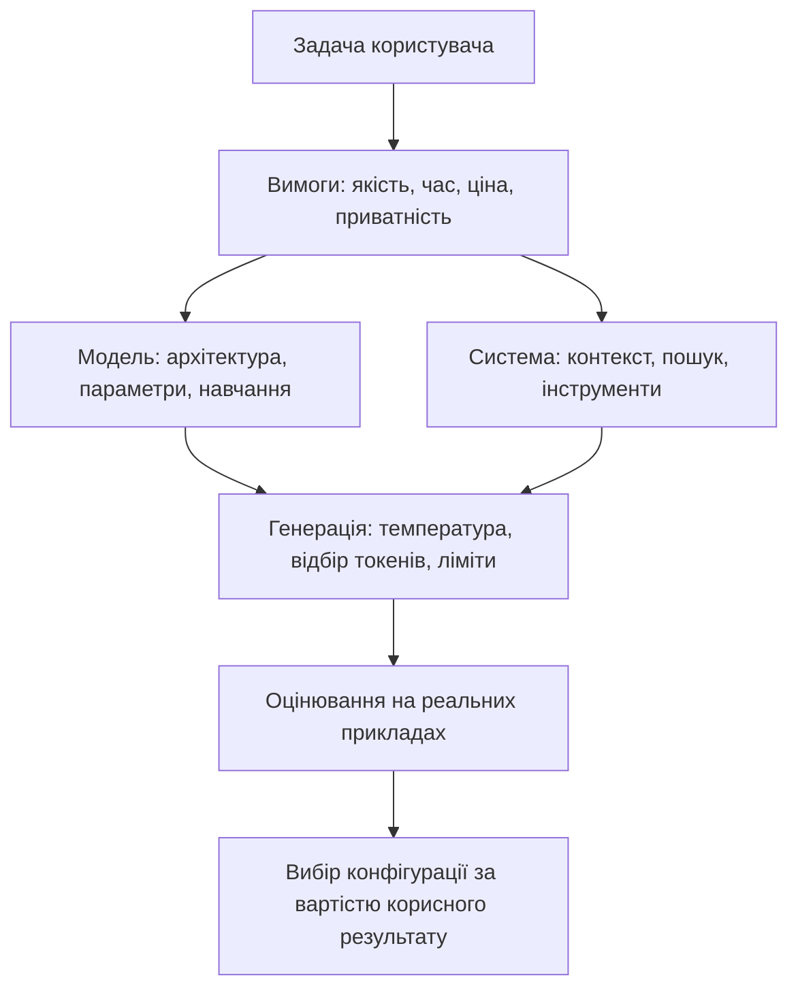

</details>

<a id="s004"></a>

### 0.2 Базові скорочення

| Скорочення | Повна назва | Українське пояснення |
|---|---|---|
| LLM | Large Language Model | Велика мовна модель |
| AI | Artificial Intelligence | Штучний інтелект |
| API | Application Programming Interface | Програмний інтерфейс застосунку |
| TTFT | Time to First Token | Час до першого токена |
| TPS | Tokens per Second | Токенів за секунду |
| RPS | Requests per Second | Запитів за секунду |
| GPU | Graphics Processing Unit | Графічний процесор |
| CPU | Central Processing Unit | Центральний процесор |
| RAM | Random Access Memory | Оперативна пам’ять |
| VRAM | Video Random Access Memory | Пам’ять графічного процесора |
| FFN | Feed-Forward Network | Мережа прямого поширення |
| MLP | Multilayer Perceptron | Багатошаровий перцептрон |
| MoE | Mixture of Experts | Суміш експертів |
| KV cache | Key–Value cache | Кеш ключів і значень уваги |
| FLOPs | Floating-Point Operations | Кількість операцій із числами з рухомою комою |
| FLOP/s | Floating-Point Operations per Second | Кількість таких операцій за секунду |
| SFT | Supervised Fine-Tuning | Донавчання з учителем |
| RL | Reinforcement Learning | Навчання з підкріпленням |
| RLHF | Reinforcement Learning from Human Feedback | Навчання з підкріпленням на основі людського зворотного зв’язку |
| CoT | Chain of Thought | Ланцюжок міркувань |
| QA | Quality Assurance | Забезпечення якості; у назві задачі Question Answering — відповіді на запитання |

**Не плутати:** параметри моделі, токени даних, розмір вектора токена, контекстне вікно та байти пам’яті — різні величини. Так само FLOPs — обсяг роботи, а FLOP/s — швидкість її виконання.

<a id="s005"></a>

## ЧАСТИНА 1. ПРОДУКТИВНІСТЬ І ВАРТІСТЬ

<a id="s006"></a>

### 1.1 Як читати картку постачальника моделі

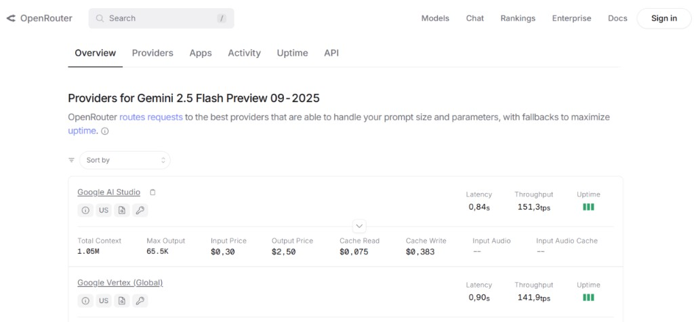

Це скриншот з нашої розмови, а не поточна пропозиція чи результат нового тестування. OpenRouter тут виступає посередником: одна модель може бути доступна через кількох постачальників. Їхні швидкість, доступність і підтримка параметрів можуть різнитися. [S01]

| Поле на скриншоті | Як його читати |
|---|---|
| Total Context: 1.05M | Заявлений контекст приблизно 1,05 млн токенів; перевірити точну семантику ліміту |
| Max Output: 65.5K | Окреме обмеження виходу приблизно 65,5 тис. токенів |
| Input Price: $0.30 | На цьому скриншоті — ціна за мільйон вхідних токенів |
| Output Price: $2.50 | Ціна за мільйон вихідних токенів |
| Cache Read: $0.075 | Тариф на повторно використану кешовану частину входу |
| Cache Write: $0.383 | Тариф запису в кеш; точний спосіб нарахування визначає постачальник |
| Latency: 0.84 s | Затримка, яку показує цей інтерфейс; у таких порівняннях часто йдеться про час до першого токена |
| Throughput: 151.3 tps | Швидкість вихідних токенів у вимірюваннях постачальника |
| Uptime | Доступність сервісу; зелені смужки самі по собі не дають точного відсотка |
| `--` біля аудіо | Значення не показано: це не означає нульову ціну |

**K** — тисяча, **M** — мільйон. В назвах моделей **B (billion)** — мільярд параметрів, але літера B біля розміру файлу може означати байт: завжди дивитися на одиницю виміру.

<a id="s007"></a>

### 1.2 Як рахувати вартість

Для запиту без кешування та додаткових платних інструментів:

$$
\text{cost}=\frac{N_{in}}{10^6}P_{in}+\frac{N_{out}}{10^6}P_{out}.
$$

`N_in` і `N_out` — кількості вхідних і вихідних токенів; `P_in` та `P_out` — відповідні ставки за мільйон. `USD` означає United States Dollar — долар США.

**Приклад за історичним скриншотом:** 10 000 вхідних і 2 000 вихідних токенів, ставки $0,30/$2,50:

$$
0.003+0.005=0.008\ \text{USD}.
$$

Тобто $0,008 за цей запит. При цьому мільйон вихідних токенів коштує приблизно у 8,33 раза дорожче за мільйон вхідних; це відношення ставок, а не множник ціни всього запиту.

Якщо є кеш, вхід потрібно розділити на кешовану й некешовану частини. Не додавати «cache read» поверх звичайної ставки автоматично: категорії тарифікації й плата за запис або зберігання залежать від провайдера. [S02]

#### Що означає «$15 + $60»

Це дві ставки, а не універсальна ціна $75 за один мільйон токенів. Історичні ставки **o1 $15/$60** підтверджує картка моделі; це не рекомендація запускати саме цю стару модель. [S54] **Навчальний розрахунок:** 100 000 вхідних і 20 000 оплачуваних вихідних токенів дадуть:

$$
100000\times\frac{15}{10^6}+20000\times\frac{60}{10^6}=2.70\ \text{USD}.
$$

У reasoning-моделей оплачуваний вихід може включати токени міркування, яких не видно у фінальній відповіді. Не додавати їх вдруге, якщо поле `output_tokens` уже містить їх. [S03]

#### DeepSeek-R1: тарифи та собівартість — різні речі

В оголошенні DeepSeek від **20 січня 2025 року** наведено такі API-ставки: $0,55 за мільйон вхідних токенів без влучення в кеш, $0,14 за кешований вхід, $2,19 за вихід. Це історичні дані, а не тарифи на дату читання довідника. [S04]

Натомість фраза «$8 за мільйон на власній інфраструктурі» без першоджерела **не підтверджена**. Навіть якщо це реальна оцінка, треба знати: за які токени, на якому обладнанні, за якого завантаження й з якими витратами на підтримку.

$$
\text{собівартість на }10^6\text{ токенів}=\frac{\text{витрати за період}}{\text{токени за цей період}}\times10^6.
$$

Такий розрахунок описує експлуатацію сервера, а не роздрібний тариф стороннього сервісу. Порівняння може бути корисним, але лише за однакового обсягу робіт та повного складу витрат.

<a id="s008"></a>

### 1.3 Latency, TTFT, TPS і RPS

**Latency — затримка** є загальним словом: воно може означати час до першого токена або час до повної відповіді. У звіті називати точну метрику. **Throughput — пропускна здатність** може вимірюватися сумарними токенами за секунду для сервера або запитами за секунду; швидкість одного потоку — не те саме.


<details>
<summary>Показати редагований код Mermaid</summary>

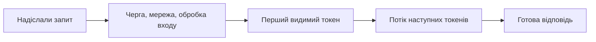

</details>

У спрощеній оцінці без інструментів і додаткових етапів:

$$
t_{total}\approx TTFT+\frac{N_{out}-1}{TPS}.
$$

Перший токен уже враховано у TTFT. Для 2 000 токенів за показниками 0,84 с і 151,3 токена/с виходить приблизно **14,05 с**. Це арифметична ілюстрація, не прогноз реальної затримки.

Модель із 1 000 токенів/с не обробляє автоматично 1 000 запитів/с. Для системи з багатьма агентами важливі також кількість викликів, їхня послідовність, паралельність і зовнішні інструменти. Наприклад, три послідовні виклики по 2 с уже дають близько 6 с без урахування іншої роботи.

**Що фіксувати в тестуванні:** модель і версію, постачальника, обладнання, вхід/вихід, кількість паралельних запитів, reasoning-режим, стан кешу та частку помилок. `p50` — медіана затримки; `p95` — значення, не перевищене приблизно у 95% спостережень. Середня швидкість не показує найповільніші відповіді.

> **Уточнення до діалогу.** Раніше наведені «актуальні» таблиці швидкості не перенесено як перевірений рейтинг: для них у матеріалах немає відтворюваного протоколу й надійного датованого першоджерела. Числа зі скриншота залишено лише як приклад читання метрик.

<a id="s009"></a>

### 1.4 Кеш: що, де і навіщо зберігається

**Cache — кеш** — тимчасово збережені дані або результати обчислень для повторного використання. Тут важливо розділити кілька механізмів. [S02] [S05]

| Механізм | Що зберігає | Чого не робить |
|---|---|---|
| KV cache всередині генерації | Ключі й значення уваги для вже опрацьованих позицій | Не збільшує максимальний контекст |
| Prompt/prefix caching між запитами | Проміжні стани повторюваного початку запиту | Не повертає автоматично стару відповідь |
| Кеш готових відповідей застосунку | Готовий текст або результат запиту | Не є тим самим, що KV cache |
| Історія чату | Збережені повідомлення | Не означає, що модель бачить їх усі |
| Довготривала пам’ять застосунку | Вибрані факти, підсумки, записи | Не є оновленням ваг моделі |

**Приклад із перевіркою рекламних матеріалів:** 5 000 токенів інструкцій + 20 000 токенів незмінних правил + 1 000 токенів нового матеріалу. У наступному запиті початкові 25 000 токенів можуть бути придатні до повторного використання. Новий матеріал потрібно опрацювати; нову відповідь — згенерувати. Умови мінімальної довжини, збігу префікса й терміну зберігання визначає реалізація. [S02]


<details>
<summary>Показати редагований код Mermaid</summary>

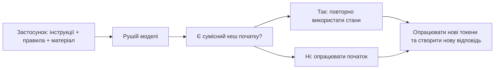

</details>

**Де фізично?** За локального запуску — у пам’яті обладнання, на якому працює рушій; можливе перенесення частини кешу в оперативну пам’ять центрального процесора. За віддаленого API — на інфраструктурі постачальника. OpenAI документує зберігання KV-станів на окремих машинах; конкретну машину цього чату або внутрішню політику ChatGPT з документації API встановити не можна. [S02] [S05]

**Не робити висновок «кеш завжди живе одну годину».** `TTL (Time to Live — час існування)` і фактичне видалення — різні можливі гарантії; вони залежать від сервісу й режиму. Кешований контекст усе одно займає контекстний бюджет. Зміна порядку чи початку повідомлень може зруйнувати збіг.

<a id="s010"></a>

### 1.5 Графік здешевлення: як його читати

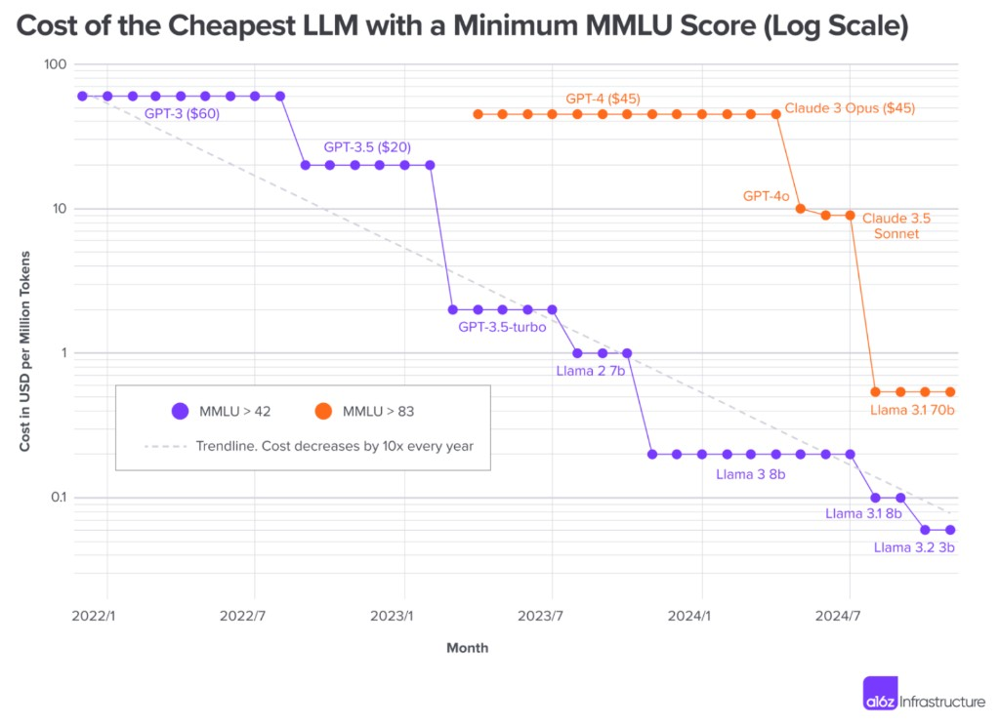

Джерело — публікація a16z від **12 листопада 2024 року**. Вона порівнює найдешевші серед розглянутих моделей, що долають певний поріг MMLU — Massive Multitask Language Understanding, тесту широких предметних знань. Це не ціни всіх моделей у світі. Якщо тарифи входу й виходу різнилися, автор використав їхнє **середнє арифметичне**, а не ціну конкретного типового запиту. [S06]

Фіолетова лінія відповідає порогу понад 42%, помаранчева — понад 83%. Вертикальна шкала логарифмічна: $100 → $10 → $1 → $0,10 означає щоразу зменшення вдесятеро. Сходинка — новий дешевший спосіб досягти порогу. Від $60 до приблизно $0,06 — близько тисячократного зниження за цим показником.

Пунктир «10× щороку» — опис історичної тенденції, не закон природи і не гарантія майбутнього. Графік не доводить таке саме здешевлення **навчання** й не робить усі моделі з однаковим MMLU взаємозамінними. Раніше наведене в діалозі датування Llama 3 8B як моделі 2023 року не слід брати з графіка: він не замінює перевірку дат релізів.

> **Уточнення історичних одиниць ціни.** Для класичного GPT-4 ставка $0,03/$0,06 за **тисячу** токенів еквівалентна $30/$60 за **мільйон**, а не $3/$6. Не плутати цю модель з GPT-4 Turbo чи GPT-4o. Картка старого GPT-4 підтверджує ставки $30/$60; графік a16z застосовує власну методику порівняння цін. [S55] [S06]

<a id="s011"></a>

### 1.6 Локальна модель, API та квантування

**Модель із відкритими вагами** можна запускати на власному обладнанні за умови сумісності програм і ліцензії. Після завантаження підтримуваної моделі LM Studio дозволяє виконувати локальні запити без інтернету. Це не означає, що будь-який комп’ютер потягне будь-яку модель. [S07]

| Дія | Чи змінюються ваги? | Що потрібно |
|---|---|---|
| Змінити промпт або температуру | Ні | Доступне налаштування генерації |
| Завантажити нову версію | Замінюємо набір ваг | Новий файл моделі; повторні тести |
| Додати документи в контекст або пошук | Ні | Система зберігання й відбору документів |
| Fine-tuning — донавчання | Так, усі або частина | Навчальні приклади, інструменти, ресурси |
| LoRA — Low-Rank Adaptation, низькорангова адаптація | Навчаються додаткові матриці | Базова модель та адаптери |
| Quantization — квантування | Змінюється числове подання | Сумісний формат і рушій |

LoRA навчає невеликі додаткові матриці замість оновлення всіх базових ваг; це зменшує кількість навчуваних параметрів, але не усуває потребу виконувати основну модель. [S08]

Квантування зменшує кількість бітів для представлення ваг. Модель стає компактнішою, але прискорення залежить від обладнання й реалізації; якість треба перевіряти. Сам факт «4 біти» не гарантує ні швидкості, ні прийнятної похибки. Практичні розрахунки пам’яті наведено в частині 2.

**Плата за експерименти:** зміна `temperature` сама по собі не тарифікується. Кожна генерація через платний API тарифікується за використання. Оплата ChatGPT та OpenAI API окрема. Локальні експерименти не мають плати сторонньому API, але використовують електроенергію, обладнання й час. [S09]

<a id="s012"></a>

### 1.7 «Вартість за корисність»

Для вибору моделі доцільно балансувати **якість, затримку та повну ціну під конкретний сценарій**, а не максимізувати кількість параметрів. Навчальний спосіб оцінки:

$$
\text{вартість успіху}=\frac{\text{витрати на всі спроби, перевірки та повтори}}{\text{кількість прийнятних результатів}}.
$$

**Умовний приклад:** система A витратила $10 й дала 50 прийнятних результатів — $0,20 за успіх. B витратила $15 й дала 90 — близько $0,167. Дешевший окремий запит не обов’язково дає дешевший корисний результат. «Прийнятний» слід визначити власними критеріями й тестами, а не лише балом публічного рейтингу.

<a id="s013"></a>

## ЧАСТИНА 2. КОНТЕКСТНЕ ВІКНО, ПАРАМЕТРИ Й МАСШТАБУВАННЯ

<a id="s014"></a>

### 2.1 Контекст, історія та пам’ять — не синоніми

**Context window — контекстне вікно** — обмеження обсягу послідовності, яку модель може опрацьовувати у відповідній конфігурації. **Контекст конкретного запиту** — те, що реально передали моделі. **Історія переписки** — усі повідомлення, які застосунок зберігає; до поточного контексту може потрапити лише частина історії. [S03] [S05]

> **Відповідь на запитання з діалогу:** коли розмова подовжується, збільшується обсяг історії, а не місткість контекстного вікна. Старі повідомлення можуть бути частиною входу наступного запиту, тому це не лише «моє останнє запитання + твоя наступна відповідь».

Зазвичай бюджет охоплює системні інструкції, повідомлення, знайдені фрагменти документів, результати інструментів і місце для нових токенів. Постачальник може також задавати окремі ліміти входу, виходу та особливі правила для reasoning-токенів; дивитися паспорт моделі й API. [S03]


<details>
<summary>Показати редагований код Mermaid</summary>

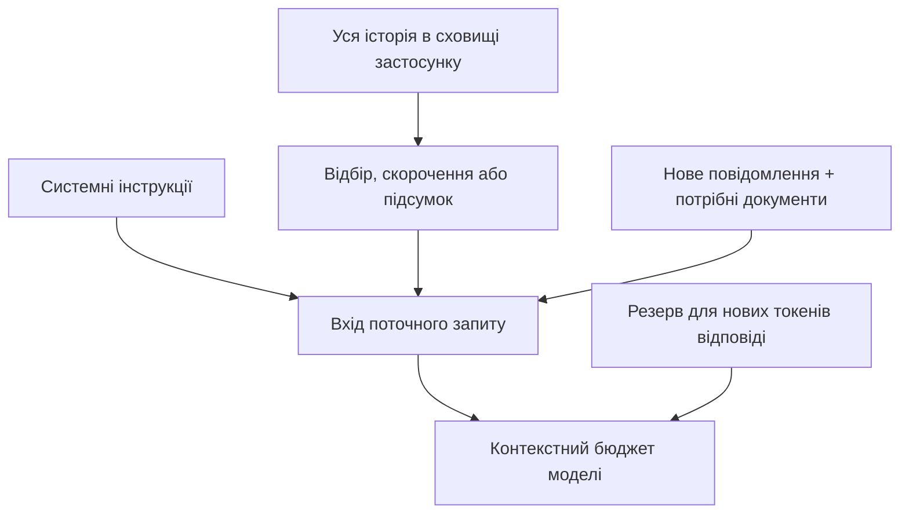

</details>

**Умовний приклад:** у чаті 100 повідомлень, але модель отримує підсумок повідомлень 1–90 та повний текст 91–100. Це можлива стратегія застосунку, а не твердження про точну внутрішню роботу ChatGPT. Короткий підсумок може втратити важливий виняток або формулювання — це окремий ризик для тестування.

<a id="s015"></a>

### 2.2 Хто визначає розподіл токенів

Розробник не знає довжину майбутнього повідомлення, але після отримання може порахувати або оцінити токени **до** генерації. Враховувати треба весь підготовлений вхід, а не лише текст останнього запитання.

| Величина | Хто визначає | Що можна зробити |
|---|---|---|
| `context_window` | Модель, сервіс і конфігурація запуску | Обрати іншу модель або допустиму конфігурацію |
| `input_tokens` | Фактичний підготовлений вхід | Скоротити, відібрати чи підсумувати дані |
| `requested_max_tokens` | Розробник застосунку | Задати бюджет відповідно до задачі |
| `model_max_output` | Модель/сервіс | Не перевищувати окремий ліміт виходу |
| `safety_margin` | Розробник | Залишити резерв на невраховані службові токени |

**Уточнення:** `input_tokens = 3500` — не «виділена квота», а вже підрахований розмір прикладу. `safety_margin = 100` — умовний резерв, не вимога моделі. Якщо точний підрахунок уже включає все, резерв може бути іншим або нульовим. Штучне збільшення числа `context_window` у коді не розширює реальні можливості моделі.

Для спільного бюджету входу та виходу:

$$
M=\min(R, O, C-I-S),
$$

де `R` — бажаний вихід, `O` — максимальний вихід моделі, `C` — загальний контекст, `I` — вхід, `S` — резерв. Потрібна перевірка, що є місце для корисної відповіді. Це політика застосунку, а не універсальний автоматичний механізм API.

| Умовний вхід | Контекст | Бажаний вихід | Резерв | Доступний вихід |
|---:|---:|---:|---:|---:|
| 500 | 4 096 | 1 000 | 100 | 1 000 |
| 2 000 | 4 096 | 1 000 | 100 | 1 000 |
| 3 500 | 4 096 | 1 000 | 100 | 496 |
| 4 200 | 4 096 | 1 000 | 100 | Запит не вміщується |

Якщо потрібні **2 000 вихідних токенів**, при контексті 4 096 і резерві 100 вхід може займати не більше **1 996 токенів**. За надто довгого входу не обов’язково мовчки зменшувати відповідь: можна скоротити історію, відібрати фрагменти, розділити задачу, обрати більший контекст або повернути зрозумілу помилку.

<a id="s016"></a>

### 2.3 Чи допомагає кеш «умістити більше»

Ні. Якщо наступний вхід містить 2 500 токенів, із яких 2 000 кешовані, в контексті все одно враховуються **2 500**, а не лише нові 500. Економимо повторні обчислення, не кількість логічних позицій. [S02] [S05]

Великий контекст полегшує роботу з великими документами, але не гарантує правильного знаходження всіх фактів. Потрібно перевіряти деталі на початку, в середині й наприкінці; суперечності між фрагментами; точність цитування. Тести LongBench саме відрізняють доступність довгого входу від здатності правильно його використовувати. [S35]

> **Історичне уточнення.** Теза «відкриті моделі переважно мають 2–4 тисячі токенів» не є характеристикою всіх поколінь. Наприклад, Mixtral 8×7B у релізі 2023 року вже заявляла 32 тисячі. Для різних версій Mistral 7B також не можна переносити один ліміт на всі. [S18]

<a id="s017"></a>

### 2.4 Що таке параметри, вектори й тензори

**Parameter — параметр** — навчуване число. До параметрів входять ваги лінійних перетворень, матриці ембедингів, параметри нормалізації та зміщення, якщо вони передбачені. **Activation — активація** — проміжне значення, обчислене для конкретного входу. Вага й активація можуть бути числами одного формату, але виконують різні ролі. [S10]

| Поняття | Приклад | Що змінюється під час звичайної генерації |
|---|---|---|
| Token ID — ідентифікатор токена | 125 | Вибираємо різні токени |
| Вектор токена | 768 чисел | Представлення залежить від позиції, контексту та шару |
| Матриця ваг | 3 072 × 768 чисел | Ваги зазвичай залишаються фіксованими |
| KV-кеш | Збережені ключі й значення для позицій | Розширюється або оновлюється за правилами рушія |

У програмуванні тензор — багатовимірний числовий масив. Скаляр має 0 осей, вектор — 1, матриця — 2, пакет матриць може мати 3 й більше. Вектор і матриця — окремі випадки тензорів, а не альтернативи їм.

#### Маленький приклад перетворення

$$
x=\begin{bmatrix}1\\2\\3\end{bmatrix},\quad
W=\begin{bmatrix}1&0&2\\0&-1&1\end{bmatrix},\quad
b=\begin{bmatrix}0.5\\-0.5\end{bmatrix}.
$$

$$
y=Wx+b=\begin{bmatrix}7.5\\0.5\end{bmatrix}.
$$

Тут вхід — 3 числа, вихід — 2, але навчуваних параметрів **8**: 6 ваг і 2 зміщення. Той самий W і b можна застосувати до багатьох різних вхідних векторів. Всі числа цього прикладу умовні.

<a id="s018"></a>

### 2.5 Чому 4,7 млн параметрів — не 4,7 млн чисел у токені

Нехай `hi` токенізується одним токеном, а `hidden_size` — розмір прихованого представлення — дорівнює 768. Початкове представлення цього токена містить **768 чисел**. Далі воно проходить через FFN — Feed-Forward Network, мережу прямого поширення:


<details>
<summary>Показати редагований код Mermaid</summary>

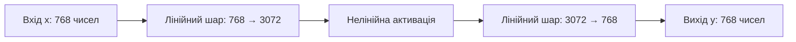

</details>

Матриці двох шарів без зміщень містять:

$$
768\times3072+3072\times768=4\,718\,592\text{ ваги}.
$$

Якщо обидва шари мають зміщення, додаємо `3072 + 768 = 3840`, разом **4 722 432 параметри**. Проміжний вектор має 3 072 значення, а не мільйони. Кількість параметрів — розмір навчуваного перетворення, не довжина даних, що проходять через нього.


**Уточнення до малюнка:** дві колонки точок і зв’язки між ними показують одне щільне лінійне перетворення. Повний типовий FFN трансформера містить щонайменше розширення, нелінійність і проєкцію назад. Малюнок не показує всі ці етапи.

<a id="s019"></a>

### 2.6 Пам’ять для ваг: навіщо її рахувати

Для ідеалізованого однакового формату всіх параметрів:

$$
\text{байти ваг}\approx N_{parameters}\times\frac{\text{бітів на параметр}}{8}.
$$

| Формат | Розшифрування | Ваги умовної моделі 7B |
|---|---|---:|
| FP32 | Floating Point 32-bit — 32-бітні числа з рухомою комою | 28 ГБ |
| FP16 | Floating Point 16-bit — 16-бітні числа з рухомою комою | 14 ГБ |
| INT8 | 8-bit Integer — 8-бітні цілі числа | 7 ГБ |
| INT4 | 4-bit Integer — 4-бітне ціле подання | 3,5 ГБ |

Це арифметична оцінка **лише ваг** у десяткових гігабайтах (`1 ГБ = 10^9 байтів`). Квантування потребує додаткових коефіцієнтів масштабу, частина параметрів може мати іншу точність. Реальному запуску також потрібні кеш, активації, робочі буфери; навчанню — градієнти й стани оптимізатора. Отже, файл на 3,5 ГБ не означає, що достатньо рівно 3,5 ГБ вільної пам’яті. [S05]

Якщо ваги або кеш не вміщаються у швидку пам’ять, доводиться розподіляти їх між пристроями чи переносити дані з повільнішої пам’яті. Це може збільшувати затримку. У MoE треба зберігати також ваги експертів, не обраних для поточного токена: вони можуть знадобитися наступному.

<a id="s020"></a>

### 2.7 Що означає «активні параметри на токен»

**B = billion — мільярд; T = trillion — трильйон.** У Grok-1 xAI заявила 314B загальних параметрів та приблизно 25% активних для токена. Число **78,5B** — арифметика `314 × 0,25`, а не довжина вектора токена й не точний підрахунок усіх операцій. Опублікована специфікація описує 8 експертів із вибором 2 та розмір ембединга 6 144. [S19] [S20]

Активні — параметри частин мережі, задіяних на обраному шляху обробки токена. Для іншого токена, іншого шару або контексту шлях може змінитися. У пакеті запитів різні токени здатні разом задіяти всі експерти, навіть якщо кожен окремо використовує лише кілька.

**Активні параметри не дорівнюють FLOPs.** Крім множень на ваги є увага до контексту, маршрутизація, нормалізація й обмін даними. Також слід дивитися, чи включив автор у підрахунок спільні блоки та ембединги.

<a id="s021"></a>

### 2.8 Закони масштабування: що саме покращується

**Scaling laws — закони масштабування** — емпіричні залежності, встановлені за результатами експериментів. У класичних роботах вони описують, як зменшується помилка прогнозування токенів, або **loss — значення функції втрат**, зі зміною кількості параметрів N, навчальних токенів D та обчислювального бюджету C. Це не обіцянка плавного покращення кожного прикладного тесту. [S11] [S12]

Одна з навчальних форм запису такої залежності:

$$
L(N,D)\approx E+\frac{A}{N^\alpha}+\frac{B}{D^\beta}.
$$

Коефіцієнти визначають експериментально для конкретного режиму. Тут B — коефіцієнт формули, не скорочення слова billion. Що більші N і D, то менші відповідні доданки; але приріст якості за додатковий ресурс поступово зменшується. Формула не враховує всі відмінності якості даних або архітектур.

**Навіщо масштабувати?** Щоб збільшити здатність моделі засвоювати складні закономірності та розв’язувати задачі. Масштабувати можна ширину шарів, їхню кількість, число експертів, навчальні дані й обчислення. Збільшення обчислень на відповідь без зміни ваг — окремий напрям, *test-time compute scaling*, який розглядаємо в частині 5.

<a id="s022"></a>

### 2.9 Баланс «параметри ↔ дані» та правило 20

Величезна мережа з обмеженою кількістю навчальних токенів може використати бюджет менш ефективно, ніж менша мережа, навчена довше. Chinchilla порівнює вибір N і D **за заданого бюджету навчання**, а не доводить, що «більше даних завжди безкоштовно краще». [S12]

| Умовна модель | Параметри | Навчальні токени | Токенів на параметр |
|---|---:|---:|---:|
| A | 100B | 300B | 3 |
| B | 100B | 2T | 20 |
| C | 500B | 300B | 0,6 |

Таблиця показує співвідношення, **не результати тесту**. Модель B також потребує більше навчальних обчислень, ніж A. Самої таблиці недостатньо, щоб визначити переможця за однакової повної вартості.

Орієнтир, який часто пов’язують із Chinchilla:

$$
D\approx20N.
$$

Для 100B це приблизно 2T токенів. **Це не 20 токенів, «прикріплених» до кожної ваги**, і не точка повного насичення. Токени проходять через багато параметрів; співвідношення статистичне. Повторення того самого тексту 20 разів не рівнозначне появі 20 незалежних якісних навчальних прикладів.

За експериментами авторів, Chinchilla з 70B параметрів і приблизно 1,4T навчальних токенів перевершила значно більшу Gopher з 280B на низці задач при подібному бюджеті навчання. Цей результат не переноситься механічно на всі архітектури, особливо на MoE: там треба розрізняти загальну місткість і обчислення активних гілок. [S12]

**Власний економічний висновок:** якщо невелику модель використовуватимуть мільйони разів, може бути вигідно більше витратити на її навчання заради дешевших запитів. Тому оптимум лише навчальної вартості та оптимум повної вартості життєвого циклу — різні задачі.

<a id="s023"></a>

### 2.10 «Нові здібності після 50B»: обережно з порогами

У дослідженнях спостерігали різкі стрибки деяких метрик, але немає універсальної межі «до 6B не вміє, після 50B вміє». Частина ефекту може походити від метрики, що зараховує лише повністю правильний результат: поступовий прогрес на окремих кроках виглядає як стрибок повного успіху. Це показує робота про можливі артефакти вимірювання emergent abilities — здібностей, що проявляються зі зростанням масштабу. [S13]

Звідси не випливає, що масштаб неважливий або нові можливості неможливі. Висновок вужчий: розмір, дані, навчання, інструменти й метрика мають оцінюватися разом. Не можна за самим числом параметрів гарантувати або заперечити конкретне вміння.

<a id="s024"></a>

## ЧАСТИНА 3. ВІД ТЕКСТУ ДО НАСТУПНОГО ТОКЕНА

<a id="s025"></a>

### 3.1 Де налаштовувати генерацію

Налаштування доступні не лише в OpenRouter. Їх можна передавати через сумісний API або локальний рушій. Графічний інтерфейс показує лише те, що підтримує обрана модель й постачальник; наявність поля в інтерфейсі не гарантує однакової реалізації. [S01] [S14] [S15]

**OpenRouter:** відкрити чат → вибрати модель → відкрити налаштування → перевірити доступні параметри → змінювати один за раз. Назви кнопок можуть змінюватися. Чотири скриншоти інтерфейсу, на які посилався вихідний `.md`, не надано; їх не замінено вигаданими знімками.

| Параметр/можливість | Що перевіряти |
|---|---|
| `temperature`, `top_p` | Чи підтримує обрана модель та reasoning-режим |
| `top_k` | Є в багатьох локальних рушіях; не універсальне поле OpenAI API |
| `frequency_penalty`, `presence_penalty` | Чи підтримуються в конкретному інтерфейсі |
| `max_output_tokens` | Ліміт виходу в OpenAI Responses API |
| `max_completion_tokens` | Поле вихідного бюджету в Chat Completions для сумісних моделей |
| `max_new_tokens` | Нові токени в `transformers.generate()` |
| `max_length` у Transformers | Загальна довжина, а не завжди лише новий вихід |
| `stop` / `stop_strings` / `eos_token_id` | Конкретна назва та семантика залежать від рушія |

**Уточнення:** `generate_length` не є універсальною стандартною назвою. Перед перенесенням налаштувань між бібліотеками читати саме документацію відповідного методу. [S14] [S15]

<a id="s026"></a>

### 3.2 Повна послідовність генерації

Нижче — **навчальна схема авторегресивної моделі лише з декодером**, а не паспорт кожної існуючої мовної моделі. Авторегресивна генерація означає, що новий токен залежить від попередньої послідовності.


<details>
<summary>Показати редагований код Mermaid</summary>

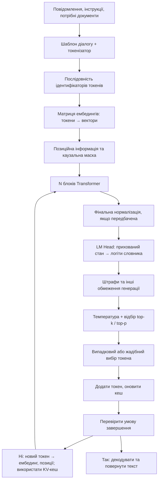

</details>

Схема опускає оптимізації виконання. Після першої обробки входу — **prefill, попереднього заповнення** — рушій із KV-кешем зазвичай не переобчислює всі старі позиції на кожному новому кроці. Наступний крок використовує новий токен і збережені ключі/значення попередніх. [S05]

#### 3.2.1 Токенізатор і словник

**Tokenizer — токенізатор** перетворює текст на ідентифікатори та назад. **Vocabulary — словник токенів** задає відповідність ідентифікаторів елементам токенізації. Словник сам не «думає», який токен поставити далі.

Токен може відповідати слову, частині слова, пробілу, пунктуації або байтовому фрагменту. `BPE (Byte-Pair Encoding — кодування парами байтів)` та WordPiece — приклади методів побудови токенізації. Поділ `playing → play + ##ing` — ілюстрація WordPiece, а не гарантія для будь-якого токенізатора.

Спеціальні маркери можуть позначати початок, кінець або ролі повідомлень. **BOS (Beginning of Sequence — початок послідовності)**, **EOS (End of Sequence — кінець послідовності)**, **PAD (padding — заповнення до потрібної довжини)** — поширені поняття, але їхні фактичні рядки та ідентифікатори різняться.

#### 3.2.2 Ембединг і позиції

Матриця ембедингів має умовну форму `V × d`: V — розмір словника, d — розмір представлення. Для токена беремо відповідний рядок. Після блоків мережі представлення стає контекстним: однаковий токен у різних реченнях може мати різні приховані стани.

У класичній схемі позиційний вектор додається до ембединга. В інших моделях застосовують **RoPE (Rotary Position Embedding — обертальне позиційне кодування)** до проєкцій запиту та ключа уваги. **RoPE не слід малювати як те саме додавання позиційної матриці до ембедингів.** Це альтернативні способи внесення позиційної інформації. [S58]

#### 3.2.3 Що всередині одного блока Transformer

Для навчальної схеми з нормалізацією перед підблоками:


<details>
<summary>Показати редагований код Mermaid</summary>

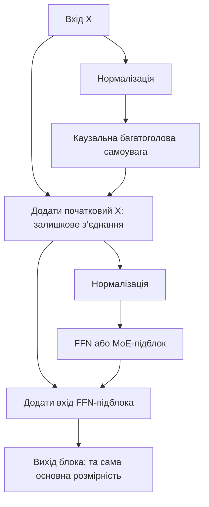

</details>

**Residual connection — залишкове з’єднання** додає вхід підблока до його результату. **Layer Normalization — нормалізація шару** або **RMSNorm (Root Mean Square Normalization — нормалізація за середньоквадратичним значенням)** допомагають контролювати масштаб представлень. Порядок і тип нормалізації залежать від архітектури.

Блоки повторюються N разів, але **зазвичай мають різні навчені ваги**. «Однакова структура» не означає «одна й та сама матриця повторюється N разів». У Dense використовується звичайний FFN, у MoE деякі такі підблоки замінюються маршрутизованими експертами. Основну ідею уваги та FFN описує робота Transformer; MoE детально розглянуто в частині 4. [S10] [S18]

#### 3.2.4 Як працює увага та що таке «голова»

**Attention head — голова уваги** — окрема гілка обчислення уваги з власними проєкціями. Це не додаткова повноцінна мовна модель й не «голова, що відповідає за математику» за заданим вручну правилом.

Для представлень X обчислюються **Q (Query — запити)**, **K (Key — ключі)** та **V (Value — значення)**. Позначення V тут означає матрицю значень, а не розмір словника з попереднього підрозділу:

$$
Q=XW_Q,\qquad K=XW_K,\qquad V=XW_V.
$$

Для однієї голови:

$$
A=\operatorname{softmax}\left(\frac{QK^T}{\sqrt{d_k}}+M\right),\qquad O=AV.
$$

`d_k` — розмір ключа; M — маска, яка забороняє увагу до майбутніх позицій. У математичній схемі забороненим позиціям додають мінус нескінченність перед softmax. Виходи голів об’єднують і проєктують назад. [S10]


<details>
<summary>Показати редагований код Mermaid</summary>

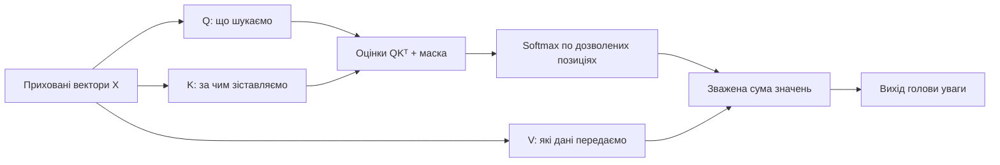

</details>

**Два різні softmax:** усередині уваги отримуємо ваги **позицій контексту**; після мовної вихідної голови — ймовірності **токенів словника**. Це різні розподіли.

#### 3.2.5 FFN і активація

FFN виконує навчуване нелінійне перетворення кожного представлення токена. Для простого варіанта: лінійне розширення → активація → лінійне стискання назад. Активація не дорівнює «увімкненню експерта»: це окрема математична функція.

**ReLU (Rectified Linear Unit — випрямлена лінійна функція)**: `max(0, x)`. **GELU (Gaussian Error Linear Unit — лінійна одиниця на основі гауссової функції похибок)** — плавніша нелінійність. У багатьох моделях є вентильні FFN, наприклад **SwiGLU (Swish-Gated Linear Unit — вентильний лінійний блок із функцією Swish)**. Тоді двоматрична формула є спрощенням: зазвичай потрібні три основні матриці.

#### 3.2.6 LM Head — інша «голова»

**LM Head (Language Modeling Head — голова мовного моделювання)** переводить прихований стан останньої позиції в оцінки всіх кандидатів наступного токена. Для рядкового вектора:

$$
z=h_tW_{out}+b,\qquad h_t\in\mathbb{R}^{d},\quad W_{out}\in\mathbb{R}^{d\times V_{vocab}}.
$$

На виході `V_vocab` чисел — по одному **логіту** на токен словника. Вага вихідної проєкції в деяких архітектурах може бути спільною з ембединг-матрицею; це не загальна вимога.

**Prediction head — голова прогнозування** — ширше поняття. Для BERT на задачі виділення відповіді голова дає оцінки початку й кінця фрагмента. Для генерації — оцінки наступного токена. Додаткові голови у варіантах випереджувального декодування можуть прогнозувати майбутні позиції. Одна назва «head» не означає однакової функції.

<a id="s027"></a>

### 3.3 Логіти: «сирі передбачення»

Так: **logits — логіти** — числові оцінки **до** нормалізації у ймовірності. Вони можуть бути додатними або від’ємними й не зобов’язані давати суму 1.

Умовний приклад для `I like…`, де для простоти є лише три кандидати:

| Кандидат-токен | Логіт | Softmax за T = 1 |
|---|---:|---:|
| `cats` | 3 | 66,52% |
| `dogs` | 2 | 24,47% |
| `birds` | 1 | 9,00% |

Невелике відхилення суми від 100% можливе через округлення. В реальності softmax нормалізується по всьому допустимому словнику, а не лише по трьох словах, показаних у таблиці.

<a id="s028"></a>

### 3.4 Порядок перетворень перед вибором токена

Для пояснення зручно використовувати послідовність:

**логіти → штрафи → температура → ймовірності → top-k/top-p → перенормування → вибір.**

Але це **концептуальний порядок**, не гарантія однакового коду в кожному рушії. Фільтр може працювати з логітами, присвоюючи виключеним кандидатам `-∞`; softmax тоді обчислюють після маскування. Top-p потребує ймовірностей для пошуку порогу. Комбінація top-k і top-p залежить від порядку застосування. [S14] [S16]

Обмеження JSON-схеми, заборонені токени або штраф повторення теж є частиною процедури декодування. Не всі ці параметри вбудовані у ваги Transformer: багато з них — логіка рушія навколо його виходу.

<a id="s029"></a>

### 3.5 Temperature — температура

Для T > 0:

$$
p_i=\frac{\exp(z_i/T)}{\sum_j\exp(z_j/T)}.
$$

T < 1 загострює розподіл, T > 1 вирівнює його; T = 1 лишає вихідне співвідношення логітів. Температура не додає моделі знань і не є перемикачем «правда / творчість».

**Перерахований приклад** для логітів `[3, 2, 1, 0.5]`:

| T | Кандидат 1 | Кандидат 2 | Кандидат 3 | Кандидат 4 |
|---:|---:|---:|---:|---:|
| 0,25 | 0,981647 | 0,017979 | 0,000329 | 0,000045 |
| 0,75 | 0,730591 | 0,192582 | 0,050764 | 0,026063 |
| 1,00 | 0,630796 | 0,232057 | 0,085369 | 0,051779 |
| 2,00 | 0,442299 | 0,268268 | 0,162713 | 0,126721 |

> **Виправлення:** у вихідному конспекті частина чисел у цій таблиці була неправильною. Тут значення обчислено програмно; код у `code/examples_offline.py`.

**T = 0** не можна підставити у формулу як звичайне ділення. Сервіс може трактувати цей режим як **greedy decoding — жадібне декодування**, тобто вибір максимального логіта. У Hugging Face явний жадібний режим задають `do_sample=False` разом із відсутністю променевого пошуку (`num_beams=1`). При T > 0 жадібний вибір максимального логіта не змінюється лише від масштабування температурою. [S14]

Навіть за жадібного режиму абсолютна повторюваність у різних запусках не гарантується: важливі версія моделі, числові обчислення, пакетування й середовище. Низька температура також не виправляє найімовірнішу, але неправильну відповідь.

<a id="s030"></a>

### 3.6 Top-k і top-p: два способи звузити кандидатів

**Top-k** залишає k найімовірніших токенів. **Top-p / nucleus sampling** залишає найменший початок відсортованого за ймовірністю списку, чия сума досягає p. *Nucleus* — «ядро», *sampling* — «випадкова вибірка». Назва підкреслює, що ядро має динамічний розмір. [S14] [S17]

Умовний розподіл:

| Кандидат | Імовірність | Накопичена ймовірність |
|---|---:|---:|
| A | 40% | 40% |
| B | 30% | 70% |
| C | 15% | 85% |
| D | 10% | 95% |
| E | 5% | 100% |

`top_k=3` залишає A, B, C. `top_p=0.85` у цій навчальній конвенції також залишає A, B, C; після перенормування їхні шанси — 47,06%, 35,29%, 17,65%. `top_p=0.9` уже залишає чотири кандидати: 85% недостатньо, наступний піднімає суму до 95%.


<details>
<summary>Показати редагований код Mermaid</summary>

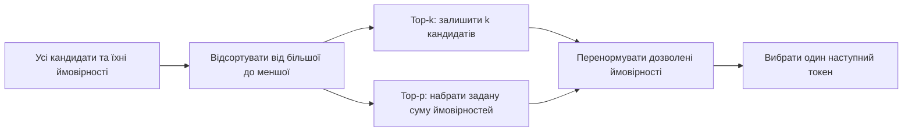

</details>

Якщо найімовірніший токен має 95%, при `top_p=0.9` залишиться один. За майже рівномірного розподілу можуть залишитися сотні чи тисячі. У реальному коді граничні рівності, мінімальна кількість кандидатів і округлення потребують перевірки. [S16]

**Не плутати:** top-p «динамічно визначає число кандидатів», але не обов’язково змінює поле `top_k`. Низький p не гарантує детермінізму, якщо залишилося кілька токенів; високий p не робить вибір рівномірним. `top_p=1` не обрізає цей розподіл, але інші обмеження можуть лишатися.

У деяких рушіях є `min_p` — відбір відносно ймовірності найкращого кандидата, або `top_a` — інший спосіб адаптивного відсікання. Їх не слід називати синонімами top-p; семантику перевіряють окремо. [S01] [S14]

<a id="s031"></a>

### 3.7 Frequency penalty та presence penalty

**Frequency penalty — штраф за частоту** залежить від числа появ токена. **Presence penalty — штраф за присутність** залежить від того, чи він узагалі був у врахованій історії. Навчальна адитивна формула:

$$
z'_i=z_i-\alpha_f c_i-\alpha_p\,\mathbf{1}[c_i>0].
$$

`c_i` — кількість врахованих появ, `α_f` і `α_p` — коефіцієнти. За додатних коефіцієнтів повтори менш імовірні; нуль прибирає відповідний штраф. Деякі API дозволяють від’ємні коефіцієнти, які, навпаки, заохочують повторення. Яку історію рахують — вхід, вихід, вікно токенів — визначає конкретний рушій. [S01] [S15]

| Попередніх появ | Логіт 5, лише presence = 0,5 | Логіт 5, лише frequency = 0,5 |
|---:|---:|---:|
| 0 | 5,0 | 5,0 |
| 1 | 4,5 | 4,5 |
| 2 | 4,5 | 4,0 |
| 3 | 4,5 | 3,5 |
| 4 | 4,5 | 3,0 |

**Що означає «одноразовий»?** Не «оштрафували на одному кроці й забули». На кожному наступному кроці, поки токен вважається присутнім, presence-віднімання має ту саму величину, незалежно від кількості появ. Frequency множить коефіцієнт на кількість появ. Штраф обчислюють від **нового базового логіта поточного кроку**, а не нескінченно віднімають від попереднього вже оштрафованого числа.

Якщо `cats` мав логіт 3 і з’явився тричі, лише frequency 0,5 дасть `3 − 3×0,5 = 1,5`. Якщо обидва штрафи 0,5 — `3 − 1,5 − 0,5 = 1,0`. Це не заборона токена: після softmax він усе ще може бути вибраний.

**Repetition penalty — штраф за повторення** в деяких рушіях працює інакше: наприклад, множить чи ділить логіти залежно від їхнього знака. Його нейтральне значення часто **1**, а не 0. Не копіювати значення frequency penalty у repetition penalty. [S14] [S16]

Штрафи застосовуються до токенів, не до «смислово однакових слів». Високі штрафи можуть зіпсувати назви змінних, точні терміни, юридичні формулювання або потрібний стилістичний повтор.

<a id="s032"></a>

### 3.8 Як обирати стартові налаштування

Наведені числа — **навчальні гіпотези для експерименту**, не офіційна оптимальна конфігурація для всіх моделей.

| Мета | Перше, що варто спробувати | Що залишити незмінним |
|---|---|---|
| Витяг полів, класифікація | Жадібний режим або T приблизно 0,1–0,3 | top-p = 1, штрафи = 0 |
| Пояснення, підсумок | T приблизно 0,4–0,7 | Спочатку без додаткового відсікання |
| Творчі варіанти | T приблизно 0,8–1,2 | Штрафи спочатку = 0 |
| Перевірка top-p | Фіксована T, змінювати p: 0,7 / 0,9 / 1,0 | Інші параметри однакові |
| Перевірка top-k | Фіксована T, k: 5 / 20 / 50 | top-p = 1 |

«Не ставити одночасно високу T і високий p» — не абсолютна заборона. Для розуміння ефектів краще змінювати **один параметр за раз**. Вибрати одну задачу, зробити кілька повторів, порівняти різноманітність і частоту порушень. Коротку відповідь просити інструкцією; ліміт токенів лише страхує від надмірної довжини.

<a id="s033"></a>

### 3.9 Max tokens і стоп-послідовності

`max_tokens` або відповідний параметр — верхня межа, не обов’язкова довжина. Коли вона вичерпана, вихід може обірватися всередині слова, речення або структури. Це не «модель навчилася бути короткою». [S14] [S15]

**Stop sequence — стоп-послідовність** — заданий текстовий маркер зупинки. Система перевіряє його появу, а не оцінює, чи відповідь логічно завершена. У підтримуваному OpenAI Chat Completions стоп-рядок не включається у відповідь; дозволено до чотирьох послідовностей, але підтримка обмежена моделями. [S15]

```text
Можливий текст моделі:
TC01: Успішний вхід
Кроки: ввести правильні дані; натиснути «Увійти».
Очікування: відкривається головна сторінка.
<END_TEST>
Додаткове пояснення...
```

За `stop=["<END_TEST>"]` повертається текст **перед** маркером. Але `stop` не змушує модель його створити. Маркер у довільному тексті також може спрацювати випадково. Приклад `stop=["4."]` може зупинити четвертий пункт списку, але може зачепити й число або інший фрагмент; це не надійна перевірка «рівно три пункти».

| Механізм | Що означає |
|---|---|
| EOS-токен | Спеціальний ідентифікатор завершення, який модель може згенерувати |
| Stop-рядок | Зовнішня текстова умова завершення |
| Ліміт нових токенів | Зупинка після заданого обсягу генерації |

<a id="s034"></a>

### 3.10 Чому `stop=["}"]` не забезпечує JSON

**JSON (JavaScript Object Notation — текстовий формат структурованих даних)** потребує правильного закриття об’єктів. Якщо стоп-рядок вилучається, то:

```json
{"product": "Example", "decision": "rejected"}
```

перетвориться на:

```text
{"product": "Example", "decision": "rejected"
```

Це невалідна структура. До того ж перша `}` може закривати **вкладений** об’єкт або бути символом усередині рядка. Підрахунок дужок і семантика JSON — не завдання текстового стоп-маркера.

<a id="s035"></a>

### 3.11 Structured Outputs — структуровані відповіді

Це режим, у якому генерація підпорядковується **JSON Schema — схемі структури даних**. Вона задає поля, типи та допустимі значення. На відміну від прохання «поверни JSON», схема застосовується як технічне обмеження. **Constrained decoding — декодування з обмеженнями** відкидає недопустимі структурні продовження. [S21]

```json
{
  "type": "object",
  "properties": {
    "product": {"type": "string"},
    "compliant": {"type": "boolean"},
    "decision": {"type": "string", "enum": ["approved", "rejected"]},
    "reason": {"type": "string"}
  },
  "required": ["product", "compliant", "decision", "reason"],
  "additionalProperties": false
}
```

`string` — текст, `boolean` — логічне `true/false`, `enum` — перелік дозволених значень, `required` — обов’язкові поля, `additionalProperties: false` — заборона невказаних полів.

**Структура не дорівнює істині.** Об’єкт нижче проходить цю схему, але суперечить сам собі:

```json
{"product":"Example","compliant":true,"decision":"rejected","reason":"All requirements are met"}
```

Потрібні окремі змістові та бізнес-перевірки. Для відсутніх доказів варто спроєктувати допустимий стан `cannot_verify`, а не змушувати модель вгадувати між двома відповідями.

| Режим | Що забезпечує | Чого не забезпечує |
|---|---|---|
| Промпт «дай JSON» | Інструкцію моделі | Технічного дотримання схеми |
| JSON mode | Синтаксичний JSON у підтримуваному успішному режимі | Потрібних полів і змістової правильності |
| Structured Outputs зі strict | Підтримувану схему за успішного завершення | Фактичної та бізнес-правильності |

У OpenAI Responses API використовується `text.format` з `type: "json_schema"`, `strict: true` та схемою; у Chat Completions — `response_format`. Потрібно окремо обробити **refusal — відмову** й **incomplete — незавершену відповідь**, а також несумісні елементи схеми. Pydantic дозволяє описати структуру Python-класом, але спосіб передачі залежить від методу SDK — Software Development Kit, набору засобів розробки. [S21]

<a id="s036"></a>

### 3.12 Раніше створена загальна інфографіка

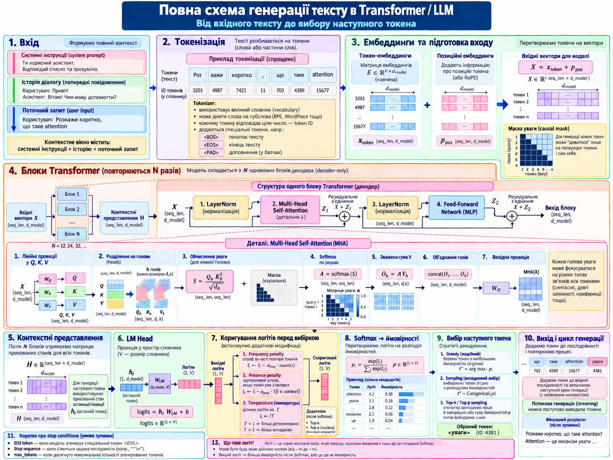

> **Статус: збережена навчальна ілюстрація, не технічна специфікація.** У ній RoPE спрощено зближено з додаванням позиційних ембедингів; немає окремо показаної фінальної нормалізації; присутність токена та порядок фільтрів не універсальні для всіх API. Числа в декоративному прикладі ймовірностей не слід використовувати як перевірений розрахунок. Для формул і порядку роботи користуватися текстом 3.2–3.7 та програмними прикладами.

<a id="s037"></a>

## ЧАСТИНА 4. DENSE, MOE ТА ВИПЕРЕДЖУВАЛЬНЕ ДЕКОДУВАННЯ

<a id="s038"></a>

### 4.1 Dense Transformer — що означає «щільний»

**Dense — щільний** у цьому порівнянні означає, що кожен токен проходить через той самий повний FFN-підблок, без вибору лише кількох експертів. Це не означає, що буквально кожна вага всієї моделі читається для кожної операції: наприклад, ембединг починається з вибору рядка. Основна відмінність від MoE — відсутність розрідженого вибору FFN-гілок. [S18]

**MoE (Mixture of Experts — суміш експертів)** — одна модель з маршрутизованими підмережами. Зазвичай замінюють деякі FFN-підблоки, а не запускають команду незалежних чатботів.


<details>
<summary>Показати редагований код Mermaid</summary>

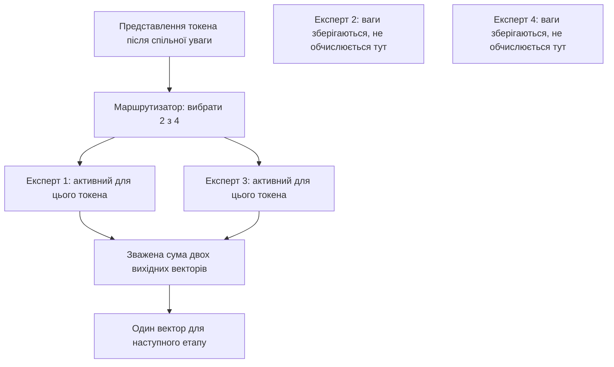

</details>

Чотири — лише навчальний приклад. У конкретній архітектурі може бути інша кількість експертів і вибраних гілок. На різних шарах є різні експерти з власними вагами; для одного токена вибір також може змінюватися між шарами.

<a id="s039"></a>

### 4.2 Що всередині експерта

Типовий **expert — експерт** — FFN із власними матрицями. У двоматричному спрощенні для стовпчикового вектора:

$$
E_i(x)=W_{2,i}\,\sigma(W_{1,i}x+b_{1,i})+b_{2,i}.
$$

Архітектура кількох експертів може бути однаковою, але ваги різні. Вони виконують різні навчені перетворення, а не шукають відповіді в різних словниках. Реальний експерт може використовувати вентильну активацію з трьома матрицями; це треба враховувати в підрахунку параметрів.

> **Відповідь на запитання «вони спеціалісти з різних наук?»** Не обов’язково. Спеціалізація формується під час навчання й може стосуватися абстрактних закономірностей, токенів або типів конструкцій. Назви «математик», «лікар», «історик» — аналогія, не паспорт стандартної MoE-архітектури.

<a id="s040"></a>

### 4.3 Що таке спільні шари

**Shared components — спільні компоненти** — частини моделі, якими користуються токени незалежно від обраних експертів. До них можуть належати ембединги, самоувага, нормалізації, вихідна проєкція та звичайні Dense-блоки. «Спільні» тут не означає, що всі шари Transformer мають одні й ті самі ваги.

Деякі архітектури додатково мають **shared experts — спільних експертів**, які працюють завжди, поряд із **routed experts — експертами, вибраними маршрутизатором**. Це окрема конструкція; вона не тотожна загальній назві «спільні шари». DeepSeek-V3 є прикладом моделі з поєднанням різних спільних і маршрутизованих компонентів. [S22]

<a id="s041"></a>

### 4.4 «Але два FFN дорожчі за один!» — правильне заперечення

**Так. Якщо всі FFN однакового розміру, виконати два дорожче, ніж один.** Попереднє загальне пояснення «MoE менше рахує» без уточнення бази порівняння було недостатнім.

Візьмемо вхідний розмір `d = 768`, проміжну ширину `m` і два лінійні шари без зміщень. У такому FFN:

$$
P_{FFN}=2dm.
$$

Оцінюємо лише параметри й основні матричні обчислення FFN; увага та інші спільні компоненти тут однакові й не включені.

| Конфігурація | Що обчислюється для токена | Усі ваги FFN | Активні ваги FFN |
|---|---|---:|---:|
| A: малий Dense | 1 × `768 → 3072 → 768` | 4 718 592 | 4 718 592 |
| B: MoE, 4 малі експерти, top-2 | 2 × `768 → 3072 → 768` | 18 874 368 | 9 437 184 |
| C: великий Dense | 1 × `768 → 12288 → 768` | 18 874 368 | 18 874 368 |
| D: MoE, 4 великі експерти, top-2 | 2 × `768 → 12288 → 768` | 75 497 472 | 37 748 736 |

У всіх MoE-рядках окремо додаються невеликі параметри маршрутизатора та витрати маршрутизації.

**B проти A:** близько удвічі більше основних FFN-обчислень. MoE тут не дешевша.

**B проти C:** однаковий сумарний обсяг ваг експертів/FFN, але в B активна половина. MoE має менше основної FFN-арифметики, хоча це не гарантує однакової якості чи двократної швидкості.

**D проти C:** кожен експерт такий самий великий, як Dense FFN, а виконуємо два. Це знову дорожче.


<details>
<summary>Показати редагований код Mermaid</summary>

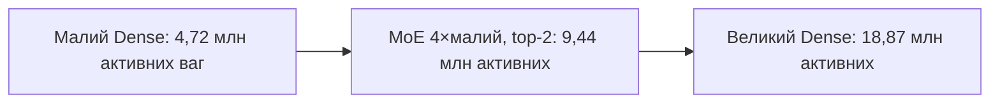

</details>

*Стрілки на цій шкалі означають збільшення основної арифметики для умовних конфігурацій, а не потік даних між моделями.*

**Ще один чесний варіант порівняння:** Dense `768 → 6144 → 768` має 9 437 184 ваги — стільки ж, скільки активні два малі експерти в B. Але B загалом зберігає удвічі більше експертних ваг. Це показує ідею **більшої місткості за подібної активної FFN-арифметики**, а не автоматично кращу якість.

#### Приблизні операції

У двоматричному FFN основна кількість множень-накопичень приблизно `2dm`. Якщо множення й додавання рахувати як дві операції з рухомою комою, це приблизно `4dm FLOPs`. Тут не враховано активацію, зміщення та службові операції. Не можна підписувати `2dm` одночасно як точний FLOP-підрахунок і число ваг без пояснення конвенції.

<a id="s042"></a>

### 4.5 Що робимо після двох експертів — вибираємо кращого?

Зазвичай **ні**. Маршрутизатор за вхідним представленням обирає експертів і коефіцієнти внеску. Виходи потім складають зі зважуванням. Він не читає дві готові текстові відповіді й не оцінює, яка «правильніша». Таке оцінювання відповідей — вже інша системна архітектура. [S18]

**Умовний приклад:** обрано експертів 1 і 3, нормовані ваги 0,7 і 0,3:

$$
E_1(x)=[2,4,6],\qquad E_3(x)=[8,2,4].
$$

$$
y=0.7E_1(x)+0.3E_3(x)=[3.8,3.4,5.4].
$$


<details>
<summary>Показати редагований код Mermaid</summary>

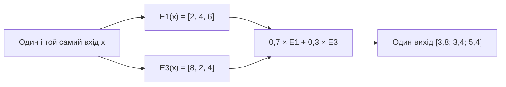

</details>

Це ще не текст і не вибір наступного слова. Новий вектор проходить далі через модель; лише вихідна голова формує логіти токенів. Конкретні правила нормування маршрутизатора й спільних експертів залежать від реалізації.

**Чи є додаткова робота?** Так. Але для двох векторів із 768 елементів зважування — близько 1 536 множень і 768 додавань; це мало порівняно з мільйонами матричних операцій експертів. Натомість передавання даних між пристроями та неефективне пакетування можуть бути значно дорожчими за саме складання векторів.

<a id="s043"></a>

### 4.6 Аналогія, яка не приховує компроміс

Уявімо **машини з різними наборами інструментів**, а не людей із готовими відповідями. Малий Dense — одна невелика машина, яка щоразу виконує весь свій цикл. Великий Dense — одна значно більша машина, яка щоразу виконує весь більший цикл. MoE — цех із багатьма меншими машинами; диспетчер направляє деталь лише до двох, а результати об’єднуються.

Усі машини треба придбати й десь розмістити — **пам’ять для ваг**. Роботу виконують вибрані — **активні обчислення**. Диспетчер і транспортування — **накладні витрати**. Дві однаково великі машини не дешевші за одну; економія виникає лише від доречного порівняння й конфігурації.

Це аналогія для розділення зберігання та роботи. Вона не доводить, що «цех» завжди дає кращий результат.

<a id="s044"></a>

### 4.7 Чому не треба постійно «оновлювати актуальність» експертів

Під час звичайного **inference — виконання навченої моделі** ваги не оновлюються. Неактивні експерти не потребують окремого безперервного навчання, щоб продовжувати існувати.

Під час **training — навчання** вибрані шляхи отримують градієнти від відповідних токенів. У навчальному пакеті — **batch** — різні токени можуть активувати різних експертів. Балансування потрібне, щоб одні експерти не були перевантажені, а інші — недостатньо навчені. Деталі оновлення також залежать від оптимізатора й додаткових функцій втрат. [S18] [S22]

MoE може бути вигідною за великого навантаження та добре організованого виконання. На ноутбуці або за малої кількості запитів компактна Dense-модель може бути простішою й економнішою. Це інженерний вибір, а не абсолютний рейтинг архітектур.

<a id="s045"></a>

### 4.8 Реальні історичні приклади — не «8 окремих 7B-чатботів»

| Модель | Загальні параметри | Активні на токен | Що важливо |
|---|---:|---:|---|
| Mixtral 8×7B | 46,7B | 12,9B | 8 FFN-експертів у шарі, вибирають 2; спільні частини не дублюються 8 разів |
| DBRX | 132B | 36B | 16 експертів, вибирають 4 |
| Grok-1 | 314B | ≈78,5B за опублікованою часткою 25% | 8 експертів, вибирають 2; 78,5B — наближений перерахунок |
| DeepSeek-V3 | 671B | 37B | Поєднання спільних і маршрутизованих компонентів |

Джерела специфікацій: Mixtral [S18], DBRX [S23], Grok-1 [S19] [S20], DeepSeek-V3 [S22]. Це не незалежне порівняння їхньої якості, швидкості чи повної вартості.

**Mixtral 8×7B не дорівнює 56B просто через множення назви.** Назва не є формулою параметрів, бо не всі частини мережі повторюються для кожного експерта. Так само арифметика «2 із 8 = 25%» не завжди дає частку всіх активних параметрів — є спільні блоки.

**DeepSeek-R1** побудована на базі DeepSeek-V3-Base та спеціально донавчена для міркувань. Не можна приписати весь її результат самій лише MoE. Невеликі дистильовані R1-моделі — інші моделі, а не повна 671B-архітектура, що магічно помістилася на ноутбуці. [S24]

OpenMoE з вихідного матеріалу — приклад дослідницького напряму. Точні розміри й твердження про перемогу над усіма Dense-аналогами без відповідних звітів тут не повторюються як встановлений факт. Так само архітектуру Grok-2/3/4 не можна автоматично вивести з архітектури Grok-1.

<a id="s046"></a>

### 4.9 Speculative decoding — інший спосіб прискорення

**Speculative decoding — випереджувальне декодування** оптимізує процес вибору послідовності токенів. У класичному варіанті є **draft model — модель-помічник**, зазвичай менша навчена мовна модель, та **target model — основна модель**. Помічник — не словник: він обчислює розподіли наступних токенів. [S25] [S26]


<details>
<summary>Показати редагований код Mermaid</summary>

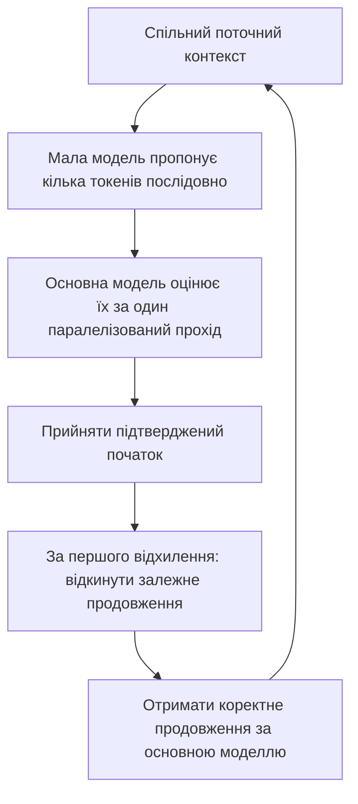

</details>

**Умовна ілюстрація:** помічник пропонує A, B, C, D. Перевірка приймає A, B і відхиляє C. Не можна просто залишити D: його було запропоновано за умови наявності C. Приймається лише підтверджений префікс і далі генерується коректний наступний токен.

Чому основна модель може перевіряти кілька позицій разом? Кандидатна послідовність уже відома, тому її умовні розподіли можна обчислювати паралельно з каузальною маскою. Для створення ще невідомих кандидатів такої можливості немає.

Класичний точний алгоритм використовує спеціальне прийняття/відхилення й корекцію вибірки, щоб зберегти **розподіл** основної моделі. Це не «перевірка істинності» тексту й не вимога повернути ті самі символи за того самого випадкового зерна. Низька частка прийнятих кандидатів або витрати на помічника можуть прибрати прискорення. [S25]

<a id="s047"></a>

### 4.10 Як підібрати помічника: де перевірити токенізатор

Для прямого порівняння кандидатних токенів потрібне сумісне кодування: один і той самий ідентифікатор має означати ту саму одиницю. **Однакова довжина словників недостатня.**

| Що перевірити в репозиторії | Навіщо |
|---|---|
| `tokenizer.json` | Словник, правила поділу, нормалізація, обробка тексту |
| `tokenizer_config.json` | Конфігурація, додані токени, шаблон діалогу |
| `special_tokens_map.json`, якщо є | Відповідності спеціальних токенів |
| `tokenizer.model` або `vocab.json` + `merges.txt`, якщо є | Інші формати словника й правил |
| `config.json` | Розмір словника та архітектура; сам по собі не доводить сумісності |
| Документація рушія | Підтримувані пари, режими, обмеження |

Практичний орієнтир — пара одного сімейства з офіційного прикладу рушія. Наприклад, документація Transformers показує `HuggingFaceTB/SmolLM-1.7B` з `HuggingFaceTB/SmolLM-135M`; це приклад підтриманого підходу, не рекомендація щодо найкращої пари на будь-якому пристрої. [S26]

**Початкова діагностика**, не повний доказ:

```python
from transformers import AutoTokenizer

a = AutoTokenizer.from_pretrained("HuggingFaceTB/SmolLM-1.7B")
b = AutoTokenizer.from_pretrained("HuggingFaceTB/SmolLM-135M")

print("Однакові відповідності токен → ID:", a.get_vocab() == b.get_vocab())
print("Спеціальні токени:", a.special_tokens_map == b.special_tokens_map)
for text in ["Hello!", "Привіт!", " hi", "a\nb", "123.45"]:
    print(repr(text), a.encode(text) == b.encode(text))
```

Завантаження потребує мережі й відповідної бібліотеки; цей приклад тут **не виконувався**. Кілька однакових результатів не доводять еквівалентності всіх можливих входів: перевірити конфігурацію, закріпити версії й запустити вимірювання.

Є **Universal Assisted Generation — універсальна генерація з помічником**, яка узгоджує різні токенізатори через перекодування. Тому «різні токенізатори = неможливо за жодних умов» — теж неправильно. Потрібна відповідна реалізація. [S27]

Існують варіанти без окремої малої моделі: пошук повторюваних токенних фрагментів або додаткові голови прогнозування. Вони не тотожні класичній парі draft/target, і їхні гарантії перевіряють окремо.

<a id="s048"></a>

### 4.11 MoE і speculative decoding можна поєднувати

| Питання | MoE | Випереджувальне декодування |
|---|---|---|
| Що змінює | Внутрішній шлях обробки токена | Кількість дорогих перевірочних циклів генерації |
| Де вибір | Між експертними підмережами | Між прийнятими та відхиленими токенами-кандидатами |
| Результат | Один об’єднаний прихований вектор | Підтверджене продовження послідовності |
| Друга повна модель | Не потрібна | Часто потрібна у класичній версії |
| Гарантоване прискорення | Ні | Ні |

<a id="s049"></a>

### 4.12 Ілюстрація з попереднього чату та її обмеження

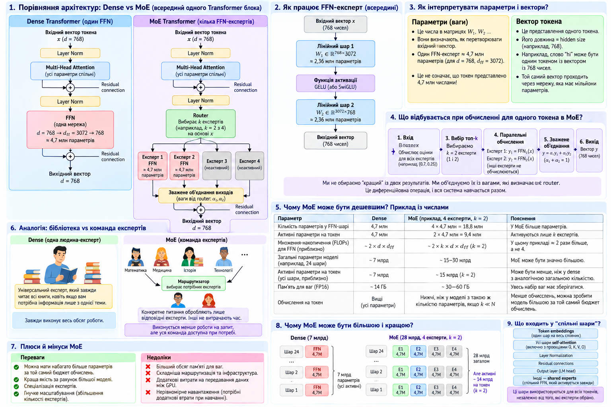

> **Не використовувати числові підписи цієї картинки як розрахунок моделі.** У нижніх блоках поєднано умовні 7B/28B та експерти по 4,7 млн без достатнього пояснення; множення кількості шарів не відтворює показані загальні мільярди. Малюнки «медицина/математика» — лише аналогія. Неактивні експерти не мають внеску в суму для цього токена, навіть якщо лінія на старій схемі створює таке враження. Перевірений навчальний розрахунок міститься в 4.4–4.5.

<a id="s050"></a>

## ЧАСТИНА 5. REASONING: НАВІЩО МОДЕЛІ ДОДАТКОВІ КРОКИ

<a id="s051"></a>

### 5.1 Головна ідея без «другого мозку»

**Reasoning — міркування, послідовне розв’язування задачі.** У типових авторегресивних reasoning-моделях додаткові токени дають більше послідовних обчислень перед фінальною відповіддю. Модель спеціально навчають корисно використовувати цей ресурс. Це не обов’язково інша архітектура, друга нейромережа або окремий «логічний шар». [S24] [S28]

> **Запитання з діалогу:** «Якщо Transformer і так може видати результат, навіщо додаткові рухи?»
>
> **Відповідь:** можливість згенерувати рядок відповіді не означає, що складну задачу вдалося правильно розв’язати. Додаткові послідовні кроки дозволяють використовувати проміжні результати як контекст для наступного обчислення.

**Аналогія — чернетка.** Можна одразу назвати добуток, а можна записати кілька простіших дій. Це аналогія до обчислювального процесу, не твердження, що нейромережа має людський досвід або що її текстовий звіт дослівно відтворює всі внутрішні механізми.

<a id="s052"></a>

### 5.2 Умовний приклад: 37 × 48

$$
37\times48=37\times(40+8)=1480+296=1776.
$$

Усі ці кроки — **зовнішня навчальна демонстрація розв’язання**, не приховані міркування конкретної моделі. Проміжне число 1 480, якщо його згенеровано, стає частиною доступної послідовності для наступних прогнозів. Основні ваги залишаються тими самими.


<details>
<summary>Показати редагований код Mermaid</summary>

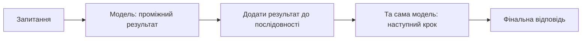

</details>

Важливе уточнення: **звичайна генерація відповіді також має багато кроків — по токену.** Reasoning не протиставляє «один прохід на весь текст» і «багато проходів». Воно дає додаткові кроки до фінального результату, часто з іншою навченою поведінкою.

Один прохід має фіксовану кількість шарів. Для складного ланцюга залежностей може бути корисно виконати кілька таких проходів і передавати результати між ними. Але довший ланцюжок не гарантує успіху: модель може помилитися, повторювати невдалу ідею або витрачати зайвий бюджет.

Ще одна проста задача з діалогу: було 15 яблук, віддали третину, додали 7. Обчислення `15 − 15/3 + 7 = 17`. Для такого прикладу великий reasoning-бюджет зазвичай не обґрунтований; він потрібен тут лише для пояснення механізму.

<a id="s053"></a>

### 5.3 Як цього навчають

**SFT (Supervised Fine-Tuning — донавчання з учителем)** показує приклади бажаного виконання. **RL (Reinforcement Learning — навчання з підкріпленням)** використовує сигнал винагороди за результати. **RLHF (Reinforcement Learning from Human Feedback — навчання з підкріпленням на основі людського зворотного зв’язку)** — лише один із видів RL, а не синонім будь-якого такого навчання.

У математиці чи коді результат іноді можна перевірити правилом, еталонною відповіддю або тестами; для інших задач можуть використовувати навчені моделі винагороди. Тому опис DeepSeek-R1 просто як «RLHF для reasoning» надто грубий. У роботі розрізняються R1-Zero з підкріпленням без попереднього етапу SFT та R1 з початковими прикладами й кількома етапами навчання. [S24]

**GRPO (Group Relative Policy Optimization — групова відносна оптимізація стратегії)** порівнює винагороди групи відповідей для навчального сигналу; окрема навчувана модель-критик значення, як у певних реалізаціях інших алгоритмів, не є обов’язковою. Це про **навчання**, а не про те, що під час кожної відповіді R1 потрібно запускати групу незалежних чатботів. [S24]


<details>
<summary>Показати редагований код Mermaid</summary>

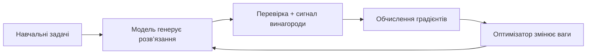

</details>

Під час звичайного використання циклу оновлення ваг немає. **Backpropagation — зворотне поширення градієнтів** — не те саме, що довше генерування міркувань.

<a id="s054"></a>

### 5.4 CoT-промпт і reasoning-модель — не одне й те саме

**CoT (Chain of Thought — ланцюжок міркувань)** у промптингу означає використання проміжних кроків або прикладів розв’язання в запиті. Звичайна модель теж може їх генерувати. Спеціалізована reasoning-модель додатково навчена використовувати обчислення для складних задач; довгий текст пояснення сам по собі не доводить правильності. [S28]

Токени міркування можуть бути видимими, прихованими або представленими підсумком — залежно від моделі та API. Підсумок не слід вважати повним журналом внутрішніх процесів. Для перевірки просити **відтворювані обчислення, докази, джерела та результати інструментів**, а не покладатися на переконливість розповіді.

<a id="s055"></a>

### 5.5 Effort, thinking budget і контроль

| Рівень керування | Що задаємо | Чого це не означає |
|---|---|---|
| Reasoning effort — рівень зусиль | Наскільки інтенсивно опрацьовувати задачу | Точної кількості токенів або конкретної послідовності кроків |
| Thinking budget — бюджет міркування | Токенний бюджет у підтримуваному API | Універсально однакової «стелі» в усіх провайдерів |
| Загальний вихідний ліміт | Скільки всього можна згенерувати | Гарантованої довжини фінальної відповіді |
| Зовнішній алгоритм | Які інструменти й перевірки виконати | Автоматичної правильності самої моделі |

**OpenAI:** `reasoning.effort` у Responses API — рівень зусиль; підтримувані значення залежать від моделі. `max_output_tokens` обмежує сукупний вихід, включно з reasoning; можливе `incomplete` ще до корисної фінальної відповіді. Облік міститься в `usage`, зокрема `output_tokens_details.reasoning_tokens`. Повний прихований текст міркувань не є стандартним поверненим результатом. [S03]

**Anthropic:** старий ручний формат `thinking: {type: "enabled", budget_tokens: N}` не слід переносити на всі нові моделі. Сучасна документація розрізняє ручне й адаптивне міркування; сумісність параметрів залежить від покоління. Саме використаний бюджет, а не арифметичне «завжди відняти запитані 16k», визначає, скільки токенів було витрачено. [S29]

**Gemini:** у документації відповідних Gemini 2.5 `thinkingBudget = -1` означало динамічний режим, **не `1`**. У різних поколіннях та інтерфейсах є інші способи керування, зокрема `thinkingLevel`. **Thought summaries — підсумки міркування** та **thought signatures — підписи/закодований стан міркування** не тотожні відкритому повному ланцюжку. Переносити їх між кроками слід за правилами саме свого API. [S30]

**Не прирівнювати OpenAI `low` до фіксованих 1 024 токенів.** Числове відображення в сумісному шарі іншого постачальника не встановлює норму для оригінального API.

> **Версійність:** цей розділ пояснює підхід, а не надає таблицю всіх актуальних моделей. У конспекті свідомо немає універсальних діапазонів на кшталт «1024–128k для будь-якого Claude».

<a id="s056"></a>

### 5.6 Як це виглядає у коді

Приклад **реального формату виклику OpenAI Responses API**, але не виконаний запит. Встановити **SDK (Software Development Kit — набір засобів розробки)**, налаштувати `OPENAI_API_KEY` та `OPENAI_REASONING_MODEL` з назвою доступної сумісної моделі. Запуск використовуватиме платний API. Рівень `high` і наведений ліміт мають підтримуватися моделлю. [S03]

```python
import os
from openai import OpenAI, APIError

model = os.environ.get("OPENAI_REASONING_MODEL")
if not model:
    raise RuntimeError("Задайте OPENAI_REASONING_MODEL для доступної reasoning-моделі.")

client = OpenAI()
try:
    response = client.responses.create(
        model=model,
        input="Перевір розв’язання: 37 × 48 = 1776. Дай коротку перевірку.",
        reasoning={"effort": "high"},
        max_output_tokens=2000,
    )
except APIError as exc:
    raise RuntimeError("Помилка API; перевірте доступ і сумісність параметрів.") from exc

if response.status != "completed":
    print("Відповідь не завершена:", response.status)
    print(getattr(response, "incomplete_details", None))
else:
    print(response.output_text)

if response.usage:
    print("Увесь вихід:", response.usage.output_tokens)
    details = response.usage.output_tokens_details
    if details:
        print("З нього токени міркування:", details.reasoning_tokens)
```

`2 000` тут — демонстраційне обмеження, не рекомендований бюджет для всіх задач. Складній задачі його може не вистачити. Порожній `output_text` не можна автоматично трактувати як помилку мережі: треба перевіряти статус, відмову й типи вихідних елементів.

<a id="s057"></a>

### 5.7 Коли ми справді контролюємо проміжні етапи

Встановлення `effort=high` не означає «виконай крок 3 саме так». Такий контроль дає **алгоритм застосунку**.


<details>
<summary>Показати редагований код Mermaid</summary>

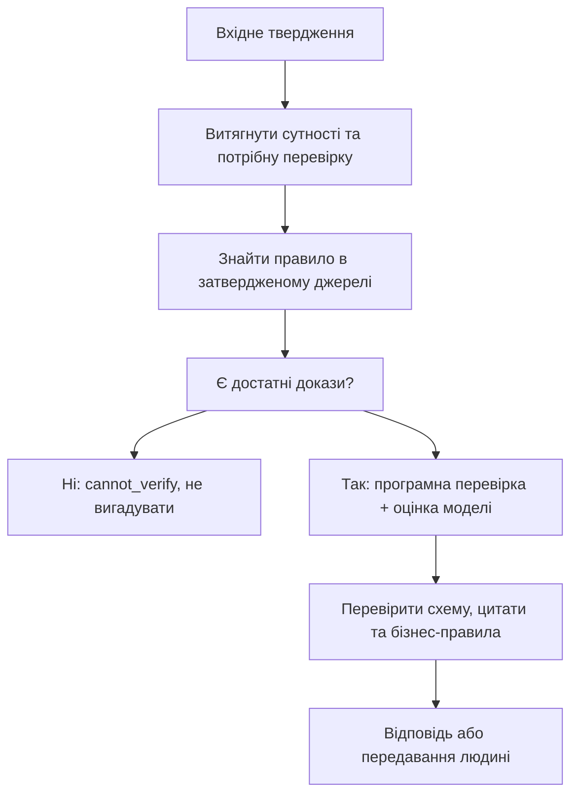

</details>

Це **навчальний проєкт системи**, не опис конкретного застосунку користувачки. Модель не повинна мати змогу перетворити відсутність доказів на «PASS» лише завдяки більшій кількості міркувань. Затверджена база — джерело фактів, а не текст, який вона сама вигадала.

<a id="s058"></a>

### 5.8 Reasoning не завжди потрібне

| Завдання | Розумний підхід для перевірки |
|---|---|
| Простий перефраз або класифікація | Почати з малого обчислювального бюджету |
| Відомий факт | Шукати надійне джерело, а не довше вгадувати |
| Множення великих цілих чисел | Використати точний алгоритм |
| Складне доведення | Додаткові кроки можуть допомогти; потрібна перевірка |
| Аналіз суперечливих вимог | Декомпозиція, докази, контроль проміжних висновків |
| Масовий потік простих запитів | Виміряти, чи окупається додаткова затримка |

Це стартові інженерні міркування, а не гарантії для конкретної моделі. Більший бюджет може покращити деякі результати, але також збільшує час і вартість. Оптимальний режим визначають на контрольному наборі.

<a id="s059"></a>

### 5.9 Чи була б згорткова мережа краща для точних наук

**CNN (Convolutional Neural Network — згорткова нейронна мережа)** використовує фільтри для локальних закономірностей. Transformer використовує увагу для зв’язків між позиціями. Вибір архітектури залежить від структури даних; назва «нейронна мережа» не означає точного арифметичного алгоритму.

У виразі `(15 + 7) × (48 − 12)` потрібно правильно інтерпретувати структуру й виконати обчислення. Навчені матричні множення всередині CNN або Transformer **не означають**, що мережа автоматично реалізує калькулятор для введеного тексту. Аналогічно, програма для розпізнавання цифр не стає бухгалтерською програмою лише через те, що сама виконує арифметику.

Для точного множення доцільний обчислювальний інструмент; для символьних перетворень — відповідний математичний алгоритм; для розуміння текстового завдання — мовна модель може бути інтерфейсом. Для зображень формул CNN, **ViT (Vision Transformer — візуальний трансформер)** або гібрид можуть виконувати частину розпізнавання, але результат усе одно потрібно перевіряти.

```text
Текст запиту → модель визначає операцію → калькулятор / Python
→ результат 378 × 924 = 349272 → модель формулює пояснення.
```

Обчислювальний інструмент теж має межі: числа з рухомою комою можуть мати округлення, чисельні розв’язувачі — похибку, а модель — неправильно вибрати операцію. Для точної цілочислової арифметики Python на цьому прикладі дає точний результат. Система перевіряється від розуміння запиту до фінального тексту.

<a id="s060"></a>

## ЧАСТИНА 6. БЕНЧМАРКИ ТА ВІДКРИТІ/ЗАКРИТІ МОДЕЛІ

<a id="s061"></a>

### 6.1 Що вимірює benchmark

**Benchmark — еталонний тест, стандартизований набір випробувань** — задачі разом із правилами проведення й оцінювання. **Leaderboard — таблиця результатів.** Бенчмарк не вимірює «відсоток інтелекту». Він вимірює виконання певних задач за певних умов.

**Важлива відмінність:** модель, модель з інструментами та агент із пошуком, пам’яттю і повторними спробами — різні оцінювані системи. Навіть однакові ваги можуть отримати різні результати через різне оточення. Це особливо помітно в програмуванні, де результат залежить від агентного середовища. [S41]

| Група | Приклади | Основний предмет перевірки |
|---|---|---|
| Широкі знання | MMLU, MMLU-Pro, ARC | Знання й застосування у запитаннях |
| Наукові задачі | GPQA, HLE | Експертна складність |
| Абстрагування | ARC-AGI | Виведення правил за прикладами |
| Математика | GSM8K, MATH-500, AIME | Правильні математичні результати |
| Код | SWE-bench, LiveCodeBench, HumanEval, MBPP | Виконуваний код і виправлення |
| Зображення й текст | MMMU, MMMU-Pro | Мультимодальне розуміння |
| Довгий контекст | LongBench | Використання довгих входів |
| Правдивість | TruthfulQA | Стійкість до поширених хибних переконань |
| Людські вподобання | Chatbot Arena | Перевага у сліпих порівняннях |
| Оцінювання відповідей | RewardBench | Якість моделі винагороди |

Наведені нижче приклади створено **для пояснення формату**, якщо прямо не зазначено інше. Це не відтворені офіційні тестові завдання.

<a id="s062"></a>

### 6.2 MMLU та MMLU-Pro

**MMLU — Massive Multitask Language Understanding:** «масштабне багатозадачне розуміння мови». *Massive* — масштабний, *multitask* — багатозадачний, *language understanding* — розуміння мови. **Measuring** («вимірювання») — початкове слово назви статті, але не додаткова літера у скороченні MMLU.

Оригінальний набір охоплює **57 дисциплін**, зокрема історію, математику, право й біологію. Формат — *multiple choice*, вибір відповіді із запропонованих варіантів. Типова метрика — частка правильних відповідей. [S31]

**Навчальний приклад:** «Яке число є простим: 21, 29, 35 чи 39?» Правильний варіант — 29.

**MMLU-Pro** — складніший варіант із більшим акцентом на міркування, очищенням частини некоректних/надто простих питань і розширенням вибору з чотирьох до десяти варіантів. *Pro* — частина назви, не окреме технічне скорочення, яке треба вигадано розшифровувати. [S32]

85% на MMLU не означає «модель знає 85% усіх фактів» і не гарантує 85% на українських робочих документах.

<a id="s063"></a>

### 6.3 ARC — шкільні природничі науки

**ARC — AI2 Reasoning Challenge:** «випробування здатності до міркування від AI2». **AI2 — Allen Institute for Artificial Intelligence**, Інститут штучного інтелекту Аллена. *Reasoning* — міркування, *challenge* — випробування.

Набір містить природничі тестові запитання шкільного рівня. **ARC-Easy** — простіша частина; **ARC-Challenge** — запитання, які не розв’язали визначені авторами базові пошукові методи. Це критерій формування набору, не абсолютна оцінка складності для кожної наступної моделі. [S33]

**Приклад формату:** «У якому стані буде вода після замерзання?» Потрібно вибрати правильний варіант. Дозволені інструменти й доступ до довідкових матеріалів залежать від протоколу оцінювання; сама назва ARC не гарантує режим «без інструментів».

<a id="s064"></a>

### 6.4 ARC-AGI — інший ARC

**ARC — Abstraction and Reasoning Corpus:** корпус завдань на абстрагування й міркування. **AGI — Artificial General Intelligence:** загальний штучний інтелект. У цій назві ARC не пов’язаний із природничим тестом AI2.

У класичних задачах дають кілька пар кольорових сіток «вхід → вихід» і новий вхід. Треба вивести правило й побудувати правильну вихідну сітку. [S34]

**Умовна ілюстрація повороту на 90° за годинниковою стрілкою**, де `0` — порожня клітинка:

```text
Показаний приклад:       Новий вхід:
1 0   →   0 1           2 2
1 1       1 1           0 2

Вихід за цим правилом:
0 2
2 2
```

Одного прикладу може бути недостатньо, щоб однозначно встановити правило; справжні задачі дають демонстрації для його уточнення. У протоколі важливі точність сітки, кількість спроб і бюджет обчислень.

**Уточнення:** «тут зовсім не допоможе заучування» — надто абсолютне твердження. Набір спроєктовано для оцінки узагальнення, але відкриті задачі та методи можуть потрапити в навчальні дані. Також не змішувати результати різних поколінь ARC-AGI.

<a id="s065"></a>

### 6.5 HLE — Humanity’s Last Exam

**Переклад:** «Останній іспит людства». *Humanity* — людство, *last* — останній, *exam* — іспит. **LHE** у попередньому тексті було перестановкою літер; правильно **HLE**.

Це складні запитання з багатьох дисциплін, створені фахівцями. Є текстові й мультимодальні завдання. Назва не означає буквальної межі людського знання. Крім правильності відповідей, дослідники розглядають калібрування впевненості. [S36]

**Calibration — калібрування:** чи узгоджується заявлена впевненість із частотою правильних результатів. Наприклад, серед великої групи відповідей із заявленими 90% впевненості приблизно 90% мають бути правильними для добре відкаліброваної системи. Окрема фраза «висока впевненість» не є виміряною калібрацією.

У вихідному описі простий графік ідеального газу був надто слабкою ілюстрацією характерної складності HLE. Правильніше уявляти вузькоспеціалізоване питання, яке потребує експертних знань і точного результату.

<a id="s066"></a>

### 6.6 GPQA Diamond

**GPQA — Graduate-Level Google-Proof Q&A:** запитання й відповіді на рівні поглибленої університетської/аспірантської підготовки, складні для неспеціаліста навіть із пошуком. **Q&A — Questions and Answers**, запитання та відповіді.

*Graduate-level* — післябакалаврський рівень, *Google-proof* — стійкий до простого пошуку, *Diamond* — «діамант», назва відібраного піднабору.

Оригінальний GPQA містить **448 запитань** з фізики, хімії та біології, підготовлених фахівцями. Diamond — не інша наука, а конкретний піднабір, який потрібно вказувати при порівнянні. [S37]

Google-proof не означає «відповіді немає в інтернеті» або «моделі заборонено інструменти». Це характеристика складності за експериментами авторів. Високий бал не сертифікує систему для медичної чи іншої відповідальної практики.

<a id="s067"></a>

### 6.7 GSM8K, MATH-500 та AIME

| Назва | Розшифрування / переклад | Що перевіряє |
|---|---|---|
| GSM8K | Grade School Math 8K — шкільна математика, назва набору приблизно восьмитисячного масштабу | Текстові задачі з кількома арифметичними кроками |
| MATH-500 | MATH — назва математичного набору; 500 — кількість вибраних задач | Складніші задачі з різних розділів математики |
| AIME | American Invitational Mathematics Examination — Американський запрошувальний математичний іспит | Математика змагань; у рейтингах важливий рік і конкретний набір |

Джерела: GSM8K [S38], MATH-500 [S39], математичні змагання MAA [S40].

**Власний приклад шкільного формату:** три книжки по 40 злотих зі знижкою 20% коштують `3 × 40 × 0,8 = 96 злотих`.

**Власний приклад комбінаторики:** п’ятизначні числа зі строго зростаючими цифрами. Нуль не може входити, бо тоді став би першою цифрою. Вибираємо 5 цифр із 1–9, порядок уже визначений: `C(9,5) = 126`. Це не цитата з AIME.

Якщо модель правильно розв’язала 420 із 500 задач, точність становить **84%**. Перевірка фінальної відповіді не обов’язково перевіряє всі кроки доказу. Вказувати, чи дозволено Python, калькулятор, повторні спроби й вибір серед кількох відповідей. Інструменти можуть допомогти, але слово «завжди» тут недоречне.

<a id="s068"></a>

### 6.8 SWE-bench: реальні виправлення коду

**SWE — Software Engineering:** інженерія програмного забезпечення. **Bench** — скорочення *benchmark*. Завдання складається з опису проблеми та репозиторію; система має підготувати **patch — виправлення коду**, яке проходить потрібні перевірки.


<details>
<summary>Показати редагований код Mermaid</summary>

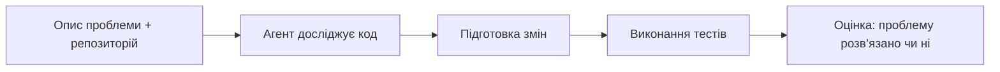

</details>

**Verified — перевірений:** піднабір із 500 задач, перевірених людьми. **Bash Only — лише Bash:** конфігурація порівняння зі спільним мінімальним агентним середовищем, а не просто новий набір запитань. Bash — командна оболонка; її назва походить від *Bourne Again SHell*. Не змішувати результати різних версій середовища. [S41]

**SWE-bench-Live** — окремий пов’язаний проєкт з оновлюваними задачами й власним протоколом; це не обов’язково вкладка того самого набору SWE-bench. *Live* тут означає регулярне оновлення, не гарантовану появу нових задач щосекунди. [S42]

Метрика **resolved rate — частка розв’язаних задач** відображає результат системи «модель + агент + інструменти + бюджет». Це корисний інженерний тест, але не доказ, що модель замінює розробника або проходить довільні невідомі перевірки без регресій.

<a id="s069"></a>

### 6.9 LiveCodeBench

**Live Code Benchmark:** тест програмування на оновлюваних задачах. *Code* — код, *live* — актуальний/оновлюваний.

Проєкт збирає задачі з програмістських змагань і вказує дати їх публікації. Це дозволяє оцінювати модель на задачах, опублікованих після її відомого навчального зрізу. Є сценарії генерації, самовиправлення, передбачення виконання та результатів тестів. [S43]

**Уточнення:** це переважно алгоритмічне програмування, а не повна копія повсякденної роботи розробника. Часовий фільтр зменшує ризик потрапляння задач у навчання, але не доводить відсутність витоку, якщо дата навчання невідома або модель пізніше донавчали.

<a id="s070"></a>

### 6.10 HumanEval і MBPP

**HumanEval:** *human* — людина, *eval* — скорочення *evaluation*, оцінювання. У назві йдеться про завдання, створені людьми, а не про обов’язкове ручне оцінювання кожної відповіді. Оригінальний набір містить 164 задачі на Python, а функціональну правильність перевіряють виконанням тестів. [S44]

**MBPP — Mostly Basic Programming Problems:** «переважно базові задачі програмування». **Виправлення до попереднього пояснення:** P у повній назві — *Programming*, а не *Python*, хоча задачі реалізуються на Python. У початковій роботі описано 974 задачі; розмір конкретного піднабору може відрізнятися. [S45]

**Приклад формату:** описати функцію, що перевіряє анаграми, та перевірити її тестами. Треба явно визначити, чи враховуються регістр, пробіли й пунктуація: без цього «правильна реалізація» неоднозначна.

Старий відкритий тест може бути корисним для регресій, але недостатнім як єдина оцінка нової моделі. Не запускати довільний згенерований код без ізоляції: виконання тестового коду — також інженерний ризик. [S44]

<a id="s071"></a>

### 6.11 MMMU та MMMU-Pro

**MMMU — Massive Multi-discipline Multimodal Understanding:** масштабне міждисциплінарне мультимодальне розуміння; повна назва роботи також містить *and Reasoning* — «та міркування».

*Multi-discipline* — з багатьох дисциплін; *multimodal* — із різними типами даних. Модель працює з текстом, графіками, схемами та іншими зображеннями на рівні університетських предметів. [S46]

**Приклад формату:** електрична схема й питання, для якого треба спочатку правильно прочитати з’єднання та номінали, а потім розрахувати результат. Помилка може виникнути у сприйнятті зображення або у подальшій логіці.

**MMMU-Pro** ускладнює оцінювання: відбирає задачі, для яких справді потрібне зображення, додає варіанти відповідей і режим із текстом питання на самому зображенні. Це зменшує частину обхідних шляхів, але не робить тест повністю невразливим до витоків. [S47]

<a id="s072"></a>

### 6.12 TruthfulQA

**Truthful Question Answering:** правдиві відповіді на запитання. *Truthful* — правдивий; *QA* тут саме *Question Answering*, не забезпечення якості.

Набір перевіряє, чи відтворює модель поширені хибні переконання з людських текстів. В оригіналі — 817 питань у 38 категоріях. Залежно від протоколу оцінюють правдивість, інформативність або вибір правильних відповідей. [S48]

**Навчальний приклад:** запитання з помилковою передумовою на кшталт «чому всі лебеді білі?». Хороша відповідь має відкинути передумову, а не вигадати переконливе пояснення.

Це не універсальна оцінка всіх галюцинацій, коректності цитувань або відповідності корпоративній базі знань. Навіть хороший результат не замінює перевірку конкретних фактів.

<a id="s073"></a>

### 6.13 LongBench

**Long-Context Benchmark:** тест роботи з довгим контекстом. *Long* — довгий; *context* — контекст.

Містить задачі на запитання за документами, узагальнення, пошук і код. Для різних підзадач використовуються різні метрики; результати LongBench і LongBench v2 не слід змішувати без уточнення. [S35]

**Власний приклад:** у довгому документі на початку є основний строк оплати, а наприкінці — виняток. Питання вимагає обох фрагментів. Модель може «вмістити» весь документ, але пропустити виняток.

Для власного тестування корисно переміщувати той самий факт по документу та додавати схожі, але нерелевантні твердження. Це пропозиція дизайну тестів, а не офіційна вимога LongBench.

<a id="s074"></a>

### 6.14 Chatbot Arena та Elo

**Chatbot Arena — арена чатботів.** Користувач порівнює дві анонімні відповіді й обирає кращу або нічию. Це **blind comparison — сліпе порівняння**. Платформа агрегує **human preferences — людські вподобання**. [S49]

**Elo — не абревіатура**, а назва рейтингової системи за прізвищем Арпада Ело. У рейтингах Arena також використовуються статистичні моделі парних порівнянь, зокрема Bradley–Terry; тому всі числа Arena не варто без уточнення називати «класичним Elo».

Рейтинг відносний: він залежить від учасників, запитань і голосувань. Приємніший стиль може перемогти, навіть якщо відповідь менш точна. Для перевірки фактів потрібні окремі критерії.

<a id="s075"></a>

### 6.15 RewardBench

**Reward — винагорода**, **reward model — модель винагороди**. Така модель оцінює або порівнює відповіді, а не обов’язково генерує їх. RewardBench перевіряє, чи надає вона перевагу бажаним відповідям у різних типах задач. [S50]

Тому твердження «Nemotron-4 340B-Reward перемогла GPT-4 на RewardBench» не означає автоматично «Nemotron краще відповідає на всі запитання». Без дати, протоколу й способу використання порівнюваних моделей цей висновок надто широкий. Історичну першість із вихідного матеріалу не перенесено як поточний факт.

<a id="s076"></a>

### 6.16 Як читати метрики

| Метрика | Переклад | Як трактувати |
|---|---|---|
| Accuracy | Частка правильних відповідей | Правильні / усі за протоколом |
| pass@1 | Успіх за одним кандидатом | Імовірність/частка коректного одного згенерованого розв’язання |
| pass@k | Успіх серед k кандидатів | Чи є хоча б один правильний у наборі; не гарантує його вибір без перевірки |
| Resolved rate | Частка розв’язаних проблем | Скільки задач пройшли критерій виправлення |
| Exact Match (EM) | Точний збіг | Чи збігається відповідь з еталоном за правилами нормалізації |
| F1 | Гармонічне середнє precision та recall | У текстових задачах часто вимірює перекриття токенів, не всю смислову правильність |
| Calibration | Калібрування | Узгодженість упевненості та правильності |
| Arena score | Рейтинговий бал | Відносна перевага у парних порівняннях |

**Precision — точність позитивних спрацювань; recall — повнота.** Не плутати precision з accuracy, хоча в українських текстах обидва інколи називають «точністю».

```text
Модель A: 80% pass@1.
Модель B: 95% pass@10.
```

З цього не випливає, що B краща з однієї спроби. Для B використано десять кандидатів і додатковий спосіб визначити, чи є правильний. Аналогічно, 90% MMLU і 75% SWE-bench не можна поставити на одну шкалу «кращий/гірший».

Перед порівнянням зафіксувати версію набору, мову, промпт, кількість прикладів у контексті, інструменти, кількість спроб, reasoning-бюджет, спосіб оцінки й дату. **Zero-shot — без демонстраційних прикладів у промпті; few-shot — з кількома прикладами.** Це не означає, що модель ніколи не бачила схожих даних під час навчання.

<a id="s077"></a>

### 6.17 Open-weight проти closed: що можна стверджувати

**Open-weight model — модель із доступними вагами.** **Open-source — відкритий код/відкрита модель за конкретними умовами ліцензування й доступності компонентів.** Відкриті ваги самі по собі не гарантують відкритих навчальних даних або повної можливості відтворити навчання.

**Data contamination — потрапляння тестових задач чи відповідей у навчальні дані.** **Data leakage — витік інформації між етапами**, наприклад використання еталонної відповіді під час підготовки вхідного контексту. Доступ до ваг не дозволяє автоматично перевірити весь навчальний корпус.

Звіт Epoch AI оцінює відставання відкритих моделей для певних періодів і метрик. Таке відставання — статистична оцінка, не універсальне «відкриті завжди позаду на рік». Не переносити її на всі задачі, а також не змішувати моделі різного розміру та бюджету. [S51]

> **Перевірене історичне уточнення.** У публікації **29 травня 2026 року** Epoch AI оцінила середнє відставання передових відкритих моделей за період 1 січня — 28 травня 2026 року приблизно у **чотири місяці** за **ECI (Epoch Capabilities Index — індекс можливостей Epoch)** з урахуванням статистичної невизначеності. За суворим порівнянням лише точкових оцінок автори отримали близько **шести місяців**. Це підтверджує існування наведеної в чаті публікації, але не встановлює постійне відставання або результат на жовтень 2026 року. [S53]

<a id="s078"></a>

### 6.18 Що з цього застосовувати в QA

Для систем **RAG (Retrieval-Augmented Generation — генерація з доповненням через пошук)** окремо перевіряють пошук і відповідь. **RAGAS (Retrieval Augmented Generation Assessment — оцінювання генерації з доповненням через пошук)** — назва одного з підходів та інструментів такого оцінювання; автоматичні оцінки теж потребують перевірки на відповідність людським критеріям. [S52]

**Власний навчальний план тестування агента перевірки контенту:** зібрати контрольні матеріали з очікуваними рішеннями; окремо вимірювати пропущені порушення, хибні спрацювання, відповідність схемі, точність джерел, правильність вибору правил і поведінку за відсутніх даних. Додати випадки обрізаного тексту, суперечливих документів, довгої історії й інструкцій усередині перевірюваного матеріалу, яким агент не повинен слідувати.

У цьому сценарії високий MMLU або HLE допомагає попередньому відбору, але **не замінює власного контрольного набору**. Остаточне рішення про модель ґрунтується на якості потрібної роботи, затримці, ціні й ризику помилки.

<a id="s079"></a>

## ПРАКТИЧНА ЧАСТИНА. МІНІЛАБОРАТОРНІ БЕЗ API

Ці вправи працюють **без інтернету, моделі та оплати API**. Вони відтворюють лише математичні приклади. Потрібен Python 3.10 або новіший; додаткові бібліотеки не потрібні.

Відкрити термінал у папці розпакованого довідника:

```bash
cd code
python examples_offline.py
python -m unittest -v test_examples.py
```

У деяких системах команда називається `python3`. Файл `examples_offline.py` містить перевірки вхідних даних і пояснення; `test_examples.py` — 17 автоматизованих перевірок. Жоден із цих файлів не викликає модель або платний сервіс.

<a id="s080"></a>

### П.1 Калькулятор вартості

У терміналі Python, відкритому з папки `code`:

```python
from examples_offline import request_cost

print(request_cost(10_000, 2_000, 0.30, 2.50))
# 0.008
print(request_cost(100_000, 20_000, 15, 60))
# 2.7
```

**Що змінити:** спочатку збільшити тільки вхід, потім тільки вихід. Порівняти, яка частина дає більший внесок за обраних ставок. Ставки задаються за мільйон токенів, а не за тисячу. Значення тут навчальні/історичні, не актуальна комерційна пропозиція.

<a id="s081"></a>

### П.2 Контекстний бюджет і помилки на межі

```python
from examples_offline import compute_max_tokens, ContextOverflowError

print(compute_max_tokens(4096, 3500, 1000, safety_margin=100))
# 496
print(compute_max_tokens(4096, 500, 1000, model_max_output=300))
# 300: спрацював окремий ліміт виходу моделі

try:
    compute_max_tokens(4096, 4200, 1000)
except ContextOverflowError as error:
    print(error)
```

**Що перевірити:** вхід рівно на межі; вхід перевищує контекст; резерв дорівнює нулю; мінімально корисна відповідь довша за доступне місце. Повернути `0` і надіслати його в API — не універсальний спосіб обробки переповнення. Тут замість цього піднімається явна помилка.

<a id="s082"></a>

### П.3 Температура, жадібний вибір і top-p

```python
from examples_offline import softmax, greedy, top_p_filter

logits = [3.0, 2.0, 1.0, 0.5]
for temperature in [0.25, 0.75, 1.0, 2.0]:
    probabilities = softmax(logits, temperature)
    print(temperature, probabilities, sum(probabilities))

print(greedy(logits))  # індекс 0, а не нова ймовірність
print(top_p_filter([0.4, 0.3, 0.15, 0.1, 0.05], p=0.9))
# Залишаються індекси [0, 1, 2, 3]. Їхні ймовірності перенормовані.
```

**Що побачити:** температура змінює розподіл, але не порядок різних логітів. Кількість кандидатів у top-p залежить від отриманих ймовірностей. При `p=0.85` у цьому прикладі достатньо трьох, при `p=0.9` потрібні чотири.

<a id="s083"></a>

### П.4 Наскрізний навчальний крок вибору токена

Усі числа нижче умовні. Припускаємо словник із п’яти елементів; реальний набагато більший.

```python
from examples_offline import (
    apply_penalties, softmax, top_p_filter, sample_index,
)

tokens = ["cat", "dog", "bird", "fish", "horse"]
logits = [3.0, 2.0, 1.0, 0.5, 0.0]
counts = [3, 0, 1, 0, 0]

adjusted = apply_penalties(logits, counts, frequency=0.5, presence=0.2)
probabilities = softmax(adjusted, temperature=0.8)
kept, filtered = top_p_filter(probabilities, p=0.9)
chosen = sample_index(filtered, seed=42)

print("Нові логіти:", adjusted)
print("Дозволені кандидати:", [tokens[i] for i in kept])
print("Обраний токен:", tokens[chosen])
```

Тут **seed — початкове значення генератора псевдовипадкових чисел**. Воно відтворює вибір у цьому локальному прикладі, але не обіцяє однакові результати будь-якої хмарної моделі. Після вибору токена реальна система оновлює послідовність, облік повторів і кеш; наступні логіти обчислює модель, а не цей демонстраційний код.

<a id="s084"></a>

### П.5 Числа всередині FFN і MoE

```python
from examples_offline import ffn_parameters, weighted_experts, weight_memory_gb

small = ffn_parameters(768, 3072)
large = ffn_parameters(768, 12288)
print(small, large)      # 4718592, 18874368
print(4 * small)         # загалом у чотирьох малих експертах
print(2 * small)         # активні ваги при виборі двох
print(weighted_experts([[2, 4, 6], [8, 2, 4]], [0.7, 0.3]))
# приблизно [3.8, 3.4, 5.4]
print(weight_memory_gb(7_000_000_000, 4))  # 3.5 ГБ тільки ваг
```

Функція рахує двоматричний FFN, а не SwiGLU. Маршрутизатор і спільні шари тут не включені. Це дозволяє чесно відокремити арифметику навчального прикладу від повної вартості моделі.

<a id="s085"></a>

### П.6 Стоп-маркер не є перевіркою структури

```python
import json
from examples_offline import stop_before

text = '{"product": "Example", "status": "approved"}'
truncated, matched = stop_before(text, ["}"])
print(truncated)
try:
    json.loads(truncated)
except json.JSONDecodeError:
    print("JSON зіпсовано: немає закривальної дужки.")
```

Це статична ілюстрація на готовому рядку. Справжній рушій виявляє маркер під час генерації; можливості та правила включення стоп-рядка залежать від реалізації. Для машинно-читаного результату перевіряти схему, повноту генерації та зміст окремо.

<a id="s086"></a>

## ДОДАТОК А. СЛОВНИК АНГЛІЙСЬКИХ ТЕРМІНІВ

Скорочення архітектури пояснено в частині 0, бенчмарків — у частині 6. Тут зібрані слова, які найчастіше трапляються в документації та на схемах.

| Англійською | Українською | Як розуміти в цій лекції |
|---|---|---|
| Training / pretraining | Навчання / попереднє навчання | Зміна параметрів за навчальними даними |
| Fine-tuning | Донавчання | Подальше навчання готової моделі |
| Inference | Використання навченої моделі, інференс | Обчислення результату за фіксованих ваг у звичайному режимі |
| Parameter | Параметр | Навчуване число |
| Weight / bias | Вага / зміщення | Параметри перетворення |
| Activation | Активація | Проміжне обчислене значення; не те саме, що вага |
| Hidden state | Прихований стан | Векторне представлення на певному етапі |
| Embedding | Векторне представлення, ембединг | Відображення токена у числовий простір |
| Layer / block | Шар / блок | Операція чи група операцій у мережі |
| Dense / sparse | Щільний / розріджений | У цій темі — повний або вибірковий шлях обчислень |
| Expert / router | Експерт / маршрутизатор | Підмережа / компонент вибору підмереж |
| Shared | Спільний | Використовуваний незалежно від вибору експертів |
| Attention | Увага | Зважене врахування представлень інших позицій |
| Head | Голова | Значення залежить від контексту: голова уваги або вихідна голова |
| Logit | Логіт | Оцінка до перетворення на ймовірність |
| Softmax | Нормалізована експоненціальна функція | Перетворює оцінки на розподіл імовірностей |
| Sampling | Випадкова вибірка | Вибір кандидата з розподілу |
| Greedy decoding | Жадібне декодування | Вибір найвищої оцінки на кожному кроці |
| Nucleus | Ядро | Набір найімовірніших кандидатів із заданою сумарною масою |
| Penalty | Штраф | Коригування оцінки токена |
| Frequency / presence | Частота / присутність | Скільки разів був токен / чи був хоча б раз |
| Stop sequence | Стоп-послідовність | Рядок-маркер завершення |
| Structured Outputs | Структуровані відповіді | Генерація у структурі за схемою |
| Schema / validation | Схема / перевірка відповідності | Вимоги до даних / перевірка цих вимог |
| Context window | Контекстне вікно | Ліміт доступного контексту для конфігурації моделі |
| Prefix / cache hit | Префікс / влучення в кеш | Початкова частина / успішне повторне використання |
| Latency / throughput | Затримка / пропускна здатність | Скільки чекати / скільки роботи за одиницю часу |
| Batch | Пакет | Група прикладів або запитів, які обробляються разом |
| Quantization | Квантування | Подання чисел із меншою точністю |
| Draft / target model | Модель-помічник / основна модель | Пропонує токени / визначає їх прийняття |
| Reasoning / effort | Міркування / зусилля | Додаткове опрацювання задачі / рівень такого опрацювання |
| Reward / verifier | Винагорода / перевіряльник | Навчальний сигнал / механізм перевірки |
| Benchmark / leaderboard | Еталонний тест / таблиця результатів | Завдання й методика / результати за певним протоколом |
| Baseline | Базовий орієнтир | Результат або система для порівняння |
| State of the art (SOTA) | Найкращий відомий рівень | Тільки для конкретної задачі, дати й протоколу |
| Multiple choice | Вибір із варіантів | Не вільна текстова відповідь |
| Patch / repository | Виправлення коду / сховище коду | Результат зміни / проєкт, який змінюють |
| Issue | Повідомлення про проблему | Опис помилки або запиту в проєкті |
| Calibration | Калібрування | Чи узгоджена впевненість із частотою правильних відповідей |
| Data contamination | Забруднення тесту навчальними даними | Тест або його відповідь потрапили у навчання |
| Data leakage | Витік інформації | Недозволена інформація потрапила на певний етап оцінювання |
| Open-weight / closed | Із доступними вагами / закритий | Рівень доступу; не автоматична гарантія якості чи ліцензії |
| Scaling / lag | Масштабування / відставання | Зміна масштабу / різниця в досягненні вимірюваного рівня |

<a id="s087"></a>

## ДОДАТОК Б. ОРИГІНАЛЬНІ РЕФЕРЕНСНІ ЗОБРАЖЕННЯ

Ці зображення були надані в діалозі як приклади стилю або навчальні ілюстрації. Їх збережено, але не слід сприймати як архітектуру всіх сучасних генеративних моделей. Читабельні редаговані схеми потрібних процесів розміщено безпосередньо в частинах 0–5.

<a id="s088"></a>

### Б.1 BERT і виділення відповіді у тексті


**BERT (Bidirectional Encoder Representations from Transformers — двонапрямні представлення кодувальника на основі трансформерів)** у показаній задачі працює з питанням і контекстом та визначає межі фрагмента-відповіді. Це **extractive question answering — виділення відповіді з наданого тексту**, а не обов’язково авторегресивна генерація нового тексту. Голова оцінює початок і кінець фрагмента, тому не треба переносити її без змін у схему LM Head. [S56]

<a id="s089"></a>

### Б.2 Кодувальник–декодер із рекурентними блоками


На референсі показані блоки **GRU (Gated Recurrent Unit — вентильний рекурентний блок)**. Це приклад **encoder–decoder — кодувальника–декодера** з рекурентними обчисленнями та увагою, а не схема лише Transformer. Наявність слова attention не робить будь-яку нейромережу трансформером. Режими training та inference на таких схемах також можуть подавати попередній токен по-різному; це не означає оновлення ваг під час звичайної відповіді. [S57]

<a id="s090"></a>

### Б.3 Запитання про вибір моделі


У межах цього запитання правильний принцип — **балансувати якість, затримку та вартість під конкретний сценарій**, а не автоматично вибирати найбільшу модель чи найвищий загальний рейтинг. Це висновок лекції; у виробничій системі додаються обмеження приватності, доступності, ліцензії та ризику.

<a id="s091"></a>

## ПІДСУМОК: ДЕСЯТЬ ВІДМІННОСТЕЙ, ЯКІ ВАРТО ПАМ’ЯТАТИ

| Не плутати | Ключова відмінність |
|---|---|
| Параметри ↔ вектор токена | Мільйони ваг можуть перетворювати вектор із сотень або тисяч чисел |
| Ваги ↔ активації | Навчені коефіцієнти та обчислені для входу значення |
| Загальні ↔ активні параметри | Усі доступні експерти та вибраний шлях для токена |
| Пам’ять ↔ обчислення | Ваги треба зберігати навіть тоді, коли не всі використовуються |
| Історія ↔ контекст ↔ кеш | Архів повідомлень, доступний моделі вхід і повторне використання обчислень |
| Temperature ↔ top-p/top-k | Зміна розподілу та обмеження кандидатів |
| Presence ↔ frequency | Факт попередньої появи та кількість появ |
| Структура ↔ істинність | Валідний JSON може містити неправильні твердження |
| Reasoning ↔ навчання | Додаткові кроки з тими самими вагами та зміна ваг |
| Benchmark ↔ реальна задача | Стандартизований тест та потрібний користувачеві результат |

**Головний принцип:** вибирати не «найбільшу нейромережу», а перевірену конфігурацію моделі й застосунку. Зміна одного компонента може покращити швидкість і погіршити якість або навпаки; це потрібно вимірювати на своїх сценаріях.

**Рівень впевненості:** високий щодо перевірених визначень, наведених формул і виконаних навчальних обчислень. Для комерційних тарифів, доступності моделей, параметрів конкретного API та рейтингів потрібна повторна перевірка на дату використання. Непідтверджені або неоднозначні твердження винесено в `verification_notes.md`.


<a id="s092"></a>

## ДЖЕРЕЛА ТА ПОДАЛЬШЕ ЧИТАННЯ

Першоджерела й офіційна документація, використані для пояснень та уточнень. Перевірка виконувалася під час підготовки редакції 28 жовтня 2026 року. Дата в назві статті — дата роботи/релізу, а не гарантія незмінності сучасної документації. Джерела інтерфейсів не описують приватну конфігурацію цього чату.

**S01. OpenRouter: generation parameters**  
<https://github.com/OpenRouterTeam/docs/blob/main/api_reference/parameters.mdx>

**S02. OpenAI: Prompt caching**  
<https://developers.openai.com/api/docs/guides/prompt-caching>

**S03. OpenAI: Reasoning models**  
<https://developers.openai.com/api/docs/guides/reasoning>

**S04. DeepSeek-R1 release, 20 January 2025**  
<https://api-docs.deepseek.com/news/news250120/>

**S05. Hugging Face Transformers: KV cache strategies**  
<https://huggingface.co/docs/transformers/main/en/kv_cache>

**S06. a16z: LLMflation, 12 November 2024**  
<https://a16z.com/llmflation-llm-inference-cost/>

**S07. LM Studio: offline operation**  
<https://lmstudio.ai/docs/app/offline>

**S08. Hugging Face PEFT: LoRA**  
<https://huggingface.co/docs/peft/main/en/conceptual_guides/lora>

**S09. OpenAI: ChatGPT and API billing**  
<https://help.openai.com/en/articles/9039756-managing-billing-for-chatgpt-and-the-api-platform>

**S10. Vaswani et al.: Attention Is All You Need (2017)**  
<https://arxiv.org/abs/1706.03762>

**S11. Kaplan et al.: Scaling Laws for Neural Language Models (2020)**  
<https://arxiv.org/abs/2001.08361>

**S12. Hoffmann et al.: Training Compute-Optimal Large Language Models (2022)**  
<https://arxiv.org/abs/2203.15556>

**S13. Schaeffer et al.: Are Emergent Abilities of Large Language Models a Mirage? (2023)**  
<https://arxiv.org/abs/2304.15004>

**S14. Hugging Face Transformers: text generation**  
<https://huggingface.co/docs/transformers/main_classes/text_generation>

**S15. OpenAI: Chat Completions API reference**  
<https://developers.openai.com/api/reference/resources/chat/subresources/completions/methods/create>

**S16. Hugging Face Transformers: generation utilities**  
<https://huggingface.co/docs/transformers/main/en/internal/generation_utils>

**S17. Holtzman et al.: The Curious Case of Neural Text Degeneration (2019)**  
<https://arxiv.org/abs/1904.09751>

**S18. Mistral AI: Mixtral of experts (2023)**  
<https://mistral.ai/news/mixtral-of-experts/>

**S19. xAI: Open Release of Grok-1 (2024)**  
<https://x.ai/news/grok-os>

**S20. xAI: Grok-1 code and model specifications**  
<https://github.com/xai-org/grok-1>

**S21. OpenAI: Structured Outputs**  
<https://developers.openai.com/api/docs/guides/structured-outputs>

**S22. DeepSeek-V3 Technical Report (2024)**  
<https://arxiv.org/abs/2412.19437>

**S23. Databricks: Introducing DBRX (2024)**  
<https://www.databricks.com/blog/introducing-dbrx-new-state-art-open-llm>

**S24. DeepSeek-R1: Incentivizing Reasoning Capability in LLMs via Reinforcement Learning (2025)**  
<https://arxiv.org/abs/2501.12948>

**S25. Chen et al.: Accelerating Large Language Model Decoding with Speculative Sampling (2023)**  
<https://arxiv.org/abs/2302.01318>

**S26. Hugging Face Transformers: assisted decoding**  
<https://github.com/huggingface/transformers/blob/main/docs/source/en/assisted_decoding.md>

**S27. Hugging Face: Universal Assisted Generation**  
<https://huggingface.co/blog/universal_assisted_generation>

**S28. Wei et al.: Chain-of-Thought Prompting Elicits Reasoning in Large Language Models (2022)**  
<https://arxiv.org/abs/2201.11903>

**S29. Anthropic: Extended thinking**  
<https://platform.claude.com/docs/en/build-with-claude/extended-thinking>

**S30. Google: Gemini thinking, Generate Content API (Legacy)**  
<https://ai.google.dev/gemini-api/docs/generate-content/thinking>

**S31. Hendrycks et al.: Measuring Massive Multitask Language Understanding (2020)**  
<https://arxiv.org/abs/2009.03300>

**S32. Wang et al.: MMLU-Pro (2024)**  
<https://arxiv.org/abs/2406.01574>

**S33. Clark et al.: Think you have Solved Question Answering? Try ARC (2018)**  
<https://arxiv.org/abs/1803.05457>

**S34. ARC Prize: ARC-AGI**  
<https://arcprize.org/arc-agi>

**S35. THUDM: LongBench and LongBench v2**  
<https://github.com/THUDM/LongBench>

**S36. Center for AI Safety and Scale AI: Humanity's Last Exam**  
<https://agi.safe.ai/>

**S37. Rein et al.: GPQA (2023)**  
<https://arxiv.org/abs/2311.12022>

**S38. OpenAI: Grade School Math (GSM8K)**  
<https://github.com/openai/grade-school-math>

**S39. Hugging Face H4: MATH-500 dataset**  
<https://huggingface.co/datasets/HuggingFaceH4/MATH-500>

**S40. Mathematical Association of America: Invitational Competitions / AIME**  
<https://maa.org/maa-invitational-competitions/>

**S41. SWE-bench Verified**  
<https://www.swebench.com/verified.html>

**S42. Microsoft: SWE-bench-Live**  
<https://github.com/microsoft/SWE-bench-Live>

**S43. LiveCodeBench**  
<https://livecodebench.github.io/>

**S44. OpenAI: HumanEval**  
<https://github.com/openai/human-eval>

**S45. Austin et al.: Program Synthesis with Large Language Models / MBPP (2021)**  
<https://arxiv.org/abs/2108.07732>

**S46. MMMU benchmark**  
<https://mmmu-benchmark.github.io/>

**S47. Yue et al.: MMMU-Pro (2024)**  
<https://arxiv.org/abs/2409.02813>

**S48. Lin et al.: TruthfulQA (2021)**  
<https://arxiv.org/abs/2109.07958>

**S49. Chiang et al.: Chatbot Arena (2024)**  
<https://arxiv.org/abs/2403.04132>

**S50. Lambert et al.: RewardBench (2024)**  
<https://arxiv.org/abs/2403.13787>

**S51. Epoch AI: Open models report**  
<https://epoch.ai/publications/open-models-report>

**S52. Es et al.: RAGAS (2023)**  
<https://arxiv.org/abs/2309.15217>

**S53. Epoch AI: Open models lag state-of-the-art closed models by 4 months, 29 May 2026**  
<https://epoch.ai/data-insights/open-closed-eci-gap>

**S54. OpenAI: o1 model card (historical tariff)**  
<https://developers.openai.com/api/docs/models/o1>

**S55. OpenAI: GPT-4 model card (historical tariff)**  
<https://developers.openai.com/api/docs/models/gpt-4>

**S56. Devlin et al.: BERT (2018)**  
<https://arxiv.org/abs/1810.04805>

**S57. Cho et al.: Learning Phrase Representations using RNN Encoder-Decoder (2014)**  
<https://arxiv.org/abs/1406.1078>

**S58. Su et al.: RoFormer / Rotary Position Embedding (2021)**  
<https://arxiv.org/abs/2104.09864>

[S01]: https://github.com/OpenRouterTeam/docs/blob/main/api_reference/parameters.mdx "OpenRouter: generation parameters"
[S02]: https://developers.openai.com/api/docs/guides/prompt-caching "OpenAI: Prompt caching"
[S03]: https://developers.openai.com/api/docs/guides/reasoning "OpenAI: Reasoning models"
[S04]: https://api-docs.deepseek.com/news/news250120/ "DeepSeek-R1 release, 20 January 2025"
[S05]: https://huggingface.co/docs/transformers/main/en/kv_cache "Hugging Face Transformers: KV cache strategies"
[S06]: https://a16z.com/llmflation-llm-inference-cost/ "a16z: LLMflation, 12 November 2024"
[S07]: https://lmstudio.ai/docs/app/offline "LM Studio: offline operation"
[S08]: https://huggingface.co/docs/peft/main/en/conceptual_guides/lora "Hugging Face PEFT: LoRA"
[S09]: https://help.openai.com/en/articles/9039756-managing-billing-for-chatgpt-and-the-api-platform "OpenAI: ChatGPT and API billing"
[S10]: https://arxiv.org/abs/1706.03762 "Vaswani et al.: Attention Is All You Need (2017)"
[S11]: https://arxiv.org/abs/2001.08361 "Kaplan et al.: Scaling Laws for Neural Language Models (2020)"
[S12]: https://arxiv.org/abs/2203.15556 "Hoffmann et al.: Training Compute-Optimal Large Language Models (2022)"
[S13]: https://arxiv.org/abs/2304.15004 "Schaeffer et al.: Are Emergent Abilities of Large Language Models a Mirage? (2023)"
[S14]: https://huggingface.co/docs/transformers/main_classes/text_generation "Hugging Face Transformers: text generation"
[S15]: https://developers.openai.com/api/reference/resources/chat/subresources/completions/methods/create "OpenAI: Chat Completions API reference"
[S16]: https://huggingface.co/docs/transformers/main/en/internal/generation_utils "Hugging Face Transformers: generation utilities"
[S17]: https://arxiv.org/abs/1904.09751 "Holtzman et al.: The Curious Case of Neural Text Degeneration (2019)"
[S18]: https://mistral.ai/news/mixtral-of-experts/ "Mistral AI: Mixtral of experts (2023)"
[S19]: https://x.ai/news/grok-os "xAI: Open Release of Grok-1 (2024)"
[S20]: https://github.com/xai-org/grok-1 "xAI: Grok-1 code and model specifications"
[S21]: https://developers.openai.com/api/docs/guides/structured-outputs "OpenAI: Structured Outputs"
[S22]: https://arxiv.org/abs/2412.19437 "DeepSeek-V3 Technical Report (2024)"
[S23]: https://www.databricks.com/blog/introducing-dbrx-new-state-art-open-llm "Databricks: Introducing DBRX (2024)"
[S24]: https://arxiv.org/abs/2501.12948 "DeepSeek-R1: Incentivizing Reasoning Capability in LLMs via Reinforcement Learning (2025)"
[S25]: https://arxiv.org/abs/2302.01318 "Chen et al.: Accelerating Large Language Model Decoding with Speculative Sampling (2023)"
[S26]: https://github.com/huggingface/transformers/blob/main/docs/source/en/assisted_decoding.md "Hugging Face Transformers: assisted decoding"
[S27]: https://huggingface.co/blog/universal_assisted_generation "Hugging Face: Universal Assisted Generation"
[S28]: https://arxiv.org/abs/2201.11903 "Wei et al.: Chain-of-Thought Prompting Elicits Reasoning in Large Language Models (2022)"
[S29]: https://platform.claude.com/docs/en/build-with-claude/extended-thinking "Anthropic: Extended thinking"
[S30]: https://ai.google.dev/gemini-api/docs/generate-content/thinking "Google: Gemini thinking, Generate Content API (Legacy)"
[S31]: https://arxiv.org/abs/2009.03300 "Hendrycks et al.: Measuring Massive Multitask Language Understanding (2020)"
[S32]: https://arxiv.org/abs/2406.01574 "Wang et al.: MMLU-Pro (2024)"
[S33]: https://arxiv.org/abs/1803.05457 "Clark et al.: Think you have Solved Question Answering? Try ARC (2018)"
[S34]: https://arcprize.org/arc-agi "ARC Prize: ARC-AGI"
[S35]: https://github.com/THUDM/LongBench "THUDM: LongBench and LongBench v2"
[S36]: https://agi.safe.ai/ "Center for AI Safety and Scale AI: Humanity's Last Exam"
[S37]: https://arxiv.org/abs/2311.12022 "Rein et al.: GPQA (2023)"
[S38]: https://github.com/openai/grade-school-math "OpenAI: Grade School Math (GSM8K)"
[S39]: https://huggingface.co/datasets/HuggingFaceH4/MATH-500 "Hugging Face H4: MATH-500 dataset"
[S40]: https://maa.org/maa-invitational-competitions/ "Mathematical Association of America: Invitational Competitions / AIME"
[S41]: https://www.swebench.com/verified.html "SWE-bench Verified"
[S42]: https://github.com/microsoft/SWE-bench-Live "Microsoft: SWE-bench-Live"
[S43]: https://livecodebench.github.io/ "LiveCodeBench"
[S44]: https://github.com/openai/human-eval "OpenAI: HumanEval"
[S45]: https://arxiv.org/abs/2108.07732 "Austin et al.: Program Synthesis with Large Language Models / MBPP (2021)"
[S46]: https://mmmu-benchmark.github.io/ "MMMU benchmark"
[S47]: https://arxiv.org/abs/2409.02813 "Yue et al.: MMMU-Pro (2024)"
[S48]: https://arxiv.org/abs/2109.07958 "Lin et al.: TruthfulQA (2021)"
[S49]: https://arxiv.org/abs/2403.04132 "Chiang et al.: Chatbot Arena (2024)"
[S50]: https://arxiv.org/abs/2403.13787 "Lambert et al.: RewardBench (2024)"
[S51]: https://epoch.ai/publications/open-models-report "Epoch AI: Open models report"
[S52]: https://arxiv.org/abs/2309.15217 "Es et al.: RAGAS (2023)"
[S53]: https://epoch.ai/data-insights/open-closed-eci-gap "Epoch AI: Open models lag state-of-the-art closed models by 4 months, 29 May 2026"
[S54]: https://developers.openai.com/api/docs/models/o1 "OpenAI: o1 model card (historical tariff)"
[S55]: https://developers.openai.com/api/docs/models/gpt-4 "OpenAI: GPT-4 model card (historical tariff)"
[S56]: https://arxiv.org/abs/1810.04805 "Devlin et al.: BERT (2018)"
[S57]: https://arxiv.org/abs/1406.1078 "Cho et al.: Learning Phrase Representations using RNN Encoder-Decoder (2014)"
[S58]: https://arxiv.org/abs/2104.09864 "Su et al.: RoFormer / Rotary Position Embedding (2021)"
