# КОНСПЕКТ ЛЕКЦІЇ №6: Агенти та інструменти

> **Тема:** як перетворити LLM із «розумної книги» на «розумного працівника» через агентний цикл, інструменти, function/tool calling і правильну когнітивну архітектуру.
>
> **Формат:** структурований навчальний конспект із прикладами коду, схемами й практичними рекомендаціями для LangChain v1.
>
> **Код до конспекту:** [AI_topic_6_lesson.ipynb](AI_topic_6_lesson.ipynb)

---

## Зміст

- [Частина 0. Вступ](#part-0)
- [Частина 1. Агенти та інструменти](#part-1)
- [Частина 2. Як працює function / tool calling](#part-2)
- [Частина 3. Агент як когнітивна архітектура](#part-3)
- [Частина 4. Агенти в LangChain v1](#part-4)
- [Частина 5. Інструменти в LangChain v1](#part-5)
- [Частина 6. Принципи проєктування інструментів](#part-6)
- [Частина 7. Підсумки](#part-7)
- [Частина 8. Шпаргалка](#part-8)
- [Уточнення до матеріалу](#clarifications)

---

<a id="part-0"></a>

## Частина 0. Вступ

Агенти та інструменти - це ключ до переходу від «генерації тексту» до «виконання завдань». Якщо базова LLM переважно міркує всередині контексту, то агентна система:

- збирає додаткові дані ззовні;
- виконує дії у зовнішніх системах;
- перевіряє результати;
- ітеративно коригує план.

У цій темі розглядаємо:

- різницю між звичайною LLM і агентом;
- роль інструментів як «органів чуттів» і «кінцівок»;
- цикл ReAct: `Thought -> Action -> Observation`;
- механіку function/tool calling і схеми JSON Schema;
- спектр із 6 рівнів автономності;
- практичну реалізацію агентів і інструментів у LangChain v1;
- принципи надійного інструмент-дизайну.

---

<a id="part-1"></a>

## Частина 1. Агенти та інструменти

### 1.1 Архітектурна відмінність: лінійність vs циклічність

Ключова різниця:

- **Звичайна LLM:** `запит -> міркування -> відповідь` (одноразовий прохід).
- **Агент:** `запит -> міркування -> дія -> спостереження -> міркування -> ... -> відповідь` (ітеративний цикл).

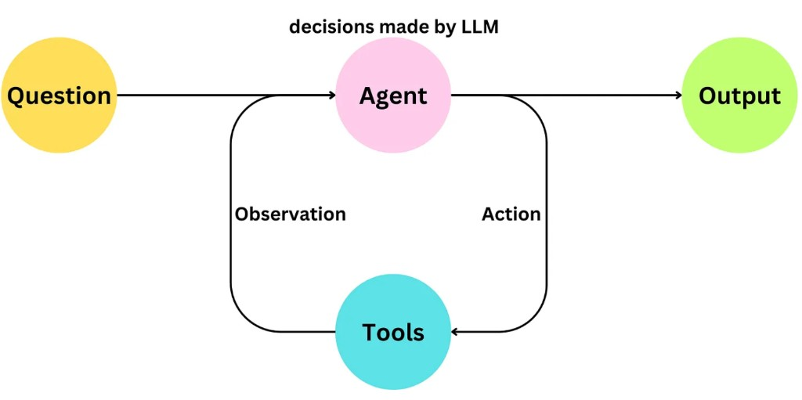

Джерело: [The AiEdge - Introduction to LangChain: Augmenting LLMs with Tools](https://newsletter.theaiedge.io/p/introduction-to-langchain-augmenting)

Ключова відмінність - **здатність діяти у зовнішньому світі через інструменти**.

### 1.2 Аналогія з людським мисленням

Люди не вирішують складні задачі лише «з голови»:

- шукають інформацію;
- користуються калькулятором;
- ведуть нотатки;
- звертаються до експертів.

Агенти роблять те саме: розуміють межі власних знань і підтягують зовнішні ресурси в потрібний момент.

### 1.3 Практична різниця в поведінці

- **LLM-поведінка:** «Я можу пояснити, як це порахувати...»
- **Агентна поведінка:** «Я знайду актуальні дані, зроблю обчислення, перевірю результат і поверну готову відповідь».

### 1.4 Інструменти як «органи чуттів» і «кінцівки»

Якщо LLM - «мозок», то інструменти дають їй:

- **зір/слух**: пошук, API, БД;
- **руки**: запис у файли/БД, виклики сервісів;
- **когнітивні підсилювачі**: калькулятор, код-інтерпретатор;
- **комунікацію**: email, месенджери, CRM.

Без інструментів агент залишається ізольованим інтелектом.

### 1.5 Чому «контекст-інжиніринг» важливіший за просто промпт

Для сучасних агентів критично:

- не завалювати модель «усім одразу»;
- підтягувати тільки релевантний контекст у поточному кроці;
- перераховувати контекст після кожного виклику інструмента.

Інструменти працюють як «лазерні промені уваги», а не як масове завантаження даних.

### 1.6 ReAct як домінантний патерн

Цикл ReAct:

1. **Thought** - подумай;
2. **Action** - виклич інструмент;
3. **Observation** - проаналізуй результат;
4. Повторюй, доки не досягнеш цілі.

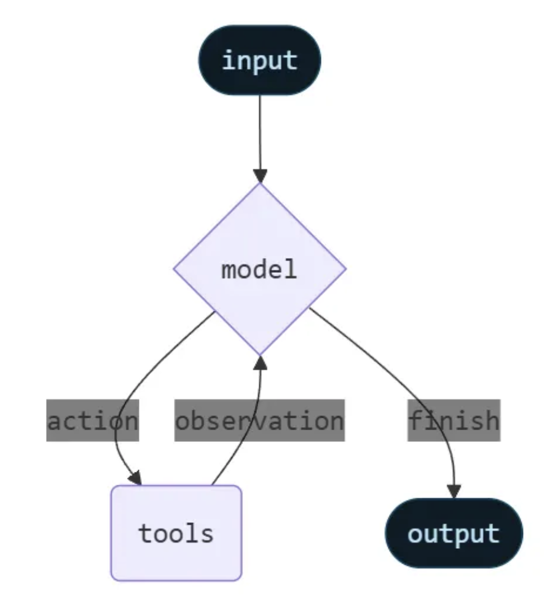

Джерело: [LangChain Agents Docs](https://docs.langchain.com/oss/python/langchain/agents)

Приклад промпта для ReAct-агента:

```text
Ти асистент, який відповідає на запитання, використовуючи інструменти.

Доступні інструменти:
- search(query) — пошук в інтернеті
- calculator(expression) — математичні обчислення

Формат відповіді:
Thought: [що мені потрібно зробити]
Action: [інструмент(параметри)]
Observation: [результат від інструмента]
... (повторюй цикл за потреби)
Thought: [фінальний висновок]
Answer: [відповідь користувачу]
```

**Важливо:** такий цикл знижує ризик галюцинацій, бо модель спирається на перевірювані проміжні результати інструментів, а також підвищує аудитованість рішень.

### 1.7 Метакогніція агента

ReAct-процес розвиває:

- самомоніторинг;
- планування;
- адаптацію;
- рефлексію.

### 1.8 Умови надійної системи «агент + інструменти»

- чіткий `system_prompt` і межі повноважень;
- мінімально достатній набір інструментів;
- відмовостійкість і ретраї;
- механізми самокорекції.

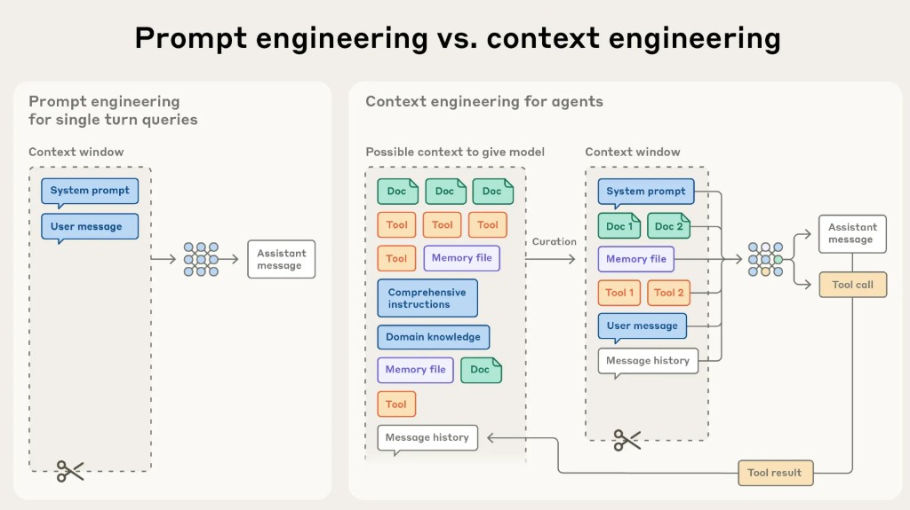

Джерело: [Anthropic - Effective context engineering for AI agents](https://www.anthropic.com/research/effective-context-engineering-for-ai-agents)

Додаткові джерела:

- [The AiEdge - Introduction to LangChain: Augmenting LLMs with Tools](https://newsletter.theaiedge.io/p/introduction-to-langchain-augmenting)
- [LangChain Agents](https://docs.langchain.com/oss/python/langchain/agents)
- [Anthropic research: Effective context engineering](https://www.anthropic.com/research/effective-context-engineering-for-ai-agents)

---

<a id="part-2"></a>

## Частина 2. Як працює function / tool calling

Function/tool calling робить LLM-агента практично корисним: модель повертає не просто текст, а структурований виклик інструмента.

Приклад:

```json
{
  "tool": "create_invoice",
  "args": {
    "client_id": "N",
    "amount": 2000
  }
}
```

Після цього рантайм викликає функцію й повертає результат назад моделі.

### 2.1 Що актуально

- де-факто стандарт для контракту інструментів - **JSON Schema**;
- поширена підтримка **structured outputs**;
- важливо обробляти часткові/streaming аргументи;
- навіть при gRPC/Protobuf назовні, шар взаємодії з LLM зазвичай лишається JSON-схемою.

### 2.2 4 ключові етапи

1. **Tool Creation** - створення інструмента + схема параметрів.
2. **Tool Binding** - прив'язка інструмента до моделі.
3. **Tool Calling** - модель генерує виклик з аргументами.
4. **Tool Execution** - виконання інструмента і повернення результату.

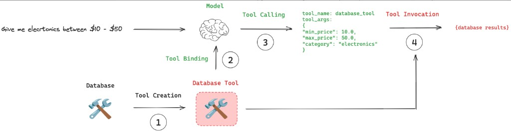

Джерело: [LangChain overview](https://docs.langchain.com/oss/python/langchain/overview)

### 2.3 Приклад визначення інструмента

```json
{
  "name": "get_delivery_date",
  "description": "Get the delivery date for a customer's order. Call this whenever you need to know the delivery date, for example when a customer asks 'Where is my package'",
  "parameters": {
    "type": "object",
    "properties": {
      "order_id": {
        "type": "string",
        "description": "The customer's order ID."
      }
    },
    "required": ["order_id"],
    "additionalProperties": false
  }
}
```

Пояснення полів:

- `name` - унікальна назва інструмента (часто `snake_case`);
- `description` - коли і навіщо інструмент викликати;
- `parameters` - JSON Schema вхідних даних;
- `properties` - перелік аргументів з типами й описами;
- `required` - обов'язкові аргументи;
- `additionalProperties: false` - заборона довільних «зайвих» полів.

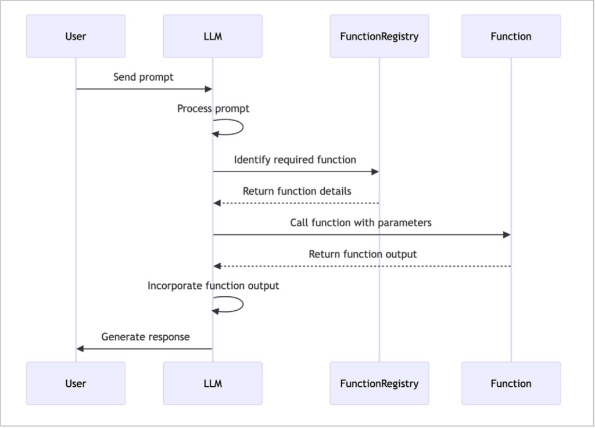

Джерело: [BentoML - Function Calling with Open-Source LLMs](https://bentoml.com/blog/function-calling-with-open-source-llms)

### 2.4 Категорії інструментів

Кожен інструмент належить до певної категорії за призначенням. Це допомагає будувати збалансований набір можливостей агента: не лише «думати», а й шукати, рахувати, комунікувати та виконувати дії.

#### 1) Пізнавальні (Cognitive)

Ці інструменти відповідають за отримання й перетворення знань:

- **Search** - розширення пам'яті через доступ до актуальної інформації.
- **Summarization** - ущільнення великих обсягів даних до придатного для рішень формату.
- **Translation** - подолання мовних бар'єрів і робота з мультимовними джерелами.

Практична роль: дати агенту «інформаційну основу» перед тим, як він щось радить або робить.

#### 2) Обчислювальні (Computational)

Ці інструменти забезпечують точність там, де «на око» відповідати не можна:

- **Calculator** - точні математичні операції.
- **Code execution** - виконання складних алгоритмів і програмної логіки.
- **Simulation** - моделювання процесів і сценаріїв для прогнозування наслідків.

Практична роль: зменшити помилки моделі в арифметиці, логіці й аналітичних задачах.

#### 3) Комунікаційні (Communication)

Ці інструменти дозволяють агенту взаємодіяти з користувачами та інформаційними системами:

- **Email / messaging** - відправка повідомлень і нотифікацій.
- **Database queries** - пошук і збереження структурованих даних.
- **File operations** - створення, редагування та обмін документами.

Практична роль: перетворити результат міркування на реальну операційну дію в бізнес-процесі.

#### 4) Дієві (Action-oriented)

Ці інструменти виконують зовнішні транзакційні або публічні дії:

- **Booking systems** - резервування та замовлення.
- **Financial transactions** - платежі й перекази.
- **Content publishing** - публікація контенту в соцмережах, блогах, CMS.

Практична роль: завершити цикл «аналіз -> дія -> результат» у зовнішньому середовищі.

#### Принцип мінімально достатнього набору

Для production-агента краще дати найменший набір інструментів, який покриває потрібні задачі:

- менше інструментів -> менше помилок вибору;
- простіше тестувати й контролювати безпеку;
- легше пояснювати поведінку агента.

Надмірний інструментарій підвищує когнітивне навантаження моделі й знижує точність маршрутизації.

### 2.5 gRPC + Protobuf у контурі Tool Calling

#### Визначення

`gRPC` і `Protobuf` часто йдуть разом у мікросервісній архітектурі, але це різні шари:

- **gRPC** - протокол/фреймворк віддалених викликів (RPC) між сервісами.
- **Protobuf (Protocol Buffers)** - мова опису даних і спосіб серіалізації повідомлень.

#### Навіщо це в агентних системах

На межі «модель -> інструмент» ви зазвичай працюєте з JSON-сумісними аргументами. Далі, усередині бекенду, ці аргументи часто треба передати швидко, типобезпечно й стандартизовано між сервісами. Саме тут корисні gRPC/Protobuf:

- нижчі накладні витрати на транспорт;
- жорсткий контракт (`.proto`) між командами/сервісами;
- добре підтриманий стримінг і двостороння комунікація;
- автогенерація клієнтів/серверів у різних мовах.

#### Приклад

З боку прикладного коду виклик виглядає як локальна функція:

```python
products = product_service.SearchProducts(
    min_price=10,
    max_price=50,
    category="electronics"
)
```

Але реально це RPC-виклик до віддаленого сервісу.

`proto`-контракт:

```proto
syntax = "proto3";

service ProductService {
  rpc SearchProducts (ProductSearchRequest) returns (ProductSearchResponse);
}

message ProductSearchRequest {
  double min_price = 1;
  double max_price = 2;
  string category = 3;
}

message Product {
  string name = 1;
  double price = 2;
}

message ProductSearchResponse {
  repeated Product products = 1;
}
```

#### Потік даних: від LLM до БД

1. LLM формує tool call з JSON-аргументами.
2. Tool Executor валідуює JSON Schema.
3. Executor мапить аргументи у Protobuf-модель.
4. gRPC-клієнт викликає RPC-метод (`SearchProducts`).
5. Сервіс виконує логіку/запит до БД.
6. Відповідь повертається через gRPC, конвертується в tool result.
7. Модель отримує результат і формує фінальну відповідь.

#### Порівняння з REST + JSON

- **REST + JSON:** endpoint-підхід, зазвичай з текстовим JSON.
- **gRPC + Protobuf:** RPC-методи + бінарна серіалізація + строгий `.proto` контракт.

У gRPC є 4 режими взаємодії:

- `Unary`
- `Server Streaming`
- `Client Streaming`
- `Bidirectional Streaming`

#### Типові ризики

- мапінг JSON -> Protobuf може ламатися на типах/nullable/enum;
- версіонування `.proto` вимагає дисципліни (не можна бездумно перевикористовувати field numbers);
- помилки мережі/таймаути/ретраї потрібно окремо проєктувати;
- авторизація інструмента не зводиться до валідації аргументів.

#### Best practices

- тримайте чіткий anti-corruption layer між LLM JSON і внутрішнім RPC-контрактом;
- явно логувати `validation -> mapping -> rpc status -> tool result`;
- вводити `timeouts`, `circuit breakers`, `idempotency keys` для критичних дій;
- тестувати контрактними тестами сумісність версій `.proto`.

Джерела:

- [gRPC Introduction](https://grpc.io/docs/what-is-grpc/introduction/)
- [Protocol Buffers Guide (proto3)](https://protobuf.dev/programming-guides/proto3/)
- [BentoML function calling](https://bentoml.com/blog/function-calling-with-open-source-llms)

---

### 2.6 JSON Schema, JSON arguments і реалізація інструмента

#### Визначення

У Tool Calling є три різні рівні, які часто плутають:

- **JSON Schema** - контракт того, *які аргументи дозволені*.
- **JSON Arguments** - фактичні значення, які *згенерувала LLM*.
- **Tool Implementation** - реальний код/сервіс, який *виконує дію*.

JSON сам по собі не «виконує інструмент» - він передає структуру даних.

#### Навіщо важливо розрізняти ці рівні

Навіть якщо модель повернула валідний JSON за схемою, виконання інструмента все одно може впасти через:

- бізнес-правила;
- API-rate limits;
- проблеми доступу;
- помилки мапінгу на внутрішній тип/протокол.

Для AI Engineer це критично: валідація формату != успішна операція.

#### Приклад на `calculator`

**1) Tool Definition (контракт)**

```json
{
  "name": "calculator",
  "description": "Performs arithmetic operations",
  "parameters": {
    "type": "object",
    "properties": {
      "a": {"type": "number"},
      "b": {"type": "number"},
      "operation": {
        "type": "string",
        "enum": ["add", "subtract", "multiply", "divide"]
      }
    },
    "required": ["a", "b", "operation"]
  }
}
```

**2) Tool Calling (фактичні аргументи)**

```json
{
  "a": 15,
  "b": 8,
  "operation": "multiply"
}
```

**3) Tool Execution (реальний код)**

```python
def calculator(a, b, operation):
    if operation == "multiply":
        return a * b
```

**4) Tool Result (повернення в агентний цикл)**

```json
{
  "result": 120
}
```

#### Категорії інструментів і формат виконання

| Категорія | JSON для аргументів | Що реально виконує роботу |
| --- | --- | --- |
| Cognitive | Часто | Search API, retrieval системи, NLP пайплайни |
| Computational | Часто | Python-код, математичні бібліотеки, симулятори |
| Communication | Часто | Email API, SQL, файлові сервіси |
| Action-oriented | Часто | Booking API, платіжні шлюзи, publish API |

Приклади:

- інструмент БД приймає JSON, але виконує SQL/ORM-запит;
- інструмент PDF приймає JSON-шаблон, але повертає бінарний файл;
- інструмент «платіж» приймає JSON, але робить транзакцію через зовнішній PSP API.

#### Що актуально у 2026 році

- JSON Schema лишається стандартом контракту для LLM tool arguments;
- Structured Outputs підвищують надійність формування аргументів;
- MCP робить discoverability інструментів системнішою;
- Pydantic (Python) і Zod (TypeScript) - типові засоби валідації;
- стримінг аргументів LLM і gRPC-streaming - різні механізми, їх не варто змішувати.

#### Типові ризики

- schema drift між описом інструмента і реальним кодом;
- «валідний JSON, але невалідна бізнес-операція»;
- неповний JSON у стримінгу;
- небезпечні аргументи без policy-check (особливо для action-oriented tools).

#### Best practices

- розділяйте етапи `schema validation -> authorization -> execution -> post-validation`;
- зберігайте стабільний формат tool result (включно з помилками);
- додавайте ідемпотентність і rollback-стратегії для дієвих інструментів;
- ведіть трасування на рівні кожного tool call (arguments, status, latency, retries).

Головний висновок: **JSON Schema визначає контракт, JSON переносить значення, а поведінку інструмента реалізує програмний код або зовнішній сервіс.**

---

<a id="part-3"></a>

## Частина 3. Агент як когнітивна архітектура

### 3.1 Визначення

Когнітивна архітектура - це «скелет мислення» системи:

- як обробляється вхід;
- як інтегруються результати;
- коли і чому система зупиняється.

### 3.2 6 рівнів автономності

#### Рівень 1. Детермінована програма

- жорсткі правила;
- без LLM-міркування;
- повна передбачуваність.

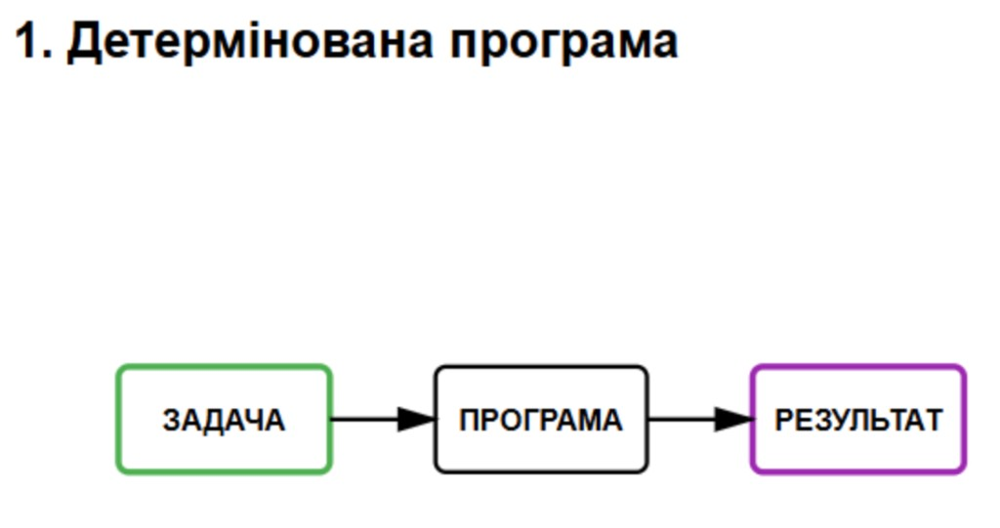

#### Рівень 2. Одне звернення до LLM

- один виклик моделі на один запит;
- мінімальна оркестрація.

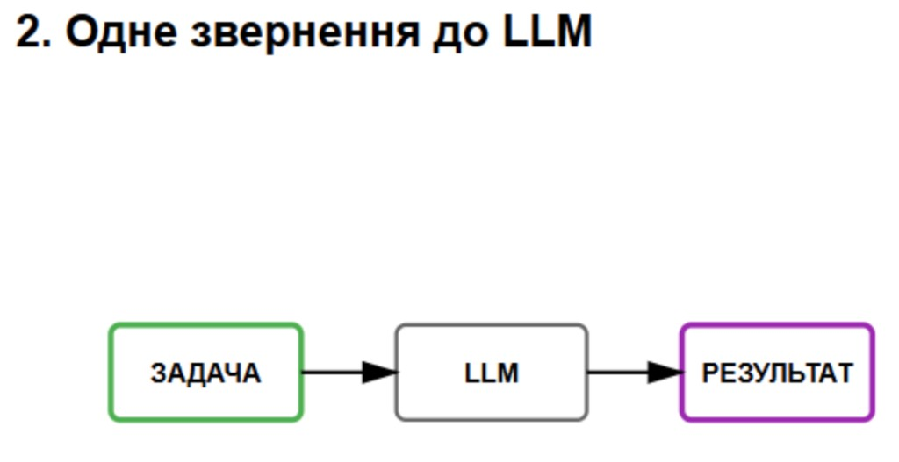

#### Рівень 3. Ланцюг (Chain)

- кілька послідовних викликів;
- вихід попереднього кроку є входом наступного.

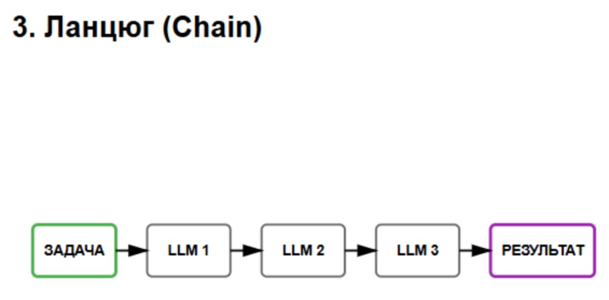

#### Рівень 4. Розгалуження (Router / Branching)

- модель обирає подальший шлях;
- виникає контрольована непередбачуваність.

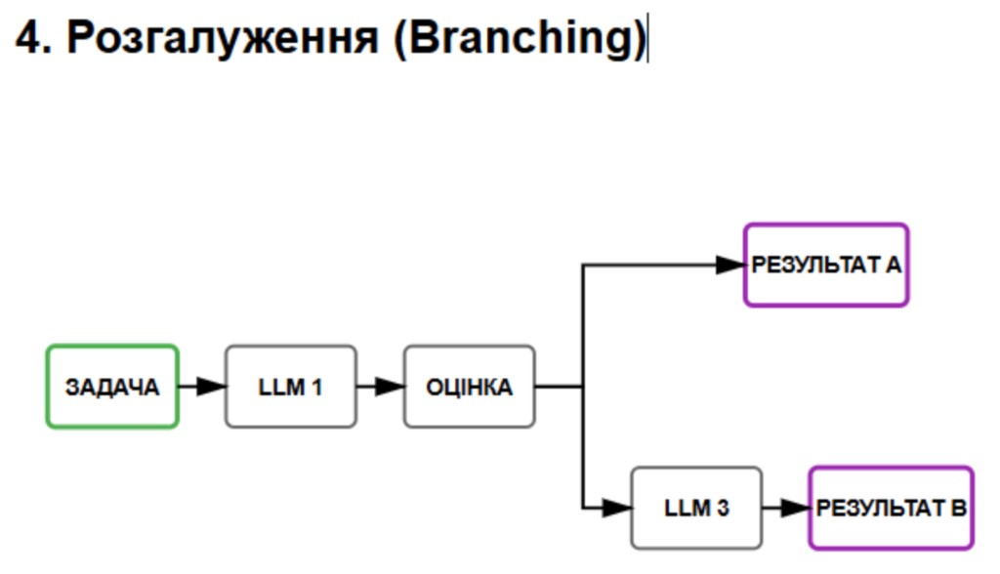

> **Уточнення:** терміни `Router` і `Branching` у цьому контексті використовуються як синоніми.

#### Рівень 5. Стан-машина (State Machine)

- розгалуження + цикли;
- система працює в межах фіксованої архітектури;
- може ітеративно використовувати інструменти.

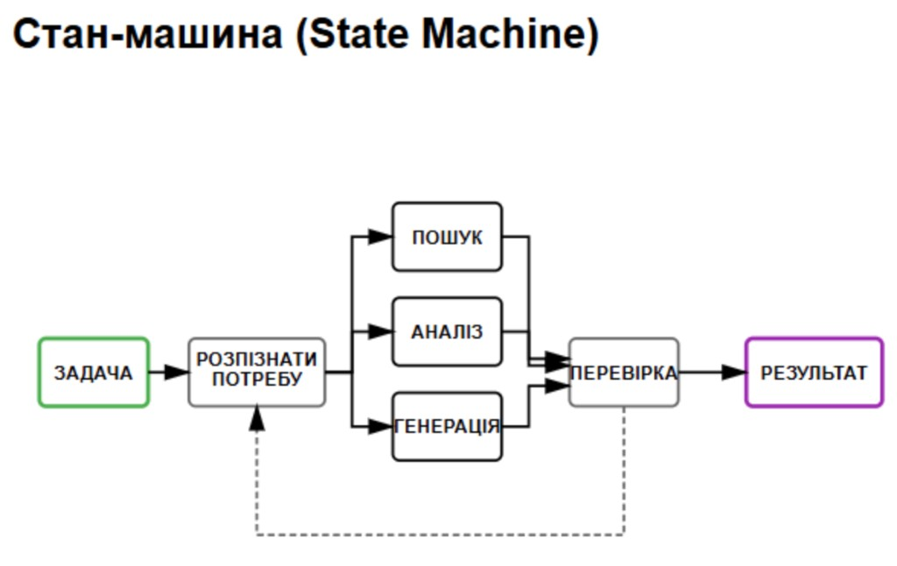

> **Уточнення:** на вихідній ілюстрації номер рівня не підписано; у цій структурі це саме **рівень 5**.

#### Рівень 6. Повна автономність

- система може змінювати власні інструкції, інструменти, стратегії;
- найвища свобода й найвищі ризики.

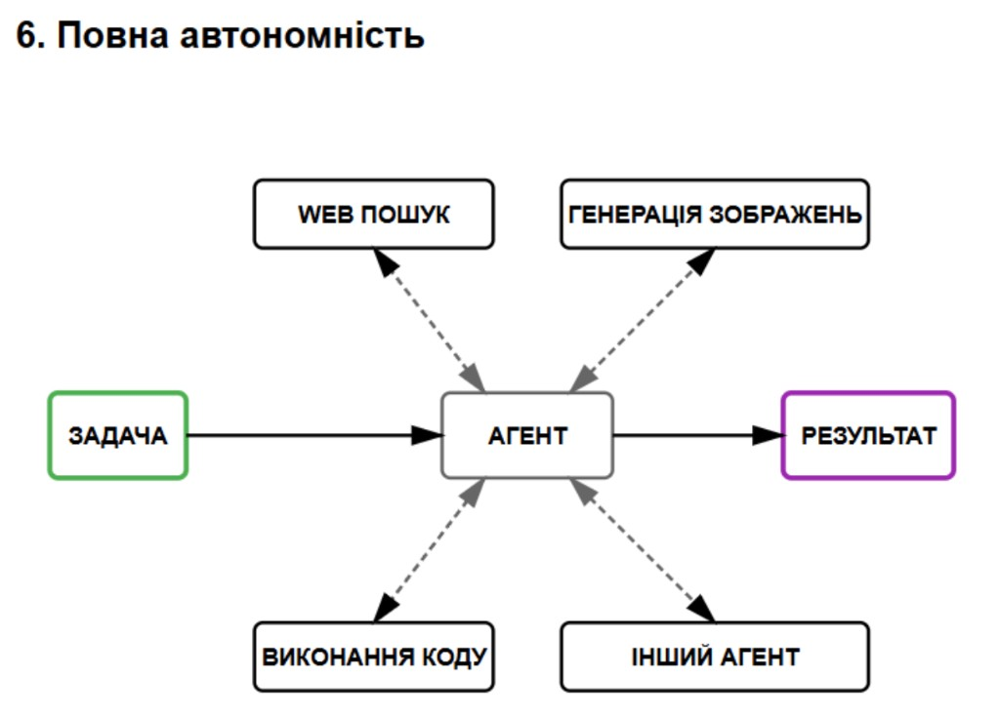

### 3.3 Router vs State Machine: ключова відмінність

Головна ідея:

- **Router** відповідає на питання: *«Куди спрямувати запит?»*
- **State Machine** відповідає на питання: *«У якому ми стані, що робити далі і за яких умов завершити процес?»*

Важливий нюанс:

- State Machine **не обов'язково** має цикли;
- Router **не обов'язково** використовує LLM.

Це різні архітектурні концепції.

#### Router — розгалуження

Сценарій для QA-асистента:

`User Request -> Router -> (Generate Tests | Debug Code | Explain Concept) -> Response`

Приклад: користувач пише `Generate test cases for login`. Router обирає гілку `Generate Tests`, передає туди запит, отримує результат і завершує процес.

Особливості Router:

- обирає маршрут на основі вхідних даних;
- часто для одного запиту обирає одну гілку;
- не вимагає складної пам'яті стану;
- може бути реалізований як LLM-класифікатор або rule-based логіка.

#### State Machine — машина станів

Сценарій для QA-агента:

`Generate Test Cases -> Execute Tests -> Evaluate Results -> (за потреби повернення до Execute Tests)`

Приклад стану:

```json
{
  "current_state": "evaluating",
  "attempt": 2,
  "max_attempts": 3,
  "test_status": "failed",
  "errors": ["Login timeout"]
}
```

Залежно від стану система може:

- повторити запуск тестів;
- перейти до аналізу проблем;
- завершити процес.

У production зазвичай задають межі: `max_attempts`, ліміти часу й бюджету.

#### Порівняння

| Характеристика | Router | State Machine |
| --- | --- | --- |
| Основне завдання | Вибрати маршрут | Керувати станами та переходами |
| Пам'ять стану | Не обов'язкова | Ключова частина |
| Цикли | Не є типовою властивістю | Можливі |
| Повторні рішення | Не обов'язкові | Можливі на кожному переході |
| Складність | Зазвичай нижча | Зазвичай вища |
| Приклад | Класифікація тікета | Автоматизоване тестування з повторами |

#### Чи може State Machine містити Router

Так, і це поширений патерн:

1. State Machine входить у стан `ANALYZE`.
2. Router обирає: `SEARCH`, `EXECUTE_CODE` або `ASK_USER`.
3. Виконується обрана дія.
4. State Machine оновлює стан.
5. Система вирішує, чи потрібен наступний крок.

Тобто Router може бути компонентом State Machine.

> **Уточнення до формулювання вище:** фраза про «фіксований набір інструментів» у State Machine не повинна трактуватися занадто жорстко. Класична машина станів фіксує стани та правила переходів, але інструменти всередині стану можуть визначатися динамічно.

### 3.4 Практичний вибір рівня

- починайте з найпростішого рівня, який покриває задачу;
- ускладнюйте архітектуру лише за потреби;
- для production найчастіше достатньо рівнів 2-3;
- для досліджень - 4-5;
- рівень 6 потребує жорстких обмежень і моніторингу.

Золоте правило: **не переплачувати за складність, якщо ціль досяжна простішим рівнем**.

---

<a id="part-4"></a>

## Частина 4. Агенти в LangChain v1

У LangChain v1 агент = модель + інструменти + керування циклом.

Базовий конструктор: `create_agent()`.

### 4.1 Модель (статична)

```python
from langchain.agents import create_agent

agent = create_agent(
    "openai:gpt-5",
    tools=[]
)
```

Або з параметрами:

```python
from langchain.agents import create_agent
from langchain_openai import ChatOpenAI

model = ChatOpenAI(
    model="gpt-5",
    temperature=0.1,
    max_tokens=1000,
    timeout=30
)

agent = create_agent(model, tools=[])
```

### 4.2 Модель (динамічний вибір через middleware)

```python
from langchain.agents import create_agent
from langchain.agents.middleware import wrap_model_call, ModelRequest
from langchain_openai import ChatOpenAI
from langchain_core.messages import HumanMessage

basic_model = ChatOpenAI(model="gpt-4o-mini")
advanced_model = ChatOpenAI(model="gpt-4o")

@wrap_model_call
def dynamic_model_selection(request: ModelRequest, handler):
    message_count = len(request.state["messages"])
    request.model = advanced_model if message_count > 10 else basic_model
    return handler(request)

agent = create_agent(
    model=basic_model,
    tools=[],
    middleware=[dynamic_model_selection]
)

result = agent.invoke({"messages": [HumanMessage(content="hello")]})
print(result["messages"][-1].content)
```

> **Уточнення:** додано імпорт `HumanMessage`, без нього приклад не виконується.

### 4.3 Додавання інструментів

```python
from langchain_core.tools import tool
from langchain.agents import create_agent

@tool
def search(query: str) -> str:
    """Пошук інформації."""
    return f"Results for: {query}"

@tool
def calculate(expression: str) -> str:
    """Обчислити вираз."""
    return str(eval(expression))  # Лише демо

agent = create_agent("openai:gpt-4o-mini", tools=[search, calculate])
```

### 4.4 System prompt

```python
from langchain.agents import create_agent

agent = create_agent(
    model="openai:gpt-4o-mini",
    tools=[],
    system_prompt="Ти дослідницький асистент. Завжди наводь джерела."
)
```

### 4.5 Structured output (`response_format`)

```python
from pydantic import BaseModel
from langchain.agents import create_agent

class ContactInfo(BaseModel):
    name: str
    email: str
    phone: str

agent = create_agent(
    model="openai:gpt-4o-mini",
    tools=[],
    response_format=ContactInfo
)

result = agent.invoke({
    "messages": [
        {
            "role": "user",
            "content": "Витягни контакти: John Doe, john@example.com, (555) 123-4567"
        }
    ]
})

print(result["structured_response"])
```

### 4.6 Пам'ять і `state_schema`

```python
from langchain.agents import create_agent, AgentState

class CustomAgentState(AgentState):
    user_preferences: dict

agent = create_agent(
    model="openai:gpt-4o-mini",
    tools=[],
    state_schema=CustomAgentState
)
```

> **Уточнення:** `AgentState` вже містить `messages`, повторно оголошувати це поле зазвичай не потрібно.

### 4.7 Архітектура AI-агента (взаємодія компонентів)

Ця схема показує не лише складові агента, а й те, як вони працюють разом у виконанні запиту:

```mermaid
flowchart TD
    userReq[User Request] --> agent[AI Agent: create_agent()]
    agent --> model[Model LLM]
    agent --> sysPrompt[System Prompt]
    agent --> tools[Tools]
    agent --> memState[Memory_State]
    agent --> middleware[Middleware]
    agent --> structOut[Structured Output]
    model --> reactLoop[Agent Execution Loop ReAct]
    reactLoop --> llmDecision[LLM Decision]
    llmDecision --> toolCall[Tool Call]
    toolCall --> toolResult[Tool Result]
    toolResult --> model
    model --> finalResp[Final Response]
```

Коротко по потоку:

- користувач надсилає запит;
- агент (`create_agent`) збирає модель, промпт, інструменти, стан, middleware;
- модель запускає цикл ReAct: `decision -> tool call -> tool result -> decision`;
- якщо увімкнено `response_format`, фінальна відповідь проходить структурну перевірку;
- агент повертає відповідь користувачу.

#### Як ці компоненти визначені в LangChain v1

| Компонент | Функція | LangChain v1 |
| --- | --- | --- |
| Model | Приймає рішення та генерує відповіді | `model` |
| Tools | Виконують зовнішні дії | `@tool`, `tools=[]` |
| System Prompt | Визначає поведінку агента | `system_prompt` |
| Memory / State | Зберігає контекст і поточний стан | `state_schema`, checkpointer для стану між викликами |
| Middleware | Налаштовує поведінку під час виконання | `middleware=[]` |
| Structured Output | Забезпечує заданий формат результату | `response_format` |

Важливо:

- ReAct - це механізм роботи агента, а не окремий інструмент;
- агент може кілька разів викликати LLM та інструменти перед фінальною відповіддю;
- `create_agent()` у LangChain v1 об'єднує ці компоненти в єдиний граф виконання.

> **Примітка:** це концептуальна логічна схема для навчання; вона не є буквальною внутрішньою схемою вузлів LangGraph.

---

<a id="part-5"></a>

## Частина 5. Інструменти в LangChain v1

### 5.1 Базове створення через `@tool`

```python
from langchain_core.tools import tool

@tool
def search_database(query: str, limit: int = 10) -> str:
    """Пошук у БД за запитом.

    Args:
        query: Пошуковий рядок.
        limit: Максимум результатів.
    """
    return f"Знайдено {limit} результатів для '{query}'"
```

### 5.2 Власна назва і опис

```python
from langchain_core.tools import tool

@tool("web_search")
def search(query: str) -> str:
    """Пошук інформації в інтернеті."""
    return f"Результати для: {query}"
```

```python
from langchain_core.tools import tool

@tool(
    "calculator",
    description="Виконує арифметичні обчислення. Використовуйте для математичних задач."
)
def calc(expression: str) -> str:
    return str(eval(expression))  # Лише демо
```

### 5.3 Складні схеми вводу через Pydantic

```python
from typing import Literal
from pydantic import BaseModel, Field
from langchain_core.tools import tool

class WeatherInput(BaseModel):
    location: str = Field(description="Назва міста або координати")
    units: Literal["celsius", "fahrenheit"] = Field(
        default="celsius",
        description="Одиниці температури"
    )
    include_forecast: bool = Field(
        default=False,
        description="Додати прогноз на 5 днів"
    )

@tool(args_schema=WeatherInput)
def get_weather(
    location: str,
    units: str = "celsius",
    include_forecast: bool = False
) -> str:
    temp = 22 if units == "celsius" else 72
    result = f"Погода в {location}: {temp} {units}"
    if include_forecast:
        result += "\nПрогноз: сонячно"
    return result
```

### 5.4 Доступ до стану через `InjectedState`

```python
from typing_extensions import Annotated
from langchain.tools import InjectedState
from langchain_core.tools import tool

@tool
def summarize_conversation(state: Annotated[dict, InjectedState]) -> str:
    """Підсумувати поточну розмову."""
    messages = state["messages"]
    return f"Кількість повідомлень у контексті: {len(messages)}"
```

### 5.5 Оновлення стану через `Command`

```python
from langgraph.types import Command
from langchain_core.tools import tool

@tool
def update_user_name(new_name: str) -> Command:
    """Оновити ім'я користувача в стані."""
    return Command(update={"user_name": new_name})
```

### 5.6 Доступ до runtime-контексту

```python
from dataclasses import dataclass
from langgraph.runtime import get_runtime
from langchain_core.tools import tool

USER_DATABASE = {
    "user123": {"name": "Alice", "balance": 5000},
    "user456": {"name": "Bob", "balance": 1200},
}

@dataclass
class UserContext:
    user_id: str

@tool
def get_account_info() -> str:
    runtime = get_runtime(UserContext)
    user_id = runtime.context.user_id
    if user_id in USER_DATABASE:
        user = USER_DATABASE[user_id]
        return f"Name: {user['name']}\nBalance: ${user['balance']}"
    return "User not found"
```

### 5.7 Довготривала пам'ять (`InMemoryStore`)

```python
from typing import Any
from langgraph.config import get_store
from langgraph.store.memory import InMemoryStore
from langchain.agents import create_agent
from langchain_core.tools import tool

@tool
def get_user_info(user_id: str) -> str:
    store = get_store()
    user = store.get(("users",), user_id)
    return str(user.value) if user else "Unknown user"

@tool
def save_user_info(user_id: str, user_info: dict[str, Any]) -> str:
    store = get_store()
    store.put(("users",), user_id, user_info)
    return "Successfully saved user info."

store = InMemoryStore()
agent = create_agent(
    model="openai:gpt-4o-mini",
    tools=[get_user_info, save_user_info],
    store=store
)
```

### 5.8 Підключення агента до інтернету (Tavily)

```python
from langchain.agents import create_agent
from langchain_openai import ChatOpenAI
from langchain_tavily import TavilySearch

llm = ChatOpenAI(
    api_key="ваш_openai_ключ",
    model="gpt-4o-mini",
)

search_tool = TavilySearch(
    tavily_api_key="ваш_tavily_ключ",
    max_results=5,
)

agent = create_agent(
    model=llm,
    tools=[search_tool],
    system_prompt="Ти корисний асистент. Використовуй пошук для актуальної інформації."
)

result = agent.invoke({
    "messages": [
        {"role": "user", "content": "Які останні новини про штучний інтелект?"}
    ]
})

print(result["messages"][-1].content)
```

> **Уточнення:** у частині прикладів в мережі ще зустрічається `create_react_agent(..., prompt=...)` з `langgraph.prebuilt`. У цьому конспекті використано актуальний для LangChain v1 варіант через `create_agent(..., system_prompt=...)`.

### 5.9 Де тут `ToolNode`

`ToolNode` — це готовий вузол у `LangGraph`, який відповідає за виконання інструментів, обробку результатів і помилок.

#### Основні функції `ToolNode`

1. **Tool Execution** — виконує інструменти, які викликала LLM, з передачею аргументів.
2. **Parallel Execution** — може виконувати кілька незалежних викликів інструментів паралельно.
3. **Error Handling** — обробляє помилки виклику інструментів за заданою стратегією.
4. **State Injection** — інжектить потрібний стан/контекст у tool runtime.
5. **Result Handling** — повертає результати як `ToolMessage` для наступного кроку моделі; також підтримує `Command` для оновлення стану.

#### Як `ToolNode` працює в агенті

- LLM генерує `tool_calls`;
- `ToolNode` виконує виклики й застосовує політику обробки помилок;
- при успіху повертає `ToolMessage` з результатом;
- при помилці повертає `ToolMessage` з описом помилки або прокидає виняток далі (залежно від конфігурації);
- LLM отримує ці повідомлення й приймає наступне рішення.

#### Приклад у Python

```python
from langgraph.prebuilt import ToolNode
from langchain.tools import tool

@tool
def divide(a: float, b: float) -> float:
    """Ділить число a на b."""
    return a / b

tool_node = ToolNode(
    tools=[divide],
    handle_tool_errors=True,
)
```

`handle_tool_errors=True` означає, що типові помилки виконання інструмента перетворюються на помилкові `ToolMessage`, які може проаналізувати LLM.

Важливо:

- `ToolNode` **не** обирає, який інструмент викликати — це робить LLM або routing-логіка графа;
- у `LangChain v1` `create_agent()` уже використовує `ToolNode` усередині, тому для стандартного агента вручну його створювати зазвичай не потрібно;
- за замовчуванням у сучасному `LangGraph` пріоритетно обробляються помилки валідації аргументів, а частина runtime-помилок може прокидатися далі як exceptions (залежно від налаштувань вузла).

---

<a id="part-6"></a>

## Частина 6. Принципи проєктування інструментів

### 1) Єдина відповідальність

Кожен інструмент повинен робити одну річ добре. Краще кілька простих tools, ніж один «універсальний».

### 2) Композиційність

Вихід одного інструмента має природно ставати входом іншого. Узгоджуйте формати даних.

### 3) Передбачуваність

Стабільний формат відповіді навіть за помилок: менше сюрпризів для моделі.

### 4) Безпечне відмовлення

Для критичних дій (платежі, видалення) краще відмовити, ніж зробити небезпечну дію.

### 5) Чітка комунікація

`docstring` і `description` - це інтерфейс для моделі: пишіть чітко, коли tool застосовувати.

### 6) Типобезпека

Type hints + Pydantic валідують вхід і зменшують runtime-помилки.

### 7) Розширюваність

Використовуйте `InjectedState`, runtime-контекст і store там, де це додає цінність, але не робіть інструменти надмірно залежними від глобального стану.

---

<a id="part-7"></a>

## Частина 7. Підсумки

Після цієї теми ви вмієте:

- відрізняти лінійну LLM-взаємодію від циклічного агентного підходу;
- пояснити цикл ReAct `думай -> дій -> спостерігай`;
- проєктувати інструменти з коректними схемами параметрів;
- реалізовувати function/tool calling із валідацією;
- обирати рівень автономності під задачу;
- створювати агентів у LangChain v1 через `create_agent()`;
- працювати зі станом, контекстом, коротко- та довготривалою пам'яттю;
- будувати надійні й безпечні набори інструментів.

Золоте правило: **використовуйте найпростішу архітектуру, яка розв'язує задачу**.

---

<a id="part-8"></a>

## Частина 8. Шпаргалка: AI-агенти, інструменти та архітектури

Таблиці нижче охоплюють ключові поняття теми 6: від відмінності між LLM та агентом до створення інструментів у LangChain v1 і роботи зі станом у LangGraph.

### 8.1 Звичайна LLM vs AI-агент

| Критерій | Звичайний виклик LLM | AI-агент |
| --- | --- | --- |
| Архітектура | Переважно лінійна | Може бути циклічною |
| Процес | Input -> LLM -> Output | Reason -> Act -> Observe -> Repeat |
| Рішення | Генерує відповідь | Може обирати наступні дії |
| Інструменти | Не обов'язкові | Можуть бути інтегровані |
| Зовнішні дані | Лише наданий контекст | Може отримувати через tools |
| Повторення | Новий виклик організовує застосунок | Агентний цикл може запускати повторні виклики |
| Приклад | Пояснити SQL-запит | Виконати SQL, перевірити результат, сформувати відповідь |

Лінійний виклик:

`Input -> LLM -> Output`

Агентний цикл ReAct:

`Reason -> Act -> Observe -> Repeat`

Запам'ятай: агент може завершити роботу за один виклик LLM. Циклічність — це можливість архітектури, а не обов'язкова кількість кроків.

### 8.2 Інструменти — «зір», «руки», «інструменти мислення»

| Метафора | Що робить | Приклади |
| --- | --- | --- |
| Зір | Отримує інформацію із зовнішнього світу | Web search, retrieval, читання файлів |
| Руки | Змінює стан зовнішніх систем | Email, booking, database write |
| Інструменти мислення | Допомагає точно обчислювати й аналізувати | Calculator, Python, simulation |

Tool — це функція або зовнішній сервіс із визначеними параметрами та результатом. Він розширює можливості LLM за межі генерації тексту.

### 8.3 Function / Tool Calling — чотири етапи

| Етап | Що відбувається | Приклад |
| --- | --- | --- |
| 1. Tool Creation | Створюється функція та описуються її параметри | `@tool def search(query: str)` |
| 2. Tool Binding | Модель отримує опис доступних інструментів | `create_agent(model, tools=[search])` |
| 3. Tool Calling | LLM обирає інструмент і генерує аргументи | `search(query="RAG evaluation")` |
| 4. Tool Execution | Застосунок виконує функцію й повертає результат моделі | Результат пошуку -> `ToolMessage` |

Ключове: LLM зазвичай генерує запит на виклик інструмента, але фактичне виконання забезпечує runtime застосунку.

### 8.4 Чотири категорії інструментів

| Категорія | Призначення | Приклади |
| --- | --- | --- |
| Cognitive — пізнавальні | Пошук, обробка й перетворення інформації | Search, Summarization, Translation |
| Computational — обчислювальні | Точні розрахунки та алгоритми | Calculator, Code execution, Simulation |
| Communication — комунікаційні | Взаємодія із зовнішніми системами | Email, Database queries, File operations |
| Action-oriented — дієві | Виконання дій із реальними наслідками | Booking, Payments, Publishing |

Принцип мінімального достатнього набору: підключай лише ті інструменти, які справді необхідні для задачі. Це зменшує складність вибору, поверхню ризику та витрати на контекст.

### 8.5 Шість рівнів когнітивної архітектури

Це навчальна класифікація за зростанням автономності, а не універсальний галузевий стандарт.

| Рівень | Архітектура | Принцип | Автономність |
| --- | --- | --- | --- |
| 1 | Deterministic Program | Фіксовані правила `if/else` | Немає |
| 2 | Single LLM Call | Один виклик моделі | Низька |
| 3 | Chain / Workflow | Заздалегідь визначена послідовність кроків | Низька |
| 4 | Router | LLM обирає одну з доступних гілок | Часткова |
| 5 | State Machine | Переходи між станами, можливі цикли | Керована |
| 6 | Autonomous Agent | Динамічно планує, викликає інструменти, оцінює результат | Вища |

#### Прості vs складні архітектури

| Прості: рівні 1–3 | Складніші: рівні 4–6 |
| --- | --- |
| Маршрут визначений заздалегідь | Наступний маршрут може залежати від рішення LLM |
| Легше прогнозувати порядок кроків | Більше можливих шляхів виконання |
| Простіше тестувати послідовність | Потрібно тестувати рішення, переходи, цикли |
| Зазвичай легше контролювати витрати | Необхідні ліміти ітерацій, часу, бюджету |

Нюанс: Router може бути повністю детермінованим, а State Machine — мати фіксовані правила. Тому рівень автономності визначається реалізацією, а не лише назвою архітектури.

### 8.6 Основні компоненти агента в LangChain v1

| Компонент | Призначення | Параметр / API |
| --- | --- | --- |
| Model | Генерація відповідей і tool calls | `model` |
| Tools | Виконання зовнішніх операцій | `tools` |
| System Prompt | Інструкції щодо поведінки | `system_prompt` |
| State / Memory | Поточні повідомлення та дані | `state_schema`, checkpointer |
| Middleware | Додаткова логіка виконання | `middleware` |
| Structured Output | Структурована фінальна відповідь | `response_format` |

#### Приклад створення агента

```python
from langchain.agents import create_agent
from langchain.tools import tool

@tool
def multiply(a: int, b: int) -> int:
    """Помножити два цілі числа."""
    return a * b

agent = create_agent(
    model=MODEL_NAME,
    tools=[multiply],
    system_prompt="Ти математичний асистент."
)

response = agent.invoke({
    "messages": [
        {"role": "user", "content": "Скільки буде 7 * 8?"}
    ]
})

print(response["messages"][-1].content)
```

`MODEL_NAME` — змінна конфігурації, яку потрібно визначити раніше.

### 8.7 Цикл ReAct (Reasoning + Acting)

| Крок | Дія агента | Приклад |
| --- | --- | --- |
| Reason | Визначає наступну дію | Потрібні актуальні дані |
| Act | Викликає інструмент | `search("RAG evaluation")` |
| Observe | Отримує й аналізує результат | Знайдені статті |
| Repeat | Вирішує, чи потрібен ще один крок | Пошук додаткових джерел |
| Final | Генерує відповідь | Підсумок із посиланнями |

Переваги: можливість використовувати перевірювані зовнішні дані, знижувати ризик галюцинацій та аналізувати послідовність tool calls і результатів. Але ReAct не гарантує достовірності відповіді.

### 8.8 Створення інструментів через `@tool`

| Елемент | Призначення |
| --- | --- |
| `@tool` | Перетворює функцію на LangChain tool |
| Назва функції | Ідентифікатор інструмента |
| Docstring | Пояснює моделі, коли і навіщо використовувати tool |
| Type hints | Описують типи параметрів і допомагають побудувати схему |
| Return value | Результат виконання |

```python
from langchain.tools import tool

@tool
def calculate_total(price: float, quantity: int) -> float:
    """Обчислити загальну вартість товарів."""
    return price * quantity
```

Типи й docstring допомагають описати контракт інструмента, але для надійного виконання все одно потрібна перевірка бізнес-правил.

### 8.9 Роль ToolNode

`ToolNode` — готовий вузол LangGraph, який виконує запити на використання інструментів.

| Функція | Що робить |
| --- | --- |
| Tool execution | Викликає потрібну функцію з аргументами |
| Parallel execution | Підтримує одночасне виконання кількох tool calls |
| Error handling | Обробляє помилки відповідно до конфігурації |
| Runtime injection | Передає стан, контекст та інші runtime-дані |
| Result handling | Повертає `ToolMessage` або обробляє `Command` |

```python
from langgraph.prebuilt import ToolNode

tool_node = ToolNode(
    tools=[multiply],
    handle_tool_errors=True
)
```

Важливо: `ToolNode` виконує інструменти, але сам не приймає семантичного рішення, який саме інструмент потрібен. У звичайному `create_agent()` створювати `ToolNode` вручну зазвичай не потрібно.

### 8.10 State, Context і Store

| Механізм | Що зберігає / надає | Тривалість | Приклад |
| --- | --- | --- | --- |
| `runtime.state` | Поточний стан агента | У межах виконання; може зберігатися між викликами через checkpointer | Messages, поточна задача |
| `runtime.context` | Дані, передані застосунком під час запуску | Контекст виконання | User ID, роль, конфігурація |
| `runtime.store` | Доступ до довготривалого сховища | Між виконаннями, якщо налаштовано persistent store | Налаштування користувача |
| `InjectedState` | Передає вибраний стан інструменту | У межах виклику | Історія повідомлень |

У LangChain v1 рекомендований підхід — `ToolRuntime`, який об'єднує доступ до state, context і store.

```python
from langchain.tools import tool, ToolRuntime

@tool
def get_context(runtime: ToolRuntime) -> str:
    """Повернути кількість повідомлень у стані агента."""
    count = len(runtime.state["messages"])
    return f"Повідомлень: {count}"
```

`runtime` передається системою автоматично — LLM не генерує його як звичайний аргумент.

### 8.11 Оновлення стану через Command

| Компонент | Роль |
| --- | --- |
| `Command` | Передає інструкцію для оновлення стану |
| `update` | Містить поля та значення для оновлення |
| Reducer | Визначає, як об'єднувати старі й нові значення |
| Checkpointer | Дозволяє зберігати й відновлювати стан виконання |

```python
from langgraph.types import Command

return Command(
    update={"task_status": "completed"}
)
```

Для практичного використання поле `task_status` має бути визначене у схемі стану, а для інструментів, що повертають `Command`, слід правильно обробляти й відповідні tool messages.

### 8.12 Сім принципів проєктування інструментів

| Принцип | Суть | Практичне правило |
| --- | --- | --- |
| Single Responsibility | Одна чітка функція | Один tool — одне основне завдання |
| Composability | Можливість комбінування | Маленькі tools легше поєднувати |
| Predictability | Передбачувана поведінка | Чіткі типи, контракти, результати |
| Safe Failure | Безпечна обробка помилок | Контроль винятків, відсутність небезпечних побічних ефектів |
| Clear Communication | Зрозумілий опис | Назви й docstrings пояснюють призначення |
| Type Safety | Контроль типів | Type hints, schema validation |
| Extensibility | Можливість розширення | Мінімізація залежностей і стабільні інтерфейси |

Для QA особливо важливо тестувати не лише успішний результат інструмента, але й невалідні аргументи, помилки зовнішніх API, таймаути, повторні виклики та несанкціоновані дії.

### 8.13 Золоте правило вибору архітектури

Обирай найпростішу архітектуру, яка надійно розв'язує задачу.

| Якщо задача потребує... | Почни з... |
| --- | --- |
| Фіксованих правил | Детермінованої програми |
| Однієї генерації тексту | Single LLM Call |
| Послідовних відомих кроків | Chain / Workflow |
| Вибору між кількома шляхами | Router |
| Контрольованих переходів і повторів | State Machine |
| Динамічного планування та використання інструментів | AI Agent |

Головна думка для іспиту: не кожна задача потребує AI-агента. Автономність додає гнучкості, але одночасно збільшує складність тестування, контролю поведінки, безпеки та витрат.

Рівень впевненості: високий (98%) щодо основних понять LangChain і LangGraph. Шестирівнева класифікація наведена як навчальна модель; точне формулювання рівнів може відрізнятися від матеріалів конкретної лекції.

---

<a id="clarifications"></a>

## Уточнення до матеріалу

| Пункт | Що було | Як виправлено в конспекті |
| --- | --- | --- |
| Tool Calls рядок | `Tool Calls:Thank you` | Замінено на коректне `Tool Calls:` |
| Escape-послідовності | Подекуди `\\n` у коді | Виправлено до реальних переносів `\n` у рядках Python |
| Динамічна модель | Бракувало імпорту `HumanMessage` | Додано `from langchain_core.messages import HumanMessage` |
| Tavily приклад | Варіант з `create_react_agent(..., prompt=...)` | Оновлено до `create_agent(..., system_prompt=...)` у стилі LangChain v1 |
| Стан агента | Повторне оголошення `messages` у `AgentState` | Додано примітку, що `messages` уже є в базовому `AgentState` |
| Рівень 4 | Змішані назви `Branching` і `Router` | Явно пояснено, що це синоніми в контексті маршрутизації |
| Рівень 5 на схемі | Номер рівня не підписано | Додано примітку під ілюстрацією, що це рівень 5 |
| `ToolNode` у підсумках | Згадується без пояснення | Додано окремий підрозділ про `ToolNode` та `handle_tool_errors` |
| ReAct у підсумках | Згадка про аудитованість без зв'язку | Додано речення про зниження галюцинацій та аудитованість |

