# КОНСПЕКТ ЛЕКЦІЇ №7: RAG-СИСТЕМИ

> **Тема:** Retrieval-Augmented Generation (RAG) - архітектура, ембединги, векторні бази даних, трансформації запитів, маршрутизація, просунута індексація, переранжування, самокорегувальні RAG-підходи.
>
> **Формат:** розгорнутий навчальний конспект-довідник із практичними прикладами Python + LangChain.
>
> **Код до конспекту:** [AI_topic_7_lesson.ipynb](AI_topic_7_lesson.ipynb), [AI_topic_7_RAG_systems.ipynb](AI_topic_7_RAG_systems.ipynb)

---

## Зміст

- [Частина 0. Вступ і визначення RAG](#part-0)
- [Частина 1. Базова система RAG](#part-1)
- [Частина 2. Ембединги і метрики схожості](#part-2)
- [Частина 3. Векторні бази даних](#part-3)
- [Частина 4. Просунуті трансформації запитів](#part-4)
- [Частина 5. Маршрутизація і конструювання запитів](#part-5)
- [Частина 6. Просунута індексація, retrieval, generation](#part-6)
- [Частина 7. Підсумковий конспект теми](#part-7)
- [Частина 8. Шпаргалка](#part-8)
- [Уточнення до матеріалу та оновлення API](#clarifications)

---

<a id="part-0"></a>

## Частина 0. Вступ і визначення RAG

RAG (Retrieval-Augmented Generation) - це підхід, у якому LLM перед генерацією відповіді отримує релевантні фрагменти знань із зовнішнього джерела (векторного сховища, пошукового індексу, БД, вебу тощо).

### Навіщо це потрібно

Класична LLM без retrieval:

- обмежена датою тренування;
- не знає внутрішні документи компанії;
- може галюцинувати, коли не має фактів у контексті;
- не завжди може дати посилання на джерело.

RAG додає "знання тут і зараз":

- свіжа інформація;
- робота з приватними корпоративними документами;
- менше галюцинацій;
- вища пояснюваність (можна показати, на які документи спиралась відповідь).

### Три базові фази RAG

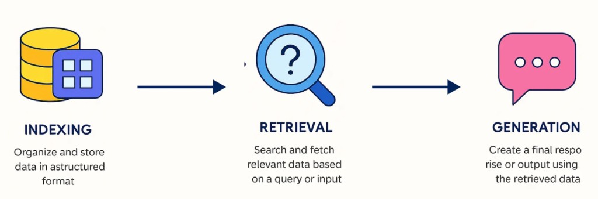

Джерело: [Building the entire RAG ecosystem and optimizing every component](https://levelup.gitconnected.com/building-the-entire-rag-ecosystem-and-optimizing-every-component-8f23349b96a4)

1. **Індексація** - підготовка знань (документи -> фрагменти -> ембединги -> векторне сховище).
2. **Отримання (retrieval)** - пошук релевантних фрагментів під конкретний запит.
3. **Генерація** - формування відповіді LLM на основі знайденого контексту.

---

<a id="part-1"></a>

## Частина 1. Базова система RAG

### 1.1. Оновлені залежності та середовище

Нижче - безпечний і актуалізований приклад старту для локального ноутбука.

```python
!pip install -qU \
  "langchain>=0.3.0,<1.0.0" \
  "langchain-core>=0.3.0,<1.0.0" \
  "langchain-community>=0.3.0,<1.0.0" \
  "langchain-openai>=0.2.0" \
  "langchain-chroma>=0.1.0" \
  "langsmith>=0.1.99" \
  "langchain-text-splitters>=0.3.0" \
  beautifulsoup4 chromadb tiktoken
```

```python
import os
from getpass import getpass

os.environ["OPENAI_API_KEY"] = getpass("OpenAI API key: ")
os.environ["LANGSMITH_API_KEY"] = getpass("LangSmith API key: ")

# Поточний прапор трасування
os.environ["LANGSMITH_TRACING"] = "true"

# Історичний аліас (зустрічається в старих прикладах)
os.environ["LANGCHAIN_TRACING_V2"] = "true"

os.environ["LANGSMITH_ENDPOINT"] = "https://api.smith.langchain.com"
os.environ["LANGSMITH_PROJECT"] = "topic-7-rag-systems"
```

> Якщо працюєте через OpenRouter, налаштуйте `base_url` і API-ключ аналогічно до прикладів у `AI_topic_7_RAG_systems.ipynb`.

### 1.2. Фаза індексації

#### Крок 1. Завантаження документів

```python
import bs4
from langchain_community.document_loaders import WebBaseLoader

os.environ["USER_AGENT"] = "rag-study-bot/1.0"

loader = WebBaseLoader(
    web_paths=("https://lilianweng.github.io/posts/2023-06-23-agent/",),
    bs_kwargs=dict(
        parse_only=bs4.SoupStrainer(
            class_=("post-content", "post-title", "post-header")
        )
    ),
)

docs = loader.load()
print(f"Loaded docs: {len(docs)}")
```

#### Крок 2. Chunking (розбиття на фрагменти)

```python
from langchain_text_splitters import RecursiveCharacterTextSplitter

text_splitter = RecursiveCharacterTextSplitter(
    chunk_size=1000,
    chunk_overlap=200,
)
splits = text_splitter.split_documents(docs)

print(f"Chunks created: {len(splits)}")
```

Пояснення параметрів:

- `chunk_size`: верхня межа розміру фрагмента;
- `chunk_overlap`: перекриття між сусідніми фрагментами, щоб не "порвати" сенс на межі chunk-ів.

#### Крок 3. Ембединг і векторне сховище

```python
from langchain_openai import OpenAIEmbeddings
from langchain_chroma import Chroma

embeddings = OpenAIEmbeddings(model="text-embedding-3-small")

vectorstore = Chroma.from_documents(
    documents=splits,
    embedding=embeddings,
    collection_name="topic7-rag-demo",
)
```

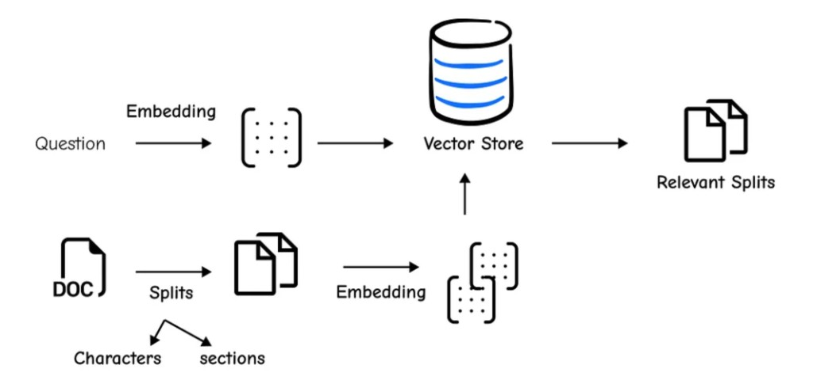

Джерело: [Building the entire RAG ecosystem and optimizing every component](https://levelup.gitconnected.com/building-the-entire-rag-ecosystem-and-optimizing-every-component-8f23349b96a4)

### 1.3. Фаза retrieval

```python
retriever = vectorstore.as_retriever(
    search_type="similarity",
    search_kwargs={"k": 4},
)

question = "What is Task Decomposition?"
retrieved_docs = retriever.invoke(question)

print(f"Retrieved: {len(retrieved_docs)}")
print(retrieved_docs[0].page_content[:600])
```

Що відбувається:

1. Запит користувача переводиться в embedding.
2. Векторний індекс шукає найближчі вектори.
3. Повертаються відповідні текстові фрагменти.

### 1.4. Фаза генерації

#### Варіант А: локальний prompt (найстабільніший для Colab/ноутбуків)

```python
from langchain_core.prompts import ChatPromptTemplate

prompt = ChatPromptTemplate.from_template(
    """You are an assistant for question-answering tasks.
Use the following pieces of retrieved context to answer the question.
If you don't know the answer, just say that you don't know.
Use three sentences maximum and keep the answer concise.

Question: {question}
Context: {context}
Answer:"""
)
```

#### Варіант Б: prompt із LangSmith Hub

```python
from langsmith import Client

client = Client()
prompt_from_hub = client.pull_prompt(
    "rlm/rag-prompt",
    dangerously_pull_public_prompt=True,
)
```

#### LLM + LCEL-ланцюг

```python
from langchain_openai import ChatOpenAI
from langchain_core.output_parsers import StrOutputParser
from langchain_core.runnables import RunnablePassthrough

llm = ChatOpenAI(
    model="gpt-4o-mini",
    temperature=0,
)

def format_docs(docs):
    return "\n\n".join(doc.page_content for doc in docs)

rag_chain = (
    {
        "context": retriever | format_docs,
        "question": RunnablePassthrough(),
    }
    | prompt
    | llm
    | StrOutputParser()
)

answer = rag_chain.invoke("What is Task Decomposition?")
print(answer)
```

> Важливо: правильний роздільник - `"\n\n"`, а не `"\\n\\n"` (другий варіант додає буквальні символи `\` + `n`, а не переноси рядка).

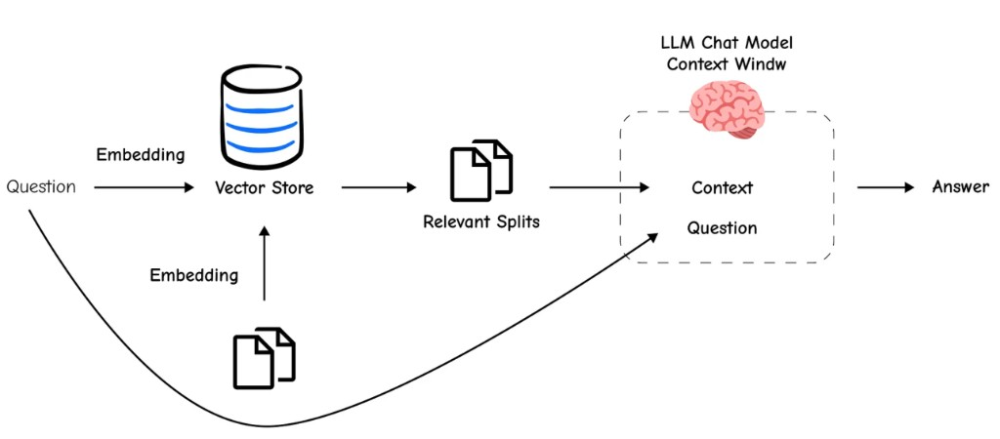

Джерело: [Building the entire RAG ecosystem and optimizing every component](https://levelup.gitconnected.com/building-the-entire-rag-ecosystem-and-optimizing-every-component-8f23349b96a4)

### 1.5. Що ви щойно реалізували

- Повноцінний мінімальний RAG pipeline.
- Розділення знань на retrieval і generation.
- Повторювану структуру, на яку далі накладаються advanced-техніки.

---

<a id="part-2"></a>

## Частина 2. Ембединги і метрики схожості

### 2.1. Що таке ембединг

Ембединг - це числове представлення тексту у вигляді вектора фіксованої розмірності. Для RAG це основа семантичного пошуку:

- запит користувача -> вектор;
- фрагменти документів -> вектори;
- пошук близьких векторів -> пошук близького змісту.

Embedding-модель у RAG використовується і для документів, і для запиту користувача. Ці дві операції відбуваються на різних етапах.

#### Індексація: заздалегідь

1. Завантажуємо документи.
2. Розбиваємо їх на фрагменти (chunks).
3. Передаємо кожен фрагмент в embedding-модель.
4. Отримуємо числові вектори.
5. Зберігаємо вектори разом із текстом і метаданими у векторному сховищі.

#### Пошук: коли надходить запит

1. Користувач ставить запитання.
2. Та сама embedding-модель перетворює запит на вектор.
3. Векторна БД порівнює вектор запиту зі збереженими векторами документів.
4. Повертає найбільш релевантні фрагменти.
5. LLM отримує ці фрагменти і генерує відповідь.

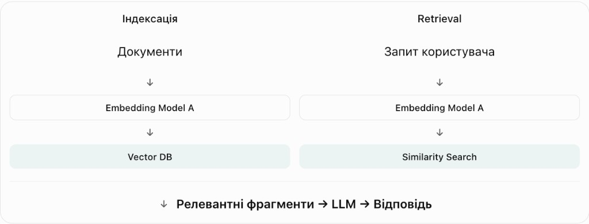

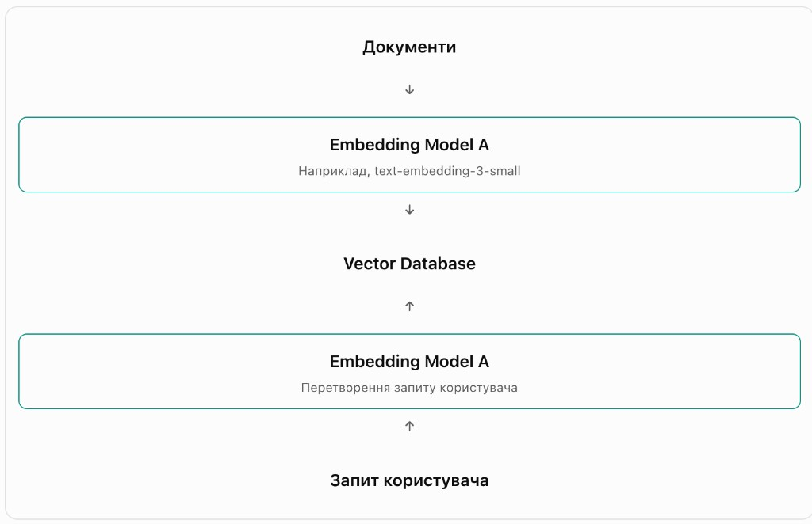

Документи не потрібно заново ембедити на кожен запит. Їхні вектори вже лежать у векторній БД. Новий ембединг створюється лише для запиту користувача.

#### Важливий нюанс

Зазвичай індексація і запит проходять через одну й ту саму embedding-модель. Інакше координати векторів опиняються в різних просторах, і порівняння схожості стає некоректним.

Деякі спеціалізовані моделі мають різні режими кодування для запитів і документів, наприклад `query` і `passage`. Це все ще одна модель і один простір, але з різним префіксом або інструкцією на вході.

Якщо в системі кілька типів джерел, запит можна спочатку направити в відповідний індекс: текст, код або PDF. Кожен індекс має власну embedding-модель, після чого результати зводяться і переранжовуються.

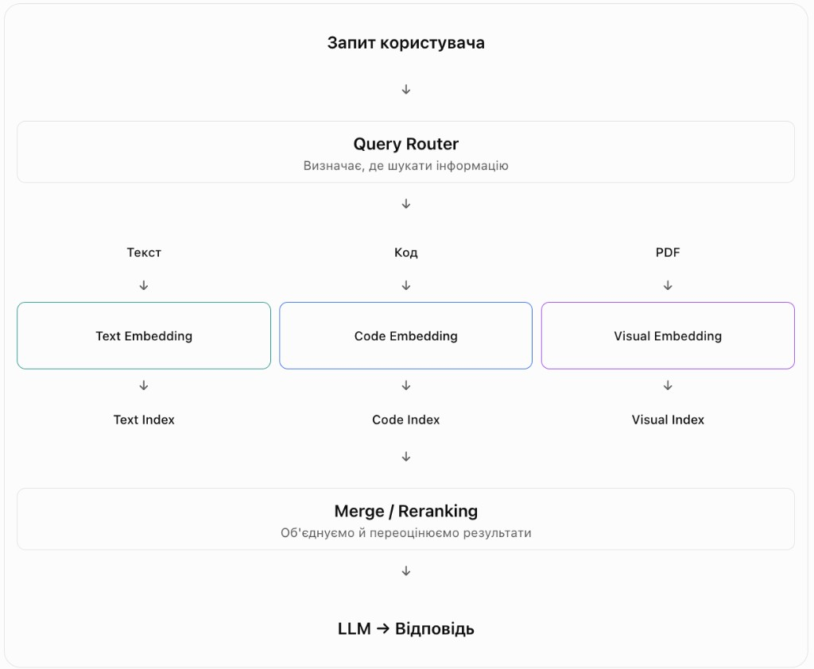

### 2.2. Інтуїція простору ембедингів

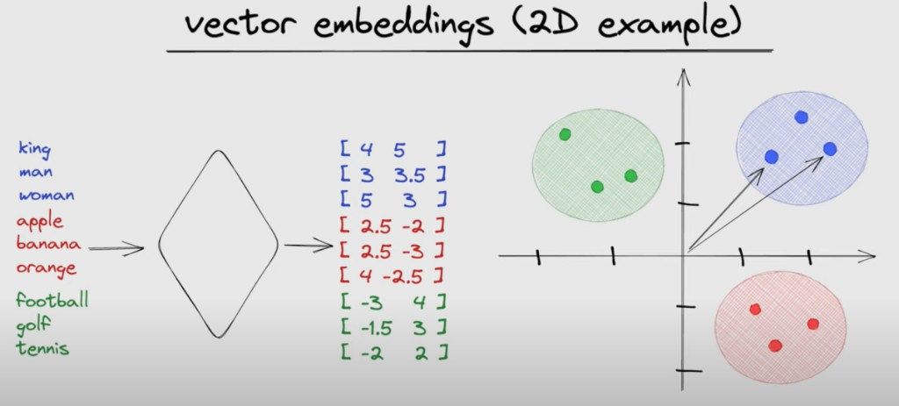

Джерело: [Vector Embedding (CauseWriter)](https://causewriter.ai/courses/ai-explainers/lessons/vector-embedding/)

- Кожна точка - слово/фраза/документ.
- Семантично близькі об'єкти групуються поруч.
- Реальні моделі працюють не у 2D, а у 100+ вимірах (часто 384, 768, 1024, 1536, 3072).

### 2.3. Напрямок і довжина вектора

- **Напрямок** вектора часто є ключовим для семантичної схожості.
- **Норма (довжина)** теж може бути інформативною, але її інтерпретація залежить від конкретної моделі, даних і процедури навчання.

Через це вибір метрики критично важливий: одні метрики ігнорують норму, інші - враховують.

#### Приклад: однаковий напрямок, різна довжина

Візьмемо два вектори:

\[
A=[3,4],\qquad B=[6,8]
\]

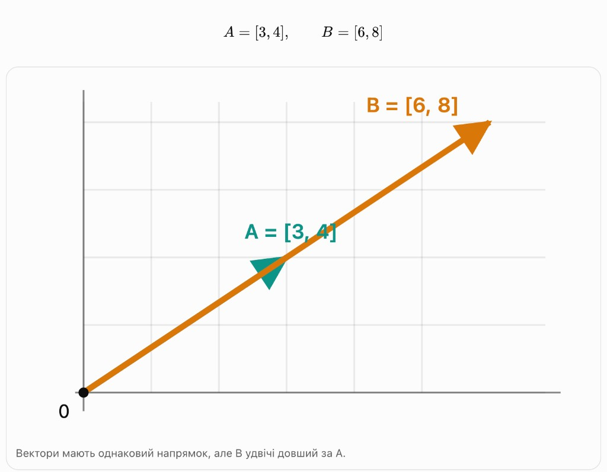

\[
\|A\|_2=\sqrt{3^2+4^2}=5
\]

\[
\|B\|_2=\sqrt{6^2+8^2}=10
\]

Висновки:

- напрямок у `A` та `B` однаковий;
- довжина різна (`5` і `10`);
- cosine similarity між ними дорівнює `1`.

Для RAG це означає:

- якщо пошук працює за **cosine similarity**, система порівнює переважно напрямки;
- якщо використовується **dot product** без нормалізації, довжина також впливає на ранг.

### Додаткове пояснення: розмірність ембедингів і значення координат

Тут важливо розділити два різні питання:

1. Чому ембединг має саме 96, 384, 768, 1536 чи 3072 вимірів?
2. Що означає кожен вимір і як набір чисел може представляти значення слова або речення?

#### 1) Що означає кількість вимірів `n`

У математиці вектор - це впорядкований набір чисел.

У 2D:

\[
v = [0.8,\ 0.3]
\]

У 3D:

\[
v = [0.8,\ 0.3,\ 0.9]
\]

Для `1536` вимірів:

\[
v = [0.12,\ -0.45,\ 0.87,\ldots,\ 0.31]
\]

Тобто це просто вектор у 1536-вимірному просторі. Ми не можемо його "намалювати" інтуїтивно, але можемо коректно рахувати:

- косинусну схожість;
- скалярний добуток;
- відстані (L1, L2 тощо).

#### Звідки беруться числа 96-3072

Це не математична константа і не обов'язковий стандарт.  
Розмірність задається архітектурою embedding-моделі, яку обирає розробник моделі.

| Модель | Кількість вимірів |
| --- | --- |
| `all-MiniLM-L6-v2` | 384 |
| `all-mpnet-base-v2` | 768 |
| `text-embedding-3-small` | 1536 (типово) |
| `text-embedding-3-large` | 3072 (типово) |

У частині API (зокрема сучасних OpenAI embedding-моделей) вихідну розмірність також можна зменшувати параметром `dimensions`.

Отже, діапазон 96-3072 у конспекті - це практичний орієнтир для популярних моделей, а не універсальне правило.

#### Чому не завжди брати найбільшу розмірність

Більша розмірність = не завжди кращий результат. Є компроміси:

- більше пам'яті під вектори;
- вищі витрати на ANN-індекси;
- дорожче/повільніше обчислення;
- не гарантовано кращий retrieval на вашому датасеті.

Орієнтир для 1 млн векторів у `float32` (тільки "сирі" вектори, без індексів і метаданих):

| Розмірність | Пам'ять для векторів |
| --- | --- |
| 384 | ~1.54 GB |
| 1536 | ~6.14 GB |
| 3072 | ~12.29 GB |

#### 2) Що означає фраза "кожен вимір кодує аспект значення"

У навчальних прикладах часто беруть штучні осі, наприклад:

- X = "розмір";
- Y = "свійськість";
- Z = "хижість".

Тоді можна вручну задати:

\[
\text{Кіт} = [0.2,\ 0.9,\ 0.7]
\]

\[
\text{Тигр} = [0.9,\ 0.1,\ 1.0]
\]

Це корисна інтуїція, але **реальні embedding-моделі так не працюють**. Їм ніхто явно не задає: "координата №1 = розмір". Модель сама вивчає представлення під час оптимізації loss-функції.

Тому вектор вигляду

\[
\text{Кіт} = [-0.183,\ 0.741,\ -0.092,\ldots]
\]

не має простої людської інтерпретації по кожній окремій координаті. Семантика зазвичай **розподілена** між багатьма вимірами.

#### 3) Як тоді модель визначає схожість

Модель не повинна "пояснювати" кожну координату. Її завдання - розмістити схожі тексти близько в просторі.

Наприклад:

- Query: `How can I break down a complex task?`
- Passage: `Task decomposition involves dividing a complex problem into smaller subtasks.`

Попри різні слова, вектори можуть бути близькими.

Часто використовується косинусна схожість:

\[
\operatorname{sim}(A,B) = \frac{A \cdot B}{\|A\| \|B\|}
\]

Ближче до `1` -> вектори більш співнапрямлені, і для цієї embedding-моделі це зазвичай означає вищу семантичну подібність.

#### 4) Практичний висновок для RAG

- Розмірність ембединга - це кількість чисел у векторі, а не "рівень інтелекту" моделі.
- Окремі координати зазвичай не мають простої інтерпретації.
- Сенс кодується у взаємному розташуванні векторів.
- Для retrieval треба векторизувати запит і документи **сумісною моделлю** (найчастіше тією самою), інакше порівняння може бути некоректним.
- Навіть висока cosine similarity не гарантує фактичної правильності відповіді - саме тому потрібен RAG evaluation (Recall@K, MRR, faithfulness, answer relevance).

### 2.3.1. Важливе уточнення про норму в Word2Vec і BERT

Твердження "більша норма = більше значущості/впевненості" не є універсальним правилом.

#### Word2Vec

Для частини корпусів і тренувань спостерігається зв'язок між нормою вектора і частотою слова, але він може бути **немонотонним**: на високих частотах поведінка норми може змінюватися.

Практичний висновок: фразу "що частіше слово, то більша норма" не варто використовувати як загальне правило.

#### BERT та інші контекстуальні моделі

Норма контекстуального embedding-представлення залежить від багатьох чинників:

- конкретного контексту;
- шару моделі;
- цілі навчання і токенізації;
- регуляризації та інших деталей тренування.

Тому інтерпретувати норму як "впевненість BERT" без окремої валідації некоректно.

Для оцінювання впевненості в прикладних задачах зазвичай аналізують вихідні ймовірності/логіти, калібрування моделі та task-specific метрики, а не лише норму прихованого вектора.

#### Практичне правило для RAG-інженерії

- Норма ембединга - це математична властивість вектора.
- Її не слід автоматично трактувати як важливість, якість або впевненість.
- Якщо вектори нормалізовані до одиничної довжини, норма дорівнює `1` і перестає бути окремою ознакою ранжування.

### 2.4. Метрики подібності/відстані

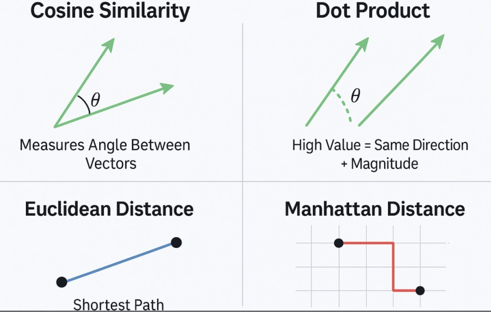

Джерело: [Distance Metrics in Vector Stores (LinkedIn)](https://www.linkedin.com/pulse/distance-metrics-similarity-indexes-vector-stores-venkatesh-madala-um6oc)

#### 1) Cosine similarity

- Міра кута між векторами.
- Діапазон: `[-1, 1]`.
- Інваріантна до масштабу вектора.
- Часто найкращий дефолт для семантичного пошуку.

#### 2) Dot product

- Враховує і напрямок, і довжину.
- Добрий варіант, якщо модель навчалась під dot-product ціль.
- Часто використовується у retrieval/attention-пайплайнах.

#### 3) Euclidean distance (L2)

- Геометрична відстань між точками.
- Чутлива до масштабу.
- Корисна, коли абсолютні відхилення мають сенс.

#### 4) Manhattan distance (L1)

- Сума абсолютних різниць по координатах.
- Часто стійкіша до "сплесків" в окремих вимірах.

### 2.4.1. Детальний приклад чотирьох метрик на одних векторах

Розглянемо 4 метрики, які найчастіше використовують для порівняння ембедингів у RAG та інших ML-системах:

1. Cosine similarity (косинусна схожість)
2. Euclidean distance (L2, евклідова відстань)
3. Dot product (скалярний добуток)
4. Manhattan distance (L1, мангеттенська відстань)

Для всіх прикладів беремо:

\[
A=[3,4], \qquad B=[6,2]
\]

#### Cosine similarity

Вимірює, наскільки подібні **напрямки** векторів, ігноруючи масштаб після нормалізації.

\[
\cos(\theta)=\frac{A \cdot B}{\|A\|_2 \|B\|_2}
\]

де:

- \(A\cdot B\) — скалярний добуток;
- \(\|A\|_2\), \(\|B\|_2\) — евклідові норми.

Обчислення:

\[
A\cdot B = 3\cdot6 + 4\cdot2 = 26
\]

\[
\|A\|_2=\sqrt{3^2+4^2}=5
\]

\[
\|B\|_2=\sqrt{6^2+2^2}=\sqrt{40}
\]

\[
\cos(\theta)=\frac{26}{5\sqrt{40}}\approx0.822
\]

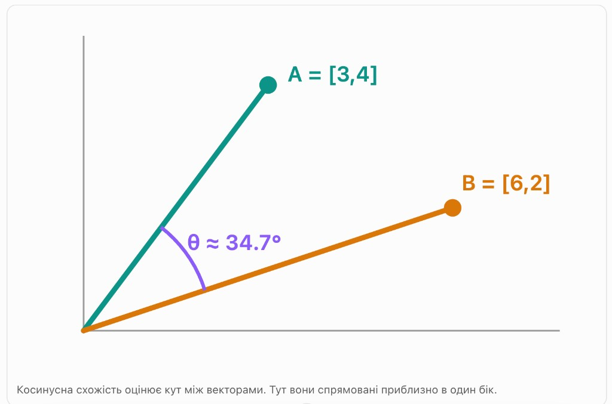

Інтерпретація: значення `0.822` означає, що вектори спрямовані приблизно в один бік.

#### Euclidean distance (L2)

Найкоротша "пряма" відстань між точками:

\[
d(A,B)=\sqrt{\sum_{i=1}^{n}(A_i-B_i)^2}
\]

Для 2D:

\[
d(A,B)=\sqrt{(A_1-B_1)^2+(A_2-B_2)^2}
\]

Обчислення:

\[
d(A,B)=\sqrt{(3-6)^2+(4-2)^2}
=\sqrt{9+4}
=\sqrt{13}
\approx3.606
\]

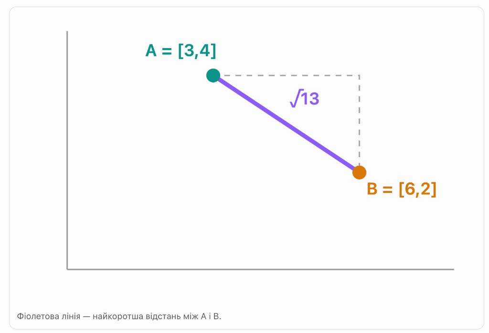

#### Dot product

Арифметична форма:

\[
A\cdot B=\sum_{i=1}^{n}A_iB_i
\]

Геометрична форма:

\[
A\cdot B=\|A\|_2\|B\|_2\cos(\theta)
\]

Обчислення:

\[
A\cdot B=3\cdot6+4\cdot2=18+8=26
\]

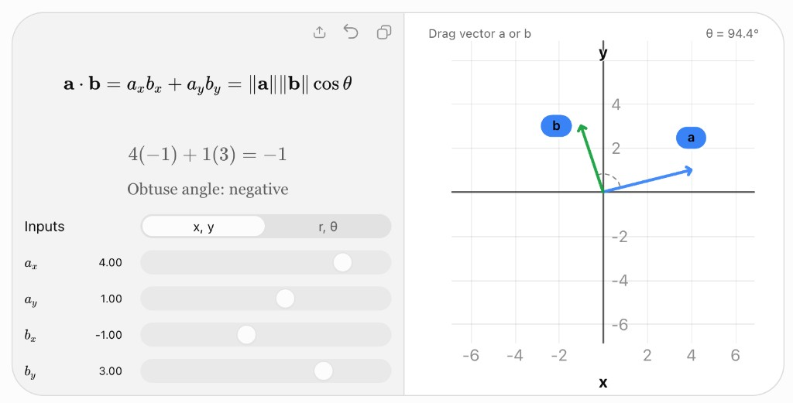

Додатковий приклад з ілюстрації: коли кут тупий, dot product стає від'ємним (наприклад, \(4(-1)+1(3)=-1\)).

#### Manhattan distance (L1)

Сума абсолютних різниць координат:

\[
d(A,B)=\sum_{i=1}^{n}|A_i-B_i|
\]

Обчислення:

\[
d(A,B)=|3-6|+|4-2|=3+2=5
\]

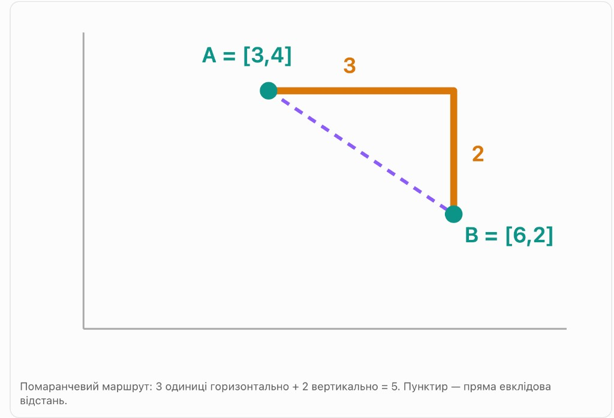

#### Порівняння результатів

| Метрика | Результат для A і B | Інтерпретація |
| --- | --- | --- |
| Cosine similarity | 0.822 | Більше -> більш схожий напрямок |
| Euclidean distance | 3.606 | Менше -> точки ближчі |
| Dot product | 26 | Більше -> вища оцінка за dot product |
| Manhattan distance | 5 | Менше -> менша L1-відстань |

#### Важливо для RAG

Якщо ембединги нормалізовано до одиничної довжини (\(\|A\|=\|B\|=1\)):

\[
A\cdot B=\cos(\theta)
\]

а також:

\[
\|A-B\|_2^2=2-2\cos(\theta)
\]

Тому для нормалізованих векторів cosine, dot product і L2 дають однаковий порядок ранжування (для того самого набору кандидатів).

Практичне правило: орієнтуватися на рекомендовану метрику embedding-моделі і перевіряти якість на власних retrieval-тестах (Recall@K, MRR, faithfulness, answer relevance).

### 2.5. Критичні зауваження про cosine

- Cosine дуже корисна, але не універсальна "істина семантики".
- Результат залежить від простору, у якому навчена модель ембедингів.
- У практиці антоніми не обов'язково будуть "протилежними" векторами.

Дискусія про обмеження cosine: [Steck et al., arXiv:2403.05440](https://arxiv.org/abs/2403.05440).

### 2.6. Статичні vs контекстуальні ембединги

**Статичні ембединги (static embeddings)** - це числові представлення слів, у яких кожне слово має один фіксований вектор незалежно від контексту, в якому воно використовується.

#### 1) Як це працює

Уявімо слово «замок», яке має два значення:

- «Середньовічний замок» - архітектурна споруда.
- «Дверний замок» - механізм для замикання дверей.

У статичних моделях, таких як Word2Vec та GloVe, слово «замок» отримує один і той самий вектор в обох реченнях.

```text
«Середньовічний замок»          «Дверний замок»
замок = будівля                 замок = механізм
            \                         /
             \                       /
              v                     v
        [0.23, -0.51, 0.87, 0.14, ...]
        один і той самий вектор для обох значень
```

Числа умовні, це ілюстрація, а не реальний вектор моделі.

#### 2) Чому це називається «статичний»

Після навчання embedding-моделі вектор слова залишається незмінним під час використання, незалежно від навколишніх слів.

Word2Vec і GloVe навчаються на контекстах слів у великому корпусі текстів. Контекст враховується **під час навчання**, але не змінює вектор конкретного слова **під час застосування** моделі.

#### 3) Що означає «вектор знаходиться між двома значеннями»

Якщо слово часто зустрічається і в архітектурних, і в механічних контекстах, модель отримує навчальні сигнали від обох значень.

У результаті один вектор може містити змішану інформацію про обидва значення. Це не буквальне арифметичне усереднення двох готових векторів, а наслідок процесу навчання.

#### 4) Чим відрізняються контекстуальні ембединги

Сучасні моделі, наприклад BERT, створюють різні представлення слова залежно від його контексту. Кожен токен «дивиться» на інші токени речення через self-attention, тому вектор слова обчислюється як функція всього речення.

| | Статичні | Контекстуальні |
| --- | --- | --- |
| Моделі | Word2Vec, GloVe | BERT, RoBERTa |
| «Середньовічний замок» | Вектор A | Вектор A |
| «Дверний замок» | Той самий вектор A | Інший вектор B |
| Врахування контексту під час застосування | Ні | Так |
| Багатозначність | Обмежене розрізнення | Краще розрізнення |

Для RAG контекстуальні представлення можуть краще передавати значення багатозначних слів. Якість пошуку все одно залежить також від навчання embedding-моделі, chunking і обраної метрики схожості.

### 2.7. Каталог популярних embedding-моделей

Каталог нижче фіксує стан на 2026 рік. Старіші моделі залишені там, де вони ще корисні як історичний контекст або baseline, але не як перша рекомендація для нового проєкту.

#### OpenAI

Основні моделі в документації OpenAI: [Embeddings](https://developers.openai.com/api/docs/guides/embeddings).

| Модель | Статус | Розмірність | Коментар |
| --- | --- | --- | --- |
| `text-embedding-3-large` | Актуальна | 3072 за замовчуванням | Найякісніша з цієї пари; кількість вимірів можна скорочувати |
| `text-embedding-3-small` | Актуальна | 1536 за замовчуванням | Дешевша і швидша; кількість вимірів також можна скорочувати |
| `text-embedding-ada-002` | Застаріле покоління | 1536 | Лише для історичного контексту і вже наявних індексів |

Обидві моделі серії `text-embedding-3` підтримують параметр `dimensions`: вихідний вектор можна вкоротити. Це компроміс між пам'яттю і якістю, а не стиснення без втрат.

#### Voyage AI

Покоління Voyage 3 у лекції вже застаріло як основна рекомендація. Виробник рекомендує переходити на четверте покоління. Документація: [docs.voyageai.com](https://docs.voyageai.com).

| Модель | Призначення |
| --- | --- |
| `voyage-4-large` | Найвища якість універсального retrieval |
| `voyage-4` | Баланс якості та вартості |
| `voyage-4-lite` | Швидкість і нижча вартість |
| `voyage-code-4` | Пошук у програмному коді |
| `voyage-4-nano` | Open-weight модель |

`voyage-3`, `voyage-3-large` і `voyage-3.5` ще доступні, але для нових індексів орієнтир - Voyage 4.

Важливе виправлення: твердження, що вектори Voyage можна «стискати без втрати якості», некоректне. Voyage підтримує скорочення розмірності та квантизацію (наприклад, `int8` і `binary`). Ці операції зменшують обсяг даних, але можуть знижувати точність пошуку.

#### Jina AI

У 2026 році актуальне п'яте покоління. Джерело: [jina.ai](https://jina.ai).

| Модель | Призначення |
| --- | --- |
| `jina-embeddings-v5-text-small` | Багатомовний текстовий retrieval, до 32K токенів |
| `jina-embeddings-v5-text-nano` | Компактна текстова модель, до 8K токенів |
| `jina-embeddings-v5-omni-small` | Текст, зображення, аудіо, відео та PDF |
| `jina-embeddings-v5-omni-nano` | Компактна мультимодальна модель |
| `jina-embeddings-v4` | Попереднє покоління, також мультимодальне |
| `jina-embeddings-v3` | Старіше текстове покоління |

`jina-embeddings-v5-text` представлено в лютому 2026 року, `jina-embeddings-v5-omni` - у травні 2026 року.

Формулювання «Jina embeddings v3 розроблена для багатьох мов» залишається правильним описом цієї моделі. Як рекомендація сучасної моделі для нового RAG воно вже застаріло: для багатомовного текстового retrieval орієнтир - `jina-embeddings-v5-text-small`.

#### Cohere

Розділ про Embed v3 треба читати як попереднє покоління. 30 вересня 2026 року Cohere представила Embed 5. Документація: [docs.cohere.com](https://docs.cohere.com).

| Модель | Статус |
| --- | --- |
| `embed-v5.0-pro` | Нове покоління, акцент на якості |
| `embed-v5.0-fast` | Нове покоління, акцент на швидкості |
| `embed-v4.0` | Попередня мультимодальна модель |
| `embed-english-v3.0` | Старіша, ще доступна |
| `embed-multilingual-v3.0` | Старіша, ще доступна |

Обидві моделі v5 працюють із текстом, зображеннями та комбінованими документами, мають контекст до 128K токенів і налаштовувану розмірність до 2048.

`embed-v5.0-pro` і `embed-v5.0-fast` використовують спільний простір ембедингів. Документи можна індексувати моделлю Pro, а запити обробляти моделлю Fast.

#### Open-source

Старіші open-source моделі варто залишити: вони корисні для навчання і як baseline, з яким порівнюють нові покоління.

| Модель | Оцінка на 2026 рік |
| --- | --- |
| `BAAI/bge-m3` | Залишити. Особливо корисна для hybrid retrieval |
| `sentence-transformers/all-MiniLM-L6-v2` | Залишити. Проста компактна модель для навчання (384 виміри) |
| `intfloat/e5-large-v2` | Залишити як baseline. Це не найновіша модель сімейства |
| GTE-large | Уточнювати конкретну версію і порівнювати з новішими GTE, включно з `GTE-ModernColBERT-v1` |

`BGE-M3` підтримує три режими: dense, sparse і multi-vector retrieval. Модель працює з понад 100 мовами і текстами до 8192 токенів. Картка моделі: [BAAI/bge-m3 на Hugging Face](https://huggingface.co/BAAI/bge-m3).

Порівняння нового покоління зі старими baseline на одному тестовому наборі - корисний навчальний експеримент, а не привід видаляти старі моделі з конспекту.

#### Що брати для практики RAG у 2026 році

Не потрібно однаково глибоко вивчати десятки моделей. Корисніше побачити різницю між архітектурами на одному датасеті.

| Напрямок | Модель для практики |
| --- | --- |
| Простий dense retrieval | `all-MiniLM-L6-v2` |
| Комерційний API retrieval | `text-embedding-3-small` |
| Сучасний multilingual retrieval | `jina-embeddings-v5-text-small` |
| Hybrid retrieval | `BGE-M3` |
| Multi-vector / late interaction | ColBERT v2 |
| Sparse retrieval | SPLADE-v3 |
| Multimodal PDF retrieval | `jina-embeddings-v5-omni-small` або ColPali |

Це навчальна добірка різних підходів, а не рейтинг найточніших моделей.

Для evaluation порівнюйте dense, sparse, hybrid і multi-vector retrieval на одному тестовому наборі. Базові метрики: Recall@K, MRR, nDCG@K, а для генерації - faithfulness і answer relevance.

### 2.8. Спеціалізовані embedding-підходи

| Модель | Навіщо залишити в конспекті |
| --- | --- |
| ColBERT v2 | Щоб зрозуміти late interaction і багатовекторний пошук |
| SPLADE-v3 | Щоб зрозуміти neural sparse retrieval |
| ColPali | Щоб зрозуміти visual document retrieval |
| CLIP | Фундаментальна модель зв'язку тексту і зображення |
| `GTE-ModernColBERT-v1` | Сучасніший open-source приклад multi-vector підходу |
| Jina v4 / v5-omni | Мультимодальний пошук, включно з PDF як зображенням сторінки |

Два уточнення до початкового формулювання лекції:

- **ColBERT v2** - це не модель «для довгих документів». Головна особливість - окремий контекстний вектор на токен і late interaction: запит і документ зіставляються на рівні токенів, а не одним усередненим вектором чанка.
- **SPLADE-v3** створює розріджені вектори, зручні для інвертованих індексів. Це не означає, що така модель завжди займає менше пам'яті, ніж будь-яка dense-модель. Фактичний обсяг залежить від реалізації, кількості ненульових координат і способу зберігання індексу.

---

<a id="part-3"></a>

## Частина 3. Векторні бази даних

Векторна БД оптимізована для nearest-neighbor пошуку у високій розмірності, де традиційні SQL-індекси неефективні.

### 3.1. Що вона дає в RAG

- швидкий пошук семантично близьких фрагментів;
- масштабування до мільйонів/мільярдів векторів;
- фільтри за метаданими (дата, автор, тег, мова, доступ);
- наближений пошук (ANN) з високою швидкістю.

### 3.2. Типові індекси

HNSW і IVF - це алгоритми індексації для швидкого пошуку найближчих векторів (Approximate Nearest Neighbor Search, ANN).

#### HNSW (Hierarchical Navigable Small World)

Українською: ієрархічний навігаційний граф малого світу.

- **Hierarchical** - граф має кілька рівнів.
- **Navigable** - пошук переходить між вузлами в бік найближчих векторів.
- **Small World** - між багатьма вузлами є короткі шляхи.

Вектори організовані в багаторівневий граф. Пошук починається на верхньому рівні, де можна швидко переміщатися великими відстанями, і спускається на нижчі рівні для точнішого пошуку.

Аналогія: спочатку знаходиш потрібний район міста, потім вулицю, а потім будинок.

#### IVF (Inverted File Index)

Українською: інвертований файловий індекс.

- **Inverted** - зворотне відображення від кластера до векторів, які в нього входять.
- **File** - історична частина назви, від способу організації індексів.
- **Index** - структура, яка прискорює пошук.

Вектори заздалегідь розподіляються на кластери. Для нового запиту система визначає найближчі кластери і шукає переважно всередині них, а не по всій базі.

Аналогія: у бібліотеці спочатку знаходиш секцію «Машинне навчання», а вже потім шукаєш книжки всередині неї.

#### Основна різниця

| | HNSW | IVF |
| --- | --- | --- |
| Структура | Багаторівневий граф | Кластери |
| Принцип пошуку | Переходи між сусідніми вузлами | Пошук у вибраних кластерах |
| Пам'ять | Зазвичай більші накладні витрати | Часто економніший |
| Точність | Висока за належного налаштування | Залежить від кількості кластерів, які перевіряються |

Обидва алгоритми прискорюють пошук, але можуть пропустити справді найближчий вектор: це приблизний пошук, а не гарантовано точний перебір усієї бази.

**PQ і scalar quantization** - окремий прийом стиснення векторів. Він зменшує пам'ять, іноді ціною невеликої втрати точності, і може поєднуватися з HNSW або IVF.

### 3.3. Ландшафт векторних БД

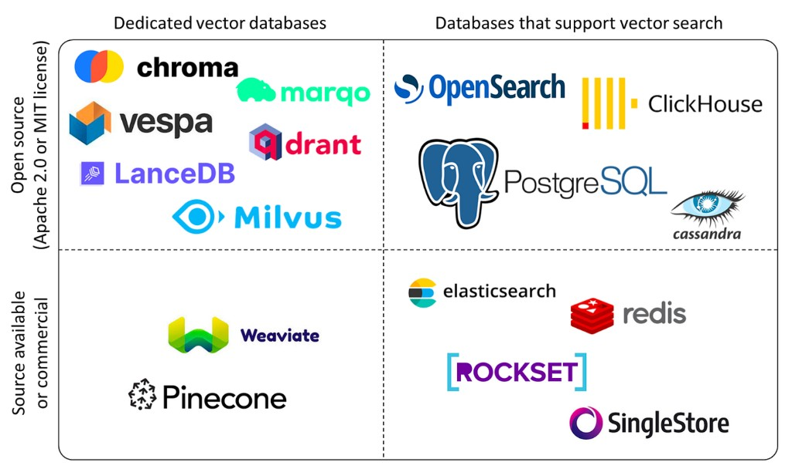

Джерело: [Improving - Enterprise AI, Data & Application Services](https://www.improving.com/)

### 3.4. Каталог систем і коли яку обирати

#### Milvus

- Open-source, сильний у very-large-scale.
- Підходить для великих продакшенів із мільярдами векторів.
- Ціна складності: потрібні інфраструктурні компетенції.

#### Qdrant

- Rust-реалізація, потужні фільтри.
- Простий DX, якісні SDK.
- Добрий вибір для RAG із фільтрами та гнучкими payload-умовами.

#### Weaviate

- Гібридний пошук (BM25 + вектори), гнучкі API.
- Параметр `alpha` керує балансом keyword/semantic.
- Добре підходить для mixed-search сценаріїв.

#### Pinecone

- Managed cloud-first сервіс.
- Мінімум DevOps-операцій.
- Є Pinecone Local для локальної розробки/тестів, але основна цінність - managed-модель.

#### Chroma

- Легка "SQLite-подібна" точка входу для RAG-проєктів.
- Дуже зручна для навчання, PoC, внутрішніх прототипів.

#### pgvector

- Розширення PostgreSQL.
- Зручно, якщо вже є Postgres-ландшафт і потрібен єдиний storage.
- Проста інтеграція SQL + vector-умов.

#### Vespa

- Пошукова платформа промислового класу.
- Сильна багатофакторна логіка ранжування.
- Для систем із серйозними вимогами до relevance tuning.

#### Elasticsearch (vector search)

- Природно, якщо організація вже на Elastic-stack.
- Гібридний пошук, фільтрація, аналітика, лог-екосистема в одному місці.

#### LanceDB

- Файлоорієнтована модель, зручна для локальних/embedded use-cases.
- Версіонування і ефективна робота з колонковим форматом.

#### FAISS

- Бібліотека (не повноцінна БД), зате максимальний контроль і швидкість.
- Часто використовується як engine усередині інших систем.

### 3.5. Коротка матриця вибору

- **Швидко стартувати:** Chroma, Qdrant Cloud free tier.
- **Без DevOps:** Pinecone.
- **Є mature Postgres:** pgvector.
- **Є mature Elastic:** Elasticsearch vector search.
- **Найвищий контроль ANN:** FAISS/Milvus.
- **Гібридний пошук "з коробки":** Weaviate, Elasticsearch.

---

<a id="part-4"></a>

## Частина 4. Просунуті трансформації запитів

Query transformation - це етап, на якому система змінює оригінальний запит, щоб підвищити шанс знайти релевантні документи. Документи в базі можуть уже бути, але звичайний пошук їх не бачить, бо формулювання користувача не збігається з мовою корпусу.

Користувач питає: «Чому наш AI-асистент вигадує відповіді, хоча має доступ до документації?» У внутрішніх текстах при цьому стоять hallucinations, faithfulness, retrieval failures, context relevance, grounded generation. Проблема не обов'язково в embedding-моделі.

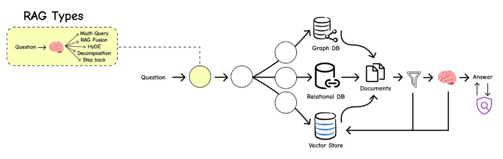

Джерело: [Building the entire RAG ecosystem and optimizing every component](https://levelup.gitconnected.com/building-the-entire-rag-ecosystem-and-optimizing-every-component-8f23349b96a4)

| Стратегія | Що змінюємо | Для чого |
| --- | --- | --- |
| Multi-Query | Один запит стає кількома переформулюваннями | Знайти документи з іншою термінологією |
| RAG-Fusion | Кілька списків зливаються в один рейтинг | Узгодити порядок знайдених документів |
| Decomposition | Складний запит ділиться на підпитання | Закрити кілька інформаційних потреб |
| Step-Back | Конкретний запит піднімається до загальнішого | Дістати принципи, яких немає в вузькому формулюванні |
| HyDE | Запит стає гіпотетичним документом | Шукати текст, схожий на можливу відповідь |

Ці стратегії можна комбінувати. Вони не замінюють якісну індексацію й embedding-модель.

### 4.1. Multi-Query Generation

Звичайний RAG шукає один раз:

\[
q \rightarrow \mathrm{Embedding}(q) \rightarrow \mathrm{Retrieval}
\]

Один запит не покриває різні формулювання тієї самої теми. Для «Як зменшити галюцинації RAG?» генератор може видати три пошукові варіанти: як підвищити faithfulness, як заземлювати відповіді LLM і як зменшити твердження без підтримки в контексті.

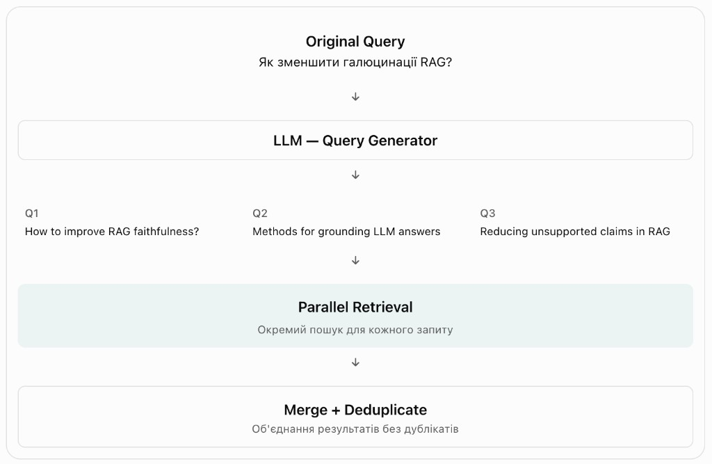

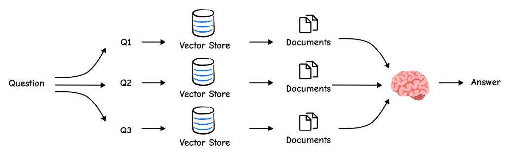

```python
from langchain_core.prompts import ChatPromptTemplate
from langchain_core.output_parsers import StrOutputParser

multi_query_prompt = ChatPromptTemplate.from_template(
    """You are an AI assistant.
Generate 5 diverse search queries for the user question.
Return one query per line.
Question: {question}"""
)

generate_queries = multi_query_prompt | llm | StrOutputParser() | (lambda x: x.split("\n"))
queries = [q.strip("- ").strip() for q in generate_queries.invoke({"question": question}) if q.strip()]
```

Щоб прибрати дублікати документів:

```python
from langchain_core.load import dumps, loads

def get_unique_union(documents: list[list]):
    flattened = [dumps(doc) for sublist in documents for doc in sublist]
    unique = list(set(flattened))
    return [loads(doc) for doc in unique]
```

Пошук іде окремо для кожного варіанта, потім результати зливаються. Дублікати треба знімати за стабільним id фрагмента, а не лише за текстом. Оригінальний запит теж варто лишати в наборі: переформулювання може загубити обмеження, яке було в питанні користувача.

Головний виграш - recall, частка релевантних документів, які вдалося знайти. Precision при цьому не обов'язково росте: разом із корисними фрагментами приходить більше шуму. Кількість пошукових операцій теж зростає.

Корисно, коли користувачі й документи називають одне й те саме різними словами.

### 4.2. RAG-Fusion (RRF)

Просте об'єднання списків Multi-Query не дає узгодженого рейтингу. Три запити можуть повернути документи в різному порядку:

| Позиція | Query 1 | Query 2 | Query 3 |
| --- | --- | --- | --- |
| 1 | A | B | A |
| 2 | B | A | C |
| 3 | C | D | B |

RAG-Fusion зводить ці списки через Reciprocal Rank Fusion. Оцінка залежить від позиції, а не від сирих similarity scores, тому можна змішувати dense search і BM25 з різними шкалами.

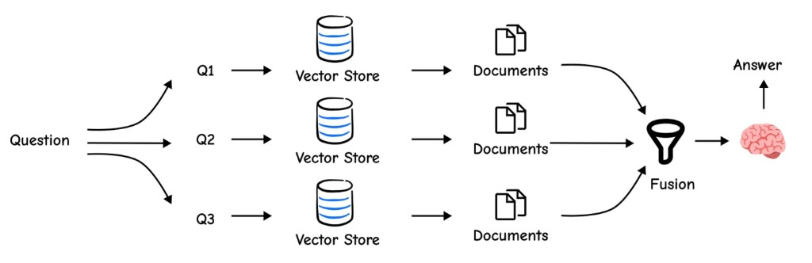

\[
\mathrm{RRF}(d) = \sum_{i=1}^{m} \frac{1}{k + r_i(d)}
\]

\(d\) - документ, \(m\) - кількість списків, \(r_i(d)\) - його позиція в списку \(i\) (перше місце має позицію 1), \(k\) - згладжування, часто 60. Якщо документа в списку немає, цей список нічого не додає.

A стоїть на місцях 1, 2 і 1:

\[
\mathrm{RRF}(A) = \frac{1}{61} + \frac{1}{62} + \frac{1}{61} \approx 0.0489
\]

B стоїть на місцях 2, 1 і 3:

\[
\mathrm{RRF}(B) = \frac{1}{62} + \frac{1}{61} + \frac{1}{63} \approx 0.0484
\]

A трохи вищий, але документ, який зустрівся в багатьох списках, не перемагає автоматично: вирішують і позиції, і \(k\). C у цьому прикладі отримує близько 0.0320, D - близько 0.0159.

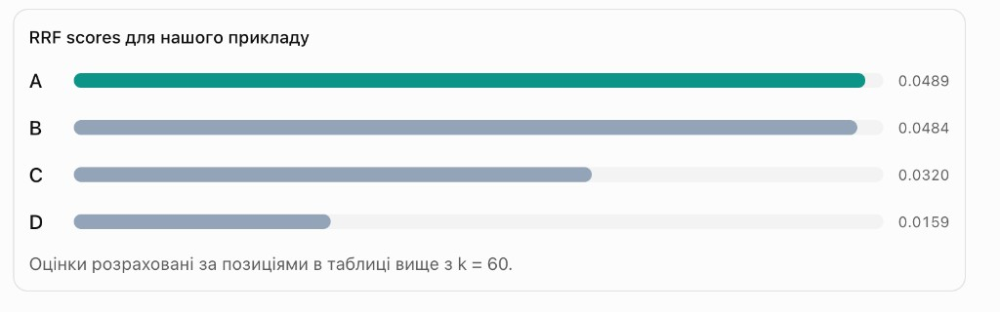

```python
def reciprocal_rank_fusion(results: list[list], k: int = 60):
    fused_scores = {}
    for docs in results:
        for rank, doc in enumerate(docs, start=1):
            doc_str = dumps(doc)
            fused_scores[doc_str] = fused_scores.get(doc_str, 0) + 1 / (k + rank)

    reranked = [
        (loads(doc), score)
        for doc, score in sorted(fused_scores.items(), key=lambda x: x[1], reverse=True)
    ]
    return reranked
```

RRF об'єднує вже готові рейтинги. Він не читає пару «запит - документ» заново, тому не замінює cross-encoder reranking.

### 4.3. Decomposition

Один embedding складного питання може зачепити лише одну з його частин. Запит «Які компоненти має LLM-агент, як вони взаємодіють і що відбувається, коли інструмент повертає помилку?» - це три інформаційні потреби: склад, взаємодія і обробка помилок інструмента.

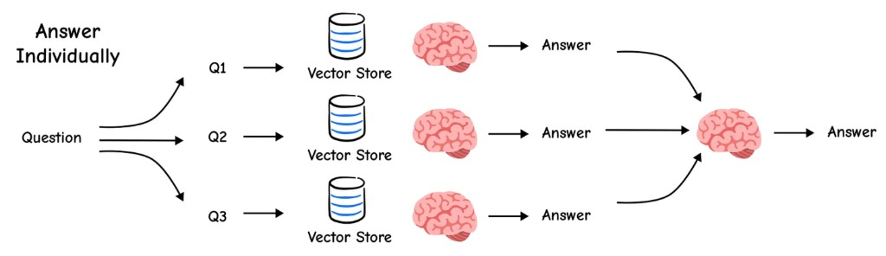

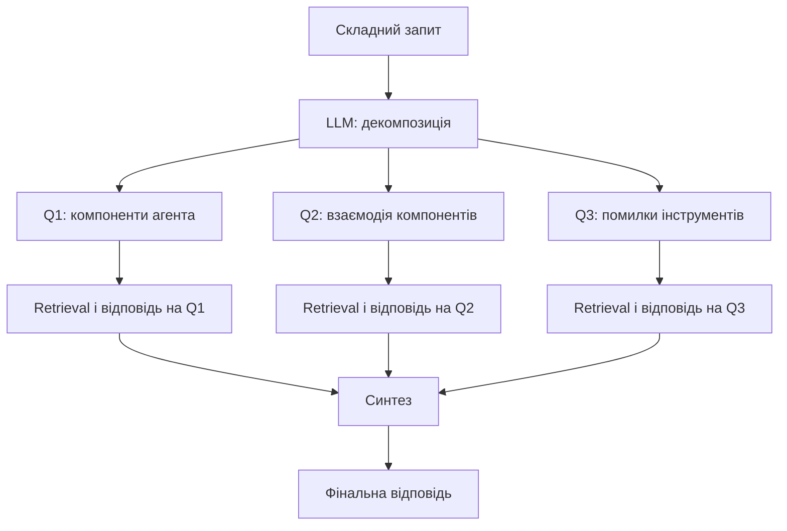

Паралельна декомпозиція підходить, коли підпитання незалежні. Послідовна потрібна, коли наступне залежить від попереднього. Запит «Яка компанія розробила Python і які ще мови вона створила?» спочатку має перевірити хибну передумову: Python створив Гвідо ван Россум, а не компанія. Система не повинна сліпо продовжувати з цього припущення.

```python
decomposition_prompt = """Break the following complex question into
2-4 simpler, self-contained subquestions.
Each subquestion should address one information need.
Preserve the original question's constraints.
Question: {question}"""
```

Після пошуку недостатньо просто склеїти документи. На кожне підпитання формується часткова відповідь, потім вони синтезуються в одну. Помилка на ранньому кроці може перейти у фінальний синтез, а кількість викликів LLM і retrieval зростає.

Корисно для multi-hop питань, порівнянь і задач із кількома залежними частинами.

### 4.4. Step-Back Prompting

Дуже вузький запит може не збігтися з жодним абзацом, хоча в документації є загальний принцип, з якого випливає відповідь. «Чому RAG-асистент використовує документацію API v1 замість v2?» конкретизує симптом. Step-back піднімає його до питання на кшталт «Як RAG-системи керують версіями документів і актуальністю retrieved context?».

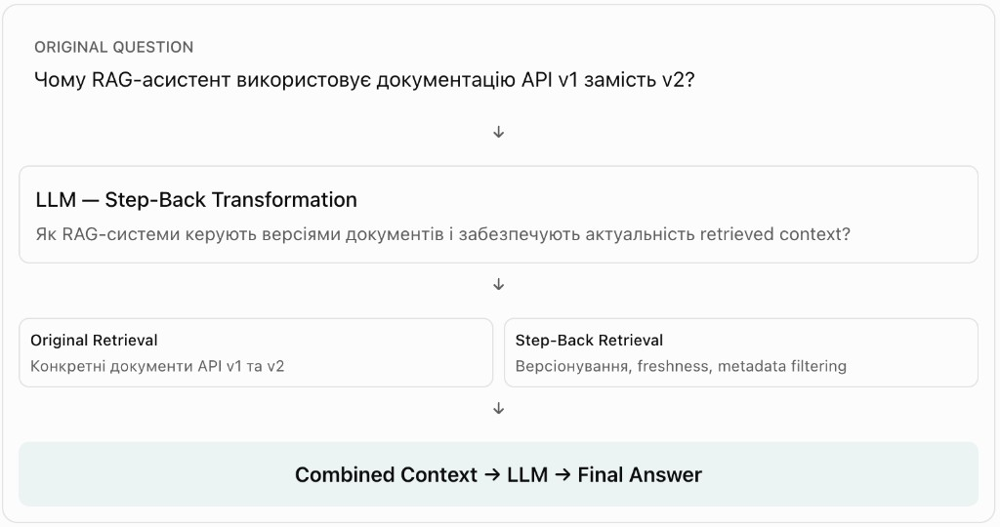

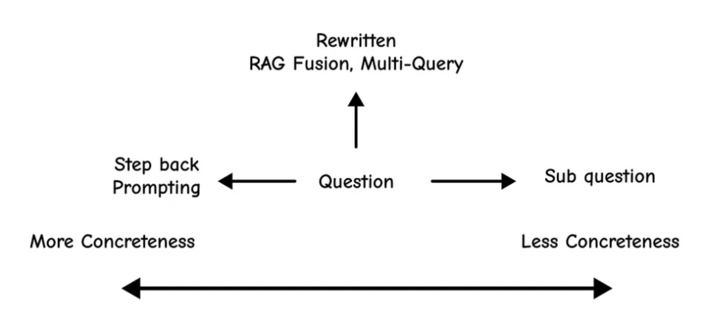

| | Запитання |
| --- | --- |
| Original | Чому RAG повертає застарілу версію API? |
| Decomposition | Яка версія потрібна? Які документи знайдено? Як налаштовані фільтри? |
| Step-Back | Які принципи забезпечують актуальність документів у RAG? |

Decomposition ріже питання на частини того самого рівня. Step-back змінює рівень абстракції. Retrieval треба робити і за оригіналом, і за загальним питанням: знання про metadata filtering не каже, які саме версії лежать у конкретній базі.

Корисно для troubleshooting і причинно-наслідкових пояснень, коли симптом вузький, а механізм описаний загально.

```python
step_back_prompt = ChatPromptTemplate.from_template(
    """Rewrite the user question into a broader, more general question
that helps gather foundational context.
Question: {question}"""
)

general_question = (step_back_prompt | llm | StrOutputParser()).invoke({"question": question})
```

### 4.5. HyDE (Hypothetical Document Embeddings)

LLM спочатку генерує гіпотетичну відповідь на основі самого запитання і знань, отриманих під час попереднього навчання (pretraining). Retrieval виконується вже за цим текстом, а не за коротким запитом.

На цьому етапі модель ще не бачить документів із векторної бази.

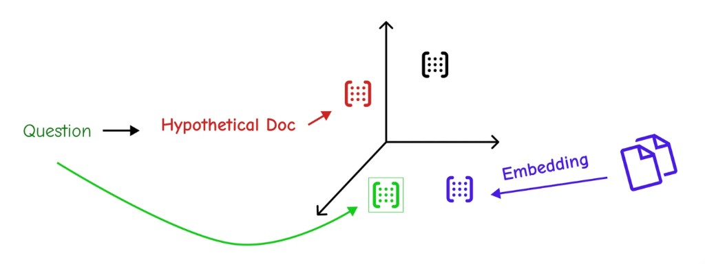

#### Приклад

У корпоративній базі є документація про RAG, а користувач запитує: «Як покращити якість пошуку в RAG?»

1. **Запит.** «Як покращити якість пошуку в RAG?»
2. **Гіпотетичний документ.** LLM пише правдоподібний пасаж зі своїх загальних знань, наприклад: «Якість retrieval у RAG можна покращити завдяки hybrid search, query expansion, reranking, оптимізації chunk size та вибору embedding-моделі».
3. **Ембединг.** Цей пасаж перетворюється на вектор, умовно `[0.21, -0.43, 0.78, ...]`.
4. **Пошук.** Векторна база шукає реальні документи, схожі на гіпотетичну відповідь.
5. **Фінальна відповідь.** LLM отримує знайдені документи і відповідає вже на їхній основі.

```python
hyde_prompt = ChatPromptTemplate.from_template(
    """Please write a detailed passage that answers the question.
Question: {question}
Passage:"""
)

generate_hypothetical_doc = hyde_prompt | llm | StrOutputParser()
hyp_doc = generate_hypothetical_doc.invoke({"question": question})
retrieved_hyde = retriever.invoke(hyp_doc)
```

#### Якщо гіпотеза неправильна

Гіпотетичний документ не є джерелом фактів. Його роль - створити вектор, за яким шукають справжні документи.

LLM може назвати неіснуючий алгоритм. Якщо решта тексту все одно містить релевантні поняття, пошук може знайти корисні фрагменти. Якщо ж гіпотеза семантично відхилиться від потрібної теми, retrieval погіршиться. HyDE цього не гарантує.

#### Чому це може бути краще за пошук за коротким запитом

Запит часто короткий: «Як оптимізувати retrieval?» Документація при цьому розгорнута і містить терміни на кшталт `HNSW`, `BM25`, `reranking`, `chunking`.

Гіпотетичний пасаж може містити ці терміни і лежати ближче до стилю документів, ніж саме питання. HyDE намагається зменшити розрив між формулюванням запиту і мовою корпусу.

У класичному HyDE порядок такий: спочатку LLM пише правдоподібний текст без retrieval, потім embedding-модель перетворює його на вектор, і лише після цього система шукає реальні документи. Гіпотетичний текст - інструмент пошуку, а не доказ правильності відповіді.

Той самий розрив словника видно на короткому питанні «Чому агент забуває інформацію між викликами?» і статті про persistent state та memory persistence. Гіпотетичний пасаж може згадати database-backed memory і structured state, навіть якщо користувач цих слів не вжив. Вектор такого пасажа часто ближчий до технічної статті, ніж вектор короткого питання.

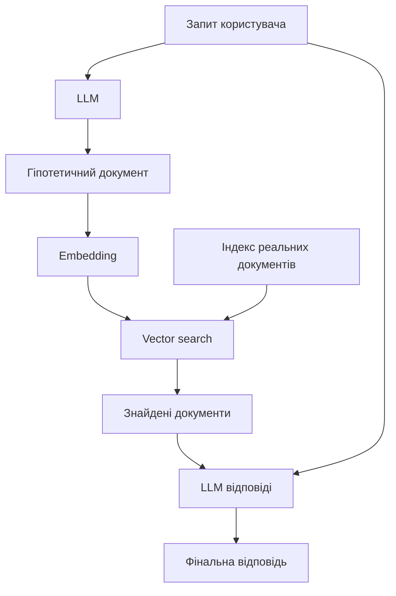

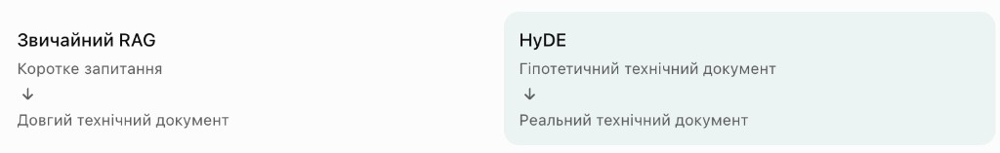

Довший текст не гарантує кращий ембединг. Якщо гіпотеза вигадає Redis, якого в системі немає, пошук поїде вбік. Такий текст не вважають джерелом і не підкладають у фінальний контекст як доказ.

Корисно, коли запити короткі, розмовні й далекі від термінології документів.

### 4.6. Як обрати трансформацію

| Стратегія | Трансформація | Перевага | Ризик |
| --- | --- | --- | --- |
| Multi-Query | 1 запит стає N варіантами | Вищий шанс знайти релевантне | Дрейф запиту і зайві результати |
| RAG-Fusion | N списків стають одним рейтингом | Узгоджене ранжування | Спільна помилка кількох запитів підсилюється |
| Decomposition | Складне питання стає підпитаннями | Multi-hop і кілька потреб | Накопичення помилок і вартість |
| Step-Back | Конкретне стає загальним | Фундаментальні принципи | Втрата специфіки |
| HyDE | Запит стає гіпотетичним документом | Менший розрив мови запиту і документів | Хибні припущення LLM |

| Проблема retrieval | З чого почати |
| --- | --- |
| Користувач і документація говорять різними термінами | Multi-Query |
| Кілька пошуків уже є, їх треба звести в один порядок | RAG-Fusion |
| У запиті кілька питань і кожному потрібні свої докази | Decomposition |
| Запит надто вузький, а в базі описані загальні принципи | Step-Back |
| Коротке розмовне питання погано лягає на технічний текст | HyDE |

Це навчальна евристика, не гарантія найкращого методу на конкретному датасеті.

Порівнювати треба з базовим retrieval на тих самих документах, запитах, еталонних фрагментах і тій самій LLM.

| Метрика | Що показує |
| --- | --- |
| Recall@K (Recall at K) | Чи знайшли потрібні документи |
| Precision@K (Precision at K) | Яка частка знайденого релевантна |
| MRR (Mean Reciprocal Rank) | Наскільки високо стоїть перший релевантний результат |
| nDCG@K (normalized Discounted Cumulative Gain at K) | Якість ранжування з урахуванням ступеня релевантності |
| Faithfulness | Чи підтверджується фінальна відповідь знайденими доказами |
| Latency | Скільки триває один запит |
| Cost per query | Скільки коштує один запит |

**K** — це кількість верхніх результатів пошуку, які беруть до оцінки. Запис `@K` читається як «серед перших K документів».

Якщо retriever повертає впорядкований список, а `K = 5`, метрики дивляться лише на перші п'ять позицій. Решта списку в розрахунок не входить.

- **Recall@5** показує, яку частку потрібних документів вдалося покласти в ці п'ять.
- **Precision@5** показує, скільки з цих п'яти справді релевантні.
- **nDCG@5** оцінює, наскільки вдало вони впорядковані всередині цих п'яти: вище й релевантніше дає більший внесок.

K обирають самостійно. На практиці його часто ставлять рівним числу фрагментів, які далі передають у контекст LLM: 3, 5, 10 або 20. Одне й те саме ранжування може мати Recall@5 = 0,4 і Recall@20 = 1,0: потрібний документ є, але стоїть нижче п'ятої позиції.

У **MRR** окремого K у цій таблиці немає. Там береться місце першого релевантного результату в усьому списку: якщо він перший, внесок дорівнює 1; якщо другий — 1/2; якщо п'ятий — 1/5.

Складніша архітектура не є кращою сама по собі. Її залишають, якщо виміряний приріст якості виправдовує додаткові затримку і вартість.

---

<a id="part-5"></a>

## Частина 5. Маршрутизація і конструювання запитів

У продакшені часто є багато джерел знань, і кожен запит потрібно спрямувати туди, де ймовірність релевантної відповіді максимальна.

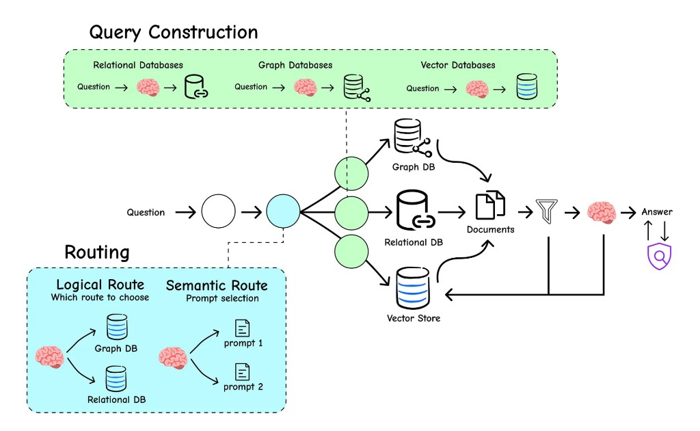

Джерело: [Building the entire RAG ecosystem and optimizing every component](https://levelup.gitconnected.com/building-the-entire-rag-ecosystem-and-optimizing-every-component-8f23349b96a4)

### 5.1. Логічна маршрутизація

Логічна маршрутизація класифікує запит у один із заздалегідь визначених класів, наприклад документацію Python, JavaScript або Go, і далі шукає лише в цьому джерелі.

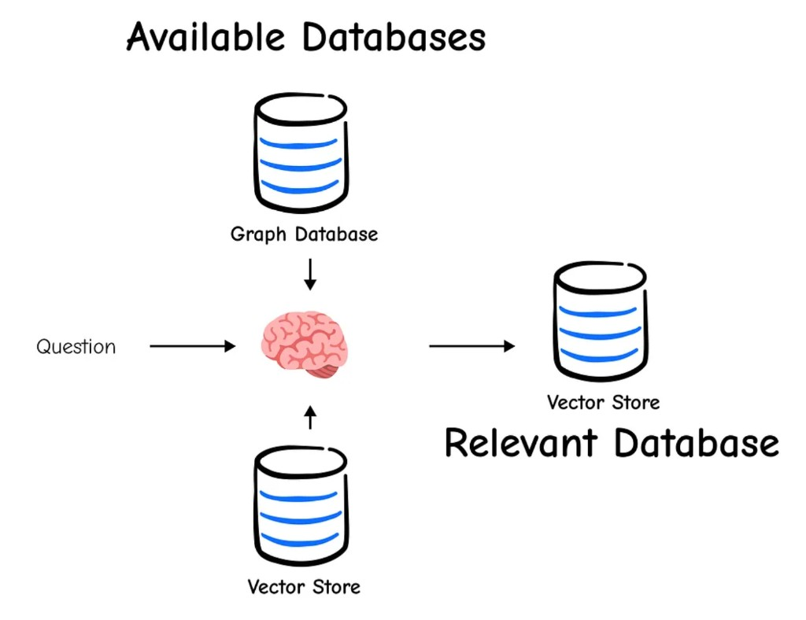

У LangChain це збирається з трьох окремих частин:

1. **Модель даних (schema / contract)** задає, які рішення маршрутизатору дозволено повернути.
2. **Маршрутизатор (router chain)** читає запит через LLM і обирає напрямок.
3. **Розгалуження (routing logic)** викликає пошук у вибраному джерелі.

Pydantic тут не вирішує, куди йти запит. Він лише описує і перевіряє форму відповіді. Ваги LLM у цьому прикладі не змінюються: модель класифікує запит під час inference за інструкцією в prompt, а не «навчається» на наших прикладах.

#### 1) Контракт на Pydantic

`Literal` імпортується зі стандартного модуля `typing`. Це спеціальна форма анотації типу, а не окрема бібліотека і не звичайний клас. Сам по собі `Literal` не перевіряє значення під час виконання: його бачать статичні перевірки на кшталт mypy або Pyright. Pydantic уже перевіряє обмеження в runtime і кидає `ValidationError`, якщо значення поза списком.

```python
from typing import Literal
from pydantic import BaseModel, Field

class RouteQuery(BaseModel):
    """Route a user question to the relevant documentation."""

    datasource: Literal["python", "javascript", "go"] = Field(
        description="The documentation source for the question"
    )
```

| Компонент | Значення |
| --- | --- |
| `BaseModel` | Базовий клас Pydantic для структурованих даних |
| `RouteQuery` | Модель рішення маршрутизатора |
| `datasource` | Поле з вибраним маршрутом |
| `Literal` | Дозволені значення: `python`, `javascript`, `go` |
| `Field` | Опис поля, який бачить LLM |

Допустимий результат:

```json
{"datasource": "python"}
```

Значення `"ruby"` цей контракт не пропустить.

#### 2) Router chain

```python
from langchain_openai import ChatOpenAI
from langchain_core.prompts import ChatPromptTemplate

llm = ChatOpenAI(model="gpt-4.1-mini", temperature=0)

system_prompt = """You are an expert at routing user questions
to the appropriate documentation.

Available data sources:
- python: Python language and Python libraries
- javascript: JavaScript and its ecosystem
- go: Go language and its ecosystem

Select the most relevant data source."""

prompt = ChatPromptTemplate.from_messages([
    ("system", system_prompt),
    ("human", "{question}"),
])

structured_llm = llm.with_structured_output(RouteQuery)
router_chain = prompt | structured_llm
```

`llm.with_structured_output(RouteQuery)` вимагає відповідь у формі цієї Pydantic-схеми. Опис методу: [with_structured_output](https://reference.langchain.com/python/langchain-core/language_models/chat_models/BaseChatModel/with_structured_output).

```python
question = "Why doesn't my Python LangChain code work?"
result = router_chain.invoke({"question": question})
print(result.datasource)  # python
```

Ланцюг виглядає так: запитання потрапляє в prompt, LLM разом зі схемою повертає `{"datasource": "python"}`.

#### 3) Розгалуження і retrieval

Три окремі індекси вже зібрані у `python_vectorstore`, `javascript_vectorstore` і `go_vectorstore`.

```python
retrievers = {
    "python": python_vectorstore.as_retriever(),
    "javascript": javascript_vectorstore.as_retriever(),
    "go": go_vectorstore.as_retriever(),
}

def route_question(question: str):
    route = router_chain.invoke({"question": question})
    retriever = retrievers[route.datasource]
    return retriever.invoke(question)

documents = route_question("How do I handle exceptions in Python?")
for doc in documents:
    print(doc.page_content)
```

Маршрутизатор не шукає документи. Він лише називає retriever. Для запиту про винятки в Python це буде `python`, і пошук піде тільки в індекс Python.

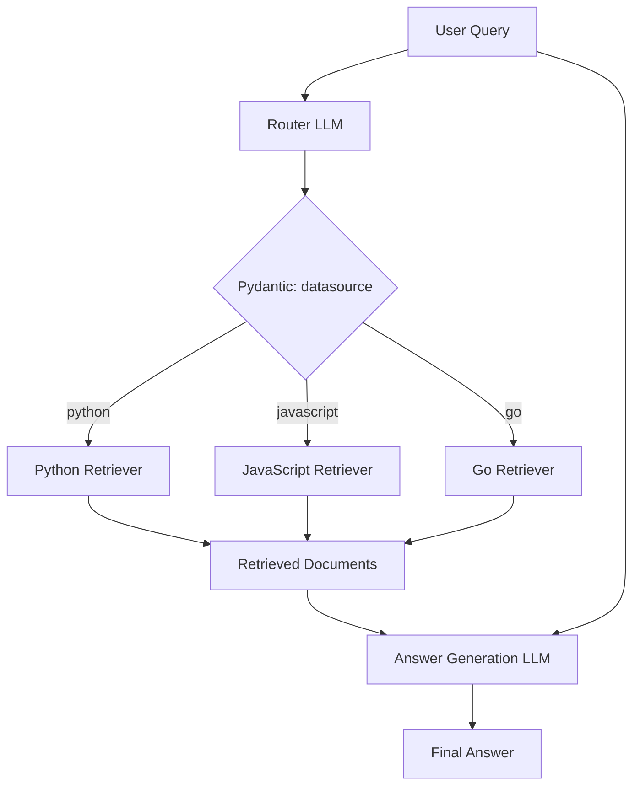

Оригінальне запитання теж іде в генеративну LLM разом зі знайденими документами. Інакше модель бачить контекст, але не бачить, на що саме відповідати.

Ту саму функцію можна вкласти в LCEL через `RunnableLambda` ([документація](https://reference.langchain.com/python/langchain-core/runnables/RunnableLambda)):

```python
from langchain_core.runnables import RunnableLambda

retrieval_chain = RunnableLambda(route_question)
documents = retrieval_chain.invoke("How do I handle exceptions in Python?")
```

Для продакшену варто додати маршрут `unknown` або `general` і можливість обрати кілька джерел. Запит на кшталт «порівняй конкурентність у Python і Go» не можна чесно відправити лише в один індекс.

#### 4) Як перевіряти маршрутизатор

Якість маршруту перевіряють окремо від якості retrieval.

| Тестовий запит | Очікуваний маршрут |
| --- | --- |
| How to use Python decorators? | `python` |
| How does JavaScript Promise.all work? | `javascript` |
| How to create goroutines? | `go` |
| How to use LangChain in Python? | `python` |
| Compare Python and Go concurrency | Неоднозначний: потрібен multi-route |

Routing Accuracy:

\[
\text{Accuracy} = \frac{\text{Correct routing decisions}}{\text{Total routing decisions}}
\]

Для всієї RAG-системи цієї метрики мало: далі окремо міряють retrieval (Recall@K, MRR) і якість фінальної відповіді (faithfulness, answer relevance).

Pydantic задає контракт, LLM обирає маршрут, Python або LCEL робить розгалуження, retriever виконує пошук.

### 5.2. Семантична маршрутизація

Семантична маршрутизація обирає, як обробити запит, порівнюючи його зміст із заздалегідь заданими описами маршрутів через ембединги. На відміну від логічної маршрутизації, окремий виклик LLM для вибору категорії тут не потрібен.

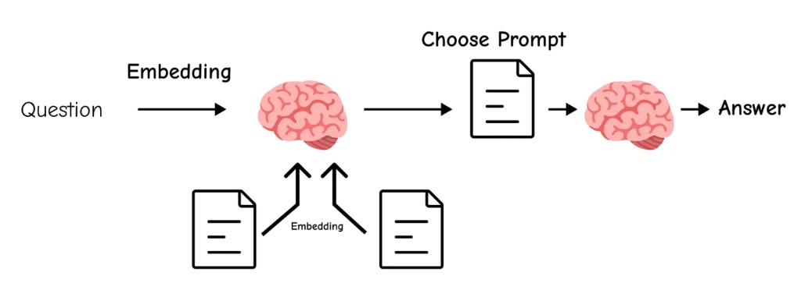

Приклад: асистент має двох експертів.

- **Physics Expert** пояснює фізичні явища.
- **Math Expert** розв'язує математичні задачі покроково.

Запит: «Що таке чорна діра?»

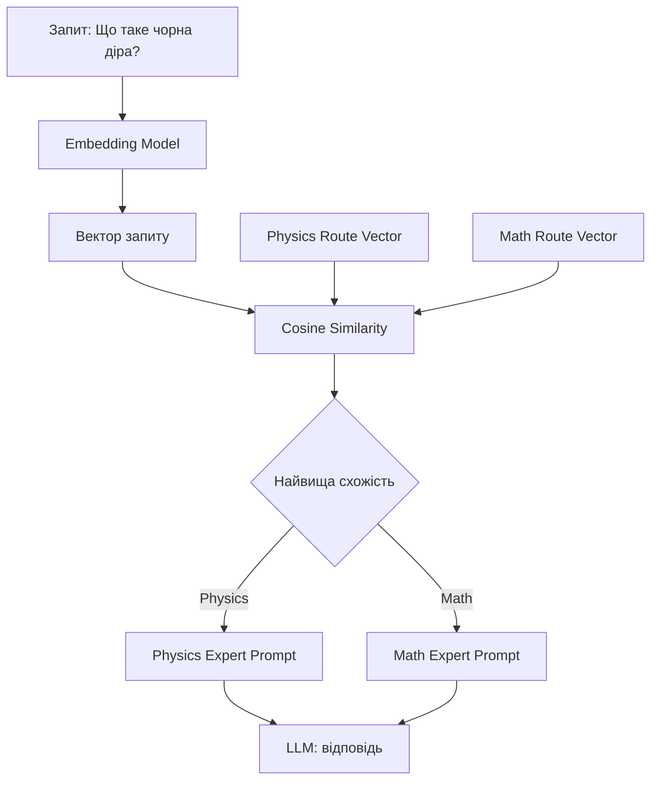

#### Кроки

1. Заздалегідь описуємо предметну область кожного маршруту, а не весь експертний prompt. Фраза «You are a helpful physics professor. Answer concisely» описує стиль відповіді, а не те, які запити сюди направляти.

```python
route_descriptions = {
    "physics": (
        "Physics questions about gravity, "
        "black holes, motion, forces and energy."
    ),
    "math": (
        "Mathematics questions about algebra, "
        "equations, calculus and geometry."
    ),
}
```

2. Описи маршрутів перетворюємо на ембединги і зберігаємо.
3. Запит користувача теж перетворюємо на ембединг.
4. Рахуємо косинусну схожість вектора запиту \(q\) з вектором кожного маршруту \(r_i\):

\[
\operatorname{sim}(q, r_i) = \frac{q \cdot r_i}{\|q\| \, \|r_i\|}
\]

5. Обираємо маршрут із найбільшим значенням і лише тоді застосовуємо відповідний експертний prompt та викликаємо генеративну LLM.

Ілюстративні оцінки для «Що таке чорна діра?»: Physics Expert \(0.91\), Math Expert \(0.43\). Система обирає фізику. Ці числа вигадані для пояснення принципу, це не результат запуску embedding-моделі.

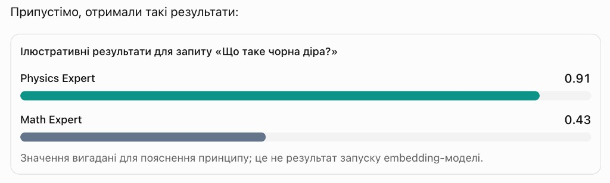

#### Реалізація

```python
import numpy as np
from langchain_openai import OpenAIEmbeddings, ChatOpenAI
from langchain_core.prompts import ChatPromptTemplate

embeddings = OpenAIEmbeddings(model="text-embedding-3-small")

route_names = list(route_descriptions.keys())
route_vectors = embeddings.embed_documents(list(route_descriptions.values()))

def semantic_route(question: str):
    query_vector = embeddings.embed_query(question)
    q = np.array(query_vector)
    r = np.array(route_vectors)
    q = q / np.linalg.norm(q)
    r = r / np.linalg.norm(r, axis=1, keepdims=True)
    scores = r @ q
    best_idx = int(np.argmax(scores))
    return route_names[best_idx], float(scores[best_idx])

route, score = semantic_route("What is a black hole?")
print(route, score)  # очікуємо physics; score залежить від моделі
```

`embed_documents()` повертає по одному вектору на опис. Після нормалізації скалярний добуток збігається з косинусною схожістю.

```python
expert_prompts = {
    "physics": (
        "You are a physics professor. "
        "Explain physics concepts accurately and clearly."
    ),
    "math": (
        "You are a mathematician. "
        "Solve problems step by step."
    ),
}

llm = ChatOpenAI(model="gpt-4.1-mini", temperature=0)

def answer_question(question: str):
    route, score = semantic_route(question)
    prompt = ChatPromptTemplate.from_messages([
        ("system", expert_prompts[route]),
        ("human", "{question}"),
    ])
    answer = (prompt | llm).invoke({"question": question})
    return {"route": route, "similarity": score, "answer": answer.content}
```

Embedding-модель обирає маршрут. LLM лише генерує відповідь уже обраним стилем.

#### Logical Routing і Semantic Routing

| Критерій | Logical Routing | Semantic Routing |
| --- | --- | --- |
| Як обирається маршрут | LLM класифікує запит | Порівняння ембедингів |
| Виклик LLM для маршрутизації | Зазвичай так | Ні |
| Механізм | Prompt і structured output | Embeddings і similarity |
| Швидкість | Залежить від LLM | Часто швидше |
| Складні правила | Зазвичай гнучкіше | Потрібна додаткова логіка |
| Новий маршрут | Оновити схему й інструкції | Додати опис і його ембединг |

#### Де це в RAG

У прикладі вище маршрут обирає prompt. У RAG він може обирати ще й джерело знань: Python-запит іде в індекс документації Python, JavaScript - у свій, Go - у свій. Після пошуку LLM отримує знайдені документи.

Це два різні рішення: **prompt routing** (поведінка моделі) і **retrieval routing** (джерело знань).

#### Обмеження

Простий `argmax` завжди обере один із наявних маршрутів, навіть якщо запит про кулінарію. Для надійнішої системи потрібні поріг схожості, fallback-маршрут і, за потреби, кілька маршрутів одразу.

Оцінка \(0.91\) не означає 91% імовірності правильного маршруту. Це геометрична схожість векторів, а не калібрована впевненість.

Логічна маршрутизація спирається на міркування LLM, семантична - на близькість ембедингів. Який варіант кращий для конкретного корпусу, перевіряють за routing accuracy, затримкою і вартістю.

### 5.3. Структурування запитів (query construction)

Мета: із природної мови витягти структуровані фільтри.

Приклад вхідного запиту:

- "покажи відео про LangChain agents за 2023 рік, до 5 хвилин, від 10к переглядів"

Приклад структури:

```python
from datetime import date
from pydantic import BaseModel, Field

class VideoSearchFilter(BaseModel):
    content_query: str | None = None
    title_query: str | None = None
    min_views: int | None = None
    max_views: int | None = None
    published_from: date | None = None
    published_to: date | None = None
    max_duration_sec: int | None = None
    author: str | None = None

query_constructor_prompt = ChatPromptTemplate.from_template(
    """Convert user request into a structured video search filter.
Request: {question}"""
)

query_constructor = query_constructor_prompt | llm.with_structured_output(VideoSearchFilter)
structured = query_constructor.invoke(
    {"question": "відео про чат LangChain, опубліковані у 2023 році, до 5 хвилин"}
)
print(structured.model_dump())
```

Перевага: можна поєднати semantic retrieval + metadata filters без ручного парсингу тексту.

---

<a id="part-6"></a>

## Частина 6. Просунута індексація, retrieval і generation

### 6.1. Чому базового chunking часто недостатньо

Малі chunk-и точніше знаходяться, але часто не мають контексту для повної відповіді. Великі chunk-и дають контекст, але їхній сенс розмазується в одному векторі.

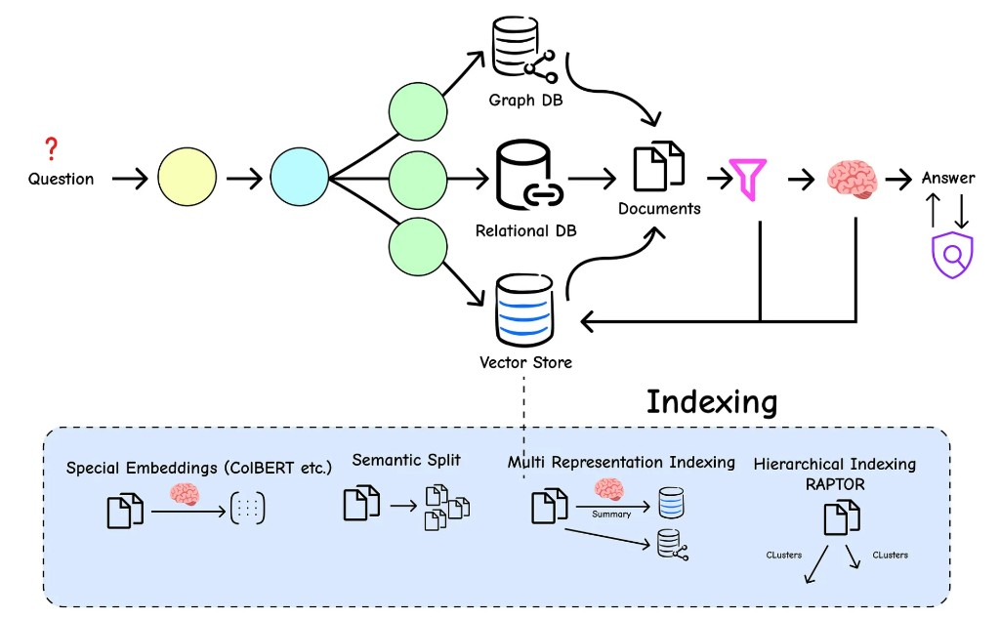

Три стратегії нижче по-різному вирішують одне питання: що саме перетворювати на ембединги, як складати індекс і що повертати після пошуку. Приклад спільний: корпоративна документація про випуск програмного забезпечення, з розділами про тестування, релізи, розгортання, інциденти і rollback.

| Стратегія | Основна ідея | Що індексуємо |
| --- | --- | --- |
| Multi-Representation | Шукаємо за стислим описом, повертаємо оригінал | Резюме, запитання або інші представлення |
| RAPTOR | Організовуємо знання в ієрархію | Фрагменти і резюме різних рівнів |
| ColBERT | Порівнюємо тексти на рівні токенів | Окремі контекстуальні вектори токенів |

### 6.2. Multi-Representation Indexing

Якщо один вектор побудовано для 20-сторінкового опису релізу, згадка rollback може майже не вплинути на цей вектор. Коротше представлення, наприклад резюме процедури, краще збігається з запитом «Що робити, якщо після релізу виявлено критичний дефект?».

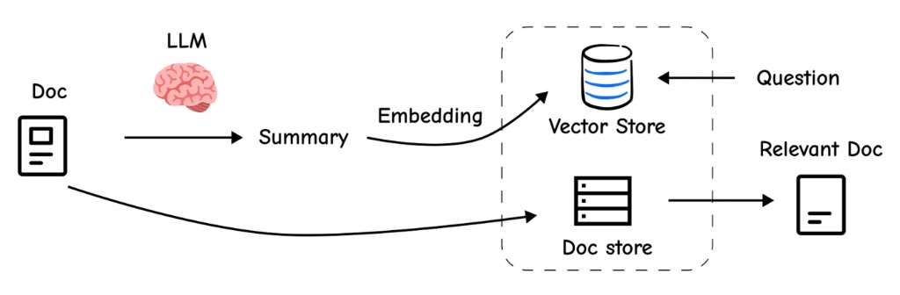

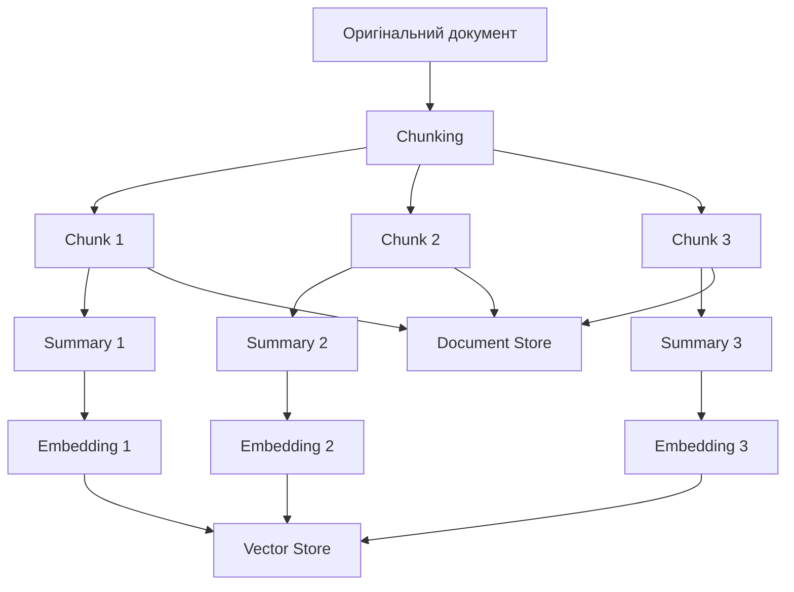

Vector Store зберігає ембединги коротких представлень і ідентифікатори оригіналів. Document Store зберігає повні фрагменти, які підуть у LLM.

Оригінальний фрагмент `DOC-102`: після production deployment команда проводить smoke testing; якщо критичний дефект блокує основні функції, Release Manager ініціює rollback, після відновлення версії повторює критичні сценарії і фіксує результати в incident report.

Пошукове резюме: «Процедура rollback після production release у випадку критичних дефектів».

```python
summary = (
    "Процедура rollback після production release "
    "у випадку критичних дефектів."
)
summary_vector = embedding_model.embed_query(summary)
```

У векторному сховищі лежить `summary-102` з `metadata.doc_id = "DOC-102"`. У сховищі документів за цим id лежить повний chunk. Під час запиту система ембедить питання, знаходить близьке резюме, за `doc_id` дістає оригінал і передає його в LLM. Шукаємо за коротким представленням, відповідаємо за повним текстом.

Один документ може мати кілька представлень, і всі вони вказують на той самий оригінал:

| Представлення | Текст |
| --- | --- |
| Summary | Процедура rollback після релізу |
| Question | Що робити при критичному дефекті в production? |
| Question | Хто приймає рішення про rollback? |
| Keywords | production, rollback, critical defect, incident |

Недолік: LLM, яка пише резюме або гіпотетичні питання, може пропустити деталь. Індекс лише з резюме іноді гірше відповідає на дуже конкретні запити.

### 6.3. RAPTOR (ієрархічна індексація)

RAPTOR (Recursive Abstractive Processing for Tree-Organized Retrieval) іде далі за резюме одного фрагмента. Семантично близькі фрагменти збираються в кластер, кластер отримує резюме, резюме знову кластеризуються, і так виникають узагальнення вищого рівня.

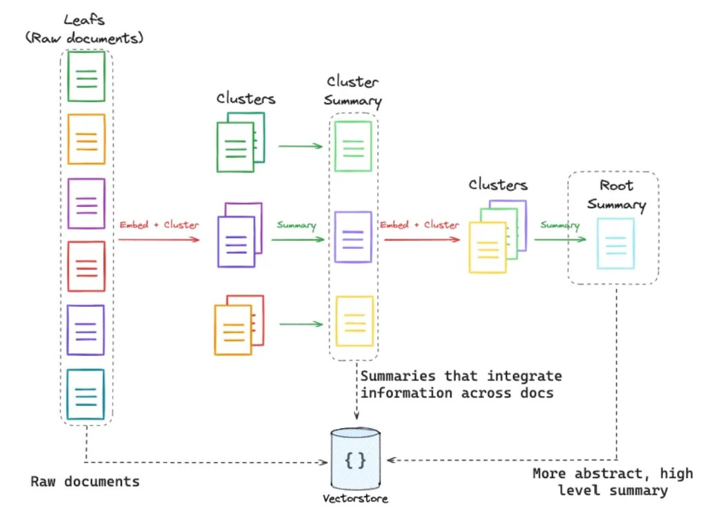

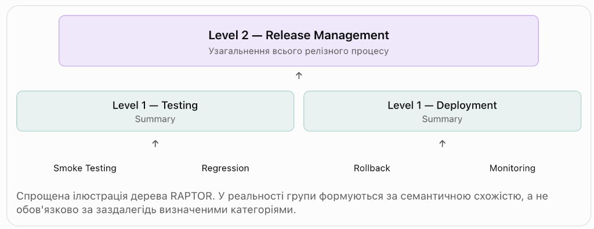

На схемі Level 2 узагальнює весь релізний процес, Level 1 окремо згортає тестування і розгортання, а листя лишаються конкретними процедурами: smoke testing, regression, rollback, monitoring. У реальній побудові групи формуються за семантичною схожістю, а не за заздалегідь заданими назвами розділів.

Побудова дерева:

1. Розбити документи на невеликі фрагменти.
2. Перетворити фрагменти на вектори.
3. Зібрати семантично близькі фрагменти в кластери. Rollback і production incident management можуть опинитися разом.
4. Згенерувати резюме кожного кластера.
5. Повторити ембединг, кластеризацію і резюмування для резюме, доки не вийде потрібна глибина.

Пошук може порівнювати запит із вузлами різних рівнів. «Які основні ризики production release?» ближче до загального резюме Release Management. «Хто має затвердити rollback?» потребує конкретного листа з процедурою.

| Переваги | Недоліки |
| --- | --- |
| Пошук на різних рівнях деталізації | Дорожча індексація |
| Краще для узагальнювальних питань | Багато викликів LLM під час побудови |
| Зв'язки між документами | Резюме можуть втрачати факти |
| Зручно для великих колекцій | Дерево складніше оновлювати |

RAPTOR особливо корисний, коли відповідь треба зібрати з багатьох документів, а не з одного релевантного chunk.

### 6.4. ColBERT і токен-рівневий retrieval

ColBERT (Contextualized Late Interaction over BERT) не будує резюме і не будує дерево. Звичайна dense-модель стискає речення в один вектор, і жодна окрема координата не відповідає слову `rollback` чи `approved`. ColBERT зберігає контекстний вектор кожного токена.

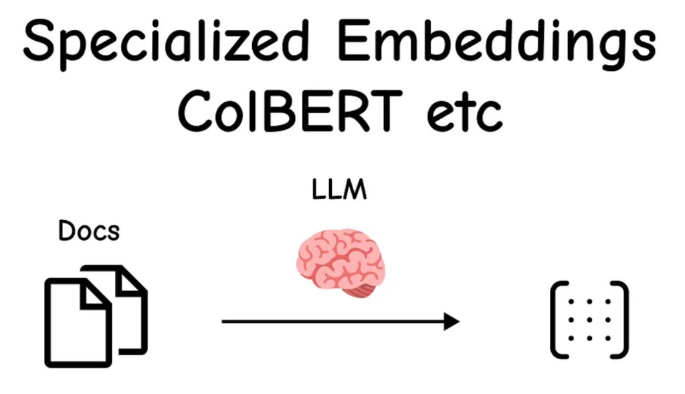

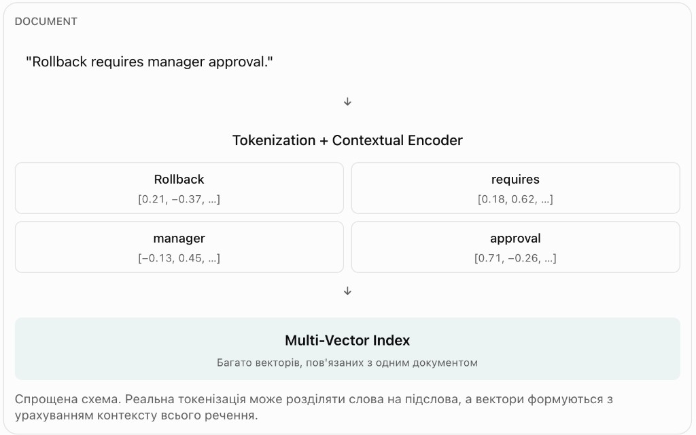

Для `"Rollback requires manager approval."` індекс зберігає окремі вектори токенів `Rollback`, `requires`, `manager`, `approval`, усі прив'язані до одного документа. Реальна токенізація може різати слова на підслова, а кожен вектор залежить від усього речення.

Запит `"Who approves rollback?"` теж розкладається на токенні вектори. Для кожного токена запиту обирається найближчий токен документа. Умовне зіставлення, не результат конкретної моделі:

| Токен запиту | Найближчий токен документа | Схожість |
| --- | --- | --- |
| Who | manager | 0.82 |
| approves | approval | 0.94 |
| rollback | Rollback | 0.98 |

Оцінка MaxSim:

\[
S(Q, D) = \sum_{i=1}^{|Q|} \max_{j=1}^{|D|} (q_i \cdot d_j)
\]

\(Q\) - вектори токенів запиту, \(D\) - вектори токенів документа, \(q_i\) і \(d_j\) - окремі токени. Для прикладу вище:

\[
S(Q, D) = 0.82 + 0.94 + 0.98 = 2.74
\]

Це оцінка релевантності документа, не ймовірність і не відсоток правильності. Запит і документ кодуються окремо, а взаємодіють лише під час підрахунку релевантності. Звідси назва late interaction. Оригінальна робота: [ColBERT, Khattab and Zaharia, 2020](https://arxiv.org/abs/2004.12832).

| Переваги | Недоліки |
| --- | --- |
| Детальніше зіставлення запиту і документа | Більше векторів треба зберігати |
| Краще тримає окремі токени | Складніший індекс |
| Корисно для точних технічних запитів | Дорожчий scoring |
| Може бути retriever або reranker | Потрібна спеціалізована інфраструктура |

ColBERT не завжди кращий за один вектор на chunk. Це залежить від задачі, даних і моделі.

#### Порівняння трьох стратегій

Для документації на 10 000 сторінок різні запитання спираються на різні сильні сторони. Це потенційна перевага, а не гарантія перемоги на тесті.

| Запитання | Підхід | Чому |
| --- | --- | --- |
| Що робити при критичному дефекті після релізу? | Multi-Representation | Резюме виводить потрібну процедуру |
| Які основні ризики всього релізного процесу? | RAPTOR | Потрібні кілька розділів одразу |
| Хто саме затверджує rollback у production? | ColBERT | Важливе точне зіставлення понять |

| | Multi-Representation | RAPTOR | ColBERT |
| --- | --- | --- | --- |
| Одиниця індексації | Summary або інше представлення | Фрагменти і резюме кластерів | Токени |
| Рівні | Зазвичай один | Багато | Один рівень представлення |
| Основна операція | Embedding і mapping за id | Кластеризація і резюме | Контекстне кодування і MaxSim |
| LLM під час індексації | Часто, для резюме і питань | Так, для abstractive summaries | Окрема генеративна LLM не потрібна |
| Мета | Наблизити формулювання запиту до документа | Шукати на різних рівнях абстракції | Точніше зіставляти токени |

### 6.5. Reranking

Reranking, CRAG і Self-RAG не є стратегіями індексації. Індекс уже побудовано однією зі схем вище. Ці кроки працюють після пошуку.

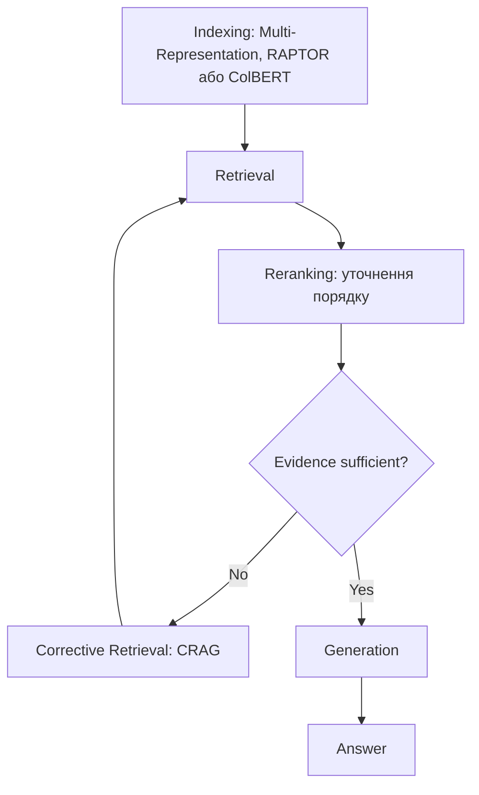

Це узагальнена схема можливого пайплайна, не точна реалізація CRAG чи Self-RAG.

Класичний reranking:

1. First-stage retriever повертає top-N, наприклад 50 фрагментів.
2. Точніша модель перевпорядковує цей список.
3. У prompt ідуть top-k, наприклад 5 фрагментів.

Це часто піднімає якість без заміни всього індексу.

### 6.6. CRAG, Self-RAG і самокорекція

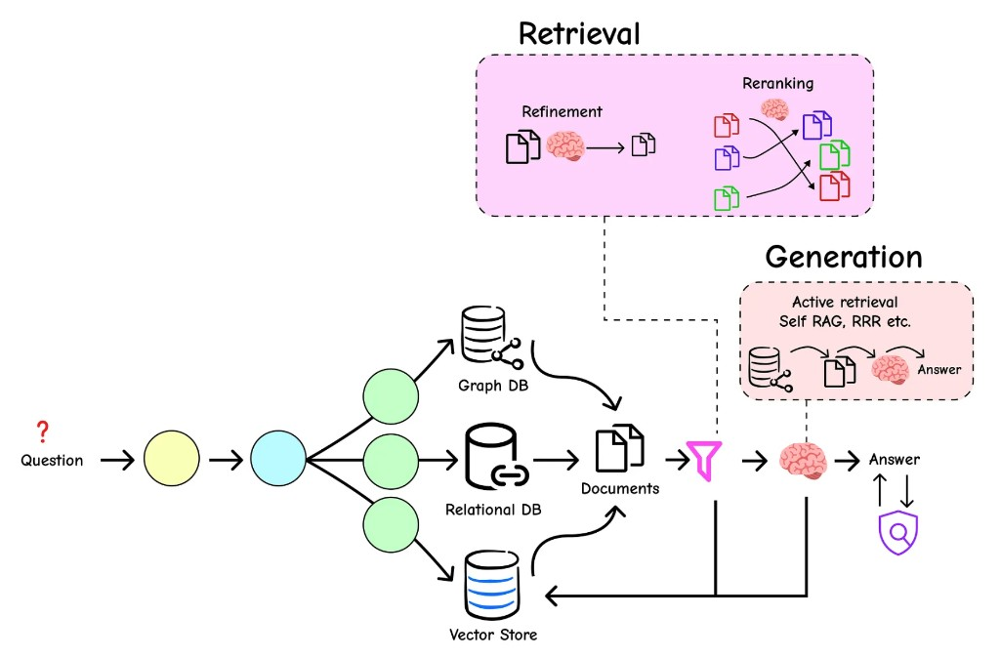

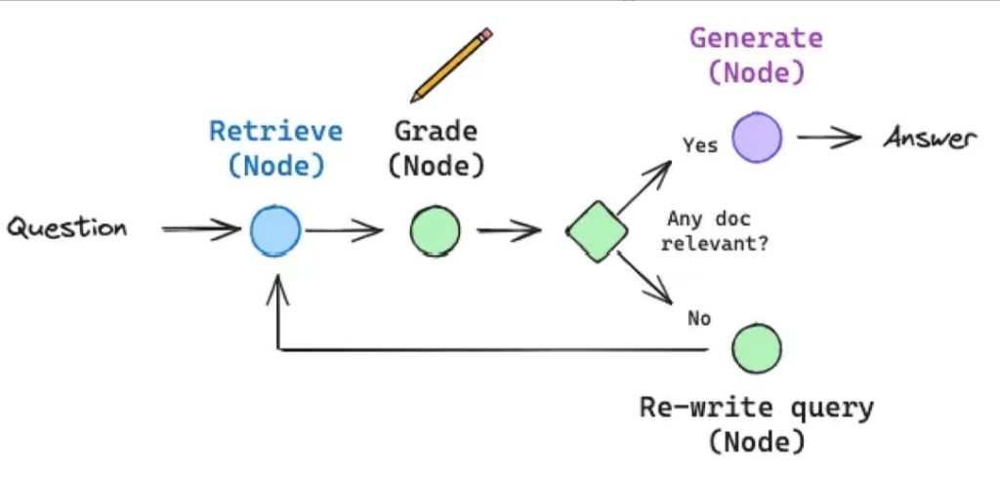

#### CRAG (Corrective Retrieval-Augmented Generation)

CRAG оцінює якість уже знайдених документів. Якщо доказів недостатньо або вони суперечливі, система коригує retrieval: переписує запит, шукає знову або йде в зовнішній вебпошук. Вебпошук - один із варіантів корекції, не єдина дія CRAG.

#### Self-RAG (Self-Reflective Retrieval-Augmented Generation)

Self-RAG - навчений підхід, у якому модель сама вирішує, чи потрібен retrieval, і оцінює знайдені докази та власну генерацію спеціальними reflection tokens. Це не звичайна LLM, якій у prompt написали «перевір свою відповідь».

Обидва механізми можна поєднати з Multi-Representation, RAPTOR або ColBERT: спочатку індекс визначає, які представлення шукати, потім оцінка доказів вирішує, чи достатньо їх для відповіді.

### 6.7. Підсумок просунутих стратегій

Індексацію, retrieval, reranking і контроль якості генерації не варто змішувати. Кожна стратегія сидить на своєму етапі.

| Стратегія | Етап RAG | Основна ідея | Коли застосовувати |
| --- | --- | --- | --- |
| Multi-Representation Indexing | Indexing + Retrieval | Ембединги коротких представлень (summary, questions), а в LLM повертається оригінал за id | Запити формулюються інакше, ніж текст документів |
| RAPTOR | Indexing + Retrieval | Кластеризація фрагментів і багаторівневі резюме | Великі колекції і питання, яким потрібне узагальнення |
| ColBERT | Indexing + Retrieval / Reranking | Контекстуальні ембединги токенів і порівняння через MaxSim | Коли важливі точні поняття і деталі |
| Reranking | Після retrieval | Повторна оцінка знайдених документів і зміна їхнього порядку | Початковий пошук повертає багато частково релевантних фрагментів |
| CRAG | Контроль якості retrieval | Перевірка знайдених документів і корекція пошуку за потреби | Докази можуть бути недостатні, нерелевантні або ненадійні |
| Self-RAG | Retrieval + Generation | Навчені механізми саморефлексії: чи шукати, чи релевантні докази, чи якісна відповідь | Потрібні адаптивний retrieval і контроль обґрунтованості |

| Стратегія | Додаткова LLM | Основні витрати | Головне обмеження |
| --- | --- | --- | --- |
| Multi-Representation | Часто під час індексації | Генерація і зберігання представлень | Summary може загубити деталь |
| RAPTOR | Під час побудови резюме | Багаторівнева кластеризація і генерація | Ієрархію складно оновлювати |
| ColBERT | Генеративна LLM не потрібна | Пам'ять, індекс, MaxSim | Багато векторів |
| Reranking | Залежить від моделі | Додатковий inference | Не знайде документ, який пропустив перший пошук |
| CRAG | Залежить від реалізації | Оцінка доказів і повторний пошук | Додаткова затримка і ризик невдалої корекції |
| Self-RAG | Спеціально навчена модель | Складніші навчання та inference | Не гарантує фактичної правильності |

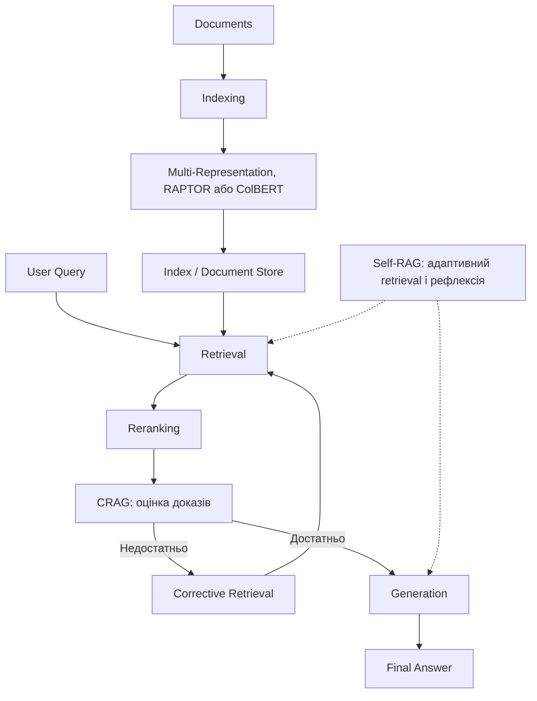

Це концептуальна схема, а не обов'язковий порядок усіх стратегій одразу. Self-RAG - окрема архітектура, а не блок, який просто ставлять після CRAG.

- Multi-Representation, RAPTOR і ColBERT змінюють спосіб представлення і пошуку.
- Reranking покращує порядок уже знайдених результатів.
- CRAG намагається виправити ситуацію, коли знайденого недостатньо або воно ненадійне.
- Self-RAG дає моделі механізми адаптивного пошуку й оцінки власної генерації.

Підходи можна поєднувати. Наприклад, Multi-Representation для індексу, ColBERT як reranker і окремий коригувальний пошук, якщо доказів мало.

Для інженерної роботи починайте з baseline RAG і додавайте стратегії по одній. Міряйте Recall@K, nDCG@K, faithfulness, latency і cost, щоб бачити, яке ускладнення справді покращує продукт.

### 6.8. Довгий контекст vs RAG

Великі контекстні вікна (128k, 200k, 1M) не "вбивають" RAG:

- **Long context** сильний у multi-hop synthesis по великому корпусу одразу.
- **RAG** сильний у точному відборі релевантних фактів із шумного сховища.

Найпрактичніший продакшен-підхід - гібрид:

1. RAG для відбору найкращого контексту.
2. Long-context LLM для фінального синтезу.

---

<a id="part-7"></a>

## Частина 7. Підсумковий конспект теми

Систематизований підсумок лекції: що це таке, як працює, навіщо потрібно і що варто пам'ятати в інженерній роботі.

### 7.1. RAG

RAG поєднує пошук інформації з генерацією відповіді. LLM не покладається лише на знання з тренування, а отримує додатковий контекст із зовнішніх джерел.

| Проблема | Що дає RAG |
| --- | --- |
| Knowledge cutoff | Інформація, яка з'явилася після тренування моделі |
| Private knowledge | Внутрішня документація, якої не було в тренувальних даних |
| Hallucinations | Менше необґрунтованих тверджень, якщо відповідь спирається на знайдені докази |
| Traceability | Відповідь можна пов'язати з документами-джерелами |

RAG не гарантує відсутність галюцинацій. Модель може неправильно прочитати навіть правильно знайдений документ.

### 7.2. Три компоненти

1. **Indexing:** документи, chunking, embeddings, vector store. Виконується заздалегідь і під час оновлення документів.
2. **Retrieval:** запит, embedding запиту, similarity search. Виконується в момент запиту.
3. **Generation:** питання і знайдений контекст ідуть в LLM. Виконується після retrieval.

Embedding-модель векторизує текст. Retriever знаходить фрагменти. Генеративна LLM пише відповідь.

### 7.3. Chunking

Великі документи ділять на фрагменти, з якими зручніше індексувати і шукати.

- `chunk_size` - цільовий максимальний розмір фрагмента. У `RecursiveCharacterTextSplitter` за замовчуванням це символи, не токени. Фактичні межі залежать від правил розділення.
- `chunk_overlap` - перекриття сусідніх фрагментів, щоб не розрізати думку на межі.

```python
RecursiveCharacterTextSplitter(chunk_size=1000, chunk_overlap=200)
```

```text
[ Chunk 1 .................. ]
                 [ overlap ]
                 [ Chunk 2 .................. ]
```

| | Малі chunks | Великі chunks |
| --- | --- | --- |
| Перевага | Точніший пошук конкретного факту | Більше контексту для відповіді |
| Недолік | Гірше видно зв'язки між фактами | Більше зайвого тексту |
| Ризик | Фрагментація | Розмиття сенсу в одному векторі |

Завеликий overlap дублює текст, збільшує індекс і сам по собі не покращує retrieval.

### 7.4. Ембединги і метрики

Ембединг - числовий вектор змісту: текст стає точкою, і точки можна порівнювати.

\[
\text{Text} \rightarrow [0.12,\ -0.45,\ 0.87,\ \ldots]
\]

| Метрика | Що вимірює | Як читати |
| --- | --- | --- |
| Cosine similarity | Подібність напрямків | Більше - більш схожі |
| Euclidean distance (L2) | Пряму відстань | Менше - ближчі |
| Dot product | Напрямок і довжину | Більше - вищий score |
| Manhattan distance (L1) | Суму абсолютних різниць | Менше - ближчі |

\[
\cos(\theta) = \frac{A \cdot B}{\|A\| \, \|B\|}
\]

Документи і запити мають лежати в сумісному просторі: та сама embedding-модель або пара query/document encoder однієї моделі.

### 7.5. Сімейства embedding-моделей

| Сімейство | Приклади | Особливість |
| --- | --- | --- |
| OpenAI | `text-embedding-3-small`, `text-embedding-3-large` | API, розмірність можна скорочувати |
| OpenAI legacy | `text-embedding-ada-002` | Попереднє покоління |
| Voyage | 3.x і 4.x | Retrieval, окремі варіанти для тексту і коду |
| Jina | v3-v5 | Багатомовні й мультимодальні представлення |
| Cohere | Embed v3-v5 | Багатомовний і мультимодальний retrieval |
| Open-source | BGE-M3, E5, GTE, MiniLM | Локальний запуск і baseline-експерименти |

Word2Vec і GloVe дають слову один фіксований вектор. Контекстуальні моделі враховують оточення. Більша розмірність, наприклад 3072 проти 768, не гарантує кращий пошук на конкретній задачі.

### 7.6. Векторні бази

Векторна БД зберігає ембединги і шукає схожі через ANN-індекси.

| База | Сильна сторона | Коли брати |
| --- | --- | --- |
| Milvus | Масштаб | Великі колекції і високе навантаження |
| Qdrant | Фільтри разом із векторами | Production RAG з metadata |
| Weaviate | Гібридний пошук і схема | Корпоративні бази знань |
| Pinecone | Керований сервіс | Хмарний запуск без власної інфраструктури |
| Chroma | Простий старт | Навчання, прототипи, невеликі проєкти |
| pgvector | Пошук у PostgreSQL | Дані вже живуть у Postgres |

HNSW - графовий ANN. IVF - пошук усередині найближчих кластерів. Обидва прискорюють пошук і можуть пропустити математично найближчого сусіда.

### 7.7. Трансформації запитів

Їх використовують, коли початковий запит погано лягає на термінологію документів.

| Техніка | Що робить | Коли корисна |
| --- | --- | --- |
| Multi-Query | Кілька варіантів одного запиту | Синоніми й інша термінологія |
| RAG-Fusion | Злиття списків через RRF | Кілька пошуків треба звести в один порядок |
| Decomposition | Складне питання стає підпитаннями | Multi-hop |
| Step-Back | Загальніше питання поруч із конкретним | Потрібні принципи, а не лише симптом |
| HyDE | Гіпотетичний документ для пошуку | Запит і документи сформульовані по-різному |

Для «Чому RAG неправильно відповідає?»: Multi-Query шукає причини галюцинацій і способи підняти faithfulness; Decomposition окремо питає, чи правильні документи і чи модель їх використовує; Step-Back піднімається до чинників якості RAG; HyDE генерує технічне пояснення і шукає реальні документи за його вектором.

Трансформація покращує умови пошуку. Релевантність вона не гарантує.

### 7.8. Reciprocal Rank Fusion

\[
\mathrm{RRF}(d) = \sum_{i=1}^{m} \frac{1}{k + r_i(d)}
\]

\(d\) - документ, \(m\) - кількість списків, \(r_i(d)\) - позиція в списку (перше місце = 1), \(k\) часто дорівнює 60. Документ A на позиціях 1 і 2:

\[
\mathrm{RRF}(A) = \frac{1}{61} + \frac{1}{62} \approx 0.0325
\]

RRF дивиться на позиції, не на сирі similarity scores, тому змішує BM25 і dense search. Зміст пари «запит - документ» він заново не читає.

### 7.9. Логічна і семантична маршрутизація

| | Logical routing | Semantic routing |
| --- | --- | --- |
| Принцип | LLM класифікує запит | Порівняння ембедингів |
| Технологія | Prompt і Pydantic | Embedding-модель і similarity |
| Рішення | Структурована категорія | Найближчий опис маршруту |
| Краще для | Складних правил | Тематичних маршрутів |
| Компроміс | Додатковий виклик LLM | Схожість не гарантує правильний клас |

Для документації Python, JavaScript і Go логічний маршрутизатор повертає `{"datasource": "python"}`. Семантичний порівнює вектор запиту з векторами описів маршрутів. Якщо схожості близькі, можна передати рішення LLM.

### 7.10. Структурування запиту

Природну мову перетворюють на параметри пошуку. «Знайди документацію Python про LangChain, оновлену після 2025 року» стає семантичним запитом `LangChain documentation` і фільтрами `language = python`, `year > 2025`.

Семантична близькість не вміє надійно виконати точну умову за датою, мовою чи версією. Синтаксис фільтра залежить від конкретної векторної БД. Поля, які згенерувала LLM, треба валідувати. Права доступу перевіряють окремо від моделі.

### 7.11. Просунута індексація

| Стратегія | Принцип | Що індексуємо | Перевага |
| --- | --- | --- | --- |
| Multi-Representation | Шукаємо за стислим представленням, повертаємо оригінал за id | Summaries, questions | Різні формулювання одного документа |
| RAPTOR | Рекурсивна кластеризація і резюме | Chunks і summaries рівнів | Пошук від деталі до узагальнення |
| ColBERT | Late interaction і MaxSim | Вектори токенів | Точне зіставлення понять |

Перші два підходи змінюють текст, за яким шукають. ColBERT змінює гранулярність: не один вектор на фрагмент, а багато токенних векторів.

### 7.12. Reranking і стиснення контексту

Це різні кроки, їх часто ставлять поруч.

Reranking переоцінює вже знайдене. Vector search дає top 30, cross-encoder залишає top 5, бо читає запит і документ разом. Документ, який перший retriever не повернув, reranker не відновить.

Context compression зменшує те, що піде в LLM: із 2000 токенів лишають близько 300, які стосуються запиту. Це може здешевити генерацію і водночас додає роботу до неї. Ризик - викинути критичну деталь.

### 7.13. CRAG і Self-RAG

| | CRAG | Self-RAG |
| --- | --- | --- |
| Назва | Corrective RAG | Self-Reflective RAG |
| Ідея | Оцінити докази і за потреби виправити пошук | Модель вирішує, коли шукати, і оцінює докази та відповідь |
| Механізм | Evaluator і коригувальні дії | Reflection tokens навченої моделі |
| Контроль | Насамперед якість retrieval | Retrieval, генерація, обґрунтованість |
| Приклад | Уточнення, відкидання фрагментів, зовнішній пошук | Рішення, чи потрібен пошук, і оцінка відповіді |

Self-RAG не зводиться до prompt «перевір свою відповідь». Жодна з архітектур не гарантує фактичну правильність.

### 7.14. RAG і довгий контекст

| Критерій | RAG | Long-context LLM |
| --- | --- | --- |
| Обсяг джерел | Великі колекції | Межа вікна і практична ефективність |
| Пошук | Потрібна retrieval-інфраструктура | Документи можна передати без окремого індексу |
| Актуальність | Індекс оновлюється | Новий документ треба знову покласти в контекст |
| Вартість | Індексація, retrieval, генерація | Обробка довгого контексту |
| Ризик | Потрібне можуть не знайти | Важливе можуть не використати всередині довгого тексту |
| Складність | Більше компонентів | Простіше для невеликої задачі |

RAG доречний для великої бази, частих оновлень, фільтрів, доступу і посилань на джерела. Довгий контекст доречний, коли документів мало і вони вміщаються у вікно, або коли треба бачити весь файл одразу. Гібрид: retrieval відбирає документи, long-context модель читає їх разом.

### 7.15. Як це збирається в одну систему

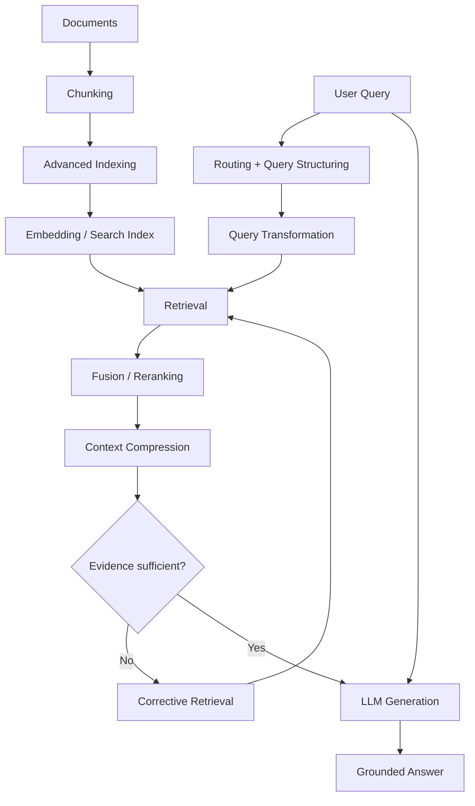

Це можлива production-схема, не обов'язковий набір для кожного застосунку. Self-RAG лишається окремою архітектурою адаптивної генерації, а не ще одним блоком у цьому ланцюгу.

Для інженерної роботи:

1. Якість retrieval визначає, які докази взагалі доступні. Якщо документ не знайдено, модель може не мати з чого відповісти.
2. Якість generation визначає, чи ці докази використані. Правильні фрагменти не гарантують правильну відповідь.
3. Кожну надбудову порівнюють із baseline за Recall@K, nDCG@K, faithfulness, answer correctness, latency і cost.

Для продукту додається ще одне питання: чи приріст якості виправдовує вартість, затримку і складність підтримки. Ефективна RAG-система має знаходити достатні релевантні докази, правильно їх використовувати і давати відповідь, яку можна перевірити за джерелами.

---

<a id="part-8"></a>

## Частина 8. Шпаргалка

### 8.1. Мінімальний RAG-ланцюг (актуальний скелет)

```python
rag_chain = (
    {"context": retriever | format_docs, "question": RunnablePassthrough()}
    | prompt
    | llm
    | StrOutputParser()
)
```

### 8.2. Яку техніку коли використовувати

- **Проблема:** низький recall через формулювання запиту  
  **Рішення:** Multi-Query, HyDE

- **Проблема:** занадто багато шуму в об'єднаних результатах  
  **Рішення:** RAG-Fusion (RRF), reranking

- **Проблема:** складні багатокомпонентні питання  
  **Рішення:** Decomposition

- **Проблема:** надто вузьке питання без базового контексту  
  **Рішення:** Step-Back

- **Проблема:** кілька джерел знань  
  **Рішення:** логічна маршрутизація

- **Проблема:** потрібна адаптація стилю/експерта  
  **Рішення:** семантична маршрутизація

### 8.3. Метрика схожості: швидкий вибір

- **Cosine:** дефолт для semantic search у більшості RAG.
- **Dot product:** коли embedding-модель/індекс заточені під нього.
- **Euclidean:** коли важлива абсолютна геометрична близькість.
- **Manhattan:** коли потрібна більша стійкість до outlier-вимірів.

---

<a id="clarifications"></a>

## Уточнення до матеріалу та оновлення API

Нижче - виправлення застарілих або неточних моментів, які варто тримати як "пам'ятку якості".

1. `langchain_community.vectorstores.Chroma`  
   Краще перейти на `langchain_chroma.Chroma` (окремий інтеграційний пакет `langchain-chroma`).

2. `langchain.hub.pull("rlm/rag-prompt")`  
   Стабільніший сучасний шлях - `langsmith.Client().pull_prompt(..., dangerously_pull_public_prompt=True)` або локальний `ChatPromptTemplate`.

3. `ChatOpenAI(model_name="gpt-3.5-turbo")`  
   Краще явно вказувати актуальну модель (`model="gpt-4o-mini"` або іншу доступну у вашому провайдері).

4. `OpenAIEmbeddings()` без параметрів  
   Рекомендовано явно вказувати модель, наприклад `OpenAIEmbeddings(model="text-embedding-3-small")`.

5. Форматування контексту  
   `"\n\n".join(...)` - правильно; `"\\n\\n".join(...)` - помилково для RAG-контексту.

6. `from langchain.load import dumps, loads`  
   Оновлено: `from langchain_core.load import dumps, loads`.

7. Трасування  
   `LANGSMITH_TRACING` - основний прапор, `LANGCHAIN_TRACING_V2` - історичний аліас (можна тримати для сумісності старих прикладів).

8. Weaviate hybrid search  
   Балансування keyword/semantic керується параметром `alpha`, а не повністю автоматичним "вибором системи".

9. Pinecone local dev  
   Окрім cloud-режиму, є Pinecone Local для частини локальних сценаріїв розробки/тестування.

10. Про cosine та "антоніми = -1"  
    Це спрощення; у реальних embedding-просторах антоніми часто знаходяться близько через схожий контекст вживання.

11. Каталог embedding-моделей (станом на 2026)  
    Актуальні орієнтири: OpenAI `text-embedding-3-*`, Voyage 4, Jina v5, Cohere Embed 5. Voyage 3, Jina v3, Cohere Embed v3 і `text-embedding-ada-002` залишені як попередні покоління. Скорочення розмірності та квантизація Voyage не є стисненням без втрати якості. Деталі - у розділах 2.7 і 2.8.

12. Корисні посилання за темою:

- [Building the entire RAG ecosystem and optimizing every component](https://levelup.gitconnected.com/building-the-entire-rag-ecosystem-and-optimizing-every-component-8f23349b96a4)
- [Vector Embedding (CauseWriter)](https://causewriter.ai/courses/ai-explainers/lessons/vector-embedding/)
- [Distance Metrics in Vector Stores (LinkedIn)](https://www.linkedin.com/pulse/distance-metrics-similarity-indexes-vector-stores-venkatesh-madala-um6oc)
- [Improving - Enterprise AI, Data & Application Services](https://www.improving.com/)
- [Steck et al. 2024 - Is Cosine-Similarity of Embeddings Really About Similarity?](https://arxiv.org/abs/2403.05440)
- [OpenAI Embeddings](https://developers.openai.com/api/docs/guides/embeddings)
- [Voyage AI docs](https://docs.voyageai.com)
- [Jina AI](https://jina.ai)
- [Cohere docs](https://docs.cohere.com)
- [BAAI/bge-m3](https://huggingface.co/BAAI/bge-m3)

---

Цей конспект можна використовувати як домашній довідник: від базового "мінімального RAG" до архітектурних рішень для продакшену.
