# КОНСПЕКТ-ДОВІДНИК ЛЕКЦІЇ №8: FINE-TUNING LLM

> **Тема:** Fine-tuning великих мовних моделей (LLM): повне донавчання, PEFT-методи (LoRA, QLoRA, DoRA, Spectrum), підготовка даних, оцінювання, розгортання та моніторинг.
>
> **Формат:** розгорнутий навчальний довідник без скорочень змісту, з виправленими неточностями, поясненнями простими словами, практичними кейсами, зображеннями й джерелами.

---

<a id="dictionary"></a>

## Словник скорочень і термінів

Біля кожного скорочення в дужках стоїть повна англійська назва. Далі — що це означає в цьому конспекті.

### Скорочення

- **A/B-тест (A/B test).** Порівняння двох версій моделі на різних групах користувачів, щоб вирішити, яку залишати.
- **Adam (Adaptive Moment Estimation).** Оптимізатор, який оновлює ваги з урахуванням попередніх кроків. У fine-tuning він займає багато додаткової пам’яті.
- **AdamW (Adam with decoupled Weight decay).** Варіант Adam, у якому послаблення великих ваг відокремлене від кроку градієнта. Для мовних моделей його беруть частіше за звичайний Adam.
- **AI/ML (Artificial Intelligence / Machine Learning).** Штучний інтелект і машинне навчання.
- **API (Application Programming Interface).** Спосіб, яким програма звертається до моделі: надсилає запит і отримує відповідь.
- **BF16 (Brain Floating Point 16-bit).** 16-бітний формат числа: 1 біт знака, 8 бітів експоненти, 7 бітів мантиси. У ньому часто рахують на сучасних відеокартах. Це не «16 цифр після коми».
- **BitFit (Bias-term Fine-Tuning).** Метод PEFT, у якому навчають лише вже наявні bias-параметри, а не нові матриці.
- **BLEU (Bilingual Evaluation Understudy).** Збіг фрагментів слів з еталоном. Найвідоміша для перекладу. Два правильні переклади можуть отримати різний бал. Універсального порога немає; для порівняння використовують однакові налаштування, наприклад SacreBLEU.
- **PPL (Perplexity).** Перплексія: наскільки модель дивується наступному токену, \(e\) у степені крос-ентропії. Менше зазвичай краще, але поріг залежить від датасету і токенізатора і не доводить фактичну правильність.
- **CLIP (Contrastive Language-Image Pre-training).** Модель, яка зіставляє зображення і текст. Це не велика мовна модель.
- **CoT (Chain-of-Thought).** Прийом промпта, коли модель просять розкласти відповідь на проміжні кроки міркування.
- **CPU (Central Processing Unit).** Центральний процесор комп’ютера. Його оперативна пам’ять — RAM.
- **CUDA (Compute Unified Device Architecture).** Платформа NVIDIA для обчислень на відеокарті. Повідомлення CUDA OOM означає, що відеокарті не вистачило пам’яті.
- **DoRA (Weight-Decomposed Low-Rank Adaptation).** Вдосконалення LoRA: напрямок стовпця ваг і його довжину \(m\) навчають окремо.
- **F1 (F1 Score).** Баланс точності й повноти. Важливий, коли класи в даних нерівні.
- **FFN (Feed-Forward Network).** Мережа прямого поширення всередині блока Transformer. Те саме місце, де стоїть MLP.
- **FP16 (Floating Point 16-bit).** 16-бітний формат числа з плаваючою комою, інший за внутрішньою будовою, ніж BF16.
- **FP32 (Floating Point 32-bit).** Звичайна 32-бітна точність. Порівняно з 4 бітами це стиснення приблизно у 8 разів, а не у 4.
- **FSDP (Fully Sharded Data Parallel).** Спосіб розподілити модель і стани навчання між кількома відеокартами, щоб повне донавчання вмістилося в пам’ять.
- **GB (Gigabyte).** Гігабайт, одиниця обсягу пам’яті.
- **GPU (Graphics Processing Unit).** Відеокарта. Саме на ній зазвичай рахують навчання і відповіді моделі.
- **HTML (HyperText Markup Language).** Мова розмітки вебсторінок. Перед навчанням з тексту прибирають теги на кшталт `<p>`.
- **HTTPS (HyperText Transfer Protocol Secure).** Захищений протокол вебсторінок. У прикладі про фішинг його згадують як ознаку, яку варто перевіряти.
- **HumanEval.** Набір задач із програмування, на якому перевіряють, чи модель пише робочий код. Це один із бенчмарків, а не оцінка вашої конкретної задачі.
- **IA3 (Infused Adapter by Inhibiting and Amplifying Inner Activations).** Метод PEFT: навчають невеликі множники, які підсилюють або послаблюють уже наявні активації.
- **IoT (Internet of Things).** Пристрої на кшталт датчиків і дрібної електроніки. Для них модель іноді ставлять просто на пристрій.
- **JSON (JavaScript Object Notation).** Текстовий формат запису структурованих даних: поля і значення у фігурних дужках.
- **JSONL (JSON Lines).** Файл, у якому кожен рядок — окремий JSON-об’єкт. Зручний формат навчальних прикладів.
- **L2-норма (Euclidean norm).** Довжина вектора: корінь із суми квадратів координат. Для \([3,\ 4]\) це 5.
- **LLM (Large Language Model).** Велика мовна модель, навчена передбачати текст.
- **LMDeploy.** Рушій розгортання моделей. На сумісному обладнанні його сильна сторона — швидкість генерації токенів.
- **LoRA (Low-Rank Adaptation).** До замороженої матриці ваг додають добуток двох маленьких матриць \(BA\). Навчають лише їх.
- **MLP (Multilayer Perceptron).** Багатошаровий перцептрон: повнозв’язна мережа з кількох шарів нейронів. У Transformer це блок після Self-Attention.
- **MLOps (Machine Learning Operations).** Практика, як запускати, стежити й оновлювати моделі в робочому сервісі.
- **MMLU (Massive Multitask Language Understanding).** Великий набір запитань із багатьох предметів. Ним порівнюють загальні моделі. Високий бал тут ще не означає, що модель впорається з вашим діалектом, звітом чи тарифом.
- **MoE (Mixture of Experts).** Архітектура, де на кожен токен працює лише частина експертів. У Mixtral 8x7B усіх параметрів близько 46,7 млрд, а активних на токен близько 12,9 млрд.
- **NER (Named Entity Recognition).** Пошук у тексті стандартних сутностей: імен, організацій, дат, сум. Для звичних типів сутностей достатньо готової моделі або промпта.
- **NF4 (NormalFloat 4-bit).** 4-бітний формат зберігання ваг. Чотири біти — це номер одного з 16 готових рівнів, а не знак, експонента і мантиса.
- **Ollama.** Простий локальний запуск моделей. Зручний для розробки і невеликих сервісів.
- **OOM (Out of Memory).** Помилка «пам’ять закінчилася». На відеокарті це зазвичай CUDA OOM.
- **PagedAttention.** Прийом vLLM: кеш ключів і значень attention ріжуть на сторінки, щоб не тримати зайву пам’ять між запитами.
- **PEFT (Parameter-Efficient Fine-Tuning).** Параметрично ефективне донавчання: більшість базових ваг заморожена, навчається маленький набір параметрів.
- **PII (Personally Identifiable Information).** Особисті дані: імена, телефони, адреси. Перед навчанням їх прибирають або замінюють мітками.
- **QA (Quality Assurance).** Перевірка якості: чи дані чисті і чи модель справді робить те, що від неї чекають на нових прикладах. У конспекті QA також може означати Question Answering, тобто відповіді на запитання. Для бази документів, яка часто змінюється, зазвичай краще RAG, а не fine-tuning.
- **QLoRA (Quantized Low-Rank Adaptation).** LoRA поверх бази, збереженої в NF4. Для рахунку ваги тимчасово розгортають, наприклад у BF16, але оригінальні цифри не відновлюються.
- **RAFT (Retrieval-Augmented Fine-Tuning).** Донавчання, під час якого модель учиться відповідати за знайденими документами й ігнорувати зайві. Воно покращує RAG, а не замінює пошук. Стаття: [arXiv:2403.10131](https://arxiv.org/abs/2403.10131).
- **RAG (Retrieval-Augmented Generation).** Перед відповіддю модель знаходить уривки у зовнішній базі знань і спирається на них.
- **RAM (Random Access Memory).** Оперативна пам’ять комп’ютера, якою користується процесор. Це не пам’ять відеокарти.
- **ReLU (Rectified Linear Unit).** Функція активації: від’ємне число стає нулем, додатне лишається. Додає нелінійність у MLP.
- **ROUGE (Recall-Oriented Understudy for Gisting Evaluation).** Метрика перекриття фрагментів тексту. Її використовують для оцінки підсумків.
- **SFT (Supervised Fine-Tuning).** Тонке налаштування з учителем: у кожному прикладі є правильна відповідь, і модель підганяють під неї.
- **SNR (Signal-to-Noise Ratio).** Співвідношення сигналу до шуму. У Spectrum це відношення суми «сигнальних» сингулярних значень матриці ваг до суми «шумових».
- **SQL (Structured Query Language).** Мова запитів до таблиць бази даних.
- **SVD (Singular Value Decomposition).** Сингулярний розклад матриці \(A = U\Sigma V^{\mathsf T}\). Показує напрямки перетворення і силу розтягування вздовж них.
- **TensorRT-LLM.** Рушій NVIDIA для швидкого інференсу на її відеокартах. Налаштування складніше, ніж у vLLM.
- **TGI (Text Generation Inference).** Сервер Hugging Face для генерації тексту в продакшені.
- **VRAM (Video RAM).** Пам’ять відеокарти. Ваги і проміжні обчислення моделі мають поміститися саме сюди.
- **vLLM.** Рушій інференсу з PagedAttention: пам’ять кешу відповідей ріжуть на сторінки, щоб обслуговувати багато запитів.
- **ZeRO (Zero Redundancy Optimizer).** Набір прийомів DeepSpeed, які роздають стани оптимізатора й ваги між відеокартами і можуть вивантажувати їх в RAM.

### Терміни

- **Accuracy.** Частка правильних відповідей у задачах класифікації.
- **Адаптер (adapter).** Невеликий додатковий модуль. Він не є окремою мовною моделлю: працює разом із великою і змінює частину її обчислень.
- **Дистиляція (distillation).** Навчання меншої моделі повторювати відповіді більшої.
- **Залишковий зв’язок (residual connection).** Додавання входу блока до його виходу, щоб сигнал не губився в глибокій мережі.
- **Latency.** Час до відповіді одного запиту. Throughput — скільки запитів або токенів система встигає обробити за одиницю часу.
- **Prefix Tuning.** Навчувані вектори, які додають до Key і Value в attention кількох шарів. Базові ваги заморожені.
- **Prompt Tuning.** Навчання soft prompt: кількох векторів на вході моделі. Базові ваги заморожені.
- **P-Tuning.** Розвиток ідеї prompt і prefix tuning, стійкіший на великих моделях.
- **Self-Attention.** Механізм, у якому токени дивляться один на одного і збирають контекст.
- **Spectrum.** Вибіркове навчання матриць базової моделі. SVD дає сингулярні значення, поріг відділяє сигнал від шуму, SNR порівнює їхні суми, і навчають матриці з найвищим SNR.
- **Edge.** Запуск моделі просто на пристрої користувача, часто без постійного інтернету.
- **Вага, або параметр.** Число всередині моделі. Від набору ваг залежить, як модель перетворює вхід на відповідь.
- **Градієнт.** Напрямок і сила, з якими треба змінити параметр, щоб помилка локально зменшилась.
- **Градієнтний спуск.** Крок оптимізатора: від параметра віднімають learning rate, помножений на градієнт.
- **Деквантизація.** Тимчасове представлення стисненої ваги у вищій точності, щоб порахувати шар. Втрачені під час квантизації цифри не повертаються.
- **Ембединг (embedding).** Вектор чисел, яким модель позначає токен у просторі смислів.
- **Інференс (inference).** Робота вже навченої моделі: вона відповідає, а ваги не оновлюються.
- **Квантизація.** Запис ваг меншою кількістю бітів, щоб вони займали менше пам’яті.
- **Катастрофічне забування (catastrophic forgetting).** Після вузького донавчання модель гірше робить те, що вміла раніше.
- **Кодбук (codebook).** Таблиця готових рівнів. У NF4 чотири біти вибирають один рівень із шістнадцяти.
- **Крос-ентропія (Cross-Entropy Loss).** Функція втрат для передбачення токена: \(L = -\log P(\text{правильний токен})\). Що ймовірніший правильний токен, то менша втрата.
- **Логіт (logit).** Число перед перетворенням на ймовірність токена.
- **Лосс (loss).** Числова помилка моделі на прикладі. Навчання зменшує її.
- **Навчальний крок (learning rate, \(\eta\)).** Наскільки сильно оптимізатор зрушує параметр за один крок.
- **Перенавчання (overfitting).** Модель добре відтворює навчальні приклади і гірше працює на нових.
- **Перплексія (perplexity).** Наскільки модель «дивується» наступному слову. Менше зазвичай краще, але поріг залежить від мови і токенізатора.
- **Попереднє навчання (pretraining).** Перший етап: модель читає величезний корпус тексту і вчиться загальній мові. Fine-tuning починається вже з цих ваг.
- **Промпт (prompt).** Текст інструкції, який дають моделі під час запиту, без зміни її ваг.
- **Ранг (rank).** У LoRA це ширина маленьких матриць. Для рангу 8 поправка до матриці \(4096 \times 4096\) має \(65\,536\) параметрів.
- **Сингулярне значення (\(\sigma\)).** Число, яке показує, наскільки матриця розтягує простір уздовж одного напрямку. Геометрично це довжина півосі еліпса.
- **Софт-промпт (soft prompt).** Навчувані вектори, які дописують до ембедингів запиту. Вони не зобов’язані збігатися з реальними словами.
- **Токен (token).** Шматок тексту, слово або частина слова, з яким модель працює як з одним елементом.
- **Тонке налаштування (fine-tuning).** Донавчання вже готової моделі на своїх прикладах.
- **Форвард і бекворд (forward pass, backpropagation).** Спочатку модель рахує відповідь, потім помилка повертається назад і дає градієнти параметрів.
- **Злиття (merge).** Додавання вивченої поправки LoRA до базових ваг, щоб під час відповіді не рахувати адаптер окремо.
- **Пейджинг (paging).** Перенесення сторінок даних, у QLoRA насамперед стану оптимізатора, між VRAM і RAM, щоб пережити короткий пік пам’яті.
- **Витік даних (data leakage).** Навчальні приклади потрапляють у перевірку, і оцінка виглядає кращою, ніж реальна якість.
- **Галюцинація (hallucination).** Правдоподібна, але неправдива відповідь моделі.

---

## Зміст

- [Словник скорочень і термінів](#dictionary)
- [Частина 0. Вступ](#part-0)
- [Частина 1. Основні підходи: Full Fine-tuning vs PEFT](#part-1)
- [Частина 2. PEFT-методи: LoRA, QLoRA, DoRA, Spectrum та інші](#part-2)
- [Частина 3. Етапи тонкого налаштування (7 етапів)](#part-3)
- [Частина 4. Актуальність fine-tuning і коли він дійсно потрібен](#part-4)
- [Частина 5. Практичні кейси](#part-5)
- [Частина 6. Підсумки і шпаргалка вибору підходу](#part-6)
- [Глосарій простими словами](#glossary)
- [Джерела та посилання](#sources)

---

<a id="part-0"></a>

## Частина 0. Вступ

Вітаємо!

Якщо промпт-інжиніринг — це мистецтво «розмови» з моделлю, то **fine-tuning** — це її глибоке перенавчання під ваші специфічні завдання.
Навіть найкраще підібрана й налаштована LLM не завжди демонструє оптимальну поведінку «з коробки». Іноді модель потрібно адаптувати до вашої предметної галузі, стилю відповідей або навчити виконувати складні спеціалізовані задачі, які важко описати одним лише промптом.

У цій темі ми детально розглянемо fine-tuning (тонке налаштування) — процес донавчання великих мовних моделей на ваших власних даних:

- основні підходи до fine-tuning (повне донавчання, LoRA, QLoRA та інші ефективні методи);
- кроки запуску fine-tuning;
- як підготувати якісний датасет для донавчання;
- оцінка результатів і порівняння з базовою моделлю;
- поширені помилки та підводні камені;
- актуальність підходу й коли він дійсно необхідний.

Після цієї теми ви зрозумієте, коли варто інвестувати час у fine-tuning, а коли — обійтися налаштуваннями промпта, RAG або оркестрацією.

> **Простими словами:**  
> Промпт — це як пояснити учневі завдання іншими словами.  
> Fine-tuning — це як відправити учня на додатковий курс саме під потрібний предмет.

---

<a id="part-1"></a>

## Частина 1. Основні підходи: Full Fine-tuning vs PEFT

Уявіть ситуацію: ви хочете використовувати GPT-модель для автоматизації роботи з юридичними документами у вашій компанії. Базова модель розуміє загальну мову, але їй бракує знання специфічної термінології, структури договорів та особливостей юридичного стилю.

Тонке налаштування дозволяє «донавчити» модель на ваших даних, зберігаючи при цьому її базові здібності.

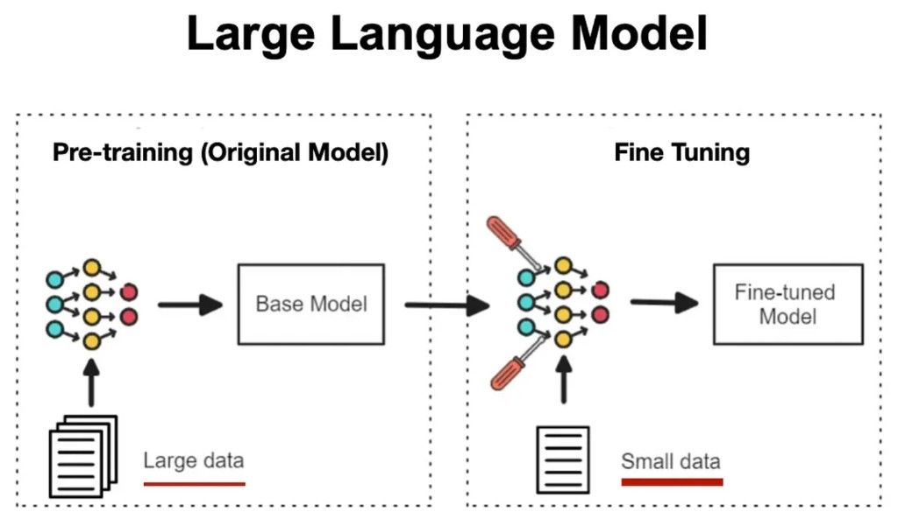

Джерело: [Pre-training, Fine-tuning or Distillation](https://amulyasharma.medium.com/pre-training-fine-tuning-or-model-distillation-for-rest-of-us-no-phd-required-01082df2aed7)

Існує два фундаментально різних підходи до цього процесу:

1. **Повне тонке налаштування (Full Fine-tuning)**  
2. **Параметрично ефективне тонке налаштування (PEFT)**

Кожен має свої переваги, обмеження та оптимальні сценарії використання.

### 1.1 Повне тонке налаштування (Full Fine-tuning)

Повне тонке налаштування — це класичний підхід, за якого ми оновлюємо **всі параметри** (ваги) нейронної мережі під час навчання на нових даних.

Параметри — це мільярди числових значень усередині моделі, які визначають, як вона обробляє й інтерпретує інформацію. При повному налаштуванні кожен з цих параметрів може змінюватися.

Це найбільш пряме рішення: ви берете готову модель і продовжуєте її навчання на ваших специфічних даних.

#### Як це працює

Процес повного налаштування схожий на перенавчання досвідченого спеціаліста для нової ролі:

- модель уже має базові знання з попереднього навчання;
- ви показуєте їй нові приклади;
- дозволяєте змінювати всі її параметри для кращої роботи з цими даними.

Наприклад, якщо ви налаштовуєте модель для медичної діагностики, вона переглядає тисячі прикладів медичних записів і діагнозів, поступово корегуючи внутрішні параметри для кращого розуміння симптомів і зв’язків.

#### Переваги

- **Максимальна якість** результатів для конкретної задачі.
- **Повна гнучкість** у зміні поведінки, стилю та спеціалізації.
- **Найкраще для складних доменів**, які сильно відрізняються від загального інтернет-тексту.

#### Недоліки

- **Високі вимоги до ресурсів.**  
  На практиці повний fine-tuning великих моделей вимагає дуже багато GPU-пам’яті, особливо з Adam-оптимізатором.

  Орієнтир пам’яті без жорстких оптимізацій:
  - 7B: часто 80–140+ GB сумарно для комфортного навчання;
  - 13B+: зазвичай уже потребує кілька GPU або оффлоад-стратегії.

- **Окрема повна копія моделі для кожної спеціалізації.**  
  Якщо у вас 5 доменів, часто це 5 окремих великих чекпойнтів.

- **Тривалість.**  
  Навчання може тривати години або дні.

- **Ризик катастрофічного забування.**  
  Після сильного донавчання у вузькому домені модель може гірше справлятися із загальними задачами.

#### Коли використовувати

- критично важливі задачі (медицина, фінанси, право);
- радикально новий домен;
- є бюджет на GPU та MLOps;
- потрібна одна топова спеціалізована модель.

#### Практичний приклад (ілюстративний)

Велика фармацевтична компанія адаптує модель 13B на великому медичному датасеті. Це дорого й довго, але дає максимальну точність для їхнього критичного сценарію.

> **Примітка:** конкретні цифри в цьому кейсі ілюстративні та винесені в `unverified_claims.md`.

---

### 1.2 Параметрично ефективне тонке налаштування (PEFT)

PEFT — це сучасний підхід: замість зміни всіх мільярдів параметрів моделі ми **заморожуємо більшість базових ваг** і навчаємо лише невеликий набір параметрів. Часто це нові адаптери, вставки чи вектори. Окремі методи, наприклад BitFit, навчають уже наявні bias-параметри, а не додають нові.

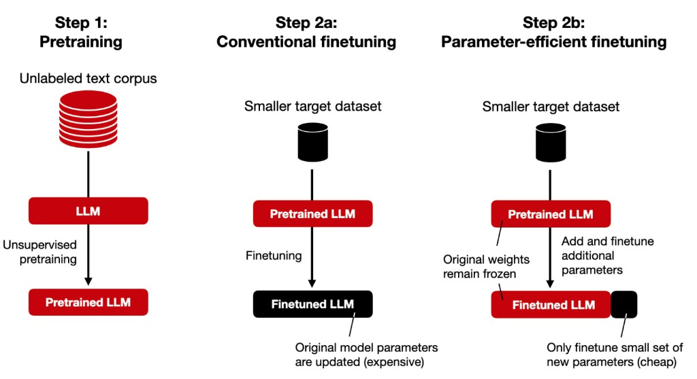

Джерело: [Finetuning LLMs Efficiently with Adapters](https://magazine.sebastianraschka.com/p/finetuning-llms-with-adapters)

> **Простими словами:**  
> Замість того щоб повністю перебудовувати автомобіль під нову задачу, ви ставите змінний модуль (як багажник на дах або зимову гуму), а сам автомобіль лишається тим самим.

#### Базова ідея PEFT

- основні ваги моделі залишаються незмінними;
- додаються компактні треновані параметри;
- навчання дешевше, швидше, доступніше;
- для нової задачі часто достатньо іншого адаптера, а не нової копії всієї моделі.

PEFT-ідея охоплює різні техніки: adapters, prompt/prefix tuning, LoRA та інші.

#### Як PEFT працює всередині нейронної мережі

Спробую пояснити PEFT на рівні самої нейронної мережі: що саме ми заморожуємо, що додаємо, як ці нові параметри навчаються і як вони впливають на результат.

Найважливіше зрозуміти, що адаптер **не є окремою маленькою мовною моделлю**. Він працює разом із великою моделлю, змінюючи результати певних математичних операцій усередині неї.

> **Простими словами:**  
> Велика модель лишається «двигуном». Адаптер — це невелика поправка до окремих обчислень, а не друга модель поруч.

##### 1. Пригадаймо, як працює звичайна нейронна мережа

Уявімо один із лінійних шарів Transformer.

Цей шар отримує вхідний вектор \(x\), множить його на матрицю ваг \(W\) і отримує результат:

\[
y = Wx
\]

Матриця \(W\) містить параметри, які модель вивчила під час pretraining.

Наприклад, у нас є модель із 7 мільярдами параметрів. Вона вже навчилася працювати з мовою, розпізнавати закономірності, обробляти контекст тощо.

Тепер ми хочемо адаптувати її до певного завдання, наприклад аналізу юридичних документів.

При Full Fine-tuning ми дозволяємо змінювати всі 7 мільярдів параметрів.

При PEFT ми залишаємо основні параметри незмінними й навчаємо значно менший набір параметрів.

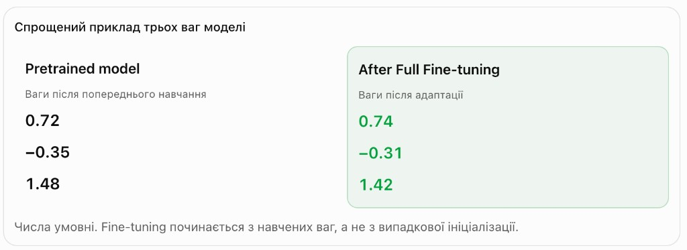

Числа умовні. Fine-tuning починається з уже навчених ваг, а не з випадкової ініціалізації. Кожна вага лише трохи зсувається: `0.72` стає `0.74`, `-0.35` стає `-0.31`, `1.48` стає `1.42`. При повному донавчанні так змінюються мільярди чисел. При PEFT більшість із них лишається на місці.

##### 2. Як працює адаптер на прикладі LoRA

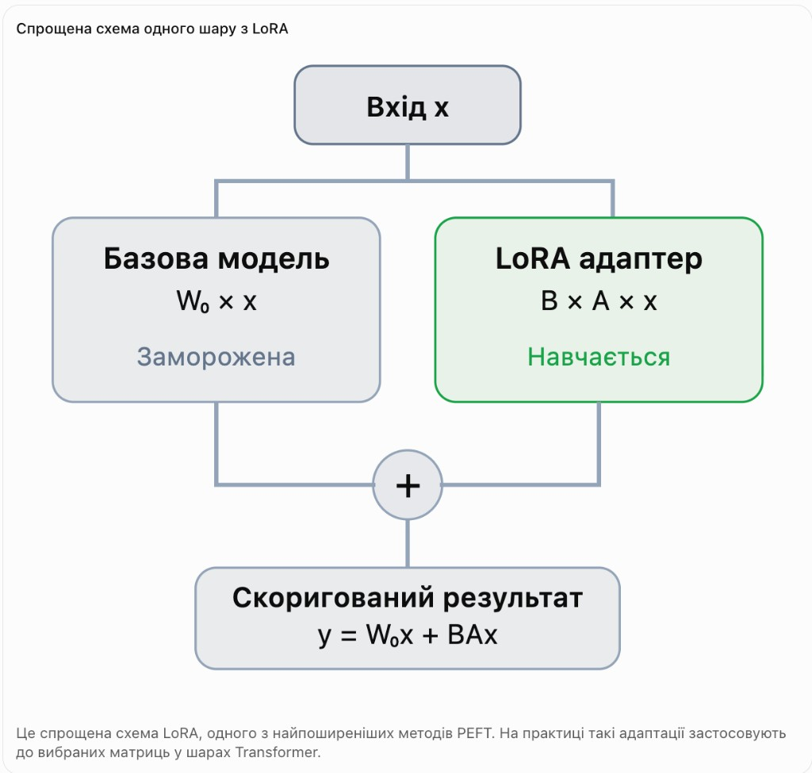

Це спрощена схема LoRA, одного з найпоширеніших методів PEFT. На практиці такі адаптації застосовують до вибраних матриць у шарах Transformer.

У звичайній моделі результат був би:

\[
y = W_0 x
\]

У LoRA:

\[
y = W_0 x + BAx
\]

Тут:

- \(W_0\) — велика матриця оригінальної моделі. Вона заморожена.
- \(A\) і \(B\) — дві значно менші матриці, які ми додаємо.
- \(BAx\) — корекція результату, яку обчислює адаптер.

Тобто базова модель продовжує виконувати свою роботу, а LoRA додає до результату вивчену корекцію.

> **Простими словами:**  
> Вхід іде двома шляхами. Перший шлях — стара заморожена матриця. Другий — маленький адаптер. Результати додаються. Модель «бачить» майже те саме, плюс невелику вивчену поправку.

##### 3. Чому дві маленькі матриці замість однієї великої

Припустимо, що початкова матриця \(W_0\) має розмір:

\[
4096 \times 4096
\]

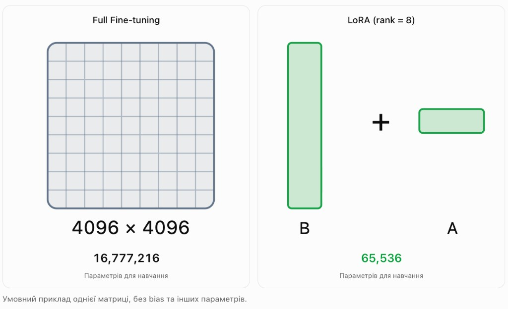

Умовний приклад однієї матриці, без bias та інших параметрів.

- Full Fine-tuning цієї матриці: \(4096 \times 4096 = 16\,777\,216\) параметрів.
- LoRA з рангом 8: матриця \(B\) розміром \(4096 \times 8\) і матриця \(A\) розміром \(8 \times 4096\), разом \(65\,536\) параметрів.

Замість навчання 16,8 мільйона параметрів однієї матриці ми навчаємо лише 65,5 тисячі — приблизно **0,39%**.

\[
\frac{65\,536}{16\,777\,216} \approx 0{,}0039 = 0{,}39\%
\]

Це можливо завдяки припущенню LoRA: для адаптації моделі часто достатньо корекції з низьким рангом (low-rank update).

> **Простими словами:**  
> Замість перемальовувати всю велику таблицю чисел ми навчаємо дві вузькі «смужки». Їхній добуток дає поправку майже того ж розміру, але параметрів у сотні разів менше.

##### 4. Але як адаптер розуміє, чого ми від нього хочемо

Ось тут починається сам процес навчання.

Наприклад, ми хочемо, щоб LLM аналізувала юридичні документи й повертала структуровану відповідь.

1. **Готуємо навчальні приклади.**
   - Input: уривок юридичного договору та запит на аналіз.
   - Expected output: категорія ризику, пояснення, посилання на відповідний пункт.
2. **Пропускаємо input через модель разом з адаптером** і отримуємо згенеровану відповідь.
3. **Обчислюємо loss** — наскільки передбачені моделлю токени відрізняються від очікуваних.
4. **Виконуємо backpropagation**, щоб обчислити градієнти для параметрів адаптера.
5. **Оптимізатор оновлює тільки матриці \(A\) і \(B\).** Ваги \(W_0\) залишаються незмінними.

Повторюємо процес багато разів. Поступово адаптер навчається вносити такі корекції, які допомагають моделі краще виконувати спеціалізоване завдання.

Важливий нюанс: адаптер не обов'язково засвоює лише формат відповідей. Він може впливати на поведінку, термінологію, стиль, а іноді й на фактичні знання моделі.

> **Простими словами:**  
> Модель відповідає, ми порівнюємо відповідь із правильною, і «підкручуємо» лише маленький адаптер. Велика книга ваг базової моделі на цьому кроці не переписується.

##### 5. А що відбувається, коли ми використовуємо модель після навчання

Після fine-tuning у нас є два компоненти:

- базова модель, наприклад 7B;
- навчений LoRA-адаптер.

Під час inference вони працюють разом. LoRA-корекції застосовуються до відповідних шарів під час обробки запиту.

У стандартній LoRA також часто можна об'єднати (merge) навчені корекції з оригінальними матрицями. Тоді окремі адаптерні множення під час інференсу вже не потрібні:

\[
W_{\text{merged}} = W_0 + BA
\]

І ще одна можливість: одна базова модель і кілька різних адаптерів — наприклад для юридичних, фінансових і технічних завдань. Між ними можна перемикатися, не зберігаючи кілька повних копій моделі.

##### 6. Чи всі методи PEFT працюють так само

Ні. PEFT — це категорія методів, а LoRA — лише один із них.

| Метод | Що саме навчаємо |
|---|---|
| LoRA | Невеликі низькорангові матриці |
| Adapters | Додаткові невеликі нейронні модулі |
| Prefix Tuning | Навчені вектори-префікси в attention |
| Prompt Tuning | Навчені вектори soft prompt |
| BitFit | Лише bias-параметри базової моделі |

Тому формулювання, що PEFT завжди додає нові параметри, дещо спрощене. Наприклад, BitFit навчає частину вже наявних параметрів.

##### Що варто запам'ятати

- **Full Fine-tuning:** змінюємо всі ваги моделі, щоб адаптувати її до нового завдання.
- **PEFT:** навчаємо невелику частину параметрів (нових або наявних), залишаючи більшість базових ваг замороженими.
- **LoRA:** замість зміни великої матриці ваг навчаємо дві маленькі матриці, добуток яких утворює корекцію до результату базової моделі.

І головне: LoRA не переписує знання всієї моделі, а навчає компактну математичну корекцію її роботи. Це дозволяє адаптувати великі LLM зі значно меншими витратами пам'яті й обчислювальних ресурсів.

---

<a id="part-2"></a>

## Частина 2. PEFT-методи: LoRA, QLoRA, DoRA, Spectrum та інші

### 2.1 LoRA (Low-Rank Adaptation)

LoRA — найпопулярніший метод PEFT.

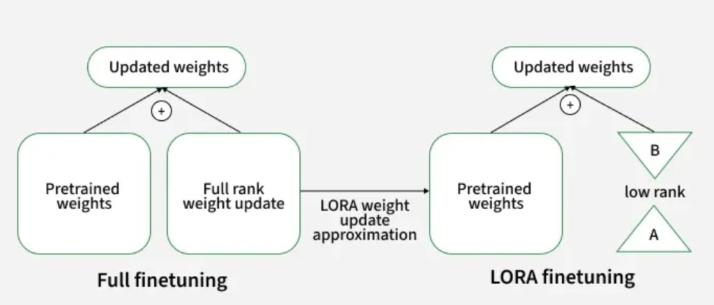

Джерела:  
- [GeeksforGeeks: Fine-Tuning using LoRA and QLoRA](https://www.geeksforgeeks.org/deep-learning/fine-tuning-using-lora-and-qlora/)  
- [Medium: Full FT vs LoRA vs QLoRA](https://medium.com/garantibbva-teknoloji/full-fine-tuning-lora-and-qlora-a-comparison-of-techniques-in-model-optimization-89038d36865f)

#### Суть методу

LoRA додає до певних лінійних шарів моделі дві невеликі матриці низького рангу.

Замість оновлення повної матриці, наприклад `4096 x 4096`, навчається компактна поправка:

- `A`: `4096 x r`
- `B`: `r x 4096`

Якщо `r = 8`, то кількість тренованих параметрів:

- повна матриця: `4096 x 4096 = 16,777,216`
- LoRA-поправка: `4096 x 8 + 8 x 4096 = 65,536`

Це приблизно у **256 разів менше** тренованих параметрів на такий шар.

> **Простими словами:**  
> LoRA — це «окуляри» для моделі: невелика насадка, яка змінює результат, але не перебудовує всю систему.

#### Плюси LoRA

- значно менше пам’яті й обчислень;
- швидке навчання;
- адаптери легко перемикати між задачами;
- адаптер можна «злити» з базовою моделлю для інференсу без додаткової затримки.

#### Мінуси LoRA

- інколи трохи слабше за повний fine-tuning на дуже складних задачах;
- треба акуратно вибирати `rank`, `alpha`, `target_modules`.

#### Практичний приклад (ілюстративний)

Одна базова модель + кілька LoRA-адаптерів для різних відділів (продажі, підтримка, повернення товарів) дають високу гнучкість і економію пам’яті.

---

### 2.2 QLoRA (Quantized Low-Rank Adaptation)

QLoRA (Quantized Low-Rank Adaptation) комбінує LoRA (Low-Rank Adaptation) з квантизацією базової моделі.

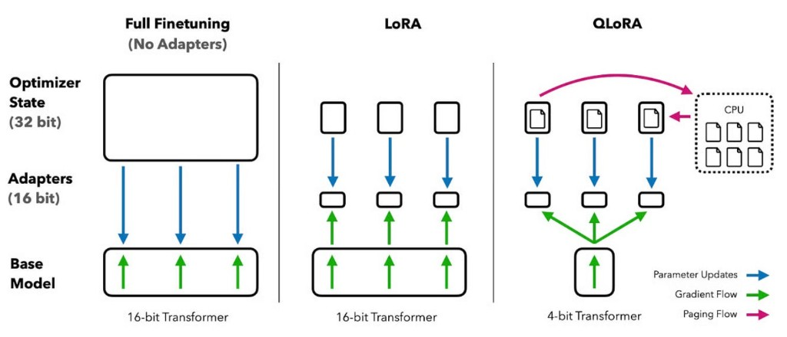

Джерела:

- [GeeksforGeeks: Fine-Tuning using LoRA and QLoRA](https://www.geeksforgeeks.org/deep-learning/fine-tuning-using-lora-and-qlora/)
- [QLoRA: Efficient Finetuning of Quantized LLMs](https://arxiv.org/abs/2305.14314)
- [Hugging Face: 4-bit QLoRA](https://huggingface.co/blog/4bit-transformers-bitsandbytes)

При QLoRA (Quantized Low-Rank Adaptation) базова модель залишається квантизованою і під час навчання, і під час використання (inference). Для математичних операцій її ваги тимчасово деквантизуються до вищої точності.

> **Простими словами:**  
> QLoRA (Quantized Low-Rank Adaptation) — це як запакувати великий архів у стиснений формат і редагувати лише маленький файл-додаток зверху. Архів не розпаковують назавжди: його відкривають лише на час обчислення.

Скорочення цього розділу:

- **NF4 (NormalFloat 4-bit)** — 4-бітний формат зберігання ваг, спеціально підігнаний під розподіл ваг нейронних мереж.
- **BF16 (Brain Floating Point 16-bit)** — 16-бітний формат чисел, у якому зручно рахувати на сучасних GPU (Graphics Processing Unit).
- **FP16 (Floating Point 16-bit)** — інший 16-бітний формат чисел із плаваючою комою.
- **FP32 (Floating Point 32-bit)** — звичайна 32-бітна точність.
- **VRAM (Video RAM)** — пам’ять відеокарти.
- **RAM (Random Access Memory)** — оперативна пам’ять комп’ютера, якою користується CPU (Central Processing Unit).
- **OOM (Out of Memory)** — помилка «не вистачило пам’яті».

#### 1. Як це працює під час навчання

Уявімо модель із 7 мільярдами параметрів.

1. Зберігаємо ваги у 4-бітному форматі NF4 (NormalFloat 4-bit). Це суттєво економить VRAM (Video RAM).
2. Під час forward pass потрібні ваги деквантизуються, наприклад до BF16 (Brain Floating Point 16-bit), для математичних операцій.
3. Обчислюємо результат і loss.
4. Під час backpropagation обчислюємо градієнти для LoRA-адаптерів (Low-Rank Adaptation).
5. Оновлюємо лише LoRA-адаптери (Low-Rank Adaptation). Базові ваги у форматі NF4 (NormalFloat 4-bit) не змінюються.

Деквантизація не повертає оригінальні ваги. Частина числової точності вже втрачена назавжди, коли 16-бітні ваги перетворили на 4-бітні. Ми не розгортаємо всю модель назад у FP16 (Floating Point 16-bit) чи BF16 (Brain Floating Point 16-bit) і не зберігаємо її в такому вигляді постійно.

Початкові ваги pretrained-моделі часто лежать у BF16 (Brain Floating Point 16-bit). Бувають також FP16 (Floating Point 16-bit) і FP32 (Floating Point 32-bit).

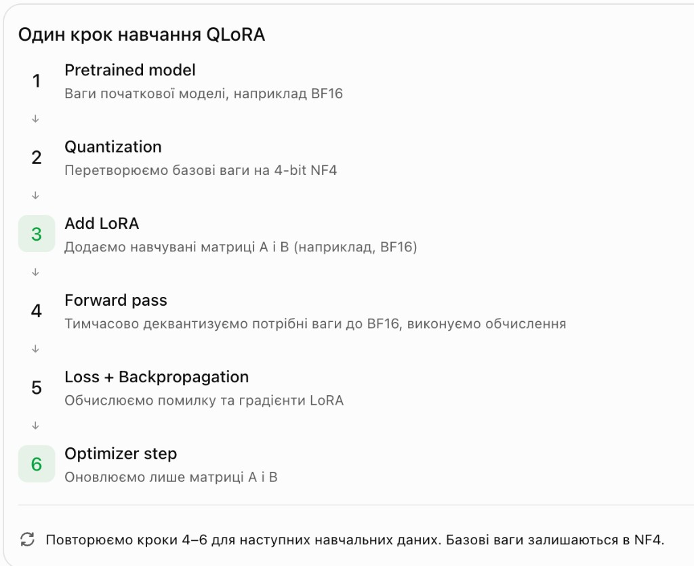

Один крок навчання QLoRA (Quantized Low-Rank Adaptation):

1. **Pretrained model.** Ваги початкової моделі, наприклад BF16 (Brain Floating Point 16-bit).
2. **Quantization.** Базові ваги перетворюємо на NF4 (NormalFloat 4-bit).
3. **Add LoRA.** Додаємо навчувані матриці \(A\) і \(B\), наприклад у BF16 (Brain Floating Point 16-bit).
4. **Forward pass.** Тимчасово деквантизуємо потрібні ваги до BF16 (Brain Floating Point 16-bit) і виконуємо обчислення.
5. **Loss + backpropagation.** Рахуємо помилку та градієнти LoRA (Low-Rank Adaptation).
6. **Optimizer step.** Оновлюємо лише матриці \(A\) і \(B\).

Кроки 4–6 повторюються на наступних навчальних даних. Базові ваги залишаються в NF4 (NormalFloat 4-bit).

Після loss повторна квантизація не потрібна. Оригінальні 4-бітні ваги весь час лежать у пам’яті. Тимчасові значення BF16 (Brain Floating Point 16-bit) живуть лише під час forward і backward pass. Коли вони більше не потрібні, цю пам’ять звільняють або використовують знову.

Це не цикл постійного переписування базових ваг:

`NF4 (NormalFloat 4-bit) → BF16 (Brain Floating Point 16-bit) → NF4 (NormalFloat 4-bit) → BF16 (Brain Floating Point 16-bit)`

Це цикл:

`збережені NF4 (NormalFloat 4-bit) → тимчасові 16-бітні обчислення → звільнення тимчасових даних`

#### 2. Звідки беруться «зайві» цифри після деквантизації

Коли 16-бітні ваги перетворили на 4-бітні, частину інформації втратили назавжди. Деквантизація до 16 біт **не відновлює** оригінальні значення. Базові ваги також не перемикаються між двома форматами зберігання: вони зберігаються у 4 бітах, а для обчислень тимчасово представлені у 16-бітному форматі.

Припустимо, початкове значення однієї ваги:

\[
w = 0.73428125
\]

Це умовний приклад. Під час 4-бітної квантизації число не просто обрізають до чотирьох двійкових цифр. Його зіставляють з одним із 16 можливих квантованих рівнів. Для NF4 (NormalFloat 4-bit) ці рівні розподілені нерівномірно, а для відновлення використовують коефіцієнти масштабування блоку ваг.

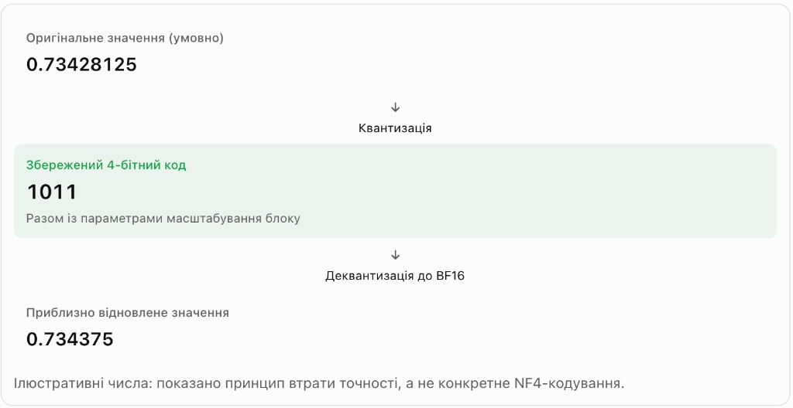

Ілюстративні числа. Це принцип втрати точності, а не конкретне кодування NF4 (NormalFloat 4-bit).

Значення `0.734375` не взяте з копії оригінального числа. Алгоритм складає його з трьох речей:

- збереженого 4-бітного коду, наприклад `1011`;
- таблиці значень NF4 (NormalFloat 4-bit), тобто codebook;
- коефіцієнтів масштабування відповідного блоку ваг.

Результат — наближення до оригіналу, записане у BF16 (Brain Floating Point 16-bit).

16-бітний формат означає, що для числа виділено 16 бітів, а не що після коми буде 16 десяткових цифр.

> **Простими словами:**  
> Стиснене фото не стає оригіналом, якщо його знову відкрити у великому редакторі. Файл на диску лишається стисненим. На екран виводять приблизну копію лише на час перегляду.

#### 3. Чим BF16 відрізняється від NF4

BF16 (Brain Floating Point 16-bit) і NF4 (NormalFloat 4-bit) відрізняються не лише кількістю бітів. Вони по-різному представляють число.

##### Як виглядають біти

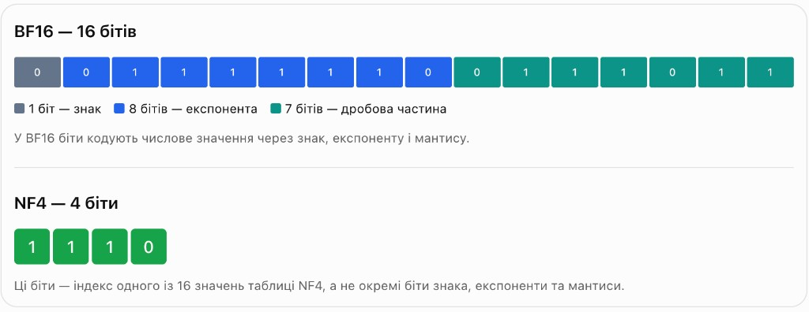

**BF16 (Brain Floating Point 16-bit), 16 бітів.** Біти кодують значення через знак, експоненту й мантису:

- 1 біт — знак числа (`+` або `−`);
- 8 бітів — експонента, тобто масштаб числа;
- 7 бітів — дробова частина мантиси, тобто точність.

Тому BF16 (Brain Floating Point 16-bit) може представляти дуже великі, дуже малі, додатні й від’ємні числа.

**NF4 (NormalFloat 4-bit), 4 біти.** Ці 4 біти — не знак, експонента й мантиса. Це індекс одного із 16 значень готової таблиці:

\[
2^4 = 16
\]

Кожен код відповідає одному із 16 заздалегідь визначених рівнів. Рівні підібрані під нормальний розподіл, бо ваги нейронних мереж часто розподілені приблизно так. Біля нуля рівнів більше: саме там зазвичай лежить більшість ваг. Джерело: [QLoRA paper](https://arxiv.org/abs/2305.14314).

> **Простими словами:**  
> BF16 (Brain Floating Point 16-bit) сам збирає число з трьох деталей: знак, масштаб і дробова частина. NF4 (NormalFloat 4-bit) лише показує номер полички в шафі з 16 готових чисел.

##### Одне й те саме число в двох форматах

Візьмемо вагу:

\[
w = 0.73
\]


- BF16 (Brain Floating Point 16-bit) дає приблизно `0.73046875`. На це йде 16 бітів.
- NF4 (NormalFloat 4-bit) дає приблизно `0.7229568`. На це йдуть 4 біти плюс масштаб блоку.

У прикладі коефіцієнт масштабування блоку дорівнює `1.0`, таблиця рівнів — стандартна NF4 (NormalFloat 4-bit). За іншого масштабу відновлене число буде іншим.

- BF16 (Brain Floating Point 16-bit) кодує число через експоненту й мантису.
- NF4 (NormalFloat 4-bit) шукає найближчий рівень у таблиці з 16 значень і зберігає його індекс. Під час деквантизації до цього рівня застосовують масштаб блоку.

Обидва формати втрачають точність. NF4 (NormalFloat 4-bit) стискає сильніше.

##### Скільки пам’яті це економить

Для 1 мільярда параметрів лише під ваги, без масштабів квантизації, метаданих і інших витрат:

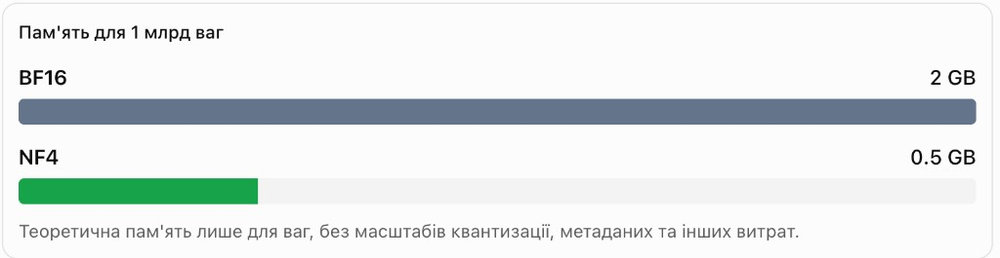

- BF16 (Brain Floating Point 16-bit): \(1\,000\,000\,000 \times 2\) байти = **2 GB**.
- NF4 (NormalFloat 4-bit): \(1\,000\,000\,000 \times 0{,}5\) байта = **0,5 GB**.

Отже, NF4 (NormalFloat 4-bit) стискає ваги приблизно в **4 рази** відносно BF16 (Brain Floating Point 16-bit), а не у 8. Вісім разів — це порівняння FP32 (Floating Point 32-bit) із 4-бітним форматом: 32 / 4 = 8.

##### Як обидва формати працюють у QLoRA

| Компонент | Формат | Призначення |
|---|---|---|
| Базові ваги моделі | NF4 (NormalFloat 4-bit) | Компактне зберігання |
| Тимчасові обчислення | BF16 (Brain Floating Point 16-bit) | Математичні операції |
| LoRA-матриці \(A\) і \(B\) (Low-Rank Adaptation) | Зазвичай BF16 (Brain Floating Point 16-bit) або FP32 (Floating Point 32-bit) | Навчання адаптера |

Під час деквантизації NF4 (NormalFloat 4-bit) → BF16 (Brain Floating Point 16-bit) виходить не початкове число, а його наближення, записане у BF16 (Brain Floating Point 16-bit).

Тому 4-бітна модель не стає автоматично такою ж точною, як оригінальна 16-бітна. На багатьох задачах результати все одно дуже близькі.

Джерела: [QLoRA paper](https://arxiv.org/abs/2305.14314), [Hugging Face: bitsandbytes](https://huggingface.co/docs/transformers/quantization/bitsandbytes).

#### 4. Що відбувається під час inference

Процес схожий, але без навчання: градієнти не рахують і адаптери не оновлюють.


1. У пам’яті лежать базова модель у NF4 (NormalFloat 4-bit) і навчений LoRA-адаптер (Low-Rank Adaptation).
2. Потрібні ваги тимчасово деквантизуються до BF16 (Brain Floating Point 16-bit).
3. Обчислення йдуть уже з LoRA-корекціями (Low-Rank Adaptation).
4. На виході — згенерована відповідь.

Є й інший варіант розгортання: злити LoRA (Low-Rank Adaptation) з базовими вагами і за потреби знову квантизувати модель. Inference не зобов’язаний лишатися саме в NF4 (NormalFloat 4-bit).

#### 5. Paging: куди дівається пам’ять під час піків

Paging (сторінкова організація пам’яті) переміщує частини даних між різними областями пам’яті.

У QLoRA (Quantized Low-Rank Adaptation) для цього є paged optimizers. Вони спираються на NVIDIA Unified Memory і гасять тимчасові піки використання пам’яті GPU (Graphics Processing Unit). Джерело: [QLoRA paper](https://arxiv.org/abs/2305.14314).

Уявімо:

- GPU (Graphics Processing Unit) має 12 GB VRAM (Video RAM);
- комп’ютер має 32 GB RAM (Random Access Memory);
- під час навчання GPU (Graphics Processing Unit) раптово потрібно більше пам’яті, ніж є у VRAM (Video RAM).


Схема умовна. Це не виміряний профіль пам’яті конкретного запуску.

Крім ваг, GPU (Graphics Processing Unit) тримає активації, градієнти, стани оптимізатора й тимчасові буфери. Коли використання різко стрибає, звичайний процес падає з CUDA OOM (Out of Memory). Paged optimizer може відкласти частину стану оптимізатора в RAM (Random Access Memory) і повернути її, коли вона знову потрібна.

> **Простими словами:**  
> На столі замало місця, тож частину паперів на хвилину кладуть на полицю. Полиця далі від рук, тому робота стає повільнішою.

Передача між GPU (Graphics Processing Unit) і RAM (Random Access Memory) значно повільніша за роботу просто у VRAM (Video RAM). Paging у QLoRA (Quantized Low-Rank Adaptation) стосується насамперед пам’яті станів оптимізатора, а не будь-яких даних моделі. Він не гарантує, що модель поміститься на GPU (Graphics Processing Unit) за будь-яких умов.

#### 6. Як три механізми працюють разом

| Механізм | Що робить | Навіщо |
|---|---|---|
| NF4 (NormalFloat 4-bit) | Зберігає базові ваги у 4 бітах | Економія VRAM (Video RAM) |
| LoRA (Low-Rank Adaptation) | Навчає лише маленькі матриці \(A\) і \(B\) | Менше параметрів, градієнтів і станів оптимізатора |
| Paged optimizer | За потреби переносить сторінки стану оптимізатора між GPU (Graphics Processing Unit) і RAM (Random Access Memory) | Менший ризик OOM (Out of Memory) під час піків |

BF16 (Brain Floating Point 16-bit) — це формат обчислень. NF4 (NormalFloat 4-bit) — формат зберігання базових ваг. Вони не суперечать одне одному: ваги лежать компактно, а рахують їх із вищою точністю.

#### 7. Уточнення щодо пам'яті QLoRA і Mixtral

Наступні числа часто наводять як орієнтир, але вони залежать від конфігурації.

- Модель на 70 мільярдів параметрів у 4 бітах потребує приблизно **35 GB лише під ваги**, без активацій, градієнтів і оптимізатора. Це не 18 GB. В оригінальному дослідженні QLoRA (Quantized Low-Rank Adaptation) модель на 65 мільярдів донавчали на GPU (Graphics Processing Unit) з 48 GB пам’яті. Джерело: [QLoRA paper](https://arxiv.org/abs/2305.14314).
- Mixtral 8x7B має приблизно **46,7 млрд параметрів загалом**, але лише близько **12,9 млрд активних на кожен токен**. Формулювання «46 млрд активних» хибне. Джерело: [Mixtral of Experts](https://arxiv.org/abs/2401.04088).

QLoRA (Quantized Low-Rank Adaptation) все одно робить донавчання великих моделей доступнішим, ніж повне оновлення всіх ваг. Конкретна ціна й обсяг VRAM (Video RAM) залежать від моделі, довжини контексту й обладнання.

#### Що варто запам’ятати

- **Квантизація** визначає, у якій точності зберігаємо ваги.
- **Деквантизація** дозволяє рахувати з вищою точністю, але не відновлює втрачені цифри.
- **LoRA (Low-Rank Adaptation)** визначає, які параметри навчаємо.

QLoRA (Quantized Low-Rank Adaptation) поєднує всі три механізми: NF4 (NormalFloat 4-bit), LoRA (Low-Rank Adaptation) і paged optimizer.

---

### 2.3 DoRA (Weight-Decomposed Low-Rank Adaptation)

DoRA (Weight-Decomposed Low-Rank Adaptation) — це вдосконалення LoRA (Low-Rank Adaptation). Воно дозволяє окремо навчати напрямок і величину векторів ваг.

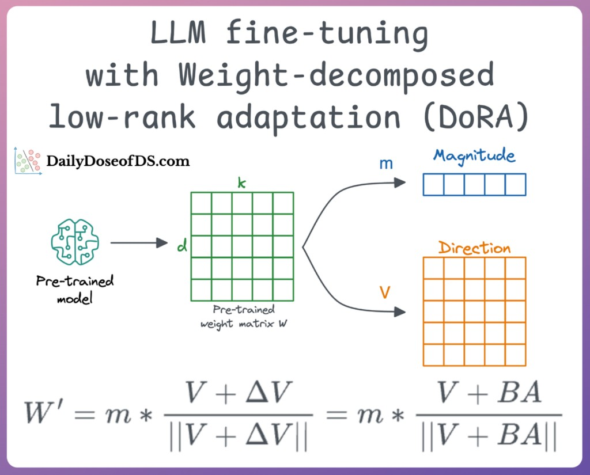

Джерела:

- [DoRA: Weight-Decomposed Low-Rank Adaptation (Liu et al., 2024)](https://arxiv.org/abs/2402.09353)
- [DailyDoseofDS: Implementing DoRA](https://www.dailydoseofds.com/implementing-dora-an-improved-lora-from-scratch/)

> **Простими словами:**  
> Якщо LoRA (Low-Rank Adaptation) змінює стрілку цілком, то DoRA (Weight-Decomposed Low-Rank Adaptation) окремо крутить її напрямок і окремо змінює, наскільки сильно натиснути.

DoRA (Weight-Decomposed Low-Rank Adaptation) особливо корисна, коли навчальних даних небагато або треба витиснути максимум якості в межах PEFT (Parameter-Efficient Fine-Tuning).

#### 1. Кожен вектор має довжину і напрямок

Уявімо вектор:

\[
w = [3,\ 4]
\]

Його довжина, або L2-норма (евклідова норма):

\[
\|w\| = \sqrt{3^2 + 4^2} = 5
\]

Напрямок — це той самий вектор, стиснутий до довжини 1:

\[
\hat{w} = \frac{w}{\|w\|} = [0.6,\ 0.8]
\]

Тому вихідний вектор розкладається на два незалежні аспекти:

\[
w = \underbrace{5}_{\text{величина}} \cdot \underbrace{[0.6,\ 0.8]}_{\text{напрямок}}
\]

Можна змінити лише напрямок і лишити довжину 5. Можна змінити лише довжину і лишити напрямок \([0.6,\ 0.8]\). Саме це розділення використовує DoRA (Weight-Decomposed Low-Rank Adaptation).

#### 2. Чим DoRA відрізняється від LoRA

Формула LoRA (Low-Rank Adaptation):

\[
W_{\text{LoRA}} = W_0 + BA
\]

- \(W_0\) — велика заморожена матриця ваг базової моделі.
- \(A\) і \(B\) — дві маленькі навчувані матриці.
- \(BA\) — корекція ваг \(W_0\), а не корекція самих матриць \(A\) і \(B\).

\(BA\) має той самий розмір, що й \(W_0\), тому їх можна додати:

\[
\underbrace{W_0}_{4096 \times 4096} + \underbrace{B}_{4096 \times 8} \cdot \underbrace{A}_{8 \times 4096}
\]

Добуток \(BA\) має розмір \(4096 \times 4096\). Маленькі матриці навчаються створювати поправку для великої матриці, не переписуючи її збережені параметри. Ця ідея спільна для LoRA (Low-Rank Adaptation) і DoRA (Weight-Decomposed Low-Rank Adaptation).

Обмеження LoRA (Low-Rank Adaptation): додавання \(BA\) може одночасно змінити і довжину, і напрямок стовпців ваг. Окремого важеля для довжини немає.

DoRA (Weight-Decomposed Low-Rank Adaptation) робить інакше:

1. \(W_0\) лишається замороженою.
2. Через LoRA (Low-Rank Adaptation) навчається корекція напрямку.
3. Отримані стовпці нормалізують, тобто приводять до довжини 1.
4. Окремо навчають величини \(m\), які задають довжину кожного стовпця.

Коротко: DoRA (Weight-Decomposed Low-Rank Adaptation) = LoRA (Low-Rank Adaptation) для напрямку + окремі навчувані величини.

#### 3. Формула і числовий приклад

\[
W' = m \odot \frac{W_0 + BA}{\|W_0 + BA\|_c}
\]

- \(W_0 + BA\) — початкові ваги з LoRA-корекцією (Low-Rank Adaptation).
- \(\|\cdot\|_c\) — L2-норма (евклідова норма) кожного стовпця.
- Ділення на цю норму дає одиничні вектори напрямку.
- \(m\) — окремі навчувані величини стовпців.
- \(\odot\) — масштабування кожного стовпця своєю величиною.

Норму рахують по стовпцях матриці ваг, а не окремо для кожної ваги і не «для кожного нейрона» як самостійної одиниці. Джерело: [DoRA paper](https://arxiv.org/abs/2402.09353).

Припустимо, один стовпець має значення:

\[
w_0 = [3,\ 4], \quad \|w_0\| = 5
\]

LoRA (Low-Rank Adaptation) дала корекцію \(\Delta w = [1,\ -1]\). Тоді:

\[
w_0 + \Delta w = [4,\ 3]
\]

DoRA (Weight-Decomposed Low-Rank Adaptation) нормалізує результат. Довжина \([4,\ 3]\) теж дорівнює 5:

\[
\frac{[4,\ 3]}{5} = [0.8,\ 0.6]
\]

Якщо оптимізатор навчив величину \(m = 6\):

\[
w' = 6 \cdot [0.8,\ 0.6] = [4.8,\ 3.6]
\]

\(w'\) читається як «w штрих». Це новий, скоригований вектор ваг. Штрих тут не означає похідну.

| | Початковий вектор | Після DoRA |
|---|---|---|
| Координати | \([3,\ 4]\) | \([4.8,\ 3.6]\) |
| Довжина | 5 | 6 |
| Напрямок | \([0.6,\ 0.8]\) | \([0.8,\ 0.6]\) |

Напрямок і довжина змінились різними механізмами.

На старті \(m\) дорівнює початковим нормам стовпців \(W_0\), а LoRA-корекція (Low-Rank Adaptation) дорівнює нулю. Тому на першому кроці модель поводиться так само, як базова.

#### 4. Як оптимізатор навчає величину \(m\)

Практичний цикл такий самий, як у LoRA (Low-Rank Adaptation):

1. **Forward pass.** Базова модель разом із DoRA (Weight-Decomposed Low-Rank Adaptation) рахує прогноз.
2. **Loss.** Рахуємо помилку.
3. **Backpropagation.** Рахуємо градієнти.
4. **Optimizer step.** Оновлюємо \(A\), \(B\) і величини \(m\).

\(W_0\) не змінюється. Після навчання DoRA (Weight-Decomposed Low-Rank Adaptation) можна злити з базовими вагами для inference, як звичайну LoRA (Low-Rank Adaptation).

Звідки береться конкретне \(m\), наприклад 6, а не 5 чи 7? Оптимізатор його не «знає». Він зменшує loss.

Спрощений нейрон, у якому напрямок тимчасово зафіксований:

- вхід \(x = [1,\ 0]\);
- напрямок \(\hat{w} = [0.8,\ 0.6]\);
- поточна величина \(m = 6\);
- правильна відповідь \(y_{\text{true}} = 4\).

**Крок 1. Forward pass.** Скалярний добуток:

\[
y_{\text{pred}} = (m\hat{w}) \cdot x = 6(0.8 \cdot 1 + 0.6 \cdot 0) = 4.8
\]

**Крок 2. Loss.** Квадратична помилка:

\[
L = \frac{1}{2}(y_{\text{pred}} - y_{\text{true}})^2 = \frac{1}{2}(4.8 - 4)^2 = 0.32
\]

**Крок 3. Похідна за \(m\).** За правилом ланцюга:

\[
\frac{\partial L}{\partial m} = (y_{\text{pred}} - y_{\text{true}}) \cdot (\hat{w} \cdot x) = (4.8 - 4) \cdot 0.8 = 0.64
\]

Градієнт додатний, тож локально помилку зменшує зменшення \(m\).

**Крок 4. Оновлення.** Градієнтний спуск із learning rate (швидкість навчання) \(\eta = 0.1\):

\[
m_{\text{new}} = m - \eta \frac{\partial L}{\partial m} = 6 - 0.1 \cdot 0.64 = 5.936
\]

Новий вектор і прогноз:

\[
w' = 5.936 \cdot [0.8,\ 0.6] = [4.7488,\ 3.5616]
\]

Прогноз стає 4.7488 замість 4.8, тобто ближче до 4.

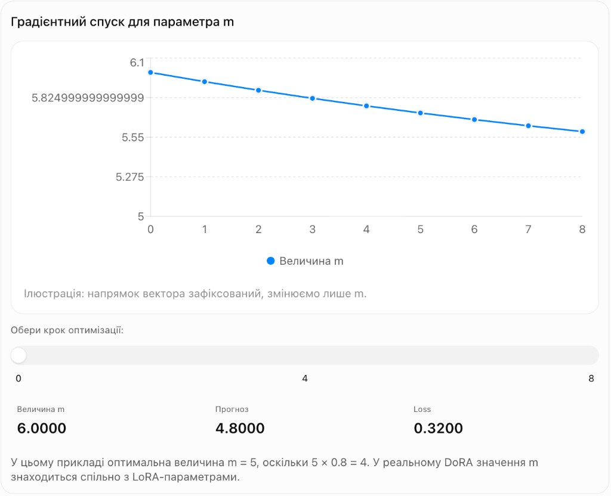

На графіку напрямок зафіксований, змінюється лише \(m\). У цьому прикладі оптимальна величина \(m = 5\), бо \(5 \times 0.8 = 4\). У справжній DoRA (Weight-Decomposed Low-Rank Adaptation) \(m\) шукають разом із параметрами LoRA (Low-Rank Adaptation), а не при замороженому напрямку.

У реальній моделі оптимізатор одночасно оновлює три набори параметрів:

- матрицю \(A\);
- матрицю \(B\);
- вектор величин \(m\) для стовпців.

Backpropagation дає три градієнти:

\[
\frac{\partial L}{\partial A}, \quad \frac{\partial L}{\partial B}, \quad \frac{\partial L}{\partial m}
\]

Далі їх оновлює оптимізатор, наприклад Adam (Adaptive Moment Estimation). Коли змінюються \(A\) і \(B\), змінюється й напрямок, тому градієнт для \(m\) на наступному кроці вже інший.

Початкові \(m\) не випадкові: це норми відповідних стовпців базової матриці \(W_0\).

Особливість DoRA (Weight-Decomposed Low-Rank Adaptation) не в новому способі рахувати похідні. Backpropagation і градієнтний спуск ті самі. Інша лише параметризація: величина й напрямок розділені.

#### 5. Як формула ваг пов’язана з оновленням \(m\)

Основна формула DoRA (Weight-Decomposed Low-Rank Adaptation):

\[
W' = m \odot \frac{W_0 + BA}{\|W_0 + BA\|_c}
\]

- \(W_0\) — заморожена матриця ваг базової моделі.
- \(BA\) — корекція, яку навчає LoRA (Low-Rank Adaptation).
- \(\|W_0 + BA\|_c\) — L2-норма (евклідова норма) кожного стовпця.
- \(m\) — навчуваний вектор величин (magnitude).
- \(W'\) — результуюча матриця ваг.

Якщо оптимізатор — звичайний градієнтний спуск, саме \(m\) оновлюється так:

\[
m_{\text{new}} = m_{\text{old}} - \eta \frac{\partial L}{\partial m}
\]

- \(\eta\) — learning rate (швидкість навчання).
- \(L\) — функція втрат. Для передбачення токенів це зазвичай Cross-Entropy Loss (крос-ентропія). У спрощеному прикладі вище замість неї була квадратична помилка, щоб порахувати похідну вручну.
- \(\frac{\partial L}{\partial m}\) — градієнт, який рахує backpropagation.

Перша формула показує, як \(m\) входить у ваги моделі, а через ваги — у ймовірності наступних токенів. Друга показує, як оптимізатор змінює \(m\), щоб зменшити помилку передбачення.

У реальній DoRA (Weight-Decomposed Low-Rank Adaptation) одночасно оновлюються \(m\), \(A\) і \(B\). Матриця \(W_0\) залишається незмінною.

#### 6. Як це працює на справжніх токенах

У реальній LLM (Large Language Model) ми знаємо очікуваний токен або послідовність токенів. Ми не знаємо «правильне число 4», як у спрощеному прикладі нейрона.

**1. Модель отримує навчальний приклад.**

- Input: `The capital of Poland is`
- Target: `Warsaw`

Модель рахує ймовірності наступного токена. Нижче умовний приклад лише з чотирма варіантами:

| Токен | Ймовірність |
|---|---:|
| Warsaw | 0.40 |
| Krakow | 0.35 |
| Berlin | 0.15 |
| Paris | 0.10 |

**2. Рахуємо loss.** Правильний токен — `Warsaw`. Для цього беруть Cross-Entropy Loss (крос-ентропія):

\[
L = -\log(P(\text{Warsaw})) = -\ln(0.40) \approx 0.916
\]

У цій формулі \(\log\) — натуральний логарифм. Модель має підвищити ймовірність правильного токена: що більша \(P(\text{Warsaw})\), то менший loss.

**3. Як це пов’язано з величиною \(m\).** Параметр \(m\) не є правильною відповіддю і не відповідає конкретному слову. Він змінює ваги одного з лінійних шарів Transformer. Ці ваги змінюють приховані стани, далі логіти, і вже з логітів виходять імовірності токенів.

Ланцюг один:

1. Навчуваний параметр DoRA (Weight-Decomposed Low-Rank Adaptation): \(m\).
2. Він впливає на ваги шару Transformer.
3. Змінюються логіти та ймовірності токенів.
4. Рахуємо loss для правильного токена.
5. Backpropagation рахує \(\frac{\partial L}{\partial m}\).
6. Оптимізатор оновлює \(m\), а також матриці \(A\) і \(B\).

Наприклад, після кількох кроків імовірність `Warsaw` може зрости з 0.40 до 0.75. Це ілюстрація, а не гарантований результат.

Оптимізатор не знає, якою має бути величина \(m\). Він знає лише градієнт функції втрат за цим параметром. Через chain rule (правило ланцюга) backpropagation визначає, в який бік змінити \(m\), щоб зменшити помилку передбачення правильних токенів.

Саме так DoRA (Weight-Decomposed Low-Rank Adaptation) навчає величини векторів ваг, хоча в навчальному наборі немає жодних правильних значень цих величин.

> **Простими словами:**  
> У зошиті написано лише правильне слово `Warsaw`. Там немає рядка «величина \(m\) має бути 6». Модель сама підкручує \(m\), доки правильне слово не стає ймовірнішим.

#### 7. Чому DoRA може працювати краще

У дослідженні 2024 року автори побачили, що під час повного fine-tuning зміни величин і напрямків ваг мають інші закономірності, ніж у LoRA (Low-Rank Adaptation). DoRA (Weight-Decomposed Low-Rank Adaptation) адаптує ці характеристики окремо, тому в їхніх експериментах її поведінка була ближчою до повного донавчання.

У тестах авторів DoRA (Weight-Decomposed Low-Rank Adaptation) переважала LoRA (Low-Rank Adaptation) на кількох мовних і мультимодальних задачах. Твердження, що якість «майже ідентична» повному fine-tuning, не є гарантією для будь-якої моделі, даних і завдання. Джерело: [DoRA paper](https://arxiv.org/abs/2402.09353).

#### 8. LoRA, QLoRA і DoRA поруч

| | LoRA (Low-Rank Adaptation) | QLoRA (Quantized Low-Rank Adaptation) | DoRA (Weight-Decomposed Low-Rank Adaptation) |
|---|---|---|---|
| Базові ваги | Заморожені | Заморожені, зазвичай NF4 (NormalFloat 4-bit) | Заморожені |
| Що навчаємо | Матриці \(A\), \(B\) | Матриці \(A\), \(B\) | Матриці \(A\), \(B\) і величини \(m\) |
| Основна ідея | Низькорангова корекція ваг | LoRA (Low-Rank Adaptation) + квантизація | Розділення величини й напрямку |
| Головна перевага | Економія ресурсів | Ще менші вимоги до пам’яті | Більша гнучкість адаптації |

DoRA (Weight-Decomposed Low-Rank Adaptation) можна поєднувати з квантизацією. Це не взаємовиключні технології.

#### Що варто запам’ятати

- LoRA (Low-Rank Adaptation) навчає корекцію \(BA\) для великої матриці \(W_0\). Ця корекція може змінювати довжини й напрямки стовпців одночасно.
- DoRA (Weight-Decomposed Low-Rank Adaptation) розділяє процеси: LoRA-частина (Low-Rank Adaptation) задає напрямки, а параметри \(m\) задають довжини.
- Через це оптимізація гнучкіша, але навчуваних параметрів і обчислень трохи більше.

---

### 2.4 Spectrum

Spectrum визначає, які матриці ваг базової моделі варто навчати, а які краще залишити замороженими. Це інший підхід, ніж LoRA (Low-Rank Adaptation): нових низькорангових матриць він не додає.

Метод описано в дослідженні [Spectrum: Targeted Training on Signal to Noise Ratio (Hartford et al., 2024)](https://arxiv.org/abs/2406.06623). Реалізація: [QuixiAI/spectrum](https://github.com/QuixiAI/spectrum).

#### 1. У чому головна ідея

Три вже знайомі варіанти:

- **Full Fine-tuning:** навчаємо всі ваги базової моделі.
- **LoRA (Low-Rank Adaptation):** базові ваги заморожені, навчаємо додаткові маленькі матриці \(A\) і \(B\).
- **Spectrum:** аналізуємо початкові матриці ваг, вибираємо найперспективніші й навчаємо тільки їх. Решту заморожуємо.

У Transformer, наприклад, 32 шари. У кожному шарі кілька матриць: в Attention і в MLP (Multilayer Perceptron, багатошаровий перцептрон). Spectrum може взяти 25% таких матриць. Це не обов’язково 25% цілих шарів.

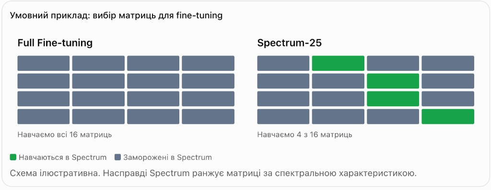

На умовній схемі повне навчання оновлює всі 16 матриць. Spectrum-25 оновлює 4 із 16. Зелені клітинки навчаються, сірі заморожені. Схема ілюстративна: насправді Spectrum ранжує матриці за спектральною характеристикою, а не фарбує кожну четверту клітинку.

У вибраних матрицях оновлюються всі їхні параметри. Spectrum не обмежується низькоранговою корекцією.

> **Простими словами:**  
> Замість того щоб домальовувати маленькі окуляри до всієї моделі, Spectrum спочатку дивиться, які «сторінки» ваг найінформативніші, і переписує лише їх.

#### 2. Що таке MLP і навіщо він у Transformer

MLP (Multilayer Perceptron, багатошаровий перцептрон) — звичайна нейронна мережа з кількох шарів нейронів. Це та сама конструкція, що й у базовому курсі: ваги, bias (зміщення), ReLU (Rectified Linear Unit, випрямлена лінійна одиниця), градієнтний спуск і backpropagation.

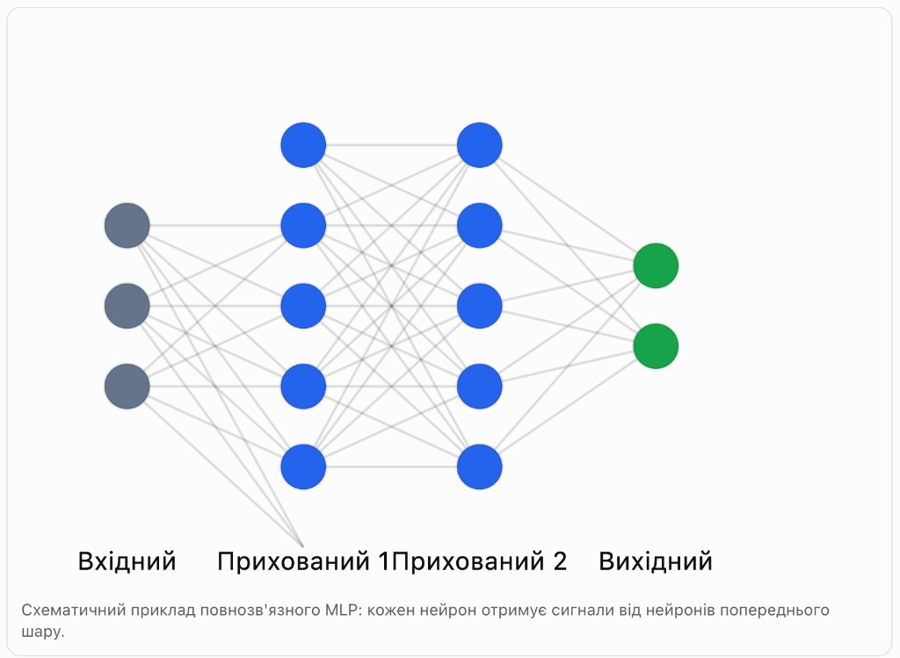

Кожен нейрон прихованого шару отримує сигнали від усіх нейронів попереднього шару. Один такий шар рахує приблизно так:

\[
h = \mathrm{ReLU}(Wx + b)
\]

- \(x\) — вхідний вектор.
- \(W\) — матриця ваг.
- \(b\) — вектор зміщень, bias.
- ReLU (Rectified Linear Unit) — функція активації. Вона додає нелінійність: від’ємні значення стають нулем, додатні лишаються.

Результат \(h\) іде в наступний шар.

У блоці Transformer зазвичай два великі обчислення:

- **Self-Attention.** Токени обмінюються інформацією і враховують контекст один одного.
- **MLP, його ще називають FFN (Feed-Forward Network, мережа прямого поширення).** Воно окремо перетворює представлення кожного токена навченими матрицями і нелінійними функціями.

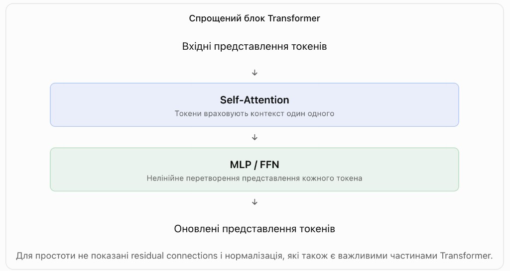

На схемі шлях такий: вхідні представлення токенів, Self-Attention, MLP / FFN (Feed-Forward Network), оновлені представлення. Residual connections (залишкові зв’язки) і нормалізацію для простоти не показано, хоча вони теж є в блоці.

Приклад речення: «Я поклала гроші в банк».

- Attention допомагає токену «банк» побачити контекст «поклала гроші», а не лише слово «банк» саме по собі.
- MLP перетворює вже контекстне представлення цього токена нелінійними операціями.

Attention не відповідає «лише за контекст», а MLP не зберігає «лише знання». Обидва компоненти разом формують поведінку моделі.

У Spectrum MLP згадують тому, що всередині нього лежать великі матриці ваг. У багатьох сучасних LLM (Large Language Model) таких проєкцій три:

- `gate_proj` керує нелінійним перетворенням;
- `up_proj` розширює внутрішнє представлення;
- `down_proj` повертає його до початкової розмірності.

Spectrum може розкласти кожну з цих матриць через SVD (Singular Value Decomposition) і вирішити, які з них навчати.

> **Простими словами:**  
> MLP — не окрема нова технологія мовної моделі. Це знайома повнозв’язна мережа, вставлена в кожен блок Transformer. Attention працює зі зв’язками між позиціями токенів. MLP перетворює представлення кожної позиції.

#### 3. Навіщо Spectrum потрібен SVD

SVD (Singular Value Decomposition, сингулярний розклад) — той самий прийом, що й під час стиснення зображень. Матрицю розкладають на напрямки перетворення і відповідні сингулярні значення:

\[
A = U \Sigma V^{\mathsf T}
\]

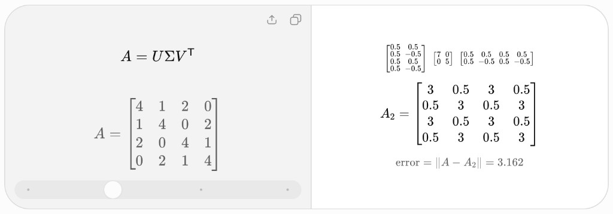

На ілюстрації матриця

\[
A =
\begin{bmatrix}
4 & 1 & 2 & 0 \\
1 & 4 & 0 & 2 \\
2 & 0 & 4 & 1 \\
0 & 2 & 1 & 4
\end{bmatrix}
\]

замінена наближенням \(A_2\) з двох найсильніших складових. Помилка цього наближення:

\[
\|A - A_2\| = 3.162
\]

Це приклад самого розкладу, як у стисненні картинки. Spectrum не замінює ваги моделі на таке стиснене \(A_2\) і не навчає лише окремі сингулярні напрямки.

Для Spectrum важливі сингулярні значення \(\sigma_i\). Це числа, які показують, наскільки сильно матриця розтягує або стискає простір уздовж певних напрямків.

У розкладі \(A = U\Sigma V^{\mathsf T}\):

- \(V^{\mathsf T}\) задає вхідні напрямки;
- \(\Sigma\) містить сингулярні значення, тобто коефіцієнти розтягування або стискання;
- \(U\) задає вихідні напрямки.

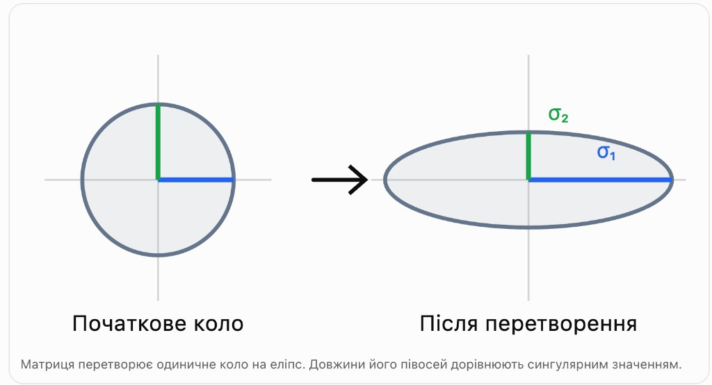

Матриця перетворює одиничне коло на еліпс. Довжини півосей цього еліпса і є сингулярними значеннями.

Наприклад,

\[
A =
\begin{bmatrix}
3 & 0 \\
0 & 1
\end{bmatrix}
\]

має \(\sigma_1 = 3\) і \(\sigma_2 = 1\). Один напрямок розтягується втричі, другий лишається без зміни.

Сингулярні значення пов’язані з власними значеннями матриці \(A^{\mathsf T}A\):

\[
\sigma_i = \sqrt{\lambda_i(A^{\mathsf T}A)}
\]

- вони завжди невід’ємні;
- їх упорядковують: \(\sigma_1 \ge \sigma_2 \ge \ldots \ge 0\);
- велике значення означає сильніше масштабування вздовж відповідного напрямку;
- нуль означає, що цей напрямок стискається повністю.

Сингулярні вектори задають напрямки. Сингулярні значення задають силу масштабування вздовж цих напрямків.

У стисненні зображень залишають найбільші \(\sigma_i\), щоб зберегти головні деталі картинки. Spectrum так не робить. Він не вибирає окремі великі \(\sigma_i\) для навчання. Він дивиться на розподіл усіх сингулярних значень матриці ваг і за ним рахує SNR (Signal-to-Noise Ratio, співвідношення сигналу до шуму).

#### 4. Від сингулярних значень до SNR

Між SVD (Singular Value Decomposition) і SNR (Signal-to-Noise Ratio) є поріг, який відділяє сигнал від шуму.

**1. SVD знаходить сингулярні значення.** Припустимо, для матриці ваг \(W\) вийшло:

\[
\sigma = [9,\ 4,\ 1,\ 0.5]
\]

**2. Поріг відділяє сигнал від шуму.** Spectrum оцінює поріг \(\varepsilon\) за розподілом Марченка–Пастура. У прикладі нижче поріг умовний: \(\varepsilon = 2\). Справжній Spectrum рахує його зі статистики спектра і розмірів матриці.

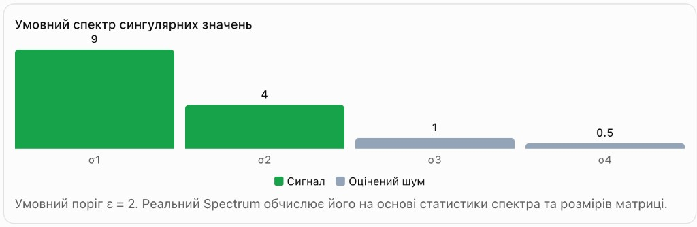

- Сигнал: \(9\) і \(4\), бо вони більші за 2.
- Шум: \(1\) і \(0.5\).

**3. SNR порівнює суми.** 

\[
\mathrm{SNR} = \frac{\sum \sigma_{\text{signal}}}{\sum \sigma_{\text{noise}}} = \frac{9 + 4}{1 + 0.5} = \frac{13}{1.5} \approx 8.67
\]

Сума значень, віднесених до сигналу, приблизно в 8.67 раза більша за суму значень, віднесених до шуму. В оригінальній реалізації Spectrum цей показник ще нормалізують на найбільше сингулярне значення. Джерело: [Spectrum paper](https://arxiv.org/abs/2406.06623).

**4. Далі Spectrum порівнює матриці.** Такий показник рахують для різних матриць ваг і для навчання беруть матриці з найвищими оцінками.

Послідовність саме така:

\[
\text{SVD} \rightarrow \text{поріг сигнал/шум} \rightarrow \text{SNR} \rightarrow \text{вибір цілих матриць}
\]

Spectrum вибирає цілі матриці ваг, а не лише окремі домінантні сингулярні значення.

#### 5. Як Spectrum вибирає матриці

Умовні результати для п’яти матриць:

| Матриця | SNR (Signal-to-Noise Ratio), умовно | Рішення |
|---|---:|---|
| \(W_1\) | 12.5 | Навчаємо |
| \(W_2\) | 2.1 | Заморожуємо |
| \(W_3\) | 9.8 | Заморожуємо |
| \(W_4\) | 1.4 | Заморожуємо |
| \(W_5\) | 3.7 | Заморожуємо |

Якщо навчати 20% матриць, зі списку беруть одну з найвищим SNR (Signal-to-Noise Ratio): \(W_1\). \(W_3\) теж має високий SNR (Signal-to-Noise Ratio), але в цю квоту вже не входить.

Далі звичайне навчання:

1. Подаємо навчальні приклади.
2. Модель виконує forward pass.
3. Рахуємо loss за правильними токенами.
4. Backpropagation рахує градієнти.
5. Оптимізатор оновлює параметри \(W_1\) і не чіпає заморожені матриці.

SVD (Singular Value Decomposition) у стандартному Spectrum рахують для матриць ваг базової моделі, а не для градієнтів на маленькій вибірці. Спектральний аналіз лише вибирає матриці. Потім вибрані матриці навчаються цілком.

#### 6. Наскільки це економить пам’ять

В оригінальному дослідженні для Llama 3 8B під час розподіленого навчання на восьми GPU (Graphics Processing Unit) наведено такі піки VRAM (Video RAM) на одну GPU (Graphics Processing Unit):

| Метод | Максимум VRAM (Video RAM) на GPU (Graphics Processing Unit) |
|---|---:|
| Full Fine-tuning | 24.92 GB |
| QLoRA (Quantized Low-Rank Adaptation) | 21.25 GB |
| Spectrum-25 | 19.18 GB |
| Spectrum-25 + QLoRA (Quantized Low-Rank Adaptation) | 16.95 GB |

У цьому експерименті Spectrum-25 зменшив пікове використання пам’яті на GPU (Graphics Processing Unit) приблизно на 23% порівняно з повним fine-tuning: \((24.92 - 19.18) / 24.92 \approx 0.23\). На одному GPU (Graphics Processing Unit) звичайна QLoRA (Quantized Low-Rank Adaptation) використала менше пам’яті, ніж Spectrum-25. Джерело: [Spectrum paper](https://arxiv.org/abs/2406.06623).

Твердження про адаптер 25 MB проти 200 MB, точність 97,5% і 40 копій моделі на одному сервері цими результатами не підтверджуються. Навіть маленький адаптер усе одно потребує базової моделі, щоб рахувати відповідь.

#### 7. Порівняння з попередніми методами

| Метод | Що навчаємо |
|---|---|
| Full Fine-tuning | Усі ваги |
| LoRA (Low-Rank Adaptation) | Додаткові низькорангові матриці |
| QLoRA (Quantized Low-Rank Adaptation) | LoRA-матриці (Low-Rank Adaptation) при квантизованій базі |
| DoRA (Weight-Decomposed Low-Rank Adaptation) | LoRA-матриці (Low-Rank Adaptation) і окремі величини ваг |
| Spectrum | Вибрані за SNR (Signal-to-Noise Ratio) матриці базової моделі |

Spectrum — вибіркове тонке налаштування. SVD (Singular Value Decomposition) і SNR (Signal-to-Noise Ratio) визначають, які матриці ваг найперспективніші. Вибрані матриці оновлюються, решта лишаються замороженими.

На відміну від LoRA (Low-Rank Adaptation), Spectrum не створює низькорангових адаптерів. Його можна поєднувати з QLoRA (Quantized Low-Rank Adaptation).

Високий SNR (Signal-to-Noise Ratio) не гарантує, що матриця найважливіша саме для вашого завдання. Ефективність треба перевіряти на відкладеному наборі даних.

#### Що варто запам’ятати

- Spectrum вибирає матриці ваг, а не домальовує адаптер до кожної з них.
- Шлях такий: SVD (Singular Value Decomposition) дає сингулярні значення, поріг відділяє сигнал від шуму, SNR (Signal-to-Noise Ratio) порівнює їхні суми, і вже за цим показником вибирають цілі матриці.
- MLP (Multilayer Perceptron) у Transformer — це FFN (Feed-Forward Network) після Attention. Саме його великі матриці, як `gate_proj`, `up_proj` і `down_proj`, Spectrum теж може аналізувати.
- У вибраній матриці навчаються всі її параметри. Заморожені матриці не змінюються.

---

### 2.5 Інші PEFT-методи, які важливо знати

Оскільки в підсумкових цілях теми згадані альтернативи, додаємо їх повноцінно:

#### Adapters (Houlsby adapters)

- У кожен Transformer-блок додаються малі bottleneck-шари.
- Тренуються тільки ці шари.
- Класичне джерело: [Houlsby et al., 2019](https://arxiv.org/abs/1902.00751).

#### Prompt Tuning і Prefix Tuning: soft prompt і вектори-префікси

Вектори soft prompt і вектори-префікси — це спеціальні набори чисел, які модель навчається використовувати, щоб змінювати свою поведінку без оновлення основних ваг.

Вони схожі на звичайні embeddings слів, але є важлива відмінність: вони не обов'язково відповідають реальним словам чи токенам.

##### 1. Почнемо з embeddings

Коли ми передаємо LLM текст:

`Analyze this medical document`

Модель спочатку розбиває його на токени, а потім перетворює кожен токен на вектор чисел.

Наприклад:

\[
\text{medical} \rightarrow [0.24,\ -0.81,\ 0.53,\ 0.12,\ \ldots]
\]

Ці числа — координати токена у багатовимірному просторі embeddings.

У звичайної моделі ці вектори вже сформовані під час pretraining.

А тепер уявімо, що ми створили новий вектор:

\[
p_1 = [0.17,\ 0.93,\ -0.42,\ 0.61,\ \ldots]
\]

Він не відповідає жодному конкретному слову. Ми просто дозволяємо моделі навчати значення цього вектора, щоб допомогти їй виконувати потрібне завдання.

Це основа Prompt Tuning.

> **Простими словами:**  
> Звичайне слово — це вже відома точка на карті смислів. Soft prompt — це нова точка, яку ми самі рухаємо, поки модель не почне краще виконувати завдання. Ця точка не зобов’язана бути реальним словом.

##### 2. Що таке Soft Prompt

При Prompt Tuning ми створюємо кілька таких навчуваних векторів і додаємо їх до послідовності embeddings користувацького запиту.

- Навчаються тільки «м’які токени» промпта.
- Усі ваги базової моделі заморожені.


Навчувані вектори \(P_1, P_2, P_3\) стоять попереду embeddings реальних токенів (`Analyze`, `this`, `document`). Уся ця послідовність іде в заморожену Transformer-модель, і вже з неї виходить відповідь.

Наприклад, ми навчаємо 20 soft-prompt векторів для завдання класифікації медичних документів.

Під час навчання:

1. Базова LLM залишається замороженою.
2. Ми подаємо приклади документів із правильними відповідями.
3. Обчислюємо loss.
4. Через backpropagation оновлюємо лише 20 навчуваних векторів.

Згодом модель навчається інтерпретувати ці вектори так, щоб генерувати відповіді, які краще відповідають завданню.

Важливо: soft prompt не обов'язково можна перетворити на зрозумілий людині текст.

##### 3. А що таке Prefix Tuning

Тут ідея схожа, але механізм інший.

- Для кожного шару додаються треновані префікс-вектори в attention.
- Це особливо корисно для генеративних задач.

Згадаймо, що в Transformer є механізм Attention, який використовує три типи векторів:

- **Query (Q)** — що шукаємо.
- **Key (K)** — за чим визначаємо релевантність.
- **Value (V)** — яку інформацію передаємо далі.

При Prefix Tuning ми навчаємо спеціальні prefix-вектори для Key і Value, які додаються до attention-контексту в різних шарах Transformer.

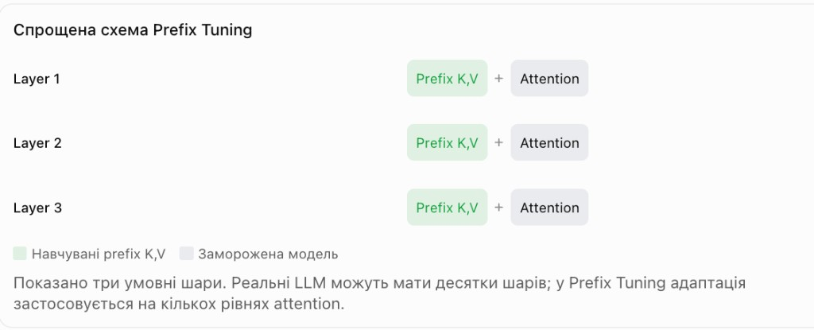

На схемі показано три умовні шари. У кожному з них навчуваний блок `Prefix K,V` додається до замороженого `Attention`. Реальні LLM можуть мати десятки шарів; у Prefix Tuning адаптація застосовується на кількох рівнях attention.

Це дозволяє впливати на те, яку інформацію обробляє attention у різних шарах, не змінюючи ваг базової моделі.

> **Простими словами:**  
> Soft prompt шепоче моделі щось на самому вході. Prefix tuning шепоче їй на кожному поверсі attention: «на ці підказки теж дивись, коли вирішуєш, що важливе».

##### 4. У чому головна різниця

| Характеристика | Soft Prompt | Prefix Tuning |
|---|---|---|
| Що навчаємо | Вектори embeddings | Prefix-вектори для attention |
| Куди додаємо | На вході моделі | У Key/Value attention кількох шарів |
| Основні ваги LLM | Заморожені | Заморожені |
| Вплив | Через вхідну послідовність | Безпосередньо через attention |
| Людина може прочитати? | Ні | Ні |

##### 5. А навіщо це робити замість звичайного текстового prompt

При звичайному prompting ми самі пишемо інструкцію:

> You are a medical document classifier. Classify each document into one of five categories.

А при Prompt Tuning ми фактично говоримо:

> Ось тисячі прикладів правильних відповідей. Знайди такі числові вектори, які допоможуть моделі якнайкраще виконувати це завдання.

Тобто замість того, щоб людина експериментувала зі словами інструкції, оптимізатор шукає ефективні значення векторів за допомогою градієнтного спуску.

Але це не гарантує, що soft prompt буде кращим за добре написану текстову інструкцію.

##### Що варто запам'ятати

- **Prompt Tuning:** навчаємо спеціальні вектори, які додаються до embeddings вхідного тексту.
- **Prefix Tuning:** навчаємо спеціальні вектори, які додаються до Key і Value в механізмах attention.
- **LoRA:** навчаємо низькорангові матриці, які коригують роботу вибраних лінійних шарів.

У всіх трьох випадках ми можемо адаптувати модель, залишивши основні ваги замороженими, але точка втручання в обчислення Transformer різна.

#### P-Tuning (та P-Tuning v2)

- Розширення prompt/prefix-ідеї з кращою стабільністю на великих моделях.

#### IA³ (Infused Adapter by Inhibiting and Amplifying Inner Activations)

IA³ навчає невеликі **вектори масштабування** і застосовує їх до активацій усередині Transformer. Базові матриці ваг не змінюються — змінюється лише те, наскільки «гучно» звучить кожна компонента проміжних обчислень.

##### 1. Що таке активації

Перш ніж зрозуміти IA³, треба розуміти, що таке **активація**.

Нейронний шар рахує:

\[
z = w_1 x_1 + w_2 x_2 + b
\]

Потім застосовує функцію активації ReLU (Rectified Linear Unit):

\[
a = \operatorname{ReLU}(z) = \max(0, z)
\]

Приклад: вхід \(x = [2,\ 3]\), ваги \(w = [0.5,\ {-0.2}]\), зміщення \(b = 0.1\):

\[
z = 0.5 \cdot 2 + (-0.2) \cdot 3 + 0.1 = 0.5
\]

\[
a = \operatorname{ReLU}(0.5) = 0.5
\]

Це число **0.5** і є активацією нейрона.

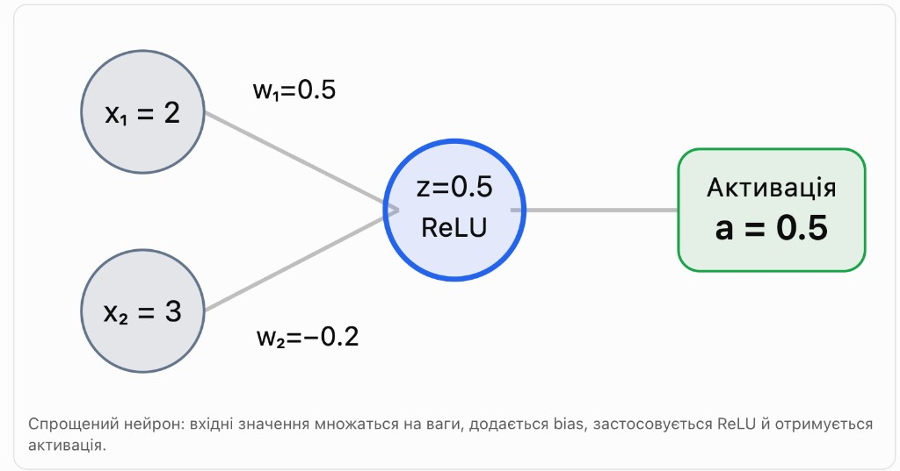

> **Простими словами:**
> Ваги — це навчені налаштування, які лежать у моделі постійно.
> Активації — це проміжні значення, які виникають під час кожного конкретного запиту.
> Для різних речень ваги однакові, а активації різні.

У великих мережах активації — це не одне число, а цілі вектори й тензори, що передаються між шарами. У Transformer слово activations часто означає і проміжні результати до нелінійних функцій теж.

| Поняття | Що це | Коли існує |
|---|---|---|
| Ваги (Weights) | Навчені параметри мережі | Постійно: і під час навчання, і під час inference |
| Активації (Activations) | Проміжні результати обчислень | Під час кожного forward pass |
| Градієнти (Gradients) | Похідні loss за параметрами | Лише під час backpropagation |

##### 2. Як IA³ змінює активації

Нейронний шар без IA³:

\[
h = Wx
\]

Припустимо, результат \(h = [2,\ 5,\ 3]\).

IA³ додає навчуваний вектор \(l = [1.5,\ 0.2,\ 2]\) і виконує поелементне множення (⊙):

\[
h' = l \odot h = [3,\ 1,\ 6]
\]

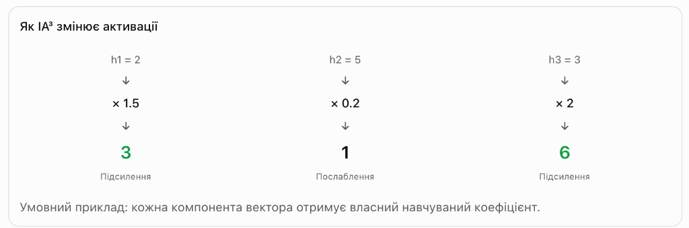

- \(h_1 = 2 \times 1.5 = 3\) → підсилення
- \(h_2 = 5 \times 0.2 = 1\) → послаблення
- \(h_3 = 3 \times 2 = 6\) → підсилення

Коефіцієнт, близький до 0, фактично вимикає компоненту. Більший за 1 — підсилює. Початково всі \(l = 1\), тому без навчання поведінка моделі не змінюється. Оптимізатор навчає \(l\) через loss і backpropagation так само, як навчається параметр \(m\) у DoRA.

##### 3. Де всередині Transformer застосовується IA³

У класичному IA³ вектори масштабування навчаються у трьох місцях:

- **Key (K)** — ключі механізму Self-Attention.
- **Value (V)** — значення механізму Self-Attention.
- **FFN (Feed-Forward Network)** — внутрішні активації MLP (Multilayer Perceptron) між двома лінійними шарами.

Джерело: [Hugging Face — IA³ documentation](https://huggingface.co/docs/peft/en/package_reference/ia3).

##### 4. IA³ проти LoRA

| | LoRA (Low-Rank Adaptation) | IA³ |
|---|---|---|
| Що навчаємо | Матриці A і B | Вектори коефіцієнтів \(l\) |
| Де діє | Додає корекцію до ваг: \(W' = W_0 + BA\) | Масштабує активації: \(h' = l \odot h\) |
| Кількість параметрів | Залежить від рангу | Зазвичай менше, ніж у LoRA |
| Коли обирати | Більшість практичних задач | Коли потрібна максимально компактна адаптація |

> **Головне для запам'ятовування:** LoRA навчається **додавати корекцію** до ваг. IA³ навчається **множити** проміжні результати на коефіцієнти. Обидва методи не змінюють базові ваги та зберігають їх замороженими.
>
> Який підхід кращий — завжди перевіряють експериментально на конкретній задачі.

#### BitFit

- Навчаються лише bias-параметри вже наявної моделі.
- Нові матриці не додаються: змінюється маленька частина старих ваг, решта лишається замороженою.

---

### 2.6 Порівняння підходів (коротка таблиця)

| Підхід | Що навчаємо | Якість | Вартість/ресурси | Коли брати |
|---|---|---|---|---|
| Full FT | Всі параметри | Найвища (часто) | Найдорожче | Критичні задачі, є бюджет |
| LoRA | Низькорангові адаптери | Висока | Низька/середня | Більшість практичних кейсів |
| QLoRA | LoRA + 4-bit база | Висока | Ще дешевше по VRAM | Великі моделі на доступному залізі |
| DoRA | LoRA + декомпозиція magnitude/direction | Часто краща за LoRA | Середня | Коли важливі тонкі покращення |
| Spectrum | Вибрані за SNR (Signal-to-Noise Ratio) матриці базової моделі | Конкурентна | Ефективна, можна поєднати з QLoRA | Коли треба навчати менше матриць без адаптера |
| IA³ | Вектори масштабування активацій Key, Value, FFN | Менша за LoRA часто | Мінімальна кількість параметрів | Коли потрібна дуже компактна адаптація |

---

<a id="part-3"></a>

## Частина 3. Етапи тонкого налаштування (7 етапів)

Процес файнтюнінгу складається з 7 ключових етапів:

1. підготовка датасету;
2. ініціалізація моделі;
3. налаштування середовища навчання;
4. власне файнтюнінг;
5. оцінка та валідація;
6. розгортання;
7. моніторинг і підтримка.

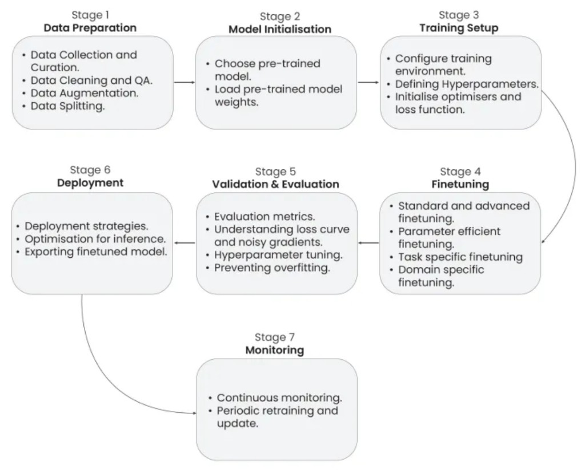

Джерело: [Comprehensive Guide to Fine-tuning LLM](https://medium.com/data-science-collective/comprehensive-guide-to-fine-tuning-llm-4a8fd4d0e0af)

Нижче ті самі сім етапів розкладені по роботах, які на кожному з них реально роблять. Далі в частині кожен етап розібрано докладніше.

#### 1. Data Preparation (підготовка даних)

- **Data Collection and Curation** — збирання та відбір якісних даних.
- **Data Cleaning and QA (Quality Assurance)** — очищення даних і перевірка їхньої якості.
- **Data Augmentation** — розширення навчального набору, наприклад створенням додаткових варіантів уже наявних прикладів.
- **Data Splitting** — поділ на навчальну, валідаційну і тестову вибірки.

Тут важливо не допустити data leakage (витоку інформації між вибірками). Якщо один і той самий приклад потрапить і в навчання, і в перевірку, оцінка виглядатиме кращою, ніж реальна якість.

#### 2. Model Initialisation (ініціалізація моделі)

Вибирають pretrained model (попередньо навчену модель) і завантажують її ваги. Наприклад, Llama або Mistral. Параметри вже навчені. Навчання не починається з випадкових чисел.

#### 3. Training Setup (налаштування навчання)

На цьому етапі фіксують:

- **Learning rate** — швидкість навчання, наскільки сильно ваги зрушуються за один крок.
- **Batch size** — скільки прикладів модель бачить за один крок оновлення.
- **Epochs** — скільки разів модель проходить увесь навчальний набір.
- **Optimizer** — алгоритм оновлення ваг, наприклад AdamW (Adam with decoupled Weight decay).
- **Loss function** — функція помилки, для передбачення токенів зазвичай Cross-Entropy Loss (крос-ентропія).

Окремо готують середовище: GPU (Graphics Processing Unit), пам’ять і точність обчислень, наприклад BF16 (Brain Floating Point 16-bit) або NF4 (NormalFloat 4-bit).

#### 4. Fine-tuning (тонке налаштування)

Саме тут застосовують методи з частини 2.

| Метод | Що відбувається |
|---|---|
| Full Fine-tuning | Оновлюємо всі ваги |
| LoRA (Low-Rank Adaptation) | Навчаємо низькорангові матриці |
| QLoRA (Quantized Low-Rank Adaptation) | База зберігається квантизованою, навчається LoRA |
| DoRA (Weight-Decomposed Low-Rank Adaptation) | Окремо навчаємо величини й напрямки ваг |
| Spectrum | Навчаємо відібрані за SNR (Signal-to-Noise Ratio) матриці базової моделі |

На загальній схемі семи етапів також є task-specific і domain-specific fine-tuning. Це не інші алгоритми. Це цілі адаптації: під конкретне завдання або під предметну область. І для завдання, і для галузі можна взяти LoRA (Low-Rank Adaptation), DoRA (Weight-Decomposed Low-Rank Adaptation) чи інший метод зі списку.

#### 5. Validation & Evaluation (валідація та оцінювання)

Перевіряють, наскільки модель справді навчилася.

- **Evaluation Metrics** — якість за метриками завдання.
- **Loss Curve** — графіки навчальних і валідаційних втрат.
- **Noisy Gradients** — чи градієнти стрибають так сильно, що навчання нестабільне.
- **Hyperparameter Tuning** — підбір learning rate, batch size та інших налаштувань.
- **Preventing Overfitting** — контроль перенавчання.

Якщо результат слабкий, повертаються до налаштування навчання або навіть до підготовки даних.

#### 6. Deployment (розгортання)

Модель готують до використання:

- вибирають, де вона працюватиме;
- прискорюють inference (генерацію відповідей);
- експортують модель або лише адаптери;
- відкривають API (Application Programming Interface), щоб інші програми могли надсилати запити.

Перед розгортанням потрібне окреме фінальне тестування на даних, яких модель не бачила під час навчання.

#### 7. Monitoring (моніторинг)

Після запуску робота не закінчується. Стежать за якістю відповідей, затримкою, витратами ресурсів, помилками і тим, чи поведінка моделі з часом гіршає. Якщо так, модель донавчають або оновлюють знову.

#### Що важливо зрозуміти

Схема семи етапів виглядає як пряма лінія. У реальному машинному навчанні це цикл.

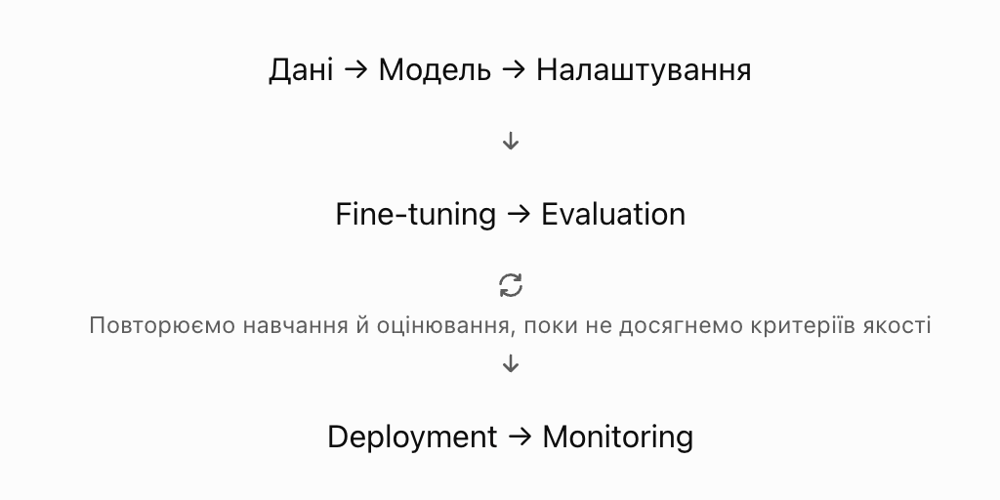

Спочатку готують дані, модель і налаштування. Потім повторюють fine-tuning і evaluation, доки якість не досягне критеріїв. Лише після цього йдуть deployment і monitoring.

Зменшення training loss ще не означає, що модель добре виконує реальні завдання. Потрібні перевірки на даних, яких вона не бачила, регресійне тестування вже робочих сценаріїв і окрема оцінка безпечності та надійності. Для AI/ML-інженера (Artificial Intelligence / Machine Learning) і для QA-фахівця (Quality Assurance) це різні перевірки, і жодна з них не замінює іншу.

---

### Етап 1: Підготовка датасету (Dataset Preparation)

Підготовка даних — база всього процесу.

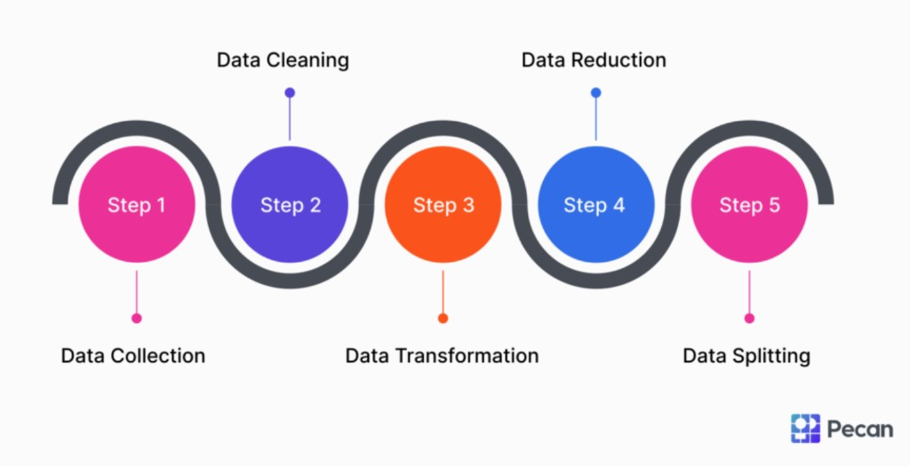

Джерела:  
- [Pecan guide](https://www.pecan.ai/blog/data-preparation-for-machine-learning/)  
- локальна копія: `uploads/data-preparation-for-machine-learning-6.md`

#### 1.1 Визначення мети та збір даних

Типи завдань і відповідні дані:

1. **Інструкційне налаштування (Instruction Tuning).**
   - Мета: навчити модель виконувати команди.
   - Дані: пари «інструкція → виконання».
2. **Діалогове налаштування (Conversational Fine-tuning).**
   - Мета: покращити здатність вести природні діалоги.
   - Дані: історії розмов користувача з асистентом.
3. **Доменна адаптація (Domain Adaptation).**
   - Мета: спеціалізація в конкретній галузі.
   - Дані: тексти з медицини, юриспруденції, фінансів тощо.

#### 1.2 Формати датасетів

Найпопулярніше — **JSONL** (один JSON-об’єкт = один рядок).

Приклад instruction-формату:

```json
{"instruction":"Поясни концепцію рекурсії в програмуванні","input":"","output":"Рекурсія — це техніка, коли функція викликає саму себе..."}
{"instruction":"Переклади англійською","input":"Доброго ранку, як справи?","output":"Good morning, how are you?"}
{"instruction":"Створи SQL-запит","input":"Знайди всіх користувачів старше 25 років з таблиці users","output":"SELECT * FROM users WHERE age > 25;"}
```

Приклад діалогового формату:

```json
{
  "messages": [
    {"role":"system","content":"Ти експерт з кібербезпеки."},
    {"role":"user","content":"Які основні типи кібератак існують?"},
    {"role":"assistant","content":"Основні типи включають: фішинг, DDoS, malware..."}
  ]
}
```

Приклад спеціалізованого формату (медицина):

```json
{
  "context":"Пацієнт: чоловік, 45 років...",
  "question":"Який попередній діагноз та план обстеження?",
  "answer":"Попередній діагноз: ...",
  "metadata":{"specialty":"cardiology","difficulty":"intermediate"}
}
```

#### 1.3 Обсяг і якість даних

Цифри нижче — порядок величин, а не мінімальні вимоги чи стандарт. Скільки прикладів потрібно, залежить від базової моделі, складності завдання, якості даних і того, який результат вважають достатнім.

| Тип завдання | Орієнтовний мінімум | Орієнтовний оптимум | Коментар |
|---|---:|---:|---|
| Стильова адаптація | 200–500 | 1000–2000 | Тон, манера, формат |
| Однозадачний файнтюнінг | 500–1000 | 2000–5000 | Одна чітка функція |
| Багатозадачний | 5000–10000 | 20000–50000 | Різні навички |
| Повна доменна адаптація | 10000+ | 50000–100000 | Нова галузь знань |
| Instruction tuning | 10000+ | 50000–200000 | Загальна інструктивність |

##### Як читати ці цифри

| Сценарій | Коментар | Уточнення |
|---|---|---|
| Стильова адаптація: 200–2000 | Реалістичний порядок | Іноді вистачає 50–100 якісних прикладів |
| Однозадачний fine-tuning: 500–5000 | Реалістичний порядок | Для простого завдання можна почати зі 100–500 |
| Багатозадачний: 5000–50000 | Можливий діапазон | Залежить від кількості завдань, їхньої складності й різноманітності |
| Повна доменна адаптація: 10000–100000 | Умовно | Треба розрізняти вміння виконувати завдання в галузі і засвоєння нових знань |
| Instruction tuning: 10000–200000 | Мінімум завищений | Добрі результати можливі вже з близько 1000 прикладів |

##### Що кажуть джерела

1. **OpenAI, Supervised Fine-Tuning.** У документації з SFT (Supervised Fine-Tuning, тонке налаштування з учителем) радять починати приблизно з 50 якісних прикладів. Покращення часто видно вже на 50–100 прикладах. Джерело: [OpenAI — Supervised Fine-Tuning](https://developers.openai.com/api/docs/guides/supervised-fine-tuning).
2. **LIMA (Less Is More for Alignment), 2023.** Модель LLaMA 65B донавчили на 1000 ретельно відібраних парах «інструкція — відповідь» і отримали сильні результати на багатьох завданнях. Джерело: [LIMA: Less Is More for Alignment](https://arxiv.org/abs/2305.11206). Це показує, що якість і різноманітність прикладів можуть важити більше за їхню кількість.
3. **Domain Adaptation.** Тут два різні режими.
   - **Domain-specific SFT (Supervised Fine-Tuning):** модель вчать, наприклад, класифікувати медичні документи. Можуть вистачити сотні або тисячі прикладів.
   - **Continued Pretraining:** попереднє навчання продовжують на спеціалізованих текстах, щоб модель краще знала галузь. Обсяг тоді рахують у токенах, а не в парах «інструкція — відповідь».

##### Орієнтири для першого експерименту

Це не гарантовані мінімуми і не оптимуми з досліджень. Це обсяги, з яких розумно починати перевірку.

| Сценарій | Початковий обсяг для експерименту |
|---|---|
| Стильова адаптація | 50–200 |
| Просте спеціалізоване завдання | 100–500 |
| Складне однозадачне навчання | 500–2000 |
| Багатозадачне навчання | 1000–10000+ |
| Instruction tuning | 1000–10000+ |
| Доменна адаптація | Залежить від типу навчання: SFT (Supervised Fine-Tuning) чи continued pretraining |

##### Learning curve замість одного числа

Замість питання «скільки прикладів треба взагалі» проводять learning curve experiment: навчають модель на 100, 500, 1000 і 2000 прикладах і міряють якість на одному й тому самому незалежному тестовому наборі.

Якщо після 500 прикладів якість майже не зростає, збільшення датасету до 10000 саме по собі може нічого не дати. Тоді змінюють склад даних, розмітку або метод навчання.

> **Простими словами:**  
> Краще десять бездоганних прикладів, ніж тисяча однакових і брудних. Спочатку зробіть маленький експеримент і подивіться, чи якість ще росте, коли прикладів стає більше.

#### 1.4 Очищення даних

Очищення текстових даних, text cleaning, готує навчальний набір: прибирає або виправляє небажане і не знищує те, чого модель має навчитися.

Нижче — типові операції. Для fine-tuning LLM (Large Language Model) вони не завжди обов’язкові.

| Операція | Чи завжди так | Пояснення |
|---|---|---|
| Видалення HTML-тегів (HyperText Markup Language) | Залежить від завдання | Для звичайного тексту теги зазвичай прибирають. Якщо модель має працювати з HTML, теги треба залишити |
| Видалення зайвих пробілів | Переважно так | Пробіли й переноси рядків важливі для коду, Markdown і документів, де структура має сенс |
| Видалення «дивних» символів | Не завжди | Символи Unicode, емодзі й спеціальні знаки можуть бути частиною даних, а не сміттям |
| Видалення персональних даних, PII (Personally Identifiable Information) | Так, коли це потрібно | Краще маскувати або редагувати дані за вимогами приватності, а не вирізати текст навмання |
| Видалення текстів коротших за 50 слів | Не універсальне правило | Короткі приклади корисні для класифікації і коротких відповідей |
| Видалення текстів довших за 2000 слів | Не універсальне правило | Довгий текст можна розрізати або залишити цілком, якщо він вміщається в контекстне вікно моделі |

Приклад:

До:

```text
<p>Привіт!!!    Мене звати   Іван Петренко, мій номер +380501234567</p>
```

Після:

```text
Привіт! Мене звати [ІМ'Я], мій номер [ТЕЛЕФОН]
```

Такий результат можливий, але в ньому три нюанси.

1. `Привіт!!!` стало `Привіт!`. Змінилося емоційне забарвлення. Для навчання стилю це може бути шкідливо.
2. `Іван Петренко` стало `[ІМ'Я]`. Це маскування, псевдонімізація, а не обов’язково повна анонімізація. Особу іноді все одно можна впізнати за іншими деталями тексту.
3. `+380501234567` стало `[ТЕЛЕФОН]`. Для багатьох завдань це правильно. Якщо модель має навчитися розпізнавати формат номера, таке маскування якраз прибирає потрібний сигнал.

Що варто робити замість жорсткого списку:

- прибирати лише нерелевантну HTML-розмітку, службові елементи і технічний шум;
- нормалізувати пробіли, переноси рядків і символи, якщо це не змінює змісту;
- знаходити персональні та конфіденційні дані і обробляти їх відповідно до вимог приватності;
- шукати дублікати, пошкоджені й неякісні приклади;
- звіряти довжину текстів із контекстним вікном моделі і з метою навчання;
- зберігати зміст, стиль і структуру, які потрібні саме цьому завданню.

Головне правило: очищення не має знищувати інформацію, яку модель має навчитися розпізнавати або відтворювати.

Після очищення перевіряють не лише формат. Мітки класів, зміст відповідей і співвідношення категорій не повинні непомітно змінитися. Інакше модель навчається вже на інших даних, ніж ті, що зібрали.

#### 1.5 Балансування

Балансування робить датасет справедливішим: модель має бачити рідкісні випадки не набагато рідше за часті.

Проблема: якщо в даних 1000 прикладів про котів і лише 10 про собак, модель добре вивчить котів і погано розумітиме собак. Те саме стається з рідкісними типами запитів, діагнозів чи помилок.

Рішення:

1. **Більше прикладів для рідкісних категорій.** Це oversampling: рідкісний приклад не просто копіюють, а роблять варіації, ніби ксерокопію з невеликими змінами.
2. **Більша вага рідкісних прикладів під час навчання.** Це class weights у loss: помилка на рідкісному класі карається сильніше, як додаткові бали на іспиті за складне питання.
3. **Рівномірний розподіл типів даних.** У навчальній, валідаційній і тестовій вибірках мають бути і коти, і собаки. Інакше тест не покаже, що модель не вміє рідкісний клас. Такий поділ називають стратифікованим.

#### 1.6 Data leakage (критично)

Data leakage — коли модель «бачить майбутнє» через неправильну підготовку.  
Наприклад, якщо однакові записи потрапили і в train, і в validation.

Правило:

- спочатку чесно розділяємо `train/val/test`,
- потім виконуємо кроки, чутливі до статистики (нормалізація, feature selection) лише на train.

> **Простими словами:**  
> Це як підглядати відповіді до контрольної заздалегідь: здається, що результат чудовий, але в реальності знань немає.

#### 1.7 Перевірка якості даних перед ініціалізацією моделі

Це остання перевірка перед тим, як завантажувати модель. Краще знайти проблеми зараз, ніж після днів навчання.

Чотири типових критерії доречні, але список неповний, а граматику, формат і безпечність не можна застосовувати однаково до кожного завдання.

| Критерій | Чи завжди так | Уточнення |
|---|---|---|
| Правопис і граматика | Частково | Помилки не завжди виправляють. Якщо модель вчать виправляти граматику, помилки мають лишитися у вхідних даних |
| Правдивість інформації | Так | Відповіді перевіряють за надійними джерелами |
| Однаковий формат | Так, із застереженням | Приклади мають відповідати одній структурі даних. Однакової довжини чи стилю не потрібно |
| Безпечність контенту | Частково | Шкідливий текст не завжди видаляють. Для навчання модерації потрібні і безпечні, і небезпечні приклади, але з правильними мітками |

До цих чотирьох варто додати ще п’ять перевірок.

1. **Узгодженість розмітки (Label Consistency).** Однакові випадки отримують однакові мітки за тими самими правилами.
2. **Дублікати і витік (Data Leakage).** Однаковий або майже однаковий приклад не лежить одночасно в навчальній і тестовій вибірках.
3. **Повнота (Completeness).** Немає порожніх відповідей, відсутніх обов’язкових полів і пошкоджених записів.
4. **Репрезентативність (Representativeness).** Дані покривають реальні сценарії, різні категорії і крайові випадки.
5. **Приватність і походження (Privacy & Provenance).** Перевірені персональні дані, джерела, права і дозволи на використання матеріалів.

Перед fine-tuning LLM (Large Language Model) навчальний набір має відповідати саме цьому завданню. Зручний список критеріїв:

- **Коректність (Correctness):** фактично правильні відповіді і точна розмітка.
- **Структурна валідність (Schema Validity):** формат, типи даних і обов’язкові поля дотримані.
- **Узгодженість (Consistency):** у відповідях і мітках немає суперечностей без причини.
- **Повнота (Completeness):** усі потрібні дані на місці.
- **Унікальність (Uniqueness):** дублікати і перетини вибірок під контролем.
- **Репрезентативність (Representativeness):** є типові, рідкісні і складні сценарії.
- **Безпечність і приватність (Safety & Privacy):** чутливі дані і ризикований контент оброблені навмисно, а не випадково стерті.
- **Мовна якість (Linguistic Quality):** граматика, правопис і стиль відповідають меті навчання, а не абстрактному ідеалу.

Перевірки ділять на два рівні.

- **Автоматизовані** проходять по всьому датасету: JSON Schema (схема формату JSON), обов’язкові поля, дублікати, довжина в токенах, допустимі мітки і перетин вибірок.
- **Експертні** потрібні для ризикованих прикладів і для репрезентативної вибірки: факти, якість відповідей, відповідність галузі, безпечність і складні суперечливі випадки.

> **Простими словами:**  
> Якісний датасет — це не тексти без жодної помилки. Це дані, які правильні для завдання, придатні до навчання, покривають реальні випадки і не вчать модель тому, чого вчити не планували.

---

### Етап 2: Ініціалізація моделі (Model Initialization)

Ініціалізація моделі — це вибір уже навченої LLM (Large Language Model) і стартових налаштувань перед навчанням або розгортанням. Навчання не починається з випадкових ваг: завантажують параметри, отримані на великому корпусі текстів.

#### 2.1 Вибір базової моделі

1. **Розмір і ресурси.** Кількість параметрів сама по собі не каже, яка відеокарта потрібна. Важливі ще квантизація, архітектура, довжина контексту і спосіб запуску. Орієнтир лише для першого відсіву:
   - 1–3B: edge-пристрої і мобільні застосунки;
   - 7–13B: робочі станції і невеликі сервери;
   - 30–70B: потужні сервери і хмара;
   - 100B+: дата-центри і кілька машин.
2. **Спеціалізація.**
   - загальні: Llama, Mistral, Gemma;
   - код: CodeLlama, StarCoder, DeepSeek-Coder;
   - математика: Qwen2.5-Math, DeepSeekMath;
   - мультимодальні: LLaVA. CLIP (Contrastive Language-Image Pre-training) — енкодер, який зіставляє зображення і текст. Це не генеративна LLM.
3. **Ліцензія конкретної версії.** Те, що ваги можна скачати, не означає, що їх можна вільно використовувати. У Llama є обмеження ліцензії. У Mistral частина моделей під Apache 2.0, частина ні. Falcon і MPT теж треба звіряти за конкретною версією, а не записувати як «повністю вільні» без перевірки. Комерційні GPT і Claude зазвичай доступні через API (Application Programming Interface), а не як файл ваг для власного донавчання.

#### 2.2 Завантаження моделі

Перед fine-tuning фіксують:

- токенізатор тієї самої моделі;
- максимальну довжину послідовності;
- точність обчислень: BF16 (Brain Floating Point 16-bit), FP16 (Floating Point 16-bit), 8 біт або NF4 (NormalFloat 4-bit);
- seed, версії бібліотек і конфіг, щоб запуск можна було повторити.

---

### Етап 3: Налаштування середовища навчання (Training Environment Setup)

На цьому етапі налаштовується інфраструктура:

- бібліотеки та рантайм;
- GPU-ресурси;
- оптимізатори;
- логування метрик;
- збереження чекпойнтів.

#### Що таке VRAM

**VRAM** (Video RAM) — це пам’ять відеокарти. Саме в ній під час роботи лежать ваги моделі, проміжні обчислення й дані, з якими GPU рахує прямо зараз.

Звичайна оперативна пам’ять комп’ютера (RAM) — це «стіл» процесора. VRAM — окремий «стіл» відеокарти. Модель на GPU не може вільно користуватися всією RAM: їй потрібне місце саме у VRAM.

Для fine-tuning це головне обмеження. Наприклад, модель на 7 мільярдів параметрів у 16-бітному форматі займає приблизно 14 ГБ лише під ваги. Повне донавчання потребує ще місця під градієнти й стан оптимізатора, тому VRAM треба значно більше. LoRA і QLoRA якраз зменшують цей обсяг: навчається не вся модель, а невелика поправка, і базові ваги можна тримати в стислому вигляді.

> **Простими словами:**  
> RAM — пам’ять усього комп’ютера. VRAM — пам’ять саме відеокарти. Якщо модель не вміщається у VRAM, навчання на цій відеокарті не стартує, навіть коли на диску й у RAM місця ще багато.

#### Орієнтовні конфігурації VRAM за певних умов

Цифри нижче — не паспорт відеокарти. Пам’ять змінюється від batch size (розміру пакета), довжини послідовності, точності чисел і того, чи ввімкнені оптимізації пам’яті.

Без вивантаження в RAM (Random Access Memory) і без 8-бітного оптимізатора повне навчання моделі на 7 мільярдів параметрів з AdamW (Adam with decoupled Weight decay) у змішаній точності часто оцінюють приблизно в 16–18 байт на параметр лише під ваги, градієнти і стани оптимізатора. Це близько 112–126 GB, і ще без активацій. Тому «24 GB+» можливі лише тоді, коли стан оптимізатора роздають між відеокартами або вивантажують з VRAM (Video RAM), наприклад через ZeRO (Zero Redundancy Optimizer) чи FSDP (Fully Sharded Data Parallel).

У дослідженні QLoRA (Quantized Low-Rank Adaptation) модель на 65 мільярдів донавчали на одному GPU (Graphics Processing Unit) з 48 GB. Джерело: [QLoRA paper](https://arxiv.org/abs/2305.14314).

Нижче — орієнтир для планування, не паспорт відеокарти. Менші числа виходять, якщо пакет маленький, контекст короткий і ввімкнено offload.

| Метод / модель | 7B | 13B | 30B | 70B |
|---|---:|---:|---:|---:|
| Full Fine-tuning без агресивного offload | ~80–140 GB | 160 GB+ | кілька GPU | кілька GPU |
| LoRA (Low-Rank Adaptation) | 16–24 GB | 24–40 GB | 48 GB+ | 80 GB+ |
| QLoRA (4-bit) | 8–12 GB | 12–24 GB | 24–48 GB | 48 GB+ |
| Inference у FP16 (Floating Point 16-bit) | ~14 GB+ | ~26 GB+ | ~60 GB+ | ~140 GB+ |
| Inference у 4/8 бітах | 6–10 GB | 10–16 GB | 20–35 GB | 35–80 GB |

---

### Етап 4: Процес файнтюнінгу (Fine-tuning)

На цьому етапі оновлюють параметри на підготовленому датасеті. Спочатку обирають метод: повне навчання, LoRA (Low-Rank Adaptation), QLoRA (Quantized Low-Rank Adaptation), DoRA (Weight-Decomposed Low-Rank Adaptation) або Spectrum. Потім обирають, у якому порядку подавати приклади.

#### 4.1 Progressive Learning (поступове навчання)

Це широка ідея: модель адаптують етапами і на кожному етапі змінюють дані, завдання або умови. Наступний етап спирається на попередній. Приклад для предметної галузі:

1. загальні тексти галузі;
2. специфічна термінологія;
3. складні завдання з контекстом;
4. реальні кейси.

#### 4.2 Curriculum Learning (навчання від простого до складного)

Це вужчий прийом усередині поступового навчання: приклади впорядковують за складністю. Випадкове перемішування того самого набору іноді працює не гірше. Результат залежить від завдання, тому відсотки нижче — схема одного експерименту, а не стандарт.

Складність не дорівнює довжині. Запит на 20 токенів може вимагати складного міркування, а довгий текст може бути простим переказом.

- **Фаза 1, базові приклади.** Короткі тексти, питання «що / хто / коли», однозначні відповіді. Приклад: «Що таке Python?» → «Python — це мова програмування». Орієнтовно 20–30% часу навчання.
- **Фаза 2, середня складність.** Тексти приблизно на 100–500 токенів, порівняння й аналіз. Приклад: різниця між списками і кортежами в Python. Орієнтовно 40–50% часу навчання.
- **Фаза 3, складні завдання.** Довгий контекст, логічні висновки, аналітичні або творчі задачі. Приклад: спроєктувати систему обробки великих даних. Орієнтовно 20–25% часу навчання.
- **Фаза 4, edge cases (граничні випадки).** Нестандартні, суперечливі, неповні або помилкові запити. Орієнтовно 5–10% часу навчання.

> **Простими словами:**  
> Як у школі: спочатку таблиця множення, потім задачі, потім олімпіадні приклади. Але якщо перемішати підручник, учень іноді вчиться не гірше. Тому порядок складності перевіряють експериментом, а не закріплюють як закон.

---

### Етап 5: Оцінка та валідація (Evaluation & Validation)

Після навчання перевіряють, чи модель стала кращою на даних, яких вона не бачила. Порівнюють і з базовою моделлю, і з попередніми версіями донавчання. Автоматичні метрики рахуються швидко. Людська оцінка показує, чи відповідь корисна, а не лише схожа на еталон.

#### 5.1 Метрики

**Perplexity, або PPL (перплексія).** Міра того, наскільки модель «дивується» токенам тестового тексту. Нижче зазвичай означає впевненіше передбачення наступного токена:

\[
\mathrm{PPL} = e^{L_{\text{cross-entropy}}}
\]

Орієнтовна шкала: менше 10 — модель впевнена, 10–20 — прийнятно для більшості задач, 20–50 — варто покращити, понад 50 — модель часто «губиться». Ці пороги не є стандартом: число залежить від датасету, токенізатора і способу підрахунку. Менша перплексія не доводить, що відповіді фактично правильні або корисні.

**BLEU (Bilingual Evaluation Understudy).** Збіг фрагментів слів з еталонним текстом. Метрика відома передусім для машинного перекладу. Два правильні переклади можуть бути сформульовані по-різному і отримати різний бал. Орієнтовна шкала: 0–0,1 — дуже слабкий збіг, 0,1–0,3 — базова схожість, 0,3–0,5 — хороша відповідність, 0,5+ — майже еталонна. Ці числа теж не є стандартом. Порівнювати моделі можна лише на одному тестовому наборі й з однаковими налаштуваннями підрахунку, наприклад через SacreBLEU. Джерело: [SacreBLEU](https://aclanthology.org/W18-6319/).

**Інші автоматичні метрики.**

- **ROUGE (Recall-Oriented Understudy for Gisting Evaluation)** — перекриття фрагментів для підсумків.
- **Accuracy** — частка правильних відповідей у класифікації.
- **F1 (F1 Score)** — баланс точності й повноти, коли класи нерівні.
- **Latency** — час однієї відповіді.

Для сучасних LLM цього часто мало. Варто додати перевірки самого завдання:

| Метрика | Що оцінює |
|---|---|
| Instruction Following | Чи виконано інструкцію |
| Factual Accuracy | Чи відповідь фактично правильна |
| Groundedness | Чи відповідь спирається на надані джерела, а не на вигадку |
| Task Success Rate | Частка завдань, які справді завершені |
| Safety | Чи відповідь безпечна |
| Format Compliance | Чи дотримано заданий формат |

Їх рахують правилами, експертами або LLM-as-a-Judge: інша модель оцінює відповіді за рубрикою. Суддю теж треба перевіряти на вибірці людей, бо він помиляється систематично.

#### 5.2 A/B-тестування

A/B-тест порівнює дві версії в реальному використанні. Контрольна група лишається на базовій або попередній моделі. Експериментальна отримує нову. Дивляться на якість за шкалою людей, узгодженість відповідей, дотримання інструкцій, швидкість і те, чи користувачі повертаються.

Кілька днів або «тисячі запитів» і правило `p-value < 0,05` самі по собі не визначають, що тест закінчено. До старту фіксують:

- одну головну метрику;
- найменший ефект, який ще варто помітити;
- потрібну статистичну потужність і очікуваний розмір вибірки;
- правило зупинки, щоб не підглядати результат щогодини і не зупинятися на першому «значущому» стрибку;
- довірчий інтервал, а не лише p-value;
- поправку, якщо метрик багато: інакше якась одна випадково виглядатиме кращою.

Спочатку обидві версії порівнюють на одному відкладеному тестовому наборі. Онлайн-експеримент з користувачами запускають після цього. Рішення: повне розгортання, доопрацювання або відкат.

#### 5.3 Типові проблеми

- **Overfitting:** на навчальних даних добре, на нових погано.
- **Catastrophic forgetting:** модель втратила загальні вміння заради нового завдання.
- **Галюцинації:** правдоподібний, але неправдивий текст.
- **Bias:** перекіс через нерівні навчальні дані.

Лікують це не однією ручкою. Іноді змінюють learning rate і число епох, іноді склад датасету, іноді метрику, за якою вирішували, що модель «готова».

---

### Етап 6: Розгортання (Deployment)

Розгортання перетворює навчену модель на сервіс. Треба вирішити, де вона стоїть, скільки запитів тримає одночасно, яка доступність потрібна, як оновлювати її без зупинки і як відкотитися, якщо нова версія гірша.

Перед викладенням користувачам проходять три перевірки: регресійну (старі сценарії не зламались), безпекову і навантажувальну. Сам випуск краще робити поступово: спочатку частка трафіку, спостереження за метриками, і лише потім усі користувачі. План відкату готують до запуску, а не після збою.

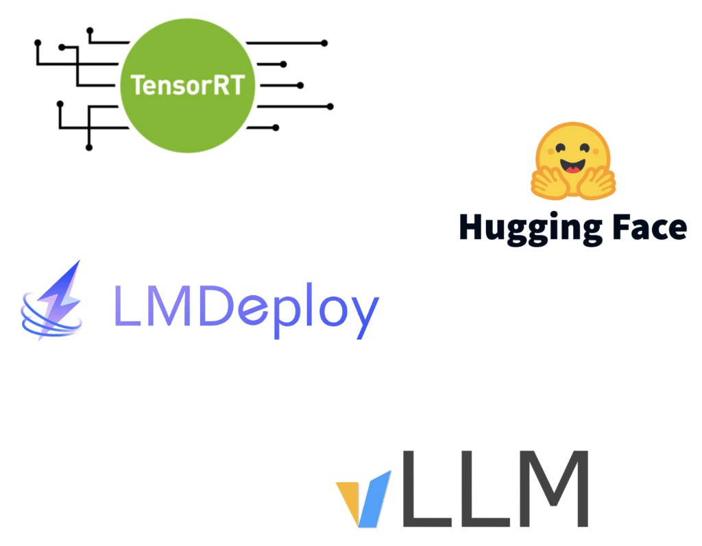

Джерело: [TensorRT-LLM vs vLLM vs TGI vs LMDeploy](https://nlpcloud.com/genai-inference-engines-tensorrt-llm-vs-vllm-vs-hugging-face-tgi-vs-lmdeploy.html)

#### Варіанти

1. **Cloud Deployment.** AWS SageMaker, Google Cloud, Azure ML. Швидкий старт, автомасштабування і вбудований моніторинг. При постійному навантаженні часто дорожче, і дані залежать від провайдера. Добре для команд без власних серверів і для нерівного потоку запитів.
2. **On-premise.** Власні сервери. Повний контроль над даними і нижча ціна при сталому високому навантаженні. Потрібні початкові витрати і люди, які це обслуговують. Добре, коли вимоги до безпеки жорсткі.
3. **Edge Deployment.** Модель на телефоні або IoT-пристрої (Internet of Things). Мінімальна затримка, робота без мережі, дані не їдуть на сервер. Ресурси малі, оновлювати модель важче.

Рушій інференсу теж обирають за залізом, а не за назвою.

- **TensorRT-LLM:** максимум швидкості на NVIDIA, складніше збирання.
- **vLLM:** висока пропускна здатність, PagedAttention.
- **Hugging Face TGI (Text Generation Inference):** зручний продакшен-сервер, часто через Docker.
- **LMDeploy:** сильна швидкість генерації на сумісному стеку.
- **Ollama:** простий локальний запуск для розробки і невеликих сервісів.

---

### Етап 7: Моніторинг і підтримка (Monitoring & Maintenance)

Моніторинг починається після розгортання і не закінчується. Його цілі: тримати сервіс доступним, помітити падіння якості раніше за користувачів, не витрачати зайві ресурси і збирати приклади для наступного покращення.

Що відстежувати:

- якість відповідей, не лише те, що сервіс «відповідає»;
- latency (затримку), частку помилок і витрати;
- GPU (Graphics Processing Unit), CPU (Central Processing Unit) і пам’ять;
- безпеку і небажані патерни;
- data drift і concept drift: змінились вхідні запити або те, що вважається правильною відповіддю;
- раптове погіршення після оновлення моделі, даних або промпта.

Повторне навчання не ставлять на календар автоматично. Спочатку шукають причину деградації. Fine-tuning її прибирає не завжди: іноді вистачить оновити базу RAG (Retrieval-Augmented Generation), промпт або фільтр даних.

Принципи, які лишаються чинними на всіх етапах:

1. якість даних важливіша за кількість;
2. ітерація: малий експеримент, вимірювання, наступна зміна;
3. моніторинг і під час навчання, і в продакшені;
4. баланс якості і вартості: повне донавчання не є відповіддю за замовчуванням.

---

<a id="part-4"></a>

## Частина 4. Актуальність fine-tuning і коли він дійсно потрібен

**Fine-tuning перестав бути автоматичним вибором** для будь-якої адаптації LLM (Large Language Model). Для багатьох простих задач сучасній моделі справді вистачає промпта, пошуку або іншої моделі. Для інших задач донавчання лишається робочим інструментом, і його часто поєднують із рештою методів.

Prompt engineering, RAG (Retrieval-Augmented Generation), fine-tuning і оркестрація розв'язують різні проблеми — і доповнюють одне одного, а не конкурують.

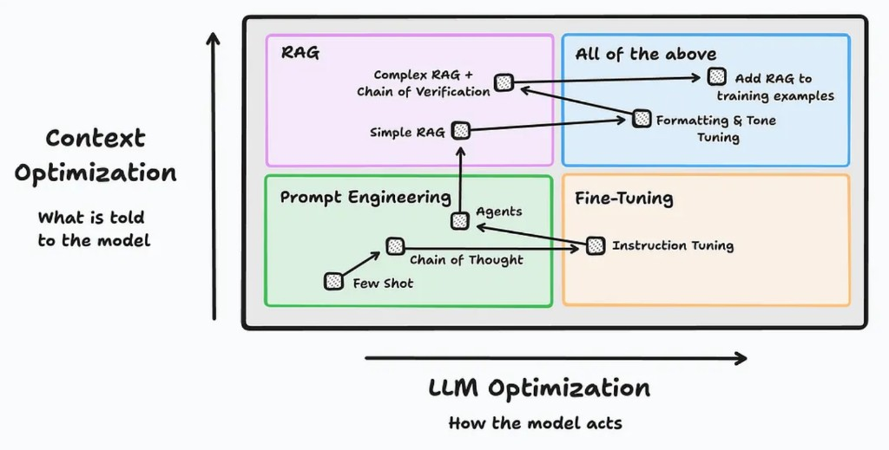

### Чому донавчання може здешевити відповідь

Порівняйте два робочі варіанти на великому потоці запитів:

1. Велика модель із довгим системним промптом і десятьма прикладами few-shot.
2. Менша модель, донавчена на цьому завданні, якій вистачає короткого промпта.

Другий варіант може бути дешевшим і швидшим. Документація Microsoft прямо називає дві економії: менше токенів у кожному запиті, бо приклади вже «вшиті» в модель, і перехід на меншу модель, яка на вузькій задачі тримає якість більшої. Навчання і хостинг донавченої моделі теж коштують грошей, тож виграш з’являється тоді, коли запитів багато. Джерело: [Microsoft, fine-tuning considerations](https://learn.microsoft.com/en-us/azure/foundry-classic/openai/concepts/fine-tuning-considerations).

Тому порівнюють **сукупну вартість**: навчання, інфраструктура, підтримка, кількість токенів і вартість inference.

### Яку проблему який метод закриває

| Проблема | Що спробувати |
| --- | --- |
| Модель неправильно розуміє інструкцію | Prompt engineering: zero-shot, few-shot, CoT (Chain-of-Thought), роль, шаблон |
| Модель не має актуальної інформації | RAG: база знань, векторний пошук, гібридний пошук, реранжування |
| Модель систематично ламає правила виконання завдання | Fine-tuning |
| Треба отримати дані або виконати дію через API (Application Programming Interface) | Інструменти й оркестрація, агенти |
| Велика модель задорога на великому потоці запитів | Менша модель, дистиляція або fine-tuning |
| Модель має читати документи і дотримуватися окремої логіки | Порівняти RAG і RAG разом із fine-tuning |

Окремий прийом цієї останньої клітинки — **RAFT (Retrieval-Augmented Fine-Tuning)**. У статті Berkeley 2024 модель навчали на питанні, наборі документів і відповіді з міркуванням. Серед документів були корисні й відволікаючі. Модель училася цитувати потрібний уривок і пропускати зайве. На PubMed, HotpotQA і наборах Gorilla RAFT покращував відповіді в режимі «відкритої книжки», тобто fine-tuning підсилював RAG. Джерело: [RAFT, arXiv:2403.10131](https://arxiv.org/abs/2403.10131).

### З чого починати

Часто пропонують таку послідовність кроків:

`модель → промпти → RAG → агенти → fine-tuning`

Цей набір технік корисний як арсенал. Жорстким правилом він не є: наступна сходинка не зобов’язана чекати, поки попередня «провалиться», і методи можна з’єднувати.

Порядок, який варто тримати в голові, починається з вимірювання. Його описує й [OpenAI — Optimizing LLM Accuracy](https://developers.openai.com/api/docs/guides/optimizing-llm-accuracy):

1. Зібрати незалежний набір тестів, якого модель не бачила під час навчання.
2. Виміряти якість базової моделі на цьому наборі.
3. Розібрати помилки: бракує знань, зламана поведінка, поганий пошук чи ненадійне виконання інструкцій.
4. Обрати метод під причину помилки. Загальні бенчмарки на кшталт MMLU (Massive Multitask Language Understanding) і HumanEval допомагають порівняти базові моделі, але рішення приймають за власним тестом.
5. Порівняти якість, затримку і сукупну вартість варіантів.


### Задачі, де fine-tuning часто розглядають

1. **Рідкісні мови, штучні мови, діалекти.** Базова модель могла майже не бачити клінгонську, внутрішню кодову мову чи діалект. Якщо корпусу прикладів немає взагалі, шукати нічого. Якщо приклади, словник або граматика вже є, їх можна покласти в промпт або в пошук. Дослідження малоресурсних мов показують, що словник і паралельні речення в контексті піднімають якість перекладу без навчання ваг: [LingoLLM](https://aclanthology.org/2024.findings-acl.925/), [переклад мовою Mambai через retrieval](https://aclanthology.org/2024.eurali-1.1/). Fine-tuning має перевагу, коли треба стійко відтворювати граматику, синтаксис і стиль, а не підставити кілька слів із картки.
2. **Глибока зміна форми мови.** Фонетичний запис нестандартного акценту, переклад між діалектами однієї мови, старослов’янська → сучасна мова. Це навчання закономірності, а не пошук абзаца в базі.
3. **Внутрішні скорочення і жаргон.** Сотні абревіатур компанії, кодові назви продуктів, цеховий сленг. Пошук може принести розшифровку. Якщо модель і після розшифровки плутає, у якому контексті слово вживають, донавчання на діалогах має сенс перевірити окремо.
4. **Мала модель на пристрої без інтернету.** Офлайн-перекладач, голосовий асистент, зв’язок без мережі. Тут немає куди сходити за документами під час відповіді, тож поведінку треба вмістити у ваги маленької моделі.

   **Що таке retrieval і чому це важливо розрізняти.**

   **Retrieval** — це пошук релевантної інформації під час генерації відповіді: наприклад у базі знань, у документах або у векторній базі даних. Саме retrieval є ключовою частиною RAG (Retrieval-Augmented Generation — генерація з доповненням знайденою інформацією).

   Порівняймо два сценарії:

   **1. Модель із RAG:**

   `Запит → Пошук у базі знань → Знайдена інформація додається до контексту → LLM → Відповідь`

   Наприклад, модель шукає значення незнайомого діалектного слова у словнику, а потім використовує його для перекладу. Слово не є частиною ваг — воно знаходиться щоразу наново.

   **2. Fine-tuned модель без retrieval:**

   `Запит → Fine-tuned LLM → Відповідь`

   Наприклад, маленьку модель донавчили перекладати із закарпатського діалекту літературною українською. Мовні закономірності засвоєні у вагах під час навчання — щоразу звертатися до зовнішнього словника не потрібно.

   Чому це важливо для пристроїв:

   - Без інтернету.
   - Без зовнішньої бази знань.
   - Без додаткового пошукового компонента.
   - Із простішою архітектурою застосунку.

   > **Важливий нюанс:** офлайн ≠ без retrieval. Локальна модель теж може шукати інформацію у документах, збережених на тому самому пристрої, — навіть без підключення до мережі.
   >
   > **Головна відмінність:** fine-tuning змінює параметри моделі. Retrieval надає їй додаткову інформацію під час виконання запиту — параметри при цьому не змінюються.
5. **Систематичні мовні помилки.** Однакове неправильне відмінювання рідкісних слів, плутанина омонімів у вузькій галузі, конструкція, якої модель стабільно не тримає.

### Де fine-tuning зазвичай зайвий

- Переклад між поширеними мовами.
- Звичайне підсумування.
- Відповіді на запитання по документах, які змінюються: тут спочатку RAG. QA тут означає Question Answering.
- NER (Named Entity Recognition) для стандартних сутностей і більшість типового аналізу тексту.
- Більшість «напиши в такому стилі», якщо few-shot уже тримає стиль.
- Простий фіксований формат на кшталт JSON (JavaScript Object Notation): його надійніше вимагати схемою, ніж вчити ваги.

### Коли донавчання взагалі ставити на стіл

| Ситуація | Доцільність fine-tuning |
| --- | --- |
| Факти й документи часто змінюються | Низька, якщо ним намагаються замінити RAG |
| Потрібен простий формат JSON | Зазвичай низька |
| Потрібен складний стабільний стиль | Середня або висока |
| Потрібно навчити нових мовних закономірностей | Потенційно висока |
| Потрібно прибрати систематичні помилки виконання завдання | Потенційно висока |
| Потрібно здешевити масовий inference малою моделлю | Потенційно висока |
| Модель неправильно користується знайденими документами | Порівняти RAG і RAG разом із fine-tuning |

---

<a id="part-5"></a>

## Частина 5. Практичні кейси

Три типові ситуації. Для кожної — перша реакція і пояснення, чому варто порівняти кілька підходів, перш ніж витрачати місяць на навчання.

### Кейс 1: Діалект із малою кількістю даних

Ситуація: компанія із Закарпаття хоче чат-бота місцевим діалектом. Claude Sonnet 4.5 і GPT-5 не тримають слова на кшталт «файний», «бадьо», «ґазда». Є 10 000 діалогів цим діалектом.

Перша реакція: QLoRA (Quantized Low-Rank Adaptation), бо промпти й RAG тут безсилі. Але це ще не доведено.

<details>
<summary>Що перевірити перед навчанням</summary>

10 000 діалогів уже є мовним матеріалом. Їх можна показати як few-shot або знаходити схожі репліки пошуком, а поруч покласти короткий словник. Для малоресурсних мов такий контекст інколи помітно піднімає якість без зміни ваг.

Порівняйте три збірки на одному відкладеному наборі, який оцінюють носії діалекту:

| Варіант | Питання експерименту |
| --- | --- |
| Базова модель + few-shot | Чи вистачає прикладів діалекту в промпті |
| Модель + словник і пошук схожих реплік | Чи вистачає мовного контексту під час відповіді |
| Модель + QLoRA на цих діалогах | Чи засвоює модель граматику, синтаксис і стиль |

Якщо помилки систематичні саме в граматиці й стилі, fine-tuning має шанс виграти. Сама кількість 10 000 якість не гарантує: дивляться на чистоту прикладів і на оцінки носіїв.

</details>

### Кейс 2: База знань підтримки, що оновлюється щотижня

Ситуація: інтернет-провайдер має 10 000 відповідей. Тарифи, акції й технічні рішення змінюються щотижня. Бот має відповідати актуальним.

RAG — правильне рішення. Перенавчати модель щотижня дорого, а оновлення векторного індексу займає хвилини.

<details>
<summary>Уточнення</summary>

Для фактів, які змінюються, RAG справді перший інструмент. Донавчання щотижня під нові тарифи не потрібне.

Окремий випадок: пошук уже приніс правильний тариф, а модель стабільно неправильно читає умову договору. Тоді варто порівняти чистий RAG із RAG разом із fine-tuning, наприклад у дусі RAFT: навчати модель триматися знайденого уривка і не вигадувати умову поруч.

</details>

### Кейс 3: Жорсткий формат звітів

Ситуація: Llama 3 має писати щоденний звіт так: заголовок великими літерами, три розділи з булітами, підсумок курсивом. Навіть детальна інструкція частина вимог губить.

Structured output або 3–5 few-shot прикладів — правильне рішення. Донавчання заради такого формату — надлишок.

<details>
<summary>Як зібрати це без навчання ваг</summary>

Надійна схема для цього звіту:

1. Модель генерує структуровані поля у JSON.
2. Відповідь перевіряють за JSON Schema.
3. Програма сама ставить великі літери, заголовки, буліти й курсив.

Structured Outputs у API змушує модель вкластися в підтримувану JSON-схему. Великі літери й курсив гарантує шаблон програми, а не ваги моделі. Джерело: [OpenAI, Structured Outputs](https://platform.openai.com/docs/guides/structured-outputs).

</details>

Коротко з трьох кейсів: діалект спочатку порівнюють із прикладами в контексті; змінні факти тримають у RAG; простий формат віддають схемі й шаблону.

---

<a id="part-6"></a>

## Частина 6. Підсумки і шпаргалка вибору підходу

Ви тепер знаєте:

- що таке fine-tuning і коли він потрібен;
- різницю між full fine-tuning і PEFT;
- як працюють LoRA, QLoRA, DoRA, Spectrum;
- 7 етапів пайплайна від даних до продакшену;
- ключові метрики оцінки;
- варіанти деплою та рушії інференсу;
- що промпт, RAG, інструменти й донавчання закривають різні причини помилок і їх порівнюють на одному тесті.

### Зведена таблиця тем

| Тема | Що потрібно знати | Коли застосовувати / обмеження |
|---|---|---|
| 1. Fine-tuning | Продовження навчання попередньо навченої LLM (Large Language Model). Модель адаптує параметри до спеціалізованих даних. | Для систематичних помилок, складних мовних закономірностей, специфічної поведінки. Не обов'язковий для простих інструкцій або актуальних фактів. |
| 2. Full Fine-tuning vs PEFT | Full: оновлюємо всі ваги. PEFT (Parameter-Efficient Fine-Tuning): навчаємо лише невелику частину параметрів, більшість ваг заморожені. | Full — максимальна гнучкість, але високі витрати пам'яті. PEFT — економніший, зазвичай практичніший для адаптації великих моделей. |
| 3. LoRA та QLoRA | LoRA (Low-Rank Adaptation): навчаємо дві маленькі матриці \(A, B\), які створюють корекцію базових ваг. QLoRA (Quantized LoRA): додаємо 4-бітну квантизацію базової моделі. | LoRA — для економного навчання адаптерів. QLoRA — коли обмежена пам'ять GPU. Можливі втрати точності та додаткові обчислювальні витрати. |
| 4. Prefix Tuning, P-Tuning, IA³ | Prefix: навчаємо вектори-префікси для attention. P-Tuning: навчаємо soft prompts через спеціальний енкодер. IA³: навчаємо вектори, що масштабують внутрішні активації. | Альтернативи LoRA з малою кількістю параметрів. Вибір залежить від завдання, архітектури та підтримки бібліотек. |
| 5. Сім етапів fine-tuning | Data Preparation → Model Initialization → Training Setup → Fine-tuning → Evaluation → Deployment → Monitoring. | Ітеративний процес: результати оцінювання можуть вимагати повернення до даних або параметрів. |
| 6. Метрики оцінювання | PPL (Perplexity): якість передбачення токенів. BLEU: збіг фрагментів з еталоном. ROUGE: перекриття для підсумування. Human Evaluation: оцінювання людьми. | Метрику обирають під завдання. Жодна автоматична метрика сама по собі не гарантує фактичної правильності відповіді. |
| 7. vLLM, TGI, Ollama | Рушії для обслуговування запитів (model serving). vLLM — висока пропускна здатність, TGI — серверний inference, Ollama — простий локальний запуск. | vLLM — продукційні системи з великим навантаженням; Ollama — локальні експерименти; TGI — переважно наявні розгортання (проєкт перейшов у режим підтримки). |
| 8. Альтернативи fine-tuning | Prompt Engineering: змінюємо інструкції. RAG: додаємо знайдену інформацію. Оркестрація: координуємо моделі, інструменти й задачі. | Варто спробувати простіші рішення, але не обов'язково всі підряд. Вибір залежить від причини помилок. |
| 9. Практичні випадки | Рідкісні мови, діалекти, спеціалізовані мовні перетворення, систематичні помилки, адаптація малих моделей для edge-пристроїв. | Доцільність визначають експериментально. Навіть для рідкісних мов іноді допомагають few-shot та RAG. |

---

### Методи PEFT — детальне порівняння

| Метод | Що навчаємо | Базові ваги | Основна особливість |
|---|---|---|---|
| LoRA | Низькорангові матриці \(A, B\) | Заморожені | Додаємо низькорангову корекцію до ваг |
| QLoRA | LoRA-матриці | Заморожені, 4-bit NF4 | Економимо пам'ять завдяки квантизації |
| DoRA | Матриці \(A, B\) та величини \(m\) | Заморожені | Окремо параметризуємо напрямок і довжину векторів ваг |
| Prefix Tuning | Навчувані префікси Key/Value | Заморожені | Впливаємо на attention у кількох шарах |
| P-Tuning | Навчувані prompt-вектори через prompt encoder | Заморожені | Автоматично навчаємо представлення підказки (P-Tuning v2 — глибокі підказки на кількох шарах) |
| IA³ | Вектори масштабування активацій Key, Value, FFN | Заморожені | Підсилюємо або послаблюємо внутрішні активації (\(h' = l \odot h\)) |
| Spectrum | Вибрані матриці базової моделі | Частково заморожені | Вибираємо матриці для навчання за спектральним аналізом (SVD + SNR) |
| BitFit | Bias-параметри базової моделі | Заморожені (крім bias) | Мінімальна адаптація: лише зміщення |

---

### Ключові формули

**LoRA:**
\[
W' = W_0 + BA
\]

**DoRA:**
\[
W' = m \odot \frac{W_0 + BA}{\|W_0 + BA\|_c}
\]

**QLoRA:** той самий принцип LoRA, але базові ваги зберігаються в NF4 (NormalFloat 4-bit), а не в BF16 (Brain Floating Point 16-bit).

**Орієнтовна пам'ять лише для ваг** моделі на 7 мільярдів параметрів:

| Формат | Теоретична пам'ять (лише ваги) |
|---|---|
| FP32 (Floating Point 32-bit) — 32 біти | 28 GB |
| BF16 — 16 бітів | 14 GB |
| NF4 — 4 біти | ~3,5 GB + службові дані |

Це не повні вимоги до навчання. Потрібна додаткова пам'ять для активацій, градієнтів, адаптерів і стану оптимізатора.

---

### Алгоритм вибору підходу

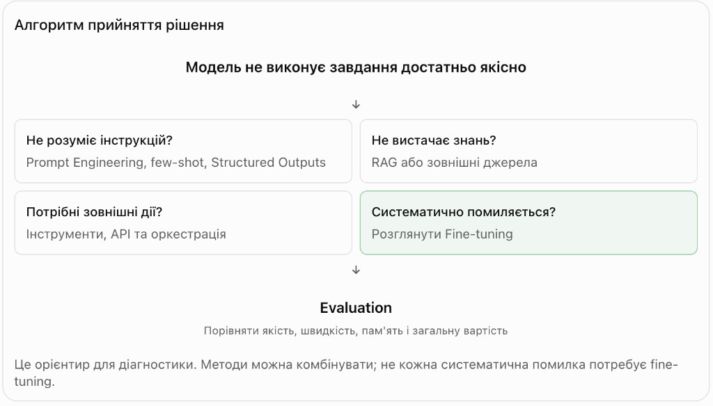

Це орієнтир для діагностики, а не жорстке правило. Методи можна комбінувати. Не кожна систематична помилка потребує fine-tuning — спочатку вимірюємо проблему, потім обираємо спосіб оптимізації.

### П'ять головних висновків

1. Fine-tuning змінює **параметри** моделі. RAG додає **інформацію** до контексту. Prompt Engineering змінює **інструкції** без зміни ваг.
2. PEFT економить ресурси: навчаємо лише невелику частину параметрів, решта залишається замороженою.
3. QLoRA — це LoRA з квантизованою базою, а не окремий алгоритм підрахунку loss.
4. Низький training loss ≠ висока якість на нових даних. Метод навчання і метод оцінювання — різні речі.
5. **Спочатку вимірюємо проблему, потім обираємо спосіб оптимізації.**

---

### Шпаргалка «з чого почати»

Спочатку тест і розбір помилок. Гілка обирається за причиною, а не за модою методу. Кілька гілок можна зібрати в одну систему.

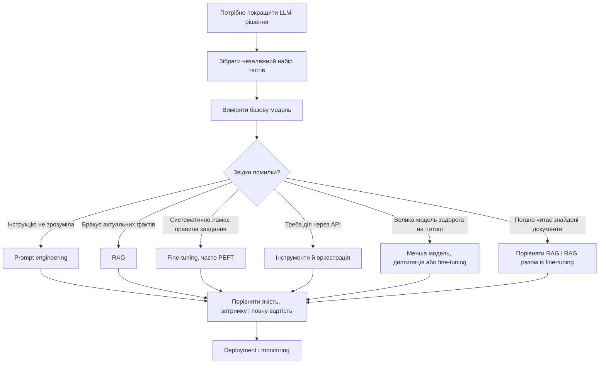

---

<a id="glossary"></a>

## Глосарій простими словами

Повний словник скорочень і термінів стоїть на початку конспекту: [Словник скорочень і термінів](#dictionary).

---


<a id="sources"></a>

## Джерела та посилання

### Основні джерела з матеріалу

- [Pre-training, Fine-tuning or Distillation](https://amulyasharma.medium.com/pre-training-fine-tuning-or-model-distillation-for-rest-of-us-no-phd-required-01082df2aed7)
- [Finetuning LLMs Efficiently with Adapters](https://magazine.sebastianraschka.com/p/finetuning-llms-with-adapters)
- [Fine-Tuning using LoRA and QLoRA](https://www.geeksforgeeks.org/deep-learning/fine-tuning-using-lora-and-qlora/)
- [Full Fine-tuning, LoRA, QLoRA comparison](https://medium.com/garantibbva-teknoloji/full-fine-tuning-lora-and-qlora-a-comparison-of-techniques-in-model-optimization-89038d36865f)
- [Implementing DoRA from Scratch](https://www.dailydoseofds.com/implementing-dora-an-improved-lora-from-scratch/)
- [Comprehensive Guide to Fine-tuning LLM](https://medium.com/data-science-collective/comprehensive-guide-to-fine-tuning-llm-4a8fd4d0e0af)
- [Data Preparation for Machine Learning](https://www.pecan.ai/blog/data-preparation-for-machine-learning/)
- [TensorRT-LLM vs vLLM vs TGI vs LMDeploy](https://nlpcloud.com/genai-inference-engines-tensorrt-llm-vs-vllm-vs-hugging-face-tgi-vs-lmdeploy.html)

### Першоджерела для точності формулювань

- [LoRA paper (arXiv:2106.09685)](https://arxiv.org/abs/2106.09685)
- [QLoRA paper (arXiv:2305.14314)](https://arxiv.org/abs/2305.14314)
- [Hugging Face: 4-bit transformers and QLoRA](https://huggingface.co/blog/4bit-transformers-bitsandbytes)
- [Hugging Face: bitsandbytes, NF4 і обчислення](https://huggingface.co/docs/transformers/quantization/bitsandbytes)
- [DoRA paper (arXiv:2402.09353)](https://arxiv.org/abs/2402.09353)
- [Spectrum paper (arXiv:2406.06623)](https://arxiv.org/abs/2406.06623)
- [Оригінальна реалізація Spectrum](https://github.com/QuixiAI/spectrum)
- [Adapters paper (Houlsby et al., arXiv:1902.00751)](https://arxiv.org/abs/1902.00751)
- [Mixtral paper (arXiv:2401.04088)](https://arxiv.org/abs/2401.04088)
- [RAFT: Adapting Language Model to Domain Specific RAG (arXiv:2403.10131)](https://arxiv.org/abs/2403.10131)
- [OpenAI — Optimizing LLM Accuracy](https://developers.openai.com/api/docs/guides/optimizing-llm-accuracy)
- [OpenAI — Structured Outputs](https://platform.openai.com/docs/guides/structured-outputs)
- [Microsoft — fine-tuning considerations](https://learn.microsoft.com/en-us/azure/foundry-classic/openai/concepts/fine-tuning-considerations)
- [LingoLLM: словник і граматика в промпті (ACL 2024)](https://aclanthology.org/2024.findings-acl.925/)
- [Малоресурсний переклад Mambai через retrieval у промпті (ACL 2024)](https://aclanthology.org/2024.eurali-1.1/)
- [Hugging Face — IA³ документація](https://huggingface.co/docs/peft/en/package_reference/ia3)
- [vLLM документація](https://docs.vllm.ai/)
- [TGI документація](https://huggingface.co/docs/text-generation-inference/)
- [Ollama документація](https://docs.ollama.com/quickstart)

---

Цей довідник можна використовувати як навчальний «маршрут» від базових понять fine-tuning до практичного розгортання в production.
