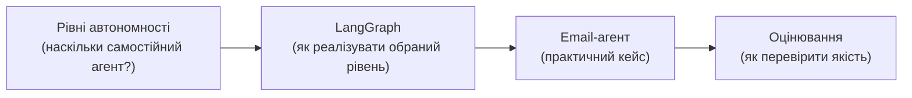
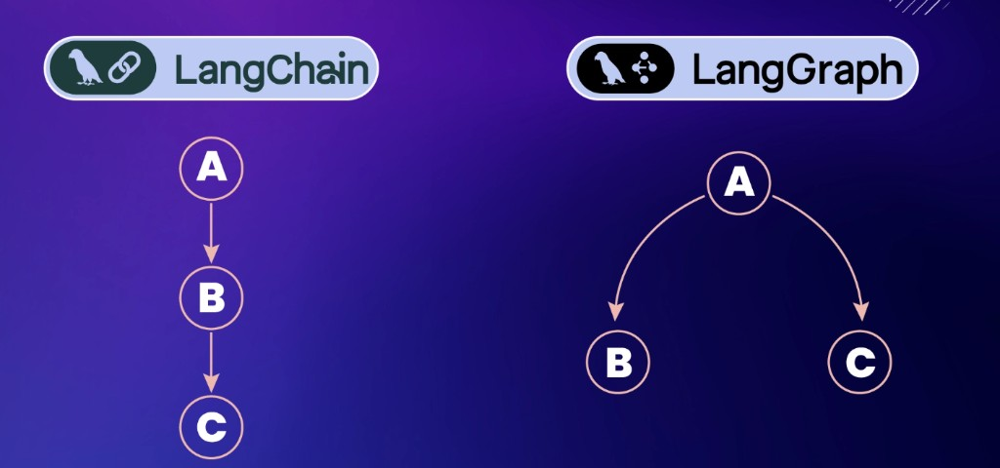
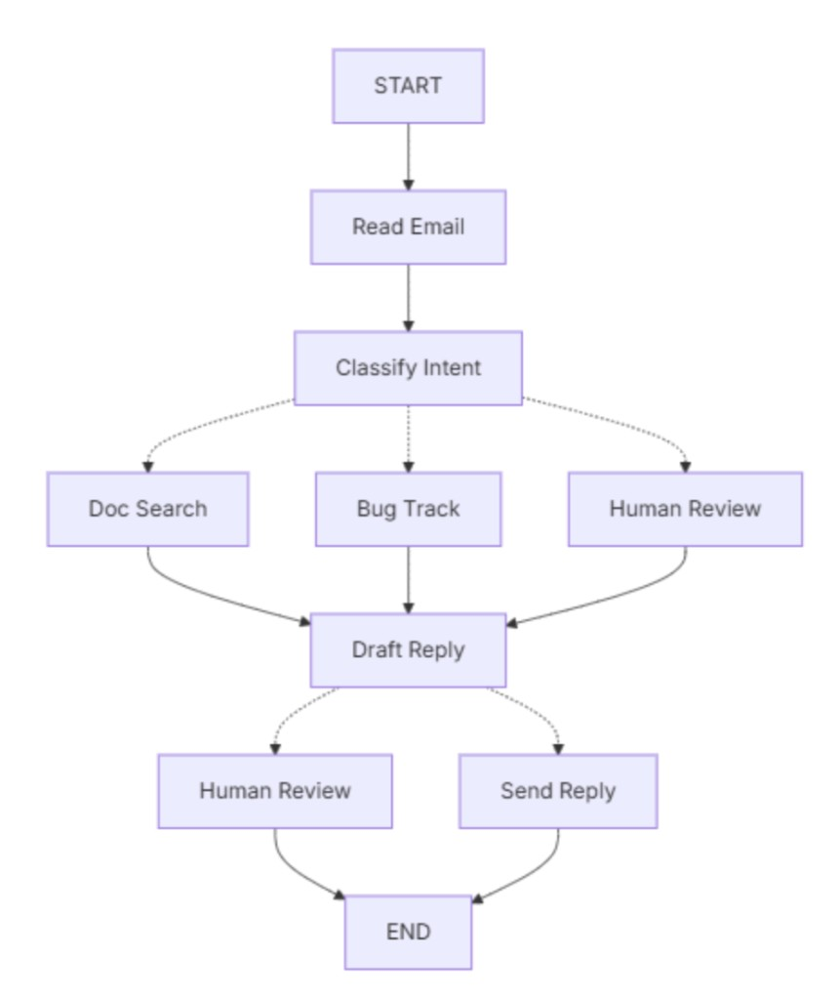
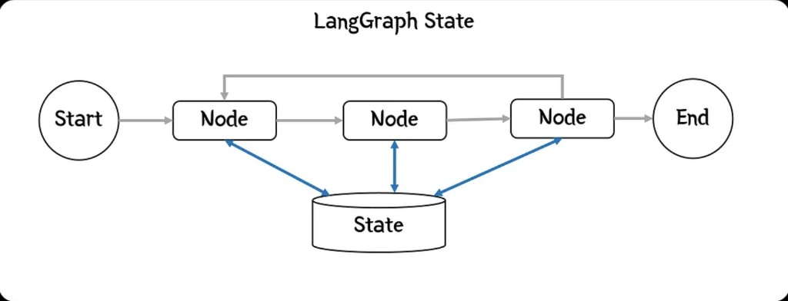
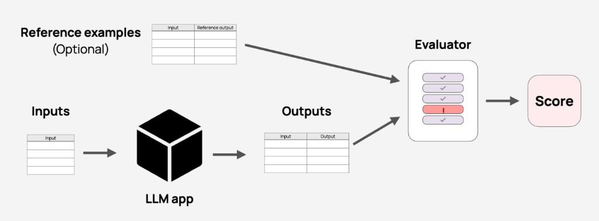
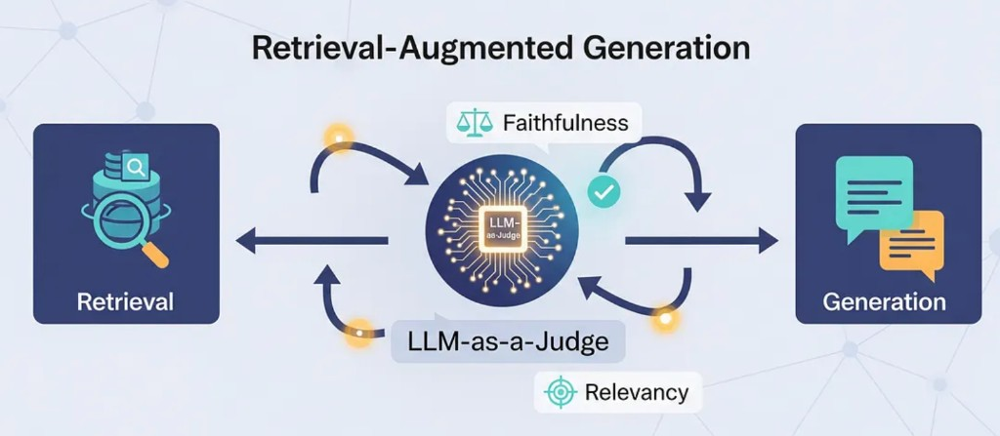
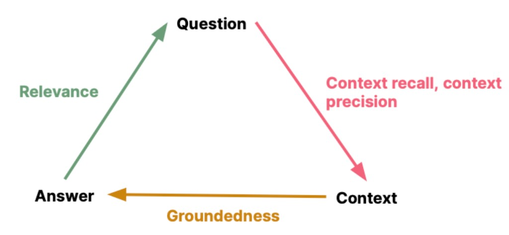
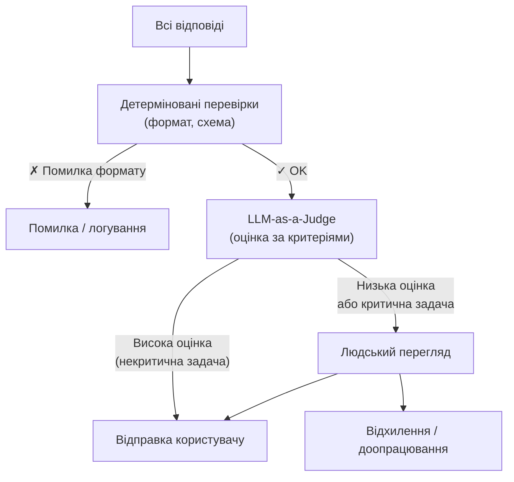
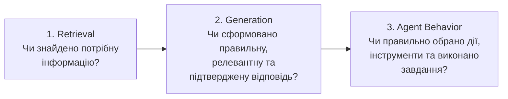

# КОНСПЕКТ-ДОВІДНИК ЛЕКЦІЇ №9: АГЕНТНІ СИСТЕМИ

> **Тема:** Агентні системи: рівні автономності, оркестрація через граф станів (LangGraph), побудова email-агента з людиною в циклі, оцінювання RAG-компонентів та агентів.
>
> **Формат:** розгорнутий навчальний довідник без скорочень змісту, з виправленнями неточностей оригінального матеріалу, поясненнями простими словами, практичними кейсами, зображеннями, формулами і джерелами.

---

<a id="dictionary"></a>

## Словник скорочень і термінів

Біля кожного скорочення в дужках стоїть повна англійська назва. Далі — що це означає в цьому конспекті.

### Скорочення

- **AI Agent (Artificial Intelligence Agent).** Програма, яка автономно сприймає стан середовища, планує кроки й виконує дії для досягнення поставленої мети. На відміну від звичайного LLM-запиту, агент може самостійно вирішувати, що робити далі.

- **API (Application Programming Interface).** Інтерфейс, через який програма взаємодіє із зовнішнім сервісом або бібліотекою: надсилає запит і отримує відповідь. Наприклад, `ChatOpenAI.invoke()` — виклик через API.

- **CI/CD (Continuous Integration / Continuous Delivery).** Практика автоматичного збирання, тестування і розгортання коду після кожного оновлення. DeepEval дозволяє вбудовувати LLM-тести в таку систему.

- **CRM (Customer Relationship Management).** Система управління взаємовідносинами з клієнтами, де зберігаються дані про покупців, їхня історія покупок і звернень.

- **FAISS (Facebook AI Similarity Search).** Бібліотека для ефективного пошуку за схожістю у великих векторних просторах. Використовується як локальне векторне сховище в навчальному прикладі RAG.

- **HITL (Human-In-The-Loop).** Підхід, коли людина бере участь у циклі роботи агента: переглядає, редагує або схвалює певні кроки перед їх виконанням.

- **IR (Information Retrieval).** Пошук інформації: наукова галузь, що вивчає алгоритми знаходження релевантних документів за запитом. Класичні IR-метрики (Precision@K, Recall@K, MRR, NDCG) широко застосовуються для оцінювання RAG.

- **LCEL (LangChain Expression Language).** Синтаксис LangChain для декларативного складання компонентів у ланцюжки: `prompt | llm | parser`. Використовує pipes та chains.

- **LLM (Large Language Model).** Велика мовна модель, навчена на текстових даних і здатна генерувати, перекладати та аналізувати текст.

- **MRR (Mean Reciprocal Rank).** Середня обернена позиція першого релевантного результату в списку. Показує, наскільки рано в результатах пошуку з'являється перший корисний документ.

- **NDCG (Normalized Discounted Cumulative Gain).** Нормалізований зважений сукупний виграш. Враховує не тільки позицію, а й ступінь релевантності кожного документа.

- **RAG (Retrieval-Augmented Generation).** Підхід, де перед генерацією відповіді модель спочатку знаходить релевантні фрагменти в зовнішній базі знань і спирається на них. Поєднує переваги пошуку та LLM.

- **RAGAS (RAG Assessment).** Спеціалізований фреймворк для оцінювання RAG-систем і агентів. Надає метрики Context Precision, Context Recall, Faithfulness, Answer Relevancy та інші. Старий єдиний `ragas score` прибрали починаючи з версії 0.2 — тепер повертаються окремі оцінки.

- **RPA (Robotic Process Automation).** Автоматизація повторюваних бізнес-процесів за допомогою програмних роботів або агентів.

- **SMTP (Simple Mail Transfer Protocol).** Протокол надсилання електронних листів. У навчальному прикладі надсилання листа *імітується* — реального SMTP-виклику немає.

### Терміни LangGraph і Python

- **State (Стан).** Спільна структура даних, яка зберігає всю поточну інформацію під час виконання графа. Схему стану зазвичай описують через `TypedDict`. Під час роботи стан — це звичайний словник Python (`dict`).

- **Node (Вузол).** Функція Python, яка отримує поточний стан, виконує певну логіку та повертає часткове оновлення стану (словник із тільки тими ключами, що змінилися). Вузлами можуть бути також асинхронні функції та інші callable-об'єкти.

- **Edge (Ребро).** Зв'язок між двома вузлами, що визначає порядок виконання. Може бути фіксованим (`add_edge`) або умовним (`add_conditional_edges`, `Command(goto=...)`).

- **Conditional Edge (Умовне ребро).** Ребро, де напрямок переходу вирішується динамічно — або через окрему функцію-маршрутизатор (`add_conditional_edges`), або безпосередньо всередині вузла через `Command(goto=...)`.

- **Graph (Граф).** Об'єкт LangGraph типу `StateGraph`, який містить усі вузли та зв'язки між ними. Перед запуском компілюється методом `.compile()`.

- **Command.** Спеціальний об'єкт LangGraph, який дозволяє вузлу одночасно оновити стан (`update`) і вказати наступний вузол (`goto`). Це головний спосіб поєднати оновлення стану та маршрутизацію в одному місці.

- **Reducer.** Функція, яка визначає, як нове значення поля стану об'єднується з попереднім. Без спеціального reducer нове значення *замінює* попереднє. `add_messages` — приклад reducer, який *додає* нові повідомлення до існуючого списку, а не замінює його.

- **`add_messages`.** Вбудований reducer LangGraph для поля `messages`. Дозволяє накопичувати повідомлення між вузлами, а не перезаписувати весь список.

- **Checkpointer (Чекпоінтер).** Механізм збереження стану графа після кожного кроку. Дозволяє відновити виконання після збою або людського втручання. `InMemorySaver` зберігає стан у RAM (зникає після завершення процесу). Для постійного збереження використовують SQLite або Postgres checkpointers.

- **`InMemorySaver` / `MemorySaver`.** Вбудований чекпоінтер LangGraph, що зберігає всі знімки стану в оперативній пам'яті. Підходить для навчання та тестування, але не для production із тривалими сесіями.

- **`thread_id`.** Ідентифікатор розмови (потоку). Всі checkpoint-и одного `thread_id` утворюють єдину послідовну «пам'ять» агента. Якщо запустити граф із тим самим `thread_id`, він продовжить з попереднього місця.

- **`interrupt`.** Функція LangGraph, яка призупиняє виконання графа й повертає payload людині для перегляду. Відновлення здійснюється через `Command(resume=...)` з тим самим `thread_id`. **Важливо:** при відновленні вузол запускається повторно з початку — тому незворотні зовнішні дії не слід виконувати до `interrupt()`.

- **`RetryPolicy`.** Об'єкт LangGraph для налаштування автоматичного повтору при тимчасових збоях (мережеві помилки, тайм-аути). Параметри: `max_attempts`, `retry_on` тощо. Щоб `RetryPolicy` спрацював, помилку треба *не перехоплювати* всередині вузла, а дати їй підняться вгору.

- **Ідемпотентність (Idempotency).** Властивість операції виконуватися кілька разів без небажаних додаткових ефектів. Оскільки вузол із `interrupt()` може запускатися повторно при відновленні, дії всередині нього мають бути ідемпотентними.

- **`TypedDict`.** Клас Python із модуля `typing`, який описує *очікувану структуру словника* для цілей статичної типізації. Це не звичайний клас з об'єктами й методами — він лише документує, які ключі має містити словник і якого вони типу.

- **`NotRequired[T]`.** Позначення з `typing_extensions`, яке вказує, що конкретний ключ у `TypedDict` може *взагалі бути відсутнім* у словнику. `T | None` означає інше: ключ є, але його значення може дорівнювати `None`.

- **`Literal[...]`.** Анотація типу, яка обмежує множину допустимих значень: наприклад, `Literal["billing", "bug", "question"]`. Корисна для статичних перевірок і структурованого виводу LLM.

- **`Annotated[T, metadata]`.** Анотація Python, яка дозволяє прикріпити метадані до типу. У LangGraph використовується для вказання reducer-а: `Annotated[list[AnyMessage], add_messages]`.

- **Структурований вивід (Structured Output).** Метод `llm.with_structured_output(Schema)`, який змушує LLM повертати відповідь у вигляді словника або об'єкта визначеної схеми. Забезпечує детерміновану структуру результату.

- **Intent (Намір).** Мета або причина звернення користувача: `"question"`, `"bug"`, `"billing"`, `"feature"`, `"complex"`. Визначається класифікатором і використовується для маршрутизації в графі.

- **Urgency (Терміновість).** Рівень критичності звернення: `"low"`, `"medium"`, `"high"`, `"critical"`. Визначає, чи потрібен обов'язковий людський огляд.

- **Topic (Тема).** Коротка тематична мітка звернення: наприклад, `"подвійне списання"`, `"помилка при PDF-експорті"`.

- **Summary (Резюме).** Стисле формулювання суті звернення у кількох словах: `"Клієнт просить повернути кошти за подвійне списання"`.

### Метрики оцінювання

- **Faithfulness (Достовірність).** Частка тверджень у згенерованій відповіді, які підтверджуються знайденим контекстом. Не гарантує фактичної правильності самих документів.

- **Groundedness.** У більшості бібліотек є синонімом або дуже близьким поняттям до Faithfulness: перевірка, чи кожне речення відповіді спирається на контекст. Поняття залежать від конкретної бібліотеки.

- **Answer Relevancy (Релевантність відповіді).** Наскільки відповідь відповідає на поставлене запитання. Не перевіряє фактичну правильність — лише відповідність запиту.

- **Answer Correctness (Правильність відповіді).** Фактична правильність відповіді порівняно з еталонною. Відрізняється від Faithfulness: Faithfulness може бути 1.0, навіть якщо джерело містить помилку.

- **Contextual Precision (Контекстна точність).** Оцінює, чи відсортовані знайдені фрагменти так, що релевантні стоять вище нерелевантних. Використовує формулу зваженої кумулятивної точності (Weighted Cumulative Precision, WCP). Потребує reference або response для визначення релевантності.

- **Contextual Recall (Контекстне повернення).** Оцінює, чи містить знайдений контекст всю інформацію, необхідну для еталонної відповіді. Порівнює твердження з `reference` з тим, що є в `retrieved_contexts`.

- **Precision@K.** Частка релевантних документів серед перших K результатів пошуку.

- **Recall@K.** Частка всіх релевантних документів, що потрапили до перших K результатів.

- **Hit@K.** Бінарна метрика: чи є хоч один очікуваний документ серед перших K результатів? Проста і зрозуміла, підходить для smoke-тестів.

- **Task Completion Rate (Частка виконаних завдань).** Відсоток завдань, які агент довів до успішного кінця. Визначення «успішного» слід фіксувати заздалегідь.

- **Milestone Achievement (Досягнення контрольних точок).** Частка пройдених етапів у складному багатокрокового завдання. Корисна для діагностики, де саме виникають проблеми.

- **Tool Correctness (Правильність вибору інструменту).** Частка кроків, де агент вибрав правильний інструмент для задачі.

- **Tool Efficiency (Ефективність використання інструментів).** Оптимальність кількості викликів інструментів. Немає єдиного стандартного визначення — це радше ілюстративна характеристика, що допомагає виявляти надмірні або зайві виклики.

- **Parameter Accuracy (Точність параметрів).** Правильність аргументів при виклику інструментів: типи даних, формати, діапазони значень.

### Методи оцінювання

- **LLM-as-a-Judge (Суддя-LLM).** Підхід, де одна мовна модель оцінює відповіді іншої за заданими критеріями. Може використовуватися та сама або інша модель з іншим промптом.

- **Rubric (Рубрика).** Набір конкретних критеріїв і правил виставлення оцінок, що забезпечує стандартизацію і відтворюваність оцінювання.

- **Pointwise Evaluation (Поточкове оцінювання).** Оцінювання однієї відповіді за заданими критеріями, незалежно від інших відповідей.

- **Pairwise Evaluation (Парне оцінювання).** Порівняння двох відповідей між собою для визначення кращої.

- **Position Bias (Упередження до позиції).** Схильність LLM-судді оцінювати вище ту відповідь, яка стоїть першою у списку, незалежно від її якості.

- **Self-Preference Bias (Упередження до власної моделі).** Схильність LLM оцінювати вище відповіді моделей своєї «родини» або самого себе.

- **Golden Dataset.** Набір тестових запитів з еталонними відповідями, очікуваними джерелами або діями. Використовується для систематичного оцінювання та регресійного тестування.

- **Inter-rater Agreement (Узгодженість між оцінювачами).** Ступінь, з яким різні люди або оцінювачі дають однакові оцінки тому ж прикладу. Показує надійність критеріїв оцінювання.

- **Judge Calibration (Калібрування судді).** Перевірка й налаштування оцінювача на прикладах з відомими відповідями для підвищення надійності його оцінок.

- **Evaluation Drift (Дрейф оцінювання).** Непомітна зміна поведінки або якості оцінювача з часом через оновлення моделі або зміщення даних.

- **Offline Evaluation.** Оцінювання системи на заздалегідь підготовленому датасеті до релізу. Дозволяє перевірити якість без реальних користувачів.

- **Online Evaluation.** Оцінювання системи в реальному часі під час роботи в production. Може бути асинхронним і не блокувати відповіді.

- **Регресійне тестування (Regression Testing).** Перевірка, що нова версія системи не погіршила якість порівняно з попередньою. Запускається автоматично при кожному оновленні.

- **Red Teaming.** Навмисні спроби знайти вразливості системи: небезпечні вхідні дані, обхід обмежень, витоки даних.

- **Prompt Injection.** Атака, де зловмисний текст у вхідних даних або знайденому документі змушує агента виконати несанкціоновані дії.

- **Галюцинація (Hallucination).** Правдоподібна, але фактично неправдива відповідь моделі, не підкріплена контекстом або реальністю.

- **Latency.** Час від відправлення запиту до отримання відповіді. Критичний показник для real-time систем.

- **Cost per Query.** Вартість одного запиту до системи, що включає витрати на LLM-виклики, embeddings і пошук.

### Інструменти

- **DeepEval.** Open-source фреймворк для автоматизованого тестування LLM-застосунків за аналогією з Pytest. Надає метрики для RAG і агентів, пороги прийнятності, інтеграцію з CI/CD.

- **DeepTeam.** Окремий інструмент від творців DeepEval, що спеціалізується на безпековому тестуванні (red teaming) LLM-систем: prompt injection, витоки даних та інші вразливості. Не варто плутати з базовим DeepEval.

- **LangSmith.** Платформа від Langchain для трасування, налагодження, тестування та моніторингу LLM-застосунків і агентів. Має безкоштовний Developer-план. Підтримує будь-які фреймворки через SDK та OpenTelemetry, а не тільки LangChain/LangGraph.

- **Tracing (Трасування).** Запис покрокового виконання агента: які вузли були викликані, які аргументи передавались, скільки часу зайняв кожен крок.

- **Kill Switch (Аварійний вимикач).** Механізм примусового зупинення агента, якщо він поводиться небезпечно або некоректно.

---

<a id="toc"></a>

## Зміст

- [Словник скорочень і термінів](#dictionary)
- [Частина 0. Вступ](#part-0)
- [Частина 1. Рівні автономності агентів](#part-1)
- [Частина 2. LangGraph — оркестрація через граф станів](#part-2)
- [Частина 3. Практичний приклад: email-агент підтримки клієнтів](#part-3)
- [Частина 4. Оцінювання агентів і RAG](#part-4)
- [Частина 5. Методи оцінювання](#part-5)
- [Частина 6. Сучасні інструменти та бібліотеки](#part-6)
- [Частина 7. Підсумки](#part-7)
- [Джерела та посилання](#sources)

---

<a id="part-0"></a>

## Частина 0. Вступ

Вітаємо!

У попередніх уроках ви вже ознайомилися з базовими концепціями агентів та їхніми інструментами. Тепер час перейти до проєктування та побудови повноцінних агентних систем для реальних завдань.

Ця тема має чітку логічну структуру — від архітектурних рішень до практичної реалізації та оцінювання:



**Починаємо з рівнів автономності** — фундаментальне архітектурне питання, що визначає всю подальшу систему. Перш ніж писати код, потрібно вирішити: наскільки самостійним буде агент? Чи потребуватиме він постійного контролю, чи працюватиме повністю автономно? Від цього залежать вимоги до безпеки, інтерфейсів та механізмів відновлення після помилок.

**Далі переходимо до LangGraph** — фреймворку, який дозволяє реалізувати агентів з обраним рівнем автономності. На відміну від простих ланцюжків LangChain, LangGraph моделює агента як граф станів. Це критично важливо для систем із циклами, точками прийняття рішень і людським втручанням.

**Приклад email-агента** демонструє, як усі ці концепції працюють разом. Показуємо, як визначити стани й переходи, реалізувати вузли для різних типів завдань, налаштувати чекпоінти для відновлення роботи. Такі агенти реально працюють у службах підтримки великих компаній.

**Завершуємо оцінюванням**, бо побудувати агента — це лише половина справи. Як дізнатися, чи він працює правильно? Особливо критично це для RAG-компонентів: якщо агент не може коректно знайти та використати інформацію з документів, усі його дії будуть помилковими. Розглянемо метрики, методи оцінювання й інструменти.

---

<a id="part-1"></a>

## Частина 1. Рівні автономності агентів

### Навіщо думати про автономність першим?

Будь‑яке проєктування починається з домовленостей про «ступінь свободи» агента. Від рівня автономності залежать:

- межі ризику;
- вимоги до підтверджень людиною;
- дизайн інтерфейсів;
- вибір технологій інтеграції.

Правильна рамка економить тижні переробок.

### Шкала рівнів

Індустрія сходиться на п'ятирівневій шкалі: **Operator → Collaborator → Consultant → Approver → Observer**, де ключова змінна — роль користувача та частота його втручань і погоджень.

> **Важливо:** рівень автономності — це свідомий вибір архітекторів системи, а не показник «розумності» моделі. Навіть найпотужніший ШІ може навмисно працювати в режимі низької автономності, якщо задача пов'язана з високими ризиками чи відповідальністю.
>
> *Примітка:* «OpenAI Operator» — це назва окремого продукту компанії OpenAI. У наведеній класифікації «Operator» означає роль людини, а не продукт.

---

### Рівень 1: Користувач як оператор (L1 — Operator)

На найнижчому рівні автономності **користувач постійно керує процесом**, а агент допомагає на вимогу — як «copilot».

**Як це виглядає:**
- Користувач сам розкладає запит на підзадачі.
- Агент спостерігає за діями та дає контекстні підказки: пропонує пошукові запити, стисло підсумовує статті, знаходить релевантні джерела.
- Агент переходить у редактор коду та пропонує автодоповнення.
- Агент **не діє без явного дозволу**.

**Коли підходить:** задачі з високою відповідальністю, де людина не може делегувати рішення; навчальні середовища; ситуації, коли помилка агента коштуватиме дорого.

---

### Рівень 2: Користувач як співучасник (L2 — Collaborator)

Користувач і агент **планують, делегують і виконують задачі разом**. Агент іноді працює автономно паралельно з користувачем.

**Як це виглядає:**
- Агент готує план — користувач його редагує.
- Частину роботи (читання й самарі) відведено агенту; гіпотези й аналіз даних залишаються у людини.
- Прогрес прозорий у спільному документі.
- Користувач може перехопити ініціативу, якщо агент зациклився або помиляється.

**Що важливо:** потрібні протоколи комунікації та зручні інтерфейси для синхронізації.

---

### Рівень 3: Користувач як консультант (L3 — Consultant)

**Більше ініціативи в агента:** він планує й виконує роботу на довших горизонтах, а користувач дає зворотний зв'язок, налаштовує пріоритети й уподобання. Прямого «ручного керування» може не бути — зміни вносяться через коментарі чи повідомлення.

**Як це виглядає:**
- Агент пропонує план (огляд літератури → глибше читання → дослідницькі питання → дані).
- Користувач корегує послідовність.
- Агент **періодично** звіряється щодо фокусу та надійності джерел.
- Накопичує результати в документі.
- Користувач може зупинити крок, попросити переробку, надати облікові дані тощо.

**Що важливо:** успіх залежить від вчасних і цільових консультацій; часто потрібен «період навчання» під конкретного користувача.

---

### Рівень 4: Користувач як затверджувач (L4 — Approver)

Користувач взаємодіє **мінімально** — в основному для розв'язання блокерів (логіни, ключі, підтвердження ризикованих дій). Агент показує план для прозорості, сам обирає джерела та дані, просить доступи й наприкінці лише підтверджує формат звіту.

**Відмінність від L3:** агент більше приймає дрібні рішення самостійно.

**Коли підходить:** процеси з багатьма невисокоризиковими виборами.

**Що ускладнюється:** підвищені вимоги до безпеки — зберігання секретів, зростання площі атаки.

---

### Рівень 5: Користувач як спостерігач (L5 — Observer)

**Повна автономність:** агент сам планує, долає перешкоди, змінює стратегію та видає готовий результат. Користувач лише переглядає журнали активності та має аварійний вимикач (kill switch).

**Переваги:**
- Відчутні в закритих або «пісочних» середовищах.
- Ефективні за надскладних задач, де втручання людини може погіршити якість.

**Ризики:**
- Помилки можуть накопичуватися непомітно.
- Без kill switch — повна втрата контролю.

---

### Порівняльна таблиця

| Рівень | Роль людини | Автономність агента | Коли використовувати |
|--------|-------------|----------------------|----------------------|
| L1 | Оператор — керує кожним кроком | Мінімальна | Критичні рішення, навчання |
| L2 | Співучасник — спільна робота | Часткова, з паузами | Складні задачі зі спільним контекстом |
| L3 | Консультант — дає фідбек | Висока, з консультаціями | Тривалі дослідницькі задачі |
| L4 | Затверджувач — схвалює блокери | Дуже висока | Автоматизовані пайплайни з контрольними точками |
| L5 | Спостерігач — моніторить | Повна | Пісочниці, добре визначені задачі |

**Три питання для вибору рівня:**
1. Наскільки великий ризик помилки агента?
2. Чи можна відкатити або скасувати дію агента?
3. Яких вимог до безпеки і відповідальності вимагає задача?

---

<a id="part-2"></a>

## Частина 2. LangGraph — оркестрація через граф станів

### Що таке LangGraph?

**LangGraph** — це фреймворк для побудови *stateful* (зі збереженням стану), багатоакторних застосунків із великими мовними моделями. Він став де‑факто стандартом, коли потрібно керувати складними циклами взаємодії між LLM, інструментами й користувачем, зберігаючи при цьому повний контроль над станом та логікою переходів.

> **Простими словами:**
> LangGraph — це фреймворк для побудови складних AI-агентів, який дозволяє створювати системи, що можуть приймати рішення, повертатися до попередніх кроків та адаптуватися до різних ситуацій. На відміну від простих чат-ботів, агенти на LangGraph можуть «думати» багатокроково та зберігати контекст між різними етапами роботи.

---

### LangChain проти LangGraph

LangChain і LangGraph — обидва дозволяють будувати складні системи з циклами, розгалуженнями й умовною логікою. Різниця не в можливостях, а в **підході до моделювання**.



> Джерело: [ProjectPro — LangChain vs LangGraph](https://www.projectpro.io/article/langchain-vs-langgraph/1123)

**LangChain (LCEL)** — це про композицію компонентів через pipes та chains. Ви думаєте процедурно: беремо prompt, передаємо в LLM, результат парсимо, за умовою йдемо в одну чи іншу гілку. Можна робити цикли, можна додавати умови, але в основі лежить ланцюжок викликів.

**LangGraph** пропонує думати через **граф станів**:

| Концепція | LangChain / LCEL | LangGraph |
|-----------|-----------------|-----------|
| Головне питання | «Що робити далі?» | «Де ми зараз і куди можемо піти?» |
| Основна метафора | Ланцюжок кроків | Карта можливих станів |
| Цикли | Можливі, але нестандартні | Перший клас громадян |
| Стан між кроками | Змінна у ланцюжку | Спільний стан графа |
| Human-in-the-loop | Потребує обхідних шляхів | Вбудований через `interrupt` |

**LangChain і LangGraph доповнюють одна одну** — LangGraph широко використовує компоненти LangChain (ChatOpenAI, embeddings, document loaders тощо).

---

### Аналогія з грою-квестом

Уявіть комп'ютерну гру-квест:

- Є **різні локації** (вузли) — наприклад, «Площа», «Таверна», «Замок».
- Між ними є **дороги** (ребра) — деякі прямі, деякі з розв'язками.
- Персонаж завжди знаходиться в **одній локації** (поточний стан).
- Залежно від того, що сталося, він може переміститися в інше місце — або повернутися назад.

У LangGraph:
- **Локації** = вузли-функції.
- **Дороги** = ребра між вузлами.
- **Те, що відбувається у локації** = логіка функції-вузла.
- **«Де ми зараз»** = поточний стан графа.

---

### Три типи маршрутизації

У LangGraph є три способи вказати, який вузол виконається наступним:

1. **`add_edge(A, B)`** — фіксований перехід: A завжди передає керування до B.
2. **`add_conditional_edges(A, func, {...)}`** — умовний перехід через зовнішню функцію-маршрутизатор, що повертає назву наступного вузла.
3. **`Command(update=..., goto=...)`** — вузол A сам повертає об'єкт Command, що одночасно оновлює стан і вказує наступний вузол B. Це найгнучкіший спосіб, бо маршрутизація і оновлення стану поєднані в одному місці.

> **Уточнення до лекційного матеріалу:** твердження «фактичне рішення про те, яким шляхом іти, приймається всередині кожного вузла» є правильним для підходу з `Command`, але не є єдиним способом маршрутизації в LangGraph. Можна використовувати всі три підходи в одному графі.

---

### П'ять ключових концепцій LangGraph

#### 1. Вузли (Nodes)

Це окремі Python-функції (або async-функції), що виконують конкретні завдання. Кожен вузол:

- Отримує поточний стан системи (`state: dict`).
- Виконує свою специфічну роботу.
- Повертає часткове оновлення стану (лише ті ключі, що змінилися) — або `Command` з оновленням і наступним вузлом.

> **Аналогія:** Вузли — як станції метро: на кожній відбувається щось своє, але всі вони з'єднані в єдину систему.

#### 2. Стан (State)

Це спільна пам'ять, яка зберігає всю важливу інформацію для *всього* графа:

- Вхідні дані та інформацію про відправника.
- Проміжні результати обробки (класифікація, результати пошуку).
- Згенерований вміст (чернетка відповіді).
- Метадані виконання (ticket_id, delivery_status).

**Схему стану** описують через `TypedDict`. Під час виконання стан — це звичайний словник Python.

> **Аналогія:** Стан — це як записник, який передається між співробітниками, і кожен додає туди свої нотатки.

**Таблиця: елементи LangGraph у термінах Python**

| Елемент | Що це в Python |
|---------|----------------|
| `AgentState` | Клас `TypedDict`, що описує схему словника |
| `state` | Звичайний словник (`dict`) з поточними значеннями |
| `classify_email()` | Функція, що реалізує логіку вузла |
| `"classify_intent"` | Рядок — назва вузла в графі |
| `StateGraph` | Клас бібліотеки LangGraph для побудови графа |
| `workflow` | Об'єкт графа до компіляції |
| `app` | Скомпільований граф, готовий до запуску |

> **Важливий нюанс:** `TypedDict` *не* створює звичайний клас з об'єктами, атрибутами й методами (як `class Customer`). Він лише описує очікувану структуру словника для статичної типізації. Runtime-валідацію він не виконує.

#### 3. Ребра (Edges)

Це з'єднання між вузлами:

- **Звичайні ребра** (`add_edge`) — завжди ведуть до конкретного вузла.
- **Умовні ребра** (`add_conditional_edges`) — вибір напрямку залежить від умов.
- **Command** — вузол сам вказує наступний крок.

> **Аналогія:** Ребра — це дороги між містами: деякі прямі, деякі з розв'язками.

#### 4. Command (Команди)

Спеціальний об'єкт для керування потоком виконання:

```python
return Command(
    update={"classification": result},  # що записати в стан
    goto="draft_response"               # який вузол виконати наступним
)
```

> **Аналогія:** Command — це як диспетчер, який керує рухом і може змінювати маршрути.

#### 5. Чекпоінтер (Checkpointer)

Механізм збереження стану для можливості відновлення:

- Зберігає «знімки» стану на кожному кроці.
- Дозволяє відновити роботу після збою або людського огляду.
- `InMemorySaver` — зберігає в RAM (тільки для навчання і тестування).
- Для production із тривалими сесіями потрібен постійний checkpointer (SQLite, Postgres).

> **Аналогія:** Чекпоінтер — це як функція автозбереження в грі: дозволяє продовжити з того місця, де ви зупинилися.

---

<a id="part-3"></a>

## Частина 3. Практичний приклад: email-агент підтримки клієнтів

Уявіть, що вам потрібно створити AI-агента, який обробляє електронні листи служби підтримки клієнтів.

### Вимоги

Агент повинен:

1. Читати вхідні електронні листи клієнтів.
2. Класифікувати їх за терміновістю та темою.
3. Шукати відповідну документацію для відповіді на запитання.
4. Складати відповіді.
5. Передавати складні запитання агентам-людям.
6. Планувати подальші дії, коли це необхідно.

**Приклади сценаріїв для обробки:**

| Тип | Приклад листа | Intent | Urgency |
|-----|---------------|--------|---------|
| Просте питання | «Як скинути пароль?» | `question` | `low` |
| Звіт про помилку | «Функція експорту PDF аварійно завершується» | `bug` | `high` |
| Термінова оплата | «З мене двічі стягнули плату за підписку!» | `billing` | `critical` |
| Запит функції | «Чи можете додати темний режим?» | `feature` | `low` |
| Складне технічне | «Наша API-інтеграція повертає 504» | `complex` | `high` |

---

### Крок 1: Визначте workflow як дискретні кроки

Почніть із визначення окремих кроків і того, як вони з'єднуються.



> Джерело: [LangGraph Thinking in Graph API](https://docs.langchain.com/oss/python/langgraph/thinking-in-graph-api)

**Вузли нашого агента:**

| Вузол | Тип | Що робить |
|-------|-----|-----------|
| `read_email` | Дія | Парсить лист, реєструє в messages |
| `classify_intent` | LLM | Визначає intent, urgency, topic → маршрутизує |
| `search_documentation` | Дані | Шукає в базі знань |
| `bug_tracking` | Дія | Створює тікет у системі відстеження |
| `draft_response` | LLM | Генерує чернетку → вирішує, чи потрібен огляд |
| `human_review` | HITL | Пауза для людського перегляду і схвалення |
| `send_reply` | Дія | Надсилає відповідь (у демо — імітація) |

**Маршрути за сценаріями:**

| Сценарій | Послідовність вузлів |
|----------|----------------------|
| Звичайне питання | Read → Classify → Search → Draft → Send |
| Термінова оплата | Read → Classify → Draft → Human Review → Send |
| Критичний баг | Read → Classify → Bug Tracking → Draft → Human Review → Send |
| Складне технічне | Read → Classify → Draft → Human Review → Send |
| Людина відхилила | Human Review → END (без надсилання) |

> **Зверніть увагу:** термінова оплата (billing/critical) **спочатку** проходить через `draft_response` для створення чернетки, і лише потім — через `human_review`. Це ключова відмінність від помилкового підходу, де агент одразу іде на людський огляд без готової чернетки.

---

### Крок 2: Визначте типи кроків

Для кожного вузла потрібно розуміти, який тип операції він виконує:

**🤖 LLM-кроки** — коли потрібне розуміння, аналіз, генерація тексту або прийняття рішень на основі міркувань.

- `classify_intent`: аналізує текст листа, визначає intent, urgency, topic і summary.
- `draft_response`: генерує персоналізовану відповідь з урахуванням контексту.

**📊 Кроки даних** — коли потрібно отримати інформацію із зовнішніх джерел.

- `search_documentation`: запитує базу знань. Підтримує кешування й повтори.
- Пошук історії клієнта: звертається до CRM. Має резервний варіант при недоступності.

**⚡ Кроки дій** — коли потрібно виконати зовнішню дію.

- `bug_tracking`: створює тікет. Критично важливо не втратити звіти про помилки.
- `send_reply`: надсилає відповідь. Не кешується — кожне надсилання унікальне.

**👤 Кроки з людиною** — коли потрібне втручання людини.

- `human_review`: відображає чернетку, отримує рішення (схвалено / відхилено / відредаговано).

---

### Крок 3: Спроєктуйте стан

Стан — це спільна пам'ять, доступна всім вузлам.



> Джерело: [Martin Hodges — Defining the LangGraph State](https://medium.com/@martin.hodges/defining-the-langgraph-state-47c5ef97a95c)

**Правила проєктування стану:**

| Питання | Дія |
|---------|-----|
| Чи потрібно зберігати між кроками? | ✅ Включити в стан |
| Чи можна вивести з інших даних? | ❌ Обчислювати за потреби, не зберігати |
| Чи дорого отримати повторно? | ✅ Кешувати в стані |

```python
from typing import Annotated, Literal
from typing_extensions import NotRequired, TypedDict
from langchain_core.messages import AnyMessage
from langgraph.graph.message import add_messages


class EmailClassification(TypedDict):
    """Структура результату класифікації одного email.

    Усі поля обов'язкові: LLM зі structured_output має заповнити їх усі.
    intent  — мета звернення (одне з п'яти значень).
    urgency — критичність (від low до critical).
    topic   — коротка тематична мітка.
    summary — стислий зміст листа у кількох словах.
    """
    intent: Literal["question", "bug", "billing", "feature", "complex"]
    urgency: Literal["low", "medium", "high", "critical"]
    topic: str
    summary: str


class EmailAgentState(TypedDict):
    """Спільний стан LangGraph email-агента.

    Вхідні ключі (email_content, sender_email, email_id, messages) —
    обов'язкові при запуску.

    Поля, що з'являються під час роботи вузлів, позначено NotRequired:
    вони відсутні на початку і з'являються після відповідного вузла.

    NotRequired[T] ≠ T | None:
    - NotRequired означає, що ключ може взагалі бути відсутній у словнику.
    - T | None означає, що ключ є, але його значення може бути None.

    messages використовує reducer add_messages: нові повідомлення
    додаються до існуючого списку, а не замінюють його.
    """
    # --- Вхідні поля (обов'язкові при запуску) ---
    email_content: str        # повний текст листа
    sender_email: str         # email відправника
    email_id: str             # унікальний ідентифікатор листа

    # Annotated[..., add_messages] вказує reducer:
    # при оновленні нові повідомлення додаються, а не замінюють список.
    messages: Annotated[list[AnyMessage], add_messages]

    # --- Поля, що з'являються під час роботи вузлів ---
    classification: NotRequired[EmailClassification]  # результат класифікатора
    search_results: NotRequired[list[str]]            # знайдені фрагменти документів
    customer_history: NotRequired[dict]               # дані CRM про клієнта
    ticket_id: NotRequired[str]                       # ID тікета у системі відстеження
    draft_response: NotRequired[str]                  # чернетка відповіді
    delivery_status: NotRequired[str]                 # статус надсилання
```

> **Принцип:** зберігайте в стані **сирі дані**. Шаблони промптів формуйте всередині вузлів. Це дозволяє різним вузлам форматувати ті самі дані по-різному, а зміна промпту не потребує зміни схеми стану.

---

### Крок 4: Побудуйте вузли

Вузол у LangGraph — це Python-функція, що приймає стан і повертає часткове оновлення або `Command`.

#### Вузол читання та класифікації

```python
from langchain_core.messages import HumanMessage
from langgraph.types import Command, interrupt


def read_email(state: EmailAgentState) -> dict:
    """Зареєструвати отриманий email у списку повідомлень стану.

    Ця функція НЕ читає реальну поштову скриньку. Вхідний лист уже
    передано в state['email_content']; тут ми лише створюємо HumanMessage,
    щоб LLM-вузли бачили лист у форматі чату.

    Returns:
        dict: оновлення поля 'messages' — один новий HumanMessage.
    """
    return {
        "messages": [HumanMessage(content=state["email_content"])]
    }


def classify_intent(
    state: EmailAgentState,
) -> Command[Literal["search_documentation", "bug_tracking", "draft_response"]]:
    """Класифікувати намір листа через LLM та маршрутизувати до вузла.

    Використовує structured output, щоб отримати EmailClassification
    у вигляді словника. Зберігає класифікацію в стані через Command.

    Маршрутизація (після виправлення):
    - bug → bug_tracking (спочатку реєструємо тікет)
    - question / feature → search_documentation
    - billing / complex / інше → draft_response

    Термінові листи (billing/critical) НЕ йдуть одразу на human_review:
    спочатку потрібна готова чернетка. Human_review буде в draft_response.

    Args:
        state: поточний стан графа.
    Returns:
        Command з оновленим полем 'classification' і наступним вузлом.
    """
    # structured_llm повертає EmailClassification як словник
    structured_llm = llm.with_structured_output(EmailClassification)

    # Промпт формується всередині вузла, а не зберігається в стані
    classification_prompt = f"""
    Проаналізуй цей email клієнта та класифікуй його:

    Email: {state['email_content']}
    Від: {state['sender_email']}

    Визнач intent, urgency, topic та summary.
    intent має бути одним із: question, bug, billing, feature, complex.
    urgency має бути одним із: low, medium, high, critical.
    """

    classification: EmailClassification = structured_llm.invoke(classification_prompt)

    # Маршрутизація: bug → bug_tracking; question/feature → search;
    # billing/complex/решта → draft_response (там вирішиться про human_review)
    if classification["intent"] == "bug":
        goto = "bug_tracking"
    elif classification["intent"] in ["question", "feature"]:
        goto = "search_documentation"
    else:
        goto = "draft_response"

    # Command одночасно зберігає класифікацію і вказує наступний вузол
    return Command(
        update={"classification": classification},
        goto=goto
    )
```

#### Вузли пошуку та трекінгу

```python
def search_documentation(
    state: EmailAgentState,
) -> Command[Literal["draft_response"]]:
    """Знайти релевантні фрагменти в базі знань.

    У production тут було б підключення до векторного сховища або CRM.
    У навчальному прикладі використовується демо-словник.

    Якщо пошук тимчасово недоступний, зберігаємо повідомлення про помилку
    у search_results і продовжуємо — чернетка буде менш конкретною.

    Args:
        state: поточний стан з полем classification.
    Returns:
        Command із search_results і переходом до draft_response.
    """
    classification = state.get("classification", {})
    intent = classification.get("intent", "")

    # У реальній системі: retriever.invoke(query)
    # У демо: статичний словник для навчальних цілей
    demo_kb = {
        "question": [
            "Відновлення пароля: відкрийте сторінку входу й натисніть «Забули пароль».",
            "Якщо лист не надійшов, перевірте папку Спам або зверніться до підтримки.",
        ],
        "feature": [
            "Запити на нові функції збирає продуктова команда; терміни не обіцяються.",
        ],
    }

    search_results = demo_kb.get(intent, [])

    return Command(
        update={"search_results": search_results},
        goto="draft_response"
    )


def bug_tracking(
    state: EmailAgentState,
) -> Command[Literal["draft_response"]]:
    """Створити тікет у системі відстеження багів і зберегти його ID.

    Ticket ID записується в окреме поле ticket_id (не у search_results),
    щоб не змішувати різні типи даних у стані.

    У production тут було б підключення до Jira, Linear тощо.
    Операція має бути ідемпотентною: повторний виклик не має створювати
    дублікати тікетів (наприклад, через перевірку за email_id).

    Args:
        state: поточний стан з полями email_id та classification.
    Returns:
        Command із ticket_id і переходом до draft_response.
    """
    # У production: jira_client.create_issue(...); перевіряти ідемпотентність
    ticket_id = f"DEMO-BUG-{state['email_id']}"

    return Command(
        update={"ticket_id": ticket_id},
        goto="draft_response"
    )
```

#### Вузли відповіді та огляду

```python
def draft_response(
    state: EmailAgentState,
) -> Command[Literal["human_review", "send_reply"]]:
    """Скласти відповідь на основі контексту і вирішити, чи потрібен огляд.

    Формує промпт із сирих даних стану, викликає LLM, зберігає чернетку.
    Після цього вирішує, чи потрібен human_review:
    - billing, complex, high urgency, critical → human_review
    - інакше → send_reply

    Args:
        state: поточний стан із classification, search_results, ticket_id.
    Returns:
        Command з draft_response і наступним вузлом.
    """
    classification = state["classification"]

    # Формуємо секції контексту з сирих даних (форматування — тут, не в стані)
    context_parts = []

    if state.get("search_results"):
        docs_text = "\n".join(f"- {doc}" for doc in state["search_results"])
        context_parts.append(f"Відповідна документація:\n{docs_text}")

    if state.get("ticket_id"):
        context_parts.append(f"Створено тікет: {state['ticket_id']}")

    if state.get("customer_history"):
        tier = state["customer_history"].get("tier", "стандартний")
        context_parts.append(f"Рівень клієнта: {tier}")

    context_text = "\n\n".join(context_parts)

    draft_prompt = f"""
    Склади відповідь на цей email клієнта:
    {state['email_content']}

    Намір: {classification.get('intent', 'невідомий')}
    Терміновість: {classification.get('urgency', 'середня')}

    {context_text}

    Рекомендації:
    - Будь професійним та корисним.
    - Звертайся до конкретної проблеми.
    - НЕ обіцяй дій, які ще не виконані (повернення коштів, виправлення тощо).
    """

    response = llm.invoke(draft_prompt)

    # Вирішуємо, чи потрібен людський огляд
    needs_review = (
        classification.get("urgency") in ["high", "critical"]
        or classification.get("intent") in ["billing", "complex"]
    )
    goto = "human_review" if needs_review else "send_reply"

    return Command(
        update={"draft_response": response.content},
        goto=goto
    )


def human_review(
    state: EmailAgentState,
) -> Command[Literal["send_reply", "__end__"]]:
    """Призупинити виконання для людського перегляду чернетки.

    interrupt() серіалізує payload і зупиняє граф. При відновленні через
    Command(resume=...) вузол запускається ПОВТОРНО з початку — тому
    жодних незворотних дій до interrupt() не виконуємо.

    Повернений human_decision — це dict, переданий через Command(resume=...).
    Якщо approved=True, відправляємо (можливо, відредаговану) відповідь.
    Якщо approved=False, завершуємо без надсилання.

    Args:
        state: поточний стан з draft_response та classification.
    Returns:
        Command із можливо оновленою чернеткою і переходом до send_reply або END.
    """
    # interrupt() має бути ПЕРШИМ: код після нього не виконається при паузі.
    # При відновленні весь вузол запускається знову; interrupt() поверне
    # значення, передане через Command(resume=...).
    human_decision = interrupt({
        "email_id": state["email_id"],
        "original_email": state["email_content"],
        "draft_response": state["draft_response"],
        "intent": state["classification"]["intent"],
        "urgency": state["classification"]["urgency"],
        "action": "Перегляньте чернетку та схваліть, відредагуйте або відхиліть",
    })

    # Перевіряємо формат рішення людини
    if not isinstance(human_decision, dict) or not isinstance(human_decision.get("approved"), bool):
        raise ValueError("Очікується dict з булевим полем 'approved'")

    if not human_decision["approved"]:
        # Людина відхилила — завершуємо без надсилання
        return Command(
            update={"delivery_status": "rejected_by_human"},
            goto=END
        )

    # Якщо надано відредаговану відповідь — використовуємо її
    edited = human_decision.get("edited_response")
    final_draft = (
        edited if isinstance(edited, str) and edited.strip()
        else state["draft_response"]
    )

    return Command(
        update={"draft_response": final_draft},
        goto="send_reply"
    )


def send_reply(state: EmailAgentState) -> dict:
    """Надіслати (або імітувати надсилання) відповіді клієнту.

    У production тут було б підключення до SMTP або Gmail API.
    У навчальному прикладі надсилання імітується: зовнішнього side effect немає.

    Args:
        state: поточний стан з draft_response.
    Returns:
        dict: оновлення поля delivery_status.
    """
    draft = state.get("draft_response", "").strip()
    if not draft:
        # Захист від відправки порожньої відповіді
        return {"delivery_status": "error_empty_draft"}

    # У production: email_client.send(to=state["sender_email"], body=draft)
    print(f"[СИМУЛЯЦІЯ] Надсилання листа до {state['sender_email']}:")
    print(draft[:200] + ("..." if len(draft) > 200 else ""))

    return {"delivery_status": "simulated_sent"}
```

---

### Крок 5: З'єднайте все разом

```python
from langgraph.checkpoint.memory import InMemorySaver
from langgraph.graph import StateGraph, START, END
from langgraph.types import RetryPolicy

# Створити граф зі схемою стану
workflow = StateGraph(EmailAgentState)

# Додати вузли
workflow.add_node("read_email", read_email)
workflow.add_node("classify_intent", classify_intent)

# RetryPolicy для вузлів із тимчасово недоступними сервісами.
# ВАЖЛИВО: щоб RetryPolicy спрацював, помилка НЕ має бути перехоплена
# всередині вузла — вона має підніматися вгору до LangGraph.
workflow.add_node(
    "search_documentation",
    search_documentation,
    retry=RetryPolicy(max_attempts=3)   # параметр називається retry, не retry_policy
)
workflow.add_node("bug_tracking", bug_tracking)
workflow.add_node("draft_response", draft_response)
workflow.add_node("human_review", human_review)
workflow.add_node("send_reply", send_reply)

# Фіксовані ребра (завжди однаковий наступний вузол)
workflow.add_edge(START, "read_email")
workflow.add_edge("read_email", "classify_intent")
workflow.add_edge("send_reply", END)

# Динамічна маршрутизація реалізована через Command(goto=...) всередині вузлів:
# classify_intent → search_documentation / bug_tracking / draft_response
# draft_response → human_review / send_reply
# human_review → send_reply / END
# (для цих переходів add_edge не додається)

# InMemorySaver зберігає стан у RAM.
# Увага: після перезапуску процесу всі checkpoint-и зникнуть.
# Для production використовуйте SqliteSaver або AsyncPostgresSaver.
checkpointer = InMemorySaver()
app = workflow.compile(checkpointer=checkpointer)
```

---

### Запуск і відновлення після людського огляду

```python
from uuid import uuid4
from langgraph.types import Command

# --- Запуск із терміновим листом про оплату ---
initial_state = {
    "email_content": "З мене двічі стягнули плату за підписку! Це терміново!",
    "sender_email": "customer@example.com",
    "email_id": "email_123",
    "messages": [],  # порожній список; add_messages додасть HumanMessage
}

# thread_id унікальний для кожної «розмови» — з ним чекпоінтер зберігає стан
config = {"configurable": {"thread_id": f"billing-{uuid4().hex[:8]}"}}

# Граф зупиниться на human_review (interrupt) і поверне __interrupt__ у стані
paused_result = app.invoke(initial_state, config=config)

# Перевіряємо, що чернетка вже готова ДО human_review (виправлена маршрутизація)
assert "__interrupt__" in paused_result, "Очікували паузу для огляду"
assert paused_result.get("draft_response"), "Чернетка має бути готовою до human_review"

print("Агент чекає на схвалення. Чернетка:")
print(paused_result["draft_response"])

# --- Відновлення після рішення людини ---
# Command(resume=...) передає рішення до interrupt() у вузлі human_review.
# Вузол запускається повторно від початку; interrupt() поверне цей dict.
human_response = Command(
    resume={
        "approved": True,
        "edited_response": (
            "Дякуємо за повідомлення про можливе подвійне списання. "
            "Передаємо звернення на перевірку спеціалісту. "
            "Будь-яке повернення коштів потребує окремого підтвердження."
        ),
    }
)

# Відновлення з тим самим thread_id — граф продовжить з human_review
final_result = app.invoke(human_response, config=config)
print(f"Статус: {final_result['delivery_status']}")
```

---

### ⚠️ Що виправлено порівняно з оригінальним навчальним матеріалом

| Проблема | Оригінал | Виправлення |
|----------|----------|-------------|
| **Маршрутизація billing/critical** | Одразу до `human_review` без чернетки | Спочатку `draft_response`, потім `human_review` |
| **Поле `current_step`** | Збережено в оновленні, але не оголошено в схемі | Замінено на `ticket_id` у схемі `EmailAgentState` |
| **`messages: list[str]`** | Несумісний тип; вузол повертає `HumanMessage` | Виправлено на `Annotated[list[AnyMessage], add_messages]` |
| **`\\n` у форматуванні** | `"\\n".join(...)` — буквальні символи | Виправлено на `"\n".join(...)` |
| **`SearchAPIError`** | Не визначений тип помилки | Прибрано нереальний перехват; логіка помилки описана словами |
| **`RetryPolicy` з перехопленням** | Помилка перехоплялася всередині вузла | Пояснено: RetryPolicy не бачить перехопленої помилки |
| **Відновлення після interrupt** | «Граф відновлюється точно з місця зупинки» | Вузол запускається **повторно від початку**; interrupt() повертає resume-значення |
| **`MemorySaver` і «дні»** | «Може відновити через дні» | `InMemorySaver` зникає після завершення процесу; для постійності — окремий checkpointer |
| **«Email успішно надіслано»** | Стверджує реальне надсилання | Замінено на «симуляція надсилання» |

---

### Переваги підходу та практичні поради

**Переваги:**

- **Модульність:** кожен вузол відповідає за одне завдання.
- **Гнучкість:** легко додавати нові вузли або змінювати логіку.
- **Відстежуваність:** чітко видно, як протікає процес (наприклад, у LangSmith).
- **Відновлюваність:** можна зупинити й відновити роботу при наявності постійного checkpointer.
- **Масштабованість:** легко розширити для складніших сценаріїв.

**Практичні поради:**

1. Зберігайте в стані **сирі дані** — форматування виконуйте у вузлах.
2. Використовуйте `NotRequired` для полів, що з'являються в процесі роботи.
3. Перевіряйте ідемпотентність вузлів, що містять `interrupt()`.
4. Для production обирайте постійний checkpointer (SQLite, Postgres).
5. Тестуйте кожен вузол окремо перед інтеграцією.
6. Не виконуйте незворотні зовнішні дії до `interrupt()`.

---

<a id="part-4"></a>

## Частина 4. Оцінювання агентів і RAG

### Навіщо оцінювати?

Уявіть ситуацію: компанія впровадила AI-агента для обслуговування клієнтів. Вже через кілька годин він почав надавати неправильну інформацію — ціни, яких не існує; документацію, якої немає. Традиційні метрики точності не передбачили цього, бо не перевіряли, як агент використовує реальні документи компанії.

> У 2025–2026 роках оцінювання LLM-агентів стало **критичним фактором успіху** AI-проєктів. Без належного оцінювання ви летите наосліп.

**Ключові запитання для RAG-систем:**
1. Чи знаходить система правильні документи? *(якість пошуку)*
2. Чи генерує вона коректні відповіді? *(якість генерації)*
3. Чи корисна відповідь для користувача? *(користувацький досвід)*

**Ключові запитання для агентів:**
1. Чи виконує агент поставлене завдання? *(завершення завдання)*
2. Чи правильно використовує інструменти? *(коректність інструментів)*
3. Чи ефективно працює? *(ефективність)*
4. Чи безпечно діє? *(безпека й надійність)*

---

### Рівні оцінювання

**Компонентний рівень:** оцінюємо кожен етап незалежно:
- якість індексації та embeddings;
- точність пошуку (retrieval);
- якість ранжування (reranking);
- коректність генерації;
- для агентів: правильність вибору інструментів і логіку рішень.

**End-to-end рівень:** оцінюємо систему як чорну скриньку за фінальним результатом. Критично для розуміння реального користувацького досвіду.

**Online evaluation:** оцінювання системи в реальному часі під час production-роботи. Може виконуватися асинхронно й не блокувати відповіді.

---

### Пайплайн оцінювання



> Джерело: [Thoughtworks — How to Evaluate an LLM System](https://www.thoughtworks.com/en-au/insights/blog/generative-ai/how-to-evaluate-an-LLM-system)

Пайплайн працює так:
1. Вхідні дані (запити) надходять до LLM-застосунку.
2. Застосунок генерує вихідні результати.
3. Evaluator порівнює виходи з опціональними еталонними прикладами.
4. Evaluator застосовує набір критеріїв і повертає оцінку (Score).

Такий підхід забезпечує об'єктивність і **повторюваність** процесу оцінювання.

---

### Метрики пошуку (Retrieval)

#### Recall@K

**Що вимірює:** частку всіх релевантних документів, що потрапили до перших K результатів.

\[
\text{Recall@K} = \frac{|\text{Релевантні} \cap \text{Топ-K}|}{|\text{Всі релевантні}|}
\]

**Коли використовувати:** медичні системи (не пропустити симптом), юридичні системи (всі прецеденти), системи безпеки (всі загрози).

**Приклад:**
```
Запит: "Як готувати борщ?"
Всі релевантні документи: [doc1, doc3, doc7, doc9]
Топ-5 результатів: [doc3, doc5, doc1, doc2, doc8]

Знайдено релевантних: 2 (doc1 та doc3)
Recall@5 = 2/4 = 0.5
```

---

#### MRR (Mean Reciprocal Rank)

**Що вимірює:** наскільки рано в результатах з'являється перший релевантний документ.

\[
\text{MRR} = \frac{1}{N} \sum_{i=1}^{N} \frac{1}{rank_i}
\]

де \(rank_i\) — позиція першого релевантного результату для запиту \(i\).

**Коли використовувати:** voice assistants, FAQ-боти, системи першої лінії підтримки — коли важлива швидкість першої правильної відповіді.

**Приклад:**
```
Запит 1: перший релевантний на позиції 2 → 1/2 = 0.5
Запит 2: перший релевантний на позиції 1 → 1/1 = 1.0
Запит 3: перший релевантний на позиції 4 → 1/4 = 0.25

MRR = (0.5 + 1.0 + 0.25) / 3 ≈ 0.583
```

---

#### Precision@K

**Що вимірює:** частку релевантних документів серед перших K результатів.

\[
\text{Precision@K} = \frac{|\text{Релевантні} \cap \text{Топ-K}|}{K}
\]

**Використання:** коли потрібно знати, скільки з перших K результатів дійсно корисні.

---

#### Contextual Precision

**Що вимірює:** чи відсортовані знайдені фрагменти так, що релевантні стоять **вище** нерелевантних. Акцент — на порядку ранжування.

Використовує формулу **зваженої кумулятивної точності (Weighted Cumulative Precision, WCP)**:

\[
\text{Contextual Precision@K} = \frac{\displaystyle\sum_{k=1}^{K} \bigl(\text{Precision@}k \times v_k\bigr)}{\text{Кількість релевантних фрагментів у топ-K}}
\]

де \(v_k \in \{0, 1\}\) — індикатор релевантності фрагмента на позиції \(k\).

**Чому WCP, а не звичайна Precision@K?**
- **Акцент на топових результатах:** LLM надає більше уваги раннім фрагментам у контексті — нерелевантний на першій позиції шкодить більше, ніж на останній.
- **Порядок має значення:** ті самі фрагменти в іншому порядку дають різний результат.

> **Виправлення оригінального матеріалу:**
>
> Розглянемо приклад із запитом «Столиця Франції»:
>
> ```
> Знайдені фрагменти (у порядку):
> 1. "Париж є столицею Франції"       ← релевантний (v1 = 1)
> 2. "Ейфелева вежа знаходиться в Парижі" ← нерелевантний (v2 = 0)
> 3. "Населення Парижа — 2,1 млн"     ← нерелевантний (v3 = 0)
> ```
>
> **Precision@3** (класична) = 1/3 ≈ **0.33** ✓
>
> **Contextual Precision** (WCP) = \(\frac{(1/1) \times 1}{1} = \) **1.0** ✓
>
> Оцінка 1.0 — бо єдиний релевантний фрагмент стоїть *першим*. Якби він був третім, а нерелевантні — першими, Contextual Precision була б нижчою.

**Наскрізний приклад «відновлення пароля»** (запит: «Як відновити пароль і скільки часу діє код?»):

```
Знайдені фрагменти:
Позиція 1: "Натисніть «Забули пароль»"           ← релевантний (v1=1)
Позиція 2: "Підписка Premium коштує 20 євро"     ← нерелевантний (v2=0)
Позиція 3: "Код підтвердження надходить на email" ← релевантний (v3=1)

Contextual Precision = (1/1 × 1 + 2/3 × 1) / 2 ≈ (1.0 + 0.667) / 2 ≈ 0.83
```

**Коли використовувати:** RAG-системи з дорогими LLM, real-time системи, чат-боти з обмеженим контекстним вікном.

---

#### Contextual Recall

**Що вимірює:** чи містить знайдений контекст всю інформацію, необхідну для еталонної відповіді. Порівнює твердження з `reference` з тим, що є в `retrieved_contexts`.

\[
\text{Contextual Recall} = \frac{\text{Факти з еталона, підтверджені контекстом}}{\text{Всі факти в еталонній відповіді}}
\]

**Приклад «відновлення пароля»:**

```
Еталонна відповідь містить три факти:
1. Натиснути «Забули пароль» — знайдено ✓
2. Код надходить на email      — знайдено ✓
3. Код діє 10 хвилин           — НЕ знайдено ✗

Contextual Recall = 2/3 ≈ 0.67
```

**Відмінність від Contextual Precision:**
- Precision → «Чи стоять релевантні фрагменти вище нерелевантних?» (порядок)
- Recall → «Чи знайдено всю потрібну інформацію?» (повнота)

---

### Метрики генерації

#### Faithfulness (Достовірність)

**Що вимірює:** частку тверджень у відповіді, які підтверджуються знайденими документами.

\[
\text{Faithfulness} = \frac{\text{Твердження відповіді, підтверджені контекстом}}{\text{Всі твердження відповіді}}
\]

Алгоритм:
1. Розбити відповідь на окремі твердження.
2. Перевірити кожне твердження на підтвердженість контекстом (через LLM або класифікатор).
3. Порахувати частку підтверджених.



> Джерело: [Towards AI — RAG Evaluation with DeepEval](https://pub.towardsai.net/rag-evaluation-building-trustworthy-ai-with-deepeval-and-llm-as-a-judge-60bafa878092)

**Приклад «відновлення пароля»** (LLM відповів: «Натисніть «Забули пароль». Код надійде на email і діятиме 30 хвилин.»):

```
Твердження 1: "Натиснути «Забули пароль»"  → є в контексті ✓
Твердження 2: "Код надійде на email"        → є в контексті ✓
Твердження 3: "Код діє 30 хвилин"          → НЕ є в контексті ✗ (галюцинація!)

Faithfulness = 2/3 ≈ 0.67
```

> **Важливо:** висока Faithfulness **не гарантує фактичної правильності**. Якщо документ сам по собі помилковий («Париж — столиця Італії»), LLM, що точно відтворює цю помилку, отримає Faithfulness = 1.0, але відповідь буде неправильною.

**Коли критично:** медичні консультації, фінансові поради, юридичні довідки, академічні асистенти.

---

#### Answer Relevancy (Релевантність відповіді)

**Що вимірює:** наскільки відповідь відповідає на поставлене запитання.

Алгоритм RAGAS: генерує кілька запитань із відповіді та вимірює їх семантичну подібність до оригінального запиту. Алгоритм DeepEval: оцінює через LLM-as-a-Judge, чи відповідь фактично дає відповідь на запит.

**Приклад:**
```
Запитання: "Яка висота Евересту?"

Відповідь: "8849 метрів"
→ Score близько 1.0 (пряма відповідь)

Відповідь: "Еверест — найвища гора, розташована в Гімалаях"
→ Score нижчий (релевантно, але не відповідає на запитання)

Відповідь: "Гімалаї простягаються через 5 країн"
→ Score близький до 0 (не релевантно)
```

> **Уточнення:** числові оцінки 1.0, 0.3, 0.0 у прикладі вище — ілюстративні. Реальні значення залежать від алгоритму і моделі-судді. Для порівняння використовуйте той самий evaluator.

**Важливо:** Answer Relevancy не перевіряє фактичну правильність. Відповідь «код діє 30 хвилин» може отримати високу релевантність, бо відповідає на запит, але міститиме галюцинацію.

---

#### Groundedness (Обґрунтованість)

**Що вимірює:** чи кожне речення відповіді спирається на наданий контекст.

У більшості бібліотек Groundedness є **синонімом або дуже близьким поняттям** до Faithfulness. Деякі бібліотеки використовують один термін, інші — обидва з дещо різними нюансами реалізації.



> Джерело: [Evidently AI — LLM Evaluation Metrics](https://www.evidentlyai.com/llm-guide/llm-evaluation-metrics)

**«RAG-тріада»** — три зв'язки, що визначають якість RAG:
- **Питання → Контекст:** Context Precision і Context Recall (якість retrieval).
- **Контекст → Відповідь:** Faithfulness / Groundedness (генерація без вигадок).
- **Питання → Відповідь:** Answer Relevancy (чи відповідає відповідь на запит).

**Приклад Groundedness:**
```
Контекст: "Python випущений у 1991 році. Його створив Гвідо ван Россум."

Відповідь: "Python створено у 1991 році. [✓ підтверджено]
Це найпопулярніша мова. [✗ не в контексті]
Автор — Гвідо ван Россум. [✓ підтверджено]"

Groundedness = 2/3 ≈ 0.67
```

---

#### Answer Correctness (Правильність відповіді)

**Що вимірює:** фактична правильність відповіді порівняно з еталоном.

**Відмінність від Faithfulness:**
```
Контекст (помилковий): "Париж — столиця Італії."
Відповідь: "Відповідно до документа, Париж — столиця Італії."

Faithfulness  = 1.0  (відповідь точно відтворює контекст)
Answer Correctness = 0.0  (відповідь фактично неправильна)
```

---

### Наскрізний приклад для чотирьох RAG-метрик

**Запит:** «Як відновити пароль і скільки часу діє код підтвердження?»

**Еталонна відповідь:** «Натисніть "Забули пароль". На email надійде код, що діє 10 хвилин.»

**Знайдені фрагменти:**
1. «Натисніть "Забули пароль"» — релевантний
2. «Підписка Premium — 20 євро» — нерелевантний
3. «Код підтвердження надходить на email» — релевантний

**Відповідь LLM:** «Натисніть "Забули пароль". Код надійде на email і діятиме 30 хвилин.»

| Метрика | Значення | Пояснення |
|---------|----------|-----------|
| Contextual Precision | ≈ 0.83 | Релевантний фрагмент на 1-й позиції — гарне ранжування |
| Contextual Recall | ≈ 0.67 | Два з трьох фактів еталона знайдено; «10 хвилин» — відсутнє |
| Faithfulness | ≈ 0.67 | «30 хвилин» — не підтверджено контекстом (галюцинація) |
| Answer Relevancy | Висока | Відповідь на обидва питання запиту, хоч і з помилкою |

---

### Метрики для агентів

#### Task Completion Rate (Частка виконаних завдань)

**Що вимірює:** відсоток завдань, що агент довів до успішного кінця.

\[
\text{Task Completion Rate} = \frac{\text{Успішно виконані завдання}}{\text{Всі завдання}} \times 100\%
\]

**Приклад:**
```
Завдання: "Забронювати квиток Київ–Париж на 15 грудня"

Сценарій 1: Знайшов рейси → вибрав → забронював          ✓
Сценарій 2: Знайшов рейси → помилка при оплаті            ✗
Сценарій 3: Забронував Київ–Лондон (неправильний рейс)    ✗
Сценарій 4: Знайшов → вибрав → забронував                 ✓

Task Completion Rate = 2/4 = 50%
```

> **Уточнення:** «альтернативна дата (16 грудня) — прийнятно» — не можна вважати автоматичним успіхом без явної згоди користувача. Визначення «успішного» слід фіксувати заздалегідь у тест-кейсі.

---

#### Milestone Achievement (Досягнення контрольних точок)

**Що вимірює:** прогрес через ключові етапи складного багатокрокового завдання.

**Приклад для завдання «Створити звіт з продажів»:**
```
Етап 1: Зібрати дані з БД    ✓  → 25%
Етап 2: Очистити дані        ✓  → 25%
Етап 3: Створити візуалізації ✓  → 25%
Етап 4: Згенерувати PDF      ✗  →  0%

Загальний прогрес: 75%
```

Дозволяє діагностувати, **на якому етапі** виникає проблема.

---

#### Tool Correctness (Правильність вибору інструменту)

**Що вимірює:** частку кроків, де агент вибрав правильний інструмент.

\[
\text{Tool Correctness} = \frac{\text{Правильні вибори інструментів}}{\text{Всі вибори інструментів}}
\]

**Приклад:**
```
"Погода в Києві"      → очікується WeatherAPI → обрано WeatherAPI    ✓
"Розрахувати 15%"     → очікується Calculator → обрано WebSearch     ✗
"Надіслати email"     → очікується EmailAPI   → обрано EmailAPI      ✓
"Перевірити граматику"→ очікується GrammarCheck→ обрано Calculator  ✗

Tool Correctness = 2/4 = 50%
```

---

#### Tool Efficiency (Ефективність використання інструментів)

**Що вимірює:** оптимальність кількості викликів інструментів для досягнення мети.

> **Уточнення:** `Efficiency Score = 1/4 = 0.25` у прикладі нижче — умовна ілюстрація, а не стандартизована метрика. Немає єдиного алгоритму розрахунку Tool Efficiency — кожна команда визначає її під свої потреби.

**Приклад:**
```
Завдання: "Знайти столицю Франції"

Неефективний агент (4 виклики):
1. GoogleSearch("Франція")
2. WikipediaAPI("Франція")
3. GoogleSearch("столиця Франції")
4. MapAPI("Париж")

Ефективний агент (1 виклик):
1. KnowledgeBase("столиця Франції")
```

---

#### Parameter Accuracy (Точність параметрів)

**Що вимірює:** правильність аргументів при виклику інструментів — типи даних, формати, діапазони.

```python
# Завдання: конвертувати 100 USD в EUR

# ❌ Неправильні параметри:
# amount = "100" (рядок замість числа)
# from_currency = "dollar" (неправильний код валюти)
currency_convert(amount="100", from_currency="dollar", to_currency="euro")

# ✅ Правильні параметри:
# amount = 100 (число)
# from_currency = "USD" (стандартний код ISO 4217)
currency_convert(amount=100, from_currency="USD", to_currency="EUR")

# Примітка: 'from' є зарезервованим словом Python,
# тому параметр перейменовано на from_currency.
```

---

### Порівняльна таблиця метрик

| Метрика | Головне питання | Що порівнюємо | Потрібен reference |
|---------|-----------------|---------------|---------------------|
| Recall@K | Чи знайдено достатньо релевантних документів? | Retrieved docs vs. всі релевантні | Так (мітки) |
| MRR | Наскільки рано з'являється перший релевантний? | Позиція в результатах | Так |
| Contextual Precision | Чи стоять релевантні фрагменти вище нерелевантних? | Порядок retrieved_contexts | Так (reference або response) |
| Contextual Recall | Чи вистачає контексту для еталонної відповіді? | Retrieved_contexts vs. reference | Так |
| Faithfulness | Чи підтверджує контекст твердження відповіді? | Response vs. retrieved_contexts | Ні |
| Answer Relevancy | Чи відповідає відповідь на запит? | Response vs. user_input | Ні |
| Answer Correctness | Чи фактично правильна відповідь? | Response vs. reference | Так |
| Task Completion | Чи досяг агент мети? | Фінальний стан vs. мета | Так |
| Tool Correctness | Чи правильні інструменти обрано? | Фактичні виклики vs. очікувані | Так |

---

<a id="part-5"></a>

## Частина 5. Методи оцінювання

### 1. Автоматизоване оцінювання

Існує три типи автоматичних перевірок:

**Детерміновані перевірки** — найшвидший і найнадійніший спосіб:
- Правила формату: чи JSON валідний? Чи відповідь вкладається в N слів?
- Точна відповідність: чи intent = "billing"?
- Перевірка схеми: `pydantic.BaseModel.model_validate(response)`.

**Класичні метрики** — статистичні, без LLM:
- Precision@K, Recall@K, MRR — для retrieval.
- Hit@K — чи знайшовся очікуваний документ?

**LLM-as-a-Judge** — гнучкий, але не детермінований:
- Модель-суддя оцінює відповідь агента за заданими критеріями.
- Може оцінювати одну відповідь (pointwise) або порівнювати дві (pairwise).


> Джерело: [Toloka — LLM as a Judge](https://toloka.ai/blog/llm-as-a-judge-can-ai-systems-evaluate-model-outputs/)

**Як працює LLM-as-a-Judge на практиці:**

Суддя отримує відповідь агента, контекст і набір критеріїв (rubric) та оцінює її. Наприклад, перевіряє, чи всі факти у відповіді підкріплені документами, чи витриманий правильний тон, чи вирішена конкретна проблема.

```python
def evaluate_response_faithfulness(
    question: str,
    retrieved_context: list[str],
    generated_response: str,
    judge_llm,
) -> dict:
    """Оцінити Faithfulness відповіді через LLM-as-a-Judge.

    Suddя отримує питання, контекст і відповідь,
    а повертає score (0-1) та обґрунтування.

    Args:
        question: оригінальний запит користувача.
        retrieved_context: список знайдених фрагментів документів.
        generated_response: відповідь, яку потрібно перевірити.
        judge_llm: LLM для ролі судді (може відрізнятися від генератора).
    Returns:
        dict з полями 'score' (float 0-1) та 'reason' (str).
    """
    context_text = "\n".join(f"- {chunk}" for chunk in retrieved_context)

    # Rubric — чіткі критерії для судді
    rubric = """
    Оціни, наскільки кожне твердження у ВІДПОВІДІ підтверджується КОНТЕКСТОМ.

    Критерії:
    - 1.0: всі твердження підтверджені контекстом
    - 0.5: частина тверджень підтверджена, частина — ні
    - 0.0: твердження суперечать контексту або є вигаданими

    Відповідай у форматі JSON: {"score": 0.0-1.0, "reason": "..."}
    """

    prompt = f"""
    {rubric}

    ПИТАННЯ: {question}

    КОНТЕКСТ:
    {context_text}

    ВІДПОВІДЬ:
    {generated_response}
    """

    result = judge_llm.invoke(prompt)
    # У production: парсити JSON, обробляти помилки
    return result.content
```

**Переваги LLM-as-a-Judge:**
- Швидкість: тисячі перевірок за хвилини.
- Гнучкість: оцінює нюансовані характеристики (тон, стиль, логіку).
- Відтворюваність: один і той же промпт — одні й ті ж критерії.

**Підводні камені:**
- **Self-preference bias:** LLM може оцінювати вище відповіді моделей своєї «родини».
- **Position bias:** суддя може надавати перевагу відповіді, що стоїть першою в списку.
- **Нестабільність:** навіть за однакового промпту оцінки можуть дещо відрізнятися через недетермінованість.
- Не чутливий до тонких культурних нюансів та гумору.

> **Уточнення до оригіналу:** твердження «модель завжди використовує однакові критерії» — надмірне спрощення. Навіть за однакового промпту LLM-суддя може давати дещо різні результати. Для підвищення стабільності калібруйте суддю на прикладах з відомими відповідями та вимірюйте inter-rater agreement.

---

### 2. Людське оцінювання

Людська оцінка залишається основним еталоном, **коли її правильно організувати**. Люди незамінні для:

- **Критичних сфер:** медицина, фінанси, юриспруденція. Людина оцінює не лише фактичну правильність, а й потенційні ризики, етичні аспекти.
- **Якості спілкування:** емпатія, природність, культурні нюанси. Чи враховані особливості конкретної аудиторії?
- **Нових типів помилок:** те, на що ще не налаштований автоматичний evaluator.

**Щоб людська оцінка була надійною:**
- Розробіть чіткий rubric — конкретні критерії і правила балів.
- Перевіряйте inter-rater agreement: якщо різні оцінювачі дають кардинально різні оцінки, критерії потрібно уточнити.
- Калібруйте оцінювачів на спільних прикладах перед початком роботи.

**Обмеження:**
- Дорого й повільно: швидкість залежить від складності прикладів.
- Суб'єктивність: різні люди можуть оцінювати по-різному навіть за однакових критеріїв.
- Навчання оцінювачів вимагає часу.

---

### 3. Гібридне оцінювання

Гібридний підхід поєднує машинну швидкість і людську точність. Це як виробництво, де роботи виконують рутину, а люди контролюють якість і приймають важливі рішення.

**Типова архітектура гібридного пайплайну:**



**Офлайн vs онлайн оцінювання:**

| Вид | Коли виконується | Навіщо |
|-----|-----------------|--------|
| Offline evaluation | До релізу, на golden dataset | Перевірити якість, знайти регресії |
| Online evaluation | Під час production-роботи | Моніторинг, виявлення дрейфу |
| A/B testing | При порівнянні версій | Вибір кращого варіанта |

**Регресійне тестування:** при кожному оновленні промпту, моделі або retrieval-конфігурації — автоматично запускати всі тести на golden dataset і порівнювати з попередніми результатами.

---

<a id="part-6"></a>

## Частина 6. Сучасні інструменти та бібліотеки

Вибір фреймворку залежить від ваших потреб: чи потрібен швидкий старт, інтеграція в CI/CD, чи глибокий моніторинг у production.

---

### RAGAS

Спеціалізований фреймворк для оцінювання RAG-систем і агентів.

**Ключові особливості (актуальні на 2026 рік):**
- Надає окремі метрики: `ContextPrecision`, `ContextRecall`, `Faithfulness`, `AnswerRelevancy` та інші.
- **Старий єдиний `ragas score` прибрано** ще в 2023 році. Тепер повертаються окремі оцінки по кожній метриці.
- Підтримує сучасний **collections API** (`from ragas.metrics.collections import ...`).
- Має метрики для агентів: `ToolCallAccuracy`, `AgentGoalAccuracy`.
- Інтеграція з LangChain та LlamaIndex.
- Не потребує розміченого датасету для метрик без reference (Faithfulness, AnswerRelevancy).

**Приклад (сучасний API):**
```python
from openai import AsyncOpenAI
from ragas.llms import llm_factory
from ragas.embeddings.base import embedding_factory
from ragas.metrics.collections import (
    ContextPrecision,   # потребує reference
    ContextRecall,      # потребує reference
    Faithfulness,       # не потребує reference
    AnswerRelevancy,    # не потребує reference, але потребує embeddings
)

# Суддя відокремлений від генератора (навіть якщо model id однаковий).
# max_retries=1 обмежує неочікувані повторні платні виклики.
eval_client = AsyncOpenAI(timeout=60.0, max_retries=1)
evaluator_llm = llm_factory("gpt-4o-mini", client=eval_client)
evaluator_embeddings = embedding_factory(
    "openai", model="text-embedding-3-small", client=eval_client
)

# Кожна метрика — окремий об'єкт; оцінюються незалежно
cp_scorer = ContextPrecision(llm=evaluator_llm)
cr_scorer = ContextRecall(llm=evaluator_llm)
faith_scorer = Faithfulness(llm=evaluator_llm)
ar_scorer = AnswerRelevancy(llm=evaluator_llm, embeddings=evaluator_embeddings)

# Оцінювання одного тест-кейсу
cp_result = await cp_scorer.ascore(
    user_input="Коли побудовано Софійський собор?",
    reference="Собор побудовано у 1037 році.",
    retrieved_contexts=["Собор побудовано у 1037 році за Ярослава Мудрого."]
)
print(f"Context Precision: {cp_result.value:.3f}")
# Одна метрика може виконувати кілька внутрішніх LLM-викликів (платно)
```

**Переваги:** не потребує розміченого датасету для багатьох метрик; одна бібліотека покриває весь RAG-пайплайн.

**Недоліки:** метрики складно налагоджувати при низьких оцінках; LLM-based оцінювання додає витрати.

---

### DeepEval

Open-source фреймворк, що працює як **«Pytest для LLM»** — дозволяє писати юніт-тести для AI-систем з порогами прийнятності.

**Ключові особливості:**
- Легка інтеграція в CI/CD: `pytest --co` запускає всі LLM-тести.
- Метрики: `ContextualPrecisionMetric`, `ContextualRecallMetric`, `FaithfulnessMetric`, `AnswerRelevancyMetric` та інші.
- Підтримка кастомних метрик.
- Хмарна платформа **Confident AI** для візуалізації та порівняння результатів.

> **Уточнення:** «40+ тестів на вразливості безпеки» — це функціональність **DeepTeam**, окремого інструмента від тієї самої екосистеми, що спеціалізується на red teaming. Базовий DeepEval зосереджений на тестуванні якості RAG та LLM-відповідей.

**Приклад:**
```python
import pytest
from deepeval import evaluate
from deepeval.metrics import FaithfulnessMetric, ContextualPrecisionMetric
from deepeval.test_case import LLMTestCase


def test_faithfulness_no_hallucination():
    """Перевірити, що відповідь агента не містить непідтверджених тверджень.

    Поріг 0.8: щонайменше 80% тверджень мають бути підтверджені контекстом.
    """
    # Поріг 0.8: щонайменше 80% тверджень — підтверджені
    metric = FaithfulnessMetric(threshold=0.8, model="gpt-4o-mini")

    test_case = LLMTestCase(
        input="Коли побудовано Софійський собор?",
        # actual_output — відповідь вашого агента
        actual_output="Собор побудовано у 1037 році за Ярослава Мудрого.",
        # retrieval_context — те, що повернув retriever
        retrieval_context=[
            "Софійський собор у Києві побудовано у 1037 році.",
            "Будівництво пов'язане з Ярославом Мудрим.",
        ]
    )

    # pytest-сумісний синтаксис: тест провалиться, якщо score < threshold
    metric.measure(test_case)
    assert metric.score >= 0.8, f"Faithfulness занадто низька: {metric.score}. {metric.reason}"


def test_contextual_precision_ranking():
    """Перевірити, що релевантні фрагменти стоять вище нерелевантних.

    Порядок retrieval_context важливий: LLM надає більше уваги
    першим фрагментам, тому нерелевантний на 1-й позиції шкодить.
    """
    metric = ContextualPrecisionMetric(threshold=0.7, model="gpt-4o-mini")

    test_case = LLMTestCase(
        input="Де розташована Хотинська фортеця?",
        actual_output="Хотинська фортеця розташована на березі Дністра.",
        expected_output="Хотинська фортеця на березі Дністра.",
        retrieval_context=[
            "Хотинська фортеця розташована на березі Дністра.",  # релевантний
            "Замок у Кам'янці-Подільському — XIV ст.",            # нерелевантний
        ]
    )

    metric.measure(test_case)
    assert metric.score >= 0.7, f"Contextual Precision: {metric.score}. {metric.reason}"
```

---

### LangSmith

Платформа від Langchain для **трасування, налагодження, тестування та моніторингу** LLM-застосунків і агентів.

**Ключові особливості (актуальні на 2026 рік):**
- Має **безкоштовний Developer-план** (не тільки платна версія).
- **Підтримує будь-які фреймворки**: OpenAI SDK, Anthropic SDK, LlamaIndex, власні реалізації — не тільки LangChain/LangGraph. Інтеграція через OpenTelemetry.
- Нативне трасування для агентів: кожен вузол, виклик інструменту і LLM-запит видно в дереві трасування.
- Можливість додавати тестові приклади з production-логів.
- Online evaluation: LLM-as-a-Judge прямо в моніторингу.
- SmithDB — спеціалізована база для швидкого пошуку по агентних трасах.

**Переваги:** повна видимість у роботу агента; зручне порівняння версій; self-hosted варіант для вимог до даних.

**Недоліки:** хмарна версія коштує при великих обсягах трас; більше налаштування для non-LangChain стеків.

---

### Порівняльна таблиця інструментів

| Критерій | RAGAS | DeepEval | LangSmith |
|----------|-------|----------|-----------|
| Основне призначення | Метрики якості RAG/агентів | LLM-тести як Pytest | Трасування, дебагінг, evaluation |
| Безкоштовна версія | Так (OSS) | Так (OSS + Confident AI) | Так (Developer plan) |
| Прив'язка до LangChain | Ні | Ні | Ні (підтримує всі фреймворки) |
| Метрики без reference | Так (Faithfulness, AR) | Так | Так |
| Інтеграція в CI/CD | Так (Python) | Так (Pytest) | Через API |
| Трасування агентів | Ні | Частково | Так (ключова функція) |
| Red teaming | Ні | DeepTeam (окрема) | Ні |

---

### Практичний приклад: оцінювання billing-агента

Для агента підтримки клієнтів, що обробляє запит про подвійне списання:

| Перевірка | Метод |
|-----------|-------|
| Чи правильно класифіковано `intent = billing`? | Детермінована перевірка з еталоном |
| Чи використано правильний API для пошуку транзакцій? | Tool Correctness |
| Чи не вигадано факт «повернення вже ініційоване»? | Faithfulness |
| Чи витриманий корпоративний тон? | LLM-as-a-Judge з rubric |
| Чи є відповідь юридично безпечною? | Людська експертна перевірка |
| Чи погіршилася якість після зміни промпту? | Регресійне тестування на golden dataset |

---

### Практичні поради

1. **Починайте просто** — базовий Recall@K і Faithfulness краще, ніж жодного оцінювання.
2. **Ітеруйте** — удосконалюйте метрики на основі реальних проблем.
3. **Баланс швидкості та якості** — автоматика для щоденних перевірок, люди — для критичних рішень.
4. **Зберігайте все** — версія моделі, промпту, retrieval-конфігурації, датасет, метрики, час запуску.
5. **Перевіряйте суддю** — калібруйте LLM-as-a-Judge на прикладах з відомими відповідями.
6. **Тестуйте безпеку** — prompt injection, витоки даних, відповідь при відсутньому контексті.

---

<a id="part-7"></a>

## Частина 7. Підсумки

### Три рівні оцінювання — ключовий висновок

Якість агентної системи потрібно оцінювати на трьох рівнях:



---

### Підсумкова таблиця теми

| Концепція | Що потрібно знати та розуміти |
|-----------|-------------------------------|
| **5 рівнів автономності** | Operator → Observer: роль людини від повного керування до спостереження. Рівень — це вибір дизайну, а не показник «розумності» моделі. |
| **LangChain vs LangGraph** | LangChain — інструменти та ланцюжки. LangGraph — граф станів зі збереженням стану, циклами і HITL. Доповнюють одна одну. |
| **Компоненти LangGraph** | State (TypedDict) → Node (функція) → Edge (перехід) → Command (оновлення + маршрут) → Reducer (правила злиття оновлень). |
| **State Management** | NotRequired для полів, що з'являються в процесі. `add_messages` для накопичення повідомлень. Зберігати сирі дані, форматувати у вузлах. |
| **Маршрутизація** | `add_edge` (фіксований), `add_conditional_edges` (через функцію), `Command(goto=...)` (всередині вузла). |
| **Human-in-the-Loop** | `interrupt()` призупиняє граф → `Command(resume=...)` відновлює. Вузол запускається повторно від початку при відновленні. |
| **Checkpointer** | `InMemorySaver` — тільки для навчання. Для production — SqliteSaver, AsyncPostgresSaver. |
| **Retrieval Metrics** | Recall@K (повнота), MRR (позиція першого), Contextual Precision (ранжування), Contextual Recall (покриття). |
| **Generation Metrics** | Faithfulness (підтвердженість контекстом), Answer Relevancy (відповідність запиту), Answer Correctness (фактична правильність). |
| **Agent Metrics** | Task Completion Rate, Milestone Achievement, Tool Correctness, Tool Efficiency (ілюстративна), Parameter Accuracy. |
| **Методи оцінювання** | Automated (детерміновані + LLM-as-a-Judge), Human (rubrics, IAA), Hybrid. Вибір залежить від ризику, вартості, швидкості. |
| **LLM-as-a-Judge** | Pointwise і pairwise. Упередження: position bias, self-preference bias. Потребує калібрування та rubric. |
| **Golden Dataset** | Набір тест-кейсів з еталонами. Основа для регресійного тестування. Включати негативні кейси. |
| **Інструменти** | RAGAS — метрики (collections API, без єдиного score). DeepEval — Pytest-тести. DeepTeam — red teaming (окремо). LangSmith — трасування і моніторинг (будь-який фреймворк). |
| **Безпека** | Перевіряти: hallucinations, prompt injection, витоки даних, некоректні tool calls, поведінку при відсутньому контексті. |
| **Production-критерії** | Latency, token usage, cost per query, error rate — разом із метриками якості. |

---

### Ролі QA AI Engineer та AI Engineer

**QA AI Engineer** — зосереджується на перевірці:
- Retrieval: чи знайдено потрібне?
- Generation: чи відповідь правильна і підтверджена?
- Agent behavior: чи правильно обрано дії?
- Не лише загальний score — а й провальні окремі приклади та їх причини.

**AI Engineer** — також проєктує, реалізовує й оптимізує:
- Retrieval: embeddings, chunking, retrieval strategies, reranking.
- Generation: налаштування промптів, зменшення галюцинацій.
- Agent workflow: маршрутизація, управління станом, tool calling, HITL.
- Evaluation pipelines: golden datasets, автоматизовані перевірки.
- Optimization: порівняння рішень за якістю, latency, вартістю.
- Production: observability, monitoring, обробка помилок, безпека.

---

<a id="sources"></a>

## Джерела та посилання

### LangGraph і LangChain

- [LangGraph Low-Level Concepts (вузли, ребра, стан, Command)](https://langchain-ai.github.io/langgraph/concepts/low_level/)
- [LangGraph Human-in-the-Loop (interrupt, resume)](https://langchain-ai.github.io/langgraph/concepts/human_in_the_loop/)
- [LangGraph Checkpointers](https://langchain-ai.github.io/langgraph/concepts/persistence/)
- [Thinking in LangGraph (навчальний приклад email-агента)](https://docs.langchain.com/oss/python/langgraph/thinking-in-graph-api)
- [Martin Hodges — Defining the LangGraph State](https://medium.com/@martin.hodges/defining-the-langgraph-state-47c5ef97a95c)
- [ProjectPro — LangChain vs LangGraph](https://www.projectpro.io/article/langchain-vs-langgraph/1123)

### Оцінювання RAG і LLM

- [RAGAS Documentation — Context Precision](https://docs.ragas.io/en/latest/concepts/metrics/available_metrics/context_precision/)
- [RAGAS Documentation — Context Recall](https://docs.ragas.io/en/latest/concepts/metrics/available_metrics/context_recall/)
- [RAGAS Documentation — Faithfulness](https://docs.ragas.io/en/latest/concepts/metrics/available_metrics/faithfulness/)
- [RAGAS Documentation — Answer Relevancy](https://docs.ragas.io/en/latest/concepts/metrics/available_metrics/answer_relevance/)
- [DeepEval — Contextual Precision](https://deepeval.com/docs/metrics-contextual-precision)
- [DeepEval — Contextual Recall](https://deepeval.com/docs/metrics-contextual-recall)
- [DeepEval — Faithfulness](https://deepeval.com/docs/metrics-faithfulness)
- [Evidently AI — LLM Evaluation Metrics](https://www.evidentlyai.com/llm-guide/llm-evaluation-metrics)
- [Towards AI — RAG Evaluation with DeepEval and LLM-as-a-Judge](https://pub.towardsai.net/rag-evaluation-building-trustworthy-ai-with-deepeval-and-llm-as-a-judge-60bafa878092)
- [Thoughtworks — How to Evaluate an LLM System](https://www.thoughtworks.com/en-au/insights/blog/generative-ai/how-to-evaluate-an-LLM-system)
- [Toloka — LLM as a Judge](https://toloka.ai/blog/llm-as-a-judge-can-ai-systems-evaluate-model-outputs/)

### LangSmith

- [LangSmith Platform](https://www.langchain.com/langsmith)
- [LangSmith Documentation](https://docs.smith.langchain.com/)

### Рівні автономності

- Feng, McDonald, Zhang et al., *Levels of Autonomy for AI Agents* — загальноприйнята рамка, адаптована індустрією; точне перводжерело уточнюється (внесено до unverified_claims.md).
